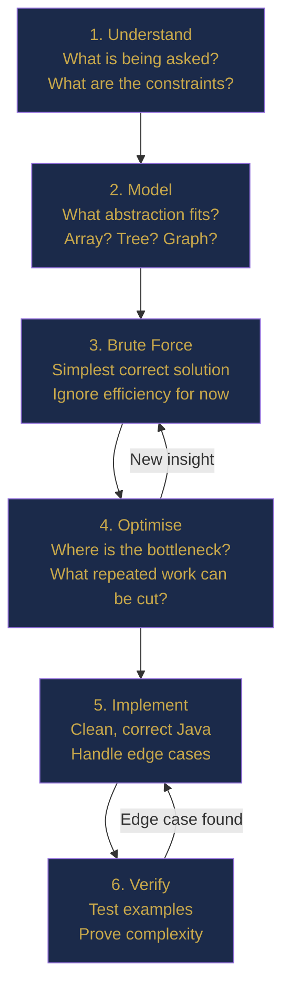
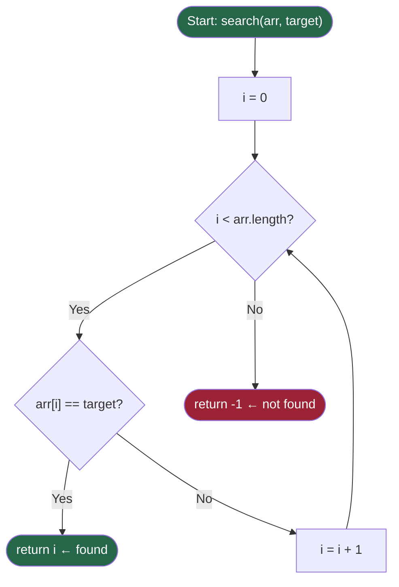
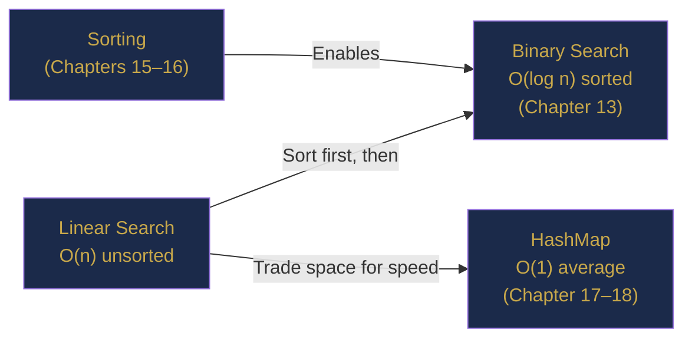

# Chapter 1 — Algorithmic Thinking: The Art of Problem Solving

> **Part I — Foundations of Algorithmic Thinking**  
> [← Index](../INDEX.md) · [→ Chapter 2](../INDEX.md#-chapter-2--mathematical-foundations-for-programmers)

---

## Learning Objectives

By the end of this chapter you will be able to:

- Define what an algorithm is and identify its five essential properties.
- Apply a structured six-phase problem-solving framework to unfamiliar problems.
- Explain informally why algorithm efficiency matters using scaling arguments.
- Understand why Java is an excellent vehicle for learning DSA.
- Implement and analyse your first algorithm: Linear Search.
- Recognise common Java pitfalls relevant to algorithm problems.

---

## Contents

- [1.1 What Is an Algorithm?](#11-what-is-an-algorithm)
  - [1.1.1 The Five Properties of an Algorithm](#111-the-five-properties-of-an-algorithm)
- [1.2 The Problem-Solving Framework](#12-the-problem-solving-framework)
- [1.3 Why Efficiency Matters](#13-why-efficiency-matters)
- [1.4 Why Java?](#14-why-java)
- [1.5 Java Essentials Every DSA Programmer Must Know](#15-java-essentials-every-dsa-programmer-must-know)
  - [1.5.1 Integer Overflow: The Silent Killer](#151-integer-overflow-the-silent-killer)
  - [1.5.2 Key Java Types at a Glance](#152-key-java-types-at-a-glance)
  - [1.5.3 Strings in Java: Immutable by Design](#153-strings-in-java-immutable-by-design)
  - [1.5.4 Essential Java Collections for DSA](#154-essential-java-collections-for-dsa)
- [1.6 Your First Algorithm: Linear Search](#16-your-first-algorithm-linear-search)
  - [1.6.1 The Problem](#161-the-problem)
  - [1.6.2 Building Intuition](#162-building-intuition)
  - [1.6.3 Java Implementation](#163-java-implementation)
  - [1.6.4 Dry Run](#164-dry-run)
  - [1.6.5 Complexity Analysis](#165-complexity-analysis)
  - [1.6.6 Correctness: The Loop Invariant](#166-correctness-the-loop-invariant)
- [1.7 Variations and Connections](#17-variations-and-connections)
- [1.8 Real-World Applications](#18-real-world-applications)
- [Interview Insight](#interview-insight)
- [Myth vs Reality](#myth-vs-reality)
- [Did You Know?](#did-you-know)
- [Mini Challenge 1.1](#mini-challenge-11)
- [Quick Quiz](#quick-quiz)
- [1.13 Practice Problems](#113-practice-problems)
- [1.14 Hard Problem Corner](#114-hard-problem-corner)
- [Chapter Summary](#chapter-summary)

---

## 1.1 What Is an Algorithm?

Before we write a single line of Java, we need to answer a deceptively simple question: *what is an algorithm?*

The word comes from the name of the ninth-century Persian scholar Muhammad ibn Musa al-Khwarizmi, whose mathematical treatises were translated into Latin in medieval Europe. His name, Latinised, gave us the word we still use today.

Informally, an algorithm is a **precise, finite set of instructions for solving a problem**. Every time you follow a recipe, navigate using GPS turn-by-turn directions, or execute a fire-drill procedure, you are executing an algorithm. The computer science definition sharpens this intuition considerably.

---

> ### 📚 History Corner
> **Al-Khwarizmi and the Birth of Algebra**
>
> Muhammad ibn Musa al-Khwarizmi (c. 780–c. 850 CE) was a scholar at the House of Wisdom in Baghdad. His book *Al-Kitab al-mukhtasar fi hisab al-jabr wal-muqabala* (The Compendious Book on Calculation by Completion and Balancing) gave us the word "algebra" from its title.
>
> His systematic, step-by-step methods for solving equations were so influential that his name — Latinised to *Algoritmi* — became the term for any such systematic procedure. The next time you write an algorithm, remember you are continuing a tradition over twelve centuries old.

---

### 1.1.1 The Five Properties of an Algorithm

Computer scientist Donald Knuth, in his monumental work *The Art of Computer Programming*, identified five properties that every algorithm must satisfy. These are not arbitrary formalities — each one matters enormously in practice.

| Property | Meaning | Why It Matters |
|----------|---------|----------------|
| **Finiteness** | The algorithm terminates after a finite number of steps. | An infinite loop is not an algorithm; it is a bug. |
| **Definiteness** | Every step is precisely and unambiguously defined. | Vague instructions lead to unpredictable behaviour. |
| **Input** | Zero or more well-defined inputs are accepted. | An algorithm must know what it is working with. |
| **Output** | One or more outputs are produced. | Without output, an algorithm is useless. |
| **Effectiveness** | Each step is simple enough to be executed exactly. | Steps must be mechanically executable, not just theoretically possible. |

*Table 1.1: Knuth's five properties of an algorithm.*

---

> ### 🔗 Analogy
> **A Recipe Is an Algorithm**
>
> Consider a recipe for baking bread. The recipe specifies: preheat the oven to 220°C, mix 500g flour with 7g yeast, knead for 10 minutes, let it rise for 1 hour, bake for 30 minutes.
>
> This recipe satisfies all five of Knuth's properties: it is **finite** (it ends when the bread is baked), **definite** (each step is precisely measurable), has clear **inputs** (flour, yeast, water, time), produces **output** (a loaf of bread), and is **effective** (any person with basic cooking ability can execute it).
>
> A computer algorithm is a recipe for a computer: precise, unambiguous instructions that transform inputs into outputs in a finite number of steps.
>
> **Where the analogy breaks down:** a recipe tolerates some human judgment ("knead until smooth"); an algorithm cannot — every step must be mechanically executable.

---

## 1.2 The Problem-Solving Framework

Experienced software engineers do not jump directly from a problem statement to code. They follow a disciplined process that separates thinking from typing. This framework will become second nature as you work through this textbook.

| Phase | Question to Answer | Output |
|-------|-------------------|--------|
| **1. Understand** | What exactly is being asked? What are the constraints? | Problem restatement in your own words. |
| **2. Model** | What mathematical or structural abstraction fits this problem? | Identification of the underlying structure (array, graph, tree, etc.). |
| **3. Brute Force** | What is the simplest possible correct solution, ignoring efficiency? | A working, provably correct, possibly slow solution. |
| **4. Optimise** | Where is the bottleneck? What repeated work can be eliminated? | Key insight that leads to a faster algorithm. |
| **5. Implement** | How do we translate the algorithm into clean, correct Java? | Interview-quality Java code. |
| **6. Verify** | Does it handle all edge cases? Is the complexity correct? | Tested solution with complexity analysis. |

*Table 1.2: The six-phase problem-solving framework used throughout this textbook.*

Notice that code appears only at phase 5. This is intentional. **The most common mistake in technical interviews — and in real engineering — is reaching for the keyboard before the thinking is done.**

The framework as a flowchart:



---

> ### 🤔 Think Before You Code
>
> You are given a list of 10,000 student exam scores. You need to determine whether any student scored exactly 75.
>
> Before reading further: which of the six phases would you spend the most time on? What is the simplest correct solution? Can you think of any property of the data that might allow a faster solution?

---

## 1.3 Why Efficiency Matters

You might wonder: with modern processors executing billions of operations per second, does algorithm efficiency really matter? The answer is an emphatic yes, and the reason is something called **scaling**.

Consider two algorithms for searching a sorted list of $n$ items. Algorithm A checks every item one by one. Algorithm B uses a smarter approach and needs at most $\log_2(n)$ steps. For small inputs, the difference is negligible. But as $n$ grows large, the gap becomes dramatic:

| $n$ (items) | Algorithm A (steps) | Algorithm B (steps) | Ratio A/B |
|-------------|---------------------|---------------------|-----------|
| 10 | 10 | 4 | 2.5× |
| 1,000 | 1,000 | 10 | 100× |
| 1,000,000 | 1,000,000 | 20 | 50,000× |
| 1,000,000,000 | 1,000,000,000 | 30 | 33,333,333× |

*Table 1.3: The explosive growth in the efficiency gap as input size increases.*

Algorithm A is *linear* — it scales proportionally with $n$. Algorithm B is *logarithmic* — it barely grows even as $n$ explodes to a billion. At Google scale — searching billions of documents, routing millions of queries per second — the difference between these algorithms is the difference between a usable product and an unusable one.

---

> ### 🔗 Analogy
> **Looking Up a Name: Linear vs Indexed Search**
>
> Imagine searching for a name in two telephone directories. The first lists names in the order they were added — completely random. You must start at page 1 and read every entry until you find the name, or exhaust the book. With 1,000,000 names, you may need 1,000,000 lookups.
>
> The second directory is alphabetically sorted. You open it roughly in the middle, see that you need to go earlier, open halfway through the earlier half, and repeat. With 1,000,000 names you need at most 20 lookups ($\log_2(1{,}000{,}000) \approx 20$).
>
> **Same data. Same result. One approach scales; the other does not.**
>
> This is the fundamental insight that drives algorithm design: the question is never just "does it work on today's data?" but always "how does it scale as the data grows?"
>
> **Where the analogy breaks down:** a telephone directory is static; real algorithms must also handle insertions and deletions efficiently.

---

We will develop precise mathematical tools to measure scaling behaviour in [Chapter 5 (Asymptotic Analysis)](../INDEX.md#-chapter-5--asymptotic-analysis-measuring-algorithm-efficiency). For now, build the intuition: *the question is never just "does it work?" but always "how does it scale?"*

---

## 1.4 Why Java?

This textbook uses Java exclusively. Before you assume this is an arbitrary choice, let us examine why Java is an excellent vehicle for learning data structures and algorithms — and for technical interviews.

| Reason | Detail |
|--------|--------|
| **Strong typing** | Forces you to think about data types explicitly, revealing important design decisions. |
| **Rich standard library** | `HashMap`, `TreeMap`, `PriorityQueue`, `ArrayDeque` — all production-quality and widely used in interviews. |
| **Explicit memory model** | Object allocation, boxing, and garbage collection are visible and relevant to complexity analysis. |
| **Industry dominance** | Java is widely used at Google, Amazon, and other top-tier companies for backend systems. |
| **Verbose but clear** | Java forces you to write explicit code, which builds discipline and clarity. No magic, no implicit behaviour. |

*Table 1.4: Why Java is the right language for learning DSA.*

---

## 1.5 Java Essentials Every DSA Programmer Must Know

You are expected to know basic Java syntax. This section highlights the **Java-specific knowledge that is critical for algorithm problems** and is frequently misunderstood or overlooked.

### 1.5.1 Integer Overflow: The Silent Killer

Java's `int` type stores values in 32 bits. This means it can hold values from $-2{,}147{,}483{,}648$ to $2{,}147{,}483{,}647$ (approximately $\pm 2.1$ billion). When a computation exceeds this range, Java does **not** throw an exception. It silently wraps around. This is called **integer overflow**, and it has caused real-world bugs in production systems and incorrect interview solutions.

```java
public class OverflowDemo {
    public static void main(String[] args) {
        int max = Integer.MAX_VALUE;  // 2,147,483,647
        System.out.println(max);      // 2147483647
        System.out.println(max + 1);  // -2147483648  ← overflow!

        // Safe midpoint calculation in binary search:
        int lo = 1_000_000_000;
        int hi = 2_000_000_000;

        // WRONG: (lo + hi) / 2 overflows!
        // int mid = (lo + hi) / 2;

        // CORRECT: avoids overflow
        int mid = lo + (hi - lo) / 2;
        System.out.println("Safe mid: " + mid);  // 1500000000

        // When you need a larger range: use long
        long bigProduct = (long) 1_000_000 * 1_000_000;  // 10^12, fine as long
        System.out.println(bigProduct);  // 1000000000000
    }
}
```

*Listing 1.1: Integer overflow in Java and the safe midpoint pattern.*

---

> [!WARNING]
> **Integer Overflow in Binary Search**
>
> The midpoint calculation `(lo + hi) / 2` has caused overflow bugs in many production implementations, including a famous bug in Java's standard library `Arrays.binarySearch()` that existed for nearly a decade (discovered by Joshua Bloch in 2006).
>
> Always use `lo + (hi - lo) / 2` when `lo` and `hi` could be large. We will see this pattern repeatedly in [Chapter 13 (Binary Search)](../INDEX.md#-chapter-13--searching-fundamentals).

---

### 1.5.2 Key Java Types at a Glance

| Type | Size | Range | Primary DSA Use |
|------|------|-------|-----------------|
| `int` | 32-bit | $-2^{31}$ to $2^{31}-1$ | Default for indices, counts, values. |
| `long` | 64-bit | $-2^{63}$ to $2^{63}-1$ | Large sums, hashes, products. |
| `char` | 16-bit | 0 to 65,535 | String character manipulation. |
| `boolean` | 1-bit | `true` / `false` | Visited arrays in BFS/DFS. |
| `double` | 64-bit | ~15 decimal digits | Geometry; use with caution for precision. |

*Table 1.5: Java primitive types most relevant to DSA problems.*

### 1.5.3 Strings in Java: Immutable by Design

Java strings are immutable: once created, their content cannot change. Every time you use the `+` operator to concatenate strings inside a loop, Java creates a brand-new `String` object. For $n$ concatenations, this takes $O(n^2)$ time. Use `StringBuilder` instead.

```java
// WRONG: O(n²) time — creates a new String every iteration
String result = "";
for (int i = 0; i < n; i++) {
    result += chars[i];   // new String object created each time!
}

// CORRECT: O(n) time — StringBuilder is mutable
StringBuilder sb = new StringBuilder();
for (int i = 0; i < n; i++) {
    sb.append(chars[i]);
}
String result = sb.toString();  // single String created at the end
```

*Listing 1.2: `StringBuilder` vs `String` concatenation in loops.*

---

> [!NOTE]
> **Character Arithmetic in Java**
>
> Java `char` values are numeric. You can write:
> - `'B' - 'A' == 1`
> - `str.charAt(i) - 'a'` to get a letter's 0-based index (0 for `'a'`, 25 for `'z'`)
> - `c >= 'a' && c <= 'z'` to check for a lowercase letter
> - `(char)(c - 32)` or `Character.toUpperCase(c)` to convert to uppercase
>
> This trick appears constantly in string problems.

---

### 1.5.4 Essential Java Collections for DSA

| Collection | Java Class | Key Operations | Complexity |
|------------|------------|----------------|------------|
| Dynamic Array | `ArrayList<E>` | `get`, `add`, `remove(last)` | $O(1)$ amortised add |
| Hash Map | `HashMap<K,V>` | `put`, `get`, `containsKey` | $O(1)$ average |
| Tree Map | `TreeMap<K,V>` | `put`, `get`, `floorKey` | $O(\log n)$ |
| Hash Set | `HashSet<E>` | `add`, `contains`, `remove` | $O(1)$ average |
| Min Heap | `PriorityQueue<E>` | `offer`, `poll`, `peek` | $O(\log n)$ poll |
| Stack / Queue | `ArrayDeque<E>` | `push`, `pop`, `offer`, `poll` | $O(1)$ amortised |

*Table 1.6: Core Java collections used throughout this textbook.*

---

## 1.6 Your First Algorithm: Linear Search

Let us apply everything we have discussed so far to the simplest meaningful algorithm: searching an unsorted array for a target value. This algorithm is simple enough to understand immediately, yet rich enough to teach us the fundamentals of algorithm analysis.

### 1.6.1 The Problem

**Problem statement:** Given an array of $n$ integers and a target value, determine whether the target exists in the array. If it does, return its index; otherwise, return $-1$.

**Example (found):**
```
Input:  arr = [64, 25, 12, 88, 37, 55],  target = 88
Output: 3        ← arr[3] == 88
```

**Example (not found):**
```
Input:  arr = [64, 25, 12, 88, 37, 55],  target = 100
Output: -1
```

### 1.6.2 Building Intuition

There is no clever shortcut available here. We know nothing about the order of the elements. We are therefore forced to examine each element one by one until we either find the target or exhaust the entire array. This is called **linear search** because we search the array linearly, from left to right.

---

> ### 🔗 Analogy
> **Searching Unlabelled Lockers**
>
> Imagine a row of storage lockers, each holding a package. The packages were placed randomly — locker 1 might hold package 88, locker 2 might hold package 25, and so on. You are looking for package 88.
>
> With no prior information about the arrangement, you must start at locker 1, open it, check the package number, then move to locker 2, and continue until you find your package or open every locker. In the best case, the package is in the first locker you check. In the worst case, it is in the last (or absent).
>
> This is exactly how linear search works. The row of lockers is the array. Each locker is an element. Opening and checking is a comparison.
>
> **Where the analogy breaks down:** lockers have physical size limits; arrays can grow as large as available memory allows.

---

Algorithm as a flowchart:



### 1.6.3 Java Implementation

```java
/**
 * Linear Search: find target in arr, return its index or -1.
 * Time:  O(n) worst case, O(1) best case
 * Space: O(1) auxiliary
 */
public class LinearSearch {

    public static int search(int[] arr, int target) {
        for (int i = 0; i < arr.length; i++) {
            if (arr[i] == target) {
                return i;    // found: return position
            }
        }
        return -1;           // not found
    }

    public static void main(String[] args) {
        int[] arr = {64, 25, 12, 88, 37, 55};

        System.out.println(search(arr, 88));   // 3
        System.out.println(search(arr, 100));  // -1
        System.out.println(search(arr, 64));   // 0  (first element)
    }
}
```

*Listing 1.3: Linear search implementation in Java.*

### 1.6.4 Dry Run

Tracing the algorithm on `arr = [64, 25, 12, 88, 37, 55]`, `target = 88`:

| Step | `i` | `arr[i]` | `arr[i] == target?` | Action |
|------|-----|----------|---------------------|--------|
| 1 | 0 | 64 | No | Move to next element |
| 2 | 1 | 25 | No | Move to next element |
| 3 | 2 | 12 | No | Move to next element |
| 4 | 3 | 88 | **YES** | **Return 3** |

*Table 1.7: Dry run of linear search for `target=88` in `arr=[64, 25, 12, 88, 37, 55]`.*

### 1.6.5 Complexity Analysis

We count the number of comparisons (the dominant operation) as a function of $n$.

| Case | Complexity | Explanation |
|------|-----------|-------------|
| **Best case** | $O(1)$ | Target is the first element. |
| **Worst case** | $O(n)$ | Target not present, or is the last element. |
| **Average case** | $O(n)$ | Expected $n/2$ comparisons on a uniformly random input. |
| **Space (auxiliary)** | $O(1)$ | No extra data structures needed. |

*Table 1.8: Complexity summary for Linear Search.*

The worst case of $O(n)$ means: if the array has 1 million elements and the target is not present, we perform 1 million comparisons. For very large arrays, this becomes unacceptably slow. This limitation motivates everything that follows in this textbook — particularly [Binary Search (Chapter 13)](../INDEX.md#-chapter-13--searching-fundamentals), which can find an element in a sorted array using only $\log_2(n)$ comparisons.

### 1.6.6 Correctness: The Loop Invariant

How do we know the algorithm is correct? We can reason using a **loop invariant** — a property that holds before and after every loop iteration.

---

> [!TIP]
> **Loop Invariant for Linear Search**
>
> **Invariant:** At the start of each iteration with index `i`, the target does not appear in `arr[0..i-1]`.
>
> - **Initialisation:** Before the first iteration (`i=0`), `arr[0..-1]` is empty, so the invariant holds trivially.
> - **Maintenance:** If `arr[i] != target`, we have checked `arr[0..i]` and not found the target. The invariant holds for the next iteration with `i+1`.
> - **Termination:** Either we returned the index when `arr[i] == target` (correct), or `i` reached `arr.length`, meaning the target is not in `arr[0..n-1]` — we return `-1` (correct).

---

## 1.7 Variations and Connections

Linear search seems simple, but it is the building block for many important ideas:

- **Sentinel search:** Place the target at the end of the array to eliminate the bounds check inside the loop, saving one comparison per iteration.
- **Last-occurrence search:** Find the last index where target appears by not returning immediately and instead updating a "best so far" variable.
- **Searching objects:** Replace `int` comparisons with `.equals()` for objects, or use a custom predicate for arbitrary search conditions.
- **Connection to sorting:** If the array were sorted, we could do much better than $O(n)$. Binary Search ([Chapter 13](../INDEX.md#-chapter-13--searching-fundamentals)) achieves $O(\log n)$ on sorted data.
- **Connection to hashing:** A `HashMap` gives $O(1)$ average search at the cost of extra memory. Trade-offs like this are central to algorithm design ([Chapter 17–18](../INDEX.md#-chapter-17--hash-tables-design-and-theory)).



---

## 1.8 Real-World Applications

- **File system search:** Finding a file by name in an unsorted directory listing is linear search.
- **Database table scan:** A full table scan in a relational database with no index is exactly linear search. This is why database indexes exist.
- **Network packet inspection:** Some firewalls linearly scan rule lists for matching entries.
- **Sensor data:** Finding an anomalous reading in a stream of sensor values.
- **Text editors:** "Find" in an unsorted document scans linearly.

---

## Interview Insight

> ### 🎯 Interview Insight
> **How Interviewers Think About Linear Search**
>
> An interviewer who asks you to search an array is rarely testing whether you know linear search. They are testing whether you:
>
> 1. **Ask clarifying questions** — Is the array sorted? Can there be duplicates? What should be returned if there are multiple matches?
> 2. **Establish the brute force** before jumping to the clever solution.
> 3. **Correctly analyse complexity** including best, worst, and average cases.
> 4. **Handle edge cases** — null array, empty array, multiple occurrences.
>
> Always demonstrate this structured thinking. Never start coding silently.

---

## Myth vs Reality

> ### ⚡ Myth vs Reality
>
> **Myth:** A fast computer makes algorithm efficiency irrelevant.
>
> **Reality:** Hardware makes constant-factor improvements — 2× faster CPU, 4× more RAM. Algorithm improvements make *asymptotic* differences: the difference between $O(n)$ and $O(n^2)$ is not a constant factor but a difference that **grows with $n$**.
>
> At $n = 10^6$, an $O(n^2)$ algorithm needs $10^{12}$ operations. Even at $10^{10}$ operations/second, that is 100 seconds. The $O(n)$ algorithm needs $10^6$ operations: a fraction of a millisecond. No hardware improvement bridges that gap.

---

## Did You Know?

> ### 💡 Did You Know?
>
> The NASA Curiosity rover's on-board software uses algorithms derived from 50-year-old computer science research. Efficient algorithms are not just interview preparation — they run on hardware costing billions of dollars operating 300 million kilometres from Earth, where there is no patch available. Algorithm correctness and efficiency are mission-critical.

---

## Mini Challenge 1.1

> ### 🏆 Mini Challenge 1.1 — Last Occurrence
>
> Modify the `LinearSearch.search()` method to return the index of the **last** occurrence of the target, rather than the first.
>
> **Questions to answer:**
> - What is the time complexity of your modified solution?
> - Can it ever have a best-case better than $O(n)$? Why or why not?
> - How would you handle the case where the target appears zero times?

---

## Quick Quiz

Test your understanding of Chapter 1.

**Q1.** What are Knuth's five properties that every algorithm must possess?

<details>
<summary><strong>Answer</strong></summary>

> **A1.** Finiteness, Definiteness, Input, Output, Effectiveness.

</details>

---

**Q2.** In the linear search dry run (Table 1.7), what would happen if the target were `64` instead of `88`? How many comparisons would be made?

<details>
<summary><strong>Answer</strong></summary>

> **A2.** Target `64` is `arr[0]`, so 1 comparison is made and the algorithm returns `0` immediately. This is the best case: $O(1)$.

</details>

---

**Q3.** Predict the output:

```java
int x = Integer.MAX_VALUE + 1;
System.out.println(x);
```

<details>
<summary><strong>Answer</strong></summary>

> **A3.** Output: `-2147483648`. `Integer.MAX_VALUE + 1` overflows to `Integer.MIN_VALUE` because Java's `int` wraps around silently.

</details>

---

**Q4.** Why should you use `StringBuilder` instead of `String` when building a result character by character inside a loop?

<details>
<summary><strong>Answer</strong></summary>

> **A4.** `String` concatenation in a loop creates a new `String` object each iteration, giving $O(n^2)$ time. `StringBuilder.append()` is $O(1)$ amortised, giving $O(n)$ total.

</details>

---

**Q5.** If linear search is $O(n)$ and an array has $10^8$ elements, approximately how many operations are needed in the worst case?

<details>
<summary><strong>Answer</strong></summary>

> **A5.** $O(10^8)$ — a linear number of operations. At $10^9$ operations/second this takes approximately 0.1 seconds. Manageable, but a sorted array with binary search ($O(\log_2(10^8)) \approx 27$ operations) would be drastically faster.

</details>

---

## 1.13 Practice Problems

The following LeetCode problems reinforce the concepts from this chapter. Work through each one using the six-phase framework before looking at solutions.

| Problem | Name | Difficulty | Concept |
|---------|------|------------|---------|
| [LC 704](https://leetcode.com/problems/binary-search/) | Binary Search | Easy | Warmup for Chapter 13 |
| [LC 27](https://leetcode.com/problems/remove-element/) | Remove Element | Easy | Array traversal, in-place modification |
| [LC 1](https://leetcode.com/problems/two-sum/) | Two Sum | Easy | Brute-force $O(n^2)$ vs HashMap $O(n)$ |
| [LC 35](https://leetcode.com/problems/search-insert-position/) | Search Insert Position | Easy | Linear scan; previews binary search |
| [LC 485](https://leetcode.com/problems/max-consecutive-ones/) | Max Consecutive Ones | Easy | Single-pass linear scan |
| [LC 169](https://leetcode.com/problems/majority-element/) | Majority Element | Easy | Boyer-Moore Voting ($O(n)$ time, $O(1)$ space) |

---

> [!NOTE]
> **How to Use the Practice Problems**
>
> For each problem: **(1)** Read and restate it in your own words. **(2)** Write a brute-force solution first. **(3)** Analyse its complexity. **(4)** Ask yourself if there is a better approach. **(5)** Implement the optimised solution. **(6)** Test edge cases: empty array, single element, all duplicates, target not present.

---

## 1.14 Hard Problem Corner

> ### 🔥 Hard Problem Corner
>
> **Problem:** Given an array of $n$ integers where every element appears exactly twice except for one element which appears exactly once, find the element that appears only once. Your solution must run in $O(n)$ time and $O(1)$ extra space.
>
> **Hint 1:** A `HashMap` solution takes $O(n)$ time but also $O(n)$ space. That violates the $O(1)$ space constraint. Think differently.
>
> **Hint 2:** What mathematical operation has the property that $x \oplus x = 0$ for any $x$?
>
> **Hint 3:** XOR. Recall: $a \oplus a = 0$ and $a \oplus 0 = a$. What happens when you XOR all elements together?

<details>
<summary><strong>Solution idea (click to reveal)</strong></summary>

> [!TIP]
> **Solution**
>
> XOR all elements in the array. Every element that appears twice will XOR to 0 with itself ($a \oplus a = 0$). The single element XORs with 0 and remains ($a \oplus 0 = a$).
>
> ```java
> public int singleNumber(int[] nums) {
>     int result = 0;
>     for (int x : nums) {
>         result ^= x;
>     }
>     return result;
> }
> ```
>
> **Complexity:** $O(n)$ time, $O(1)$ space.
>
> This is [LeetCode 136 — Single Number](https://leetcode.com/problems/single-number/). The XOR trick appears in many bit manipulation problems — we will study it systematically in [Chapter 44 (Bit Manipulation)](../INDEX.md#-chapter-44--bit-manipulation).

</details>

---

## Chapter Summary

| Concept | Key Takeaway |
|---------|-------------|
| **Algorithm** | A finite, definite, effective procedure with inputs and outputs. |
| **Problem-solving** | Understand → Model → Brute Force → Optimise → Code → Verify. |
| **Efficiency** | Measured by how the algorithm scales with input size, not just how fast it is on today's input. |
| **Linear Search** | $O(n)$ worst case; correct, simple, but limited to unsorted data. |
| **Java Pitfalls** | Integer overflow, `String` immutability, correct use of Collections. |
| **Loop Invariant** | A formal technique for proving algorithm correctness at every iteration. |

*Table 1.9: Chapter 1 key concepts.*

---

**Coming Up Next:** In [Chapter 2 (Mathematical Foundations)](../INDEX.md#-chapter-2--mathematical-foundations-for-programmers), we build the mathematical vocabulary every algorithm discussion depends on — number systems, logarithms, modular arithmetic, and mathematical induction.

In [Chapter 5 (Asymptotic Analysis)](../INDEX.md#-chapter-5--asymptotic-analysis-measuring-algorithm-efficiency), we formalise the language of efficiency with Big-O, Big-Omega, and Big-Theta notation.

---

> **Part I — Foundations of Algorithmic Thinking**  
> [← Index](../INDEX.md) · [→ Chapter 2 (planned)](../INDEX.md#-chapter-2--mathematical-foundations-for-programmers)
