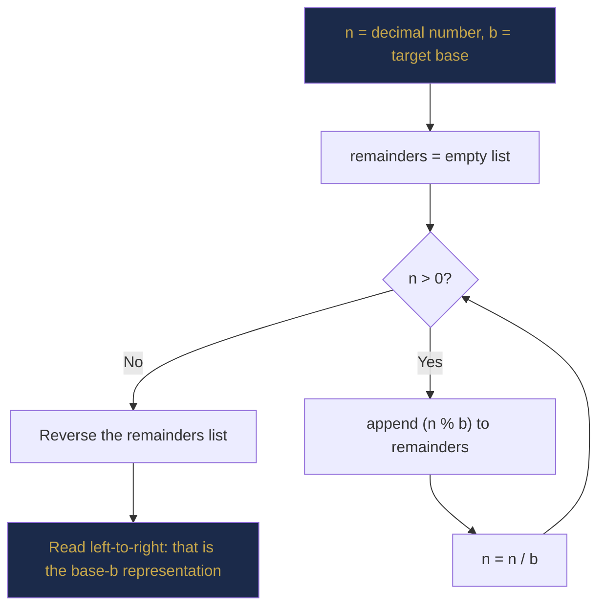
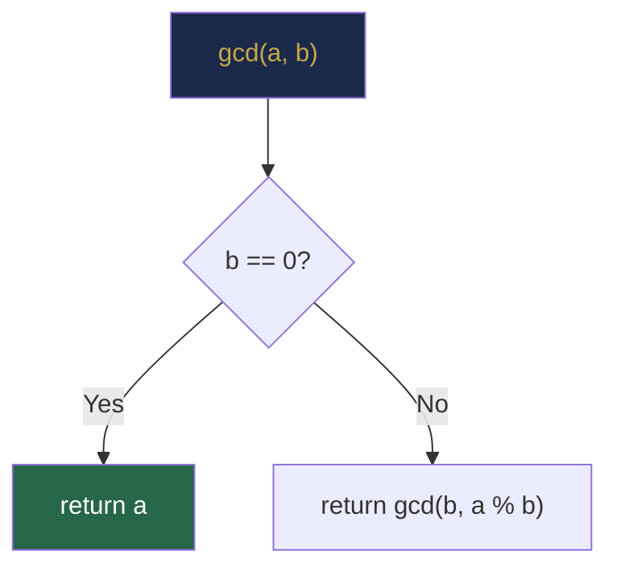

# Chapter 2 — Mathematical Foundations for Programmers

> **Part I — Foundations of Algorithmic Thinking**  
> [← Chapter 1](chapter-01-algorithmic-thinking.md) · [← Index](../INDEX.md) · [→ Chapter 3](../INDEX.md#-chapter-3--java-toolkit-for-data-structures-and-algorithms)

---

## Learning Objectives

By the end of this chapter you will be able to:

- Convert numbers between binary, decimal, octal and hexadecimal.
- Explain how Java stores signed integers using two's complement and predict overflow behaviour.
- Identify and apply powers of 2 and logarithms — the numbers that appear everywhere in algorithm analysis.
- Sum arithmetic and geometric series and use those results to analyse nested loops.
- Compute GCDs and LCMs using the Euclidean algorithm and implement it in Java.
- Apply modular arithmetic correctly, including Java's negative-remainder pitfall.
- Determine whether a number is prime and understand the Sieve of Eratosthenes.
- Prove simple properties by mathematical induction and connect induction to recursive algorithm correctness.

---

## Contents

- [2.1 Number Systems](#21-number-systems)
  - [2.1.1 Binary — Base 2](#211-binary--base-2)
  - [2.1.2 Hexadecimal — Base 16](#212-hexadecimal--base-16)
  - [2.1.3 Octal — Base 8](#213-octal--base-8)
- [2.2 Place Values and Positional Representation](#22-place-values-and-positional-representation)
  - [2.2.1 Converting to Decimal](#221-converting-to-decimal)
  - [2.2.2 Converting from Decimal](#222-converting-from-decimal)
- [2.3 Signed Integers and Two's Complement](#23-signed-integers-and-twos-complement)
- [2.4 Integer Overflow and Underflow](#24-integer-overflow-and-underflow)
- [2.5 Powers, Logarithms and Exponents](#25-powers-logarithms-and-exponents)
  - [2.5.1 Powers of 2 — The Most Important Table in Computer Science](#251-powers-of-2--the-most-important-table-in-computer-science)
  - [2.5.2 Logarithms](#252-logarithms)
  - [2.5.3 Logarithm Properties](#253-logarithm-properties)
- [2.6 Summations and Mathematical Series](#26-summations-and-mathematical-series)
  - [2.6.1 Arithmetic Series](#261-arithmetic-series)
  - [2.6.2 Geometric Series](#262-geometric-series)
  - [2.6.3 Why Series Matter for Algorithm Analysis](#263-why-series-matter-for-algorithm-analysis)
- [2.7 Combinatorics and Counting](#27-combinatorics-and-counting)
- [2.8 Factorials, Permutations and Combinations](#28-factorials-permutations-and-combinations)
- [2.9 GCD, LCM and the Euclidean Algorithm](#29-gcd-lcm-and-the-euclidean-algorithm)
- [2.10 Modular Arithmetic](#210-modular-arithmetic)
- [2.11 Prime Numbers and Divisibility](#211-prime-numbers-and-divisibility)
- [2.12 Mathematical Induction](#212-mathematical-induction)
- [Interview Insight](#interview-insight)
- [Myth vs Reality](#myth-vs-reality)
- [Mini Challenges](#mini-challenges)
- [Quick Quiz](#quick-quiz)
- [2.14 Practice Problems](#214-practice-problems)
- [2.15 Hard Problem Corner](#215-hard-problem-corner)
- [Chapter Summary](#chapter-summary)

---

## 2.1 Number Systems

Every value stored in a computer is ultimately a sequence of bits — 0s and 1s. Understanding how number systems work is not an academic formality; it is the foundation for understanding data types, overflow, hashing, bit manipulation, and more.

A **number system** (or numeral system) is a way of expressing numbers using a fixed set of digits and a **base** (or radix). The base tells you how many distinct digit symbols exist and what positional value each digit carries.

| Base | Name | Digits | Prefix in Java | Example |
|------|------|--------|---------------|---------|
| 2 | Binary | 0, 1 | `0b` | `0b1010` = 10 |
| 8 | Octal | 0–7 | `0` | `012` = 10 |
| 10 | Decimal | 0–9 | (none) | `10` |
| 16 | Hexadecimal | 0–9, A–F | `0x` | `0xA` = 10 |

*Table 2.1: Number systems used in computing.*

### 2.1.1 Binary — Base 2

Binary is the native language of digital hardware. Every `int`, `long`, and `boolean` in Java is stored as a fixed-width binary number. A single binary digit is called a **bit**. Eight bits form a **byte**.

| Bits | Name | Java type | Distinct values |
|------|------|-----------|----------------|
| 1 | Bit | `boolean` (conceptually) | 2 |
| 8 | Byte | `byte` | 256 |
| 16 | Short | `short` | 65,536 |
| 32 | Word | `int` | ~4.3 billion |
| 64 | Doubleword | `long` | ~18.4 quintillion |

*Table 2.2: Bit widths and their Java types.*

Java lets you write binary literals using the `0b` prefix:

```java
int ten       = 0b1010;      // 1*8 + 0*4 + 1*2 + 0*1 = 10
int byteMax   = 0b01111111;  // 127
int allOnes32 = 0b11111111_11111111_11111111_11111111; // -1 in two's complement

System.out.println(Integer.toBinaryString(42));  // "101010"
System.out.println(Integer.toBinaryString(-1));  // "11111111111111111111111111111111"
```

---

> ### 📚 History Corner
> **Leibniz, Boole, and the Binary Foundation of Computing**
>
> Gottfried Wilhelm Leibniz (1646–1716) was the first to fully articulate the binary number system in his 1703 paper *Explication de l'Arithmétique Binaire*. He was inspired by the Chinese *I Ching* hexagrams and saw binary as philosophically elegant — representing all of creation from just 0 and 1.
>
> George Boole (1815–1864) later developed Boolean algebra, which showed that logical statements could be expressed using binary arithmetic. Claude Shannon (1937) proved that Boolean algebra could be implemented with electrical circuits, uniting Leibniz's binary numbers with Boole's logic to create the theoretical foundation of every digital computer ever built.

---

### 2.1.2 Hexadecimal — Base 16

Hexadecimal (hex) is a compact shorthand for binary. Because $16 = 2^4$, every hex digit maps exactly to 4 bits. This makes hex ideal for displaying memory addresses, colour codes, and binary data.

| Decimal | Hex | Binary |
|---------|-----|--------|
| 0 | 0 | 0000 |
| 1 | 1 | 0001 |
| 5 | 5 | 0101 |
| 9 | 9 | 1001 |
| 10 | A | 1010 |
| 11 | B | 1011 |
| 12 | C | 1100 |
| 13 | D | 1101 |
| 14 | E | 1110 |
| 15 | F | 1111 |

*Table 2.3: Hex digit to binary mapping. Each hex digit = exactly 4 bits.*

```java
int value = 0xFF;                                 // 255
System.out.println(Integer.toHexString(255));     // "ff"
System.out.println(Integer.toHexString(65535));   // "ffff"

// Memory addresses and bit masks are almost always written in hex
int mask = 0x0000FFFF;  // lower 16 bits all set
```

### 2.1.3 Octal — Base 8

Octal uses digits 0–7. It was important on early Unix systems (file permissions such as `chmod 755` are octal). In Java, an integer literal starting with `0` (not `0b` or `0x`) is octal — a classic source of off-by-one bugs.

```java
int a = 010;  // OCTAL 10 = decimal 8, NOT decimal 10!
int b = 10;   // decimal 10
System.out.println(a == b);  // false — a classic Java gotcha
```

> [!WARNING]
> **The leading-zero octal trap in Java**
>
> Never pad an integer literal with leading zeros in Java. `010` is not ten — it is eight (octal). This has caused production bugs in time calculations (e.g., month `08` or `09` parsed as octal fails because `8` and `9` are not valid octal digits). Always write decimal literals without leading zeros.

---

## 2.2 Place Values and Positional Representation

In a **positional number system** with base $b$, a number written as $d_n d_{n-1} \ldots d_1 d_0$ has value:

$$\text{value} = d_n \cdot b^n + d_{n-1} \cdot b^{n-1} + \cdots + d_1 \cdot b^1 + d_0 \cdot b^0 = \sum_{i=0}^{n} d_i \cdot b^i$$

This single formula works for every base.

### 2.2.1 Converting to Decimal

**Example — Binary to Decimal:**  
$1101_2 = 1 \cdot 2^3 + 1 \cdot 2^2 + 0 \cdot 2^1 + 1 \cdot 2^0 = 8 + 4 + 0 + 1 = 13$

**Example — Hex to Decimal:**  
$\text{2F}_{16} = 2 \cdot 16^1 + 15 \cdot 16^0 = 32 + 15 = 47$

**Example — Octal to Decimal:**  
$17_8 = 1 \cdot 8^1 + 7 \cdot 8^0 = 8 + 7 = 15$

### 2.2.2 Converting from Decimal

The algorithm for converting a decimal number $n$ to base $b$ is: **repeatedly divide by $b$ and collect remainders in reverse order.**



**Example — 42 to binary:**

| Step | $n$ | $n \div 2$ | $n \bmod 2$ (remainder) |
|------|-----|------------|------------------------|
| 1 | 42 | 21 | **0** |
| 2 | 21 | 10 | **1** |
| 3 | 10 | 5 | **0** |
| 4 | 5 | 2 | **1** |
| 5 | 2 | 1 | **0** |
| 6 | 1 | 0 | **1** |

Remainders reversed: `101010` → $42_{10} = 101010_2$ ✓

```java
// Java: convert decimal to arbitrary base string
public static String toBase(int n, int base) {
    if (n == 0) return "0";
    StringBuilder sb = new StringBuilder();
    while (n > 0) {
        int rem = n % base;
        sb.append(rem < 10 ? (char)('0' + rem) : (char)('A' + rem - 10));
        n /= base;
    }
    return sb.reverse().toString();
}
```

*Listing 2.1: Decimal to any base conversion.*

---

> ### 🔗 Analogy
> **Odometer Reading**
>
> A car's odometer counting in decimal is exactly a positional number system in action. When the rightmost digit hits 9 and you add 1 more kilometre, it resets to 0 and carries 1 to the next position. Binary works identically — except digits reset at 1 instead of 9. A binary odometer rolling from `0111` to `1000` (from 7 to 8) is carrying the 1 through all four positions simultaneously.
>
> This is exactly what the CPU's adder circuit does when you write `x + 1` in Java.

---

## 2.3 Signed Integers and Two's Complement

Computers must represent negative numbers. Java uses **two's complement** for all integer types (`byte`, `short`, `int`, `long`). It is crucial to understand this — not just for correctness, but because overflow, bit manipulation, and right-shift behaviour all depend on it.

**How two's complement works for $n$-bit integers:**

| Range endpoint | Formula | Java `int` (32-bit) |
|---------------|---------|---------------------|
| Minimum value | $-2^{n-1}$ | $-2{,}147{,}483{,}648$ |
| Maximum value | $2^{n-1} - 1$ | $2{,}147{,}483{,}647$ |

The key property: the **most significant bit** (MSB, leftmost) acts as a sign bit. If the MSB is 1, the number is negative.

**4-bit two's complement table:**

| Binary | Unsigned interpretation | Signed (two's complement) |
|--------|------------------------|--------------------------|
| 0000 | 0 | 0 |
| 0001 | 1 | 1 |
| 0010 | 2 | 2 |
| 0011 | 3 | 3 |
| 0100 | 4 | 4 |
| 0101 | 5 | 5 |
| 0110 | 6 | 6 |
| 0111 | 7 | **7** (max positive) |
| 1000 | 8 | **−8** (most negative) |
| 1001 | 9 | −7 |
| 1010 | 10 | −6 |
| 1011 | 11 | −5 |
| 1100 | 12 | −4 |
| 1101 | 13 | −3 |
| 1110 | 14 | −2 |
| 1111 | 15 | **−1** |

*Table 2.4: 4-bit two's complement. Notice that all-ones (`1111`) represents −1, not 15.*

**To negate a number in two's complement:** invert all bits, then add 1.

**Example:** Negate 5 (`0101`) in 4-bit two's complement:
1. Invert bits: `1010`
2. Add 1: `1011` = −5 ✓

**Why two's complement?** Addition and subtraction work identically for positive and negative numbers using the same hardware circuit. No special logic is needed for the sign.

```java
System.out.println(Integer.toBinaryString(-1));  // 32 ones: "11111111111111111111111111111111"
System.out.println(Integer.toBinaryString(-5));  // "11111111111111111111111111111011"
System.out.println(~5);   // -6  (bitwise NOT: invert all bits)
System.out.println(-5);   // -5  (negation = ~5 + 1)
```

---

> [!NOTE]
> **Arithmetic vs Logical Right Shift**
>
> Java provides two right-shift operators:
> - `>>` **arithmetic right shift** — fills new MSBs with the sign bit (preserves sign for negatives).
> - `>>>` **logical right shift** — fills new MSBs with 0 (always produces non-negative result).
>
> ```java
> int x = -8;                       // 1111...11111000
> System.out.println(x >> 1);       // -4   (sign-extended: 1111...11111100)
> System.out.println(x >>> 1);      // 2147483644  (zero-filled: 0111...11111100)
> ```

---

## 2.4 Integer Overflow and Underflow

[Chapter 1](chapter-01-algorithmic-thinking.md#151-integer-overflow-the-silent-killer) introduced the safe midpoint pattern. Here we go deeper.

**Overflow** occurs when the result of an arithmetic operation exceeds the maximum representable value. **Underflow** occurs when the result is less than the minimum. In both cases, Java wraps around silently — no exception, no warning.

```java
int max  = Integer.MAX_VALUE;   //  2,147,483,647
int min  = Integer.MIN_VALUE;   // -2,147,483,648

System.out.println(max + 1);    // -2,147,483,648  (overflow wraps to MIN)
System.out.println(min - 1);    //  2,147,483,647  (underflow wraps to MAX)
System.out.println(max * 2);    //         -2      (silent overflow)

// Java 8+ safe arithmetic — throws ArithmeticException on overflow
int safe = Math.addExact(max, 1);     // throws ArithmeticException
long safe2 = Math.multiplyExact(max, 2L);  // use long to avoid overflow
```

*Listing 2.2: Detecting overflow with `Math.addExact()` and `Math.multiplyExact()`.*

**Common interview overflow patterns to watch for:**

| Pattern | Risk | Fix |
|---------|------|-----|
| `(lo + hi) / 2` | Overflow if `lo + hi > Integer.MAX_VALUE` | `lo + (hi - lo) / 2` |
| `a * b` where both are large | Overflow | Cast one operand: `(long) a * b` |
| `n * (n + 1)` for large `n` | Overflow | Use `long` |
| `result *= base` in a loop | Overflow | Use `long` or `BigInteger` |

*Table 2.5: Common overflow patterns and their fixes.*

---

## 2.5 Powers, Logarithms and Exponents

If there is one mathematical topic that every algorithm student must master, it is the relationship between powers and logarithms. These two concepts appear in virtually every complexity analysis in this textbook.

### 2.5.1 Powers of 2 — The Most Important Table in Computer Science

Memorise this table. It will speed up your reasoning about algorithms, memory, and bit manipulation.

| $n$ | $2^n$ | Approximate | Familiar context |
|-----|-------|-------------|-----------------|
| 0 | 1 | — | A single boolean |
| 1 | 2 | — | 2 choices |
| 4 | 16 | — | Hex digit count |
| 7 | 128 | ~$10^2$ | — |
| 8 | 256 | ~$10^2$ | Distinct byte values |
| 10 | 1,024 | ~$10^3$ | 1 KB (kilobyte) |
| 16 | 65,536 | ~$6.5 \times 10^4$ | `char` range |
| 20 | 1,048,576 | ~$10^6$ | 1 MB |
| 30 | 1,073,741,824 | ~$10^9$ | 1 GB |
| 31 | 2,147,483,648 | ~$2.1 \times 10^9$ | `Integer.MAX_VALUE + 1` |
| 32 | 4,294,967,296 | ~$4.3 \times 10^9$ | Unsigned 32-bit range |
| 40 | ~$10^{12}$ | ~1 TB | — |
| 63 | ~$9.2 \times 10^{18}$ | — | `Long.MAX_VALUE + 1` |

*Table 2.6: Critical powers of 2. Each entry is exactly double the one above it.*

> [!TIP]
> **The $2^{10} \approx 10^3$ Rule**
>
> $2^{10} = 1024 \approx 1000 = 10^3$. This approximation is remarkably useful:
> - $2^{20} \approx 10^6$ (one million)
> - $2^{30} \approx 10^9$ (one billion)
> - $2^{40} \approx 10^{12}$ (one trillion)
>
> So when an interviewer says "the array can have up to $10^9$ elements", you can quickly reason: that is roughly $2^{30}$ elements. Binary search would need at most $\log_2(2^{30}) = 30$ iterations.

### 2.5.2 Logarithms

The **logarithm base $b$ of $x$**, written $\log_b x$, is the exponent to which you raise $b$ to get $x$:

$$\log_b x = y \iff b^y = x$$

Concretely: $\log_2 8 = 3$ because $2^3 = 8$.

Logarithms answer the question: *"how many times do I need to divide $x$ by $b$ before reaching 1?"*

This is exactly the question binary search and balanced trees answer about their depth: dividing the problem in half each step, $\log_2 n$ steps are needed to reduce $n$ to 1.

| $n$ | $\lfloor \log_2 n \rfloor$ | Context |
|-----|--------------------------|---------|
| 2 | 1 | — |
| 4 | 2 | — |
| 8 | 3 | — |
| 16 | 4 | — |
| 1,000 | ~10 | Binary search over 1,000 items: 10 comparisons |
| 1,000,000 | ~20 | Binary search over 1 million items: 20 comparisons |
| 1,000,000,000 | ~30 | Binary search over 1 billion items: 30 comparisons |

*Table 2.7: $\lfloor \log_2 n \rfloor$ values. Notice how slowly logarithm grows.*

### 2.5.3 Logarithm Properties

These properties are used constantly when simplifying complexity expressions:

| Property | Formula |
|----------|---------|
| Product rule | $\log_b(xy) = \log_b x + \log_b y$ |
| Quotient rule | $\log_b(x/y) = \log_b x - \log_b y$ |
| Power rule | $\log_b(x^k) = k \cdot \log_b x$ |
| Change of base | $\log_b x = \dfrac{\log_a x}{\log_a b}$ |
| Special values | $\log_b 1 = 0$ and $\log_b b = 1$ |

*Table 2.8: Logarithm properties.*

**Why base doesn't matter for Big-O:** By the change-of-base formula, $\log_b n = \log_a n / \log_a b$. Since $\log_a b$ is a constant, $O(\log_b n) = O(\log_a n)$. This is why we simply write $O(\log n)$ in complexity analysis — the base is irrelevant up to a constant factor.

---

## 2.6 Summations and Mathematical Series

A **summation** (or series) is the sum of a sequence of numbers. We use sigma notation:

$$\sum_{i=1}^{n} i = 1 + 2 + 3 + \cdots + n$$

### 2.6.1 Arithmetic Series

The **arithmetic series** sums the first $n$ positive integers. Its closed form is:

$$\sum_{i=1}^{n} i = \frac{n(n+1)}{2}$$

**Proof** (Gauss's pairing trick): Write the sum forwards and backwards, then add them:

$$S = 1 + 2 + \cdots + (n-1) + n$$
$$S = n + (n-1) + \cdots + 2 + 1$$

Adding: $2S = (n+1) + (n+1) + \cdots + (n+1) = n(n+1)$, so $S = \dfrac{n(n+1)}{2}$.

**Why this matters:** A nested loop of the form below executes exactly $\frac{n(n-1)}{2} \in O(n^2)$ times in the inner body:

```java
for (int i = 0; i < n; i++) {
    for (int j = i + 1; j < n; j++) {
        // This body executes (n-1) + (n-2) + ... + 1 = n(n-1)/2 times
    }
}
```

This is the classical $O(n^2)$ double-loop pattern that motivates the search for $O(n \log n)$ algorithms.

### 2.6.2 Geometric Series

The **geometric series** sums powers of a constant ratio $r$:

$$\sum_{i=0}^{n} r^i = 1 + r + r^2 + \cdots + r^n = \frac{r^{n+1} - 1}{r - 1} \quad (r \neq 1)$$

For $r = 2$ (the most common case in CS):

$$\sum_{i=0}^{n} 2^i = 2^{n+1} - 1$$

**Interpretation:** The sum $1 + 2 + 4 + 8 + \cdots + 2^n$ equals $2^{n+1} - 1$. Each new level of a binary tree doubles the previous work, but the total is still dominated by the last level — a critical insight for tree and divide-and-conquer analysis.

### 2.6.3 Why Series Matter for Algorithm Analysis

| Pattern | Sum | Complexity |
|---------|-----|------------|
| Loop: `for i in 1..n, 1 step` | $\sum_{i=1}^{n} 1 = n$ | $O(n)$ |
| Nested loop: `for i, for j=i+1..n` | $\frac{n(n-1)}{2}$ | $O(n^2)$ |
| Merge sort levels (each level processes all $n$ elements) | $\log_2 n$ levels $\times$ $n$ work | $O(n \log n)$ |
| Binary tree total nodes | $1 + 2 + 4 + \cdots + 2^h = 2^{h+1} - 1$ | $O(2^h) = O(n)$ |

*Table 2.9: Common summation patterns and their complexities.*

---

## 2.7 Combinatorics and Counting

Combinatorics is the mathematics of counting. It is the foundation of probability, cryptography, and the analysis of backtracking algorithms.

### Product Rule

If a process has two independent steps where step 1 has $a$ choices and step 2 has $b$ choices, the total number of outcomes is $a \times b$.

**Example:** A password must have exactly 1 uppercase letter followed by exactly 1 digit. There are $26 \times 10 = 260$ possible passwords.

### Sum Rule

If a process can be done in one of two mutually exclusive ways — the first with $a$ outcomes and the second with $b$ outcomes — the total is $a + b$.

**Example:** A variable name must start with a letter (26 options) or an underscore (1 option): $26 + 1 = 27$ valid first characters.

### Counting Algorithm States

Combinatorics directly measures algorithm complexity. A backtracking algorithm that makes $n$ independent binary choices (include or exclude each of $n$ items) explores $2^n$ states — exactly the geometric series $\sum_{i=0}^{n} 2^i \approx 2^n$.

---

## 2.8 Factorials, Permutations and Combinations

### Factorials

The **factorial** of a non-negative integer $n$, written $n!$, is the product of all positive integers up to $n$:

$$n! = n \times (n-1) \times (n-2) \times \cdots \times 2 \times 1, \quad 0! = 1$$

Factorials grow explosively — faster than any polynomial or exponential with a fixed base:

| $n$ | $n!$ |
|-----|------|
| 0 | 1 |
| 1 | 1 |
| 5 | 120 |
| 10 | 3,628,800 |
| 13 | 6,227,020,800 ← exceeds `int` |
| 20 | 2,432,902,008,176,640,000 ← exceeds `long` |

*Table 2.10: Factorial growth. Use `long` for $n \leq 20$; `BigInteger` for $n > 20$.*

### Permutations

A **permutation** is an ordered arrangement. The number of ways to arrange $k$ items chosen from $n$ distinct items is:

$$P(n, k) = \frac{n!}{(n-k)!} = n \times (n-1) \times \cdots \times (n-k+1)$$

**Example:** How many ways can 3 people be chosen and ordered from a group of 5? $P(5, 3) = 5 \times 4 \times 3 = 60$.

### Combinations

A **combination** is an unordered selection. The number of ways to choose $k$ items from $n$ (without regard to order) is the **binomial coefficient**:

$$\binom{n}{k} = C(n,k) = \frac{n!}{k!(n-k)!} = \frac{P(n,k)}{k!}$$

**Example:** How many ways can 3 people be chosen from a group of 5? $\binom{5}{3} = \frac{5!}{3! \cdot 2!} = \frac{120}{12} = 10$.

```java
// Compute C(n, k) using Pascal's recurrence — avoids large intermediate factorials
// C(n, k) = C(n-1, k-1) + C(n-1, k)
public static long choose(int n, int k) {
    if (k == 0 || k == n) return 1;
    if (k > n - k) k = n - k;   // symmetry: C(n,k) = C(n, n-k)
    long result = 1;
    for (int i = 0; i < k; i++) {
        result = result * (n - i) / (i + 1);
    }
    return result;
}
```

*Listing 2.3: Computing $\binom{n}{k}$ iteratively, avoiding factorial overflow.*

---

> ### 💡 Did You Know?
>
> Pascal's Triangle arranges binomial coefficients in a triangle where each entry is the sum of the two directly above it. Row $n$ contains $\binom{n}{0}, \binom{n}{1}, \ldots, \binom{n}{n}$. The total of all entries in row $n$ is $2^n$ — the number of subsets of an $n$-element set. This is why the number of distinct subsets of an array of $n$ elements is $2^n$, as we will see in [Chapter 43 (Backtracking)](../INDEX.md#-chapter-43--backtracking-and-combinatorial-search).

---

## 2.9 GCD, LCM and the Euclidean Algorithm

### Definitions

The **greatest common divisor** (GCD) of two integers $a$ and $b$ is the largest positive integer that divides both. The **least common multiple** (LCM) is the smallest positive integer divisible by both.

$$\gcd(a, b) \qquad \text{lcm}(a, b) = \frac{a \times b}{\gcd(a, b)}$$

**Examples:**
- $\gcd(48, 18) = 6$ (since $48 = 6 \times 8$ and $18 = 6 \times 3$)
- $\text{lcm}(4, 6) = 12$

### The Euclidean Algorithm

The Euclidean algorithm computes GCD efficiently using one elegant observation:

$$\gcd(a, b) = \gcd(b,\ a \bmod b)$$

Base case: $\gcd(a, 0) = a$.

**Why does this work?** Any divisor of both $a$ and $b$ must also divide $a \bmod b$ (since $a = qb + r$ means $r = a - qb$). Conversely, any divisor of $b$ and $a \bmod b$ divides $a$. So the set of common divisors is preserved — including the greatest one.

**Dry run:** $\gcd(48, 18)$:

| Call | $a$ | $b$ | $a \bmod b$ |
|------|-----|-----|-------------|
| 1 | 48 | 18 | 12 |
| 2 | 18 | 12 | 6 |
| 3 | 12 | 6 | 0 |
| 4 | 6 | **0** | — → **return 6** |



```java
// Recursive Euclidean algorithm
public static int gcd(int a, int b) {
    return b == 0 ? a : gcd(b, a % b);
}

// Iterative version — avoids call stack depth for very large inputs
public static int gcdIterative(int a, int b) {
    while (b != 0) {
        int temp = b;
        b = a % b;
        a = temp;
    }
    return a;
}

// LCM using GCD — cast to long to prevent overflow in a*b
public static long lcm(int a, int b) {
    return (long) a / gcd(a, b) * b;  // divide first to reduce intermediate value
}

public static void main(String[] args) {
    System.out.println(gcd(48, 18));       // 6
    System.out.println(gcd(100, 75));      // 25
    System.out.println(lcm(4, 6));         // 12
    System.out.println(gcd(0, 7));         // 7  (base case: gcd(a,0)=a, here gcd(7,0)=7)
}
```

*Listing 2.4: Euclidean GCD (recursive and iterative) and LCM.*

**Complexity:** The number of steps in the Euclidean algorithm is $O(\log(\min(a, b)))$. This is because each step reduces $b$ by at least a factor of 2 every two steps (a provable consequence of the Fibonacci worst case). This makes it one of the oldest known efficient algorithms.

> [!NOTE]
> **GCD in Java's standard library**
>
> Java does not include a `gcd()` method in `java.lang.Math`. However, `java.math.BigInteger` has `gcd()`. For interview problems, implement it yourself using the recursive form above — it is a single line and interviewers expect you to know it.

---

## 2.10 Modular Arithmetic

**Modular arithmetic** works with remainders. We say $a \equiv b \pmod{m}$ (read: "$a$ is congruent to $b$ modulo $m$") if $m$ divides $a - b$, i.e., $a$ and $b$ have the same remainder when divided by $m$.

The modulo operation is written $a \bmod m$ and returns the remainder when $a$ is divided by $m$.

### Properties

| Property | Formula | Example ($m = 7$) |
|----------|---------|-------------------|
| Addition | $(a + b) \bmod m = ((a \bmod m) + (b \bmod m)) \bmod m$ | $(10 + 11) \bmod 7 = (3 + 4) \bmod 7 = 0$ |
| Multiplication | $(a \times b) \bmod m = ((a \bmod m) \times (b \bmod m)) \bmod m$ | $(10 \times 11) \bmod 7 = (3 \times 4) \bmod 7 = 5$ |
| Subtraction | $(a - b) \bmod m = ((a \bmod m) - (b \bmod m) + m) \bmod m$ | $(3 - 10) \bmod 7 = (3 - 3 + 7) \bmod 7 = 0$ |

*Table 2.11: Modular arithmetic properties. The $+m$ in subtraction keeps results non-negative.*

These properties are essential for **preventing overflow** when computing large values. Instead of computing $a^{100}$ and then taking the remainder, compute $(a \bmod m)^{100} \bmod m$ step by step.

### Java's `%` Operator — A Critical Pitfall

> [!WARNING]
> **Java's `%` returns the sign of the dividend, not the divisor.**
>
> Python and mathematics define `a mod m` as always non-negative (in the range $[0, m)$). Java's `%` returns a value with the **same sign as `a`**:
>
> ```java
> System.out.println( 7 % 3);   //  1  ← correct
> System.out.println(-7 % 3);   // -1  ← WRONG for mathematical mod
> System.out.println(-7 % -3);  // -1
> ```
>
> **Fix:** Always use this pattern when you need a non-negative result:
> ```java
> int result = ((a % m) + m) % m;  // always in [0, m)
> ```
> This matters in hash table indexing, cyclic array problems, and competitive programming.

### Applications

- **Hash tables:** `hashCode % tableSize` maps keys to buckets.
- **Cyclic arrays:** `(index + 1) % n` wraps around to 0 at the end.
- **Modular exponentiation:** Compute $a^b \bmod m$ efficiently — the foundation of RSA encryption.
- **Calendar arithmetic:** "What day of the week is 100 days from now?" → `(today + 100) % 7`.

```java
// Cyclic next index — the idiomatic Java pattern
int next = (current + 1) % n;

// Safe modulo (always non-negative)
int safeMod(int a, int m) {
    return ((a % m) + m) % m;
}

// Modular exponentiation: computes (base^exp) % mod efficiently — O(log exp)
long modPow(long base, long exp, long mod) {
    long result = 1;
    base %= mod;
    while (exp > 0) {
        if ((exp & 1) == 1) result = result * base % mod;
        base = base * base % mod;
        exp >>= 1;
    }
    return result;
}
```

*Listing 2.5: Cyclic index, safe modulo, and modular exponentiation.*

---

## 2.11 Prime Numbers and Divisibility

A **prime number** is a natural number greater than 1 that has no positive divisors other than 1 and itself. The first several primes: 2, 3, 5, 7, 11, 13, 17, 19, 23, 29, …

The **Fundamental Theorem of Arithmetic** states that every integer greater than 1 can be represented uniquely as a product of prime numbers (its prime factorisation).

**Examples:**
- $12 = 2^2 \times 3$
- $60 = 2^2 \times 3 \times 5$
- $100 = 2^2 \times 5^2$

### Divisibility

An integer $b$ **divides** $a$ (written $b \mid a$) if $a \bmod b = 0$.

**Key observation for primality testing:** If $n$ has a factor $d > 1$, then it also has a factor $\leq \sqrt{n}$. Therefore, we only need to test divisors up to $\sqrt{n}$.

```java
// Trial division: O(sqrt(n))
public static boolean isPrime(int n) {
    if (n < 2) return false;
    if (n == 2) return true;
    if (n % 2 == 0) return false;      // even numbers (except 2)
    for (int i = 3; (long) i * i <= n; i += 2) {  // odd divisors only
        if (n % i == 0) return false;
    }
    return true;
}
```

*Listing 2.6: Primality test by trial division, $O(\sqrt{n})$.*

### Sieve of Eratosthenes

For finding **all primes up to $n$**, the Sieve of Eratosthenes is far more efficient than testing each number individually. It runs in $O(n \log \log n)$ time.

**Algorithm:** Mark all numbers from 2 to $n$ as prime. For each prime $p$ found, mark all multiples of $p$ as composite.

```java
public static boolean[] sieve(int n) {
    boolean[] isPrime = new boolean[n + 1];
    Arrays.fill(isPrime, true);
    isPrime[0] = isPrime[1] = false;
    for (int p = 2; (long) p * p <= n; p++) {
        if (isPrime[p]) {
            for (int multiple = p * p; multiple <= n; multiple += p) {
                isPrime[multiple] = false;  // start at p² (smaller multiples already marked)
            }
        }
    }
    return isPrime;
}
```

*Listing 2.7: Sieve of Eratosthenes. We will cover it in full in [Chapter 55](../INDEX.md#-chapter-55--advanced-mathematical-algorithms).*

---

## 2.12 Mathematical Induction

**Mathematical induction** is a proof technique for statements that hold for all natural numbers (or all integers from some starting point). It consists of two steps:

1. **Base case:** Prove the statement holds for the smallest value (usually $n = 0$ or $n = 1$).
2. **Inductive step:** Assume the statement holds for some arbitrary $n = k$ (the **inductive hypothesis**), then prove it holds for $n = k + 1$.

If both steps succeed, the statement is proven for all $n \geq$ the base case.

### Full Example: Prove the Arithmetic Series Formula

**Claim:** $\displaystyle\sum_{i=1}^{n} i = \frac{n(n+1)}{2}$ for all $n \geq 1$.

**Base case ($n = 1$):**  
Left side: $\sum_{i=1}^{1} i = 1$.  
Right side: $\frac{1 \times 2}{2} = 1$. ✓

**Inductive step:**  
Assume $\sum_{i=1}^{k} i = \frac{k(k+1)}{2}$ holds for some $k \geq 1$.  
We want to show it holds for $k+1$:

$$\sum_{i=1}^{k+1} i = \left(\sum_{i=1}^{k} i\right) + (k+1) = \frac{k(k+1)}{2} + (k+1) = (k+1)\left(\frac{k}{2} + 1\right) = \frac{(k+1)(k+2)}{2}$$

This matches the formula with $n = k+1$. ✓

By induction, the formula holds for all $n \geq 1$. $\square$

### Connection to Recursive Algorithm Correctness

Mathematical induction and recursive algorithm correctness are two sides of the same coin:

| Induction | Recursion |
|-----------|-----------|
| Base case | Base case of the recursion |
| Inductive hypothesis | Assume recursive calls return the correct result |
| Inductive step | Show the current call produces the correct result given correct sub-results |

This is why correctly reasoning about a recursive algorithm's correctness feels exactly like writing an inductive proof. We will use this connection extensively in [Chapter 4 (Recursion)](../INDEX.md#-chapter-4--recursion-learning-to-think-recursively).

---

> ### 🔄 Pattern Connections
>
> Every major topic in this chapter reappears in later algorithm work:
>
> | Topic | Reappears in |
> |-------|-------------|
> | Powers of 2, logarithms | Binary search depth ([Ch 13](../INDEX.md#-chapter-13--searching-fundamentals)), tree height ([Ch 24–27](../INDEX.md#-chapter-24--tree-fundamentals-and-binary-trees)), merge sort analysis ([Ch 37](../INDEX.md#-chapter-37--divide-and-conquer)) |
> | Arithmetic series ($O(n^2)$) | Bubble/insertion sort ([Ch 15](../INDEX.md#-chapter-15--elementary-sorting-algorithms)), nested loop analysis |
> | Geometric series | Total nodes in a binary tree, recursion tree analysis ([Ch 5](../INDEX.md#-chapter-5--asymptotic-analysis-measuring-algorithm-efficiency)) |
> | Combinations $\binom{n}{k}$ | Backtracking state space ([Ch 43](../INDEX.md#-chapter-43--backtracking-and-combinatorial-search)) |
> | GCD / Euclidean algorithm | Number theory problems, fraction simplification |
> | Modular arithmetic | Hashing ([Ch 17](../INDEX.md#-chapter-17--hash-tables-design-and-theory)), Rabin-Karp ([Ch 12](../INDEX.md#-chapter-12--advanced-string-algorithms)), modular exponentiation |
> | Induction | Correctness proofs for every recursive algorithm ([Ch 4](../INDEX.md#-chapter-4--recursion-learning-to-think-recursively)) |

---

## Interview Insight

> ### 🎯 Interview Insight
> **Mathematics in Technical Interviews**
>
> Interviewers at top-tier companies do ask mathematical questions, but rarely in isolation. Math appears as a tool inside coding problems:
>
> - "Find the missing number in an array of 1 to n" → arithmetic series: expected sum $= \frac{n(n+1)}{2}$, actual sum computed in $O(n)$, difference is the missing number.
> - "Given large $n$, compute $n^k \bmod m$" → modular exponentiation.
> - "How many trailing zeros in $n!$?" → prime factorisation (count factors of 5 in $n!$).
> - "Is this number a power of 2?" → `(n & (n - 1)) == 0` (bitwise trick using powers of 2).
>
> You are not asked to derive the Euclidean algorithm under pressure. You are expected to *recognise when to use it* and implement it correctly in Java. The derivation behind it — which we covered in Section 2.9 — is what gives you the confidence to trust the implementation.

---

## Myth vs Reality

> ### ⚡ Myth vs Reality
>
> **Myth:** You need a mathematics degree to be good at algorithms.
>
> **Reality:** The mathematics needed for algorithms is narrow and learnable. This entire chapter covers the full set. What matters is not breadth of mathematical knowledge but the ability to recognise which mathematical pattern applies to a given problem. A programmer who has memorised the arithmetic series formula and can reach for it when analysing a nested loop is better equipped than one who can prove the Riemann hypothesis but cannot see why $1 + 2 + \cdots + n = O(n^2)$.

---

## Mini Challenges

> ### 🏆 Mini Challenge 2.1 — Decimal to Binary Without Library Methods
>
> Implement `String decimalToBinary(int n)` that returns the binary string representation of a non-negative integer `n` without using `Integer.toBinaryString()` or any other conversion library method.
>
> Then extend it to `String decimalToBase(int n, int base)` for any base from 2 to 16 (using digits `0–9` and letters `A–F`).
>
> What is the time complexity as a function of $n$? As a function of the number of digits in the output?

---

> ### 🏆 Mini Challenge 2.2 — Iterative GCD
>
> The recursive Euclidean algorithm (`gcd(b, a % b)`) is clean but uses call stack space proportional to the number of steps. Implement the iterative version using a `while` loop. Verify it produces the same result as the recursive version for all pairs $(a, b)$ where $1 \leq a, b \leq 100$.
>
> Then implement `lcm(a, b)` on top of it, being careful to avoid integer overflow in the intermediate product.

---

## Quick Quiz

**Q1.** What is $42$ in binary? (Use the repeated-division algorithm from Section 2.2.2.)

<details>
<summary><strong>Answer</strong></summary>

> **A1.** $42 = 32 + 8 + 2 = 2^5 + 2^3 + 2^1$, so binary is `101010`.  
> Verification: $1 \cdot 32 + 0 \cdot 16 + 1 \cdot 8 + 0 \cdot 4 + 1 \cdot 2 + 0 \cdot 1 = 42$ ✓

</details>

---

**Q2.** What is $\gcd(48, 18)$? Show the steps of the Euclidean algorithm.

<details>
<summary><strong>Answer</strong></summary>

> **A2.**  
> $\gcd(48, 18) = \gcd(18, 48 \bmod 18) = \gcd(18, 12)$  
> $= \gcd(12, 18 \bmod 12) = \gcd(12, 6)$  
> $= \gcd(6, 12 \bmod 6) = \gcd(6, 0) = 6$

</details>

---

**Q3.** Predict the output:

```java
System.out.println(-7 % 3);
```

<details>
<summary><strong>Answer</strong></summary>

> **A3.** Output: `-1`.  
> Java's `%` returns the sign of the **dividend** (`-7`), not the divisor. Mathematically, $-7 \bmod 3 = 2$ (since $-7 = -3 \times 3 + 2$). But Java computes $-7 = -2 \times 3 + (-1)$ and returns $-1$.  
> Fix: `((-7 % 3) + 3) % 3 = 2`.

</details>

---

**Q4.** A nested loop with `for i in 0..n-1` and `for j in i+1..n-1` runs how many iterations of the inner body? Express as a closed-form formula and a Big-O bound.

<details>
<summary><strong>Answer</strong></summary>

> **A4.** The inner body runs $\dfrac{n(n-1)}{2}$ times (arithmetic series $\sum_{i=0}^{n-1} (n-1-i) = \frac{n(n-1)}{2}$). This is $O(n^2)$.

</details>

---

**Q5.** What is $\log_2(1024)$? And approximately what is $\log_2(10^9)$?

<details>
<summary><strong>Answer</strong></summary>

> **A5.** $\log_2(1024) = \log_2(2^{10}) = 10$.  
> $\log_2(10^9) = \log_2((10^3)^3) \approx \log_2((2^{10})^3) = 30$.  
> So binary search over 1 billion sorted elements takes at most 30 comparisons.

</details>

---

## 2.14 Practice Problems

| Problem | Name | Difficulty | Concept |
|---------|------|------------|---------|
| [LC 136](https://leetcode.com/problems/single-number/) | Single Number | Easy | XOR properties |
| [LC 231](https://leetcode.com/problems/power-of-two/) | Power of Two | Easy | Powers of 2, bit trick |
| [LC 1979](https://leetcode.com/problems/find-greatest-common-divisor-of-array/) | Find GCD of Array | Easy | Euclidean algorithm |
| [LC 29](https://leetcode.com/problems/divide-two-integers/) | Divide Two Integers | Medium | Bit shifting, overflow |
| [LC 50](https://leetcode.com/problems/powx-n/) | Pow(x, n) | Medium | Fast exponentiation |
| [LC 204](https://leetcode.com/problems/count-primes/) | Count Primes | Medium | Sieve of Eratosthenes |
| [LC 372](https://leetcode.com/problems/super-pow/) | Super Pow | Medium | Modular exponentiation |

---

## 2.15 Hard Problem Corner

> ### 🔥 Hard Problem Corner
>
> **Problem:** Given a non-negative integer $n$, count the number of trailing zeros in $n!$ (n factorial). Your solution must run in $O(\log n)$ time.
>
> **Example:** $5! = 120$ has **1** trailing zero. $10! = 3{,}628{,}800$ has **2** trailing zeros.
>
> **Hint 1:** Trailing zeros come from factors of 10. $10 = 2 \times 5$. Since factors of 2 are always more plentiful than factors of 5 in $n!$, count the factors of 5 only.
>
> **Hint 2:** How many multiples of 5 are there in $1, 2, \ldots, n$? That's $\lfloor n/5 \rfloor$. But multiples of 25 contribute an extra factor of 5, multiples of 125 yet another, and so on.

<details>
<summary><strong>Solution idea (click to reveal)</strong></summary>

> [!TIP]
> **Solution**
>
> Count how many times 5 divides into $n!$:
>
> $$\text{zeros} = \left\lfloor \frac{n}{5} \right\rfloor + \left\lfloor \frac{n}{25} \right\rfloor + \left\lfloor \frac{n}{125} \right\rfloor + \cdots$$
>
> ```java
> public int trailingZeroes(int n) {
>     int count = 0;
>     while (n >= 5) {
>         n /= 5;
>         count += n;
>     }
>     return count;
> }
> ```
>
> **Complexity:** $O(\log_5 n)$ iterations — this is $O(\log n)$.
>
> This is [LeetCode 172 — Factorial Trailing Zeroes](https://leetcode.com/problems/factorial-trailing-zeroes/). It tests understanding of prime factorisation and the divisibility rules from Section 2.11.

</details>

---

## Chapter Summary

| Concept | Key Takeaway |
|---------|-------------|
| **Number systems** | Binary is native to hardware. Hex is a compact shorthand for binary (1 hex digit = 4 bits). Java's `0` prefix means octal — avoid it. |
| **Two's complement** | Java's integer types are always two's complement. MSB is the sign bit. All-ones = $-1$. |
| **Overflow** | Java wraps around silently. Use `Math.addExact()` to detect overflow, or switch to `long`. |
| **Powers of 2** | $2^{10} \approx 10^3$. Know the table from $2^0$ to $2^{30}$ by heart. |
| **Logarithms** | $\log_2 n$ = number of times you can halve $n$ before reaching 1. Base doesn't matter for Big-O. |
| **Arithmetic series** | $\sum_{i=1}^{n} i = \frac{n(n+1)}{2} \in O(n^2)$. This is the cost of a classic nested loop. |
| **Geometric series** | $\sum_{i=0}^{n} 2^i = 2^{n+1} - 1$. The last level dominates. |
| **GCD / Euclidean** | $\gcd(a, b) = \gcd(b, a \bmod b)$. $O(\log \min(a,b))$ steps. Know it by heart. |
| **Modular arithmetic** | Java `%` returns sign of dividend — always use `((a % m) + m) % m` for non-negative results. |
| **Primality** | Trial division is $O(\sqrt{n})$. Sieve finds all primes up to $n$ in $O(n \log \log n)$. |
| **Induction** | Prove base case, then assume $k$ true, prove $k+1$. Structurally identical to recursive correctness proofs. |

*Table 2.12: Chapter 2 key concepts.*

---

**Coming Up Next:** [Chapter 3 (Bit Manipulation)](../INDEX.md#-chapter-3--bit-manipulation-the-language-of-hardware) puts the binary representation and two's complement from this chapter to immediate practical use — bitwise operators, masks, XOR patterns, and Java pitfalls. [Chapter 4 (Java Toolkit)](../INDEX.md#-chapter-4--java-toolkit-for-data-structures-and-algorithms) then covers the Java standard library in depth. [Chapter 5 (Recursion)](../INDEX.md#-chapter-5--recursion-learning-to-think-recursively) will use the mathematical induction framework from Section 2.12 to reason about recursive algorithm correctness formally.

---

> **Part I — Foundations of Algorithmic Thinking**  
> [← Chapter 1](chapter-01-algorithmic-thinking.md) · [← Index](../INDEX.md) · [→ Chapter 3](chapter-03-bit-manipulation.md)
