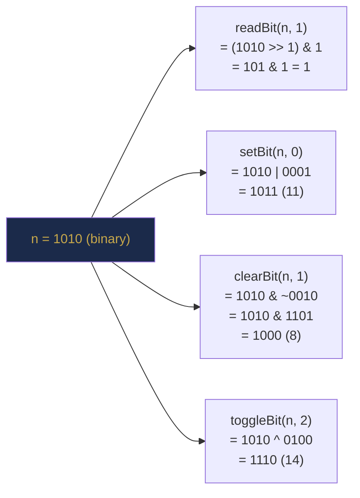

# Chapter 3 — Bit Manipulation: The Language of Hardware

> **Part I — Foundations of Algorithmic Thinking**  
> [← Chapter 2](chapter-02-mathematical-foundations.md) · [← Index](../INDEX.md) · [→ Chapter 4](../INDEX.md#-chapter-4--java-toolkit-for-data-structures-and-algorithms)

---

## Learning Objectives

By the end of this chapter you will be able to:

- Apply all six Java bitwise and shift operators correctly, citing their truth tables from memory.
- Set, clear, toggle and read individual bits in an integer using masks.
- Identify and apply the core XOR patterns that appear repeatedly in interview problems.
- Count set bits using the naive method and Brian Kernighan's algorithm.
- Detect powers of two and isolate or remove the lowest set bit in a single expression.
- Build a reusable, well-named bit-operations toolkit in Java.
- Avoid Java's most dangerous bit-manipulation pitfalls: operator precedence, arithmetic vs logical right shift, and sign extension.

---

## Contents

- [3.1 Why Bit Manipulation Matters](#31-why-bit-manipulation-matters)
- [3.2 Bitwise Operators](#32-bitwise-operators)
  - [3.2.1 AND — `&`](#321-and--)
  - [3.2.2 OR — `|`](#322-or--)
  - [3.2.3 XOR — `^`](#323-xor--)
  - [3.2.4 NOT — `~`](#324-not--)
- [3.3 Shift Operators](#33-shift-operators)
  - [3.3.1 Left Shift — `<<`](#331-left-shift--)
  - [3.3.2 Arithmetic Right Shift — `>>`](#332-arithmetic-right-shift--)
  - [3.3.3 Logical Right Shift — `>>>`](#333-logical-right-shift--)
- [3.4 Setting, Clearing, Toggling and Reading Bits](#34-setting-clearing-toggling-and-reading-bits)
- [3.5 XOR Patterns and Properties](#35-xor-patterns-and-properties)
- [3.6 Powers of Two](#36-powers-of-two)
- [3.7 Counting Set Bits](#37-counting-set-bits)
- [3.8 Useful Bit Patterns](#38-useful-bit-patterns)
- [3.9 Java-Specific Pitfalls](#39-java-specific-pitfalls)
- [Interview Insight](#interview-insight)
- [Myth vs Reality](#myth-vs-reality)
- [Mini Challenges](#mini-challenges)
- [Quick Quiz](#quick-quiz)
- [3.11 Practice Problems](#311-practice-problems)
- [3.12 Hard Problem Corner](#312-hard-problem-corner)
- [Chapter Summary](#chapter-summary)

---

## 3.1 Why Bit Manipulation Matters

Every value your program manipulates — an `int`, a `boolean`, a `char` — is ultimately stored as a sequence of bits. Bit manipulation is the ability to work with those bits directly, bypassing higher-level abstractions. That might sound low-level and niche, but it is neither.

Bit manipulation is important for three concrete reasons:

1. **Speed.** Bitwise operations are single CPU instructions executing in a single clock cycle. There is nothing faster.
2. **Space.** You can pack 32 boolean flags into one `int`, or represent a set of up to 64 elements in one `long`.
3. **Interview ubiquity.** Bit manipulation problems appear in every major technical interview loop. The XOR trick, the power-of-two check, counting set bits — these are tested explicitly and also arise as sub-steps in harder problems.

[Chapter 2](chapter-02-mathematical-foundations.md) established binary representation, two's complement, and powers of 2. This chapter builds directly on that foundation.

---

> ### 🔗 Analogy
> **A Bank of Light Switches**
>
> Think of an `int` as a panel of 32 light switches in a row, numbered 0 (rightmost) to 31 (leftmost). Each switch is either OFF (bit = 0) or ON (bit = 1).
>
> - **AND** is a master switch that turns a switch OFF: if either switch in a pair is OFF, the result is OFF.
> - **OR** turns a switch ON: if either switch is ON, the result is ON.
> - **XOR** toggles: if the two switches differ, the result is ON; if they match, it is OFF.
> - **NOT** flips every switch on the panel simultaneously.
> - **Left shift** slides all switches one position to the left (the rightmost is set to OFF).
> - **Right shift** slides them to the right.
>
> Bit manipulation is nothing more than operating this switch panel. Every pattern in this chapter is just a clever combination of those six operations.

---

## 3.2 Bitwise Operators

Java provides four bitwise operators that work on the **individual bits** of integer values.

### 3.2.1 AND — `&`

Result bit is 1 only if **both** input bits are 1.

| A | B | A & B |
|---|---|-------|
| 0 | 0 | 0 |
| 0 | 1 | 0 |
| 1 | 0 | 0 |
| 1 | 1 | **1** |

*Table 3.1: AND truth table.*

```java
// 12 & 10:
//   1100
// & 1010
// ------
//   1000  = 8
System.out.println(12 & 10);   // 8

// Classic use: check if a number is even (last bit 0)
System.out.println((7 & 1) == 0);  // false — 7 is odd
System.out.println((8 & 1) == 0);  // true  — 8 is even
```

**Primary use:** clearing bits, checking bits, masking.

### 3.2.2 OR — `|`

Result bit is 1 if **at least one** input bit is 1.

| A | B | A \| B |
|---|---|-------|
| 0 | 0 | 0 |
| 0 | 1 | **1** |
| 1 | 0 | **1** |
| 1 | 1 | **1** |

*Table 3.2: OR truth table.*

```java
// 12 | 10:
//   1100
// | 1010
// ------
//   1110  = 14
System.out.println(12 | 10);   // 14
```

**Primary use:** setting bits.

### 3.2.3 XOR — `^`

Result bit is 1 if the two input bits are **different**.

| A | B | A ^ B |
|---|---|-------|
| 0 | 0 | 0 |
| 0 | 1 | **1** |
| 1 | 0 | **1** |
| 1 | 1 | 0 |

*Table 3.3: XOR truth table. XOR = "exclusive or" = "one or the other but not both".*

```java
// 12 ^ 10:
//   1100
// ^ 1010
// ------
//   0110  = 6
System.out.println(12 ^ 10);   // 6
```

**Key properties of XOR** (covered in depth in Section 3.5):
- $a \oplus a = 0$ (self-cancellation)
- $a \oplus 0 = a$ (identity)
- Commutative and associative

**Primary use:** toggling bits, duplicate detection, encryption.

### 3.2.4 NOT — `~`

Flips **every** bit (bitwise complement). For a 32-bit `int`, `~n = -(n + 1)`.

```java
System.out.println(~0);    // -1   (all 1s)
System.out.println(~1);    // -2
System.out.println(~(-1)); //  0
// Rule: ~n == -(n + 1)
```

**Primary use:** creating masks, negating values.

---

> [!NOTE]
> **Bitwise vs Logical Operators**
>
> Java has both `&` (bitwise AND) and `&&` (logical AND). They look similar but behave differently:
> - `&&` short-circuits: if the left side is `false`, the right side is not evaluated.
> - `&` on booleans does NOT short-circuit — both sides are always evaluated.
> - `&` on integers works bit-by-bit.
>
> Similarly, `|` vs `||` and `^` vs `!=` (for booleans). In algorithm code, always use `&&` / `||` for boolean logic and `&` / `|` for bit operations on integers.

---

## 3.3 Shift Operators

Shift operators move all bits left or right by a specified number of positions.

### 3.3.1 Left Shift — `<<`

`n << k` shifts all bits $k$ positions to the left. The rightmost $k$ bits become 0. This is equivalent to multiplying by $2^k$ (as long as no bits are lost off the left edge).

```java
System.out.println(1 << 0);   //  1  = 2^0
System.out.println(1 << 1);   //  2  = 2^1
System.out.println(1 << 4);   // 16  = 2^4
System.out.println(1 << 10);  // 1024 = 2^10
System.out.println(3 << 2);   // 12  = 3 * 4
```

**Visualised** for `1 << 3`:
```
Before: 00000000 00000000 00000000 00000001  (= 1)
After:  00000000 00000000 00000000 00001000  (= 8)
```

### 3.3.2 Arithmetic Right Shift — `>>`

`n >> k` shifts all bits $k$ positions to the right. The leftmost $k$ bits are filled with the **sign bit** (0 for positive, 1 for negative). This preserves the sign of a negative number and is equivalent to floor-dividing by $2^k$.

```java
System.out.println(16 >> 1);   //  8  (16 / 2)
System.out.println(16 >> 2);   //  4  (16 / 4)
System.out.println(-8 >> 1);   // -4  (sign-extended: fills with 1s)
System.out.println(-1 >> 5);   // -1  (all 1s shifted right, still all 1s)
```

### 3.3.3 Logical Right Shift — `>>>`

`n >>> k` shifts $k$ positions to the right. The leftmost $k$ bits are always filled with **0**, regardless of the sign bit.

```java
System.out.println(-1 >>> 1);   // 2147483647  (Integer.MAX_VALUE)
// -1 is all 1s; shifting right 1 position with 0-fill gives 0111...1 = MAX_VALUE

System.out.println(-8 >>> 1);   // 2147483644
```

**Rule of thumb:**
- Use `>>` when you want sign-preserving floor division by a power of 2.
- Use `>>>` when you want to work with the raw unsigned bits (e.g., safe midpoint: `(lo + hi) >>> 1`).

```java
// Safe midpoint using logical right shift — avoids overflow AND avoids sign issues
int mid = (lo + hi) >>> 1;  // cleaner than lo + (hi - lo) / 2 for binary search
```

**Shift amounts** in Java are taken modulo 32 for `int` and modulo 64 for `long`:
```java
System.out.println(1 << 32);  // 1  (not 0! 32 % 32 == 0)
System.out.println(1 << 33);  // 2  (33 % 32 == 1)
```

---

> [!WARNING]
> **Shifting a `long` requires `1L`**
>
> `1 << 40` does NOT produce $2^{40}$. The literal `1` is an `int`, and `int` shifts are mod 32, so `1 << 40 == 1 << 8 == 256`.
>
> ```java
> long wrong  = 1 << 40;    // 256 — computed as int, then widened!
> long correct = 1L << 40;  // 1099511627776 — computed as long
> ```
>
> Always use `1L` when building a `long` mask.

---

## 3.4 Setting, Clearing, Toggling and Reading Bits

The four fundamental bit operations on a single bit at position $k$ (0 = rightmost):

| Operation | Expression | Effect |
|-----------|-----------|--------|
| **Read** bit $k$ | `(n >> k) & 1` | Returns 0 or 1 |
| **Set** bit $k$ to 1 | `n \| (1 << k)` | Forces bit $k$ to 1 |
| **Clear** bit $k$ to 0 | `n & ~(1 << k)` | Forces bit $k$ to 0 |
| **Toggle** bit $k$ | `n ^ (1 << k)` | Flips bit $k$ |

*Table 3.4: The four fundamental single-bit operations. All are O(1) time and O(1) space.*

```java
public final class BitKit {

    private BitKit() {}

    public static int readBit(int n, int k) {
        return (n >> k) & 1;
    }

    public static int setBit(int n, int k) {
        return n | (1 << k);
    }

    public static int clearBit(int n, int k) {
        return n & ~(1 << k);
    }

    public static int toggleBit(int n, int k) {
        return n ^ (1 << k);
    }

    public static void main(String[] args) {
        int n = 0b1010;  // bits 1 and 3 are set

        System.out.println(readBit(n, 1));    // 1  (bit 1 is on)
        System.out.println(readBit(n, 0));    // 0  (bit 0 is off)

        System.out.println(setBit(n, 0));     // 0b1011 = 11
        System.out.println(clearBit(n, 1));   // 0b1000 = 8
        System.out.println(toggleBit(n, 3));  // 0b0010 = 2  (bit 3 toggled off)
        System.out.println(toggleBit(n, 2));  // 0b1110 = 14 (bit 2 toggled on)
    }
}
```

*Listing 3.1: A reusable BitKit class with all four fundamental operations.*



---

> [!WARNING]
> **The Most Common Java Bit Manipulation Bug: Operator Precedence**
>
> `&`, `|`, and `^` have **lower** precedence than `==`, `!=`, `<`, `>`. This trips up nearly every programmer at least once:
>
> ```java
> // WRONG — parsed as: n & (1 == 0) = n & false = 0 → ALWAYS false!
> if (n & 1 == 0) { ... }
>
> // CORRECT — always parenthesise bitwise expressions
> if ((n & 1) == 0) { ... }  // is n even?
> ```
>
> **Rule:** When combining bitwise operators with comparison operators, **always wrap the bitwise expression in parentheses**.

---

## 3.5 XOR Patterns and Properties

XOR is the most versatile bitwise operator. Its properties make it uniquely useful:

| Property | Formula | Meaning |
|----------|---------|---------|
| Self-cancellation | $a \oplus a = 0$ | XORing a value with itself gives zero |
| Identity | $a \oplus 0 = a$ | XORing with zero is a no-op |
| Commutativity | $a \oplus b = b \oplus a$ | Order does not matter |
| Associativity | $(a \oplus b) \oplus c = a \oplus (b \oplus c)$ | Grouping does not matter |
| Self-inverse | $(a \oplus b) \oplus b = a$ | XOR is its own inverse |

*Table 3.5: XOR properties. Self-cancellation is the key to most interview XOR tricks.*

### Pattern 1: Swap Without a Temporary Variable

```java
// XOR swap — works in-place, no temporary needed
int a = 5, b = 7;
a = a ^ b;   // a = 5 ^ 7
b = a ^ b;   // b = (5^7) ^ 7 = 5
a = a ^ b;   // a = (5^7) ^ 5 = 7
System.out.println(a + " " + b);  // 7 5
```

> [!NOTE]
> The XOR swap is clever but rarely used in production — `int temp = a; a = b; b = temp;` is clearer and equally fast. Use XOR swap only when explicitly asked.

### Pattern 2: Find the Single Non-Duplicate Element

XOR all elements. Every element that appears twice cancels itself out ($a \oplus a = 0$). Only the single-occurrence element remains.

```java
// LeetCode 136 — Single Number
public int singleNumber(int[] nums) {
    int result = 0;
    for (int x : nums) result ^= x;
    return result;
}
// [4, 1, 2, 1, 2] → 4^1^2^1^2 = 4^(1^1)^(2^2) = 4^0^0 = 4
```

### Pattern 3: Find the Missing Number

For an array containing $n-1$ of the integers $1 \ldots n$ (one missing), XOR all indices and all values together. Pairs cancel; the missing number remains.

```java
// LeetCode 268 — Missing Number (XOR approach)
public int missingNumber(int[] nums) {
    int result = nums.length;              // start with n
    for (int i = 0; i < nums.length; i++) {
        result ^= i ^ nums[i];            // XOR index and value
    }
    return result;
}
```

### Pattern 4: Bit Difference (Hamming Distance)

Count the number of positions where two integers differ — that is, the number of set bits in `a ^ b`.

```java
int hammingDistance(int x, int y) {
    return Integer.bitCount(x ^ y);  // covered in Section 3.7
}
```

---

## 3.6 Powers of Two

From [Chapter 2](chapter-02-mathematical-foundations.md) Section 2.5, powers of 2 have exactly **one set bit**. This gives us elegant detection and manipulation tricks.

### Detect: Is $n$ a Power of Two?

A power of 2 has exactly one set bit. Subtracting 1 from it flips that bit off and turns all lower bits on. So `n & (n - 1) == 0` iff $n$ is a power of 2.

```
n     = 0001 0000  (16)
n - 1 = 0000 1111  (15)
n & (n-1) = 0000 0000  → 0: IS a power of 2 ✓

n     = 0001 0010  (18)
n - 1 = 0001 0001  (17)
n & (n-1) = 0001 0000  → non-zero: NOT a power of 2
```

```java
boolean isPowerOfTwo(int n) {
    return n > 0 && (n & (n - 1)) == 0;
}
```

> [!NOTE]
> `n > 0` is required because `0 & (0-1) = 0 & -1 = 0` would incorrectly report 0 as a power of two.

### Highest Set Bit Position

```java
int highestSetBit(int n) {
    return 31 - Integer.numberOfLeadingZeros(n);  // Java built-in
}
// Or: (int)(Math.log(n) / Math.log(2))  — but floating-point imprecision risks
```

### Next Power of Two ≥ n

```java
int nextPowerOfTwo(int n) {
    if (n <= 1) return 1;
    n--;                   // handle exact powers of 2
    n |= n >> 1;
    n |= n >> 2;
    n |= n >> 4;
    n |= n >> 8;
    n |= n >> 16;          // fills all bits below the highest set bit with 1s
    return n + 1;          // e.g. 0011 1111 + 1 = 0100 0000
}
```

---

## 3.7 Counting Set Bits

The number of 1-bits in an integer is called its **Hamming weight** or **popcount** (population count).

### Approach 1: Naive — O(32)

Check each bit in turn:

```java
int countSetBitsNaive(int n) {
    int count = 0;
    while (n != 0) {
        count += (n & 1);
        n >>>= 1;           // logical right shift: processes unsigned bits
    }
    return count;
}
```

### Approach 2: Brian Kernighan's Algorithm — O(k)

The expression `n & (n - 1)` **clears the lowest set bit** of `n`. Repeat until `n == 0`; the number of iterations equals the number of set bits.

```java
int countSetBitsKernighan(int n) {
    int count = 0;
    while (n != 0) {
        n &= (n - 1);  // clear lowest set bit
        count++;
    }
    return count;
}
```

**Why it is O(k):** exactly $k$ iterations, where $k$ is the number of set bits. For sparse integers (few set bits), this is much faster than the naive O(32).

**Dry run on `n = 0b10110` (22):**

| Iteration | `n` (binary) | `n - 1` | `n & (n-1)` | `count` |
|-----------|------------|---------|------------|---------|
| 1 | `10110` | `10101` | `10100` | 1 |
| 2 | `10100` | `10011` | `10000` | 2 |
| 3 | `10000` | `01111` | `00000` | 3 |

Three set bits in 22 ✓

### Approach 3: Java Built-in

```java
Integer.bitCount(42);   // returns the number of 1-bits in 42
Long.bitCount(42L);     // 64-bit version
```

`Integer.bitCount()` uses a parallel-bit-counting algorithm and is `O(1)` in practice. Use this in production and interview code unless you are specifically asked to implement it.

### Hamming Distance

The Hamming distance between two integers is the number of bit positions at which they differ.

```java
int hammingDistance(int x, int y) {
    return Integer.bitCount(x ^ y);  // XOR marks differing bits; count them
}
```

---

> ### 📚 History Corner
> **Brian Kernighan's Algorithm**
>
> Brian Kernighan, co-creator of the C programming language and co-author of *The C Programming Language* (1978), popularised the `n & (n-1)` trick in his seminal book *The C Programming Language* with Dennis Ritchie. The insight that subtracting 1 from a number flips its lowest set bit and all trailing zeros — and nothing else — is one of the most elegant observations in low-level programming. The same principle underlies Fenwick trees ([Chapter 48](../INDEX.md#-chapter-48--fenwick-trees-and-range-query-techniques)), where `i & (-i)` extracts the lowest set bit in $O(1)$.

---

## 3.8 Useful Bit Patterns

These patterns appear repeatedly in competitive programming and interview problems. Know them by heart.

| Pattern | Expression | Effect |
|---------|-----------|--------|
| Lowest set bit | `n & (-n)` | Isolates the lowest 1-bit as a power of two |
| Clear lowest set bit | `n & (n - 1)` | Removes the lowest 1-bit |
| Check if bit $k$ is set | `(n >> k) & 1` | Returns 1 if bit $k$ is on |
| Create a mask of $k$ ones | `(1 << k) - 1` | Produces $00\ldots0\underbrace{11\ldots1}_{k}$ |
| Extract bits $[l, r]$ | `(n >> l) & ((1 << (r-l+1)) - 1)` | Extracts the sub-word from bit $l$ to $r$ |
| Count trailing zeros | `Integer.numberOfTrailingZeros(n)` | Built-in; also = position of lowest set bit |
| Count leading zeros | `Integer.numberOfLeadingZeros(n)` | Built-in |

*Table 3.6: Common bit patterns. `n & (-n)` works because $-n$ in two's complement equals `~n + 1`.*

```java
int n = 0b10110;  // = 22

// Isolate lowest set bit
System.out.println(n & -n);         // 0b00010 = 2  (bit 1)

// Clear lowest set bit
System.out.println(n & (n - 1));    // 0b10100 = 20

// Mask of 4 ones
System.out.println((1 << 4) - 1);   // 0b1111 = 15

// Extract bits [1, 3] from n = 10110
// (n >> 1) = 1011, mask = (1<<3)-1 = 111
System.out.println((n >> 1) & ((1 << 3) - 1));  // 011 = 3
```

*Listing 3.2: Demonstrating common bit patterns.*

---

## 3.9 Java-Specific Pitfalls

### Pitfall 1: Operator Precedence (Revisited)

Already covered in Section 3.4, but it cannot be overstated — this is the most common Java bit manipulation bug:

```java
if (n & 1 == 0) { }     // WRONG: parsed as n & (1 == 0) = n & false = 0
if ((n & 1) == 0) { }   // CORRECT
```

### Pitfall 2: Shift Amount Wraps Modulo 32 / 64

```java
int x = 1 << 32;    // = 1  (32 % 32 = 0, no shift)
int y = 1 << 33;    // = 2  (33 % 32 = 1)
long z = 1L << 64;  // = 1  (64 % 64 = 0)
```

### Pitfall 3: Use `1L` for Long Masks

```java
long mask = 1L << 40;    // correct: 2^40
long bad  = (long)(1 << 40);  // wrong: 1 << 40 is int overflow, then cast
```

### Pitfall 4: `>>` vs `>>>` on Negative Numbers

```java
int n = -1;             // all 1s: 11111111 11111111 11111111 11111111
System.out.println(n >> 1);    // -1   (arithmetic: fills with 1s)
System.out.println(n >>> 1);   // Integer.MAX_VALUE (logical: fills with 0)
```

### Pitfall 5: `int` Promotion in Expressions with `byte` or `short`

Java promotes `byte` and `short` to `int` before bitwise operations. The result is always at least an `int`.

```java
byte b = (byte) 0xFF;        // -1 (signed byte)
int result = b & 0xFF;       // 255 — strips sign extension
```

---

> ### 🎯 Interview Insight
> **When to Use Bit Manipulation in Interviews**
>
> Bit manipulation is most applicable when the problem:
> - Asks about duplicates, single elements, or missing elements in an integer array.
> - Involves checking or counting properties of individual bits (Hamming weight/distance, power of two).
> - Requires O(1) space with no data structures — a hint that XOR or masking may be the trick.
> - Uses a bitmask to represent a small set (at most 30–64 elements). This is covered in depth in [Chapter 45](../INDEX.md#-chapter-45--bitmask-patterns-and-competitive-programming).
>
> **What interviewers test:** not raw memorisation, but whether you can reason from the fundamental properties. If you know that `n & (n-1)` clears the lowest set bit *and you understand why*, you can derive every pattern in this chapter on the fly.

---

## Myth vs Reality

> ### ⚡ Myth vs Reality
>
> **Myth:** Bit manipulation code is obscure and unreadable. Good engineers avoid it.
>
> **Reality:** *Unnamed* bit manipulation is unreadable. *Named* bit manipulation is concise and clear. `isPowerOfTwo(n)` is perfectly readable; `n > 0 && (n & (n - 1)) == 0` inside a larger expression is not. The `BitKit` class in Listing 3.1 demonstrates the right approach: encapsulate each pattern in a well-named method. The same principle applies to any "clever" code — the solution is naming, not avoidance.

---

## Mini Challenges

> ### 🏆 Mini Challenge 3.1 — isPowerOfTwo Without Conditionals
>
> Implement `boolean isPowerOfTwo(int n)` using exactly one expression involving only bitwise and arithmetic operators — no `if`, no `&&`. Hint: the result of a Java comparison like `n > 0` can be used in arithmetic via a cast.
>
> Then answer: does your expression handle `n = 0` correctly? Does it handle `n = Integer.MIN_VALUE`?

---

> ### 🏆 Mini Challenge 3.2 — Reverse Bits
>
> Reverse the bits of a 32-bit unsigned integer. For example, `reverseBits(0b00000010100101000001111010011100)` should return `0b00111001011110000010100101000000`.
>
> Can you implement this in $O(1)$ time (i.e., using a fixed number of bitwise operations)? Hint: use a divide-and-conquer approach on the bits themselves — swap pairs, then groups of 4, then groups of 8, then groups of 16.

---

## Quick Quiz

**Q1.** Evaluate `0b1101 & 0b1010`. What is the decimal result?

<details>
<summary><strong>Answer</strong></summary>

> **A1.** `1101 & 1010 = 1000 = 8`. AND keeps only bits where both inputs are 1.

</details>

---

**Q2.** What does `n & (n - 1)` do, and why?

<details>
<summary><strong>Answer</strong></summary>

> **A2.** It clears the lowest set bit of `n`. When you subtract 1 from `n`, the lowest set bit flips to 0 and all lower bits flip to 1. ANDing with the original `n` turns those lower bits back to 0, leaving only the lowest set bit cleared. All higher bits are unchanged.

</details>

---

**Q3.** Predict the output:
```java
System.out.println(-1 >>> 1);
```

<details>
<summary><strong>Answer</strong></summary>

> **A3.** `2147483647` (i.e., `Integer.MAX_VALUE`). `-1` is all 32 ones. The logical right shift (`>>>`) fills the vacated MSB with 0, giving `01111...1` = $2^{31} - 1$.

</details>

---

**Q4.** What is wrong with this code, and how do you fix it?
```java
if (flags & MASK == 0) { ... }
```

<details>
<summary><strong>Answer</strong></summary>

> **A4.** Operator precedence bug. `==` binds tighter than `&`, so this is parsed as `flags & (MASK == 0)`. Since `MASK == 0` is `false` (a boolean), the `&` with an `int` on the left is a type error (or evaluates `flags & 0 = 0` after boolean-to-int promotion in older contexts). Fix: `if ((flags & MASK) == 0) { ... }`.

</details>

---

**Q5.** An array contains $n$ distinct integers in the range $[1, n+1]$ — exactly one number in that range is missing. Write a one-liner using XOR to find it.

<details>
<summary><strong>Answer</strong></summary>

> **A5.**
> ```java
> int missing = IntStream.rangeClosed(1, n + 1).reduce(0, (a, b) -> a ^ b)
>                        ^ Arrays.stream(arr).reduce(0, (a, b) -> a ^ b);
> ```
> Or more concisely in a loop:
> ```java
> int result = 0;
> for (int i = 1; i <= arr.length + 1; i++) result ^= i;
> for (int x : arr) result ^= x;
> // result now holds the missing number
> ```
> XOR of $[1 \ldots n+1]$ XOR all array values: every present number cancels; the missing one remains.

</details>

---

## 3.11 Practice Problems

| Problem | Name | Difficulty | Bit Manipulation Concept |
|---------|------|------------|--------------------------|
| [LC 136](https://leetcode.com/problems/single-number/) | Single Number | Easy | XOR self-cancellation |
| [LC 191](https://leetcode.com/problems/number-of-1-bits/) | Number of 1 Bits | Easy | Kernighan / `Integer.bitCount` |
| [LC 231](https://leetcode.com/problems/power-of-two/) | Power of Two | Easy | `n & (n-1)` |
| [LC 268](https://leetcode.com/problems/missing-number/) | Missing Number | Easy | XOR over range |
| [LC 338](https://leetcode.com/problems/counting-bits/) | Counting Bits | Easy | `n & (n-1)` per number |
| [LC 190](https://leetcode.com/problems/reverse-bits/) | Reverse Bits | Easy | Bit-by-bit extraction |
| [LC 461](https://leetcode.com/problems/hamming-distance/) | Hamming Distance | Easy | XOR + popcount |
| [LC 371](https://leetcode.com/problems/sum-of-two-integers/) | Sum of Two Integers | Medium | Add with carry using bit ops |
| [LC 137](https://leetcode.com/problems/single-number-ii/) | Single Number II | Medium | Bit counting per position |
| [LC 260](https://leetcode.com/problems/single-number-iii/) | Single Number III | Medium | XOR + lowest set bit isolation |

---

## 3.12 Hard Problem Corner

> ### 🔥 Hard Problem Corner
>
> **Problem:** You are given two integers `start` and `goal`. Find the **minimum number of bit flips** required to convert `start` to `goal`.
>
> **Example:** `start = 10` (`1010`), `goal = 7` (`0111`). Result: 3 (bits 0, 1, and 3 differ).
>
> **Hint:** A bit flip converts a 0 to a 1 or a 1 to a 0. Two integers differ in exactly the positions where their XOR is 1. What does counting the set bits of `start ^ goal` give you?

<details>
<summary><strong>Solution (click to reveal)</strong></summary>

> [!TIP]
> **Solution**
>
> `start ^ goal` produces a 1 in every position where the two numbers differ. The number of such positions is the number of set bits in `start ^ goal`.
>
> ```java
> public int minBitFlips(int start, int goal) {
>     return Integer.bitCount(start ^ goal);
> }
> ```
>
> **Complexity:** O(1) time, O(1) space.
>
> This is [LeetCode 2220 — Minimum Bit Flips to Convert Number](https://leetcode.com/problems/minimum-number-of-bit-flips-to-convert-a-number/). It directly exercises XOR (Section 3.5) and `Integer.bitCount` (Section 3.7).

</details>

---

## Chapter Summary

| Concept | Key Takeaway |
|---------|-------------|
| **AND `&`** | Clears bits; checks bits; masks. Result is 1 only where both inputs are 1. |
| **OR `\|`** | Sets bits. Result is 1 if at least one input is 1. |
| **XOR `^`** | Toggles bits; self-cancels ($a \oplus a = 0$); swaps; finds duplicates/missing. |
| **NOT `~`** | Flips all bits. `~n == -(n+1)`. |
| **Left shift `<<`** | Multiplies by $2^k$. Right bits filled with 0. |
| **Arithmetic right shift `>>`** | Divides by $2^k$ (floor). Left bits filled with sign bit. |
| **Logical right shift `>>>`** | Left bits always filled with 0. Use for unsigned work. |
| **`n & (n-1)`** | Clears the lowest set bit. Core of Kernighan's algorithm and power-of-two check. |
| **`n & -n`** | Isolates the lowest set bit as a power of two. |
| **`(n >> k) & 1`** | Reads bit $k$. |
| **Operator precedence** | Always parenthesise: `(n & mask) == 0`, not `n & mask == 0`. |
| **`1L << k`** | Required for `long` masks; `1 << k` overflows for $k \geq 32$. |

*Table 3.7: Chapter 3 key concepts.*

---

**Coming Up Next:** [Chapter 4 (Java Toolkit)](../INDEX.md#-chapter-4--java-toolkit-for-data-structures-and-algorithms) covers the Java standard library in depth — every collection class, its internal implementation, and when to reach for each one. [Chapter 5 (Recursion)](../INDEX.md#-chapter-5--recursion-learning-to-think-recursively) will apply the mathematical induction framework from Chapter 2 to reason about recursive algorithms formally.

For advanced applications of bit manipulation — representing sets as bitmasks, iterating over subsets, and bitmask dynamic programming — see [Chapter 45 (Bitmask Patterns and Competitive Programming)](../INDEX.md#-chapter-45--bitmask-patterns-and-competitive-programming).

---

> **Part I — Foundations of Algorithmic Thinking**  
> [← Chapter 2](chapter-02-mathematical-foundations.md) · [← Index](../INDEX.md) · [→ Chapter 4 (planned)](../INDEX.md#-chapter-4--java-toolkit-for-data-structures-and-algorithms)
