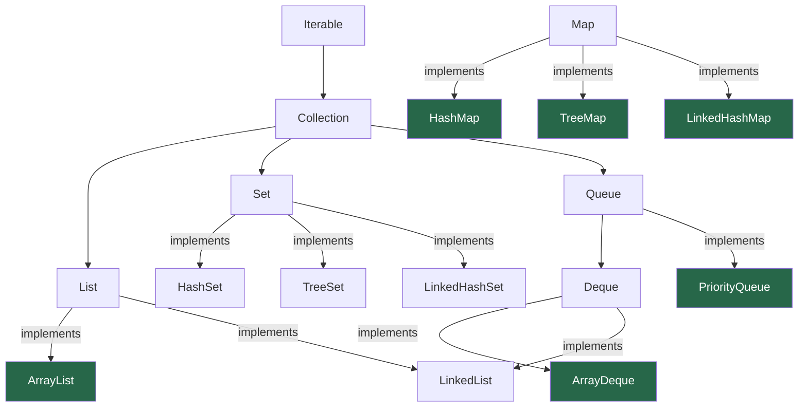

# Chapter 4 — Java Toolkit for Data Structures and Algorithms

> **Part I — Foundations of Algorithmic Thinking**  
> [← Chapter 3](chapter-03-bit-manipulation.md) · [← Index](../INDEX.md) · [→ Chapter 5](../INDEX.md#-chapter-5--recursion-learning-to-think-recursively)

---

## Learning Objectives

By the end of this chapter you will be able to:

- Describe the JVM execution model, the stack/heap split, and why it matters for complexity analysis.
- Choose the correct Java primitive type for any DSA problem, and avoid autoboxing traps.
- Apply `String`, `StringBuilder`, and the `Character` utility class to string problems.
- Implement `.equals()` and `hashCode()` correctly, and distinguish `==` from `.equals()`.
- Select the right Java collection class by matching problem requirements to data structure properties.
- Use `Comparator` and `Comparable` to sort any type in any order with a single expression.
- Read the `Arrays` and `Collections` utility APIs confidently.
- Write fast I/O code for competitive programming scenarios.
- Recognise and avoid the most common Java performance traps in algorithm problems.

---

## Contents

- [4.1 The Java Execution Model](#41-the-java-execution-model)
- [4.2 Primitive Types and Wrappers](#42-primitive-types-and-wrappers)
- [4.3 Integer Arithmetic: Limits and Safe Patterns](#43-integer-arithmetic-limits-and-safe-patterns)
- [4.4 Arrays in Java](#44-arrays-in-java)
- [4.5 Strings and Character Processing](#45-strings-and-character-processing)
- [4.6 Object Equality: `equals()`, `hashCode()` and Comparison](#46-object-equality-equals-hashcode-and-comparison)
- [4.7 The Collections Framework](#47-the-collections-framework)
  - [4.7.1 Interface Hierarchy](#471-interface-hierarchy)
  - [4.7.2 ArrayList](#472-arraylist)
  - [4.7.3 ArrayDeque — Stack and Queue](#473-arraydeque--stack-and-queue)
  - [4.7.4 PriorityQueue](#474-priorityqueue)
  - [4.7.5 HashMap and HashSet](#475-hashmap-and-hashset)
  - [4.7.6 TreeMap and TreeSet](#476-treemap-and-treeset)
  - [4.7.7 LinkedHashMap](#477-linkedhashmap)
  - [4.7.8 Choosing the Right Collection](#478-choosing-the-right-collection)
- [4.8 Comparator and Comparable](#48-comparator-and-comparable)
- [4.9 Generics at a Glance](#49-generics-at-a-glance)
- [4.10 Sorting and Binary Search APIs](#410-sorting-and-binary-search-apis)
- [4.11 Collections Utility Class](#411-collections-utility-class)
- [4.12 Fast Input/Output](#412-fast-inputoutput)
- [4.13 Java Performance Considerations](#413-java-performance-considerations)
- [Interview Insight](#interview-insight)
- [Quick Quiz](#quick-quiz)
- [4.14 Practice Problems](#414-practice-problems)
- [Chapter Summary](#chapter-summary)

---

## 4.1 The Java Execution Model

Understanding *how* Java runs your code prevents an entire class of bugs and misunderstandings about complexity.


### JVM Memory: Stack vs Heap

| Region | Contains | Lifetime | Relevance to DSA |
|--------|----------|----------|-----------------|
| **Stack** | Method frames, local variables, return addresses | Frame pushed on call, popped on return | Recursion depth ≈ stack depth; `StackOverflowError` |
| **Heap** | All objects (`new` expressions) | Until GC collects | Every `new int[]`, `new ArrayList<>()` etc. goes here |
| **Method area** | Class metadata, static fields | JVM lifetime | Minimal DSA impact |

*Table 4.1: JVM memory regions relevant to DSA.*

**Key implications:**
- **Recursion depth** is bounded by stack size (default ~500–1000 frames for typical methods; configurable with `-Xss`). Deep recursion throws `StackOverflowError` — not `OutOfMemoryError`.
- **Object allocation** (`new`) is on the heap and costs time. Allocating inside a tight loop matters for performance.
- **Primitive local variables** (`int i`, `long sum`) live on the stack — extremely cheap.

### Garbage Collection

The JVM automatically reclaims heap objects with no live references. This means you do not need to free memory manually. The cost: GC pauses can occur. For algorithm complexity analysis, treat object allocation as $O(1)$ unless you are allocating $O(n)$ objects in a loop, in which case the cumulative allocation is $O(n)$.

---

## 4.2 Primitive Types and Wrappers

Java has eight primitive types. All others are objects (reference types).

| Primitive | Bits | Range | Wrapper | Default value |
|-----------|------|-------|---------|---------------|
| `boolean` | 1 | `true` / `false` | `Boolean` | `false` |
| `byte` | 8 | −128 to 127 | `Byte` | `0` |
| `short` | 16 | −32,768 to 32,767 | `Short` | `0` |
| `int` | 32 | −2,147,483,648 to 2,147,483,647 | `Integer` | `0` |
| `long` | 64 | −9.2 × 10¹⁸ to 9.2 × 10¹⁸ | `Long` | `0L` |
| `float` | 32 | ~7 decimal digits | `Float` | `0.0f` |
| `double` | 64 | ~15 decimal digits | `Double` | `0.0` |
| `char` | 16 | 0 to 65,535 (Unicode) | `Character` | `'\u0000'` |

*Table 4.2: Java primitive types and their wrapper classes.*

### Autoboxing and Unboxing

Java automatically converts between primitives and their wrapper types:

```java
// Autoboxing: int → Integer
Integer x = 42;           // equivalent to Integer.valueOf(42)

// Unboxing: Integer → int
int y = x;                // equivalent to x.intValue()

// Autoboxing in collections — unavoidable
List<Integer> list = new ArrayList<>();
list.add(5);              // boxes 5 to Integer.valueOf(5)
int val = list.get(0);    // unboxes
```

> [!WARNING]
> **The Integer Cache Trap**
>
> `Integer.valueOf(n)` caches instances for $n \in [-128, 127]$. This creates a subtle `==` bug:
>
> ```java
> Integer a = 127, b = 127;
> System.out.println(a == b);   // true  — same cached object
>
> Integer c = 128, d = 128;
> System.out.println(c == d);   // false — different objects
> System.out.println(c.equals(d)); // true — ALWAYS use equals()!
> ```
>
> **Rule:** Never compare `Integer` (or any wrapper) objects with `==`. Always use `.equals()`.

---

## 4.3 Integer Arithmetic: Limits and Safe Patterns

This is a consolidated reference for patterns covered in Chapters [1](chapter-01-algorithmic-thinking.md#151-integer-overflow-the-silent-killer) and [2](chapter-02-mathematical-foundations.md#24-integer-overflow-and-underflow).

```java
// Key constants
int  INT_MAX  = Integer.MAX_VALUE;   //  2,147,483,647
int  INT_MIN  = Integer.MIN_VALUE;   // -2,147,483,648
long LONG_MAX = Long.MAX_VALUE;      //  9,223,372,036,854,775,807

// Safe midpoint (binary search)
int mid = lo + (hi - lo) / 2;        // avoids (lo+hi) overflow
int mid = (lo + hi) >>> 1;            // unsigned shift alternative

// Safe multiplication
long product = (long) a * b;          // cast one operand before multiply

// Detecting overflow (Java 8+)
try {
    int safe = Math.addExact(a, b);
} catch (ArithmeticException e) {
    // overflow occurred
}

// Absolute value trap
Math.abs(Integer.MIN_VALUE) == Integer.MIN_VALUE  // -2^31 has no positive counterpart!
```

---

## 4.4 Arrays in Java

### Declaration and Initialisation

```java
int[] arr = new int[5];            // zero-initialised: [0,0,0,0,0]
int[] arr = {3, 1, 4, 1, 5};      // literal initialisation
int[] arr = new int[]{3, 1, 4};   // explicit new with literal

// 2D array (array of arrays)
int[][] grid = new int[3][4];      // 3 rows, 4 columns, all zeros
int[][] grid = {{1,2},{3,4},{5,6}};

// Jagged array (rows can have different lengths)
int[][] jagged = new int[3][];
jagged[0] = new int[2];
jagged[1] = new int[5];
jagged[2] = new int[1];
```

### Arrays Utility Class

```java
import java.util.Arrays;

int[] a = {5, 3, 1, 4, 2};

Arrays.sort(a);                      // in-place sort: [1,2,3,4,5] — O(n log n)
Arrays.sort(a, 1, 4);               // sort subarray a[1..3] only
int idx = Arrays.binarySearch(a, 3); // returns index of 3 (array must be sorted)

Arrays.fill(a, 0);                   // fill entire array with 0
Arrays.fill(a, 2, 5, -1);           // fill a[2..4] with -1

int[] copy = Arrays.copyOf(a, 10);  // copy + right-pad with zeros to length 10
int[] sub  = Arrays.copyOfRange(a, 1, 4); // copy a[1..3]

System.out.println(Arrays.toString(a));       // "[1, 2, 3, 4, 5]"
System.out.println(Arrays.deepToString(grid)); // for 2D arrays

boolean eq = Arrays.equals(a, b);    // element-wise equality
```

### System.arraycopy — The Fastest Copy

```java
// System.arraycopy(src, srcPos, dest, destPos, length)
System.arraycopy(src, 0, dest, 0, src.length);  // faster than Arrays.copyOf for large arrays
```

> [!NOTE]
> **Array vs ArrayList**
>
> Use a primitive array (`int[]`) when: the size is fixed, you need maximum speed, or you are working with primitives and want to avoid boxing.  
> Use `ArrayList<Integer>` when: the size is dynamic, you need to pass it to Collections APIs, or you need methods like `contains()`.

---

## 4.5 Strings and Character Processing

### String: Immutable by Design

Every `String` modification creates a new object. The key methods:

```java
String s = "Hello, World!";

s.length()                 // 13
s.charAt(0)                // 'H'
s.substring(7, 12)         // "World"  — [7, 12)
s.indexOf("o")             // 4  (first occurrence)
s.lastIndexOf("o")         // 8
s.contains("World")        // true
s.startsWith("Hello")      // true
s.endsWith("!")            // true
s.toLowerCase()            // "hello, world!"
s.toUpperCase()            // "HELLO, WORLD!"
s.trim()                   // strips leading/trailing whitespace
s.strip()                  // Unicode-aware trim (Java 11+)
s.replace('l', 'r')        // "Herro, Worrd!"
s.replace("World", "Java") // "Hello, Java!"
s.split(", ")              // ["Hello", "World!"]
s.toCharArray()            // char[] — O(n) copy
String.valueOf(42)          // "42"
String.valueOf(new char[]{'a','b'}) // "ab"
"".isEmpty()               // true
"  ".isBlank()             // true (Java 11+)
```

### StringBuilder: Mutable String

As established in [Chapter 1](chapter-01-algorithmic-thinking.md#153-strings-in-java-immutable-by-design), always use `StringBuilder` for building strings in a loop:

```java
StringBuilder sb = new StringBuilder();
sb.append("Hello");        // append to end
sb.append(", ");
sb.append("World");
sb.insert(5, "!");         // insert at index 5
sb.delete(5, 6);           // delete characters [5,6)
sb.reverse();              // reverse in place — extremely useful
sb.deleteCharAt(0);        // delete single character
sb.setCharAt(0, 'h');      // modify character at index
int len = sb.length();
char c  = sb.charAt(0);
String result = sb.toString();  // O(n) conversion — do only once
```

> [!TIP]
> **`sb.reverse()` is O(n) and in-place** — one of the most useful `StringBuilder` methods for palindrome and reversal problems. Much cleaner than writing a manual swap loop.

### Character Utility Class

```java
Character.isDigit('5')       // true
Character.isLetter('A')      // true
Character.isLetterOrDigit('3') // true
Character.isUpperCase('A')   // true
Character.isLowerCase('a')   // true
Character.isWhitespace(' ')  // true
Character.toUpperCase('a')   // 'A'
Character.toLowerCase('A')   // 'a'
Character.getNumericValue('7') // 7

// Character arithmetic (from Ch 1):
'Z' - 'A'          // 25
'z' - 'a'          // 25
'5' - '0'          // 5  — digit char to int
(char)('a' + 3)    // 'd'
```

---

## 4.6 Object Equality: `equals()`, `hashCode()` and Comparison

### `==` vs `.equals()`

| Expression | For primitives | For objects |
|-----------|---------------|-------------|
| `a == b` | Value equality | **Reference** equality (same object in memory) |
| `a.equals(b)` | N/A | **Content** equality (as defined by the class) |

```java
String a = new String("hello");
String b = new String("hello");

System.out.println(a == b);        // false — different objects
System.out.println(a.equals(b));   // true  — same content
```

### The `equals()` / `hashCode()` Contract

If you override `equals()` in a custom class, you **must** also override `hashCode()`:
- If `a.equals(b)` is `true`, then `a.hashCode() == b.hashCode()` **must** be true.
- Violation breaks `HashMap`, `HashSet`, and all hash-based collections.

```java
// Minimal correct override pattern
@Override
public boolean equals(Object o) {
    if (this == o) return true;
    if (!(o instanceof Point p)) return false;
    return this.x == p.x && this.y == p.y;
}

@Override
public int hashCode() {
    return Objects.hash(x, y);   // Objects.hash() is the standard idiom
}
```

---

## 4.7 The Collections Framework

### 4.7.1 Interface Hierarchy



*Green nodes are the classes you will use most. `LinkedList` is included for completeness but is rarely the right choice.*

### 4.7.2 ArrayList

A dynamically resizing array. The go-to `List` implementation.

```java
List<Integer> list = new ArrayList<>();        // prefer interface type on left
List<Integer> list = new ArrayList<>(n);       // initial capacity hint — avoids resizing

list.add(10);                   // O(1) amortised — append
list.add(0, 10);                // O(n) — insert at index 0
list.get(2);                    // O(1) — random access
list.set(2, 99);                // O(1) — update
list.remove(2);                 // O(n) — remove by index (shifts elements)
list.remove(Integer.valueOf(5));// O(n) — remove first occurrence of value 5
list.size();                    // O(1)
list.isEmpty();                 // O(1)
list.contains(5);               // O(n) linear scan
list.indexOf(5);                // O(n)
list.clear();                   // O(n) — sets all references to null
Collections.sort(list);         // O(n log n)
Collections.reverse(list);      // O(n)

// Convert array to list
List<Integer> fromArray = Arrays.asList(1, 2, 3);  // fixed-size! add/remove throw
List<Integer> mutable   = new ArrayList<>(Arrays.asList(1, 2, 3));

// Convert list to array
Integer[] arr = list.toArray(new Integer[0]);
```

**Complexity summary:**

| Operation | Complexity | Notes |
|-----------|-----------|-------|
| `get(i)` / `set(i, v)` | O(1) | Random access via underlying array |
| `add(v)` (at end) | O(1) amortised | Doubles capacity when full |
| `add(i, v)` (at index) | O(n) | Shifts elements right |
| `remove(i)` | O(n) | Shifts elements left |
| `contains(v)` | O(n) | Linear scan |

*Table 4.3: ArrayList time complexity.*

### 4.7.3 ArrayDeque — Stack and Queue

**Always prefer `ArrayDeque` over `Stack` and `LinkedList`** for both stack and queue operations. It is backed by a resizable circular array, is not thread-safe (which makes it faster than the legacy `Stack`), and uses no per-element node overhead.

```java
Deque<Integer> stack = new ArrayDeque<>();   // as a Stack
stack.push(1);       // addFirst — O(1)
stack.push(2);
stack.push(3);
stack.pop();         // removeFirst — returns 3, O(1)
stack.peek();        // peekFirst  — returns 2, O(1)

Deque<Integer> queue = new ArrayDeque<>();  // as a Queue
queue.offer(1);      // addLast  — O(1)
queue.offer(2);
queue.offer(3);
queue.poll();        // removeFirst — returns 1, O(1)
queue.peek();        // peekFirst   — returns 2, O(1)
```

**All operations are O(1) amortised.** Method name guide:

| Role | `push` | `pop` | `peek` | `offer` | `poll` |
|------|--------|-------|--------|---------|--------|
| Stack | `push(e)` | `pop()` | `peek()` | — | — |
| Queue | — | — | `peek()` | `offer(e)` | `poll()` |
| Both | `addFirst(e)` | `removeFirst()` | `peekFirst()` | `addLast(e)` | `removeFirst()` |

> [!WARNING]
> **`Stack` is a legacy class — do not use it.** It extends `Vector` (which is synchronized on every operation), making it unnecessarily slow. Use `ArrayDeque` for stack operations and `ArrayDeque` as a queue.

### 4.7.4 PriorityQueue

A **min-heap** by default. The element with the smallest value according to the comparator is always at the front.

```java
PriorityQueue<Integer> minHeap = new PriorityQueue<>();
minHeap.offer(5);
minHeap.offer(1);
minHeap.offer(3);
minHeap.peek();     // 1  — smallest, O(1)
minHeap.poll();     // 1  — removes smallest, O(log n)
minHeap.size();     // 2

// Max-heap: reverse the comparator
PriorityQueue<Integer> maxHeap = new PriorityQueue<>(Collections.reverseOrder());
// or:
PriorityQueue<Integer> maxHeap = new PriorityQueue<>((a, b) -> b - a);

// Custom objects: sort by field
PriorityQueue<int[]> pq = new PriorityQueue<>((a, b) -> a[1] - b[1]); // sort by index 1

// Initialise from collection (heapifies in O(n))
PriorityQueue<Integer> pq = new PriorityQueue<>(Arrays.asList(3, 1, 4, 1, 5));
```

**Complexity:**

| Operation | Complexity |
|-----------|-----------|
| `offer(e)` | O(log n) |
| `poll()` | O(log n) |
| `peek()` | O(1) |
| `contains(e)` | O(n) |
| Build from collection | O(n) |

*Table 4.4: PriorityQueue time complexity.*

> [!NOTE]
> **PriorityQueue does NOT sort the entire collection.** Iterating over a `PriorityQueue` with a for-each loop does NOT yield elements in sorted order. Only successive `poll()` calls do. To sort, either use `Arrays.sort` / `Collections.sort`, or repeatedly `poll` from the heap.

### 4.7.5 HashMap and HashSet

`HashMap<K, V>` stores key-value pairs with O(1) average lookup.

```java
Map<String, Integer> map = new HashMap<>();

map.put("apple", 3);
map.put("banana", 1);
map.get("apple");                     // 3
map.getOrDefault("cherry", 0);        // 0 — key not present
map.containsKey("apple");             // true
map.containsValue(3);                 // true — O(n)
map.remove("apple");                  // removes the entry
map.size();                           // 1

// Iteration
for (Map.Entry<String, Integer> e : map.entrySet()) {
    System.out.println(e.getKey() + " → " + e.getValue());
}
map.keySet().forEach(System.out::println);
map.values().forEach(System.out::println);

// Frequency counting — the most common DSA pattern
Map<Character, Integer> freq = new HashMap<>();
for (char c : s.toCharArray()) {
    freq.put(c, freq.getOrDefault(c, 0) + 1);  // classic increment
    // Java 8+:
    freq.merge(c, 1, Integer::sum);             // cleaner alternative
}

// putIfAbsent, computeIfAbsent
map.putIfAbsent("key", 0);
map.computeIfAbsent("key", k -> new ArrayList<>()).add(value);
```

`HashSet<E>` is a `HashMap` with no values — just keys.

```java
Set<Integer> seen = new HashSet<>();
seen.add(5);
seen.contains(5);    // true  — O(1) average
seen.remove(5);      // O(1) average
seen.size();

// Convert list to set (removes duplicates)
Set<Integer> unique = new HashSet<>(list);
```

**Complexity (average case; assumes good hash distribution):**

| Operation | HashMap/HashSet | TreeMap/TreeSet |
|-----------|----------------|----------------|
| `put` / `add` | O(1) | O(log n) |
| `get` / `contains` | O(1) | O(log n) |
| `remove` | O(1) | O(log n) |
| Iteration | O(n) | O(n) |

*Table 4.5: Hash vs tree collection complexity.*

> [!NOTE]
> **Iteration order** of `HashMap` / `HashSet` is **not guaranteed** and may change between runs. If you need a predictable order, use `LinkedHashMap` (insertion order) or `TreeMap` (sorted order).

### 4.7.6 TreeMap and TreeSet

`TreeMap<K, V>` and `TreeSet<E>` maintain elements in **sorted order** (natural ordering or a custom `Comparator`), backed by a Red-Black tree.

```java
TreeMap<Integer, String> map = new TreeMap<>();
map.put(3, "three");
map.put(1, "one");
map.put(5, "five");

map.firstKey();           // 1  — smallest
map.lastKey();            // 5  — largest
map.floorKey(4);          // 3  — largest key ≤ 4
map.ceilingKey(4);        // 5  — smallest key ≥ 4
map.lowerKey(3);          // 1  — strictly less than 3
map.higherKey(3);         // 5  — strictly greater than 3
map.headMap(3);           // {1="one"}  — keys strictly < 3
map.tailMap(3);           // {3="three", 5="five"} — keys ≥ 3
map.subMap(1, true, 5, false); // {1="one", 3="three"} — [1, 5)

TreeSet<Integer> set = new TreeSet<>();
set.floor(4);             // 3
set.ceiling(4);           // 5
set.headSet(4);           // [1, 3]
```

**Use `TreeMap` / `TreeSet` when you need:**
- Sorted iteration.
- Range queries (`headMap`, `tailMap`, `subMap`).
- Floor/ceiling lookups.

### 4.7.7 LinkedHashMap

`LinkedHashMap` maintains **insertion order** (or access order if configured), making it ideal for LRU caches.

```java
Map<String, Integer> linked = new LinkedHashMap<>();
linked.put("b", 2);
linked.put("a", 1);
linked.put("c", 3);
// Iteration order: b, a, c  (insertion order preserved)

// LRU cache: access-ordered LinkedHashMap
Map<Integer, Integer> lru = new LinkedHashMap<>(16, 0.75f, true) {
    @Override
    protected boolean removeEldestEntry(Map.Entry<Integer, Integer> eldest) {
        return size() > CAPACITY;  // evict oldest entry when over capacity
    }
};
```

### 4.7.8 Choosing the Right Collection

| You need… | Use | Why |
|-----------|-----|-----|
| Dynamic array, indexed access | `ArrayList` | O(1) `get`, O(1) amortised `add` at end |
| Stack (LIFO) | `ArrayDeque` with `push`/`pop` | O(1), not synchronised |
| Queue (FIFO) | `ArrayDeque` with `offer`/`poll` | O(1), no node overhead |
| Min/max element repeatedly | `PriorityQueue` | O(log n) `offer`/`poll`, O(1) `peek` |
| Fast key lookup | `HashMap` | O(1) average |
| Sorted keys + range queries | `TreeMap` | O(log n), maintains order |
| Unique elements, fast lookup | `HashSet` | O(1) average `contains` |
| Unique elements, sorted | `TreeSet` | O(log n), maintains order |
| Insertion-ordered map (LRU) | `LinkedHashMap` | O(1) + preserves order |

*Table 4.6: Collection selection guide.*

---

## 4.8 Comparator and Comparable

### Comparable — Natural Ordering

Implement `Comparable<T>` to give a class a **natural ordering** (used by default sort):

```java
class Student implements Comparable<Student> {
    String name;
    int gpa;

    @Override
    public int compareTo(Student other) {
        return Double.compare(this.gpa, other.gpa);  // ascending GPA
    }
}

List<Student> students = ...;
Collections.sort(students);  // uses compareTo
```

**Contract:** `compareTo` must return negative/zero/positive when `this` is less/equal/greater than `other`.

### Comparator — External Ordering

Use `Comparator<T>` to sort by any criteria **without modifying the class**:

```java
// Sort strings by length
Comparator<String> byLength = (a, b) -> a.length() - b.length();

// SAFE pattern for subtraction-based comparators:
// WRONG: (a, b) -> a - b   — overflows if a and b have opposite signs!
// CORRECT:
Comparator<Integer> safe = Integer::compare;         // built-in
Comparator<Integer> safe = (a, b) -> Integer.compare(a, b);  // explicit

// Method reference and chaining
Comparator<Student> comp = Comparator
    .comparingInt((Student s) -> s.gpa).reversed()   // descending GPA
    .thenComparing(s -> s.name);                      // then alphabetical name

Arrays.sort(arr, comp);
students.sort(comp);
```

> [!WARNING]
> **Subtraction comparator overflow**
>
> `(a, b) -> a - b` overflows if `a` is large positive and `b` is large negative. Always use `Integer.compare(a, b)` or `Comparator.comparingInt(...)` for integer comparisons.

### Sorting in Practice

```java
int[] arr = {5, 3, 1, 4, 2};
Arrays.sort(arr);                                   // [1,2,3,4,5]

Integer[] arr2 = {5, 3, 1, 4, 2};
Arrays.sort(arr2, Collections.reverseOrder());      // [5,4,3,2,1]
Arrays.sort(arr2, Comparator.reverseOrder());        // same

String[] words = {"banana", "apple", "cherry"};
Arrays.sort(words, Comparator.comparingInt(String::length));  // by length
```

---

## 4.9 Generics at a Glance

Generics enable type-safe collections and algorithms without casting.

```java
// Generic class
class Pair<A, B> {
    final A first;
    final B second;
    Pair(A first, B second) { this.first = first; this.second = second; }
}

// Generic method
public static <T extends Comparable<T>> T max(T a, T b) {
    return a.compareTo(b) >= 0 ? a : b;
}

// Bounded type parameter: T must implement Comparable
public static <T extends Comparable<T>> void sort(T[] arr) { ... }
```

**Type erasure:** Generics exist only at compile time; at runtime, all generic types are erased to their bound (or `Object`). This means you cannot do `new T[]` or `instanceof List<Integer>` at runtime.

```java
// Common convention for type parameter names:
// T — Type (general)
// E — Element (collections)
// K, V — Key, Value (maps)
// N — Number
// R — Return type
```

---

## 4.10 Sorting and Binary Search APIs

### Arrays.sort

```java
// Primitives: Dual-Pivot Quicksort — O(n log n), NOT stable
Arrays.sort(int[] arr)
Arrays.sort(int[] arr, int fromIndex, int toIndex)

// Objects: TimSort — O(n log n), STABLE
Arrays.sort(T[] arr)
Arrays.sort(T[] arr, Comparator<T> comp)
```

> [!NOTE]
> **Stability matters.** Sorting objects with `Arrays.sort` is *stable* (equal elements preserve their original order). Sorting primitive arrays is *not stable* (but primitives don't have identity, so it doesn't matter).

### Arrays.binarySearch

```java
int[] sorted = {1, 3, 5, 7, 9};
Arrays.binarySearch(sorted, 5);    //  2 — found at index 2
Arrays.binarySearch(sorted, 4);    // -3 — not found; return is -(insertionPoint)-1
                                   //       insertion point for 4 is 2, so returns -3
// Always sort before calling binarySearch!
```

**Decoding the negative return value:** if `result < 0`, the insertion point is `-(result) - 1`. This is used in lower-bound / upper-bound style queries.

---

## 4.11 Collections Utility Class

`java.util.Collections` provides algorithms that operate on `List` or `Collection`:

```java
List<Integer> list = new ArrayList<>(Arrays.asList(3, 1, 4, 1, 5, 9));

Collections.sort(list);                    // O(n log n), stable
Collections.sort(list, Comparator.reverseOrder()); // descending
Collections.reverse(list);                 // O(n), in-place
Collections.shuffle(list);                 // O(n), random permutation
Collections.shuffle(list, new Random(42)); // seeded — reproducible

Collections.min(list);                     // O(n) — returns smallest
Collections.max(list);                     // O(n) — returns largest
Collections.frequency(list, 1);           // O(n) — count occurrences of 1

Collections.fill(list, 0);                // O(n) — replace all with 0
Collections.nCopies(5, "x");              // ["x","x","x","x","x"] — fixed-size

// Binary search on sorted list (TimSort order):
int idx = Collections.binarySearch(list, 4);

// Unmodifiable wrappers (defensive programming):
List<Integer> immutable = Collections.unmodifiableList(list);
Map<String,Integer> immutableMap = Collections.unmodifiableMap(map);
```

---

## 4.12 Fast Input/Output

For competitive programming or large inputs, `Scanner` is too slow. Use `BufferedReader`:

```java
import java.io.*;
import java.util.*;

public class Solution {
    public static void main(String[] args) throws IOException {
        BufferedReader br = new BufferedReader(new InputStreamReader(System.in));
        PrintWriter out   = new PrintWriter(new BufferedWriter(new OutputStreamWriter(System.out)));

        // Read a single integer
        int n = Integer.parseInt(br.readLine().trim());

        // Read a line of space-separated integers
        StringTokenizer st = new StringTokenizer(br.readLine());
        int[] arr = new int[n];
        for (int i = 0; i < n; i++) {
            arr[i] = Integer.parseInt(st.nextToken());
        }

        // Output — use out.println() not System.out.println()
        out.println(arr[0]);
        out.flush();   // CRITICAL: flush before program exits
    }
}
```

**Speed comparison** (10⁶ integers):

| Method | Approx. time |
|--------|-------------|
| `Scanner.nextInt()` | ~3–5 seconds |
| `BufferedReader` + `parseInt` | ~0.3 seconds |

*Table 4.7: I/O speed comparison for competitive programming.*

---

## 4.13 Java Performance Considerations

| Issue | Symptom | Fix |
|-------|---------|-----|
| Autoboxing in tight loop | Slow inner loop with `List<Integer>` | Use `int[]` instead |
| `String +=` in loop | O(n²) instead of O(n) | Use `StringBuilder` |
| `LinkedList` as queue | Cache-miss overhead, slower than `ArrayDeque` | Use `ArrayDeque` |
| `HashMap` over-allocation | GC pressure from many small maps | Set initial capacity: `new HashMap<>(expectedSize * 2)` |
| `ArrayList.remove(int)` in loop | O(n²) for iterating and removing | Collect indices, then remove; or use `Iterator.remove()` |
| `Collections.sort` on large list | Acceptable; re-sorting after each insertion | Maintain sorted order with `TreeMap` or insertion sort |
| Deep recursion | `StackOverflowError` | Convert to iterative with explicit stack (`ArrayDeque`) |
| `int[]` for 2D sparse grid | Wastes memory for sparse data | Use `Map<Integer, Map<Integer, Integer>>` |

*Table 4.8: Common Java performance traps in algorithm problems.*

---

## Interview Insight

> ### 🎯 Interview Insight
> **Data Structure Selection Is Half the Solution**
>
> In a technical interview, choosing the wrong collection often means the difference between O(n) and O(n²), or between a clean 10-line solution and an ugly 40-line one. When you read a problem, immediately ask:
>
> - Do I need **fast lookup by key**? → `HashMap`
> - Do I need elements in **sorted order** or **range queries**? → `TreeMap` / `TreeSet`
> - Do I need a **min or max** repeatedly? → `PriorityQueue`
> - Do I need a **stack** or **queue**? → `ArrayDeque`
> - Do I need to **count frequencies**? → `HashMap<T, Integer>`
> - Do I need to **eliminate duplicates**? → `HashSet`
>
> State your collection choice out loud before coding: "I'll use a HashMap to store character frequencies in O(1) per character." This signals clear thinking before a single line of code is written.

---

## Quick Quiz

**Q1.** What is the output?
```java
Integer a = 128, b = 128;
System.out.println(a == b);
System.out.println(a.equals(b));
```

<details>
<summary><strong>Answer</strong></summary>

> **A1.** `false` then `true`. Values outside the cache range [-128, 127] always create new `Integer` objects, so `a == b` compares references and returns `false`. `.equals()` compares values and returns `true`.

</details>

---

**Q2.** You need to implement a function that returns the most frequent element in an array in O(n) time. Which collections do you use?

<details>
<summary><strong>Answer</strong></summary>

> **A2.** `HashMap<Integer, Integer>` to count frequencies in one pass (O(n)), then iterate the map's values to find the maximum (O(n)). Total: O(n) time, O(n) space. Code sketch:
> ```java
> Map<Integer, Integer> freq = new HashMap<>();
> for (int x : arr) freq.merge(x, 1, Integer::sum);
> return Collections.max(freq.entrySet(), Map.Entry.comparingByValue()).getKey();
> ```

</details>

---

**Q3.** Why should you use `ArrayDeque` instead of `Stack` for stack operations?

<details>
<summary><strong>Answer</strong></summary>

> **A3.** `Stack` extends `Vector`, which synchronises every method on a mutex — unnecessary overhead for single-threaded algorithm code. `ArrayDeque` is not synchronised, is backed by a circular resizable array, and is therefore significantly faster. The Java documentation itself recommends `ArrayDeque` over `Stack`.

</details>

---

**Q4.** What does `Arrays.binarySearch(arr, 4)` return for `arr = {1, 3, 5, 7}`, and what does the return value mean?

<details>
<summary><strong>Answer</strong></summary>

> **A4.** Returns `-3`. The value 4 is not found. The insertion point (where 4 would be inserted to keep the array sorted) is index 2. The formula is `-(insertionPoint) - 1 = -(2) - 1 = -3`. To recover the insertion point: `-(result) - 1 = -(-3) - 1 = 2`.

</details>

---

**Q5.** What is wrong with this comparator, and how do you fix it?
```java
Comparator<Integer> c = (a, b) -> a - b;
```

<details>
<summary><strong>Answer</strong></summary>

> **A5.** It overflows when `a` is a large positive integer and `b` is a large negative integer (e.g., `a = Integer.MAX_VALUE`, `b = -1` → `a - b` wraps to a negative number, giving the wrong sign). Fix: `Comparator<Integer> c = Integer::compare;` or `(a, b) -> Integer.compare(a, b)`.

</details>

---

## 4.14 Practice Problems

| Problem | Name | Difficulty | Java Concept |
|---------|------|------------|-------------|
| [LC 1](https://leetcode.com/problems/two-sum/) | Two Sum | Easy | HashMap for O(1) lookup |
| [LC 20](https://leetcode.com/problems/valid-parentheses/) | Valid Parentheses | Easy | ArrayDeque as stack |
| [LC 49](https://leetcode.com/problems/group-anagrams/) | Group Anagrams | Medium | HashMap with String key |
| [LC 215](https://leetcode.com/problems/kth-largest-element-in-an-array/) | Kth Largest Element | Medium | PriorityQueue (min-heap of size k) |
| [LC 347](https://leetcode.com/problems/top-k-frequent-elements/) | Top K Frequent | Medium | HashMap + PriorityQueue |
| [LC 146](https://leetcode.com/problems/lru-cache/) | LRU Cache | Medium | LinkedHashMap |
| [LC 23](https://leetcode.com/problems/merge-k-sorted-lists/) | Merge k Sorted Lists | Hard | PriorityQueue of list nodes |
| [LC 295](https://leetcode.com/problems/find-median-from-data-stream/) | Find Median from Stream | Hard | Two PriorityQueues (max + min heap) |

---

## Chapter Summary

| Concept | Key Takeaway |
|---------|-------------|
| **JVM stack/heap** | Primitive locals on stack (cheap); objects on heap (GC'd). Recursion depth = stack depth. |
| **Autoboxing trap** | Never use `==` on `Integer`/`Long`; always `.equals()`. Values outside [-128, 127] are not cached. |
| **StringBuilder** | Use for string building in loops. `sb.reverse()` is O(n) in-place. `sb.toString()` is O(n) — call once. |
| **equals/hashCode** | Override both together or neither. Violation breaks all hash-based collections. |
| **ArrayList** | O(1) random access, O(1) amortised append. Use `int[]` for primitive-heavy code. |
| **ArrayDeque** | The right choice for stack and queue. Faster than `Stack` and `LinkedList`. |
| **PriorityQueue** | Min-heap by default. `poll()` in O(log n), `peek()` in O(1). Reverse comparator for max-heap. |
| **HashMap/HashSet** | O(1) average. Iteration order not guaranteed. |
| **TreeMap/TreeSet** | O(log n). Sorted order + floor/ceiling/range queries. |
| **Comparator** | Avoid subtraction; use `Integer.compare`. Chain with `.thenComparing()`. |
| **Subtraction overflow** | `(a, b) -> a - b` overflows. Use `Integer::compare`. |
| **Fast I/O** | `BufferedReader` + `PrintWriter` is 10× faster than `Scanner` for large inputs. |

*Table 4.9: Chapter 4 key concepts.*

---

**Coming Up Next:** [Chapter 5 (Recursion)](../INDEX.md#-chapter-5--recursion-learning-to-think-recursively) introduces the recursive mindset — base cases, recursive cases, call-stack tracing, and the induction-based correctness reasoning established in [Chapter 2](chapter-02-mathematical-foundations.md#212-mathematical-induction).

---

> **Part I — Foundations of Algorithmic Thinking**  
> [← Chapter 3](chapter-03-bit-manipulation.md) · [← Index](../INDEX.md) · [→ Chapter 5 (planned)](../INDEX.md#-chapter-5--recursion-learning-to-think-recursively)
