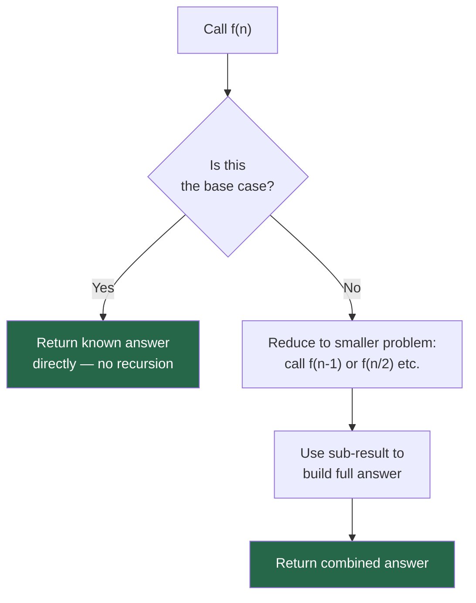
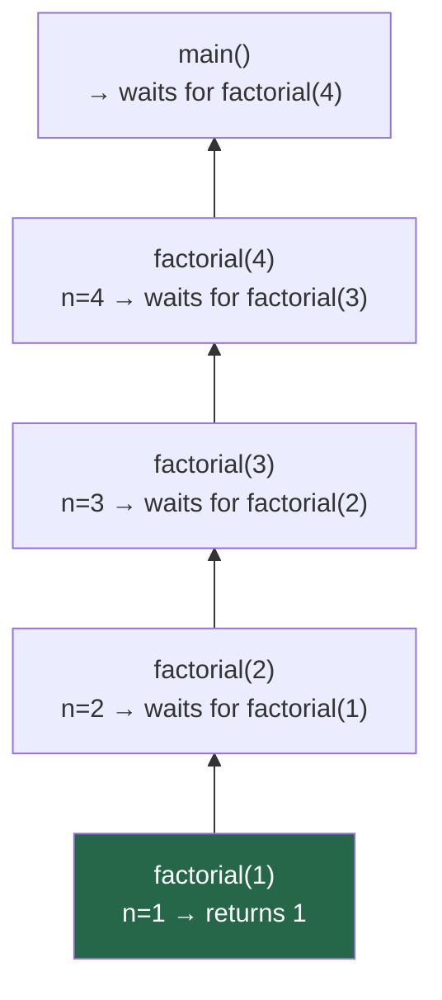
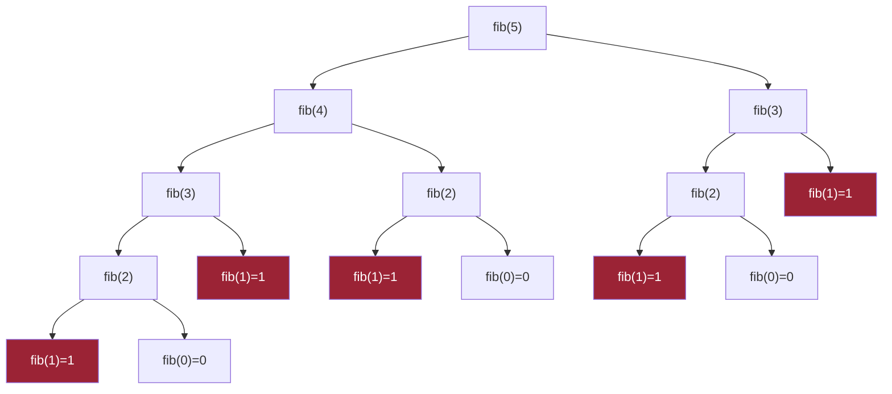
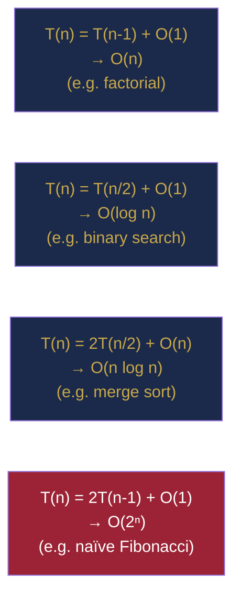

# Chapter 5 — Recursion: Learning to Think Recursively

> **Part I — Foundations of Algorithmic Thinking**  
> [← Chapter 4](chapter-04-java-toolkit.md) · [← Index](../INDEX.md) · [→ Chapter 6](../INDEX.md#-chapter-6--asymptotic-analysis-measuring-algorithm-efficiency)

---

## Learning Objectives

By the end of this chapter you will be able to:

- Define recursion precisely and distinguish it from iteration.
- Identify base cases and recursive cases in any recursive problem.
- Trace recursive calls by drawing the call stack step by step.
- Explain why Java does **not** perform tail-call optimisation and what that means for stack depth.
- Compare linear recursion, tree recursion, and their typical complexity implications.
- Convert a recursive solution to an iterative one using an explicit stack.
- Write a recurrence relation for a recursive algorithm and reason informally about its complexity.
- Apply the helper-method and accumulator patterns to write clean, safe recursive Java code.

---

## Contents

- [5.1 What Is Recursion?](#51-what-is-recursion)
- [5.2 The Anatomy of a Recursive Function](#52-the-anatomy-of-a-recursive-function)
- [5.3 Call Stack and Stack Frames](#53-call-stack-and-stack-frames)
- [5.4 Tracing Recursive Calls: Factorial](#54-tracing-recursive-calls-factorial)
- [5.5 Linear Recursion: One Recursive Call](#55-linear-recursion-one-recursive-call)
- [5.6 Tree Recursion: Multiple Recursive Calls](#56-tree-recursion-multiple-recursive-calls)
- [5.7 Direct and Indirect Recursion](#57-direct-and-indirect-recursion)
- [5.8 Recursion on Data Structures](#58-recursion-on-data-structures)
- [5.9 Recursion Depth and StackOverflowError](#59-recursion-depth-and-stackoverflowerror)
- [5.10 Recursion vs Iteration](#510-recursion-vs-iteration)
- [5.11 Converting Recursion to Iteration](#511-converting-recursion-to-iteration)
- [5.12 The Accumulator Pattern](#512-the-accumulator-pattern)
- [5.13 Recursion Trees and Recurrence Relations](#513-recursion-trees-and-recurrence-relations)
- [5.14 Java Recursion Patterns](#514-java-recursion-patterns)
- [Interview Insight](#interview-insight)
- [Myth vs Reality](#myth-vs-reality)
- [Mini Challenges](#mini-challenges)
- [Quick Quiz](#quick-quiz)
- [5.15 Practice Problems](#515-practice-problems)
- [5.16 Hard Problem Corner](#516-hard-problem-corner)
- [Chapter Summary](#chapter-summary)

---

## 5.1 What Is Recursion?

**Recursion** is a technique where a function solves a problem by calling itself on a smaller version of the same problem.

That definition has two critical parts: *a smaller version* (the problem shrinks) and *the same problem* (the structure repeats). When both are true, recursion is often the most natural solution.

Recursion and mathematical induction (covered in [Chapter 2](chapter-02-mathematical-foundations.md#212-mathematical-induction)) are two faces of the same idea:

| Mathematical Induction | Recursion |
|------------------------|-----------|
| Base case | Base case: return a known answer directly |
| Inductive step | Recursive case: reduce problem, trust the sub-result |
| Prove for $n$ given truth for $n-1$ | Solve for $n$ given the solved answer for $n-1$ |

*Table 5.1: Induction and recursion are structurally identical.*

---

> ### 🔗 Analogy
> **Russian Dolls**
>
> A set of Matryoshka (Russian nesting) dolls is a physical recursion. To find the total number of dolls, you open the outermost doll and find another doll inside. Opening that one reveals another. You keep going until you reach the smallest doll, which contains nothing — the **base case**. Then you count backwards as you re-close each layer: the smallest is 1, the next is 2, and so on until the outermost doll gives you the final count.
>
> Every recursive function works exactly this way: descend until you hit the base case, then propagate the result back up through the call chain.

---

## 5.2 The Anatomy of a Recursive Function

Every correct recursive function has exactly two ingredients:

**1. Base case(s)** — the condition under which the function returns immediately without making a recursive call. This is what stops the recursion.

**2. Recursive case** — the function calls itself with a *strictly smaller* or *simpler* input, making measurable progress toward the base case.



### The Three Questions Framework

Before writing any recursive function, answer these three questions:

1. **What is the base case?** When is the answer trivially known?
2. **What is the recursive case?** How do I express the solution in terms of a smaller sub-problem?
3. **Does the recursion make progress?** Is the input strictly shrinking toward the base case?

> [!TIP]
> **Trust the recursion.** The hardest mental shift in recursion is believing that the recursive call returns the correct answer *without tracing through the entire call tree*. You only need to verify: "if the recursive call returns the right answer for a smaller input, does my function return the right answer for the current input?" This is exactly mathematical induction.

---

## 5.3 Call Stack and Stack Frames

Every time a function is called in Java, the JVM pushes a **stack frame** onto the call stack. The frame holds:
- The function's local variables and parameters.
- The return address (where execution continues when this call returns).

When the function returns, its frame is **popped** off the stack. For a recursive function with depth $d$, there are $d$ frames on the stack simultaneously at the deepest point.

**Call stack during `factorial(4)`:**



*The stack grows downward (toward the top of this diagram). `factorial(1)` is the deepest frame and the first to return.*

---

## 5.4 Tracing Recursive Calls: Factorial

$n! = n \times (n-1) \times \cdots \times 2 \times 1$, with $0! = 1$.

**Recursive definition:**
$$n! = \begin{cases} 1 & \text{if } n = 0 \\ n \times (n-1)! & \text{if } n > 0 \end{cases}$$

```java
public static long factorial(int n) {
    if (n == 0) return 1;           // base case
    return n * factorial(n - 1);   // recursive case
}
```

*Listing 5.1: Recursive factorial.*

**Dry run for `factorial(4)`:**

| Phase | Call | Action | Returns |
|-------|------|--------|---------|
| Descent | `factorial(4)` | calls `factorial(3)` | — |
| Descent | `factorial(3)` | calls `factorial(2)` | — |
| Descent | `factorial(2)` | calls `factorial(1)` | — |
| Descent | `factorial(1)` | calls `factorial(0)` | — |
| **Base** | `factorial(0)` | returns `1` (base case) | **1** |
| Ascent | `factorial(1)` | computes `1 × 1` | **1** |
| Ascent | `factorial(2)` | computes `2 × 1` | **2** |
| Ascent | `factorial(3)` | computes `3 × 2` | **6** |
| Ascent | `factorial(4)` | computes `4 × 6` | **24** |

*Table 5.2: Descent phase builds the call stack; ascent phase unwinds it, computing results on the way back up.*

---

> [!NOTE]
> **Return values travel upward.** Each call in the ascent phase receives the return value of the call below it and uses it to compute its own return value. Nothing is computed during descent — all work happens on the way back up. This "deferred computation" pattern is characteristic of non-tail recursion.

---

## 5.5 Linear Recursion: One Recursive Call

**Linear recursion** makes exactly one recursive call per invocation. The recursion trace is a straight line, not a tree. Time complexity is usually $O(n)$ and stack depth is $O(n)$.

### Sum of Array Elements

```java
public static int sum(int[] arr, int i) {
    if (i == arr.length) return 0;          // base: empty suffix
    return arr[i] + sum(arr, i + 1);        // add current + rest
}
// Called as: sum(arr, 0)
```

### Check if a String is a Palindrome

```java
public static boolean isPalindrome(String s, int lo, int hi) {
    if (lo >= hi) return true;                      // base: empty or single char
    if (s.charAt(lo) != s.charAt(hi)) return false; // early exit
    return isPalindrome(s, lo + 1, hi - 1);         // check inner substring
}
// Called as: isPalindrome(s, 0, s.length() - 1)
```

### Reverse a String

```java
public static String reverse(String s) {
    if (s.length() <= 1) return s;                     // base
    return reverse(s.substring(1)) + s.charAt(0);      // last char moves to front
}
```

### Binary Search (Halving Recursion)

Each call halves the search space. Stack depth is $O(\log n)$:

```java
public static int binarySearch(int[] arr, int target, int lo, int hi) {
    if (lo > hi) return -1;                   // base: not found
    int mid = lo + (hi - lo) / 2;
    if (arr[mid] == target) return mid;
    if (arr[mid] < target) return binarySearch(arr, target, mid + 1, hi);
    return binarySearch(arr, target, lo, mid - 1);
}
```

---

## 5.6 Tree Recursion: Multiple Recursive Calls

**Tree recursion** makes two or more recursive calls per invocation. The call trace is a tree, and the total work is proportional to the number of nodes in that tree.

### Fibonacci (Naïve — Exponential)

```java
public static long fib(int n) {
    if (n <= 1) return n;                   // fib(0)=0, fib(1)=1
    return fib(n - 1) + fib(n - 2);        // two recursive calls
}
```

**Call tree for `fib(5)`:**



*The red nodes show the same sub-problems being solved repeatedly. `fib(3)` is computed twice, `fib(2)` three times. This is the **overlapping subproblems** problem that Dynamic Programming solves in [Chapter 40](../INDEX.md#-chapter-40--dynamic-programming-foundations).*

**Complexity of naïve Fibonacci:** Each call spawns two more. At depth $n$, there are roughly $2^n$ calls → $O(2^n)$ time, $O(n)$ space (stack depth).

> [!WARNING]
> **Naïve recursive Fibonacci is unusable for $n > 40$.** `fib(50)` makes over $10^{10}$ calls. For large $n$, use memoisation (top-down DP) or the iterative approach (Section 5.11).

---

## 5.7 Direct and Indirect Recursion

**Direct recursion:** `f` calls `f`.

```java
int factorial(int n) { return n == 0 ? 1 : n * factorial(n - 1); }
```

**Indirect recursion:** `f` calls `g`, which calls `f`. Both are mutually recursive.

```java
boolean isEven(int n) {
    if (n == 0) return true;
    return isOdd(n - 1);        // calls isOdd
}

boolean isOdd(int n) {
    if (n == 0) return false;
    return isEven(n - 1);       // calls isEven
}
```

Indirect recursion is less common but appears in parsing algorithms and certain tree traversal patterns. It follows the same rules: each call must make progress toward a base case.

---

## 5.8 Recursion on Data Structures

Recursive data structures — where a node contains a reference to nodes of the same type — are a natural fit for recursive algorithms.

### Linked List: Sum of All Values

```java
// Node definition (abbreviated)
class ListNode { int val; ListNode next; }

public static int sum(ListNode node) {
    if (node == null) return 0;           // base: empty list
    return node.val + sum(node.next);     // current + rest
}
```

### Linked List: Reverse (Recursive)

This is a canonical recursive list problem. It is worth tracing until the pattern is clear.

```java
public static ListNode reverse(ListNode head) {
    if (head == null || head.next == null) return head;  // base: 0 or 1 node
    ListNode newHead = reverse(head.next);   // reverse the tail
    head.next.next = head;                   // point tail's last node back to head
    head.next = null;                        // sever head from the rest
    return newHead;
}
```

**Tracing `reverse(1→2→3→null)`:**
1. Call `reverse(1→2→3)` → calls `reverse(2→3)`
2. Call `reverse(2→3)` → calls `reverse(3)`
3. Call `reverse(3)` → returns `3` (base case)
4. Back in `reverse(2→3)`: `3.next = 2`, `2.next = null` → list is now `3→2→null`, returns `3`
5. Back in `reverse(1→2→3)`: `2.next = 1`, `1.next = null` → list is now `3→2→1→null`, returns `3`

### Binary Tree: Height

```java
class TreeNode { int val; TreeNode left, right; }

public static int height(TreeNode root) {
    if (root == null) return -1;                      // base: empty tree
    return 1 + Math.max(height(root.left), height(root.right)); // 1 + max child height
}
```

This is tree recursion — two recursive calls per node. Total time: $O(n)$ where $n$ = number of nodes. We will explore tree recursion extensively in [Chapter 26](../INDEX.md#-chapter-26--tree-traversal-and-recursive-patterns).

---

## 5.9 Recursion Depth and StackOverflowError

The call stack has finite size. When recursive depth exceeds the JVM's stack limit (typically 500–10,000 frames depending on frame size and JVM settings), Java throws `StackOverflowError`.

```java
public static void infinite(int n) {
    infinite(n + 1);  // no base case — always overflows!
}

// Also dangerous with valid-looking code:
public static int fib(int n) {
    return fib(n - 1) + fib(n - 2);  // forgot base case!
}
```

**Estimating safe depth:** Each stack frame for a simple method uses ~100–200 bytes. The default thread stack is ~512 KB–1 MB, giving roughly 2000–5000 frames for simple methods. LeetCode problems with $n \leq 10^4$ can be recursive if each frame is small; $n \leq 10^5$ usually requires iteration.

**Diagnosing `StackOverflowError`:**
1. Missing or unreachable base case.
2. Recursive call that does not make progress (e.g., calls with the same argument).
3. Input too large for the recursive depth (convert to iterative — Section 5.11).

---

## 5.10 Recursion vs Iteration

| Dimension | Recursion | Iteration |
|-----------|-----------|-----------|
| **Clarity** | Often clearer for tree/graph problems | Often clearer for array/string problems |
| **Stack space** | O(depth) implicit stack | O(1) for simple loops; O(depth) if explicit stack |
| **Java optimisation** | No tail-call optimisation | Fully optimised by JIT |
| **Debugging** | Call stack traces are helpful | Usually easier to step through |
| **Risk** | `StackOverflowError` on deep inputs | No stack risk |

*Table 5.3: Recursion vs iteration trade-offs.*

> ### 💡 Did You Know?
>
> Many programming languages (Scheme, Haskell, Scala with `@tailrec`) perform **tail-call optimisation** (TCO): if a recursive call is the last operation in a function, the compiler reuses the current stack frame instead of pushing a new one, making the recursion $O(1)$ space. **Java does not perform TCO** — ever. Even a tail-recursive `factorial` in Java still grows the stack linearly. The only way to get $O(1)$ stack space in Java is to use an explicit loop or accumulator-based iteration.

---

## 5.11 Converting Recursion to Iteration

Any recursive algorithm can be converted to an iterative one by managing an explicit stack (`ArrayDeque`) yourself.

### Factorial: Direct Conversion

```java
// Recursive
public static long factorial(int n) {
    if (n == 0) return 1;
    return n * factorial(n - 1);
}

// Iterative — O(1) stack space
public static long factorialIterative(int n) {
    long result = 1;
    for (int i = 2; i <= n; i++) result *= i;
    return result;
}
```

### Fibonacci: Iterative

```java
public static long fibIterative(int n) {
    if (n <= 1) return n;
    long prev = 0, curr = 1;
    for (int i = 2; i <= n; i++) {
        long next = prev + curr;
        prev = curr;
        curr = next;
    }
    return curr;
}
```

**Complexity:** O(n) time, **O(1) space** — vastly better than the O(2ⁿ) recursive version.

### Depth-First Search: Explicit Stack

Tree/graph DFS is naturally recursive. When depth is too large, use an explicit stack:

```java
// Recursive DFS — may overflow for deep trees
void dfsRecursive(TreeNode root) {
    if (root == null) return;
    process(root);
    dfsRecursive(root.left);
    dfsRecursive(root.right);
}

// Iterative DFS using ArrayDeque
void dfsIterative(TreeNode root) {
    if (root == null) return;
    Deque<TreeNode> stack = new ArrayDeque<>();
    stack.push(root);
    while (!stack.isEmpty()) {
        TreeNode node = stack.pop();
        process(node);
        if (node.right != null) stack.push(node.right);  // right first (processed last)
        if (node.left  != null) stack.push(node.left);
    }
}
```

---

## 5.12 The Accumulator Pattern

The **accumulator pattern** passes an extra parameter that carries the partial result, enabling the final answer to be returned directly from the deepest call rather than computed during the ascent.

```java
// Standard recursive factorial — computes on the WAY BACK UP
public static long factorial(int n) {
    if (n == 0) return 1;
    return n * factorial(n - 1);  // must wait for sub-result
}

// Accumulator version — passes partial product DOWN
public static long factorialAcc(int n, long acc) {
    if (n == 0) return acc;              // base: acc holds the final answer
    return factorialAcc(n - 1, n * acc); // last action is the recursive call
}
// Called as: factorialAcc(5, 1)
```

**Why use this?** The accumulator version is a tail call (the recursive call is the very last operation). While Java does not optimise it, the structure makes the iterative conversion mechanical:

```java
// Accumulator → iterative: replace tail call with loop
public static long factorialLoop(int n) {
    long acc = 1;
    while (n > 0) { acc *= n; n--; }
    return acc;
}
```

### Accumulator for Sum

```java
// Without accumulator: computes on ascent
int sum(int[] arr, int i) {
    if (i == arr.length) return 0;
    return arr[i] + sum(arr, i + 1);
}

// With accumulator: returns from base case directly
int sum(int[] arr, int i, int acc) {
    if (i == arr.length) return acc;
    return sum(arr, i + 1, acc + arr[i]);
}
```

---

## 5.13 Recursion Trees and Recurrence Relations

A **recurrence relation** expresses $T(n)$ — the time cost of a recursive function on input of size $n$ — in terms of the costs of its recursive calls plus the cost of the work done at the current level.

### Four Key Recurrences



| Recurrence | Shape of recursion tree | Complexity | Example |
|-----------|------------------------|------------|---------|
| $T(n) = T(n-1) + O(1)$ | Chain (depth $n$, work per level = 1) | $O(n)$ | Factorial, sum |
| $T(n) = T(n/2) + O(1)$ | Chain (depth $\log n$, work per level = 1) | $O(\log n)$ | Binary search |
| $T(n) = 2T(n/2) + O(n)$ | Binary tree (depth $\log n$, total work per level = $n$) | $O(n \log n)$ | Merge sort |
| $T(n) = 2T(n-1) + O(1)$ | Binary tree (depth $n$, $2^n$ leaves) | $O(2^n)$ | Naïve Fibonacci |

*Table 5.4: Common recurrences. The last row produces exponential cost — the warning sign of a problem needing memoisation or DP.*

We will formalise these with the Master Theorem in [Chapter 6](../INDEX.md#-chapter-6--asymptotic-analysis-measuring-algorithm-efficiency).

### Identifying the Recurrence

For any recursive function:
1. Count the number of recursive calls per level (branching factor $b$).
2. Determine how the input size changes per call: $n-1$, $n/2$, etc.
3. Determine the work done *outside* the recursive calls (the non-recursive cost).
4. Write $T(n) = b \cdot T(\text{sub-size}) + O(\text{non-recursive work})$.

**Example — merge sort:**
- 2 recursive calls on halves → $b = 2$, sub-size $= n/2$
- Merging the two halves → $O(n)$ non-recursive work
- Recurrence: $T(n) = 2T(n/2) + O(n)$ → $O(n \log n)$

---

## 5.14 Java Recursion Patterns

### Pattern 1: Helper Method (Wrapper)

Expose a clean public API while passing extra parameters internally:

```java
// Public API: clean and simple
public boolean isPalindrome(String s) {
    return helper(s, 0, s.length() - 1);
}

// Private helper: carries the index parameters
private boolean helper(String s, int lo, int hi) {
    if (lo >= hi) return true;
    if (s.charAt(lo) != s.charAt(hi)) return false;
    return helper(s, lo + 1, hi - 1);
}
```

### Pattern 2: Return vs Void

Recursive functions either **return** a computed value or perform **side-effect** work (e.g., printing, building a list). Mixing both is a code smell.

```java
// Return-based: propagates result up the chain
int countNodes(TreeNode root) {
    if (root == null) return 0;
    return 1 + countNodes(root.left) + countNodes(root.right);
}

// Void: collects results into an external list (passed by reference)
void collectLeaves(TreeNode root, List<Integer> leaves) {
    if (root == null) return;
    if (root.left == null && root.right == null) { leaves.add(root.val); return; }
    collectLeaves(root.left, leaves);
    collectLeaves(root.right, leaves);
}
```

### Pattern 3: Global/Instance Variable Accumulation

For complex tree problems, store running state at the class or method level:

```java
int maxDiameter = 0;  // class-level field

int diameter(TreeNode root) {
    heightAndUpdate(root);
    return maxDiameter;
}

int heightAndUpdate(TreeNode root) {
    if (root == null) return -1;
    int leftH  = heightAndUpdate(root.left);
    int rightH = heightAndUpdate(root.right);
    maxDiameter = Math.max(maxDiameter, leftH + rightH + 2);
    return 1 + Math.max(leftH, rightH);
}
```

### Pattern 4: Short-Circuit Early Return

Stop as soon as the answer is known — do not keep recursing unnecessarily:

```java
boolean hasPathSum(TreeNode root, int target) {
    if (root == null) return false;
    if (root.left == null && root.right == null) return root.val == target;
    int remainder = target - root.val;
    return hasPathSum(root.left, remainder) || hasPathSum(root.right, remainder);
    // The || short-circuits: if left returns true, right is never called
}
```

---

> ### 🤔 Think Before You Code
>
> You are asked to write `int power(int base, int exp)` that computes $\text{base}^{\text{exp}}$ recursively.
>
> Before writing any code: answer the three questions.  
> 1. What is the base case? (When is the answer immediately known?)  
> 2. What is the recursive case? (How does `power(base, exp)` relate to `power(base, exp-1)`?)  
> 3. Can you do better than $O(n)$ by halving `exp` each time?

---

## Interview Insight

> ### 🎯 Interview Insight
> **How Interviewers Evaluate Recursion**
>
> When you use recursion in an interview, you are tested on four things simultaneously:
>
> 1. **Correctness** — do you have the right base case(s)? Does the recursive case make progress?
> 2. **Complexity awareness** — can you write the recurrence relation and state the resulting complexity?
> 3. **Stack awareness** — do you mention that your recursion has $O(n)$ or $O(\log n)$ stack depth? Do you know when to prefer iteration?
> 4. **Code quality** — is the code clean? Do you use a helper method where appropriate?
>
> A strong answer for a recursive solution looks like: *"I'll use recursion. The base case is [X]. Each call reduces the problem by [Y]. The recurrence is T(n) = T(n-1) + O(1) → O(n) time, O(n) stack space. If the input could be very deep, I'd convert to iterative with an explicit stack."*

---

## Myth vs Reality

> ### ⚡ Myth vs Reality
>
> **Myth:** Recursion is always slower than iteration.
>
> **Reality:** The speed difference between recursion and iteration for the *same algorithm* is a small constant factor (function call overhead). What actually matters is the **algorithm complexity** — $O(n)$ recursive vs $O(n^2)$ iterative is not even close. Where recursion genuinely loses is **stack space**: $O(n)$ stack frames can cause `StackOverflowError` on large inputs where $O(1)$ iterative code would succeed. The rule is not "avoid recursion" but "be aware of stack depth and convert to iteration when depth is a concern."

---

## Mini Challenges

> ### 🏆 Mini Challenge 5.1 — Fast Power
>
> Implement `long power(long base, int exp)` that computes $\text{base}^{\text{exp}}$ using recursion. Your solution must run in $O(\log \text{exp})$ time — not $O(\text{exp})$.
>
> **Hint:** If `exp` is even, $\text{base}^{\text{exp}} = (\text{base}^{\text{exp}/2})^2$. If `exp` is odd, $\text{base}^{\text{exp}} = \text{base} \times \text{base}^{\text{exp}-1}$.
>
> This algorithm is called **fast exponentiation** or **exponentiation by squaring**. Write the recurrence relation, then implement it.

---

> ### 🏆 Mini Challenge 5.2 — Count Occurrences
>
> Given a string `s` and a character `c`, write a recursive function that counts the number of times `c` appears in `s` — without using any loops, `indexOf`, `String.chars()`, or the `Character` class.
>
> Then identify: what recurrence does your solution satisfy? What is its complexity?

---

## Quick Quiz

**Q1.** What are the two required components of every correct recursive function?

<details>
<summary><strong>Answer</strong></summary>

> **A1.** A **base case** (returns a known answer directly without recursing) and a **recursive case** (calls itself with a strictly smaller or simpler input that makes measurable progress toward the base case).

</details>

---

**Q2.** What is the time complexity of this function? Write the recurrence and solve it.
```java
int f(int n) {
    if (n == 0) return 1;
    return f(n - 1) + f(n - 1);
}
```

<details>
<summary><strong>Answer</strong></summary>

> **A2.** Each call makes **two** recursive calls, each on input `n-1`.  
> Recurrence: $T(n) = 2T(n-1) + O(1)$.  
> This unfolds to $2 \cdot 2 \cdot 2 \cdots$ ($n$ times) = $O(2^n)$ — exponential.  
> The function computes $2^n$, but it does so in exponential time by repeatedly recomputing the same sub-problems.

</details>

---

**Q3.** Why does Java throw `StackOverflowError` on deep recursion, and not `OutOfMemoryError`?

<details>
<summary><strong>Answer</strong></summary>

> **A3.** Each recursive call pushes a new **stack frame** onto the thread's call stack (a fixed-size region of memory, separate from the heap). When the call stack is exhausted, the JVM throws `StackOverflowError` (a stack overflow, not a heap overflow). `OutOfMemoryError` occurs when the **heap** runs out — a different region.

</details>

---

**Q4.** What is the difference between a **return-based** and a **void** recursive function? Give one example of when you would use each.

<details>
<summary><strong>Answer</strong></summary>

> **A4.** A **return-based** function propagates a computed value back up the call chain (e.g., `countNodes` returning the subtree size). A **void** function performs side effects, often accumulating results into an external collection (e.g., `collectLeaves` adding values to a `List`). Use return-based when the result is a single computed value; use void when the result is a collection built incrementally.

</details>

---

**Q5.** Convert the following recursive function to an iterative one:
```java
int sum(int n) {
    if (n == 0) return 0;
    return n + sum(n - 1);
}
```

<details>
<summary><strong>Answer</strong></summary>

> **A5.**
> ```java
> int sum(int n) {
>     int total = 0;
>     for (int i = 1; i <= n; i++) total += i;
>     return total;
> }
> ```
> Or using the arithmetic series formula from [Chapter 2](chapter-02-mathematical-foundations.md#261-arithmetic-series): `return n * (n + 1) / 2;` — $O(1)$ time and space.

</details>

---

## 5.15 Practice Problems

| Problem | Name | Difficulty | Recursion Concept |
|---------|------|------------|-------------------|
| [LC 509](https://leetcode.com/problems/fibonacci-number/) | Fibonacci Number | Easy | Basic recursion; motivates memoisation |
| [LC 344](https://leetcode.com/problems/reverse-string/) | Reverse String | Easy | Linear recursion on array |
| [LC 206](https://leetcode.com/problems/reverse-linked-list/) | Reverse Linked List | Easy | Recursive linked list |
| [LC 104](https://leetcode.com/problems/maximum-depth-of-binary-tree/) | Maximum Depth of Binary Tree | Easy | Tree recursion |
| [LC 112](https://leetcode.com/problems/path-sum/) | Path Sum | Easy | Recursive tree descent |
| [LC 50](https://leetcode.com/problems/powx-n/) | Pow(x, n) | Medium | Fast exponentiation (Mini Challenge 5.1) |
| [LC 24](https://leetcode.com/problems/swap-nodes-in-pairs/) | Swap Nodes in Pairs | Medium | Recursive linked list manipulation |
| [LC 779](https://leetcode.com/problems/k-th-symbol-in-grammar/) | K-th Symbol in Grammar | Medium | Recursive structure identification |
| [LC 236](https://leetcode.com/problems/lowest-common-ancestor-of-a-binary-tree/) | Lowest Common Ancestor | Medium | Tree recursion with return values |
| [LC 95](https://leetcode.com/problems/unique-binary-search-trees-ii/) | Unique BSTs II | Medium | Generate all recursive structures |

---

## 5.16 Hard Problem Corner

> ### 🔥 Hard Problem Corner
>
> **Problem: Tower of Hanoi**
>
> You have three rods (A, B, C) and $n$ discs of decreasing size on rod A. Move all discs to rod C using B as auxiliary, subject to: (1) only one disc moves at a time, and (2) a larger disc may never rest on a smaller one.
>
> **Tasks:**
> 1. Write a recursive `hanoi(int n, char from, char to, char aux)` that prints each move.
> 2. Write the recurrence relation $T(n)$ for the number of moves.
> 3. Solve the recurrence and state the minimum number of moves for $n$ discs.

<details>
<summary><strong>Solution (click to reveal)</strong></summary>

> [!TIP]
> **Solution**
>
> **Recursive insight:** To move $n$ discs from A to C:
> 1. Move the top $n-1$ discs from A to B (using C as auxiliary).
> 2. Move the largest disc from A to C.
> 3. Move $n-1$ discs from B to C (using A as auxiliary).
>
> ```java
> public static void hanoi(int n, char from, char to, char aux) {
>     if (n == 0) return;                              // base: nothing to move
>     hanoi(n - 1, from, aux, to);                    // step 1
>     System.out.println("Move disc " + n + " from " + from + " to " + to);
>     hanoi(n - 1, aux, to, from);                    // step 3
> }
> ```
>
> **Recurrence:**  
> $T(n) = 2T(n-1) + 1$, with $T(0) = 0$.
>
> **Solving:** unfold the recurrence:  
> $T(n) = 2T(n-1) + 1 = 2(2T(n-2)+1)+1 = 4T(n-2)+3 = \ldots = 2^n T(0) + (2^n - 1) = 2^n - 1$
>
> **Minimum moves for $n$ discs: $2^n - 1$.**
>
> For $n = 64$ discs (the original legend), that is $2^{64} - 1 \approx 1.8 \times 10^{19}$ moves. At one move per second, this would take over 580 billion years — the classic illustration of exponential complexity.

</details>

---

## Chapter Summary

| Concept | Key Takeaway |
|---------|-------------|
| **Recursion** | A function that solves a problem by calling itself on a strictly smaller sub-problem. |
| **Two requirements** | Base case (stops recursion) + recursive case (makes progress). |
| **Trust the recursion** | Assume the recursive call returns the correct answer; prove your function is correct given that. This is induction. |
| **Call stack** | Depth $d$ uses $d$ frames. Exceeding the limit throws `StackOverflowError`. |
| **Linear recursion** | One call per level → $O(n)$ time, $O(n)$ stack. |
| **Tree recursion** | Multiple calls per level → exponential unless sub-problems don't overlap. |
| **No TCO in Java** | Java never optimises tail calls. Deep recursion must be converted to iteration. |
| **Accumulator pattern** | Pass partial result as a parameter; enables clean iterative conversion. |
| **Helper method pattern** | Wrap the recursive function to hide extra parameters from the public API. |
| **Recurrence $T(n) = 2T(n-1)$** | Exponential cost — the danger sign of naïve tree recursion. |
| **Converting to iterative** | Replace implicit stack with an explicit `ArrayDeque`. Applies universally. |

*Table 5.5: Chapter 5 key concepts.*

---

**Coming Up Next:** [Chapter 6 (Asymptotic Analysis)](../INDEX.md#-chapter-6--asymptotic-analysis-measuring-algorithm-efficiency) formalises the complexity reasoning used throughout this chapter. Big-O, Big-Theta, the Master Theorem, and the mathematical tools for analysing both iterative and recursive algorithms precisely.

---

> **Part I — Foundations of Algorithmic Thinking**  
> [← Chapter 4](chapter-04-java-toolkit.md) · [← Index](../INDEX.md) · [→ Chapter 6 (planned)](../INDEX.md#-chapter-6--asymptotic-analysis-measuring-algorithm-efficiency)
