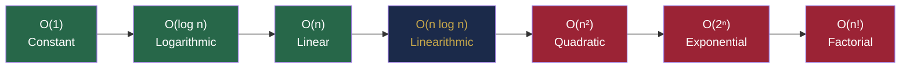
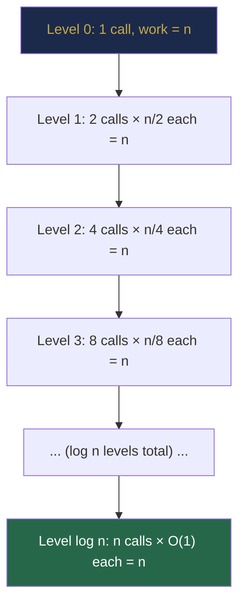
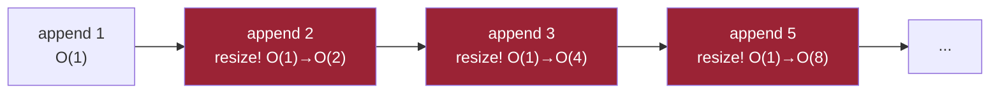

# Chapter 6 — Asymptotic Analysis: Measuring Algorithm Efficiency

> **Part I — Foundations of Algorithmic Thinking**  
> [← Chapter 5](chapter-05-recursion.md) · [← Index](../INDEX.md) · [→ Part II: Chapter 7](../INDEX.md#-chapter-7--arrays-foundations-and-memory-model)

---

## Learning Objectives

By the end of this chapter you will be able to:

- Explain what "input size" means and why constant factors are discarded in asymptotic analysis.
- State the formal definitions of Big-O, Big-Omega, and Big-Theta, and distinguish them from best/average/worst case.
- Read the complexity of any single loop, nested loop, or loop with a non-linear step in one pass.
- Write a recurrence relation for any recursive algorithm and solve it using the recursion-tree method, the substitution method, and the Master Theorem.
- Apply amortised analysis to explain why dynamic array appends are O(1) on average.
- State the auxiliary space cost of a recursive algorithm and account for the implicit call-stack space.
- Look at a problem's constraints and immediately estimate which complexity class is acceptable.

---

## Contents

- [6.1 Why Efficiency Matters](#61-why-efficiency-matters)
- [6.2 Input Size and Growth Rates](#62-input-size-and-growth-rates)
- [6.3 Big-O, Big-Omega and Big-Theta](#63-big-o-big-omega-and-big-theta)
- [6.4 Best, Average and Worst Cases](#64-best-average-and-worst-cases)
- [6.5 Complexity Classes](#65-complexity-classes)
- [6.6 Analysing Loops and Nested Loops](#66-analysing-loops-and-nested-loops)
- [6.7 Analysing Recursive Algorithms](#67-analysing-recursive-algorithms)
- [6.8 Recurrence Relations](#68-recurrence-relations)
- [6.9 The Recursion-Tree Method](#69-the-recursion-tree-method)
- [6.10 The Substitution Method](#610-the-substitution-method)
- [6.11 The Master Theorem](#611-the-master-theorem)
- [6.12 Amortised Analysis](#612-amortised-analysis)
- [6.13 Time vs Space Complexity](#613-time-vs-space-complexity)
- [6.14 Auxiliary Space and the Recursion Stack](#614-auxiliary-space-and-the-recursion-stack)
- [Interview Insight](#interview-insight)
- [Myth vs Reality](#myth-vs-reality)
- [Quick Quiz](#quick-quiz)
- [6.15 Practice Problems](#615-practice-problems)
- [Chapter Summary](#chapter-summary)

---

## 6.1 Why Efficiency Matters

Two algorithms can both solve the same problem correctly and yet behave completely differently at scale.

**Concrete example — sorting 10⁶ integers:**

| Algorithm | Complexity | Approx. operations | Time at 10⁸ ops/sec |
|-----------|-----------|-------------------|---------------------|
| Merge sort | O(n log n) | ~20 × 10⁶ | **0.2 seconds** |
| Bubble sort | O(n²) | ~10¹² | **~115 days** |

*Table 6.1: Same problem, dramatically different running times.*

The difference is not about hardware or Java optimisations — it is about the structure of the algorithm. Asymptotic analysis gives us the mathematical vocabulary to reason about this structure independent of machine speed, language, or constant factors.

---

> ### 🔗 Analogy
> **Directions in a City**
>
> Two routes connect the same two points in a city. Route A always takes about 15 minutes regardless of traffic. Route B takes 5 minutes when empty but 2 hours during rush hour. The *best case* of Route B beats Route A, but the *worst case* is disastrous. Asymptotic analysis lets you characterise *how a route's time scales with traffic volume* — independent of the specific minute it takes today.

---

## 6.2 Input Size and Growth Rates

**Input size $n$** is the quantity that dominates the problem's size:
- An array of $n$ elements → $n$ elements.
- A string of length $n$ → $n$ characters.
- A graph with $V$ vertices and $E$ edges → usually both $V$ and $E$ matter.
- A number with value $N$ → sometimes $n = N$, sometimes $n = \log N$ (number of digits).

### Growth Rate Table

The following table shows how many operations each complexity class demands for increasing $n$. Assume a machine executes $10^8$ simple operations per second.

| $n$ | O(log n) | O(n) | O(n log n) | O(n²) | O(2ⁿ) |
|-----|----------|------|-----------|-------|-------|
| 10 | 3 | 10 | 33 | 100 | 1,024 |
| 100 | 7 | 100 | 664 | 10,000 | 10³⁰ |
| 1,000 | 10 | 1,000 | ~10,000 | 10⁶ | ∞ |
| 10⁶ | 20 | 10⁶ | 2×10⁷ | 10¹² | ∞ |
| 10⁹ | 30 | 10⁹ | 3×10¹⁰ | 10¹⁸ | ∞ |

*Table 6.2: Growth rates. At $n = 100$, $O(2^n)$ exceeds the number of atoms in the observable universe.*

### Feasibility Guide (1 second / 10⁸ operations)

This table is essential for competitive programming and estimating complexity during an interview.

| Complexity | Maximum feasible $n$ |
|-----------|---------------------|
| O(1), O(log n) | Any |
| O(n) | ~10⁸ |
| O(n log n) | ~3 × 10⁶ |
| O(n²) | ~10⁴ |
| O(n³) | ~500 |
| O(2ⁿ) | ~25 |
| O(n!) | ~12 |

*Table 6.3: Feasibility guide. If a problem has $n \leq 10^5$, an O(n²) solution will almost certainly time out.*

---

## 6.3 Big-O, Big-Omega and Big-Theta

The three asymptotic notations characterise different aspects of an algorithm's growth.

### Big-O — Upper Bound

$f(n) = O(g(n))$ means $f$ grows **no faster than** $g$. Formally: there exist positive constants $c$ and $n_0$ such that $f(n) \leq c \cdot g(n)$ for all $n \geq n_0$.

```
f(n) = 3n² + 5n + 7

Is this O(n²)?  Choose c = 4, n₀ = 6:
  3n² + 5n + 7 ≤ 4n²  for all n ≥ 6? 
  5n + 7 ≤ n²?  Yes for n ≥ 6.  ✓
```

**Big-O is the most commonly used** because we almost always care about the upper bound — the worst case guarantee.

### Big-Omega — Lower Bound

$f(n) = \Omega(g(n))$ means $f$ grows **at least as fast as** $g$.

For example, any comparison-based sorting algorithm is $\Omega(n \log n)$ — no comparison sort can be better than $n \log n$ in the worst case.

### Big-Theta — Tight Bound

$f(n) = \Theta(g(n))$ means $f$ grows **exactly like** $g$: it is both $O(g)$ and $\Omega(g)$.

$f(n) = \Theta(g(n))$ iff there exist $c_1, c_2, n_0 > 0$ such that $c_1 \cdot g(n) \leq f(n) \leq c_2 \cdot g(n)$ for all $n \geq n_0$.

| Notation | Meaning | Analogy |
|----------|---------|---------|
| $f = O(g)$ | $f$ is bounded above by $g$ | $f \leq g$ |
| $f = \Omega(g)$ | $f$ is bounded below by $g$ | $f \geq g$ |
| $f = \Theta(g)$ | $f$ is bounded above and below by $g$ | $f = g$ |

*Table 6.4: Asymptotic notation summary.*

### Simplification Rules

| Rule | Example |
|------|---------|
| Drop constant factors | $O(5n) = O(n)$ |
| Drop lower-order terms | $O(n^2 + n) = O(n^2)$ |
| Logarithm base is irrelevant | $O(\log_2 n) = O(\log_{10} n) = O(\log n)$ |
| Addition: take the dominant | $O(n^2) + O(n \log n) = O(n^2)$ |
| Multiplication: multiply | $O(n) \times O(\log n) = O(n \log n)$ |

*Table 6.5: Big-O simplification rules. These follow directly from the formal definition.*

**Why drop constants?** Because Big-O describes behaviour as $n \to \infty$, and for large enough $n$, any constant factor is overwhelmed by the growth rate. A $10 \times$ faster machine does not change the class.

> [!NOTE]
> **Big-O does not mean "worst case".** It is an upper bound on a *specific* case. You can speak of the Big-O of the best case, the average case, or the worst case separately. In practice, unless otherwise stated, "the time complexity is $O(n \log n)$" almost always refers to the worst-case time complexity.

---

## 6.4 Best, Average and Worst Cases

These describe how the input affects performance — they are orthogonal to the O/Omega/Theta choice.

**Linear search** in an array of $n$ elements looking for target $t$:

| Case | Scenario | Complexity |
|------|----------|------------|
| Best | $t$ is the first element | $O(1)$ |
| Average | $t$ is at a random position | $O(n/2) = O(n)$ |
| Worst | $t$ is absent or last | $O(n)$ |

**Quicksort** on an array of $n$ elements:

| Case | Scenario | Complexity |
|------|----------|------------|
| Best | Pivot always splits perfectly in half | $O(n \log n)$ |
| Average | Random pivot choice | $O(n \log n)$ |
| Worst | Pivot is always the minimum or maximum | $O(n^2)$ |

Quicksort's average case is $O(n \log n)$ but its worst case is $O(n^2)$ — this is why interview candidates are expected to know both.

---

## 6.5 Complexity Classes



| Class | Name | Canonical Example |
|-------|------|------------------|
| $O(1)$ | Constant | Array index, hash lookup |
| $O(\log n)$ | Logarithmic | Binary search, Fenwick tree update |
| $O(n)$ | Linear | Linear scan, sum of array |
| $O(n \log n)$ | Linearithmic | Merge sort, Heap sort |
| $O(n^2)$ | Quadratic | Bubble sort, naïve string matching |
| $O(n^3)$ | Cubic | Floyd-Warshall, naïve matrix multiply |
| $O(2^n)$ | Exponential | All subsets, naïve Fibonacci |
| $O(n!)$ | Factorial | All permutations, brute-force TSP |

*Table 6.6: Complexity classes with canonical examples.*

---

## 6.6 Analysing Loops and Nested Loops

### Single Loop

```java
for (int i = 0; i < n; i++) {
    doConstantWork();   // O(1)
}
// Total: n iterations × O(1) = O(n)
```

### Loop with Non-Linear Step

```java
for (int i = 1; i < n; i *= 2) {   // i doubles each time
    doConstantWork();
}
// i = 1, 2, 4, 8, ..., 2^k where 2^k < n
// Number of iterations: floor(log₂ n) + 1 = O(log n)
```

### Nested Loops — Independent Bounds

```java
for (int i = 0; i < n; i++) {       // n times
    for (int j = 0; j < n; j++) {   // n times
        doConstantWork();
    }
}
// Total: n × n = O(n²)
```

### Nested Loops — Dependent Bounds

```java
for (int i = 0; i < n; i++) {
    for (int j = i + 1; j < n; j++) {   // inner runs n-i-1 times
        doConstantWork();
    }
}
// Total iterations: (n-1) + (n-2) + ... + 1 + 0 = n(n-1)/2 = O(n²)
```

This is the arithmetic series from [Chapter 2](chapter-02-mathematical-foundations.md#261-arithmetic-series). The inner loop starts at $i+1$, so total pairs = $\binom{n}{2}$ — still $O(n^2)$.

### Mixed: Outer O(n), Inner O(log n)

```java
for (int i = 0; i < n; i++) {           // n times
    int j = 1;
    while (j < n) j *= 2;               // O(log n)
}
// Total: n × O(log n) = O(n log n)
```

### A Subtle Case: Two Sequential Loops

```java
for (int i = 0; i < n; i++) doWork();  // O(n)
for (int j = 0; j < m; j++) doWork();  // O(m)
// Total: O(n + m)  — NOT O(n) unless m = O(n)
```

If $n$ and $m$ are independent, the complexity is $O(n + m)$. If $m = O(n)$, then $O(n + m) = O(n)$.

### Quick Loop Analysis Reference

| Loop structure | Complexity |
|---------------|-----------|
| `for i in [0, n)` | O(n) |
| `for i in [0, n)`, `for j in [0, n)` | O(n²) |
| `for i in [0, n)`, `for j in [i, n)` | O(n²) |
| `for i = 1; i < n; i *= 2` | O(log n) |
| `for i in [0, n)`, `for j = 1; j < n; j *= 2` | O(n log n) |
| Three nested loops each to n | O(n³) |

*Table 6.7: Common loop patterns and their complexities.*

---

## 6.7 Analysing Recursive Algorithms

For recursive functions, loop analysis does not directly apply. Instead:

1. **Identify the recursive calls** and their input sizes.
2. **Measure the non-recursive work** at each level.
3. **Write a recurrence relation** (Section 6.8).
4. **Solve the recurrence** (Sections 6.9–6.11).

```java
// Example: merge sort
void mergeSort(int[] arr, int lo, int hi) {
    if (lo >= hi) return;                    // O(1) base case
    int mid = lo + (hi - lo) / 2;
    mergeSort(arr, lo, mid);                 // T(n/2)
    mergeSort(arr, mid + 1, hi);             // T(n/2)
    merge(arr, lo, mid, hi);                 // O(n) non-recursive work
}
// Recurrence: T(n) = 2T(n/2) + O(n)
```

---

## 6.8 Recurrence Relations

A **recurrence relation** defines $T(n)$ in terms of $T$ on smaller inputs.

| Recurrence | Typical algorithm | Closed-form |
|-----------|------------------|-------------|
| $T(n) = T(n-1) + O(1)$ | Factorial, sum of list | $O(n)$ |
| $T(n) = T(n-1) + O(n)$ | Selection sort | $O(n^2)$ |
| $T(n) = T(n/2) + O(1)$ | Binary search | $O(\log n)$ |
| $T(n) = T(n/2) + O(n)$ | Quickselect (average) | $O(n)$ |
| $T(n) = 2T(n/2) + O(1)$ | Counting tree nodes | $O(n)$ |
| $T(n) = 2T(n/2) + O(n)$ | Merge sort | $O(n \log n)$ |
| $T(n) = 2T(n-1) + O(1)$ | Naïve Fibonacci, Tower of Hanoi | $O(2^n)$ |

*Table 6.8: Common recurrences and their solutions. Memorise the top five — they appear in every complexity discussion.*

---

## 6.9 The Recursion-Tree Method

Draw the recursion as a tree. At each level, count the total work. Sum across all levels.

**Example: $T(n) = 2T(n/2) + O(n)$ (merge sort)**



**Analysis:**
- At every level, the total work is **exactly $n$**.
- The tree has depth $\log_2 n$ (input halves each time).
- Total work: $n \times \log_2 n$ levels = $O(n \log n)$ ✓

**Step-by-step:**

| Level | Number of calls | Work per call | Total work at level |
|-------|----------------|--------------|---------------------|
| 0 | 1 | $n$ | $n$ |
| 1 | 2 | $n/2$ | $n$ |
| 2 | 4 | $n/4$ | $n$ |
| $k$ | $2^k$ | $n/2^k$ | $n$ |
| $\log n$ | $n$ | $O(1)$ | $n$ |

Sum across $\log n + 1$ levels: $n \cdot (\log n + 1) = O(n \log n)$.

*Table 6.9: Recursion-tree analysis of merge sort.*

**Example: $T(n) = 2T(n-1) + O(1)$ (Tower of Hanoi)**

| Level | Calls | Work per call | Total at level |
|-------|-------|--------------|----------------|
| 0 | 1 | 1 | 1 |
| 1 | 2 | 1 | 2 |
| 2 | 4 | 1 | 4 |
| $k$ | $2^k$ | 1 | $2^k$ |
| $n$ | $2^n$ | 1 | $2^n$ |

Sum: $1 + 2 + 4 + \cdots + 2^n = 2^{n+1} - 1 = O(2^n)$ (geometric series from [Chapter 2](chapter-02-mathematical-foundations.md#262-geometric-series)).

---

## 6.10 The Substitution Method

**Guess** the form of the solution, then **prove it by induction**.

**Example: $T(n) = 2T(n/2) + n$. Guess $T(n) = O(n \log n)$.**

We want to show $T(n) \leq cn \log n$ for some constant $c > 0$ and sufficiently large $n$.

**Inductive step:** Assume $T(n/2) \leq c(n/2)\log(n/2)$. Then:

$$T(n) = 2T(n/2) + n \leq 2 \cdot c \frac{n}{2} \log \frac{n}{2} + n = cn \log \frac{n}{2} + n = cn(\log n - 1) + n = cn\log n - cn + n$$

For $c \geq 1$: $cn \log n - cn + n \leq cn \log n$ iff $n(1-c) \leq 0$ iff $c \geq 1$. ✓

This confirms $T(n) \leq cn \log n$, so $T(n) = O(n \log n)$.

**Key principle:** If your guess is wrong (the algebra doesn't close), adjust the guess — often by adding lower-order terms or changing the exponent.

---

## 6.11 The Master Theorem

The Master Theorem gives a closed-form solution for divide-and-conquer recurrences of the form:

$$T(n) = aT\!\left(\frac{n}{b}\right) + f(n) \qquad a \geq 1,\ b > 1$$

where $a$ = number of sub-problems, $b$ = factor by which input shrinks, $f(n)$ = non-recursive work.

Let $k = \log_b a$ (the **critical exponent** — the exponent of the natural complexity of combining sub-problems at each level).

| Case | Condition on $f(n)$ | Solution |
|------|--------------------|---------| 
| **Case 1** | $f(n) = O(n^{k-\varepsilon})$ for some $\varepsilon > 0$ (sub-problems dominate) | $T(n) = \Theta(n^k)$ |
| **Case 2** | $f(n) = \Theta(n^k)$ (balanced) | $T(n) = \Theta(n^k \log n)$ |
| **Case 3** | $f(n) = \Omega(n^{k+\varepsilon})$ for some $\varepsilon > 0$ (combining dominates) | $T(n) = \Theta(f(n))$ |

*Table 6.10: Master Theorem. Case 2 is by far the most common in practice.*

### Applying the Master Theorem

**Merge sort:** $T(n) = 2T(n/2) + n$

- $a = 2, b = 2$ → $k = \log_2 2 = 1$
- $f(n) = n = \Theta(n^1) = \Theta(n^k)$ → **Case 2**
- Result: $T(n) = \Theta(n \log n)$ ✓

**Binary search:** $T(n) = T(n/2) + 1$

- $a = 1, b = 2$ → $k = \log_2 1 = 0$
- $f(n) = 1 = \Theta(n^0) = \Theta(n^k)$ → **Case 2**
- Result: $T(n) = \Theta(\log n)$ ✓

**Counting tree nodes:** $T(n) = 2T(n/2) + 1$

- $a = 2, b = 2$ → $k = 1$
- $f(n) = 1 = O(n^{1-\varepsilon})$ for $\varepsilon = 1$ → **Case 1** (sub-problems dominate)
- Result: $T(n) = \Theta(n)$ ✓

**Karatsuba multiplication:** $T(n) = 3T(n/2) + n$

- $a = 3, b = 2$ → $k = \log_2 3 \approx 1.585$
- $f(n) = n = O(n^{1.585 - \varepsilon})$ → **Case 1**
- Result: $T(n) = \Theta(n^{\log_2 3}) \approx \Theta(n^{1.585})$ — faster than naïve $O(n^2)$

> [!NOTE]
> **When the Master Theorem does NOT apply:**
> - The sub-problems have different sizes (e.g., $T(n) = T(n/3) + T(2n/3) + n$ — merge sort on unequal splits).
> - The recurrence is $T(n) = T(n-1) + \ldots$ — these decrease by a constant, not a factor.
> - The regularity condition in Case 3 fails.
>
> In these situations, use the recursion-tree or substitution method.

---

## 6.12 Amortised Analysis

**Amortised analysis** determines the average cost per operation over a sequence of operations, even when individual operations occasionally spike in cost.

### Dynamic Array Resizing

`ArrayList` doubles its capacity when full. Consider appending $n$ elements:

- Most appends: $O(1)$ (no resize needed).
- Occasional append: $O(k)$ to copy $k$ elements (when resizing from capacity $k$).

Resizes happen at capacities $1, 2, 4, 8, \ldots, n$. Total copy cost:

$$1 + 2 + 4 + 8 + \cdots + n = 2n - 1 = O(n)$$

(Geometric series from [Chapter 2](chapter-02-mathematical-foundations.md#262-geometric-series).)

**Amortised cost per append** = total cost / number of appends = $O(n) / n$ = **O(1)**.

Each append is O(1) amortised even though some individual appends are O(n). This is why `ArrayList.add()` is listed as $O(1)$ amortised in every Java reference.



*Expensive operations (red) are rare. The total cost is O(n), amortised O(1) per operation.*

### Aggregate Method

The aggregate method states: if $n$ operations cost at most $T_{\text{total}}$ in total, then each operation costs $T_{\text{total}} / n$ amortised.

Amortised analysis will appear again when we study Fibonacci heaps (Chapter 55) and union-find (Chapter 60).

---

## 6.13 Time vs Space Complexity

Every algorithm has both a **time complexity** and a **space complexity**. Often there is a trade-off: you can spend more memory to run faster, or accept slower speed to use less memory.

| Algorithm | Time | Space | Trade-off |
|-----------|------|-------|-----------|
| Merge sort | $O(n \log n)$ | $O(n)$ | Needs auxiliary array |
| Heap sort | $O(n \log n)$ | $O(1)$ | In-place but worse cache |
| Hash table lookup | $O(1)$ avg | $O(n)$ | Spends memory for speed |
| Memoised Fibonacci | $O(n)$ | $O(n)$ | Cache vs recompute |
| Iterative Fibonacci | $O(n)$ | $O(1)$ | Optimal |

*Table 6.11: Time vs space trade-offs for familiar algorithms.*

**Space complexity** counts all memory used by the algorithm, excluding the input. It includes:
- Variables and arrays created.
- The implicit call stack (for recursive algorithms).

---

## 6.14 Auxiliary Space and the Recursion Stack

The call stack is real memory. A recursive function with depth $d$ uses $O(d)$ space for stack frames, even if each frame uses $O(1)$ local storage.

| Algorithm | Recursion depth | Stack space |
|-----------|---------------|-------------|
| Factorial($n$) | $n$ | $O(n)$ |
| Binary search($n$) | $\log n$ | $O(\log n)$ |
| Merge sort($n$) | $\log n$ | $O(\log n)$ |
| Naïve Fibonacci($n$) | $n$ | $O(n)$ |
| DFS on tree of $n$ nodes | $n$ (worst: skewed tree) | $O(n)$ |

*Table 6.12: Recursion stack space for common algorithms.*

**Practical rule:** When reporting space complexity for a recursive algorithm, include the stack. Merge sort uses $O(n)$ auxiliary array space **plus** $O(\log n)$ stack space. The array term dominates, so the total auxiliary space is $O(n)$ — but on a balanced tree DFS, the stack $O(\log n)$ might be your only extra space.

> [!NOTE]
> As established in [Chapter 5](chapter-05-recursion.md#59-recursion-depth-and-stackoverflowerror), **Java does not perform tail-call optimisation**. Even a tail-recursive function with $n$ calls uses $O(n)$ stack frames.

---

## Interview Insight

> ### 🎯 Interview Insight
> **The Complexity Conversation**
>
> Every solution you present in an interview must be followed by a complexity analysis. The expected format:
>
> *"This runs in $O(n \log n)$ time and $O(n)$ space. Time: the outer loop runs $n$ times, and each iteration does a binary search in $O(\log n)$. Space: I'm storing the result in an output array of size $n$; I'm not counting the input."*
>
> Common pitfalls that cost marks:
> - Forgetting to account for stack space in a recursive solution.
> - Saying $O(n)$ when the loop body itself is $O(n)$, making the total $O(n^2)$.
> - Using $n$ to refer to two different things in the same analysis (e.g., both vertex count and edge count in a graph problem — use $V$ and $E$).
> - Claiming $O(1)$ space for a recursive solution.
>
> A good interviewer will probe your complexity claim. Know it, and know why.

---

## Myth vs Reality

> ### ⚡ Myth vs Reality
>
> **Myth:** Big-O is the whole picture. The algorithm with the better Big-O always runs faster.
>
> **Reality:** Big-O hides constant factors. An $O(n)$ algorithm with a constant of 1,000 is slower than an $O(n \log n)$ algorithm with a constant of 1 for any $n < e^{1000}$ — essentially all practical inputs. This is why quicksort is preferred over merge sort in practice despite having the same average case: its constant factor is smaller (better cache locality, in-place). Asymptotic analysis is essential for large-scale reasoning but should be combined with profiling and empirical measurement in production systems.

---

## Quick Quiz

**Q1.** State the Big-O of the following, and justify your answer:
```java
for (int i = 0; i < n; i++) {
    for (int j = 0; j < n; j *= 2) {
        doConstantWork();
    }
}
```

<details>
<summary><strong>Answer</strong></summary>

> **A1.** $O(n \log n)$.  
> The outer loop runs $n$ times. The inner loop runs $O(\log n)$ times (j doubles each iteration until j ≥ n). Total: $n \times O(\log n) = O(n \log n)$.

</details>

---

**Q2.** A recurrence $T(n) = T(n-1) + O(n)$ arises from an algorithm. What is its closed-form complexity?

<details>
<summary><strong>Answer</strong></summary>

> **A2.** $O(n^2)$.  
> Unfolding: $T(n) = O(n) + T(n-1) = O(n) + O(n-1) + T(n-2) = \ldots = O(n) + O(n-1) + \cdots + O(1) = O(n(n+1)/2) = O(n^2)$.  
> This is the arithmetic series from Chapter 2. Example: selection sort.

</details>

---

**Q3.** Apply the Master Theorem to $T(n) = 4T(n/2) + n$.

<details>
<summary><strong>Answer</strong></summary>

> **A3.** $a=4, b=2$ → $k = \log_2 4 = 2$. $f(n) = n = O(n^{2-1}) = O(n^{k-1})$ → **Case 1** (sub-problems dominate).  
> Result: $T(n) = \Theta(n^2)$.

</details>

---

**Q4.** Why is `ArrayList.add(e)` said to be $O(1)$ amortised even though some adds trigger an $O(n)$ resize?

<details>
<summary><strong>Answer</strong></summary>

> **A4.** Resizes occur at capacities $1, 2, 4, \ldots, n$. The total copy work is $1+2+4+\cdots+n = 2n-1 = O(n)$ across all $n$ appends. Dividing the total cost by $n$ operations gives $O(n)/n = O(1)$ amortised per append. No single append pays more than a fixed multiple of its "share" of the total work.

</details>

---

**Q5.** An algorithm runs in $O(2^n)$ time. A problem has $n \leq 30$. Is this acceptable?

<details>
<summary><strong>Answer</strong></summary>

> **A5.** Marginally. $2^{30} \approx 10^9$ operations. At $10^8$ operations/second, this takes ~10 seconds — typically too slow for a 1-second time limit but feasible for a 10-second limit or with heavy pruning. $n \leq 25$ is usually safe for $O(2^n)$; $n \leq 20$ with tight constant factors. For $n = 30$ you would likely need a meet-in-the-middle approach ($O(2^{n/2}) = O(2^{15}) \approx 32{,}000$).

</details>

---

## 6.15 Practice Problems

These problems require identifying or proving the complexity of algorithms — a core interview skill.

| Problem | Name | Key Complexity Concept |
|---------|------|------------------------|
| [LC 704](https://leetcode.com/problems/binary-search/) | Binary Search | Identify O(log n) recurrence |
| [LC 912](https://leetcode.com/problems/sort-an-array/) | Sort an Array | Compare O(n log n) vs O(n²) strategies |
| [LC 215](https://leetcode.com/problems/kth-largest-element-in-an-array/) | Kth Largest | Quickselect average O(n), worst O(n²) |
| [LC 169](https://leetcode.com/problems/majority-element/) | Majority Element | O(n) vs O(n log n) solutions |
| [LC 53](https://leetcode.com/problems/maximum-subarray/) | Maximum Subarray | O(n) Kadane's vs O(n log n) divide-and-conquer |
| [LC 50](https://leetcode.com/problems/powx-n/) | Pow(x,n) | O(log n) fast exponentiation from Chapter 5 |

**Challenge:** For each problem above, write the recurrence (if recursive) or count the loop iterations (if iterative), then derive the complexity from first principles rather than looking it up.

---

## Chapter Summary

| Concept | Key Takeaway |
|---------|-------------|
| **Big-O** | Upper bound. $O(g)$ means "grows no faster than $g$". Drop constants and lower-order terms. |
| **Big-Omega** | Lower bound. Useful for proving algorithm optimality. |
| **Big-Theta** | Tight bound: both upper and lower. The most precise characterisation. |
| **Cases vs notation** | Best/average/worst case describe the input; O/Ω/Θ describe the bound. They are independent. |
| **Loop rules** | Single loop = O(n). Nested = multiply. Halving step = O(log n). |
| **Recurrences** | Write $T(n)$, then solve with recursion-tree, substitution, or Master Theorem. |
| **Master Theorem** | $T(n) = aT(n/b) + f(n)$. Compare $f(n)$ to $n^{\log_b a}$: Case 1/2/3. |
| **Amortised O(1)** | ArrayList append is O(1) amortised because resize cost $O(n)$ is shared over $n$ appends. |
| **Stack space** | Recursive depth $d$ costs $O(d)$ space. Always include this in space complexity. |
| **Feasibility** | n ≤ 10⁴ → O(n²) ok. n ≤ 10⁶ → need O(n log n). n ≤ 10⁸ → O(n) only. |

*Table 6.13: Chapter 6 key concepts.*

---

**Coming Up Next:** [Chapter 7 (Arrays)](../INDEX.md#-chapter-7--arrays-foundations-and-memory-model) begins Part II. With the analytical tools from this chapter, we can now reason precisely about every array algorithm we write — not just whether it is correct, but exactly how fast and how space-efficient it is.

---

> **Part I — Foundations of Algorithmic Thinking** *(Complete)*  
> [← Chapter 5](chapter-05-recursion.md) · [← Index](../INDEX.md) · [→ Chapter 7 — Part II (planned)](../INDEX.md#-chapter-7--arrays-foundations-and-memory-model)
