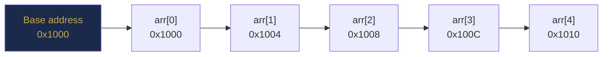
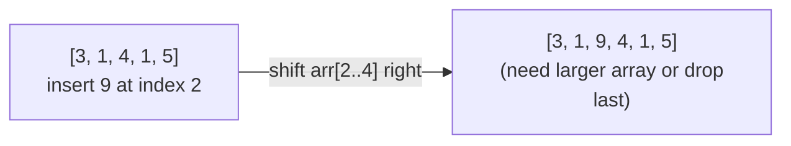
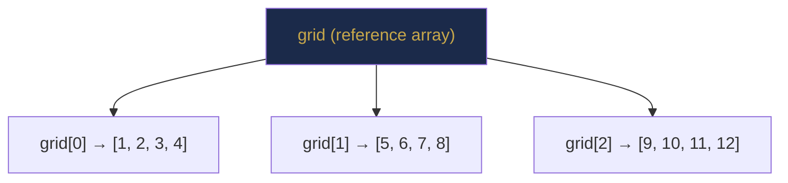

# Chapter 7 — Arrays: Foundations and Memory Model

> **Part II — Arrays and Array Patterns**  
> [← Part I Review](part-01-review.md) · [← Index](../INDEX.md) · [→ Chapter 8](../INDEX.md#-chapter-8--two-pointers)

---

## Learning Objectives

By the end of this chapter you will be able to:

- Explain why random access on an array is $O(1)$ using the address formula.
- Distinguish static (`int[]`) from dynamic (`ArrayList`) arrays and choose between them.
- Implement in-place traversal, insertion, deletion, reversal, and rotation correctly.
- Traverse a 2D array in row-major order and explain why it matters for cache performance.
- Apply the prefix-sum technique to answer range-sum queries in $O(1)$ after $O(n)$ preprocessing.
- Identify and avoid the five most dangerous array pitfalls in Java.

---

## Contents

- [7.1 Arrays in Memory: The Physical Picture](#71-arrays-in-memory-the-physical-picture)
- [7.2 Java Array Fundamentals](#72-java-array-fundamentals)
- [7.3 Indexing and Random Access](#73-indexing-and-random-access)
- [7.4 Traversal Patterns](#74-traversal-patterns)
- [7.5 Insertion and Deletion](#75-insertion-and-deletion)
- [7.6 Static vs Dynamic Arrays](#76-static-vs-dynamic-arrays)
- [7.7 Array Copying and Resizing](#77-array-copying-and-resizing)
- [7.8 Multidimensional Arrays](#78-multidimensional-arrays)
- [7.9 In-Place Algorithms](#79-in-place-algorithms)
- [7.10 Core Array Manipulation Patterns](#710-core-array-manipulation-patterns)
- [7.11 Prefix Sums](#711-prefix-sums)
- [7.12 Common Pitfalls](#712-common-pitfalls)
- [Interview Insight](#interview-insight)
- [Quick Quiz](#quick-quiz)
- [7.13 Practice Problems](#713-practice-problems)
- [7.14 Hard Problem Corner](#714-hard-problem-corner)
- [Chapter Summary](#chapter-summary)

---

## 7.1 Arrays in Memory: The Physical Picture

An array is a contiguous block of memory holding elements of the same type. "Contiguous" means all elements sit side by side — no gaps, no pointers between them.



*Each `int` occupies 4 bytes. `arr[i]` is at address `base + i × 4`.*

### The O(1) Access Formula

To find element at index $i$:

$$\text{address}(\texttt{arr}[i]) = \text{base\_address} + i \times \text{element\_size}$$

This is a single arithmetic operation — no searching, no traversal. It executes in one or two CPU instructions. That is why array random access is $O(1)$ regardless of array size.

### Cache Locality: The Hidden Superpower

Modern CPUs do not fetch one memory word at a time — they fetch a **cache line** (typically 64 bytes, covering 16 consecutive `int` values). When you access `arr[0]`, the CPU pre-loads `arr[1]` through `arr[15]` into the fastest cache automatically.

This makes sequential array traversal the most cache-friendly operation in computing. A linked list, by contrast, stores each node at an arbitrary heap address — every access is potentially a cache miss.

> **Empirically:** Traversing an `int[]` of 10⁷ elements is typically 5–10× faster than traversing a linked list of the same size, even though both are $O(n)$ in asymptotic terms.

---

> ### 🔗 Analogy
> **Post Office Boxes**
>
> Imagine a row of 1000 numbered post office boxes. Finding box #743 does not require checking boxes 1 through 742 — you walk directly to position 743. All boxes are the same size, in the same row, and the numbering is sequential. That direct walk is $O(1)$ access. A linked list, by comparison, would be a treasure hunt: each box contains a note saying "go to box #217 next."

---

## 7.2 Java Array Fundamentals

```java
// Declaration and initialisation
int[] arr = new int[5];            // zero-initialised: [0, 0, 0, 0, 0]
int[] arr = {3, 1, 4, 1, 5};      // literal: compile-time initialisation
String[] words = new String[3];   // null-initialised (reference types)

// Key properties
int len = arr.length;              // .length is a field, not a method (no parentheses)
int first = arr[0];                // first element
int last  = arr[arr.length - 1];  // last element

// Default values by type
// int[], long[], short[], byte[] → 0
// double[], float[]              → 0.0
// boolean[]                      → false
// Object[]                       → null
```

**Arrays are objects in Java.** An `int[]` variable is a reference stored on the stack; the array data lives on the heap. Assigning `int[] b = a` does not copy the data — both `a` and `b` now point to the same heap memory.

```java
int[] a = {1, 2, 3};
int[] b = a;        // b points to the SAME array
b[0] = 99;
System.out.println(a[0]);  // 99 — a is affected!
```

---

## 7.3 Indexing and Random Access

Java arrays are **zero-indexed**: valid indices are $[0, \texttt{arr.length} - 1]$.

| Index | 0 | 1 | 2 | 3 | 4 |
|-------|---|---|---|---|---|
| Value | 3 | 1 | 4 | 1 | 5 |
| Address | base | base+4 | base+8 | base+12 | base+16 |

Accessing any index outside the valid range throws `ArrayIndexOutOfBoundsException` at runtime:

```java
int[] arr = {3, 1, 4, 1, 5};
arr[5];     // throws ArrayIndexOutOfBoundsException: Index 5 out of bounds for length 5
arr[-1];    // throws ArrayIndexOutOfBoundsException: Index -1 out of bounds for length 5
```

> [!NOTE]
> **Why zero-based?** Dijkstra argued in his 1982 note *"Why Numbering Should Start at Zero"* that zero-based indexing makes the address formula simpler (`base + i × size` vs `base + (i-1) × size`), and the half-open interval `[0, n)` for a range of $n$ elements avoids the asymmetry of either endpoint. Java, C, Python, and most modern languages follow this convention.

---

## 7.4 Traversal Patterns

### Forward Traversal

```java
for (int i = 0; i < arr.length; i++) {
    process(arr[i]);
}
```

### Backward Traversal

```java
for (int i = arr.length - 1; i >= 0; i--) {
    process(arr[i]);
}
```

### Enhanced For-Each (Read-Only)

```java
for (int x : arr) {
    process(x);   // x is a copy — modifying x does NOT change arr
}
```

> [!WARNING]
> **The for-each trap.** The enhanced `for` loop copies the primitive value into `x`. Writing `x = 99` does nothing to the array. Use index-based loops when you need to modify elements.

### Traversal with Step

```java
// Even indices only
for (int i = 0; i < arr.length; i += 2) { ... }

// Every third element from the end
for (int i = arr.length - 1; i >= 0; i -= 3) { ... }
```

### Two-Pointer Traversal (Preview of Chapter 8)

```java
int lo = 0, hi = arr.length - 1;
while (lo < hi) {
    // process arr[lo] and arr[hi] simultaneously
    lo++;
    hi--;
}
```

---

## 7.5 Insertion and Deletion

Arrays have **fixed allocated size**. "Insertion" into the middle means shifting elements to make room; "deletion" means shifting to close the gap.

### Insertion at Index $i$ — O(n − i)



```java
// Insert value at index i — assumes arr has space at the end
void insertAt(int[] arr, int i, int value, int size) {
    for (int j = size - 1; j >= i; j--) {
        arr[j + 1] = arr[j];   // shift right
    }
    arr[i] = value;
}
// Complexity: O(n - i) shifts. Worst case (insert at 0): O(n).
```

### Deletion at Index $i$ — O(n − i)

```java
// Delete element at index i — returns new logical size
int deleteAt(int[] arr, int i, int size) {
    for (int j = i; j < size - 1; j++) {
        arr[j] = arr[j + 1];   // shift left
    }
    return size - 1;
}
// Complexity: O(n - i) shifts. Worst case (delete at 0): O(n).
```

**Complexity summary:**

| Operation | Position | Complexity |
|-----------|----------|-----------|
| Read / Write | Any | O(1) |
| Insert | At end (if space) | O(1) |
| Insert | At index $i$ | O(n − i) |
| Insert | At beginning | O(n) |
| Delete | At end | O(1) |
| Delete | At index $i$ | O(n − i) |
| Delete | At beginning | O(n) |

*Table 7.1: Array operation complexities. This table motivates why linked lists exist — they offer O(1) insert/delete at any known position.*

---

## 7.6 Static vs Dynamic Arrays

| Property | `int[]` (static) | `ArrayList<Integer>` (dynamic) |
|----------|-----------------|-------------------------------|
| Size | Fixed at creation | Grows automatically |
| Element type | Primitives allowed | Wrapper types (boxing overhead) |
| Random access | O(1) | O(1) |
| Append at end | N/A (fixed size) | O(1) amortised |
| Memory | Exactly n × size | ≥ n × size (capacity buffer) |
| API | `.length`, `[]` | `.size()`, `.get()`, `.set()` |
| Null elements | Not for primitives | Yes |

*Table 7.2: Static vs dynamic array comparison.*

**When to use `int[]`:**
- Size is known at creation.
- Performance is critical (no boxing, better cache behaviour).
- Passing to `Arrays.sort`, `Arrays.binarySearch`.
- 2D grids: `int[][] grid`.

**When to use `ArrayList`:**
- Size changes dynamically.
- Need to pass to Collections APIs.
- Need `contains()`, `indexOf()`, or other list methods.

The doubling strategy and amortised $O(1)$ append were proven in [Chapter 6](chapter-06-asymptotic-analysis.md#612-amortised-analysis).

---

## 7.7 Array Copying and Resizing

```java
int[] src = {1, 2, 3, 4, 5};

// 1. System.arraycopy — fastest (native implementation)
int[] dst = new int[5];
System.arraycopy(src, 0, dst, 0, src.length);
// System.arraycopy(src, srcPos, dest, destPos, length)

// 2. Arrays.copyOf — convenient, creates new array
int[] copy = Arrays.copyOf(src, src.length);       // exact copy
int[] grown = Arrays.copyOf(src, 10);              // pads with 0s to length 10
int[] shrunk = Arrays.copyOf(src, 3);              // {1, 2, 3}

// 3. Arrays.copyOfRange — copy a subarray [from, to)
int[] sub = Arrays.copyOfRange(src, 1, 4);        // {2, 3, 4}

// 4. Manual loop — slowest, most control
int[] manual = new int[src.length];
for (int i = 0; i < src.length; i++) manual[i] = src[i];
```

**Shallow vs Deep Copy for reference arrays:**

```java
Point[] points = {new Point(1, 2), new Point(3, 4)};

// Shallow copy — same Point objects, different array
Point[] shallow = Arrays.copyOf(points, points.length);
shallow[0].x = 99;
System.out.println(points[0].x);   // 99 — SAME object was modified!

// Deep copy — new Point objects
Point[] deep = new Point[points.length];
for (int i = 0; i < points.length; i++) {
    deep[i] = new Point(points[i].x, points[i].y);
}
deep[0].x = 99;
System.out.println(points[0].x);   // 1 — original unchanged
```

> [!WARNING]
> `Arrays.copyOf` on an `Object[]` does a **shallow copy** — it copies references, not the objects themselves. For primitive arrays (`int[]`, `long[]`, etc.) this is not an issue since primitives are values, not references.

---

## 7.8 Multidimensional Arrays

### Declaration and Initialisation

```java
// 2D array: 3 rows, 4 columns
int[][] grid = new int[3][4];        // all zeros
int[][] grid = {{1,2,3},{4,5,6},{7,8,9}};

// Access: row first, column second
grid[row][col] = value;
int rows = grid.length;              // number of rows
int cols = grid[0].length;          // number of columns in row 0
```

### Memory Layout: Java's "Array of Arrays"

Java's 2D array is NOT a single contiguous block. It is an **array of references**, each pointing to a separate 1D row array on the heap.



Each row is a separate heap allocation. Rows are contiguous within themselves but not necessarily adjacent to each other.

### Cache-Efficient Traversal: Row-Major Order

Always traverse **row by row** (inner loop over columns). This accesses consecutive memory locations within a row, maximising cache hits.

```java
// Row-major (CORRECT — cache-friendly)
for (int r = 0; r < rows; r++) {
    for (int c = 0; c < cols; c++) {
        process(grid[r][c]);         // sequential within grid[r]
    }
}

// Column-major (WRONG for performance — cache-hostile)
for (int c = 0; c < cols; c++) {
    for (int r = 0; r < rows; r++)
        process(grid[r][c]);         // jumps between row arrays
    }
}
```

For a 1000×1000 matrix, row-major traversal can be **5–10× faster** than column-major due to cache-line utilisation.

### Jagged Arrays

```java
int[][] jagged = new int[3][];
jagged[0] = new int[2];   // row 0 has 2 elements
jagged[1] = new int[5];   // row 1 has 5 elements
jagged[2] = new int[1];   // row 2 has 1 element
```

Jagged arrays are useful for triangular matrices and adjacency lists.

---

## 7.9 In-Place Algorithms

An **in-place algorithm** uses $O(1)$ extra space, mutating the input array directly. The swap operation is the primitive building block:

```java
private static void swap(int[] arr, int i, int j) {
    int tmp = arr[i];
    arr[i]  = arr[j];
    arr[j]  = tmp;
}
```

> [!NOTE]
> The XOR swap (`arr[i] ^= arr[j]; arr[j] ^= arr[i]; arr[i] ^= arr[j]`) is a bit-manipulation curiosity, but it **fails when `i == j`** (it zeroes the element). Always use the `tmp` swap in production code.

**Why in-place matters:**
- $O(1)$ space vs $O(n)$ space for a copy-based approach.
- For large arrays (say, $n = 10^8$ integers = 400 MB), allocating a copy may be impossible.
- Many interview problems explicitly require $O(1)$ extra space.

---

## 7.10 Core Array Manipulation Patterns

### Reverse an Array — O(n) Time, O(1) Space

```java
void reverse(int[] arr) {
    int lo = 0, hi = arr.length - 1;
    while (lo < hi) swap(arr, lo++, hi--);
}
```

### Rotate Right by k — O(n) Time, O(1) Space

The **reverse trick**: to rotate right by $k$, reverse the whole array, then reverse the first $k$ elements, then reverse the rest.

```java
void rotateRight(int[] arr, int k) {
    int n = arr.length;
    k %= n;                   // handle k ≥ n
    reverse(arr, 0, n - 1);  // reverse all
    reverse(arr, 0, k - 1);  // reverse first k
    reverse(arr, k, n - 1);  // reverse remainder
}

void reverse(int[] arr, int lo, int hi) {
    while (lo < hi) swap(arr, lo++, hi--);
}
```

**Example:** `[1,2,3,4,5]`, rotate right by 2 → `[4,5,1,2,3]`

| Step | Array |
|------|-------|
| Initial | `[1, 2, 3, 4, 5]` |
| Reverse all | `[5, 4, 3, 2, 1]` |
| Reverse first 2 | `[4, 5, 3, 2, 1]` |
| Reverse last 3 | `[4, 5, 1, 2, 3]` ✓ |

*Table 7.3: Rotation by reversal. Each step is a single O(n) pass; no extra array needed.*

### Remove Duplicates from Sorted Array — O(n), O(1)

The **read/write pointer** pattern (a teaser for Chapter 8):

```java
int removeDuplicates(int[] arr) {
    if (arr.length == 0) return 0;
    int write = 1;                          // write pointer: next write position
    for (int read = 1; read < arr.length; read++) {  // read pointer
        if (arr[read] != arr[read - 1]) {   // new unique value found
            arr[write++] = arr[read];        // write it
        }
    }
    return write;                           // new logical length
}
```

### Move Zeros to End — O(n), O(1)

```java
void moveZeros(int[] arr) {
    int write = 0;
    for (int read = 0; read < arr.length; read++) {
        if (arr[read] != 0) arr[write++] = arr[read];
    }
    while (write < arr.length) arr[write++] = 0;
}
```

### Find Min and Max Simultaneously — O(n), 3n/2 comparisons

Standard approach uses $2(n-1)$ comparisons. The pair-based approach uses $3n/2 - 2$:

```java
int[] minMax(int[] arr) {
    int min = Integer.MAX_VALUE, max = Integer.MIN_VALUE;
    int i = 0;
    if (arr.length % 2 == 1) { min = max = arr[0]; i = 1; }
    for (; i < arr.length; i += 2) {
        int lo = Math.min(arr[i], arr[i + 1]);
        int hi = Math.max(arr[i], arr[i + 1]);
        min = Math.min(min, lo);
        max = Math.max(max, hi);
    }
    return new int[]{min, max};
}
```

---

## 7.11 Prefix Sums

The **prefix sum array** is one of the most versatile array preprocessing techniques. Build it once in $O(n)$, then answer any range-sum query in $O(1)$.

**Definition:** $\text{prefix}[i] = \text{arr}[0] + \text{arr}[1] + \cdots + \text{arr}[i-1]$, with $\text{prefix}[0] = 0$.

```java
int[] buildPrefix(int[] arr) {
    int[] prefix = new int[arr.length + 1];
    for (int i = 0; i < arr.length; i++) {
        prefix[i + 1] = prefix[i] + arr[i];
    }
    return prefix;
}

// Sum of arr[l..r] inclusive — O(1)
int rangeSum(int[] prefix, int l, int r) {
    return prefix[r + 1] - prefix[l];
}
```

**Example:**

| $i$ | `arr[i]` | `prefix[i+1]` |
|-----|----------|---------------|
| 0 | 3 | 3 |
| 1 | 1 | 4 |
| 2 | 4 | 8 |
| 3 | 1 | 9 |
| 4 | 5 | 14 |

Sum of `arr[1..3]` = `prefix[4] - prefix[1]` = `9 - 3` = `6` ✓

*Table 7.4: Prefix sum array for `[3, 1, 4, 1, 5]`.*

> [!TIP]
> **The off-by-one trick:** Defining `prefix[0] = 0` (the empty prefix) means `rangeSum(l, r) = prefix[r+1] - prefix[l]` works uniformly for all $l$, including $l = 0$, without a special case.

Prefix sums extend to 2D grids, XOR prefix arrays, and modular prefix sums. They are covered in depth in Chapter 10.

---

## 7.12 Common Pitfalls

### Pitfall 1: Off-by-One in Loop Bounds

```java
// WRONG: accesses arr[arr.length] → ArrayIndexOutOfBoundsException
for (int i = 0; i <= arr.length; i++) process(arr[i]);

// CORRECT
for (int i = 0; i < arr.length; i++) process(arr[i]);
```

### Pitfall 2: Off-by-One in Last Element

```java
int last = arr[arr.length];     // WRONG: out of bounds
int last = arr[arr.length - 1]; // CORRECT
```

### Pitfall 3: Modifying Array While Iterating

```java
// WRONG: shifting indices cause elements to be skipped
for (int i = 0; i < list.size(); i++) {
    if (list.get(i) == 0) list.remove(i); // i++ after removal skips next element
}

// CORRECT: iterate backward when removing
for (int i = list.size() - 1; i >= 0; i--) {
    if (list.get(i) == 0) list.remove(i);
}
// Or use Iterator.remove() for forward traversal
```

### Pitfall 4: Integer Overflow in Index Arithmetic

```java
int mid = (lo + hi) / 2;    // WRONG: lo + hi overflows if both are near Integer.MAX_VALUE
int mid = lo + (hi - lo) / 2; // CORRECT
int mid = (lo + hi) >>> 1;    // CORRECT: unsigned right shift
```

### Pitfall 5: Column-Major Traversal of 2D Arrays

```java
// WRONG for performance: jumps across row arrays (cache misses)
for (int c = 0; c < cols; c++)
    for (int r = 0; r < rows; r++)
        process(grid[r][c]);

// CORRECT: sequential within each row (cache hits)
for (int r = 0; r < rows; r++)
    for (int c = 0; c < cols; c++)
        process(grid[r][c]);
```

### Pitfall 6: Assuming Sorted Input

Many array algorithms (binary search, two-pointer on pair sums, merge) **require a sorted array**. Always verify whether the input is sorted or sort it first — and account for the $O(n \log n)$ sorting cost in your complexity analysis.

---

## Interview Insight

> ### 🎯 Interview Insight
> **Array Problems: What Interviewers Actually Test**
>
> Surface-level array problems test whether you know the operations. Deeper problems test pattern recognition:
>
> - **"Find a pair/triplet that sums to X"** → Two pointers if sorted (Chapter 8), HashSet if unsorted.
> - **"Subarray sum equals k"** → Prefix sums + HashMap (Chapter 10).
> - **"Longest subarray with property P"** → Sliding window (Chapter 9).
> - **"Rearrange in-place"** → Think rotation, partition, or read/write pointer.
> - **"O(1) extra space required"** → You must work in-place; think about using the array's own indices to store information.
>
> The last point is the most powerful: arrays can serve as their own hash table. If values are in range $[1, n]$ and the array has length $n$, you can use sign-flipping or index-remapping to encode "seen" information without extra space. This is the insight behind the Hard Problem Corner below.

---

## Quick Quiz

**Q1.** An `int[]` has base address `0x2000` and 10 elements. What is the memory address of `arr[6]`?

<details>
<summary><strong>Answer</strong></summary>

> `0x2000 + 6 × 4 = 0x2000 + 0x18 = 0x2018`. Each `int` is 4 bytes; index 6 is 24 bytes from the base.

</details>

---

**Q2.** What does this print, and why?
```java
int[] a = {10, 20, 30};
int[] b = a;
b[1] = 99;
System.out.println(a[1]);
```

<details>
<summary><strong>Answer</strong></summary>

> `99`. `b = a` copies the **reference**, not the data. Both `a` and `b` point to the same heap array. Modifying through `b` is visible via `a`.

</details>

---

**Q3.** Why is row-major traversal of a 2D array faster than column-major in Java?

<details>
<summary><strong>Answer</strong></summary>

> Java's 2D array is an array of row references. Each row is a contiguous `int[]` on the heap. Row-major accesses elements sequentially within a row — triggering CPU cache pre-fetching and maximising cache hits. Column-major jumps across separate row arrays, causing a cache miss at every step.

</details>

---

**Q4.** Given `arr = [1, 2, 3, 4, 5]`, apply rotate-right-by-2 using the reversal trick. Show each step.

<details>
<summary><strong>Answer</strong></summary>

> `k = 2`.  
> 1. Reverse all: `[5, 4, 3, 2, 1]`  
> 2. Reverse first 2: `[4, 5, 3, 2, 1]`  
> 3. Reverse last 3: `[4, 5, 1, 2, 3]` ✓

</details>

---

**Q5.** Using the prefix sum array for `[2, 4, 6, 8, 10]`, compute the sum of elements at indices 1 through 3 (inclusive).

<details>
<summary><strong>Answer</strong></summary>

> `prefix = [0, 2, 6, 12, 20, 30]`.  
> `rangeSum(1, 3) = prefix[4] - prefix[1] = 20 - 2 = 18`.  
> Check: `4 + 6 + 8 = 18` ✓

</details>

---

## 7.13 Practice Problems

| Problem | Name | Difficulty | Key Pattern |
|---------|------|------------|-------------|
| [LC 189](https://leetcode.com/problems/rotate-array/) | Rotate Array | Medium | Reversal trick |
| [LC 283](https://leetcode.com/problems/move-zeroes/) | Move Zeroes | Easy | Read/write pointer |
| [LC 26](https://leetcode.com/problems/remove-duplicates-from-sorted-array/) | Remove Duplicates from Sorted Array | Easy | Read/write pointer |
| [LC 724](https://leetcode.com/problems/find-pivot-index/) | Find Pivot Index | Easy | Prefix sum |
| [LC 238](https://leetcode.com/problems/product-of-array-except-self/) | Product of Array Except Self | Medium | Prefix + suffix product |
| [LC 48](https://leetcode.com/problems/rotate-image/) | Rotate Image | Medium | 2D in-place: transpose + reverse |
| [LC 54](https://leetcode.com/problems/spiral-matrix/) | Spiral Matrix | Medium | 2D traversal with boundary pointers |
| [LC 128](https://leetcode.com/problems/longest-consecutive-sequence/) | Longest Consecutive Sequence | Medium | HashSet for O(1) lookup |

---

## 7.14 Hard Problem Corner

> ### 🔥 Hard Problem Corner
>
> **Problem:** Given an unsorted integer array `nums` containing $n$ distinct integers, find the **smallest positive integer** that does not appear in `nums`.
>
> **Constraints:** $O(n)$ time, $O(1)$ extra space. (You may modify the array.)
>
> **Example:** `[3, 4, -1, 1]` → `2`. `[1, 2, 0]` → `3`.
>
> **Hint:** The answer must be in the range $[1, n+1]$. Values outside this range are irrelevant. How can you use the array's own indices (positions $0$ to $n-1$) to record which values in $[1, n]$ are present — without any extra space?

<details>
<summary><strong>Solution (click to reveal)</strong></summary>

> [!TIP]
> **Key insight:** Use the array as an in-place hash table. If value $v$ is in range $[1, n]$, it *belongs* at index $v-1$. Place each value at its "home" index using cyclic swaps. Then scan for the first index $i$ where `arr[i] != i+1` — that index tells us the missing value is `i+1`.
>
> ```java
> public int firstMissingPositive(int[] nums) {
>     int n = nums.length;
>
>     // Phase 1: place each value v ∈ [1, n] at index v-1
>     for (int i = 0; i < n; i++) {
>         while (nums[i] > 0 && nums[i] <= n && nums[nums[i] - 1] != nums[i]) {
>             swap(nums, i, nums[i] - 1);  // send nums[i] to its home index
>         }
>     }
>
>     // Phase 2: find first index where value is wrong
>     for (int i = 0; i < n; i++) {
>         if (nums[i] != i + 1) return i + 1;
>     }
>     return n + 1;  // all of [1..n] present, answer is n+1
> }
> ```
>
> **Complexity:** $O(n)$ time (each element is swapped at most once), $O(1)$ space (modified in-place).
>
> **Dry run on `[3, 4, -1, 1]`:**
>
> | After swap | Array |
> |------------|-------|
> | Initial | `[3, 4, -1, 1]` |
> | Place 3 at index 2 | `[-1, 4, 3, 1]` |
> | Place 4 at index 3 | `[-1, 1, 3, 4]` |
> | Place 1 at index 0 | `[1, -1, 3, 4]` |
> | Scan: index 1 → arr[1]=-1 ≠ 2 | → **return 2** ✓ |
>
> This is [LeetCode 41 — First Missing Positive](https://leetcode.com/problems/first-missing-positive/). It is considered hard because the $O(1)$ space constraint forces the "array as hash table" insight — using array indices themselves as keys.

</details>

---

## Chapter Summary

| Concept | Key Takeaway |
|---------|-------------|
| **Random access O(1)** | `address = base + i × elementSize`. Direct formula — no traversal. |
| **Cache locality** | Sequential array access maximises CPU cache hits. The hidden performance edge over linked lists. |
| **Insert/Delete middle** | O(n) due to shifting. Use only when necessary; prefer append-at-end. |
| **Static vs dynamic** | `int[]` for known size and performance; `ArrayList` for dynamic growth. |
| **Shallow copy trap** | `Arrays.copyOf` on `Object[]` copies references. Deep copy requires explicit object duplication. |
| **2D = array of arrays** | Java's `int[][]` is not a contiguous block. Always traverse row-major for cache efficiency. |
| **In-place** | Use O(1) space by mutating the input. The swap helper is the fundamental primitive. |
| **Reverse trick** | Rotate right by $k$: reverse all → reverse first $k$ → reverse rest. O(n), O(1). |
| **Read/write pointer** | Two indices: one reads every element, one writes only the elements that survive. O(n), O(1). |
| **Prefix sum** | Build in O(n), answer range-sum queries in O(1). `rangeSum(l,r) = prefix[r+1] - prefix[l]`. |
| **Array as hash table** | Values in $[1, n]$ can be stored at their own indices. Enables O(n) time, O(1) space tricks. |

*Table 7.5: Chapter 7 key concepts.*

---

**Coming Up Next:** [Chapter 8 (Two Pointers)](../INDEX.md#-chapter-8--two-pointers) formalises the read/write pointer and opposite-direction pointer patterns introduced here and shows how they solve pair, triplet, and partition problems on arrays in $O(n)$ time.

---

> **Part II — Arrays and Array Patterns**  
> [← Part I Review](part-01-review.md) · [← Index](../INDEX.md) · [→ Chapter 8 (planned)](../INDEX.md#-chapter-8--two-pointers)
