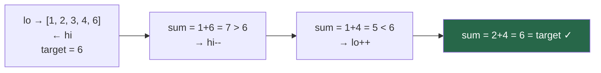
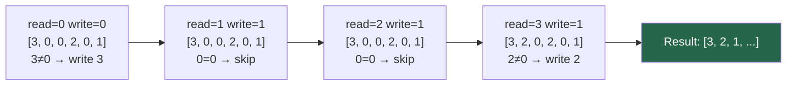

# Chapter 8 — Two Pointers

> **Part II — Arrays and Array Patterns**  
> [← Chapter 7](chapter-07-arrays.md) · [← Index](../INDEX.md) · [→ Chapter 9](../INDEX.md#-chapter-9--sliding-window)

---

## Learning Objectives

By the end of this chapter you will be able to:

- Identify which of the four two-pointer patterns applies to a given problem.
- Apply opposite-direction pointers to solve pair and triplet sum problems on sorted arrays.
- Use same-direction (read/write) pointers to compact arrays in-place in O(n).
- Implement Floyd's fast/slow pointer to detect cycles and find midpoints.
- Execute the Dutch National Flag three-way partition in a single pass.
- State precisely when two pointers work and when they fail, and why sorted order is usually required.

---

## Contents

- [8.1 The Core Idea](#81-the-core-idea)
- [8.2 Opposite-Direction Pointers](#82-opposite-direction-pointers)
- [8.3 Same-Direction Pointers](#83-same-direction-pointers)
- [8.4 Read/Write Pointer (Compaction)](#84-readwrite-pointer-compaction)
- [8.5 Fast and Slow Pointers](#85-fast-and-slow-pointers)
- [8.6 Partitioning Arrays](#86-partitioning-arrays)
- [8.7 Pair and Triplet Problems](#87-pair-and-triplet-problems)
- [8.8 When Two Pointers Work and When They Fail](#88-when-two-pointers-work-and-when-they-fail)
- [Interview Insight](#interview-insight)
- [Quick Quiz](#quick-quiz)
- [8.9 Practice Problems](#89-practice-problems)
- [8.10 Hard Problem Corner](#810-hard-problem-corner)
- [Chapter Summary](#chapter-summary)

---

## 8.1 The Core Idea

**Two pointers** is a technique where two index variables traverse an array (or string) simultaneously, making intelligent decisions about which one to advance. The payoff is dramatic: problems that naïvely require a nested loop — O(n²) — reduce to a single pass — O(n).

The technique works by exploiting **structure**: either sorted order, a logical partition, or a size relationship between fast and slow elements. Without structure to reason about, you can't decide which pointer to advance, and the approach breaks down.

**The four patterns:**

| Pattern | Pointers start | Move direction | Typical use |
|---------|---------------|----------------|-------------|
| Opposite-direction | Both ends | Toward each other | Pair sums, palindromes, water trapping |
| Same-direction | Both at start | Same direction, different speed | Remove duplicates, partition |
| Read/Write | Both at start | Same direction | Compact arrays in-place |
| Fast/Slow | Both at start | Fast 2×, slow 1× | Cycle detection, find middle |

*Table 8.1: The four two-pointer patterns.*

---

> ### 🔗 Analogy
> **Two Librarians**
>
> You need to find two books on a sorted shelf whose combined page counts equal exactly 1000. One librarian starts at the left (thinnest books), one at the right (thickest books). They call out their combined count:
> - Too low? The left librarian steps right (need a thicker book on the left).
> - Too high? The right librarian steps left (need a thinner book on the right).
> - Exactly 1000? Found it.
>
> Total steps: at most $n$ moves between them. Without the sorted shelf — without the structure — this trick does not work. You would need every left librarian to check every right librarian: $O(n^2)$.

---

## 8.2 Opposite-Direction Pointers

Two indices start at opposite ends and converge toward the middle. The loop terminates when they meet or cross.

```java
int lo = 0, hi = arr.length - 1;
while (lo < hi) {
    // examine arr[lo] and arr[hi]
    // then advance one or both pointers
}
```

The key: on each iteration you advance **at least one** pointer, so the algorithm terminates in at most $n$ steps.

### Two Sum II — Sorted Array

```java
// Given sorted array, find indices of two elements summing to target
int[] twoSum(int[] nums, int target) {
    int lo = 0, hi = nums.length - 1;
    while (lo < hi) {
        int sum = nums[lo] + nums[hi];
        if      (sum == target) return new int[]{lo + 1, hi + 1}; // 1-indexed
        else if (sum < target)  lo++;   // sum too small: need larger left
        else                    hi--;   // sum too large: need smaller right
    }
    return new int[]{-1, -1};  // no solution
}
```

**Why it works:** The array is sorted. If `nums[lo] + nums[hi] < target`, we cannot fix this by decreasing `hi` (that would only make it smaller). The only productive move is `lo++`. Each comparison eliminates an entire column of the implicit $n \times n$ comparison grid.



### Valid Palindrome

```java
boolean isPalindrome(String s) {
    int lo = 0, hi = s.length() - 1;
    while (lo < hi) {
        while (lo < hi && !Character.isLetterOrDigit(s.charAt(lo))) lo++;
        while (lo < hi && !Character.isLetterOrDigit(s.charAt(hi))) hi--;
        if (Character.toLowerCase(s.charAt(lo)) !=
            Character.toLowerCase(s.charAt(hi))) return false;
        lo++; hi--;
    }
    return true;
}
```

### Container With Most Water

Given heights `h[0..n-1]`, find two lines maximising the water area: `min(h[lo], h[hi]) × (hi - lo)`.

```java
int maxArea(int[] h) {
    int lo = 0, hi = h.length - 1, best = 0;
    while (lo < hi) {
        best = Math.max(best, Math.min(h[lo], h[hi]) * (hi - lo));
        if (h[lo] < h[hi]) lo++;   // shorter side limits area: move it inward
        else                hi--;
    }
    return best;
}
```

**Why advance the shorter side?** Moving the taller side inward can only decrease width while the minimum stays the same or gets worse — strictly no improvement. Moving the shorter side might find a taller wall, potentially increasing the area.

---

## 8.3 Same-Direction Pointers

Both pointers start at the left and move rightward, but at different logical speeds or on different conditions. `slow` lags behind `fast`.

### Remove Duplicates from Sorted Array

```java
// Returns new logical length; first k elements are deduplicated
int removeDuplicates(int[] nums) {
    if (nums.length == 0) return 0;
    int slow = 0;
    for (int fast = 1; fast < nums.length; fast++) {
        if (nums[fast] != nums[slow]) {
            nums[++slow] = nums[fast];   // new unique value: advance slow, write
        }
        // duplicate: fast moves on, slow stays
    }
    return slow + 1;
}
```

**Invariant:** `nums[0..slow]` always contains the unique prefix of `nums[0..fast]` seen so far.

### Remove Duplicates — Allow At Most k Occurrences

```java
int removeDuplicatesAtMostK(int[] nums, int k) {
    int slow = 0;
    for (int fast = 0; fast < nums.length; fast++) {
        if (slow < k || nums[fast] != nums[slow - k]) {
            nums[slow++] = nums[fast];
        }
    }
    return slow;
}
```

---

## 8.4 Read/Write Pointer (Compaction)

The read pointer advances unconditionally. The write pointer advances only when a value should be kept. At the end, `[0, write)` is the compacted result.



### Remove All Instances of a Value

```java
int removeElement(int[] nums, int val) {
    int write = 0;
    for (int read = 0; read < nums.length; read++) {
        if (nums[read] != val) nums[write++] = nums[read];
    }
    return write;
}
```

### Move Zeros to End (Preserve Order)

```java
void moveZeros(int[] nums) {
    int write = 0;
    for (int read = 0; read < nums.length; read++) {
        if (nums[read] != 0) nums[write++] = nums[read];
    }
    while (write < nums.length) nums[write++] = 0;
}
```

> [!TIP]
> The read/write pattern always produces an in-place, stable compaction. It is O(n) time and O(1) space. The pattern is: `read` sees everything; `write` only records what survives.

---

## 8.5 Fast and Slow Pointers

Also called **Floyd's tortoise and hare**. `fast` advances two steps per iteration; `slow` advances one. If a cycle exists, `fast` will eventually lap `slow` and they will meet inside the cycle.

### Detect a Cycle in a Linked List (Preview of Chapter 19)

```java
boolean hasCycle(ListNode head) {
    ListNode slow = head, fast = head;
    while (fast != null && fast.next != null) {
        slow = slow.next;        // 1 step
        fast = fast.next.next;   // 2 steps
        if (slow == fast) return true;
    }
    return false;
}
```

### Find Middle of a Linked List

When `fast` reaches the end, `slow` is at the middle.

```java
ListNode findMiddle(ListNode head) {
    ListNode slow = head, fast = head;
    while (fast != null && fast.next != null) {
        slow = slow.next;
        fast = fast.next.next;
    }
    return slow;  // middle node
}
```

### Happy Number

A number is happy if the repeated digit-square-sum process eventually reaches 1. Otherwise it cycles. Use fast/slow on the implicit sequence.

```java
boolean isHappy(int n) {
    int slow = n, fast = digitSquareSum(n);
    while (fast != 1 && slow != fast) {
        slow = digitSquareSum(slow);
        fast = digitSquareSum(digitSquareSum(fast));
    }
    return fast == 1;
}

int digitSquareSum(int n) {
    int sum = 0;
    while (n > 0) { int d = n % 10; sum += d * d; n /= 10; }
    return sum;
}
```

---

## 8.6 Partitioning Arrays

Partitioning divides an array into sections by a **pivot** condition in a single pass. Two pointers maintain the partition boundary.

### Lomuto Partition (Single Pass, Unstable)

```java
// Partitions arr[lo..hi] around pivot arr[hi].
// Returns final pivot index.
int lomuto(int[] arr, int lo, int hi) {
    int pivot = arr[hi];
    int i = lo - 1;              // i: last element ≤ pivot
    for (int j = lo; j < hi; j++) {
        if (arr[j] <= pivot) swap(arr, ++i, j);
    }
    swap(arr, i + 1, hi);        // place pivot at its correct position
    return i + 1;
}
```

### Dutch National Flag — Three-Way Partition

Given an array of 0s, 1s, and 2s (or any three distinct values), sort it in one pass using three pointers.

```java
void sortColors(int[] nums) {
    int lo = 0, mid = 0, hi = nums.length - 1;
    while (mid <= hi) {
        switch (nums[mid]) {
            case 0 -> swap(nums, lo++, mid++);  // 0: extend left region, both advance
            case 1 -> mid++;                     // 1: already in correct region
            case 2 -> swap(nums, mid, hi--);     // 2: extend right region, only hi decreases
        }                                        // mid NOT incremented: unknown what came from hi
    }
}
```

**Invariants maintained:**
- `nums[0..lo-1]` = all 0s
- `nums[lo..mid-1]` = all 1s
- `nums[mid..hi]` = unknown (not yet processed)
- `nums[hi+1..n-1]` = all 2s

**Why `mid` doesn't advance after swapping with `hi`?** The element arriving at `mid` from position `hi` is unknown — it hasn't been classified yet. It must be re-examined on the next iteration.

---

## 8.7 Pair and Triplet Problems

### Two Sum on Sorted Array — O(n)

As shown in Section 8.2. Sort first if unsorted: O(n log n) total.

### Three Sum — O(n²)

Reduce to two-sum: fix the first element, two-pointer on the rest.

```java
List<List<Integer>> threeSum(int[] nums) {
    Arrays.sort(nums);
    List<List<Integer>> result = new ArrayList<>();
    for (int i = 0; i < nums.length - 2; i++) {
        if (i > 0 && nums[i] == nums[i - 1]) continue;  // skip outer duplicates
        int lo = i + 1, hi = nums.length - 1;
        while (lo < hi) {
            int sum = nums[i] + nums[lo] + nums[hi];
            if (sum == 0) {
                result.add(List.of(nums[i], nums[lo], nums[hi]));
                while (lo < hi && nums[lo] == nums[lo + 1]) lo++;  // skip inner dups
                while (lo < hi && nums[hi] == nums[hi - 1]) hi--;
                lo++; hi--;
            } else if (sum < 0) lo++;
            else                hi--;
        }
    }
    return result;
}
```

**Complexity:** O(n log n) sort + O(n²) for the outer loop × inner two-pointer = **O(n²) overall**.

### Four Sum — O(n³)

Add one more outer loop: fix two elements, two-pointer on the rest.

```java
List<List<Integer>> fourSum(int[] nums, int target) {
    Arrays.sort(nums);
    List<List<Integer>> result = new ArrayList<>();
    int n = nums.length;
    for (int i = 0; i < n - 3; i++) {
        if (i > 0 && nums[i] == nums[i - 1]) continue;
        for (int j = i + 1; j < n - 2; j++) {
            if (j > i + 1 && nums[j] == nums[j - 1]) continue;
            int lo = j + 1, hi = n - 1;
            while (lo < hi) {
                long sum = (long) nums[i] + nums[j] + nums[lo] + nums[hi];
                if      (sum == target) { result.add(List.of(nums[i],nums[j],nums[lo],nums[hi])); lo++; hi--; }
                else if (sum < target)  lo++;
                else                    hi--;
            }
        }
    }
    return result;
}
```

**General k-sum:** Each additional number adds one outer loop, increasing complexity by one factor of $n$. k-Sum is $O(n^{k-1})$ with this approach.

---

## 8.8 When Two Pointers Work and When They Fail

| Condition | Works? | Why |
|-----------|--------|-----|
| Sorted array, pair/triplet search | ✅ | Sorted order lets you determine which pointer to advance |
| Unsorted array, pair search | ⚠️ Sort first | O(n log n) preprocessing; then two pointers in O(n) |
| Compaction (remove/move elements) | ✅ | No ordering dependency — read/write pattern always valid |
| Palindrome check | ✅ | Opposite pointers converge; order is the structure |
| Subarray with property requiring window state | ❌ | Use sliding window (Chapter 9) instead |
| Need to track 3+ positions simultaneously | ❌ | Three-pointer or different technique |
| Hash table lookup is O(1) and simpler | ❌ | E.g., unsorted two-sum → HashMap is cleaner |

*Table 8.2: When to use two pointers.*

**The fundamental requirement:** You must be able to decide which pointer to advance based on the current comparison. If neither choice is strictly better, the approach fails (you'd need to try both → exponential).

> [!NOTE]
> **Two pointers vs HashMap for Two Sum:** On an unsorted array, `HashMap` gives O(n) time and O(n) space. Two pointers require sorting first: O(n log n) time, O(1) extra space (if sort is in-place). Choose based on the constraint: O(1) space required → sort + two pointers; O(n) space is fine → HashMap.

---

## Interview Insight

> ### 🎯 Interview Insight
> **Spotting the Two-Pointer Signal**
>
> When you read a problem, these phrases are strong signals that two pointers will work:
>
> - *"Given a **sorted** array…"*
> - *"Find **two** (or three) elements that…"*
> - *"**In-place**, O(1) extra space…"*
> - *"**Without** using extra space…"*
> - *"**Remove** all instances of X from the array"*
> - *"Check if the string is a **palindrome**"*
>
> The interview move: once you identify the pattern, state your invariant before writing code. *"I'll maintain `lo` pointing to the first candidate and `hi` to the last. I advance `lo` when the sum is too small and `hi` when it's too large. The invariant is that the answer, if it exists, is always between `lo` and `hi`."* Stating the invariant proves you understand the algorithm, not just memorised it.

---

## Quick Quiz

**Q1.** What is the time complexity of Three Sum, and why isn't it O(n) even though the inner two-pointer loop is O(n)?

<details>
<summary><strong>Answer</strong></summary>

> **O(n²)**. The outer `for` loop runs $n$ times. For each iteration, the inner two-pointer loop runs in $O(n)$. Total: $n \times O(n) = O(n^2)$. The two-pointer inner loop reduces one dimension from $O(n^2)$ to $O(n)$, but cannot remove the outer dimension entirely.

</details>

---

**Q2.** In the Dutch National Flag algorithm, why do we NOT increment `mid` after swapping `nums[mid]` with `nums[hi]`?

<details>
<summary><strong>Answer</strong></summary>

> Because we swapped an **unexamined element** from position `hi` into position `mid`. We don't know its value yet — it could be 0, 1, or 2. It must be re-classified on the next iteration. If we had incremented `mid`, this element would be incorrectly included in the "processed" region without examination.

</details>

---

**Q3.** Given `[-4, -1, -1, 0, 1, 2]`, trace the first outer iteration (`i=0`, `nums[i]=-4`) of the Three Sum algorithm. What pairs does the two-pointer find?

<details>
<summary><strong>Answer</strong></summary>

> `i=0, nums[i]=-4`, target pair sum = `4`. `lo=1, hi=5`.  
> - `(-1) + 2 = 1 < 4` → `lo++`  
> - `(-1) + 2 = 1 < 4` → `lo++`  
> - `0 + 2 = 2 < 4` → `lo++`  
> - `1 + 2 = 3 < 4` → `lo++`  
> - `lo = hi = 5` → loop ends.  
>
> No triplet with `nums[0] = -4` sums to 0. (Closest: `-4 + 1 + 2 = -1`.)

</details>

---

**Q4.** For `h = [1, 8, 6, 2, 5, 4, 8, 3, 7]`, what is the maximum water and which two indices form it?

<details>
<summary><strong>Answer</strong></summary>

> Indices 1 and 8 (`h[1]=8, h[8]=7`): area = `min(8,7) × (8-1) = 7 × 7 = 49`. This is the answer to [LC 11 Container With Most Water](https://leetcode.com/problems/container-with-most-water/).

</details>

---

## 8.9 Practice Problems

| Problem | Name | Difficulty | Pattern |
|---------|------|------------|---------|
| [LC 167](https://leetcode.com/problems/two-sum-ii-input-array-is-sorted/) | Two Sum II | Easy | Opposite-direction |
| [LC 125](https://leetcode.com/problems/valid-palindrome/) | Valid Palindrome | Easy | Opposite-direction |
| [LC 977](https://leetcode.com/problems/squares-of-a-sorted-array/) | Squares of a Sorted Array | Easy | Opposite-direction |
| [LC 27](https://leetcode.com/problems/remove-element/) | Remove Element | Easy | Read/write |
| [LC 26](https://leetcode.com/problems/remove-duplicates-from-sorted-array/) | Remove Duplicates from Sorted Array | Easy | Same-direction |
| [LC 141](https://leetcode.com/problems/linked-list-cycle/) | Linked List Cycle | Easy | Fast/slow |
| [LC 11](https://leetcode.com/problems/container-with-most-water/) | Container With Most Water | Medium | Opposite-direction |
| [LC 15](https://leetcode.com/problems/3sum/) | 3Sum | Medium | Sort + opposite-direction |
| [LC 75](https://leetcode.com/problems/sort-colors/) | Sort Colors | Medium | Dutch National Flag |
| [LC 18](https://leetcode.com/problems/4sum/) | 4Sum | Medium | Sort + nested + two pointers |

---

## 8.10 Hard Problem Corner

> ### 🔥 Hard Problem Corner
>
> **Problem: Trapping Rain Water** ([LC 42](https://leetcode.com/problems/trapping-rain-water/))
>
> Given an array `height` representing an elevation map where the width of each bar is 1, compute how much water it can trap after raining.
>
> **Example:** `[0,1,0,2,1,0,1,3,2,1,2,1]` → `6`
>
> **Requirement:** O(n) time, O(1) space.
>
> **Hint:** Water at position $i$ is determined by `min(maxLeft[i], maxRight[i]) - height[i]`. The key insight: you don't need to precompute both arrays simultaneously. If you know which side has the smaller maximum, you can process that side safely.

<details>
<summary><strong>Solution (click to reveal)</strong></summary>

> [!TIP]
> **Two-pointer approach:**
>
> Maintain `maxLeft` (highest bar seen from the left) and `maxRight` (highest bar seen from the right). Process whichever side has the smaller maximum — because for that position, the water level is fully determined by that side alone (the other side is guaranteed to be at least as tall).
>
> ```java
> int trap(int[] height) {
>     int lo = 0, hi = height.length - 1;
>     int maxLeft = 0, maxRight = 0, water = 0;
>     while (lo < hi) {
>         if (height[lo] <= height[hi]) {
>             if (height[lo] >= maxLeft) maxLeft = height[lo];
>             else water += maxLeft - height[lo];  // trapped water at lo
>             lo++;
>         } else {
>             if (height[hi] >= maxRight) maxRight = height[hi];
>             else water += maxRight - height[hi]; // trapped water at hi
>             hi--;
>         }
>     }
>     return water;
> }
> ```
>
> **Why it works:** When `height[lo] <= height[hi]`, the water at `lo` is capped by `maxLeft` (since `height[hi] >= height[lo]`, the right wall is always at least as tall as `maxLeft`). So we can safely compute the water at `lo` without knowing the exact right maximum. Symmetric reasoning applies when `height[lo] > height[hi]`.
>
> **Complexity:** O(n) time, O(1) space — a single pass, two integer variables.

</details>

---

## Chapter Summary

| Concept | Key Takeaway |
|---------|-------------|
| **Opposite-direction** | Start at both ends, converge. Use when sorted order lets you decide which pointer to move. |
| **Same-direction** | Slow lags behind fast. Use for maintaining a valid prefix while scanning. |
| **Read/write** | Read sees all; write records survivors. The canonical in-place compaction pattern. |
| **Fast/slow** | 2× speed difference detects cycles and finds midpoints. |
| **Dutch National Flag** | Three pointers, one pass, three-way partition. `mid` stalls when swapping with `hi`. |
| **Three Sum** | Sort + fix one element + two-pointer inner loop = O(n²). Skip duplicates at both levels. |
| **Decision rule** | The whole technique rests on being able to discard one pointer's options at every step. Without sorted order or structure, this breaks down. |
| **vs HashMap** | O(1) space → sort + two pointers. O(n) space OK → HashMap for simpler code on unsorted input. |

*Table 8.3: Chapter 8 key concepts.*

---

**Coming Up Next:** [Chapter 9 (Sliding Window)](../INDEX.md#-chapter-9--sliding-window) extends the same-direction pointer idea to a window of variable or fixed size, handling subarrays with sum/count constraints and frequency-map conditions.

---

> **Part II — Arrays and Array Patterns**  
> [← Chapter 7](chapter-07-arrays.md) · [← Index](../INDEX.md) · [→ Chapter 9 (planned)](../INDEX.md#-chapter-9--sliding-window)
