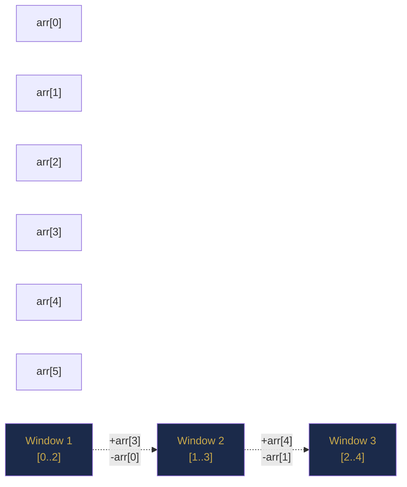

# Chapter 9 — Sliding Window

> **Part II — Arrays and Array Patterns**  
> [← Chapter 8](chapter-08-two-pointers.md) · [← Index](../INDEX.md) · [→ Chapter 10](../INDEX.md#-chapter-10--prefix-sums-and-difference-arrays)

---

## Learning Objectives

By the end of this chapter you will be able to:

- Distinguish fixed-size from variable-size sliding windows and choose the right template for each.
- Maintain a window invariant using the expand-then-shrink loop structure.
- Use a `HashMap` or frequency array to track window state in O(1) per step.
- Solve longest-subarray and shortest-subarray variants with a single template.
- Identify the two common sliding window pitfalls and avoid them.

---

## Contents

- [9.1 The Core Idea](#91-the-core-idea)
- [9.2 Fixed-Size Sliding Window](#92-fixed-size-sliding-window)
- [9.3 Variable-Size Sliding Window](#93-variable-size-sliding-window)
- [9.4 The Window Invariant](#94-the-window-invariant)
- [9.5 Frequency Maps Within Windows](#95-frequency-maps-within-windows)
- [9.6 Longest Subarray Problems](#96-longest-subarray-problems)
- [9.7 Shortest Subarray Problems](#97-shortest-subarray-problems)
- [9.8 Multiple Constraints](#98-multiple-constraints)
- [9.9 Common Pitfalls](#99-common-pitfalls)
- [Interview Insight](#interview-insight)
- [Quick Quiz](#quick-quiz)
- [9.10 Practice Problems](#910-practice-problems)
- [9.11 Hard Problem Corner](#911-hard-problem-corner)
- [Chapter Summary](#chapter-summary)

---

## 9.1 The Core Idea

A **sliding window** is a contiguous subarray `[left, right]` that moves across the array. Instead of recomputing the subarray's property from scratch every time it moves, we **add one element on the right and remove one on the left** — an incremental update.

This turns a naïve O(n × k) or O(n²) approach into O(n).



**Two variants:**

| Variant | Window size | `left` moves | Typical goal |
|---------|------------|-------------|--------------|
| Fixed-size | Constant $k$ | Every step (keep size) | Max/min/average over all windows of size k |
| Variable-size | Grows and shrinks | When invariant is violated | Longest/shortest subarray satisfying a condition |

---

> ### 🔗 Analogy
> **A Moving Frame on a Film Strip**
>
> Imagine holding a rectangular frame over a film strip. For the fixed window, the frame is a fixed width — you slide it one frame to the right at a time. For the variable window, the frame can stretch (right edge moves) or compress (left edge moves) until the content inside meets some condition. Either way, you never lift and reposition the frame from scratch — you always slide one edge.

---

## 9.2 Fixed-Size Sliding Window

**Template:**

```java
// Compute result for every window of size k
int fixedWindow(int[] arr, int k) {
    // 1. Build the first window
    int windowSum = 0;
    for (int i = 0; i < k; i++) windowSum += arr[i];

    int best = windowSum;

    // 2. Slide: add right element, remove left element
    for (int right = k; right < arr.length; right++) {
        windowSum += arr[right];           // enter: new right element
        windowSum -= arr[right - k];       // exit:  old left element
        best = Math.max(best, windowSum);
    }
    return best;
}
```

**Complexity:** O(n) — each element enters and exits the window exactly once.

### Maximum Sum Subarray of Size k

```java
int maxSumSubarrayK(int[] nums, int k) {
    int windowSum = 0;
    for (int i = 0; i < k; i++) windowSum += nums[i];
    int max = windowSum;
    for (int right = k; right < nums.length; right++) {
        windowSum += nums[right] - nums[right - k];
        max = Math.max(max, windowSum);
    }
    return max;
}
```

### Maximum Average Subarray of Size k

```java
double findMaxAverage(int[] nums, int k) {
    double windowSum = 0;
    for (int i = 0; i < k; i++) windowSum += nums[i];
    double max = windowSum;
    for (int right = k; right < nums.length; right++) {
        windowSum += nums[right] - nums[right - k];
        max = Math.max(max, windowSum);
    }
    return max / k;
}
```

---

## 9.3 Variable-Size Sliding Window

The window expands by moving `right` forward and shrinks by moving `left` forward. The critical decision: **when to shrink**.

**Template — Longest window satisfying condition:**

```java
int variableWindowLongest(int[] arr) {
    int left = 0, best = 0;
    // window state variables here (sum, count, map, etc.)

    for (int right = 0; right < arr.length; right++) {
        // --- EXPAND: add arr[right] to window state ---

        // --- SHRINK: while invariant violated, remove arr[left] ---
        while (/* window is invalid */) {
            // remove arr[left] from window state
            left++;
        }

        // window [left, right] is now valid
        best = Math.max(best, right - left + 1);
    }
    return best;
}
```

**Template — Shortest window satisfying condition:**

```java
int variableWindowShortest(int[] arr, int target) {
    int left = 0, best = Integer.MAX_VALUE;
    // window state

    for (int right = 0; right < arr.length; right++) {
        // --- EXPAND ---

        // --- SHRINK: while still valid, try to minimise ---
        while (/* window satisfies condition */) {
            best = Math.min(best, right - left + 1);
            // remove arr[left] from state
            left++;
        }
    }
    return best == Integer.MAX_VALUE ? 0 : best;
}
```

> [!NOTE]
> The key difference between longest and shortest templates is **when you record the answer**:
> - **Longest:** record *after* shrinking (when window is valid but as large as possible).
> - **Shortest:** record *during* shrinking (every time the window is valid, check if it's shorter).

---

## 9.4 The Window Invariant

Every sliding window problem has a **window invariant** — a property that must hold for the window `[left, right]` to be a valid candidate.

| Problem | Invariant |
|---------|-----------|
| Subarray sum ≤ target | `sum <= target` |
| At most k distinct characters | `distinctCount <= k` |
| No repeating characters | `all chars in window are unique` |
| All 1s (after at most k flips) | `countOfZeros <= k` |

The shrink loop restores the invariant. The expand step (adding `arr[right]`) may temporarily violate it; the shrink loop always restores it.

---

## 9.5 Frequency Maps Within Windows

Many window problems require tracking how many times each element appears in the current window. Use a `HashMap<Character, Integer>` or `int[26]` / `int[128]` frequency array.

### Longest Substring Without Repeating Characters

Invariant: all characters in `[left, right]` are unique.

```java
int lengthOfLongestSubstring(String s) {
    int[] freq = new int[128];   // ASCII frequency array — O(1) lookup
    int left = 0, best = 0;

    for (int right = 0; right < s.length(); right++) {
        freq[s.charAt(right)]++;                        // expand

        while (freq[s.charAt(right)] > 1) {            // duplicate entered
            freq[s.charAt(left)]--;                     // shrink
            left++;
        }
        best = Math.max(best, right - left + 1);
    }
    return best;
}
```

### Longest Substring with At Most k Distinct Characters

```java
int lengthOfLongestSubstringKDistinct(String s, int k) {
    Map<Character, Integer> freq = new HashMap<>();
    int left = 0, best = 0;

    for (int right = 0; right < s.length(); right++) {
        freq.merge(s.charAt(right), 1, Integer::sum);  // expand

        while (freq.size() > k) {                      // too many distinct chars
            char lc = s.charAt(left);
            freq.merge(lc, -1, Integer::sum);
            if (freq.get(lc) == 0) freq.remove(lc);    // remove entry when count hits 0
            left++;
        }
        best = Math.max(best, right - left + 1);
    }
    return best;
}
```

> [!TIP]
> **`int[128]` vs `HashMap`:** For ASCII character windows, a `int[128]` frequency array is significantly faster than `HashMap` (no boxing, no hashing, O(1) with smaller constant). Use `HashMap` only when keys are arbitrary integers or the alphabet is large.

---

## 9.6 Longest Subarray Problems

### Longest Subarray with Sum ≤ Target

Invariant: `windowSum <= target`.

```java
int longestSubarraySum(int[] nums, int target) {
    int left = 0, windowSum = 0, best = 0;
    for (int right = 0; right < nums.length; right++) {
        windowSum += nums[right];
        while (windowSum > target) windowSum -= nums[left++];
        best = Math.max(best, right - left + 1);
    }
    return best;
}
```

> [!WARNING]
> This template only works correctly when **all values are non-negative**. If negative values are possible, adding more elements can decrease the sum, meaning the shrink condition `windowSum > target` might become false without actually moving `left`. For subarrays with negative numbers and sum constraints, use prefix sums + HashMap (Chapter 10).

### Longest Subarray with At Most k Zeros (Max Consecutive Ones III)

Replace at most `k` zeros to maximise the run of ones.

```java
int longestOnes(int[] nums, int k) {
    int left = 0, zeros = 0, best = 0;
    for (int right = 0; right < nums.length; right++) {
        if (nums[right] == 0) zeros++;
        while (zeros > k) {
            if (nums[left] == 0) zeros--;
            left++;
        }
        best = Math.max(best, right - left + 1);
    }
    return best;
}
```

---

## 9.7 Shortest Subarray Problems

### Minimum Size Subarray Sum ≥ Target

Shrink as long as the window still satisfies the condition; each time it does, record the length.

```java
int minSubarrayLen(int target, int[] nums) {
    int left = 0, windowSum = 0, best = Integer.MAX_VALUE;
    for (int right = 0; right < nums.length; right++) {
        windowSum += nums[right];
        while (windowSum >= target) {
            best = Math.min(best, right - left + 1);
            windowSum -= nums[left++];
        }
    }
    return best == Integer.MAX_VALUE ? 0 : best;
}
```

**Complexity:** O(n) — `left` and `right` each traverse the array at most once.

---

## 9.8 Multiple Constraints

Some problems impose multiple simultaneous window conditions. The approach is the same: maintain all state in the window, shrink when **any** constraint is violated.

### Minimum Window Substring (All chars of t must appear)

```java
String minWindowSubstring(String s, String t) {
    int[] need = new int[128], have = new int[128];
    int formed = 0, required = 0;
    for (char c : t.toCharArray()) { need[c]++; }
    for (int c = 0; c < 128; c++) if (need[c] > 0) required++;

    int left = 0, bestLen = Integer.MAX_VALUE, bestL = 0;

    for (int right = 0; right < s.length(); right++) {
        char rc = s.charAt(right);
        have[rc]++;
        if (need[rc] > 0 && have[rc] == need[rc]) formed++;  // this char is now satisfied

        while (formed == required) {               // window satisfies all constraints
            if (right - left + 1 < bestLen) { bestLen = right - left + 1; bestL = left; }
            char lc = s.charAt(left);
            have[lc]--;
            if (need[lc] > 0 && have[lc] < need[lc]) formed--;  // constraint broken
            left++;
        }
    }
    return bestLen == Integer.MAX_VALUE ? "" : s.substring(bestL, bestL + bestLen);
}
```

**Pattern:** `formed` counts how many distinct characters of `t` are currently satisfied (have enough copies). The window is valid when `formed == required`. Shrink whenever valid; expand otherwise.

---

## 9.9 Common Pitfalls

### Pitfall 1: Using Sliding Window on Arrays with Negative Numbers

The variable-size template assumes: "if the window sum exceeds the target, the window can only get worse by expanding." Negative numbers break this — an expansion could decrease the sum, making the window valid again without shrinking.

```java
// WRONG for arrays with negatives: sum can decrease on expansion
while (windowSum > target) { windowSum -= nums[left++]; }  // may shrink past valid windows
```

**Fix:** Use prefix sums + `HashMap` (Chapter 10) for negative-number subarray sum problems.

### Pitfall 2: Off-by-One in Window Size

```java
int windowSize = right - left;      // WRONG: missing +1
int windowSize = right - left + 1;  // CORRECT: both endpoints inclusive
```

### Pitfall 3: Forgetting to Remove from Frequency Map

```java
// WRONG: map keeps stale entries, size never decreases
freq.put(s.charAt(left), freq.get(s.charAt(left)) - 1);  // count goes to 0 but entry stays

// CORRECT: remove entry when count reaches 0
freq.merge(c, -1, Integer::sum);
if (freq.get(c) == 0) freq.remove(c);
```

### Pitfall 4: Not Using `while` for the Shrink Loop

Using `if` instead of `while` in the shrink step processes only one violation per right-step, leaving the window in an invalid state.

```java
// WRONG: might leave window invalid
if (freq.size() > k) { ... left++; }

// CORRECT: shrink until invariant is restored
while (freq.size() > k) { ... left++; }
```

---

## Interview Insight

> ### 🎯 Interview Insight
> **Recognising the Sliding Window Signal**
>
> These problem phrases almost always indicate a sliding window:
> - *"**Contiguous** subarray / substring…"*
> - *"**Longest** subarray with property X"*
> - *"**Shortest** subarray with property X"*
> - *"**Maximum** sum / average of a window of size k"*
> - *"At most k distinct / at most k zeros"*
>
> The interview approach:
> 1. State the invariant: *"The window `[left, right]` will always satisfy [condition]."*
> 2. State when to expand vs shrink.
> 3. State when to record the answer (after vs during shrink).
> 4. Justify O(n): *"Each element enters and exits the window exactly once."*

---

## Quick Quiz

**Q1.** What is the time complexity of the variable-size sliding window, and how do you justify O(n) even though there is a `while` loop inside the `for` loop?

<details>
<summary><strong>Answer</strong></summary>

> **O(n)**. The `right` pointer advances $n$ times total. The `left` pointer also advances at most $n$ times total (across all iterations of the outer `for` loop). Both pointers traverse the array at most once — giving $2n$ operations total = O(n).

</details>

---

**Q2.** For `s = "abcabcbb"`, trace the first three steps of the "longest substring without repeating characters" algorithm. What is `left` and `best` after each step?

<details>
<summary><strong>Answer</strong></summary>

> - `right=0` ('a'): freq['a']=1. No shrink. `best = max(0, 0-0+1) = 1`.  
> - `right=1` ('b'): freq['b']=1. No shrink. `best = max(1, 1-0+1) = 2`.  
> - `right=2` ('c'): freq['c']=1. No shrink. `best = max(2, 2-0+1) = 3`.  
> `left=0` throughout; window is `[0,2]="abc"`.

</details>

---

**Q3.** Why does the minimum window substring problem use `while (formed == required)` for the shrink loop instead of `if`?

<details>
<summary><strong>Answer</strong></summary>

> Because after removing `s.charAt(left)` and incrementing `left`, the window might **still** satisfy all constraints — there could be a redundant copy of the removed character remaining. Using `while` keeps shrinking as long as the window is still valid, ensuring we find the minimum-length window. Using `if` would stop after one shrink even if more shrinks are possible.

</details>

---

## 9.10 Practice Problems

| Problem | Name | Difficulty | Pattern |
|---------|------|------------|---------|
| [LC 643](https://leetcode.com/problems/maximum-average-subarray-i/) | Maximum Average Subarray I | Easy | Fixed window |
| [LC 1876](https://leetcode.com/problems/substrings-of-size-three-with-distinct-characters/) | Substrings of Size Three With Distinct Characters | Easy | Fixed window |
| [LC 3](https://leetcode.com/problems/longest-substring-without-repeating-characters/) | Longest Substring Without Repeating Characters | Medium | Variable window + freq array |
| [LC 1004](https://leetcode.com/problems/max-consecutive-ones-iii/) | Max Consecutive Ones III | Medium | Variable window (at most k) |
| [LC 209](https://leetcode.com/problems/minimum-size-subarray-sum/) | Minimum Size Subarray Sum | Medium | Shortest variable window |
| [LC 424](https://leetcode.com/problems/longest-repeating-character-replacement/) | Longest Repeating Character Replacement | Medium | Variable window + max-freq tracking |
| [LC 567](https://leetcode.com/problems/permutation-in-string/) | Permutation in String | Medium | Fixed window + frequency matching |
| [LC 76](https://leetcode.com/problems/minimum-window-substring/) | Minimum Window Substring | Hard | Shortest window + multi-constraint |

---

## 9.11 Hard Problem Corner

> ### 🔥 Hard Problem Corner
>
> **Problem: Longest Repeating Character Replacement** ([LC 424](https://leetcode.com/problems/longest-repeating-character-replacement/))
>
> Given a string `s` and integer `k`, you may replace at most `k` characters in any window. Find the length of the longest substring that can be made all one character.
>
> **Key insight:** A window of length `len` is valid if `len - maxFreq(window) <= k`, where `maxFreq` is the count of the most frequent character. The characters we don't replace are `maxFreq` of them; we replace the rest.

<details>
<summary><strong>Solution (click to reveal)</strong></summary>

> [!TIP]
> ```java
> int characterReplacement(String s, int k) {
>     int[] freq = new int[26];
>     int left = 0, maxFreq = 0, best = 0;
>
>     for (int right = 0; right < s.length(); right++) {
>         freq[s.charAt(right) - 'A']++;
>         maxFreq = Math.max(maxFreq, freq[s.charAt(right) - 'A']);
>
>         // Window size - maxFreq = characters to replace
>         while ((right - left + 1) - maxFreq > k) {
>             freq[s.charAt(left) - 'A']--;
>             left++;
>             // Note: we don't recompute maxFreq on shrink — see explanation
>         }
>         best = Math.max(best, right - left + 1);
>     }
>     return best;
> }
> ```
>
> **Why not recompute `maxFreq` after shrinking?** We only care about windows **larger than the current best**. If `maxFreq` decreases after shrinking, the window can't be longer than `best` anyway, so we can safely keep the stale (overestimated) `maxFreq`. It never causes incorrect results — only potential extra shrinking of windows we wouldn't have kept anyway.
>
> **Complexity:** O(n) time, O(26) = O(1) space.

</details>

---

## Chapter Summary

| Concept | Key Takeaway |
|---------|-------------|
| **Fixed window** | Build first window, then slide: `sum += arr[right]; sum -= arr[right-k]`. O(n). |
| **Variable window** | Expand right always; shrink left when invariant violated. O(n) because each element enters/exits once. |
| **Invariant** | State the invariant explicitly: what property must hold for `[left, right]` to be a valid window? |
| **Frequency map** | Use `int[128]` for ASCII, `HashMap` for large/arbitrary alphabets. Remove entries at 0. |
| **Longest vs Shortest** | Longest: record after shrink. Shortest: record during shrink. |
| **Negative numbers** | Variable window breaks for arrays with negatives. Use prefix sum + HashMap instead. |
| **`while` not `if`** | Shrink loop must be `while` — a single shrink may not fully restore the invariant. |
| **O(n) justification** | `right` traverses $n$ times, `left` traverses at most $n$ times total = O(n) overall. |

*Table 9.1: Chapter 9 key concepts.*

---

**Coming Up Next:** [Chapter 10 (Prefix Sums and Difference Arrays)](../INDEX.md#-chapter-10--prefix-sums-and-difference-arrays) handles subarray sum queries for arrays with negative numbers — where sliding window breaks down — and introduces range-update operations via difference arrays.

---

> **Part II — Arrays and Array Patterns**  
> [← Chapter 8](chapter-08-two-pointers.md) · [← Index](../INDEX.md) · [→ Chapter 10 (planned)](../INDEX.md#-chapter-10--prefix-sums-and-difference-arrays)
