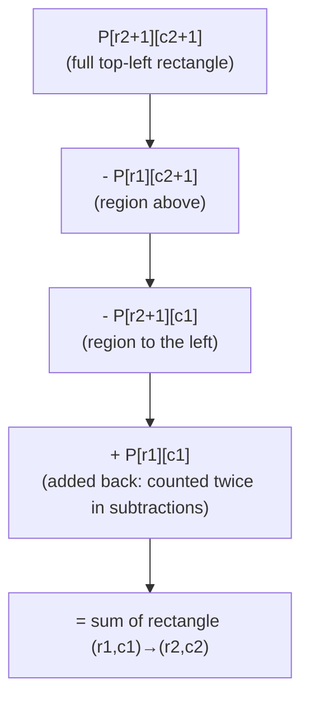

# Chapter 10 — Prefix Sums and Difference Arrays

> **Part II — Arrays and Array Patterns**  
> [← Chapter 9](chapter-09-sliding-window.md) · [← Index](../INDEX.md) · [→ Chapter 11](../INDEX.md#-chapter-11--advanced-array-patterns)

---

## Learning Objectives

By the end of this chapter you will be able to:

- Build a prefix sum array in O(n) and answer arbitrary range-sum queries in O(1).
- Find the number of subarrays with sum equal to a target using prefix sums and a HashMap.
- Extend the prefix sum technique to 2D matrices for rectangle sum queries.
- Build and apply a difference array to perform range-update operations in O(1) each.
- Apply prefix XOR to solve subarray XOR query and equality problems.

---

## Contents

- [10.1 Motivation: The Range Sum Problem](#101-motivation-the-range-sum-problem)
- [10.2 Prefix Sum Construction and Queries](#102-prefix-sum-construction-and-queries)
- [10.3 Subarray Sum Problems with HashMap](#103-subarray-sum-problems-with-hashmap)
- [10.4 Prefix Sum Modulo](#104-prefix-sum-modulo)
- [10.5 Two-Dimensional Prefix Sums](#105-two-dimensional-prefix-sums)
- [10.6 Difference Arrays](#106-difference-arrays)
- [10.7 Prefix XOR](#107-prefix-xor)
- [10.8 Choosing Between Techniques](#108-choosing-between-techniques)
- [Quick Quiz](#quick-quiz)
- [10.9 Practice Problems](#109-practice-problems)
- [10.10 Hard Problem Corner](#1010-hard-problem-corner)
- [Chapter Summary](#chapter-summary)

---

## 10.1 Motivation: The Range Sum Problem

**Problem:** Given an array `nums`, answer $q$ queries of the form "what is the sum of elements from index $l$ to $r$?"

| Approach | Preprocessing | Per query | Total for $q$ queries |
|----------|--------------|----------|----------------------|
| Brute force (loop per query) | O(1) | O(n) | O(qn) |
| Prefix sum | O(n) | **O(1)** | **O(n + q)** |

For $q = 10^5$ queries on an array of $10^5$ elements: brute force = $10^{10}$ operations; prefix sum = $2 \times 10^5$ operations. The prefix sum turns the problem from infeasible to trivial.

---

## 10.2 Prefix Sum Construction and Queries

**Definition:** `prefix[i]` = sum of `nums[0]` through `nums[i-1]`. Equivalently, `prefix[0] = 0` and `prefix[i] = prefix[i-1] + nums[i-1]`.

```java
int[] buildPrefix(int[] nums) {
    int[] prefix = new int[nums.length + 1];  // prefix[0] = 0 by default
    for (int i = 0; i < nums.length; i++) {
        prefix[i + 1] = prefix[i] + nums[i];
    }
    return prefix;
}
```

**Range sum query `[l, r]` (inclusive):**

$$\text{sum}(l, r) = \texttt{prefix}[r+1] - \texttt{prefix}[l]$$

```java
int rangeSum(int[] prefix, int l, int r) {
    return prefix[r + 1] - prefix[l];
}
```

**Worked example for `nums = [3, 1, 4, 1, 5, 9]`:**

| Index | 0 | 1 | 2 | 3 | 4 | 5 |
|-------|---|---|---|---|---|---|
| `nums` | 3 | 1 | 4 | 1 | 5 | 9 |
| `prefix` | 0 | 3 | 4 | 8 | 9 | 14 | 23 |

- `sum(1, 4)` = `prefix[5] - prefix[1]` = `14 - 3` = **11** ✓ (`1+4+1+5=11`)
- `sum(0, 2)` = `prefix[3] - prefix[0]` = `8 - 0` = **8** ✓ (`3+1+4=8`)
- `sum(2, 2)` = `prefix[3] - prefix[2]` = `8 - 4` = **4** ✓ (single element)

> [!NOTE]
> The length-`n+1` prefix array with `prefix[0] = 0` is not an accident. It is what makes the formula `prefix[r+1] - prefix[l]` work uniformly for all $l$, including $l = 0$, without a special case. This one design choice eliminates an entire class of off-by-one bugs.

---

## 10.3 Subarray Sum Problems with HashMap

The prefix sum becomes exponentially more powerful when combined with a `HashMap`. The key identity:

> Sum of `nums[l..r]` = `prefix[r+1] - prefix[l]`  
> Therefore: a subarray `[l, r]` has sum $k$ iff `prefix[r+1] - prefix[l] = k` iff `prefix[l] = prefix[r+1] - k`.

This means: "how many subarrays ending at `r` have sum $k$?" equals "how many prefix values equal `prefix[r+1] - k`?" — a single O(1) HashMap lookup.

### Count Subarrays with Sum Exactly k

```java
int subarraySum(int[] nums, int k) {
    Map<Integer, Integer> freq = new HashMap<>();
    freq.put(0, 1);   // empty prefix: sum 0 seen once (critical initialisation!)
    int prefixSum = 0, count = 0;

    for (int x : nums) {
        prefixSum += x;
        count += freq.getOrDefault(prefixSum - k, 0);  // how many prefixes == prefixSum - k?
        freq.merge(prefixSum, 1, Integer::sum);         // record this prefix sum
    }
    return count;
}
```

**Why `freq.put(0, 1)` is essential:** If a subarray starting at index 0 has sum exactly $k$, then `prefixSum = k` and we look for `prefixSum - k = 0` in the map. Without the initial `{0:1}`, this case would be missed.

**Worked example for `nums = [1, 2, 3]`, `k = 3`:**

| Step | `x` | `prefixSum` | lookup `prefixSum - k` | `count` | map after |
|------|-----|-------------|----------------------|---------|-----------|
| init | — | 0 | — | 0 | {0:1} |
| 0 | 1 | 1 | lookup 1−3=−2 → 0 | 0 | {0:1, 1:1} |
| 1 | 2 | 3 | lookup 3−3=0 → 1 | **1** | {0:1, 1:1, 3:1} |
| 2 | 3 | 6 | lookup 6−3=3 → 1 | **2** | {0:1, 1:1, 3:1, 6:1} |

Result: 2 subarrays (`[1,2]` and `[3]`) ✓

**Complexity:** O(n) time, O(n) space.

> [!TIP]
> This technique works for **arrays with negative numbers** — unlike the sliding window. Since prefix sums are monotonically increasing only for non-negative inputs, we can't use two pointers. The HashMap makes it work for any integer array.

### Subarray with Sum Equal to Multiple of k

```java
int checkSubarraySum(int[] nums, int k) {
    Map<Integer, Integer> firstSeen = new HashMap<>();
    firstSeen.put(0, -1);  // remainder 0 seen before index 0
    int prefixSum = 0;
    for (int i = 0; i < nums.length; i++) {
        prefixSum = (prefixSum + nums[i]) % k;
        if (firstSeen.containsKey(prefixSum)) {
            if (i - firstSeen.get(prefixSum) >= 2) return true;  // subarray length ≥ 2
        } else {
            firstSeen.put(prefixSum, i);
        }
    }
    return false;
}
```

---

## 10.4 Prefix Sum Modulo

When a problem asks about subarrays whose sum is divisible by $k$, store **prefix sums modulo $k$**. Two indices $i < j$ form a valid subarray iff `prefix[j] % k == prefix[i] % k` (the difference is divisible by $k$).

```java
int subarraysDivByK(int[] nums, int k) {
    Map<Integer, Integer> count = new HashMap<>();
    count.put(0, 1);
    int prefixSum = 0, result = 0;
    for (int x : nums) {
        prefixSum = ((prefixSum + x) % k + k) % k;  // always non-negative mod
        result += count.getOrDefault(prefixSum, 0);
        count.merge(prefixSum, 1, Integer::sum);
    }
    return result;
}
```

> [!WARNING]
> Java's `%` operator returns the sign of the dividend. For `(-7) % 3`, Java returns `-1`, not `2`. Always use `((x % k) + k) % k` to get a non-negative remainder.  
> (Covered in [Chapter 2](chapter-02-mathematical-foundations.md#28-modular-arithmetic-the-clock-of-mathematics).)

---

## 10.5 Two-Dimensional Prefix Sums

Extend prefix sums to a 2D grid for rectangle sum queries in O(1).

**Definition:**

$$\texttt{P}[r][c] = \sum_{i=0}^{r-1} \sum_{j=0}^{c-1} \texttt{grid}[i][j]$$

**Inclusion-exclusion construction:**

$$\texttt{P}[r][c] = \texttt{grid}[r-1][c-1] + \texttt{P}[r-1][c] + \texttt{P}[r][c-1] - \texttt{P}[r-1][c-1]$$

```java
int[][] build2DPrefix(int[][] grid) {
    int rows = grid.length, cols = grid[0].length;
    int[][] P = new int[rows + 1][cols + 1];
    for (int r = 1; r <= rows; r++) {
        for (int c = 1; c <= cols; c++) {
            P[r][c] = grid[r-1][c-1] + P[r-1][c] + P[r][c-1] - P[r-1][c-1];
        }
    }
    return P;
}
```

**Rectangle sum query** — top-left `(r1, c1)` to bottom-right `(r2, c2)` (all inclusive):

$$\text{rectSum} = \texttt{P}[r2+1][c2+1] - \texttt{P}[r1][c2+1] - \texttt{P}[r2+1][c1] + \texttt{P}[r1][c1]$$

```java
int rectSum(int[][] P, int r1, int c1, int r2, int c2) {
    return P[r2+1][c2+1] - P[r1][c2+1] - P[r2+1][c1] + P[r1][c1];
}
```

**Visualised (Inclusion-Exclusion):**



---

## 10.6 Difference Arrays

A **difference array** solves the problem of applying many range-increment operations efficiently.

**Problem:** Given $n$ elements initialised to 0, perform $q$ operations of the form "add $v$ to all elements in `[l, r]`". Answer final array.

- Brute force: O(r − l + 1) per operation → O(nq) total.
- Difference array: O(1) per operation → O(n + q) total.

**Key idea:** `diff[l] += v; diff[r+1] -= v`. The prefix sum of `diff` gives the final array.

```java
// Build difference array, apply q range increments, return final array
int[] rangeIncrements(int n, int[][] operations) {
    int[] diff = new int[n + 1];  // extra slot avoids bounds check

    for (int[] op : operations) {
        int l = op[0], r = op[1], v = op[2];
        diff[l] += v;             // start increment at l
        diff[r + 1] -= v;         // end increment after r
    }

    // Prefix sum of diff gives the final array
    int[] result = new int[n];
    int running = 0;
    for (int i = 0; i < n; i++) {
        running += diff[i];
        result[i] = running;
    }
    return result;
}
```

**Example:** n=5, operations: `[1,3,+2]`, `[2,4,+3]`

| Index | 0 | 1 | 2 | 3 | 4 | 5 (extra) |
|-------|---|---|---|---|---|-----------|
| After op1 | 0 | +2 | 0 | 0 | -2 | 0 |
| After op2 | 0 | +2 | +3 | 0 | -2 | -3 |
| Prefix sum | 0 | 2 | 5 | 5 | 3 | 0 |

Final array: `[0, 2, 5, 5, 3]` ✓

**Complexity:** O(1) per range update, O(n) for final reconstruction. Total: O(n + q).

**Classic application — Car Pooling:**

```java
boolean carPooling(int[][] trips, int capacity) {
    int[] diff = new int[1001];  // stops in [0, 1000]
    for (int[] t : trips) {
        diff[t[1]] += t[0];     // t[0] passengers board at stop t[1]
        diff[t[2]] -= t[0];     // t[0] passengers alight at stop t[2]
    }
    int onboard = 0;
    for (int passengers : diff) {
        onboard += passengers;
        if (onboard > capacity) return false;
    }
    return true;
}
```

---

## 10.7 Prefix XOR

The same prefix technique applies to XOR instead of addition.

**Definition:** `xorPrefix[i]` = `nums[0] ^ nums[1] ^ ... ^ nums[i-1]`, with `xorPrefix[0] = 0`.

**XOR of range `[l, r]`:**

$$\text{xorRange}(l, r) = \texttt{xorPrefix}[r+1] \oplus \texttt{xorPrefix}[l]$$

(Because $a \oplus a = 0$, the elements outside `[l, r]` cancel.)

```java
int[] buildXorPrefix(int[] nums) {
    int[] xp = new int[nums.length + 1];
    for (int i = 0; i < nums.length; i++) xp[i + 1] = xp[i] ^ nums[i];
    return xp;
}

int xorRange(int[] xp, int l, int r) {
    return xp[r + 1] ^ xp[l];
}
```

**Application — Count subarrays with XOR equal to target:**

Same pattern as sum-k with HashMap: count how many prefix XOR values equal `prefixXor ^ target`.

```java
int countSubarraysWithXor(int[] nums, int target) {
    Map<Integer, Integer> freq = new HashMap<>();
    freq.put(0, 1);
    int prefixXor = 0, count = 0;
    for (int x : nums) {
        prefixXor ^= x;
        count += freq.getOrDefault(prefixXor ^ target, 0);
        freq.merge(prefixXor, 1, Integer::sum);
    }
    return count;
}
```

---

## 10.8 Choosing Between Techniques

| Scenario | Best technique |
|----------|--------------|
| Many range sum queries, no updates | Prefix sum array |
| Subarrays with sum = k (any integers) | Prefix sum + HashMap |
| Subarrays with sum divisible by k | Prefix sum mod k + HashMap |
| Rectangle sum queries on 2D grid | 2D prefix sum |
| Many range-increment updates, then query final array | Difference array |
| Subarrays with XOR = k | Prefix XOR + HashMap |
| Subarray sum ≥ 0 (non-negative), find longest/shortest | Sliding window (Chapter 9) |

*Table 10.1: Technique selection guide.*

---

## Quick Quiz

**Q1.** For `nums = [2, -1, 3, 4]`, build the prefix sum array and compute `sum(1, 2)`.

<details>
<summary><strong>Answer</strong></summary>

> `prefix = [0, 2, 1, 4, 8]`.  
> `sum(1, 2) = prefix[3] - prefix[1] = 4 - 2 = 2`. Check: `(-1) + 3 = 2` ✓.

</details>

---

**Q2.** Why does `subarraySum` initialise the map with `{0: 1}`, and what case does it handle?

<details>
<summary><strong>Answer</strong></summary>

> It handles subarrays that start at index 0. If `prefixSum == k` at some index, we look up `prefixSum - k = 0`. Without the initial `{0: 1}`, this lookup returns 0 — the subarray `[0, i]` would not be counted. The entry `{0: 1}` represents the "empty prefix" of sum 0 that exists before any element.

</details>

---

**Q3.** A difference array has `diff = [0, 3, 0, -1, 0, -2]`. What is the final array after taking the prefix sum?

<details>
<summary><strong>Answer</strong></summary>

> Running prefix sum: `0, 3, 3, 2, 2, 0`. Final array (excluding the trailing 0): `[0, 3, 3, 2, 2]`.

</details>

---

**Q4.** What is `xorRange(xp, 2, 4)` for `nums = [5, 1, 3, 2, 7]`?

<details>
<summary><strong>Answer</strong></summary>

> `xp = [0, 5, 4, 7, 5, 2]`.  
> `xorRange(2, 4) = xp[5] ^ xp[2] = 2 ^ 4 = 6`.  
> Check: `3 ^ 2 ^ 7 = 1 ^ 7 = 6` ✓.

</details>

---

## 10.9 Practice Problems

| Problem | Name | Difficulty | Technique |
|---------|------|------------|-----------|
| [LC 303](https://leetcode.com/problems/range-sum-query-immutable/) | Range Sum Query - Immutable | Easy | Prefix sum |
| [LC 724](https://leetcode.com/problems/find-pivot-index/) | Find Pivot Index | Easy | Prefix sum |
| [LC 525](https://leetcode.com/problems/contiguous-array/) | Contiguous Array | Medium | Prefix sum + HashMap |
| [LC 560](https://leetcode.com/problems/subarray-sum-equals-k/) | Subarray Sum Equals K | Medium | Prefix sum + HashMap |
| [LC 523](https://leetcode.com/problems/continuous-subarray-sum/) | Continuous Subarray Sum | Medium | Prefix sum mod k + HashMap |
| [LC 304](https://leetcode.com/problems/range-sum-query-2d-immutable/) | Range Sum Query 2D - Immutable | Medium | 2D prefix sum |
| [LC 1094](https://leetcode.com/problems/car-pooling/) | Car Pooling | Medium | Difference array |
| [LC 1109](https://leetcode.com/problems/corporate-flight-bookings/) | Corporate Flight Bookings | Medium | Difference array |
| [LC 1310](https://leetcode.com/problems/xor-queries-of-a-subarray/) | XOR Queries of a Subarray | Medium | Prefix XOR |

---

## 10.10 Hard Problem Corner

> ### 🔥 Hard Problem Corner
>
> **Problem: Count of Range Sum** ([LC 327](https://leetcode.com/problems/count-of-range-sum/))
>
> Given an integer array `nums` and two integers `lower` and `upper`, return the number of range sums `sum(i, j)` such that `lower <= sum(i, j) <= upper`.
>
> **Constraint:** O(n log n).
>
> **Hint:** Express the problem in terms of prefix sums. `sum(i, j) = prefix[j+1] - prefix[i]`. Counting pairs `(i, j)` with `lower <= prefix[j+1] - prefix[i] <= upper` is equivalent to: for each `j`, count how many prior prefix values `p` satisfy `prefix[j+1] - upper <= p <= prefix[j+1] - lower`. This is a range-count query on a growing set of values — solvable with a modified merge sort or balanced BST.

<details>
<summary><strong>Solution sketch (click to reveal)</strong></summary>

> [!TIP]
> Build the prefix sum array. Then use **merge sort** on the prefix array: during the merge step, count pairs from the left and right halves satisfying the condition using two pointers (since both halves are sorted). This gives O(n log n).
>
> ```java
> int countRangeSum(int[] nums, int lower, int upper) {
>     int n = nums.length;
>     long[] prefix = new long[n + 1];
>     for (int i = 0; i < n; i++) prefix[i + 1] = prefix[i] + nums[i];
>     return mergeCount(prefix, 0, n + 1, lower, upper);
> }
>
> int mergeCount(long[] p, int lo, int hi, int lower, int upper) {
>     if (hi - lo <= 1) return 0;
>     int mid = lo + (hi - lo) / 2;
>     int count = mergeCount(p, lo, mid, lower, upper)
>               + mergeCount(p, mid, hi, lower, upper);
>     // Count cross pairs: p[j] - p[i] in [lower, upper], i in [lo,mid), j in [mid,hi)
>     int j1 = mid, j2 = mid;
>     for (int i = lo; i < mid; i++) {
>         while (j1 < hi && p[j1] - p[i] < lower) j1++;
>         while (j2 < hi && p[j2] - p[i] <= upper) j2++;
>         count += j2 - j1;
>     }
>     // Standard merge
>     long[] sorted = Arrays.copyOfRange(p, lo, hi);
>     Arrays.sort(sorted);
>     System.arraycopy(sorted, 0, p, lo, sorted.length);
>     return count;
> }
> ```
>
> **Complexity:** O(n log n) — merge sort structure with O(n) work per level.

</details>

---

## Chapter Summary

| Concept | Key Takeaway |
|---------|-------------|
| **Prefix sum** | Build O(n), query O(1). `sum(l,r) = prefix[r+1] - prefix[l]`. Always use length `n+1` with `prefix[0]=0`. |
| **Prefix + HashMap** | Counts subarrays with sum = k in O(n). Works for negatives. Seed with `{0:1}`. |
| **Mod k variant** | Store `prefix % k`. Two indices with equal mod have a subarray sum divisible by k. |
| **2D prefix sum** | Inclusion-exclusion formula. O(mn) build, O(1) rectangle query. |
| **Difference array** | O(1) range update, O(n) final reconstruction. Use `diff[l] += v; diff[r+1] -= v`. |
| **Prefix XOR** | `xorRange(l,r) = xorPrefix[r+1] ^ xorPrefix[l]`. Same HashMap trick for XOR = k. |
| **Java mod trap** | `(-7) % 3 = -1` in Java. Use `((x % k) + k) % k` for non-negative remainder. |

*Table 10.2: Chapter 10 key concepts.*

---

**Coming Up Next:** [Chapter 11 (Advanced Array Patterns)](../INDEX.md#-chapter-11--advanced-array-patterns) covers Kadane's algorithm, the Dutch National Flag in depth, matrix transformations, spiral traversal, and cyclic sort — completing Part II.

---

> **Part II — Arrays and Array Patterns**  
> [← Chapter 9](chapter-09-sliding-window.md) · [← Index](../INDEX.md) · [→ Chapter 11 (planned)](../INDEX.md#-chapter-11--advanced-array-patterns)
