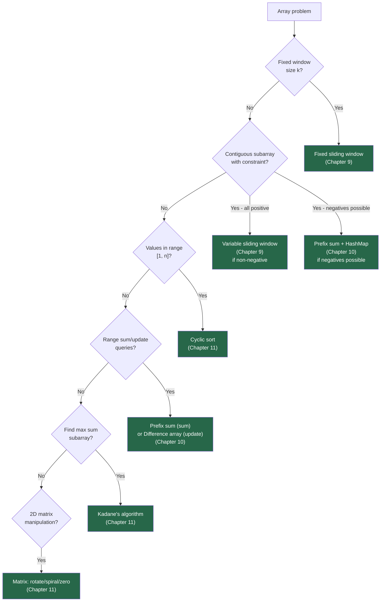

# Chapter 11 — Advanced Array Patterns

> **Part II — Arrays and Array Patterns**  
> [← Chapter 10](chapter-10-prefix-sums.md) · [← Index](../INDEX.md) · [→ Part II Review / Chapter 12](../INDEX.md#-chapter-12--string-fundamentals)

---

## Learning Objectives

By the end of this chapter you will be able to:

- Apply Kadane's algorithm to find the maximum subarray sum in O(n).
- Use cyclic sort to place values at their correct indices for missing/duplicate detection.
- Execute the Dutch National Flag three-way partition to solve colour-sort variants.
- Rotate and transpose a matrix in-place without extra space.
- Traverse a matrix in spiral order using boundary pointers.
- Identify which pattern applies when given an array rearrangement problem.

---

## Contents

- [11.1 Kadane's Algorithm — Maximum Subarray](#111-kadanes-algorithm--maximum-subarray)
- [11.2 Cyclic Sort](#112-cyclic-sort)
- [11.3 Dutch National Flag (Revisited and Generalised)](#113-dutch-national-flag-revisited-and-generalised)
- [11.4 Matrix Rotation and Transformation](#114-matrix-rotation-and-transformation)
- [11.5 Spiral Matrix Traversal](#115-spiral-matrix-traversal)
- [11.6 In-Place Matrix Manipulation](#116-in-place-matrix-manipulation)
- [11.7 Array Partitioning and Rearrangement](#117-array-partitioning-and-rearrangement)
- [11.8 Pattern Recognition Guide](#118-pattern-recognition-guide)
- [Quick Quiz](#quick-quiz)
- [11.9 Practice Problems](#119-practice-problems)
- [11.10 Hard Problem Corner](#1110-hard-problem-corner)
- [Chapter Summary](#chapter-summary)

---

## 11.1 Kadane's Algorithm — Maximum Subarray

**Problem:** Find the contiguous subarray with the largest sum.

**Naïve O(n²):** Try all pairs `(l, r)` and sum each subarray.  
**Kadane's O(n):** At each position, make one local decision — extend the current subarray or start fresh.

**The key insight:** `maxEndingHere` is the maximum-sum subarray ending exactly at the current index. If extending it (adding `nums[i]`) gives a negative total, discard it and start fresh at `nums[i]`.

```java
int maxSubArray(int[] nums) {
    int maxEndingHere = nums[0];
    int maxSoFar = nums[0];

    for (int i = 1; i < nums.length; i++) {
        maxEndingHere = Math.max(nums[i], maxEndingHere + nums[i]);
        maxSoFar = Math.max(maxSoFar, maxEndingHere);
    }
    return maxSoFar;
}
```

**Dry run on `[-2, 1, -3, 4, -1, 2, 1, -5, 4]`:**

| i | nums[i] | maxEndingHere | maxSoFar |
|---|---------|--------------|----------|
| 0 | -2 | -2 | -2 |
| 1 | 1 | max(1, -2+1)=1 | 1 |
| 2 | -3 | max(-3, 1-3)=-2 | 1 |
| 3 | 4 | max(4, -2+4)=4 | **4** |
| 4 | -1 | max(-1, 4-1)=3 | 4 |
| 5 | 2 | max(2, 3+2)=5 | **5** |
| 6 | 1 | max(1, 5+1)=6 | **6** |
| 7 | -5 | max(-5, 6-5)=1 | 6 |
| 8 | 4 | max(4, 1+4)=5 | 6 |

Answer: 6 (`[4, -1, 2, 1]`) ✓

*Table 11.1: Kadane's algorithm dry run.*

### Returning the Subarray Indices

```java
int[] maxSubArrayWithIndices(int[] nums) {
    int maxEndingHere = nums[0], maxSoFar = nums[0];
    int start = 0, end = 0, tempStart = 0;

    for (int i = 1; i < nums.length; i++) {
        if (nums[i] > maxEndingHere + nums[i]) {
            maxEndingHere = nums[i];
            tempStart = i;              // fresh start here
        } else {
            maxEndingHere += nums[i];
        }
        if (maxEndingHere > maxSoFar) {
            maxSoFar = maxEndingHere;
            start = tempStart;
            end = i;
        }
    }
    return new int[]{start, end, maxSoFar};
}
```

### Maximum Circular Subarray Sum

For circular arrays, the answer is either:
1. The standard maximum subarray (non-wrapping), or
2. `totalSum - minSubarraySum` (the wrapping case excludes the minimum subarray).

```java
int maxSubarrayCircular(int[] nums) {
    int totalSum = 0;
    int maxSum = nums[0], curMax = 0;
    int minSum = nums[0], curMin = 0;

    for (int x : nums) {
        curMax = Math.max(x, curMax + x);
        maxSum = Math.max(maxSum, curMax);
        curMin = Math.min(x, curMin + x);
        minSum = Math.min(minSum, curMin);
        totalSum += x;
    }
    // Edge case: all negative — circular case would give 0 (empty), but subarray must be non-empty
    return maxSum > 0 ? Math.max(maxSum, totalSum - minSum) : maxSum;
}
```

---

## 11.2 Cyclic Sort

**Problem:** An array contains integers in the range `[1, n]` (possibly with missing/duplicate values). Place each value at its "home" index (`value - 1`) in O(n).

**Insight:** Value $v$ belongs at index $v - 1$. If `nums[i] != i + 1` and `nums[i]` is in range, swap it to its home. Repeat until `nums[i]` is either at home or out of range.

```java
void cyclicSort(int[] nums) {
    int i = 0;
    while (i < nums.length) {
        int correct = nums[i] - 1;                           // home index for nums[i]
        if (nums[i] > 0 && nums[i] <= nums.length && nums[i] != nums[correct]) {
            swap(nums, i, correct);                          // send to home
        } else {
            i++;                                             // already home (or invalid)
        }
    }
}
```

**Complexity:** O(n). Each swap places at least one element at its correct index; total swaps ≤ n.

**Applications after sorting:**

```java
// Find missing number (range [1, n], one missing)
int findMissing(int[] nums) {
    cyclicSort(nums);
    for (int i = 0; i < nums.length; i++) {
        if (nums[i] != i + 1) return i + 1;
    }
    return nums.length + 1;
}

// Find all duplicates (range [1, n], each appears once or twice)
List<Integer> findDuplicates(int[] nums) {
    cyclicSort(nums);
    List<Integer> result = new ArrayList<>();
    for (int i = 0; i < nums.length; i++) {
        if (nums[i] != i + 1) result.add(nums[i]);
    }
    return result;
}
```

> [!NOTE]
> Cyclic sort is the O(n) alternative to `Arrays.sort` when values are bounded integers. It is not a general-purpose sort — it only works when you know the value range. For the classic interview problems "find missing number" or "find the duplicate", cyclic sort gives the most intuitive O(n), O(1) solution.

---

## 11.3 Dutch National Flag (Revisited and Generalised)

Fully covered in [Chapter 8](chapter-08-two-pointers.md#86-partitioning-arrays). Here we apply it to problems beyond the three-colour constraint.

### Segregate Negatives and Positives

```java
void segregate(int[] nums) {
    int lo = 0, hi = nums.length - 1;
    while (lo < hi) {
        while (lo < hi && nums[lo] < 0) lo++;    // find non-negative on left
        while (lo < hi && nums[hi] >= 0) hi--;   // find negative on right
        if (lo < hi) swap(nums, lo, hi);
    }
}
```

### Sort Array by Parity (Even Before Odd)

```java
int[] sortArrayByParity(int[] nums) {
    int lo = 0, hi = nums.length - 1;
    while (lo < hi) {
        while (lo < hi && nums[lo] % 2 == 0) lo++;
        while (lo < hi && nums[hi] % 2 == 1) hi--;
        if (lo < hi) swap(nums, lo, hi);
    }
    return nums;
}
```

---

## 11.4 Matrix Rotation and Transformation

### Rotate 90° Clockwise (In-Place)

For an $n \times n$ matrix: **transpose** then **reverse each row**.

```
Transpose:    Reverse rows:
1 2 3         1 4 7       7 4 1
4 5 6  -->    2 5 8  -->  8 5 2
7 8 9         3 6 9       9 6 3
```

```java
void rotate90Clockwise(int[][] matrix) {
    int n = matrix.length;

    // Step 1: Transpose (swap across the main diagonal)
    for (int r = 0; r < n; r++) {
        for (int c = r + 1; c < n; c++) {
            int tmp = matrix[r][c];
            matrix[r][c] = matrix[c][r];
            matrix[c][r] = tmp;
        }
    }

    // Step 2: Reverse each row
    for (int r = 0; r < n; r++) {
        int lo = 0, hi = n - 1;
        while (lo < hi) {
            int tmp = matrix[r][lo];
            matrix[r][lo] = matrix[r][hi];
            matrix[r][hi] = tmp;
            lo++; hi--;
        }
    }
}
```

**Complexity:** O(n²) time, O(1) space.

**Rotate 90° Counter-Clockwise:** Transpose then **reverse each column** (or reverse each row then transpose).

**Rotate 180°:** Reverse the entire matrix row-order, then reverse each row (or apply 90° twice).

### Reflect (Mirror)

```java
// Horizontal mirror (flip upside down)
void flipHorizontal(int[][] m) {
    int lo = 0, hi = m.length - 1;
    while (lo < hi) { int[] tmp = m[lo]; m[lo] = m[hi]; m[hi] = tmp; lo++; hi--; }
}

// Vertical mirror (flip left-right) = reverse each row
void flipVertical(int[][] m) {
    for (int[] row : m) {
        int lo = 0, hi = row.length - 1;
        while (lo < hi) { int t = row[lo]; row[lo] = row[hi]; row[hi] = t; lo++; hi--; }
    }
}
```

---

## 11.5 Spiral Matrix Traversal

Traverse an $m \times n$ matrix in clockwise spiral order. Maintain four boundary variables that shrink as layers are peeled.

```java
List<Integer> spiralOrder(int[][] matrix) {
    List<Integer> result = new ArrayList<>();
    int top = 0, bottom = matrix.length - 1;
    int left = 0, right = matrix[0].length - 1;

    while (top <= bottom && left <= right) {
        // → traverse top row
        for (int c = left; c <= right; c++)  result.add(matrix[top][c]);
        top++;

        // ↓ traverse right column
        for (int r = top; r <= bottom; r++)  result.add(matrix[r][right]);
        right--;

        // ← traverse bottom row (if still valid)
        if (top <= bottom) {
            for (int c = right; c >= left; c--) result.add(matrix[bottom][c]);
            bottom--;
        }

        // ↑ traverse left column (if still valid)
        if (left <= right) {
            for (int r = bottom; r >= top; r--) result.add(matrix[r][left]);
            left++;
        }
    }
    return result;
}
```

**Complexity:** O(mn) — each cell visited exactly once.

**Visualised boundary shrink:**

```
Step 1: top row →     [1, 2, 3]       top = 1
Step 2: right col ↓   [6, 9]          right = 1
Step 3: bottom row ←  [8, 7]          bottom = 1
Step 4: left col ↑    [4]             left = 1
Step 5: top row →     [5]  (single)   done
```

> [!TIP]
> The boundary guards `if (top <= bottom)` and `if (left <= right)` before the bottom-row and left-column passes are essential. Without them, a matrix with one row or one column would add elements twice.

---

## 11.6 In-Place Matrix Manipulation

### Set Matrix Zeroes

If `matrix[r][c] == 0`, set all elements in row `r` and column `c` to 0. Do it in O(1) extra space.

**Key insight:** Use the first row and first column as markers, but save the original zero-state of `matrix[0][0]`.

```java
void setZeroes(int[][] matrix) {
    int rows = matrix.length, cols = matrix[0].length;
    boolean firstRowZero = false;

    // Use row 0 and col 0 as markers
    for (int r = 0; r < rows; r++) {
        for (int c = 0; c < cols; c++) {
            if (matrix[r][c] == 0) {
                matrix[0][c] = 0;                    // mark column
                if (r == 0) firstRowZero = true;
                else        matrix[r][0] = 0;        // mark row (via first column)
            }
        }
    }

    // Zero out cells based on markers (skip row 0 and col 0 themselves)
    for (int r = 1; r < rows; r++)
        for (int c = 1; c < cols; c++)
            if (matrix[r][0] == 0 || matrix[0][c] == 0) matrix[r][c] = 0;

    // Handle first column
    if (matrix[0][0] == 0)
        for (int r = 0; r < rows; r++) matrix[r][0] = 0;

    // Handle first row
    if (firstRowZero)
        for (int c = 0; c < cols; c++) matrix[0][c] = 0;
}
```

---

## 11.7 Array Partitioning and Rearrangement

### Next Permutation

Find the lexicographically next permutation of an array in O(n), in-place.

**Algorithm:**
1. Find the rightmost index `i` where `nums[i] < nums[i+1]` (the "pivot").
2. Find the rightmost index `j > i` where `nums[j] > nums[i]`.
3. Swap `nums[i]` and `nums[j]`.
4. Reverse the suffix `nums[i+1..]`.

```java
void nextPermutation(int[] nums) {
    int n = nums.length, i = n - 2;

    // Step 1: find rightmost ascending pair
    while (i >= 0 && nums[i] >= nums[i + 1]) i--;

    if (i >= 0) {
        // Step 2: find rightmost element larger than nums[i]
        int j = n - 1;
        while (nums[j] <= nums[i]) j--;
        swap(nums, i, j);                     // Step 3
    }
    reverse(nums, i + 1, n - 1);             // Step 4
}
```

**Example:** `[1, 3, 2]` → pivot at index 1 (3→2 is descending; go left: 1<3 ✓) → swap 1 with 2 → `[2, 3, 1]` → reverse suffix from index 2 → `[2, 1, 3]` ✓.

### Rearrange Array: Positive and Negative Alternating

```java
// Interleave positives and negatives (equal counts, preserve order)
int[] rearrangeArray(int[] nums) {
    int[] result = new int[nums.length];
    int pos = 0, neg = 1;
    for (int x : nums) {
        if (x > 0) { result[pos] = x; pos += 2; }
        else        { result[neg] = x; neg += 2; }
    }
    return result;
}
```

---

## 11.8 Pattern Recognition Guide



---

## Quick Quiz

**Q1.** What does Kadane's algorithm do when it sets `maxEndingHere = nums[i]` (instead of `maxEndingHere + nums[i]`)?

<details>
<summary><strong>Answer</strong></summary>

> It discards the previous subarray and starts a new subarray beginning at index `i`. This happens when `maxEndingHere + nums[i] < nums[i]`, i.e., when `maxEndingHere < 0` — the accumulated sum so far is negative, so starting fresh gives a better result.

</details>

---

**Q2.** For `nums = [3, 1, 2]` (range [1, 3]), trace cyclic sort step by step.

<details>
<summary><strong>Answer</strong></summary>

> - `i=0`: `nums[0]=3`, home=2. `nums[2]=2 ≠ 3` → swap → `[2, 1, 3]`.
> - `i=0`: `nums[0]=2`, home=1. `nums[1]=1 ≠ 2` → swap → `[1, 2, 3]`.
> - `i=0`: `nums[0]=1`, home=0. `nums[0]=1 = 1` → `i++`.
> - `i=1,2`: already at home. Done: `[1, 2, 3]` ✓.

</details>

---

**Q3.** For a 3×3 matrix, write out the two steps of the 90° clockwise rotation (transpose then reverse rows) for `[[1,2,3],[4,5,6],[7,8,9]]`.

<details>
<summary><strong>Answer</strong></summary>

> **After transpose:**  
> `[[1,4,7],[2,5,8],[3,6,9]]`  
> **After reversing each row:**  
> `[[7,4,1],[8,5,2],[9,6,3]]` ✓

</details>

---

**Q4.** What is the spiral order of matrix `[[1,2],[3,4]]`?

<details>
<summary><strong>Answer</strong></summary>

> `[1, 2, 4, 3]`. Top row: `[1,2]`. Right col: `[4]`. Bottom row (right to left): `[3]`. Left col: empty.

</details>

---

## 11.9 Practice Problems

| Problem | Name | Difficulty | Pattern |
|---------|------|------------|---------|
| [LC 53](https://leetcode.com/problems/maximum-subarray/) | Maximum Subarray | Medium | Kadane's |
| [LC 918](https://leetcode.com/problems/maximum-sum-circular-subarray/) | Maximum Sum Circular Subarray | Medium | Kadane's (circular) |
| [LC 268](https://leetcode.com/problems/missing-number/) | Missing Number | Easy | Cyclic sort |
| [LC 442](https://leetcode.com/problems/find-all-duplicates-in-an-array/) | Find All Duplicates in an Array | Medium | Cyclic sort |
| [LC 75](https://leetcode.com/problems/sort-colors/) | Sort Colors | Medium | Dutch National Flag |
| [LC 48](https://leetcode.com/problems/rotate-image/) | Rotate Image | Medium | Transpose + reverse |
| [LC 54](https://leetcode.com/problems/spiral-matrix/) | Spiral Matrix | Medium | Boundary pointers |
| [LC 59](https://leetcode.com/problems/spiral-matrix-ii/) | Spiral Matrix II | Medium | Boundary pointers (fill) |
| [LC 73](https://leetcode.com/problems/set-matrix-zeroes/) | Set Matrix Zeroes | Medium | In-place with markers |
| [LC 31](https://leetcode.com/problems/next-permutation/) | Next Permutation | Medium | Rearrangement |

---

## 11.10 Hard Problem Corner

> ### 🔥 Hard Problem Corner
>
> **Problem: Maximum Product Subarray** ([LC 152](https://leetcode.com/problems/maximum-product-subarray/))
>
> Find the contiguous subarray with the largest product. Array can contain negatives and zeros.
>
> **Why Kadane's doesn't directly apply:** A large negative × a later large negative = large positive. You cannot simply discard negative products as you can discard negative sums. You must track both the maximum and minimum product ending at each position.

<details>
<summary><strong>Solution (click to reveal)</strong></summary>

> [!TIP]
> ```java
> int maxProduct(int[] nums) {
>     int maxEnd = nums[0], minEnd = nums[0], best = nums[0];
>     for (int i = 1; i < nums.length; i++) {
>         int x = nums[i];
>         // A negative flips max and min — compute both and take max/min
>         int newMax = Math.max(x, Math.max(maxEnd * x, minEnd * x));
>         int newMin = Math.min(x, Math.min(maxEnd * x, minEnd * x));
>         maxEnd = newMax;
>         minEnd = newMin;
>         best = Math.max(best, maxEnd);
>     }
>     return best;
> }
> ```
>
> **Why track minimum?** If `minEnd` is a large negative and `nums[i]` is also negative, `minEnd * nums[i]` becomes a large positive — the new maximum. By always keeping both extremes, we never miss this flip.
>
> **Zeros** naturally reset both `maxEnd` and `minEnd` to `nums[i]` (via `Math.max(x, ...)` / `Math.min(x, ...)`), which is correct: a zero breaks any product, so we start fresh from the next element.
>
> **Complexity:** O(n) time, O(1) space.

</details>

---

## Chapter Summary

| Concept | Key Takeaway |
|---------|-------------|
| **Kadane's** | `maxEndingHere = max(nums[i], maxEndingHere + nums[i])`. Start fresh when accumulated sum turns negative. O(n). |
| **Circular Kadane** | `max(normalMax, totalSum - minSubarray)`. Edge case: all-negative → return normalMax. |
| **Cyclic sort** | Value $v$ belongs at index $v-1$. Swap until home; then `i++`. O(n) for bounded-integer arrays. |
| **Dutch National Flag** | 3 pointers (lo, mid, hi). One pass, one invariant. `mid` stalls when swapping with `hi`. |
| **90° rotation** | Transpose (swap `[r][c]` and `[c][r]`) then reverse each row. O(n²), O(1). |
| **Spiral traversal** | 4 boundary variables (top, bottom, left, right). Shrink after each direction. Guard before bottom-row and left-col passes. |
| **Set matrix zeroes** | Use row 0 and col 0 as markers. Save original `firstRowZero` state before marking. |
| **Next permutation** | Find pivot (rightmost ascending pair), swap with rightmost larger, reverse suffix. |
| **Max product subarray** | Track both `maxEnd` and `minEnd` — a negative number flips them. |

*Table 11.1: Chapter 11 key concepts.*

---

**Part II is complete.** You now have a full toolkit for array problems:

| Chapter | Pattern |
|---------|---------|
| 7 | Array fundamentals, in-place manipulation, prefix sums (intro) |
| 8 | Two pointers: opposite-direction, same-direction, fast/slow, DNF |
| 9 | Sliding window: fixed and variable size, frequency maps |
| 10 | Prefix sums, HashMap subarray counting, difference arrays, prefix XOR |
| 11 | Kadane's, cyclic sort, matrix transformations, spiral, next permutation |

**Coming Up Next:** Part III — Strings and String Algorithms begins with [Chapter 12](../INDEX.md#-chapter-12--string-fundamentals).

---

> **Part II — Arrays and Array Patterns** *(Complete)*  
> [← Chapter 10](chapter-10-prefix-sums.md) · [← Index](../INDEX.md) · [→ Chapter 12: Part III (planned)](../INDEX.md#-chapter-12--string-fundamentals)
