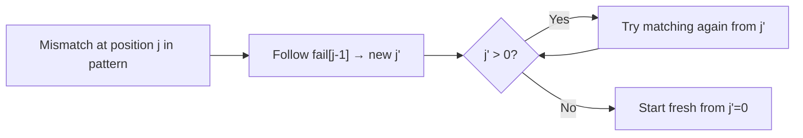
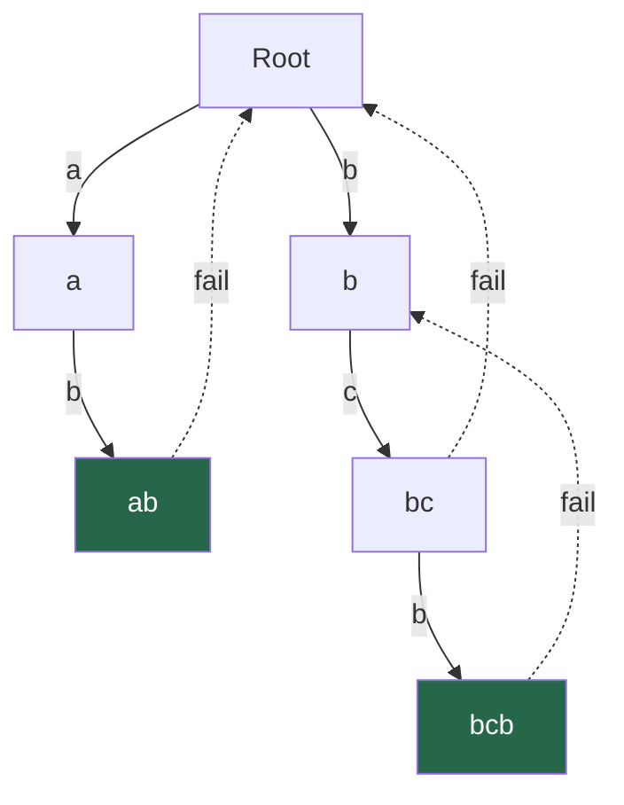
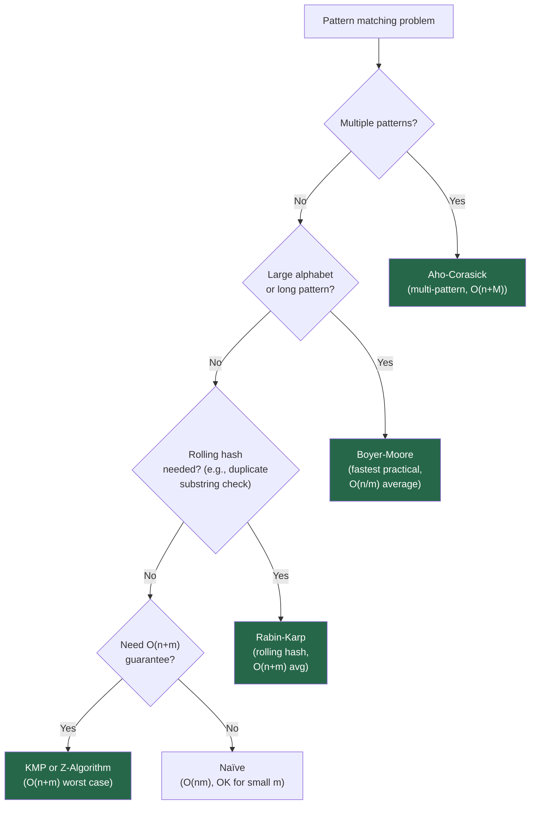

# Chapter 13 — Advanced String Algorithms

> **Part III — Strings and String Algorithms**  
> [← Chapter 12](chapter-12-string-fundamentals.md) · [← Index](../INDEX.md) · [→ Part III Review](part-03-review.md)

---

## Learning Objectives

By the end of this chapter you will be able to:

- Implement naïve pattern matching and state its worst-case complexity.
- Build the KMP failure function (prefix table) and use it to match in O(n + m).
- Compute the Z-array and apply it to pattern matching and other prefix queries.
- Implement the Rabin-Karp rolling hash and handle hash collisions correctly.
- Describe at a conceptual level how Boyer-Moore and Aho-Corasick work and when to use each.
- Select the right algorithm for a given pattern-matching problem.

---

## Contents

- [13.1 The Pattern Matching Problem](#131-the-pattern-matching-problem)
- [13.2 Naïve Pattern Matching](#132-naïve-pattern-matching)
- [13.3 Prefix and Suffix Concepts](#133-prefix-and-suffix-concepts)
- [13.4 KMP Algorithm](#134-kmp-algorithm)
- [13.5 Z-Algorithm](#135-z-algorithm)
- [13.6 Rabin-Karp and Rolling Hash](#136-rabin-karp-and-rolling-hash)
- [13.7 Boyer-Moore Overview](#137-boyer-moore-overview)
- [13.8 Aho-Corasick Overview](#138-aho-corasick-overview)
- [13.9 Algorithm Selection Guide](#139-algorithm-selection-guide)
- [Interview Insight](#interview-insight)
- [Quick Quiz](#quick-quiz)
- [13.10 Practice Problems](#1310-practice-problems)
- [13.11 Hard Problem Corner](#1311-hard-problem-corner)
- [Chapter Summary](#chapter-summary)

---

## 13.1 The Pattern Matching Problem

**Problem:** Given a text string `t` of length $n$ and a pattern string `p` of length $m$, find all positions in `t` where `p` occurs as a substring.

This is one of the most studied problems in computer science. The naïve approach is O(nm). The goal of this chapter is to reach O(n + m).

**Terminology:**

| Term | Meaning |
|------|---------|
| Text `t` | The long string being searched |
| Pattern `p` | The short string being searched for |
| $n$ | Length of text |
| $m$ | Length of pattern |
| Match at index $i$ | `t[i..i+m-1] == p[0..m-1]` |

---

> ### 🔗 Analogy
> **Naïve search is like sliding a transparency.**
>
> Write the pattern on a transparent overlay. Slide it across the text one position at a time, checking if all characters align. This always works but is slow — you restart the check from the beginning of the pattern at every shift. KMP is like sliding the overlay intelligently: when a mismatch occurs, you skip forward based on what you already know matched, never re-checking characters needlessly.

---

## 13.2 Naïve Pattern Matching

Slide the pattern over every position in the text. At each position, compare character by character.

```java
List<Integer> naiveSearch(String t, String p) {
    List<Integer> matches = new ArrayList<>();
    int n = t.length(), m = p.length();
    for (int i = 0; i <= n - m; i++) {
        int j = 0;
        while (j < m && t.charAt(i + j) == p.charAt(j)) j++;
        if (j == m) matches.add(i);
    }
    return matches;
}
```

**Complexity:**
- Best case: O(n) — first character always mismatches.
- Worst case: **O(nm)** — e.g., `t = "aaaa...a"` (n chars) and `p = "aa...ab"` (m chars); matches n − m + 1 times through almost all of p before the mismatch.

---

## 13.3 Prefix and Suffix Concepts

Before KMP, we need a precise vocabulary.

**Proper prefix:** A prefix that is not the whole string. `"ab"` has proper prefixes `""`, `"a"`.

**Proper suffix:** A suffix that is not the whole string. `"ab"` has proper suffixes `""`, `"b"`.

**Border (or failure link):** A string that is simultaneously a proper prefix AND a proper suffix. For `"abab"`: `"ab"` is both a prefix and a suffix → border of length 2.

The length of the **longest border** of a string is the key quantity in KMP. It tells us: "if the current match attempt fails, how far back can we jump in the pattern without missing a possible match?"

**Examples:**

| String | Longest border | Length |
|--------|---------------|--------|
| `"a"` | `""` | 0 |
| `"aba"` | `"a"` | 1 |
| `"abab"` | `"ab"` | 2 |
| `"aabaa"` | `"aa"` | 2 |
| `"abcabc"` | `"abc"` | 3 |

*Table 13.1: Longest border lengths.*

---

## 13.4 KMP Algorithm

Knuth-Morris-Pratt (1977) achieves O(n + m) by precomputing the **failure function** (prefix table) of the pattern, which encodes the longest border at each prefix.

### Step 1: Build the Failure Function

`fail[i]` = length of the longest proper prefix of `p[0..i]` that is also a suffix.

```java
int[] buildFailure(String p) {
    int m = p.length();
    int[] fail = new int[m];
    fail[0] = 0;      // by definition: longest proper border of single char is 0
    int k = 0;        // length of current matching border

    for (int i = 1; i < m; i++) {
        // Follow failure links until we find a match or reach the start
        while (k > 0 && p.charAt(i) != p.charAt(k)) k = fail[k - 1];
        if (p.charAt(i) == p.charAt(k)) k++;
        fail[i] = k;
    }
    return fail;
}
```

**Example for `p = "ababac"`:**

| i | p[i] | fail[i] | Explanation |
|---|------|---------|-------------|
| 0 | a | 0 | No proper prefix |
| 1 | b | 0 | "ab": no border |
| 2 | a | 1 | "aba": border "a" |
| 3 | b | 2 | "abab": border "ab" |
| 4 | a | 3 | "ababa": border "aba" |
| 5 | c | 0 | "ababac": no border |

*Table 13.2: Failure function for "ababac".*

### Step 2: Use the Failure Function to Search

```java
List<Integer> kmpSearch(String t, String p) {
    List<Integer> matches = new ArrayList<>();
    int n = t.length(), m = p.length();
    int[] fail = buildFailure(p);
    int k = 0;   // number of characters matched so far in p

    for (int i = 0; i < n; i++) {
        // Follow failure links until we match or exhaust the pattern
        while (k > 0 && t.charAt(i) != p.charAt(k)) k = fail[k - 1];
        if (t.charAt(i) == p.charAt(k)) k++;
        if (k == m) {
            matches.add(i - m + 1);   // full match found
            k = fail[k - 1];           // continue searching (allow overlapping matches)
        }
    }
    return matches;
}
```

**Why it's O(n + m):** The variable `k` can increase at most once per character of `t` (the `k++` line), and can only decrease to previous values via failure links. Total increases ≤ $n$; total decreases ≤ total increases ≤ $n$. The failure function build is O(m) by the same argument. Combined: **O(n + m)**.



---

## 13.5 Z-Algorithm

The **Z-array** is an alternative precomputation that also enables O(n + m) pattern matching. For string `s`, `Z[i]` = length of the longest substring starting at `i` that is also a prefix of `s`. By convention, `Z[0]` is undefined (or set to `n`).

### Build the Z-Array

```java
int[] buildZ(String s) {
    int n = s.length();
    int[] z = new int[n];
    int l = 0, r = 0;   // [l, r] is the rightmost Z-box seen so far

    for (int i = 1; i < n; i++) {
        if (i < r) {
            // i is inside the current Z-box — use existing info
            z[i] = Math.min(r - i, z[i - l]);
        }
        // Try to extend further
        while (i + z[i] < n && s.charAt(z[i]) == s.charAt(i + z[i])) z[i]++;
        // Update the rightmost Z-box
        if (i + z[i] > r) { l = i; r = i + z[i]; }
    }
    return z;
}
```

**Complexity:** O(n). The right boundary `r` only moves forward — total character comparisons ≤ 2n.

### Pattern Matching with Z-Algorithm

Concatenate `p + "$" + t` where `"$"` is a separator character not in either string. Compute Z on this concatenated string. Any position in the text portion where `Z[i] == m` is a match.

```java
List<Integer> zSearch(String t, String p) {
    String s = p + "$" + t;
    int[] z = buildZ(s);
    int m = p.length(), offset = m + 1;
    List<Integer> matches = new ArrayList<>();
    for (int i = offset; i < s.length(); i++) {
        if (z[i] == m) matches.add(i - offset);
    }
    return matches;
}
```

**Example for `p="ab"`, `t="ababab"`:**

Concatenated: `"ab$ababab"`. Z-values at positions ≥ 3: `2, 0, 2, 0, 2`. Positions where Z=2: indices 3, 5, 7 in the concat string → text positions 0, 2, 4. ✓

---

## 13.6 Rabin-Karp and Rolling Hash

Rabin-Karp (1987) reduces string comparison to hash comparison. Instead of comparing all $m$ characters, compare a hash value in O(1). A **rolling hash** updates the window hash in O(1) as the window slides.

### Polynomial Rolling Hash

Treat the string as a number in base $b$ modulo prime $q$:

$$h(s[i..i+m-1]) = (s[i] \cdot b^{m-1} + s[i+1] \cdot b^{m-2} + \cdots + s[i+m-1]) \mod q$$

**Rolling update when sliding by 1:**

$$h(s[i+1..i+m]) = (h(s[i..i+m-1]) - s[i] \cdot b^{m-1}) \cdot b + s[i+m] \pmod{q}$$

```java
List<Integer> rabinKarp(String t, String p) {
    final int BASE = 31, MOD = 1_000_000_007;
    int n = t.length(), m = p.length();
    List<Integer> matches = new ArrayList<>();

    // Precompute BASE^(m-1) mod MOD
    long power = 1;
    for (int i = 0; i < m - 1; i++) power = power * BASE % MOD;

    // Hash of pattern and first window of text
    long patHash = 0, winHash = 0;
    for (int i = 0; i < m; i++) {
        patHash = (patHash * BASE + (p.charAt(i) - 'a' + 1)) % MOD;
        winHash = (winHash * BASE + (t.charAt(i) - 'a' + 1)) % MOD;
    }

    for (int i = 0; i <= n - m; i++) {
        if (winHash == patHash) {
            // Hash match: verify with direct comparison (handle collisions)
            if (t.substring(i, i + m).equals(p)) matches.add(i);
        }
        // Slide window
        if (i < n - m) {
            winHash = (winHash - (t.charAt(i) - 'a' + 1) * power % MOD + MOD) % MOD;
            winHash = (winHash * BASE + (t.charAt(i + m) - 'a' + 1)) % MOD;
        }
    }
    return matches;
}
```

**Complexity:**
- Average: **O(n + m)** — hash collisions are rare with a good prime.
- Worst case: **O(nm)** — adversarial input with many collisions (e.g., all same characters with certain moduli).

**Hash collision handling:** When `winHash == patHash`, always verify with a direct character comparison. Without this, Rabin-Karp would produce false positives.

> [!TIP]
> **Double hashing:** Use two independent (BASE, MOD) pairs. The probability of a false positive for both simultaneously is astronomically small ($\approx 10^{-18}$ with two 64-bit hashes). This is the standard approach in competitive programming to eliminate false positives without O(m) verification.

---

## 13.7 Boyer-Moore Overview

Boyer-Moore (1977) is the fastest practical single-pattern matching algorithm for large alphabets. It scans the pattern **right-to-left** and uses two heuristics to skip large portions of the text:

**1. Bad Character Heuristic:** When a mismatch occurs at text position `i` with pattern position `j`, shift the pattern so that the last occurrence of `t[i]` in the pattern aligns with `t[i]`. If `t[i]` doesn't appear in the pattern, shift the entire pattern past `i`.

**2. Good Suffix Heuristic:** When a suffix of length $k$ matched before the mismatch, shift the pattern so that another occurrence of that suffix (or its longest border) aligns with the matched suffix in the text.

| Property | Boyer-Moore |
|----------|------------|
| Preprocessing | O(m + σ) where σ = alphabet size |
| Best case | **O(n/m)** — skips most of the text |
| Worst case | O(nm) — pathological inputs |
| Practical | Fastest for large alphabets and long patterns |

**When to use:** Searching for a fixed pattern in many texts (e.g., text editor search, `grep`). Not typically asked in coding interviews to implement from scratch — just describe the concept.

---

## 13.8 Aho-Corasick Overview

Aho-Corasick (1975) extends KMP to **multi-pattern matching**: given a set of $k$ patterns of total length $M$, find all occurrences of any pattern in text `t` in O(n + M + occurrences).

**How it works:**
1. Build a **trie** of all patterns. (Covered in depth in Chapter 25 — Tries.)
2. Add **failure links** (like KMP's failure function) between trie nodes — when a character doesn't match in the current path, follow the failure link to the longest suffix of the current path that is also a prefix of some pattern.
3. Add **dictionary links** (output links) to quickly enumerate all patterns that end at each node.



| Property | Aho-Corasick |
|----------|-------------|
| Preprocessing | O(M × σ) where M = total pattern length |
| Search | **O(n + M + occurrences)** |
| Use case | Log parsing, DNA sequence search, spam filtering |

**When to use:** You have many patterns (thousands) and need to find all simultaneously. A dictionary of English words, a set of banned phrases, or a virus signature database are typical inputs.

---

## 13.9 Algorithm Selection Guide



| Algorithm | Time | Space | Key strength |
|-----------|------|-------|-------------|
| Naïve | O(nm) | O(1) | Simple, no preprocessing |
| KMP | O(n+m) | O(m) | O(n+m) guaranteed, overlapping matches |
| Z-Algorithm | O(n+m) | O(n+m) | Clean implementation, good for prefix queries |
| Rabin-Karp | O(n+m) avg | O(1) | Rolling hash, works for 2D pattern matching |
| Boyer-Moore | O(n/m) avg | O(m+σ) | Fastest practical for large alphabets |
| Aho-Corasick | O(n+M) | O(M×σ) | Multi-pattern matching |

*Table 13.3: Algorithm comparison.*

---

## Interview Insight

> ### 🎯 Interview Insight
> **What Interviewers Actually Ask**
>
> You will almost never be asked to implement Boyer-Moore or Aho-Corasick from scratch in an interview. The realistic expectations are:
>
> - **KMP:** Know the concept of the failure function and why it gives O(n+m). Be able to implement it if asked.
> - **Rabin-Karp:** Know the rolling hash formula and how to handle collisions. Often asked for "find duplicate substrings" problems.
> - **Z-Algorithm:** Less common, but elegant — know how the Z-box optimisation works.
> - **Boyer-Moore:** Describe the bad-character and good-suffix heuristics conceptually.
> - **Aho-Corasick:** Know it exists and what problem it solves; implement in senior/specialist interviews.
>
> For 90% of string matching interview problems, the correct answer is: **build a string `p + "$" + t`, apply KMP or Z-algorithm, find positions where failure-function value = m**. This covers: pattern in text, check if one string is rotation of another, check if one string is a repeated pattern of another.

---

## Quick Quiz

**Q1.** What does `fail[i]` store in the KMP failure function, and why is it useful?

<details><summary><strong>Answer</strong></summary>

> `fail[i]` = length of the longest proper prefix of `p[0..i]` that is also a suffix of `p[0..i]`. When a mismatch occurs after matching `j` characters, instead of restarting from 0, we continue matching from position `fail[j-1]` — the longest prefix of the pattern that we know still matches a suffix of what we've seen. This avoids redundant comparisons.

</details>

---

**Q2.** Build the failure function for `p = "aabaabaaa"`.

<details><summary><strong>Answer</strong></summary>

> | i | 0 | 1 | 2 | 3 | 4 | 5 | 6 | 7 | 8 |
> |---|---|---|---|---|---|---|---|---|---|
> | p[i] | a | a | b | a | a | b | a | a | a |
> | fail[i] | 0 | 1 | 0 | 1 | 2 | 3 | 4 | 5 | 2 |

</details>

---

**Q3.** Why does Rabin-Karp need a character-by-character verification step after a hash match?

<details><summary><strong>Answer</strong></summary>

> Two different strings can have the same hash value (a **collision**). Without verification, a collision would produce a false match. The verification is O(m) but rare in practice — the expected number of verifications is O(1) with a good hash function, keeping the total average time O(n + m).

</details>

---

**Q4.** For `s = "aabaab"`, compute the Z-array values.

<details><summary><strong>Answer</strong></summary>

> `Z = [undefined, 1, 0, 3, 1, 0]`.  
> - Z[1]: "abaab" vs "aabaab" → 'a'='a', 'b'≠'a' → Z[1]=1.  
> - Z[2]: "baab" vs "aabaab" → 'b'≠'a' → Z[2]=0.  
> - Z[3]: "aab" vs "aabaab" → 'a'='a', 'a'='a', 'b'='b' → Z[3]=3.  
> - Z[4]: "ab" vs "aabaab" → 'a'='a', 'b'≠'a' → Z[4]=1.  
> - Z[5]: "b" vs "aabaab" → 'b'≠'a' → Z[5]=0.

</details>

---

## 13.10 Practice Problems

| Problem | Name | Difficulty | Algorithm |
|---------|------|------------|-----------|
| [LC 28](https://leetcode.com/problems/find-the-index-of-the-first-occurrence-in-a-string/) | Find the Index of the First Occurrence | Easy | KMP or naïve |
| [LC 459](https://leetcode.com/problems/repeated-substring-pattern/) | Repeated Substring Pattern | Easy | KMP failure function property |
| [LC 796](https://leetcode.com/problems/rotate-string/) | Rotate String | Easy | KMP: is `s` in `s+s`? |
| [LC 686](https://leetcode.com/problems/repeated-string-match/) | Repeated String Match | Medium | KMP |
| [LC 214](https://leetcode.com/problems/shortest-palindrome/) | Shortest Palindrome | Hard | KMP on `s + "#" + reverse(s)` |
| [LC 1392](https://leetcode.com/problems/longest-happy-prefix/) | Longest Happy Prefix | Hard | KMP failure function |
| [LC 1044](https://leetcode.com/problems/longest-duplicate-substring/) | Longest Duplicate Substring | Hard | Rabin-Karp + binary search |
| [LC 718](https://leetcode.com/problems/maximum-length-of-repeated-subarray/) | Maximum Length of Repeated Subarray | Medium | Rabin-Karp or DP |

---

## 13.11 Hard Problem Corner

> ### 🔥 Hard Problem Corner
>
> **Problem: Shortest Palindrome** ([LC 214](https://leetcode.com/problems/shortest-palindrome/))
>
> Given string `s`, you can insert characters in front of it to make it a palindrome. Return the shortest such palindrome.
>
> **Key insight:** You need to find the longest prefix of `s` that is already a palindrome. The answer is `reverse(s[k..n-1]) + s` where `k` is the first character after the longest palindromic prefix.
>
> This reduces to: find the longest prefix of `s` that is a palindrome → apply KMP on `s + "#" + reverse(s)`.

<details><summary><strong>Solution (click to reveal)</strong></summary>

> [!TIP]
> ```java
> String shortestPalindrome(String s) {
>     String rev = new StringBuilder(s).reverse().toString();
>     String combined = s + "#" + rev;         // '#' ensures no cross-boundary match
>     int[] fail = buildFailure(combined);
>     int longestPalindromePrefix = fail[combined.length() - 1];
>     // Characters after the longest palindromic prefix need to be prepended (reversed)
>     return rev.substring(0, s.length() - longestPalindromePrefix) + s;
> }
> ```
>
> **Why it works:** The failure value at the last position of `s + "#" + rev` gives the length of the longest prefix of `s + "#" + rev` that equals a suffix of `s + "#" + rev`. Since `"#"` acts as a barrier, this longest common prefix/suffix is exactly the longest prefix of `s` that is also a suffix of `rev` (i.e., a suffix of the reversed string) — which is the longest palindromic prefix of `s`.
>
> **Example:** `s = "aacecaaa"`.  
> `rev = "aaacecaa"`. Combined: `"aacecaaa#aaacecaa"`.  
> `fail` at last position = 7 (longest palindromic prefix = `"aacecaa"`).  
> Prepend `rev[0..0]` = `"a"`. Answer: `"aaacecaaa"`.  
> **Complexity:** O(n).

</details>

---

## Chapter Summary

| Algorithm | Preprocessing | Search | Key idea |
|-----------|--------------|--------|----------|
| Naïve | O(1) | O(nm) | Slide and compare |
| KMP | O(m) failure fn | O(n) | Follow failure links on mismatch; never re-examine text |
| Z-Algorithm | O(n+m) Z-array | O(n+m) | Z-box reuse; find positions where Z[i] = m |
| Rabin-Karp | O(m) hash | O(n+m) avg | Rolling hash slide; verify on collision |
| Boyer-Moore | O(m+σ) | O(n/m) avg | Right-to-left scan; bad-char + good-suffix skip |
| Aho-Corasick | O(M×σ) trie | O(n+M) | Failure links on trie; simultaneous multi-pattern |

*Table 13.4: Chapter 13 algorithm summary.*

**The unifying theme:** Every advanced string algorithm precomputes structural information about the pattern (or patterns) to avoid redundant comparisons in the text. The precomputation cost is paid once; the search is then O(n) or better.

---

**Part III is complete** after this chapter.

---

> **Part III — Strings and String Algorithms**  
> [← Chapter 12](chapter-12-string-fundamentals.md) · [← Index](../INDEX.md) · [→ Part III Review](part-03-review.md)
