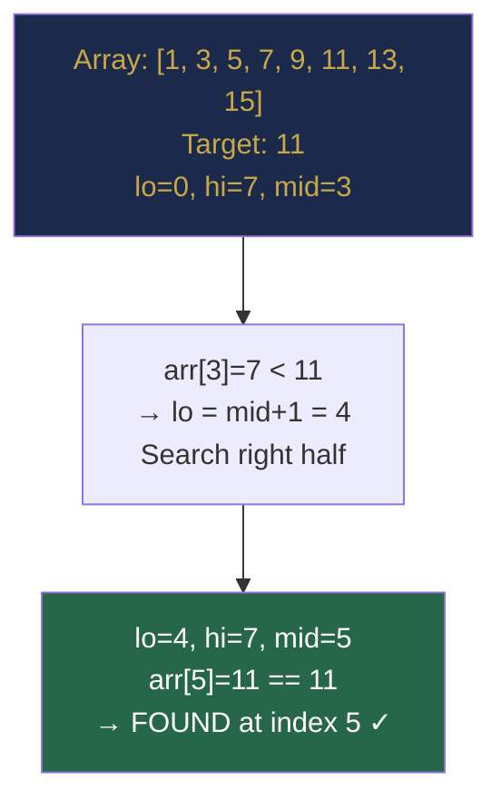

# Chapter 14 — Searching Fundamentals

> **Part IV — Searching and Sorting**  
> [← Part III Review](part-03-review.md) · [← Index](../INDEX.md) · [→ Chapter 15](../INDEX.md#-chapter-15--advanced-binary-search-patterns)

---

## Learning Objectives

By the end of this chapter you will be able to:

- State the invariants for both the `lo <= hi` and `lo < hi` binary search templates and choose the right one.
- Derive binary search from first principles without memorising code.
- Implement first occurrence, last occurrence, lower bound, and upper bound correctly.
- Avoid the integer overflow bug in midpoint calculation.
- Use `Arrays.binarySearch` and `Collections.binarySearch` correctly, including interpreting negative return values.

---

## Contents

- [14.1 Linear Search](#141-linear-search)
- [14.2 Binary Search: Intuition](#142-binary-search-intuition)
- [14.3 The Invariant-Based Derivation](#143-the-invariant-based-derivation)
- [14.4 Two Canonical Templates](#144-two-canonical-templates)
- [14.5 Boundary Conditions and Pitfalls](#145-boundary-conditions-and-pitfalls)
- [14.6 First and Last Occurrence](#146-first-and-last-occurrence)
- [14.7 Lower Bound and Upper Bound](#147-lower-bound-and-upper-bound)
- [14.8 Search Insertion Position](#148-search-insertion-position)
- [14.9 Java Binary Search APIs](#149-java-binary-search-apis)
- [Interview Insight](#interview-insight)
- [Quick Quiz](#quick-quiz)
- [14.10 Practice Problems](#1410-practice-problems)
- [14.11 Hard Problem Corner](#1411-hard-problem-corner)
- [Chapter Summary](#chapter-summary)

---

## 14.1 Linear Search

**Linear search** scans every element in order until it finds the target or exhausts the array.

```java
int linearSearch(int[] arr, int target) {
    for (int i = 0; i < arr.length; i++) {
        if (arr[i] == target) return i;
    }
    return -1;
}
```

**Complexity:** O(n) time, O(1) space.  
**Requires:** No special structure — works on any array, sorted or unsorted.

**When to use linear search:**
- Array is unsorted.
- Array is very small (n < ~20) — binary search overhead isn't worth it.
- Searching a linked list (no random access, so binary search doesn't apply).
- The array changes frequently (maintaining sorted order is expensive).

---

## 14.2 Binary Search: Intuition

Binary search works by repeatedly halving the search space. At each step, compare the target with the middle element:

- If the target equals the middle: found.
- If the target is less: the answer is in the left half (discard right).
- If the target is greater: the answer is in the right half (discard left).

Each comparison eliminates half the remaining candidates. After $k$ comparisons, $n / 2^k$ candidates remain. When $n / 2^k = 1$, we have $k = \log_2 n$ comparisons. Hence **O(log n)**.

**Requires:** A sorted array (or more generally, a monotonically ordered search space).

| $n$ | log₂ n (steps) |
|-----|---------------|
| 1,000 | ~10 |
| 10⁶ | ~20 |
| 10⁹ | ~30 |
| 10¹⁸ | ~60 |

*Table 14.1: Binary search only needs ~60 steps for the largest 64-bit integer.*

---

> ### 🔗 Analogy
> **The Number Guessing Game**
>
> You pick a number between 1 and 1024. I guess 512. You say "lower." I guess 256. You say "higher." Each time, I halve the remaining range. I find your number in at most 10 guesses — $\log_2 1024 = 10$.  
> Linear search would take up to 1024 guesses. Binary search takes 10. At $n = 10^9$: linear = $10^9$ guesses; binary = 30.

---

> [!NOTE]
> **Historical Context**  
> Binary search was first described by John Mauchly in **1946**, but correct implementations proved surprisingly difficult — D. H. Lehmer published a formally correct version in **1960**, fourteen years later. In **1986**, Jon Bentley's *Programming Pearls* reported that roughly **90% of professional programmers could not write a correct binary search** after an hour of thought. The most common error was the off-by-one boundary bug. This is exactly why the invariant-based derivation in Section 14.3 matters: when you derive the boundary updates *from the invariant* instead of guessing, the bugs disappear.



---

## 14.3 The Invariant-Based Derivation

The safest way to write binary search is to define and maintain an **invariant** about what `lo` and `hi` represent throughout the loop.

**Choose your invariant first. Then derive the loop body.**

**Invariant (for exact search):**  
"The target, if present, is always within `arr[lo..hi]`."

This means:
- Initially: `lo = 0, hi = n-1` (the entire array satisfies the invariant).
- When we compute `mid = lo + (hi-lo)/2`:
  - If `arr[mid] == target`: found, return `mid`.
  - If `arr[mid] < target`: target is in `[mid+1, hi]` → set `lo = mid + 1`.
  - If `arr[mid] > target`: target is in `[lo, mid-1]` → set `hi = mid - 1`.
- Termination: `lo > hi` → search space empty → target absent.

The invariant is never violated because every branch preserves it.

---

## 14.4 Two Canonical Templates

### Template 1: `lo <= hi` — Exact Value Search

Use when you want to find whether a specific value exists, returning its index.

```java
int binarySearch(int[] arr, int target) {
    int lo = 0, hi = arr.length - 1;
    while (lo <= hi) {
        int mid = lo + (hi - lo) / 2;      // avoids (lo+hi) overflow
        if      (arr[mid] == target) return mid;
        else if (arr[mid] < target)  lo = mid + 1;
        else                         hi = mid - 1;
    }
    return -1;   // not found
}
```

**Loop terminates when `lo > hi`.** The search space `[lo, hi]` shrinks to empty.

### Template 2: `lo < hi` — Boundary Search

Use when you want to find the **first** or **last** position satisfying a condition. The loop terminates when `lo == hi`, which is the answer.

```java
// Find first position where arr[i] >= target (lower bound)
int lowerBound(int[] arr, int target) {
    int lo = 0, hi = arr.length;   // hi = n: target might be past the last element
    while (lo < hi) {
        int mid = lo + (hi - lo) / 2;
        if (arr[mid] < target) lo = mid + 1;  // mid is too small: answer in [mid+1, hi]
        else                   hi = mid;       // mid is a candidate: answer in [lo, mid]
    }
    return lo;   // lo == hi == answer
}
```

**Key differences from Template 1:**

| Property | Template 1 (`lo <= hi`) | Template 2 (`lo < hi`) |
|----------|------------------------|----------------------|
| Initial `hi` | `n - 1` | `n` (can go past array) |
| `mid` update | `lo = mid + 1` or `hi = mid - 1` | `lo = mid + 1` or `hi = mid` (never `mid - 1`) |
| Terminates | `lo > hi` (empty space) | `lo == hi` (single point = answer) |
| Returns | `-1` if not found | Always a valid index in `[0, n]` |

*Table 14.2: Template 1 vs Template 2 comparison.*

> [!WARNING]
> **Never use `hi = mid - 1` in Template 2.** If `lo = mid` and you set `hi = mid - 1`, the loop might never terminate (or skip the answer). Template 2's invariant requires `hi = mid` when `mid` is a candidate.

---

## 14.5 Boundary Conditions and Pitfalls

### Pitfall 1: Integer Overflow in Midpoint

```java
int mid = (lo + hi) / 2;      // WRONG: lo + hi overflows if both are near Integer.MAX_VALUE
int mid = lo + (hi - lo) / 2; // CORRECT: difference never overflows
int mid = (lo + hi) >>> 1;    // CORRECT: unsigned right shift
```

> [!TIP]
> **Did You Know?**  
> Java's own `Arrays.binarySearch` contained this exact integer overflow bug (`(lo + hi) / 2`) from its very first release in **Java 1.2 (1998)** until it was silently corrected in **Java 6 update 2 (2007)** — nine years in the standard library. The bug was publicly exposed by **Josh Bloch** (Java's lead architect and author of *Effective Java*) in a 2006 blog post titled *"Extra, Extra — Read All About It: Nearly All Binary Searches and Mergesorts are Broken."* The post became one of the most circulated programming articles of its decade.

### Pitfall 2: Infinite Loop with `mid = (lo + hi) / 2` and `hi = mid`

When `lo + 1 == hi`, `mid = lo`. If you then set `hi = mid = lo`, nothing changes → infinite loop.

```java
// WRONG: can infinite-loop
while (lo < hi) {
    int mid = lo + (hi - lo) / 2;   // when lo+1==hi, mid==lo
    if (condition) hi = mid;         // hi = lo → no progress!
    else lo = mid;                   // lo = lo → no progress!
}

// CORRECT: when lo = mid is possible, use lo = mid + 1
while (lo < hi) {
    int mid = lo + (hi - lo) / 2;
    if (arr[mid] < target) lo = mid + 1;  // skip mid
    else                   hi = mid;       // keep mid as candidate
}
```

### Pitfall 3: Off-by-One in `hi` Initialisation

For lower/upper bound (Template 2), `hi` must be initialised to `n` (not `n-1`) because the answer could be "insert at the end" (index `n`).

---

## 14.6 First and Last Occurrence

When an array contains duplicates, there may be multiple indices where `arr[i] == target`. You often need the **first** or **last** one.

### First Occurrence

```java
int firstOccurrence(int[] arr, int target) {
    int lo = 0, hi = arr.length - 1, result = -1;
    while (lo <= hi) {
        int mid = lo + (hi - lo) / 2;
        if (arr[mid] == target) {
            result = mid;    // record this match
            hi = mid - 1;   // keep searching LEFT for earlier occurrence
        } else if (arr[mid] < target) lo = mid + 1;
        else                           hi = mid - 1;
    }
    return result;
}
```

### Last Occurrence

```java
int lastOccurrence(int[] arr, int target) {
    int lo = 0, hi = arr.length - 1, result = -1;
    while (lo <= hi) {
        int mid = lo + (hi - lo) / 2;
        if (arr[mid] == target) {
            result = mid;    // record this match
            lo = mid + 1;   // keep searching RIGHT for later occurrence
        } else if (arr[mid] < target) lo = mid + 1;
        else                           hi = mid - 1;
    }
    return result;
}
```

**Count of occurrences** = `lastOccurrence - firstOccurrence + 1` (if target exists).

---

## 14.7 Lower Bound and Upper Bound

These are the foundational primitives used throughout competitive programming and many library implementations (C++ `lower_bound`/`upper_bound`).

### Lower Bound: First index where `arr[i] >= target`

```java
int lowerBound(int[] arr, int target) {
    int lo = 0, hi = arr.length;
    while (lo < hi) {
        int mid = lo + (hi - lo) / 2;
        if (arr[mid] < target) lo = mid + 1;
        else                   hi = mid;
    }
    return lo;   // first index with arr[lo] >= target; equals arr.length if none
}
```

### Upper Bound: First index where `arr[i] > target`

```java
int upperBound(int[] arr, int target) {
    int lo = 0, hi = arr.length;
    while (lo < hi) {
        int mid = lo + (hi - lo) / 2;
        if (arr[mid] <= target) lo = mid + 1;  // <= instead of <
        else                    hi = mid;
    }
    return lo;   // first index with arr[lo] > target
}
```

**Using both together:**

| Query | Formula |
|-------|---------|
| Does `target` exist? | `lowerBound(target) < n && arr[lowerBound(target)] == target` |
| Count of `target` | `upperBound(target) - lowerBound(target)` |
| First occurrence | `lowerBound(target)` (if it exists) |
| Last occurrence | `upperBound(target) - 1` (if it exists) |

*Table 14.3: Lower and upper bound applications.*

**Worked example for `arr = [1, 3, 3, 3, 5, 7]`, `target = 3`:**

| Function | Returns | Meaning |
|----------|---------|---------|
| `lowerBound(3)` | 1 | First index with value ≥ 3 |
| `upperBound(3)` | 4 | First index with value > 3 |
| Count of 3 | 4 − 1 = **3** | ✓ (three 3s at indices 1,2,3) |

---

## 14.8 Search Insertion Position

**Problem:** Given a sorted array and a target, find the index where you would insert the target to keep the array sorted (return existing index if present).

This is exactly `lowerBound(target)`:

```java
int searchInsert(int[] nums, int target) {
    int lo = 0, hi = nums.length;
    while (lo < hi) {
        int mid = lo + (hi - lo) / 2;
        if (nums[mid] < target) lo = mid + 1;
        else                    hi = mid;
    }
    return lo;
}
```

**Examples:** `[1,3,5,6]`, target=5 → 2. target=2 → 1. target=7 → 4. target=0 → 0.

---

## 14.9 Java Binary Search APIs

```java
// Arrays.binarySearch — requires sorted array
int[] arr = {1, 3, 5, 7, 9};
int idx = Arrays.binarySearch(arr, 5);     // returns 2
int idx2 = Arrays.binarySearch(arr, 4);   // returns negative: -(insertion point) - 1 = -3

// Decode insertion point from negative return value
if (idx2 < 0) {
    int insertionPoint = -(idx2 + 1);      // where 4 would be inserted = 2
}

// Search a range
Arrays.binarySearch(arr, 1, 4, 7);  // search arr[1..3] for 7

// Collections.binarySearch — for List<Comparable>
List<Integer> list = Arrays.asList(1, 3, 5, 7, 9);
int pos = Collections.binarySearch(list, 7);    // returns 3

// With custom comparator
List<String> words = Arrays.asList("apple", "banana", "cherry");
int p = Collections.binarySearch(words, "banana", String::compareTo); // 1
```

> [!WARNING]
> `Arrays.binarySearch` returns **unspecified** index if there are multiple equal elements — it does not guarantee first or last occurrence. For first/last occurrence, use the hand-written implementations from Section 14.6.

---

## Interview Insight

> ### 🎯 Interview Insight
> **The Binary Search Interview Mindset**
>
> Binary search problems in interviews fall into two categories:
>
> 1. **Direct:** "Search in sorted array." The template is straightforward.
> 2. **Hidden:** "Find the minimum capacity that works," "Find the first day X is achievable." The array structure is implicit. You must recognise that the feasibility function is **monotonic** (all infeasible → then all feasible) — which makes binary search applicable.
>
> The interviewer signal for category 2: words like *"minimum," "maximum," "at least," "at most"* combined with an answer space that is numeric and bounded.
>
> **State your invariant aloud.** `lo` is always a known infeasible value; `hi` is always a known feasible value (or vice versa). This proves you understand the algorithm rather than memorised it.

---

## Quick Quiz

**Q1.** Why do we use `mid = lo + (hi - lo) / 2` instead of `mid = (lo + hi) / 2`?

<details><summary><strong>Answer</strong></summary>

> `lo + hi` can overflow if both are large positive integers (near `Integer.MAX_VALUE`). `hi - lo` is always non-negative and at most `Integer.MAX_VALUE` for valid indices. `lo + (hi-lo)/2` computes the same midpoint without overflow.

</details>

---

**Q2.** For `arr = [1, 2, 2, 2, 3]` and `target = 2`, what does `lowerBound` return and what does `upperBound` return?

<details><summary><strong>Answer</strong></summary>

> `lowerBound(2) = 1` (first index ≥ 2).  
> `upperBound(2) = 4` (first index > 2).  
> Count of 2s = 4 − 1 = 3 ✓.

</details>

---

**Q3.** Trace Template 2 (`lo < hi`, lower bound) for `arr = [3, 5, 7, 9]`, `target = 6`.

<details><summary><strong>Answer</strong></summary>

> `lo=0, hi=4`. `mid=2`, `arr[2]=7 ≥ 6` → `hi=2`. `lo=0, hi=2`. `mid=1`, `arr[1]=5 < 6` → `lo=2`. `lo=hi=2`. Return 2.  
> Check: `arr[2]=7` is the first value ≥ 6 ✓.

</details>

---

**Q4.** `Arrays.binarySearch(arr, x)` returns `-3`. What does that mean?

<details><summary><strong>Answer</strong></summary>

> `x` was not found. The insertion point is `-((-3)+1) = 2`. `x` would be inserted at index 2 to maintain sorted order.

</details>

---

## 14.10 Practice Problems

| Problem | Name | Difficulty | Technique |
|---------|------|------------|-----------|
| [LC 704](https://leetcode.com/problems/binary-search/) | Binary Search | Easy | Template 1 |
| [LC 35](https://leetcode.com/problems/search-insert-position/) | Search Insert Position | Easy | Lower bound |
| [LC 34](https://leetcode.com/problems/find-first-and-last-position-of-element-in-sorted-array/) | First and Last Position of Element | Medium | First + last occurrence |
| [LC 744](https://leetcode.com/problems/find-smallest-letter-greater-than-target/) | Smallest Letter Greater Than Target | Easy | Upper bound on circular alphabet |
| [LC 278](https://leetcode.com/problems/first-bad-version/) | First Bad Version | Easy | Lower bound on predicate |
| [LC 374](https://leetcode.com/problems/guess-number-higher-or-lower/) | Guess Number Higher or Lower | Easy | Template 1 |
| [LC 69](https://leetcode.com/problems/sqrtx/) | Sqrt(x) | Easy | Binary search on answer |
| [LC 1385](https://leetcode.com/problems/find-the-distance-value-between-two-arrays/) | Find the Distance Value Between Two Arrays | Easy | Lower/upper bound |

---

## 14.11 Hard Problem Corner

> ### 🔥 Hard Problem Corner
>
> **Problem: Median of Two Sorted Arrays** ([LC 4](https://leetcode.com/problems/median-of-two-sorted-arrays/))
>
> Given two sorted arrays `nums1` and `nums2` of sizes `m` and `n`, return the median in **O(log(m+n))** time.
>
> **Why hard:** Merging takes O(m+n). The O(log) requirement demands a binary-search-based approach. The key insight: partition both arrays simultaneously so that the left halves together contain exactly `(m+n)/2` elements, and every element on the left ≤ every element on the right.

<details><summary><strong>Solution sketch (click to reveal)</strong></summary>

> [!TIP]
> Binary search on the partition point in the smaller array. For each candidate partition `i` in `nums1`, the partition in `nums2` is determined: `j = (m+n+1)/2 - i`. Check if the partition is valid: `nums1[i-1] <= nums2[j]` and `nums2[j-1] <= nums1[i]`. Adjust `i` left or right based on which condition fails.
>
> ```java
> double findMedianSortedArrays(int[] A, int[] B) {
>     if (A.length > B.length) return findMedianSortedArrays(B, A); // A is shorter
>     int m = A.length, n = B.length;
>     int lo = 0, hi = m;
>     while (lo <= hi) {
>         int i = lo + (hi - lo) / 2;      // partition A at i
>         int j = (m + n + 1) / 2 - i;     // partition B at j
>         int maxLeftA  = (i == 0) ? Integer.MIN_VALUE : A[i - 1];
>         int minRightA = (i == m) ? Integer.MAX_VALUE : A[i];
>         int maxLeftB  = (j == 0) ? Integer.MIN_VALUE : B[j - 1];
>         int minRightB = (j == n) ? Integer.MAX_VALUE : B[j];
>         if      (maxLeftA > minRightB) hi = i - 1;
>         else if (maxLeftB > minRightA) lo = i + 1;
>         else {
>             int maxLeft = Math.max(maxLeftA, maxLeftB);
>             if ((m + n) % 2 == 1) return maxLeft;
>             return (maxLeft + Math.min(minRightA, minRightB)) / 2.0;
>         }
>     }
>     return 0;
> }
> ```
>
> **Complexity:** O(log(min(m, n))).

</details>

---

## Chapter Summary

| Concept | Key Takeaway |
|---------|-------------|
| **Linear search** | O(n), no structure needed. Use for unsorted or tiny arrays. |
| **Binary search** | O(log n), requires monotonic ordering. Eliminate half the space each step. |
| **Invariant first** | Define what `lo` and `hi` mean before writing the loop. Derive updates from the invariant. |
| **Template 1 (`lo <= hi`)** | For exact value search. Returns `-1` if not found. |
| **Template 2 (`lo < hi`)** | For boundary search. `hi = n` initially; `hi = mid` (not `mid-1`) when mid is a candidate. Terminates at `lo == hi`. |
| **Overflow** | Always use `lo + (hi - lo) / 2`, never `(lo + hi) / 2`. |
| **First/last occurrence** | On match: record and continue in one direction. |
| **Lower bound** | First index where `arr[i] >= target`. Condition: `arr[mid] < target → lo = mid+1`. |
| **Upper bound** | First index where `arr[i] > target`. Condition: `arr[mid] <= target → lo = mid+1`. |
| **`Arrays.binarySearch`** | Negative return = `-(insertionPoint) - 1`. Not guaranteed first/last occurrence. |

*Table 14.4: Chapter 14 key concepts.*

---

**Coming Up Next:** [Chapter 15 (Advanced Binary Search Patterns)](../INDEX.md#-chapter-15--advanced-binary-search-patterns) extends these templates to rotated arrays, peak elements, matrix search, and the powerful "binary search on answer" technique.

---

> **Part IV — Searching and Sorting**  
> [← Part III Review](part-03-review.md) · [← Index](../INDEX.md) · [→ Chapter 15 (planned)](../INDEX.md#-chapter-15--advanced-binary-search-patterns)
