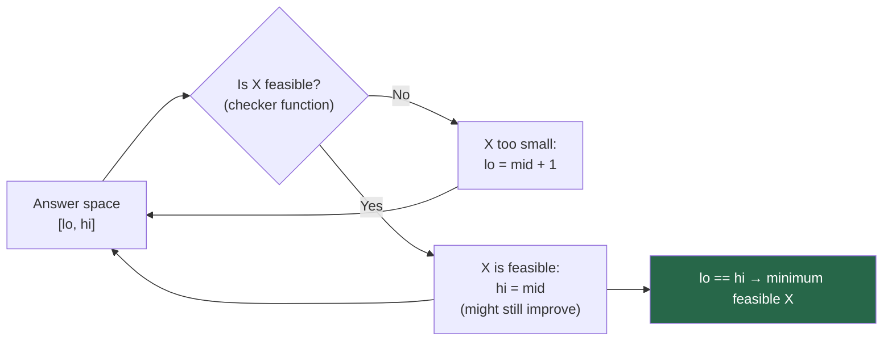

# Chapter 15 — Advanced Binary Search Patterns

> **Part IV — Searching and Sorting**  
> [← Chapter 14](chapter-14-searching-fundamentals.md) · [← Index](../INDEX.md) · [→ Chapter 16](../INDEX.md#-chapter-16--elementary-sorting-algorithms)

---

## Learning Objectives

By the end of this chapter you will be able to:

- Apply "binary search on answer" to minimisation and maximisation problems.
- Search in a rotated sorted array in O(log n) by identifying the sorted half.
- Find a peak element in O(log n) using the monotonic condition on slopes.
- Search in an m×n matrix using 2D-to-1D index mapping.
- Recognise a monotonic predicate and binary-search the threshold in O(log(range) × O(checker)).

---

## Contents

- [15.1 Binary Search on Answer](#151-binary-search-on-answer)
- [15.2 Search in Rotated Sorted Array](#152-search-in-rotated-sorted-array)
- [15.3 Search in Nearly Sorted Arrays](#153-search-in-nearly-sorted-arrays)
- [15.4 Peak Element Problems](#154-peak-element-problems)
- [15.5 Search in Matrices](#155-search-in-matrices)
- [15.6 Monotonic Predicates](#156-monotonic-predicates)
- [15.7 Minimum Feasible Value Problems](#157-minimum-feasible-value-problems)
- [15.8 Off-by-One Error Catalogue](#158-off-by-one-error-catalogue)
- [Interview Insight](#interview-insight)
- [Quick Quiz](#quick-quiz)
- [15.9 Practice Problems](#159-practice-problems)
- [15.10 Hard Problem Corner](#1510-hard-problem-corner)
- [Chapter Summary](#chapter-summary)

---

## 15.1 Binary Search on Answer

The most powerful binary search pattern: instead of searching for a value in an array, **binary search over the answer space**.

**Template:** "Find the minimum value of X such that some condition is satisfied."



**Requirements:**
1. The answer is a numeric value with a bounded range `[lo, hi]`.
2. The feasibility function is **monotonic**: if X is feasible, all larger values are also feasible (or all smaller, for maximisation).
3. The checker is O(n) or faster — total complexity is O(n log(range)).

### Minimum Eating Speed (Koko Eating Bananas)

```java
int minEatingSpeed(int[] piles, int h) {
    int lo = 1, hi = Arrays.stream(piles).max().getAsInt();
    while (lo < hi) {
        int mid = lo + (hi - lo) / 2;
        if (canFinish(piles, mid, h)) hi = mid;  // mid is feasible; try slower
        else                           lo = mid + 1;
    }
    return lo;
}

boolean canFinish(int[] piles, int speed, int h) {
    int hours = 0;
    for (int p : piles) hours += (p + speed - 1) / speed;  // ceil division
    return hours <= h;
}
```

**Complexity:** O(n log(max_pile)). `max_pile` is at most 10⁹, so log = ~30.

---

## 15.2 Search in Rotated Sorted Array

A sorted array `[4, 5, 6, 7, 0, 1, 2]` has been rotated at some pivot. At every midpoint, **at least one half is fully sorted**. Use this to determine which half the target is in.

```java
int searchRotated(int[] nums, int target) {
    int lo = 0, hi = nums.length - 1;
    while (lo <= hi) {
        int mid = lo + (hi - lo) / 2;
        if (nums[mid] == target) return mid;

        if (nums[lo] <= nums[mid]) {           // LEFT half is sorted
            if (nums[lo] <= target && target < nums[mid])
                hi = mid - 1;                  // target in sorted left
            else
                lo = mid + 1;                  // target in right
        } else {                                // RIGHT half is sorted
            if (nums[mid] < target && target <= nums[hi])
                lo = mid + 1;                  // target in sorted right
            else
                hi = mid - 1;                  // target in left
        }
    }
    return -1;
}
```

**Key invariant:** `nums[lo] <= nums[mid]` iff the left half is sorted (no rotation point in `[lo, mid]`).

### Search with Duplicates (LC 81)

Duplicates break the `nums[lo] <= nums[mid]` test (both could be equal at the rotation point). Handle by shrinking when equal:

```java
boolean searchRotatedWithDups(int[] nums, int target) {
    int lo = 0, hi = nums.length - 1;
    while (lo <= hi) {
        int mid = lo + (hi - lo) / 2;
        if (nums[mid] == target) return true;
        if (nums[lo] == nums[mid] && nums[mid] == nums[hi]) { lo++; hi--; } // shrink both
        else if (nums[lo] <= nums[mid]) {
            if (nums[lo] <= target && target < nums[mid]) hi = mid - 1;
            else lo = mid + 1;
        } else {
            if (nums[mid] < target && target <= nums[hi]) lo = mid + 1;
            else hi = mid - 1;
        }
    }
    return false;
}
```

**Worst case with duplicates:** O(n) (all same elements, target absent). Average: O(log n).

---

## 15.3 Search in Nearly Sorted Arrays

A **nearly sorted** array has each element at most 1 position away from its sorted position. Element at index `i` could be at index `i-1`, `i`, or `i+1` in the sorted order.

```java
int searchNearlySorted(int[] arr, int target) {
    int lo = 0, hi = arr.length - 1;
    while (lo <= hi) {
        int mid = lo + (hi - lo) / 2;
        // Check mid and its neighbours
        if (arr[mid] == target) return mid;
        if (mid > lo && arr[mid - 1] == target) return mid - 1;
        if (mid < hi && arr[mid + 1] == target) return mid + 1;
        // Eliminate both mid and its neighbours
        if (arr[mid] < target) lo = mid + 2;
        else                   hi = mid - 2;
    }
    return -1;
}
```

---

## 15.4 Peak Element Problems

A **peak element** is strictly greater than its neighbours. By convention, elements outside the array are $-\infty$.

**Key insight:** If `nums[mid] < nums[mid+1]`, there is always a peak in `[mid+1, hi]`. If `nums[mid] > nums[mid+1]`, there is always a peak in `[lo, mid]`. This guarantees O(log n).

```java
int findPeakElement(int[] nums) {
    int lo = 0, hi = nums.length - 1;
    while (lo < hi) {
        int mid = lo + (hi - lo) / 2;
        if (nums[mid] < nums[mid + 1]) lo = mid + 1;  // slope going up → peak is to the right
        else                            hi = mid;       // slope going down → peak is here or left
    }
    return lo;   // lo == hi == peak index
}
```

**Why this works:** The array can be thought of as a landscape. If you're standing on an upward slope (`nums[mid] < nums[mid+1]`), there must be a peak to the right (the landscape must come down eventually, or the last element itself is a peak). The Template 2 invariant applies: `lo` converges to the peak.

---

## 15.5 Search in Matrices

### Type 1: Row-sorted, row-monotone matrix

Each row is sorted, and the first element of each row > last element of the previous row (the matrix is globally sorted if flattened).

```java
// Treat as 1D sorted array: row = mid / cols, col = mid % cols
boolean searchMatrix(int[][] matrix, int target) {
    int m = matrix.length, n = matrix[0].length;
    int lo = 0, hi = m * n - 1;
    while (lo <= hi) {
        int mid = lo + (hi - lo) / 2;
        int val = matrix[mid / n][mid % n];
        if      (val == target) return true;
        else if (val < target)  lo = mid + 1;
        else                    hi = mid - 1;
    }
    return false;
}
```

**Complexity:** O(log(mn)).

### Type 2: Row-sorted, column-sorted (but not globally sorted)

Each row sorted left-to-right; each column sorted top-to-bottom. Use **staircase search** starting from top-right corner:

```java
boolean searchMatrixII(int[][] matrix, int target) {
    int r = 0, c = matrix[0].length - 1;
    while (r < matrix.length && c >= 0) {
        if      (matrix[r][c] == target) return true;
        else if (matrix[r][c] > target)  c--;   // too large: move left
        else                              r++;   // too small: move down
    }
    return false;
}
```

**Complexity:** O(m + n) — not binary search, but optimal for this matrix type.

---

## 15.6 Monotonic Predicates

A **monotonic predicate** `P(x)` is a function where:
- For all `x < threshold`: `P(x) = false`
- For all `x >= threshold`: `P(x) = true`

(Or the reverse for maximisation problems.)

Binary search finds the **threshold** in O(log(range)) calls to `P`.

**General template:**

```java
// Find minimum x in [lo, hi] where P(x) is true
int binarySearchOnPredicate(int lo, int hi) {
    while (lo < hi) {
        int mid = lo + (hi - lo) / 2;
        if (predicate(mid)) hi = mid;    // mid satisfies P: might go lower
        else                 lo = mid + 1; // mid fails P: must go higher
    }
    return lo;   // minimum x where P(x) is true
}
```

---

## 15.7 Minimum Feasible Value Problems

A catalogue of "binary search on answer" problems with their answer spaces and checkers.

| Problem | Answer space | Checker condition |
|---------|-------------|------------------|
| Koko eating bananas in H hours | `[1, max(piles)]` | total hours ≤ H |
| Ship packages in D days | `[max(weight), sum(weights)]` | total days ≤ D |
| Minimum days to make M bouquets | `[1, max(bloomDay)]` | bouquets achievable ≥ M |
| Painter partition (min time) | `[max(board), sum(boards)]` | painters needed ≤ k |
| Aggressive cows (max min distance) | `[1, max(stall)-min(stall)]` | cows fit ≥ k |

*Table 15.1: Common "binary search on answer" problems.*

### Ship Packages in D Days

```java
int shipWithinDays(int[] weights, int days) {
    int lo = Arrays.stream(weights).max().getAsInt();  // must carry heaviest package
    int hi = Arrays.stream(weights).sum();              // carry everything in 1 day
    while (lo < hi) {
        int mid = lo + (hi - lo) / 2;
        if (canShip(weights, days, mid)) hi = mid;
        else                              lo = mid + 1;
    }
    return lo;
}

boolean canShip(int[] weights, int days, int capacity) {
    int usedDays = 1, currentLoad = 0;
    for (int w : weights) {
        if (currentLoad + w > capacity) { usedDays++; currentLoad = 0; }
        currentLoad += w;
    }
    return usedDays <= days;
}
```

---

## 15.8 Off-by-One Error Catalogue

| Mistake | Consequence | Fix |
|---------|-------------|-----|
| `hi = arr.length - 1` in lower bound | Miss insertion at the end | `hi = arr.length` |
| `hi = mid - 1` in Template 2 | May skip the correct answer | `hi = mid` |
| `lo = mid` without `+1` in Template 2 | Infinite loop when `lo + 1 == hi` | `lo = mid + 1` |
| `lo < hi` in exact search | Loop exits with `lo == hi` unexamined | `lo <= hi` |
| `lo <= hi` in lower/upper bound | May not converge correctly | `lo < hi` |
| `(lo + hi) / 2` | Integer overflow | `lo + (hi - lo) / 2` |

*Table 15.2: Binary search off-by-one error guide.*

---

## Interview Insight

> ### 🎯 Interview Insight
> **Identifying "Binary Search on Answer" Problems**
>
> The clearest signals:
> - *"Minimise the maximum…"* or *"Maximise the minimum…"*
> - *"Find the minimum X such that…"*
> - The answer is a **single number** (not an index) in a bounded range.
> - There's a natural "if X works, then X+1 also works" structure.
>
> **Red flag:** If you're tempted to try every value from 1 to max and run a simulation for each, that's O(n × max) — the binary search on answer version is O(n log max), which is usually 30× faster.

---

## Quick Quiz

**Q1.** What is the time complexity of "binary search on answer" with answer range 10⁹ and an O(n) checker?

<details><summary><strong>Answer</strong></summary>

> O(n log 10⁹) ≈ O(30n). The binary search runs ≈ 30 iterations; each calls the O(n) checker.

</details>

---

**Q2.** For rotated array `[6, 7, 1, 2, 3, 4, 5]` and `target = 3`, which half is sorted at the first step, and where do you search?

<details><summary><strong>Answer</strong></summary>

> `lo=0, hi=6, mid=3`. `nums[3]=2`. `nums[lo]=6 > nums[mid]=2` → right half `[2,3,4,5]` is sorted. `target=3` is in `(2, 5]` → `lo = mid + 1 = 4`. Next: `lo=4, hi=6, mid=5`, `nums[5]=4`. Right half `[4,5]` is sorted. `3 < 4` → target not in right half → `hi = mid-1 = 4`. `lo=hi=4`, `nums[4]=3` → found ✓.

</details>

---

**Q3.** Why does peak element search use `lo < hi` (Template 2) rather than `lo <= hi`?

<details><summary><strong>Answer</strong></summary>

> With Template 2, the loop terminates at `lo == hi`, which is the peak index. We use `hi = mid` (not `hi = mid-1`) when `nums[mid] > nums[mid+1]`, because `mid` itself could be the peak — we can't exclude it. If we used `lo <= hi` with `hi = mid-1`, we might skip the peak.

</details>

---

## 15.9 Practice Problems

| Problem | Name | Difficulty | Pattern |
|---------|------|------------|---------|
| [LC 33](https://leetcode.com/problems/search-in-rotated-sorted-array/) | Search in Rotated Sorted Array | Medium | Rotated search |
| [LC 81](https://leetcode.com/problems/search-in-rotated-sorted-array-ii/) | Search in Rotated Sorted Array II | Medium | Rotated with duplicates |
| [LC 153](https://leetcode.com/problems/find-minimum-in-rotated-sorted-array/) | Find Minimum in Rotated Sorted Array | Medium | Rotated minimum |
| [LC 162](https://leetcode.com/problems/find-peak-element/) | Find Peak Element | Medium | Peak search |
| [LC 74](https://leetcode.com/problems/search-a-2d-matrix/) | Search a 2D Matrix | Medium | 2D-to-1D binary search |
| [LC 240](https://leetcode.com/problems/search-a-2d-matrix-ii/) | Search a 2D Matrix II | Medium | Staircase search |
| [LC 875](https://leetcode.com/problems/koko-eating-bananas/) | Koko Eating Bananas | Medium | Binary search on answer |
| [LC 1011](https://leetcode.com/problems/capacity-to-ship-packages-within-d-days/) | Capacity to Ship Packages | Medium | Binary search on answer |
| [LC 410](https://leetcode.com/problems/split-array-largest-sum/) | Split Array Largest Sum | Hard | Binary search on answer |

---

## 15.10 Hard Problem Corner

> ### 🔥 Hard Problem Corner
>
> **Problem: Split Array Largest Sum** ([LC 410](https://leetcode.com/problems/split-array-largest-sum/))
>
> Split array `nums` into exactly `k` non-empty subarrays to minimise the largest subarray sum.
>
> **Answer space:** `[max(nums), sum(nums)]`.  
> **Checker:** Given a maximum allowed sum `mid`, can we split into at most `k` subarrays each with sum ≤ `mid`? Greedily accumulate until adding the next element would exceed `mid` — then start a new subarray.

<details><summary><strong>Solution (click to reveal)</strong></summary>

> [!TIP]
> ```java
> int splitArray(int[] nums, int k) {
>     int lo = Arrays.stream(nums).max().getAsInt();
>     int hi = Arrays.stream(nums).sum();
>     while (lo < hi) {
>         int mid = lo + (hi - lo) / 2;
>         if (canSplit(nums, k, mid)) hi = mid;
>         else                         lo = mid + 1;
>     }
>     return lo;
> }
>
> boolean canSplit(int[] nums, int k, int maxSum) {
>     int parts = 1, curSum = 0;
>     for (int x : nums) {
>         if (curSum + x > maxSum) { parts++; curSum = 0; }
>         curSum += x;
>     }
>     return parts <= k;
> }
> ```
>
> **Complexity:** O(n log(sum − max)).

</details>

---

## Chapter Summary

| Pattern | Template | Key decision |
|---------|----------|-------------|
| **Binary search on answer** | `lo < hi`, `hi = mid` on feasible | "Is mid feasible?" — O(n) checker |
| **Rotated array search** | `lo <= hi` | Identify sorted half; check if target is in it |
| **Peak element** | `lo < hi`, `hi = mid` | `nums[mid] < nums[mid+1]` → peak is right |
| **Matrix (globally sorted)** | `lo <= hi` on `mid = r*n+c` | 2D-to-1D index mapping |
| **Matrix (row+col sorted)** | No binary search | Staircase from top-right: O(m+n) |
| **Monotonic predicate** | `lo < hi`, `hi = mid` | Find minimum threshold where P turns true |
| **Off-by-one guide** | See Table 15.2 | Pick `lo < hi` for boundaries, `lo <= hi` for exact |

*Table 15.3: Chapter 15 pattern summary.*

---

> **Part IV — Searching and Sorting**  
> [← Chapter 14](chapter-14-searching-fundamentals.md) · [← Index](../INDEX.md) · [→ Chapter 16 (planned)](../INDEX.md#-chapter-16--elementary-sorting-algorithms)
