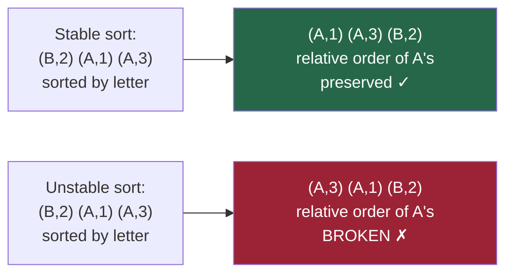

# Chapter 16 — Elementary Sorting Algorithms

> **Part IV — Searching and Sorting**  
> [← Chapter 15](chapter-15-advanced-binary-search.md) · [← Index](../INDEX.md) · [→ Chapter 17](../INDEX.md#-chapter-17--efficient-and-non-comparison-sorting)

---

## Learning Objectives

By the end of this chapter you will be able to:

- State the time and space complexity of selection, bubble, and insertion sort and explain the derivation.
- Explain the concept of stability and identify which elementary algorithms are stable.
- Explain why insertion sort is O(n) on nearly sorted input and what "inversions" measure.
- Identify when simple O(n²) sorting is preferable to O(n log n) in practice.

---

## Contents

- [16.1 Sorting Fundamentals](#161-sorting-fundamentals)
- [16.2 Stability](#162-stability)
- [16.3 Selection Sort](#163-selection-sort)
- [16.4 Bubble Sort](#164-bubble-sort)
- [16.5 Insertion Sort](#165-insertion-sort)
- [16.6 Inversions and Adaptivity](#166-inversions-and-adaptivity)
- [16.7 Comparison Table](#167-comparison-table)
- [16.8 When Simple Sorting Is Useful](#168-when-simple-sorting-is-useful)
- [Quick Quiz](#quick-quiz)
- [16.9 Practice Problems](#169-practice-problems)
- [Chapter Summary](#chapter-summary)

---

## 16.1 Sorting Fundamentals

**Sorting** rearranges elements of a collection into a defined order (typically non-decreasing for numbers, lexicographic for strings).

**The comparison model:** Most general-purpose sorting algorithms only use pairwise comparisons between elements. We will show in Chapter 17 that any comparison sort requires Ω(n log n) comparisons in the worst case.

**Key sorting properties:**

| Property | Meaning |
|----------|---------|
| **In-place** | O(1) extra memory (beyond the array) |
| **Stable** | Equal elements maintain their original relative order |
| **Adaptive** | Runs faster on partially sorted input |
| **Online** | Can sort a stream, processing elements one at a time |

*Table 16.1: Sorting properties.*

---

## 16.2 Stability

**Stability** matters when elements carry additional data beyond their sort key.

**Example:** Sorting employee records first by department, then by name. If you sort by name (stable), then sort by department (stable), the name ordering is preserved within each department. With an unstable sort for department, name order is lost.

| Algorithm | Stable? |
|-----------|---------|
| Selection sort | ❌ No |
| Bubble sort | ✅ Yes |
| Insertion sort | ✅ Yes |
| Merge sort | ✅ Yes |
| Heap sort | ❌ No |
| Quicksort (standard) | ❌ No |
| Java `Arrays.sort` (objects) — Timsort | ✅ Yes |
| Java `Arrays.sort` (primitives) — dual-pivot quicksort | ❌ No |

*Table 16.2: Stability of common sorting algorithms.*



---

## 16.3 Selection Sort

**Idea:** Repeatedly find the minimum element in the unsorted portion and swap it to its correct position.

```java
void selectionSort(int[] arr) {
    int n = arr.length;
    for (int i = 0; i < n - 1; i++) {
        int minIdx = i;
        for (int j = i + 1; j < n; j++) {
            if (arr[j] < arr[minIdx]) minIdx = j;
        }
        swap(arr, i, minIdx);
    }
}
```

**Dry run on `[64, 25, 12, 22, 11]`:**

| Pass | Array after swap | Min found at |
|------|-----------------|--------------|
| i=0 | `[11, 25, 12, 22, 64]` | index 4 |
| i=1 | `[11, 12, 25, 22, 64]` | index 2 |
| i=2 | `[11, 12, 22, 25, 64]` | index 3 |
| i=3 | `[11, 12, 22, 25, 64]` | index 3 (no change) |

*Table 16.3: Selection sort trace.*

**Complexity:**
- Comparisons: $(n-1) + (n-2) + \cdots + 1 = \frac{n(n-1)}{2} = O(n^2)$ always.
- Swaps: exactly $n - 1$ swaps — the minimum possible for a sort.
- Space: O(1).
- Stable: **No** — swapping `arr[i]` with `arr[minIdx]` can skip over equal elements.

> [!NOTE]
> **Selection sort's one advantage:** It makes the minimum number of swaps (n-1). This matters when swapping is expensive (e.g., large objects on disk, write-heavy flash memory).

---

## 16.4 Bubble Sort

**Idea:** Repeatedly scan and swap adjacent elements that are out of order. The largest unsorted element "bubbles" to its correct position each pass.

```java
void bubbleSort(int[] arr) {
    int n = arr.length;
    for (int i = 0; i < n - 1; i++) {
        boolean swapped = false;
        for (int j = 0; j < n - i - 1; j++) {   // last i elements already in place
            if (arr[j] > arr[j + 1]) {
                swap(arr, j, j + 1);
                swapped = true;
            }
        }
        if (!swapped) break;    // array is already sorted — early exit
    }
}
```

**Complexity:**
- Worst case: O(n²) comparisons and swaps (reverse-sorted input).
- Best case: **O(n)** with the `swapped` flag — one pass with no swaps confirms sorted order.
- Space: O(1).
- Stable: **Yes** — only swaps adjacent elements; equal elements are never swapped.

**Dry run on `[5, 3, 1, 4, 2]` (first pass only):**

```
[5,3,1,4,2] → swap(5,3) → [3,5,1,4,2]
[3,5,1,4,2] → swap(5,1) → [3,1,5,4,2]
[3,1,5,4,2] → swap(5,4) → [3,1,4,5,2]
[3,1,4,5,2] → swap(5,2) → [3,1,4,2,5]
```

After pass 1: `5` is in its final position.

---

## 16.5 Insertion Sort

**Idea:** Build the sorted portion one element at a time. Take the next element from the unsorted portion and insert it at the correct position in the sorted portion by shifting elements right.

```java
void insertionSort(int[] arr) {
    for (int i = 1; i < arr.length; i++) {
        int key = arr[i];         // element to insert
        int j = i - 1;
        while (j >= 0 && arr[j] > key) {
            arr[j + 1] = arr[j]; // shift right
            j--;
        }
        arr[j + 1] = key;        // place key in its correct position
    }
}
```

**Dry run on `[5, 2, 4, 6, 1, 3]`:**

| i | key | Before | After |
|---|-----|--------|-------|
| 1 | 2 | `[5, 2, 4, 6, 1, 3]` | `[2, 5, 4, 6, 1, 3]` |
| 2 | 4 | `[2, 5, 4, 6, 1, 3]` | `[2, 4, 5, 6, 1, 3]` |
| 3 | 6 | `[2, 4, 5, 6, 1, 3]` | `[2, 4, 5, 6, 1, 3]` |
| 4 | 1 | `[2, 4, 5, 6, 1, 3]` | `[1, 2, 4, 5, 6, 3]` |
| 5 | 3 | `[1, 2, 4, 5, 6, 3]` | `[1, 2, 3, 4, 5, 6]` |

*Table 16.4: Insertion sort trace.*

**Complexity:**
- Worst case (reverse sorted): $1 + 2 + \cdots + (n-1) = O(n^2)$ comparisons and shifts.
- Best case (already sorted): **O(n)** — no shifts, one comparison per element.
- Space: O(1).
- Stable: **Yes** — only shifts elements past strictly greater ones (not equal).
- **Adaptive:** See Section 16.6.

---

## 16.6 Inversions and Adaptivity

An **inversion** is a pair of indices $(i, j)$ with $i < j$ but `arr[i] > arr[j]`. A fully sorted array has 0 inversions; a reverse-sorted array has $n(n-1)/2$ inversions.

**Insertion sort removes exactly one inversion per shift.** Total work = O(inversions + n).

| Input type | Inversions | Insertion sort time |
|------------|-----------|---------------------|
| Fully sorted | 0 | O(n) |
| Nearly sorted (k out of place) | O(kn) | O(kn + n) |
| Random | O(n²/4) | O(n²) |
| Reverse sorted | n(n-1)/2 | O(n²) |

*Table 16.5: Insertion sort adaptivity based on inversions.*

**Insertion sort is optimal for nearly sorted data.** This is why Timsort (Java's object sort) uses insertion sort for small runs and already-sorted segments within merge sort.

---

## 16.7 Comparison Table

| Algorithm | Best | Average | Worst | Space | Stable | Adaptive |
|-----------|------|---------|-------|-------|--------|----------|
| Selection sort | O(n²) | O(n²) | O(n²) | O(1) | ❌ | ❌ |
| Bubble sort | **O(n)** | O(n²) | O(n²) | O(1) | ✅ | ✅ |
| Insertion sort | **O(n)** | O(n²) | O(n²) | O(1) | ✅ | ✅ |

*Table 16.6: Elementary sorting algorithm comparison.*

---

## 16.8 When Simple Sorting Is Useful

Despite their O(n²) worst case, elementary algorithms remain useful in several scenarios:

**1. Small arrays (n ≤ ~20):**  
O(n log n) algorithms have overhead (function calls, recursive stack, merge buffer). For tiny arrays, insertion sort's low constant factor wins. Java's Timsort uses insertion sort for runs of length < 32.

**2. Nearly sorted input:**  
Insertion sort is O(n + inversions). With a few out-of-place elements, it outperforms merge sort.

**3. Online sorting (streaming):**  
Insertion sort can process new elements as they arrive, maintaining a sorted prefix. Merge sort and quicksort require the full array.

**4. Linked lists:**  
Insertion sort on linked lists avoids the random access problem (no cache misses for the insertion point since we traverse anyway).

**5. When minimising writes (swaps):**  
Selection sort makes exactly n-1 swaps — fewest of any algorithm. Important for write-heavy storage (EEPROM, flash).

---

## Quick Quiz

**Q1.** Insertion sort on `[1, 2, 3, 4, 5]` — how many comparisons does it make?

<details><summary><strong>Answer</strong></summary>

> **n − 1 = 4 comparisons.** The array is already sorted. Each `while` loop check immediately fails (the new element is already in position), so only one comparison per element is made.

</details>

---

**Q2.** Is selection sort stable? Give a counterexample.

<details><summary><strong>Answer</strong></summary>

> **No.** Consider `[(3a), (3b), (1)]` sorted by value, where `3a` and `3b` are equal. In pass 1, we find the minimum (1) at index 2 and swap it with index 0: `[(1), (3b), (3a)]`. Now `3b` comes before `3a` — the relative order of equal elements was reversed.

</details>

---

**Q3.** How many inversions does `[4, 3, 2, 1]` have?

<details><summary><strong>Answer</strong></summary>

> $\binom{4}{2} = 6$ inversions: (4,3), (4,2), (4,1), (3,2), (3,1), (2,1). This equals $n(n-1)/2$ for a fully reversed array of length 4.

</details>

---

## 16.9 Practice Problems

| Problem | Name | Difficulty | Relevance |
|---------|------|------------|-----------|
| [LC 912](https://leetcode.com/problems/sort-an-array/) | Sort an Array | Medium | Implement any sorting algorithm |
| [LC 147](https://leetcode.com/problems/insertion-sort-list/) | Insertion Sort List | Medium | Insertion sort on linked list |
| [LC 315](https://leetcode.com/problems/count-of-smaller-numbers-after-self/) | Count of Smaller Numbers After Self | Hard | Count inversions (merge sort approach) |

---

## Chapter Summary

| Algorithm | Key idea | Only advantage |
|-----------|----------|----------------|
| **Selection sort** | Find minimum, swap to front | Minimum swaps (n-1) |
| **Bubble sort** | Swap adjacent out-of-order pairs | Simple, stable, O(n) best case |
| **Insertion sort** | Insert next element into sorted prefix | O(n+inversions), best for nearly sorted, used in Timsort |

**Inversions** = the fundamental measure of unsortedness. Insertion sort's work is exactly proportional to inversions.

**Stability** = equal elements keep their original order. Only bubble sort and insertion sort are stable among the three elementary algorithms.

---

> **Part IV — Searching and Sorting**  
> [← Chapter 15](chapter-15-advanced-binary-search.md) · [← Index](../INDEX.md) · [→ Chapter 17 (planned)](../INDEX.md#-chapter-17--efficient-and-non-comparison-sorting)
