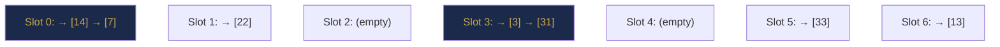

# Chapter 18 — Hash Tables: Design and Theory

> **Part V — Hashing and Lookup Structures**  
> [← Part IV Review](part-04-review.md) · [← Index](../INDEX.md) · [→ Chapter 19](../INDEX.md#-chapter-19--hashmap-hashset-and-problem-patterns)

---

## Learning Objectives

By the end of this chapter you will be able to:

- Explain why hash tables achieve O(1) average-case operations using the hash function and load factor.
- Implement a hash table with separate chaining and with open addressing (linear probing).
- Describe the birthday problem and explain why collisions are unavoidable.
- Choose between separate chaining and open addressing given the use case.
- State what constitutes a good hash function and what universal hashing provides.

---

## Contents

- [18.1 The O(1) Lookup Problem](#181-the-o1-lookup-problem)
- [18.2 Direct Addressing](#182-direct-addressing)
- [18.3 Hash Functions](#183-hash-functions)
- [18.4 Collisions and the Birthday Problem](#184-collisions-and-the-birthday-problem)
- [18.5 Separate Chaining](#185-separate-chaining)
- [18.6 Open Addressing](#186-open-addressing)
- [18.7 Load Factor and Rehashing](#187-load-factor-and-rehashing)
- [18.8 Complexity Analysis](#188-complexity-analysis)
- [Interview Insight](#interview-insight)
- [Quick Quiz](#quick-quiz)
- [Chapter Summary](#chapter-summary)

---

## 18.1 The O(1) Lookup Problem

Binary search gives O(log n) lookup by exploiting sorted order. Can we do better? Can we find any element in O(1)?

The answer is yes — but only if we can directly compute **where** an element is stored from its key, without any traversal or comparison.

The idea: allocate an array `T` of size `m`. Given key `k`, compute index `h(k)` and store the element at `T[h(k)]`. Lookup is then one array access — O(1).

The challenge: the key space is enormous (all possible strings, integers, objects) but `m` must be finite. The hash function `h` maps large key space → small index space, inevitably creating **collisions** (two keys mapping to the same index). Managing collisions efficiently is the core design challenge of hash tables.

---

> [!NOTE]
> **Historical Context**  
> Hash tables were independently conceived by multiple researchers around the same time. **Hans Peter Luhn** (IBM) proposed the basic idea in an internal IBM memo around **1953**. **Arnold Dumey** published the first formal description in **1956**. The term "hashing" — converting a key to an index through arithmetic — was coined in this same period. **Separate chaining** is credited to Luhn; **open addressing** was developed by Amdahl, Boehme, Rochester, and Samuel at IBM around **1954**. By the early 1960s, hash tables were standard in every CS curriculum. Today they underpin almost every real-world software system: database indexes, caches, symbol tables in compilers, and the dictionaries/maps in every major programming language.

---

> ### 🔗 Analogy
> **Library Index Cards**
>
> A library with 1 million books uses an index card system. Direct addressing would need one physical slot for every possible ISBN (10 digits = 10 billion possible ISBNs). Hash addressing computes a shelf number from the ISBN: `shelf = ISBN % 500`. Two books on the same shelf (collision) are stored together on a small list behind that shelf number. Finding a book requires going to the right shelf (O(1) math) and scanning the short list (O(1) if few collisions).

---

## 18.2 Direct Addressing

The simplest possible lookup structure: use the key directly as an array index.

```java
// Direct address table for keys in [0, U)
int[] table = new int[U];
table[key] = value;        // O(1) insert
int v = table[key];        // O(1) lookup
table[key] = -1;           // O(1) delete (sentinel)
```

**Requirements:** Keys must be small non-negative integers in a known range `[0, U)`.

**Problem:** If the universe size `U` is large (e.g., `U = 10^9` for all 32-bit integers), the table wastes enormous memory even if only `n` entries are stored. When `n << U`, hashing is the solution.

---

## 18.3 Hash Functions

A **hash function** maps a key `k` to an index `h(k) ∈ [0, m)`.

### Properties of a Good Hash Function

1. **Deterministic:** same key always produces the same index.
2. **Uniform distribution:** keys spread evenly across all slots; no clustering.
3. **Fast to compute:** ideally O(1) or O(key length).
4. **Avalanche effect:** small change in key → large change in hash (prevents adversarial inputs).

### Division Method

$$h(k) = k \bmod m$$

Simple, but sensitive to the choice of `m`. **Choose `m` to be a prime** not close to a power of 2 to avoid patterns. For example, `m = 97` or `m = 1,000,003`.

### Multiplication Method

$$h(k) = \lfloor m \cdot (k \cdot A \bmod 1) \rfloor \quad \text{where } A = \frac{\sqrt{5}-1}{2} \approx 0.618$$

Takes the fractional part of `k × A`, scales by `m`. Less sensitive to `m`. Works well in practice.

### Polynomial Rolling Hash for Strings

Treats the string as a number in base `b` modulo prime `q`:

$$h(s) = (s_0 \cdot b^{n-1} + s_1 \cdot b^{n-2} + \cdots + s_{n-1}) \bmod q$$

```java
int hashString(String s, int base, int mod) {
    long h = 0;
    for (char c : s.toCharArray()) h = (h * base + c) % mod;
    return (int) h;
}
```

Good choices: `base = 31` (or 37), `mod = 10^9 + 7` (a large prime).

### Java's `hashCode()` for Strings

Java computes `s.hashCode()` as: $\sum_{i=0}^{n-1} s[i] \cdot 31^{n-1-i}$. The base is 31; there is no large prime modulus — this means Java string hashes can produce collisions deliberately if an attacker knows the formula. In security-critical contexts, use a randomised hash.

### Universal Hashing

A family $\mathcal{H}$ of hash functions is **universal** if for any two distinct keys `x ≠ y`:

$$\Pr_{h \in \mathcal{H}}[h(x) = h(y)] \leq \frac{1}{m}$$

By choosing a hash function at random from a universal family at table creation time, no adversary can construct a worst-case input without knowing the chosen function. Java's `HashMap` uses a randomised seed since Java 8 for string keys to defend against hash-flooding attacks.

---

## 18.4 Collisions and the Birthday Problem

**Collisions are mathematically inevitable** once the number of entries approaches $\sqrt{m}$.

**Birthday problem:** How many people must be in a room before the probability of two sharing a birthday exceeds 50%? Answer: **23** (out of 365). The intuition: with $n$ people, there are $\binom{n}{2} \approx n^2/2$ pairs, each with collision probability $1/365$. Expected collisions $\approx n^2 / 730$; this exceeds 1 when $n \approx 27$.

**For hash tables with $m$ slots and $n$ entries:**

$$\text{Expected first collision at } n \approx \sqrt{2m \ln 2} \approx 1.18\sqrt{m}$$

For `m = 1000`: first collision expected by ~37 entries. The collision rate then grows proportional to `n²/m`.

This is why we don't try to avoid collisions — we manage them.

---

## 18.5 Separate Chaining

Each slot `T[i]` holds a **linked list** (or other dynamic structure) of all keys that hash to `i`.



*Hash table with m=7, using h(k) = k mod 7. Slots 0 and 3 have chains of length 2.*

```java
class HashTableChaining {
    private static final int M = 97;   // prime number of buckets
    private LinkedList<int[]>[] table; // each bucket is a list of [key, value] pairs

    @SuppressWarnings("unchecked")
    HashTableChaining() { table = new LinkedList[M]; }

    void put(int key, int value) {
        int idx = Math.abs(key % M);
        if (table[idx] == null) table[idx] = new LinkedList<>();
        for (int[] kv : table[idx]) {
            if (kv[0] == key) { kv[1] = value; return; }  // update existing
        }
        table[idx].add(new int[]{key, value});             // new entry
    }

    int get(int key) {
        int idx = Math.abs(key % M);
        if (table[idx] == null) return -1;
        for (int[] kv : table[idx]) if (kv[0] == key) return kv[1];
        return -1;
    }
}
```

**Properties of separate chaining:**
- Load factor $\alpha = n/m$ can exceed 1 (chains grow beyond one element).
- Average chain length = $\alpha$.
- Average search: $O(1 + \alpha)$ — one hash computation + expected $\alpha/2$ comparisons.
- Handles high load gracefully but has pointer overhead per entry.

> [!TIP]
> **Did You Know?**  
> Before **Java 8 (2014)**, Java's `HashMap` used only linked lists for bucket chaining — no tree upgrade. This made it vulnerable to a **hash-flooding denial-of-service attack**: an adversary who knew Java's `String.hashCode()` formula (base 31, no randomised seed before Java 8) could craft thousands of keys that all collided into the same bucket, degrading `HashMap` from O(1) to O(n) per operation and crashing a web server. Java 8 addressed this with two changes: (1) tree buckets (linked list → red-black tree at chain length 8) and (2) a randomised hash seed mixed at JVM startup for string keys.

**Java's `HashMap`** uses separate chaining with an important optimisation: when a bucket's chain exceeds 8 elements, it converts to a **red-black tree** (O(log n) per bucket instead of O(n)), then converts back when the count drops below 6.

---

## 18.6 Open Addressing

All entries are stored **inside** the table itself — no external lists. When a collision occurs at `h(k)`, probe a sequence of alternative slots until an empty one is found.

**Probe sequence:** $h(k, 0), h(k, 1), h(k, 2), \ldots$ until an empty slot.

**Requirement:** Load factor $\alpha < 1$ always (table must have empty slots).

### Linear Probing

$$h(k, i) = (h(k) + i) \bmod m$$

```java
class HashTableLinearProbing {
    private int[] keys, values;
    private boolean[] occupied;
    private int m;

    HashTableLinearProbing(int capacity) {
        m = capacity;
        keys = new int[m]; values = new int[m]; occupied = new boolean[m];
    }

    void put(int key, int value) {
        int idx = Math.abs(key % m);
        while (occupied[idx] && keys[idx] != key) idx = (idx + 1) % m;
        keys[idx] = key; values[idx] = value; occupied[idx] = true;
    }

    int get(int key) {
        int idx = Math.abs(key % m);
        while (occupied[idx]) {
            if (keys[idx] == key) return values[idx];
            idx = (idx + 1) % m;
        }
        return -1;
    }
}
```

**Problem: Primary Clustering.** Long chains of occupied slots build up around popular hash values. As $\alpha$ increases, clusters grow and insertion/search degrade significantly.

### Quadratic Probing

$$h(k, i) = (h(k) + c_1 i + c_2 i^2) \bmod m$$

Reduces primary clustering but introduces **secondary clustering** (all keys with the same initial hash follow the same probe sequence).

### Double Hashing

$$h(k, i) = (h_1(k) + i \cdot h_2(k)) \bmod m$$

Uses two independent hash functions. The step size `h₂(k)` is unique per key, eliminating both primary and secondary clustering. Provides the best distribution for open addressing.

```java
int probe(int key, int i, int m) {
    int h1 = key % m;
    int h2 = 1 + (key % (m - 1));  // must be non-zero and coprime with m
    return (h1 + i * h2) % m;
}
```


*Linear probing: 14 placed at slot 0; 21 also hashes to 0 → probes to slot 1.*

### Comparison: Chaining vs Open Addressing

| Property | Separate Chaining | Open Addressing |
|----------|-----------------|-----------------|
| Memory | Extra pointer per entry | All in one array (cache-friendly) |
| Load factor | Can exceed 1 | Must stay < 1 |
| Deletion | Simple (remove from list) | Requires tombstones or rehash |
| Cache performance | Poor (pointer chasing) | Excellent (array locality) |
| Java `HashMap` uses | ✅ Chaining | — |
| Performance at high load | Degrades gracefully | Degrades sharply |

*Table 18.1: Chaining vs open addressing.*

---

## 18.7 Load Factor and Rehashing

**Load factor** $\alpha = n / m$ where $n$ = number of stored entries, $m$ = number of buckets.

As $\alpha$ grows, collision probability increases and performance degrades. The standard strategy: **double the table size** when $\alpha$ exceeds a threshold, then rehash all entries.

| Threshold | Java `HashMap` default | Used by |
|-----------|----------------------|---------|
| $\alpha > 0.75$ | ✅ | Java `HashMap` |
| $\alpha > 0.5$ | — | Python `dict` |
| $\alpha > 0.9$ | — | High-memory scenarios |

**Rehashing cost:** When the table doubles from size $m$ to $2m$, all $n$ entries must be re-inserted (each with a new hash computation). This is an O(n) operation — but it happens only when $n = \alpha \cdot m$, so the **amortised cost per insert is O(1)** (same argument as `ArrayList` resizing from [Chapter 6](chapter-06-asymptotic-analysis.md#612-amortised-analysis)).

```java
void rehash() {
    int oldM = m;
    int[] oldKeys = keys, oldValues = values;
    boolean[] oldOccupied = occupied;
    m = oldM * 2;                           // double the size
    keys = new int[m]; values = new int[m]; occupied = new boolean[m];
    for (int i = 0; i < oldM; i++) {
        if (oldOccupied[i]) put(oldKeys[i], oldValues[i]);  // re-insert
    }
}
```

---

## 18.8 Complexity Analysis

**Average case** (with uniform hashing, load factor $\alpha$):

| Operation | Chaining | Open addressing (linear probe) |
|-----------|----------|-------------------------------|
| Search (success) | $O(1 + \alpha/2)$ | $O\!\left(\frac{1}{2}\!\left(1 + \frac{1}{(1-\alpha)^2}\right)\right)$ |
| Search (failure) | $O(1 + \alpha)$ | $O\!\left(\frac{1}{2}\!\left(1 + \frac{1}{1-\alpha}\right)\right)$ |
| Insert | $O(1)$ amortised | $O\!\left(\frac{1}{1-\alpha}\right)$ |

*Table 18.2: Hash table operation complexity.*

For $\alpha = 0.75$: chaining averages ~1.375 operations; linear probing averages ~8.5 operations (probe sequence gets long). This is why a load factor threshold of 0.75 matters — above it, open addressing degrades sharply while chaining remains acceptable.

**Worst case:** O(n) for any operation — all keys hash to the same slot, forming a single chain of length n. Prevented in practice by good hash functions and low load factor.

---

## Interview Insight

> ### 🎯 Interview Insight
> **What "O(1) HashMap" Really Means**
>
> When an interviewer asks "what is the time complexity of `HashMap.get`?", the correct answer is not simply "O(1)." The full answer:
>
> *"O(1) average case, assuming a good hash function and low load factor. The worst case is O(n) if many keys collide into the same bucket. Java's HashMap mitigates this by converting long chains to red-black trees, giving O(log n) worst case per bucket. With reasonable inputs and Java's default load factor of 0.75, `HashMap.get` and `HashMap.put` behave as O(1) in practice."*
>
> This answer demonstrates you understand the mechanism, not just the textbook claim.

---

## Quick Quiz

**Q1.** Why should the hash table size `m` be a prime number for the division method?

<details><summary><strong>Answer</strong></summary>

> Prime `m` avoids common factors with typical key patterns. If `m` is a power of 2, keys that differ only in high bits hash identically (since `k % 2^p` only uses the low `p` bits of `k`). A prime `m` distributes such keys more uniformly.

</details>

---

**Q2.** What is the load factor of a hash table with 1000 slots and 750 entries?

<details><summary><strong>Answer</strong></summary>

> $\alpha = 750 / 1000 = 0.75$. Java `HashMap` would trigger a rehash at this exact point.

</details>

---

**Q3.** Why is deletion harder in open addressing than in separate chaining?

<details><summary><strong>Answer</strong></summary>

> In open addressing, a key was placed at its current slot because earlier slots in its probe sequence were occupied. Deleting a slot by simply marking it empty would break the probe chain — a later search for a key that probed through that slot would stop prematurely and incorrectly report "not found." The fix: use **tombstone** markers (deleted but probed-through) or rehash the remaining elements.

</details>

---

## Chapter Summary

| Concept | Key Takeaway |
|---------|-------------|
| **Hash function** | Maps keys to indices. Must be uniform, deterministic, fast. |
| **Collision** | Inevitable once n ≈ √m (birthday problem). Managed, not avoided. |
| **Separate chaining** | Linked list per bucket. Load factor can exceed 1. Java uses this. |
| **Open addressing** | All entries in-place. Load factor must stay < 1. Cache-friendly. |
| **Linear probing** | Simple but causes primary clustering at high load. |
| **Double hashing** | Best probe distribution for open addressing. |
| **Load factor** | α = n/m. Java triggers rehash at α > 0.75. |
| **Rehashing** | O(n) work, O(1) amortised per insert (geometric series). |
| **Average complexity** | O(1) insert/search/delete with good hash and low α. |
| **Worst case** | O(n) — all keys collide. Prevented by good hash function. |

*Table 18.3: Chapter 18 key concepts.*

---

> **Part V — Hashing and Lookup Structures**  
> [← Part IV Review](part-04-review.md) · [← Index](../INDEX.md) · [→ Chapter 19 (planned)](../INDEX.md#-chapter-19--hashmap-hashset-and-problem-patterns)
