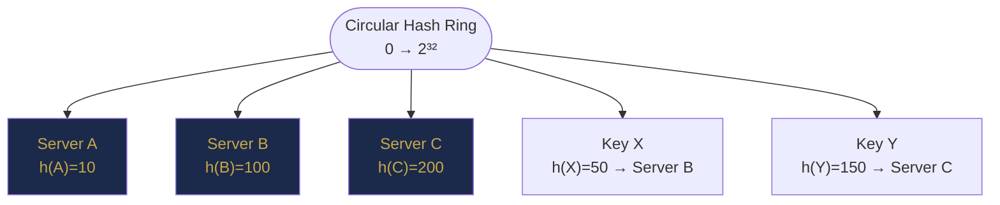

# Chapter 20 — Ordered Maps and Advanced Hashing

> **Part V — Hashing and Lookup Structures**  
> [← Chapter 19](chapter-19-hashmap-patterns.md) · [← Index](../INDEX.md) · [→ Part V Review](part-05-review.md)

---

## Learning Objectives

By the end of this chapter you will be able to:

- Use all `TreeMap` navigation methods (`floorKey`, `ceilingKey`, `lowerKey`, `higherKey`, `subMap`) correctly.
- Choose between `HashMap` and `TreeMap` based on whether sorted order or range queries are needed.
- Apply `TreeMap` to interval problems, frequency-ordered problems, and ordered window problems.
- Explain hash collision attacks and describe defensive hashing strategies.
- Describe consistent hashing at the conceptual level.

---

## Contents

- [20.1 TreeMap and TreeSet Foundations](#201-treemap-and-treeset-foundations)
- [20.2 Navigation Methods](#202-navigation-methods)
- [20.3 Range Queries and Submaps](#203-range-queries-and-submaps)
- [20.4 Ordered Frequency Problems](#204-ordered-frequency-problems)
- [20.5 Rolling Hash Applications](#205-rolling-hash-applications)
- [20.6 Hash Collisions in Adversarial Inputs](#206-hash-collisions-in-adversarial-inputs)
- [20.7 Consistent Hashing](#207-consistent-hashing)
- [20.8 HashMap vs TreeMap: Decision Guide](#208-hashmap-vs-treemap-decision-guide)
- [Interview Insight](#interview-insight)
- [Quick Quiz](#quick-quiz)
- [20.9 Practice Problems](#209-practice-problems)
- [20.10 Hard Problem Corner](#2010-hard-problem-corner)
- [Chapter Summary](#chapter-summary)

---

> [!NOTE]
> **Historical Context**  
> **Red-black trees** were invented by **Leo J. Guibas** and **Robert Sedgewick** in **1978** as a simplification of symmetric binary B-trees. The "red" and "black" node colouring is purely bookkeeping — Guibas used red to flag nodes that required special attention during structural rebalancing. Java's `TreeMap` uses a red-black tree internally, as does C++'s `std::map` and `std::set`. **B-Trees** (the basis for database index files) were invented by **Rudolf Bayer** and **Edward McCreight** at Boeing Research Labs in **1972**. The B+ Tree variant (B-Tree where all data is at the leaves) is used by virtually every relational database (MySQL InnoDB, PostgreSQL, Oracle) for primary and secondary indexes.

> [!TIP]
> **Did You Know?**  
> Java's `TreeMap` implements the `NavigableMap` interface, which provides `floorKey`, `ceilingKey`, `lowerKey`, and `higherKey` — four navigation methods that make it qualitatively more powerful than a simple sorted map. These methods were added in **Java 6 (2006)**, replacing the clumsier `SortedMap` interface from Java 1.2. Many developers use `TreeMap` only for its basic sorted iteration and are unaware that `ceilingKey(k)` exists — it is the single call that makes interval scheduling, nearest-event queries, and consistent hashing implementable in O(log n) instead of O(n).

---

## 20.1 TreeMap and TreeSet Foundations

`TreeMap<K, V>` is backed by a **red-black tree** — a self-balancing BST. All operations are O(log n), but unlike `HashMap`, iteration is in **sorted key order**.

| Operation | `HashMap` | `TreeMap` |
|-----------|----------|----------|
| `put`, `get`, `remove` | O(1) avg | O(log n) |
| `containsKey` | O(1) avg | O(log n) |
| Sorted iteration | ✗ | ✅ |
| `floorKey`, `ceilingKey` | ✗ | O(log n) |
| `subMap`, `headMap`, `tailMap` | ✗ | O(1) view |
| Memory overhead | Low | Higher (tree nodes) |

*Table 20.1: HashMap vs TreeMap operation comparison.*

```java
TreeMap<Integer, String> map = new TreeMap<>();
map.put(5, "five"); map.put(3, "three"); map.put(7, "seven");

// Iteration is always in sorted key order
for (Map.Entry<Integer, String> e : map.entrySet()) {
    System.out.println(e.getKey() + " → " + e.getValue());
}
// Output: 3 → three, 5 → five, 7 → seven
```

**`TreeSet<E>`** is a `TreeMap<E, PRESENT>` — same relationship as `HashSet` to `HashMap`, but sorted.

```java
TreeSet<Integer> set = new TreeSet<>(Arrays.asList(5, 3, 7, 1, 9));
// set is ordered: [1, 3, 5, 7, 9]
System.out.println(set.first());  // 1
System.out.println(set.last());   // 9
```

---

## 20.2 Navigation Methods

These are `TreeMap`'s most powerful methods for interval and nearest-neighbour queries:

| Method | Returns | Null if |
|--------|---------|---------|
| `floorKey(k)` | Largest key **≤ k** | No key ≤ k |
| `ceilingKey(k)` | Smallest key **≥ k** | No key ≥ k |
| `lowerKey(k)` | Largest key **< k** (strictly) | No key < k |
| `higherKey(k)` | Smallest key **> k** (strictly) | No key > k |
| `firstKey()` | Smallest key in map | Map is empty |
| `lastKey()` | Largest key in map | Map is empty |

*Table 20.2: TreeMap navigation methods.*

```java
TreeMap<Integer, String> map = new TreeMap<>();
// Keys: [1, 3, 5, 7, 9]
map.floorKey(6)   // 5 — largest ≤ 6
map.ceilingKey(6) // 7 — smallest ≥ 6
map.lowerKey(5)   // 3 — strictly < 5
map.higherKey(5)  // 7 — strictly > 5
map.floorKey(0)   // null — no key ≤ 0
```

**`TreeSet` equivalents:** `floor(e)`, `ceiling(e)`, `lower(e)`, `higher(e)` — same semantics.

### My Calendar: Interval Overlap Detection

A classic `TreeMap` problem. Store intervals by start time; for each new `[start, end)`, check if it overlaps with its predecessor or successor.

```java
class MyCalendar {
    private TreeMap<Integer, Integer> calendar = new TreeMap<>();

    boolean book(int start, int end) {
        Integer prevStart = calendar.floorKey(start);
        Integer nextStart = calendar.ceilingKey(start);

        // Overlap if previous interval extends into [start, end)
        if (prevStart != null && calendar.get(prevStart) > start) return false;
        // Overlap if next interval starts before end
        if (nextStart != null && nextStart < end) return false;

        calendar.put(start, end);
        return true;
    }
}
```

**Complexity:** O(log n) per booking — the tree lookup replaces an O(n) linear scan.

---

## 20.3 Range Queries and Submaps

```java
TreeMap<Integer, String> map = new TreeMap<>();
// Keys: [1, 3, 5, 7, 9, 11]

// Keys in [3, 8): subMap(fromKey, toKey) — fromKey inclusive, toKey exclusive
map.subMap(3, 8).keySet()     // [3, 5, 7]
map.subMap(3, true, 7, true)  // inclusive-inclusive overload: [3, 5, 7]

// Keys < 7
map.headMap(7).keySet()       // [1, 3, 5]

// Keys ≥ 7
map.tailMap(7).keySet()       // [7, 9, 11]
```

**These return live views** — changes to the submap affect the original map and vice versa.

### Count Events in a Time Window

```java
TreeMap<Long, Integer> events = new TreeMap<>(); // timestamp → event count

// Count events between timestamps lo and hi (inclusive)
int countInRange(long lo, long hi) {
    return events.subMap(lo, true, hi, true)
                 .values().stream()
                 .mapToInt(Integer::intValue).sum();
}
```

---

## 20.4 Ordered Frequency Problems

### Sliding Window with Sorted Structure (Sliding Window Median)

Maintain a sorted structure of the current window to quickly find the median.

**Approach:** Two `TreeMap`s — a max-side (left half, keys stored normally) and min-side (right half). When a window element enters or leaves, rebalance so both halves are equal size (or left has one more for odd-size windows). Median = `maxSide.lastKey()` (or average of both).

```java
class SlidingWindowMedian {
    TreeMap<Integer, Integer> maxSide = new TreeMap<>();  // lower half: access max
    TreeMap<Integer, Integer> minSide = new TreeMap<>();  // upper half: access min
    int maxSize = 0, minSize = 0;

    void add(int num) {
        // Route to correct side
        if (maxSide.isEmpty() || num <= maxSide.lastKey()) {
            maxSide.merge(num, 1, Integer::sum); maxSize++;
        } else {
            minSide.merge(num, 1, Integer::sum); minSize++;
        }
        rebalance();
    }

    void remove(int num) {
        if (!maxSide.isEmpty() && num <= maxSide.lastKey()) {
            removeFrom(maxSide, num); maxSize--;
        } else {
            removeFrom(minSide, num); minSize--;
        }
        rebalance();
    }

    double median() {
        if (maxSize > minSize) return maxSide.lastKey();
        return (maxSide.lastKey() + (double) minSide.firstKey()) / 2;
    }

    private void rebalance() {
        while (maxSize > minSize + 1) {
            int key = maxSide.lastKey();
            removeFrom(maxSide, key); maxSize--;
            minSide.merge(key, 1, Integer::sum); minSize++;
        }
        while (minSize > maxSize) {
            int key = minSide.firstKey();
            removeFrom(minSide, key); minSize--;
            maxSide.merge(key, 1, Integer::sum); maxSize++;
        }
    }

    private void removeFrom(TreeMap<Integer, Integer> map, int key) {
        if (map.merge(key, -1, Integer::sum) == 0) map.remove(key);
    }
}
```

---

## 20.5 Rolling Hash Applications

The rolling hash from [Chapter 13](chapter-13-advanced-string-algorithms.md#136-rabin-karp-and-rolling-hash) has applications beyond pattern matching.

### Find All Duplicate Substrings of Length k

```java
List<String> duplicateSubstrings(String s, int k) {
    Map<Long, Integer> seen = new HashMap<>();
    List<String> result = new ArrayList<>();
    final long BASE = 31, MOD = 1_000_000_007L;

    long hash = 0, power = 1;
    for (int i = 0; i < k; i++) {
        hash = (hash * BASE + (s.charAt(i) - 'a' + 1)) % MOD;
        if (i > 0) power = power * BASE % MOD;
    }
    seen.put(hash, 0);

    for (int i = 1; i <= s.length() - k; i++) {
        hash = (hash - (s.charAt(i - 1) - 'a' + 1) * power % MOD + MOD) % MOD;
        hash = (hash * BASE + (s.charAt(i + k - 1) - 'a' + 1)) % MOD;
        if (seen.containsKey(hash)) {
            String sub = s.substring(i, i + k);
            if (s.substring(seen.get(hash), seen.get(hash) + k).equals(sub))
                result.add(sub);  // verify to handle hash collisions
        }
        seen.put(hash, i);
    }
    return result;
}
```

### Longest Duplicate Substring (Binary Search + Rolling Hash)

Binary search on length $k$; for each $k$ use rolling hash to check for duplicates in O(n). Total: O(n log n).

---

## 20.6 Hash Collisions in Adversarial Inputs

**The attack:** An adversary who knows your hash function can craft inputs that all collide to the same bucket, degrading `HashMap` from O(1) to O(n) per operation — a **hash-flooding denial-of-service**.

**Example:** Java's `String.hashCode()` uses base 31. An attacker can enumerate strings with identical hashCode and flood a web server's request parameter parsing.

**Java's defence (since Java 8):**
1. When a bucket's linked list exceeds 8 entries, it converts to a **red-black tree** → O(log n) even under attack.
2. `HashMap` uses a randomised hash seed per JVM startup (via `HASH_SEED` in the hash computation) so the attacker cannot know the actual hash function.

**Your defence in competitive programming:**
- Use a large prime modulus with a random base for string hashing.
- Use double hashing (two independent hash functions) — collision probability drops to ~$10^{-18}$.

```java
// Anti-hack double hash in competitive programming
static final long MOD1 = 1_000_000_007L, MOD2 = 998_244_353L;
static final long BASE1 = 131, BASE2 = 137;
// Store pair (hash1, hash2) as key — collision requires both to match simultaneously
```

---

## 20.7 Consistent Hashing

**Problem:** You have `n` servers (nodes) in a distributed system. When you add or remove a server, how do you remap keys with minimal disruption?

**Naïve hash:** `server = key % n`. Adding or removing one server remaps almost all keys.

**Consistent hashing:** Map both servers and keys to a **circular ring** (hash space 0 to 2³²-1). Each key is served by the first server clockwise from its position on the ring.



**Benefits:**
- Adding/removing a server remaps only `1/n` of keys on average.
- With **virtual nodes** (each server has multiple positions on the ring), load is distributed more evenly.

**Java implementation:** `TreeMap<Integer, String>` where keys are hash positions and values are server names. `ceilingKey(hash(key))` finds the responsible server in O(log n).

```java
TreeMap<Integer, String> ring = new TreeMap<>();

void addServer(String name, int replicas) {
    for (int i = 0; i < replicas; i++)
        ring.put(Objects.hash(name + "#" + i), name);
}

String getServer(String dataKey) {
    int hash = dataKey.hashCode();
    Integer pos = ring.ceilingKey(hash);
    if (pos == null) pos = ring.firstKey();  // wrap around
    return ring.get(pos);
}
```

---

## 20.8 HashMap vs TreeMap: Decision Guide

| Need | Use |
|------|-----|
| Fast lookup/insert, order doesn't matter | `HashMap` O(1) |
| Sorted iteration over all keys | `TreeMap` O(n log n) |
| Find nearest key (floor/ceiling) | `TreeMap` O(log n) |
| Range query (all keys in [a, b]) | `TreeMap.subMap` O(log n + result) |
| Sliding window median / order statistics | `TreeMap` as multiset |
| Interval overlap detection | `TreeMap` O(log n) |
| Consistent hashing | `TreeMap` O(log n) |

*Table 20.3: HashMap vs TreeMap decision guide.*

---

## Interview Insight

> ### 🎯 Interview Insight
> **When to Reach for TreeMap**
>
> `HashMap` handles "does this exist?" and "what is the value for X?" in O(1). But the moment you need **relative ordering** — "what is the nearest booking before X?" or "what values fall in this range?" — `TreeMap` is the right tool. The O(log n) cost per operation is almost always acceptable.
>
> The key signal phrases:
> - *"Find the closest / nearest…"* → `floorKey` or `ceilingKey`
> - *"Count or list all entries in range [a, b]…"* → `subMap`
> - *"Process in sorted order…"* → Iterate `TreeMap`
> - *"Check if interval overlaps…"* → `floorEntry` / `ceilingEntry`

---

## Quick Quiz

**Q1.** `TreeMap` has keys `[2, 5, 8, 11]`. What do `floorKey(5)`, `ceilingKey(6)`, `lowerKey(8)`, and `higherKey(8)` return?

<details><summary><strong>Answer</strong></summary>

> - `floorKey(5)` = **5** (largest ≤ 5)
> - `ceilingKey(6)` = **8** (smallest ≥ 6)
> - `lowerKey(8)` = **5** (strictly < 8)
> - `higherKey(8)` = **11** (strictly > 8)

</details>

---

**Q2.** Why is O(log n) for `TreeMap` acceptable when O(1) exists with `HashMap`?

<details><summary><strong>Answer</strong></summary>

> `HashMap` cannot perform floor/ceiling/range queries — it has no concept of key ordering. When the problem requires knowing the nearest key, the keys in a range, or sorted iteration, `HashMap` simply cannot solve it. The O(log n) cost of `TreeMap` is the minimum cost of maintaining sorted order — provably optimal for a comparison-based ordered structure.

</details>

---

**Q3.** How does Java defend against hash-flooding attacks on `HashMap`?

<details><summary><strong>Answer</strong></summary>

> Two mechanisms: (1) **Tree buckets** — chains longer than 8 convert to red-black trees, limiting worst-case per-bucket cost to O(log n) instead of O(n). (2) **Randomised hashing** — a per-JVM-run seed is mixed into the hash computation, preventing an attacker from predicting which keys will collide without knowing the seed.

</details>

---

## 20.9 Practice Problems

| Problem | Name | Difficulty | Technique |
|---------|------|------------|-----------|
| [LC 729](https://leetcode.com/problems/my-calendar-i/) | My Calendar I | Medium | TreeMap floor/ceiling |
| [LC 731](https://leetcode.com/problems/my-calendar-ii/) | My Calendar II | Medium | TreeMap + difference array |
| [LC 220](https://leetcode.com/problems/contains-duplicate-iii/) | Contains Duplicate III | Hard | TreeMap floor/ceiling for nearest |
| [LC 480](https://leetcode.com/problems/sliding-window-median/) | Sliding Window Median | Hard | Two TreeMaps |
| [LC 1046](https://leetcode.com/problems/last-stone-weight/) | Last Stone Weight | Easy | TreeMap/PriorityQueue max |
| [LC 1438](https://leetcode.com/problems/longest-continuous-subarray-with-absolute-diff-less-than-or-equal-to-limit/) | Longest Continuous Subarray | Medium | TreeMap for window min/max |
| [LC 1044](https://leetcode.com/problems/longest-duplicate-substring/) | Longest Duplicate Substring | Hard | Rolling hash + binary search |

---

## 20.10 Hard Problem Corner

> ### 🔥 Hard Problem Corner
>
> **Problem: Longest Continuous Subarray With Absolute Diff ≤ Limit** ([LC 1438](https://leetcode.com/problems/longest-continuous-subarray-with-absolute-diff-less-than-or-equal-to-limit/))
>
> Find the longest subarray where `max - min ≤ limit`. Use a sliding window that tracks both the current maximum and minimum in O(log n) per step.

<details><summary><strong>Solution (click to reveal)</strong></summary>

> [!TIP]
> Use a `TreeMap` as a **multiset** (frequency map) for the current window. `lastKey()` = max, `firstKey()` = min. When `lastKey() - firstKey() > limit`, shrink from the left.
>
> ```java
> int longestSubarray(int[] nums, int limit) {
>     TreeMap<Integer, Integer> window = new TreeMap<>();
>     int left = 0, best = 0;
>     for (int right = 0; right < nums.length; right++) {
>         window.merge(nums[right], 1, Integer::sum);
>         while (window.lastKey() - window.firstKey() > limit) {
>             if (window.merge(nums[left], -1, Integer::sum) == 0)
>                 window.remove(nums[left]);
>             left++;
>         }
>         best = Math.max(best, right - left + 1);
>     }
>     return best;
> }
> ```
>
> **Complexity:** O(n log n) — each element enters and exits the TreeMap once, each operation O(log n).  
> **Alternative:** Two monotonic deques give O(n) — but the TreeMap approach is cleaner and easier to implement under interview pressure.

</details>

---

## Chapter Summary

| Concept | Key Takeaway |
|---------|-------------|
| **TreeMap** | Red-black tree. All ops O(log n). Sorted key iteration. Use when order matters. |
| **floorKey / ceilingKey** | Nearest key ≤ or ≥ target. The core tool for interval and nearest-neighbour problems. |
| **subMap / headMap / tailMap** | Live views of key ranges. O(1) to create, O(log n + k) to iterate k results. |
| **TreeMap as multiset** | Store `(value, count)` pairs. `lastKey()`/`firstKey()` = window max/min. Use for sliding window median, etc. |
| **Rolling hash** | O(1) window update. Use for duplicate substring detection; double-hash to eliminate collisions. |
| **Adversarial hashing** | Java uses tree buckets + randomised seed. In competitive programming, use double hashing. |
| **Consistent hashing** | TreeMap + virtual nodes for distributed key-to-server mapping with minimal remapping on node changes. |
| **HashMap vs TreeMap** | HashMap for speed; TreeMap when you need sorted order or range/nearest queries. |

*Table 20.4: Chapter 20 key concepts.*

---

> **Part V — Hashing and Lookup Structures**  
> [← Chapter 19](chapter-19-hashmap-patterns.md) · [← Index](../INDEX.md) · [→ Part V Review](part-05-review.md)
