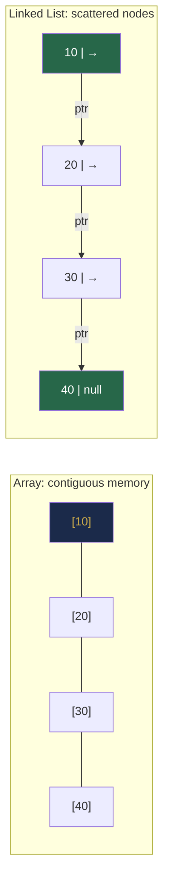

# Chapter 21 — Linked List Foundations

> **Part VI — Linked Lists**  
> [← Part V Review](part-05-review.md) · [← Index](../INDEX.md) · [→ Chapter 22](../INDEX.md#-chapter-22--linked-list-problem-patterns)

---

## Learning Objectives

By the end of this chapter you will be able to:

- Implement singly and doubly linked list nodes and basic operations from scratch.
- Explain the key structural difference between arrays and linked lists (contiguity vs pointer chains).
- Insert and delete at the head, tail, and an arbitrary position in O(1) or O(n) respectively.
- Traverse a linked list iteratively and avoid common null-pointer pitfalls.
- Use Java's `LinkedList<E>` correctly and know when it is — and is not — the right choice.

---

## Contents

- [21.1 Linked List Concepts](#211-linked-list-concepts)
- [21.2 Nodes and References](#212-nodes-and-references)
- [21.3 Singly Linked List](#213-singly-linked-list)
- [21.4 Doubly Linked List](#214-doubly-linked-list)
- [21.5 Circular Linked List](#215-circular-linked-list)
- [21.6 Insertion and Deletion](#216-insertion-and-deletion)
- [21.7 Traversal](#217-traversal)
- [21.8 Java LinkedList Considerations](#218-java-linkedlist-considerations)
- [21.9 Linked List vs Array](#219-linked-list-vs-array)
- [Quick Quiz](#quick-quiz)
- [21.10 Practice Problems](#2110-practice-problems)
- [Chapter Summary](#chapter-summary)

---

## 21.1 Linked List Concepts

An **array** stores elements in a contiguous block of memory. Random access is O(1) because the address of element `i` is `base + i × size`. But inserting or deleting in the middle requires shifting elements — O(n).

A **linked list** stores elements as individual nodes, each holding a value and a pointer (reference) to the next node. The nodes can be anywhere in memory — they are connected by references, not physical adjacency.

```
Array:    [10 | 20 | 30 | 40 | 50]      ← contiguous memory
           0    1    2    3    4

Linked:   [10|→] → [20|→] → [30|→] → [40|→] → [50|null]
           head                                   tail
```

**Core trade-off:**

| Operation | Array | Linked List |
|-----------|-------|-------------|
| Access by index | **O(1)** | O(n) — must traverse |
| Insert/delete at head | O(n) — shift | **O(1)** |
| Insert/delete at tail | **O(1)** amortised | O(1) with tail pointer |
| Insert/delete at middle | O(n) | O(1) splice, O(n) to find position |
| Memory | Compact, cache-friendly | Pointer overhead, poor locality |

*Table 21.1: Array vs linked list operation comparison.*

---

> [!NOTE]
> **Historical Context**  
> Linked lists were invented by **Allen Newell, Cliff Shaw, and Herbert Simon** while developing the **Information Processing Language (IPL)** at RAND Corporation in **1955–1956**. IPL was the first list-processing language, created to implement the Logic Theorist — one of the earliest artificial intelligence programs. The linked list was an essential building block: AI programs needed to represent symbolic expressions as chains of nodes that could grow and shrink dynamically, which fixed-size arrays could not support. Newell, Simon, and Shaw received the **Turing Award in 1975**, partly for this foundational work. John McCarthy's Lisp (1958) later made the linked list the central data structure of the language, cementing its place in computing history.



---

> ### 🔗 Analogy
> **Train carriages vs seats in a theatre.**
>
> A theatre assigns fixed, numbered seats — finding seat 47 is instant. But inserting a new row in the middle means renumbering everything. Train carriages are linked end-to-end by couplings. Finding the 47th carriage requires walking the train from the front, but adding or removing a carriage in the middle just means unhooking two couplings and reattaching them — no other carriages move.

---

## 21.2 Nodes and References

The building block of every linked list is the **node**: a small object containing a value and one or more references to neighbouring nodes.

```java
// Singly linked list node — used in almost all LeetCode linked list problems
class ListNode {
    int val;
    ListNode next;

    ListNode(int val) { this.val = val; }
    ListNode(int val, ListNode next) { this.val = val; this.next = next; }
}

// Doubly linked list node
class DListNode {
    int val;
    DListNode prev, next;

    DListNode(int val) { this.val = val; }
}
```

**The sentinel (dummy) node pattern:** Many algorithms are cleaner if the list always has a dummy head node that never holds real data. This eliminates the special case of inserting/deleting at the actual head.

```java
ListNode dummy = new ListNode(-1);  // sentinel
dummy.next = head;                   // real list follows
// Operations never need to check "is head null?"
```

---

## 21.3 Singly Linked List

Each node has exactly one pointer (`next`). Traversal is forward-only.

```java
class SinglyLinkedList {
    private ListNode head;
    private int size;

    void addFirst(int val) {
        head = new ListNode(val, head);
        size++;
    }

    void addLast(int val) {
        ListNode node = new ListNode(val);
        if (head == null) { head = node; size++; return; }
        ListNode curr = head;
        while (curr.next != null) curr = curr.next;
        curr.next = node;
        size++;
    }

    int get(int index) {
        ListNode curr = head;
        for (int i = 0; i < index; i++) curr = curr.next;
        return curr.val;
    }

    int size() { return size; }
}
```

**Problem with `addLast`:** It is O(n) because we must traverse to the tail. The fix: maintain an explicit `tail` pointer and update it on every add/delete at the end. This makes `addLast` O(1).

---

## 21.4 Doubly Linked List

Each node has two pointers (`prev` and `next`). Enables O(1) backward traversal and O(1) deletion of a node given only its reference (without traversing from head to find its predecessor).

```java
class DoublyLinkedList {
    private DListNode head, tail;
    private int size;

    void addFirst(int val) {
        DListNode node = new DListNode(val);
        if (head == null) { head = tail = node; }
        else { node.next = head; head.prev = node; head = node; }
        size++;
    }

    void addLast(int val) {
        DListNode node = new DListNode(val);
        if (tail == null) { head = tail = node; }
        else { tail.next = node; node.prev = tail; tail = node; }
        size++;
    }

    void removeNode(DListNode node) {
        if (node.prev != null) node.prev.next = node.next;
        else head = node.next;
        if (node.next != null) node.next.prev = node.prev;
        else tail = node.prev;
        size--;
    }
}
```

**Key advantage of doubly linked:** Given only a reference to a node, `removeNode` runs in O(1). In a singly linked list, deletion requires knowing the predecessor — O(n) to find it.

---

## 21.5 Circular Linked List

The last node's `next` points back to the head (or some other node in the list). Used in round-robin schedulers, music playlists, and buffer rings.

```java
class CircularLinkedList {
    private ListNode tail;   // tail.next = head

    void add(int val) {
        ListNode node = new ListNode(val);
        if (tail == null) { node.next = node; tail = node; return; }
        node.next = tail.next;   // new node → old head
        tail.next = node;        // old tail → new node
        tail = node;             // advance tail
    }

    ListNode head() { return tail == null ? null : tail.next; }
}
```

**Pitfall:** Traversal must stop when you return to the starting node — there is no `null` to terminate.

```java
void print(ListNode tail) {
    if (tail == null) return;
    ListNode curr = tail.next;   // start at head
    do {
        System.out.print(curr.val + " ");
        curr = curr.next;
    } while (curr != tail.next); // stop when we return to head
}
```

---

## 21.6 Insertion and Deletion

### Insert After a Given Node

```java
void insertAfter(ListNode node, int val) {
    ListNode newNode = new ListNode(val, node.next);
    node.next = newNode;
}
```

**Complexity:** O(1). The only operation is pointer reassignment.

### Delete the Node After a Given Node

```java
void deleteAfter(ListNode node) {
    if (node.next == null) return;
    node.next = node.next.next;
}
```

**Complexity:** O(1).

### Delete a Node by Value

```java
ListNode deleteByValue(ListNode head, int val) {
    ListNode dummy = new ListNode(-1, head);
    ListNode curr = dummy;
    while (curr.next != null) {
        if (curr.next.val == val) { curr.next = curr.next.next; break; }
        curr = curr.next;
    }
    return dummy.next;
}
```

**Complexity:** O(n) to find the predecessor. The dummy node eliminates the special case of deleting the head.

### Delete All Nodes with a Value

```java
ListNode deleteAll(ListNode head, int val) {
    ListNode dummy = new ListNode(-1, head);
    ListNode curr = dummy;
    while (curr.next != null) {
        if (curr.next.val == val) curr.next = curr.next.next;
        else curr = curr.next;
    }
    return dummy.next;
}
```

---

## 21.7 Traversal

```java
// Iterative traversal — standard
void printList(ListNode head) {
    for (ListNode curr = head; curr != null; curr = curr.next)
        System.out.print(curr.val + " → ");
    System.out.println("null");
}

// Count nodes
int length(ListNode head) {
    int count = 0;
    for (ListNode curr = head; curr != null; curr = curr.next) count++;
    return count;
}

// Find k-th node from head (0-indexed)
ListNode kthNode(ListNode head, int k) {
    ListNode curr = head;
    for (int i = 0; i < k && curr != null; i++) curr = curr.next;
    return curr;   // null if k >= length
}
```

> [!WARNING]
> **The null-pointer trap.** The most common bug in linked list code is advancing a pointer past `null`. Always check `curr != null` before accessing `curr.val` or `curr.next`. With two pointers (fast/slow), always check `fast != null && fast.next != null` before advancing `fast` two steps.

---

## 21.8 Java LinkedList Considerations

Java provides `java.util.LinkedList<E>` which implements both `List<E>` and `Deque<E>`. It is a **doubly linked list** internally.

```java
LinkedList<Integer> list = new LinkedList<>();

// List operations
list.add(10);         list.add(20);  list.add(30);
list.addFirst(5);     // [5, 10, 20, 30]
list.addLast(35);     // [5, 10, 20, 30, 35]
list.removeFirst();   // removes 5
list.removeLast();    // removes 35
list.get(1);          // 20 — O(n): must traverse!

// Deque operations (stack/queue — prefer these)
list.push(0);         // addFirst — stack push
list.pop();           // removeFirst — stack pop
list.offer(99);       // addLast — queue enqueue
list.poll();          // removeFirst — queue dequeue
list.peek();          // peekFirst
```

> [!WARNING]
> `list.get(i)` on `LinkedList` is **O(n)** — it traverses from head or tail (whichever is closer). Never loop `for (int i=0; i<n; i++) list.get(i)` — that is O(n²). Use an iterator or for-each loop instead.

**When to actually use `java.util.LinkedList`:**
- You need frequent O(1) insertions/deletions at both ends (use `ArrayDeque` instead — it's faster).
- In practice, `ArrayDeque` outperforms `LinkedList` for stack and queue operations due to better cache locality.

**The honest advice:** Java's `LinkedList` is rarely the best choice. `ArrayDeque` for stack/queue; `ArrayList` for list. `LinkedList` shines only when you hold references to interior nodes (like in LRU/LFU cache implementations).

> [!TIP]
> **Did You Know?**  
> Implementing a linked list in **Rust** is famously difficult — Rust's ownership and borrowing rules make the mutual back-references in a doubly linked list a compile error unless you use `unsafe` code or reference-counted smart pointers (`Rc<RefCell<T>>`). This is not a Rust limitation but a feature: Rust's type system forces you to acknowledge that shared mutable state is dangerous. There is an entire free online book dedicated to this problem: ***"Learn Rust With Entirely Too Many Linked Lists"*** (rust-unofficial.github.io/too-many-lists/). It has become one of the most-read Rust learning resources precisely because the difficulty of linked lists reveals the depth of Rust's ownership model.

---

## 21.9 Linked List vs Array

| Scenario | Prefer |
|----------|--------|
| Frequent random access by index | Array (`ArrayList`) |
| Frequent insert/delete at head | LinkedList |
| Frequent insert/delete at tail | Array (`ArrayList` amortised O(1)) |
| Frequent insert/delete in middle (given position) | LinkedList (find is O(n), splice is O(1)) |
| Cache-friendly iteration | Array |
| Need to hold interior node references (LRU) | LinkedList |
| Memory overhead matters | Array |

*Table 21.2: Array vs linked list use-case guide.*

---

## Quick Quiz

**Q1.** Why is deleting a node from a singly linked list O(n) even if you have a reference to the node?

<details><summary><strong>Answer</strong></summary>

> To delete a node, you need to update its **predecessor's** `next` pointer. In a singly linked list, there is no `prev` pointer — finding the predecessor requires traversing from the head. In a doubly linked list, `node.prev` gives the predecessor directly, so deletion is O(1).

</details>

---

**Q2.** What is the purpose of a sentinel (dummy) head node?

<details><summary><strong>Answer</strong></summary>

> It eliminates the special case of an empty list or operations at the head. With a dummy node, `curr.next` is always the actual first real node — you never need to check "is `head` null?" or handle `head = head.next` as a special branch. All insertions and deletions go through the uniform `curr.next = ...` pattern.

</details>

---

**Q3.** `java.util.LinkedList.get(500)` on a list of 1000 elements — which end does Java start from?

<details><summary><strong>Answer</strong></summary>

> Java's `LinkedList` starts from the **closer end**. Index 500 on a 1000-element list is exactly in the middle, so it starts from either end and traverses 500 steps. For index ≤ size/2, it traverses from head; for index > size/2, from tail. Still O(n).

</details>

---

## 21.10 Practice Problems

| Problem | Name | Difficulty | Technique |
|---------|------|------------|-----------|
| [LC 707](https://leetcode.com/problems/design-linked-list/) | Design Linked List | Medium | Full implementation |
| [LC 206](https://leetcode.com/problems/reverse-linked-list/) | Reverse Linked List | Easy | Pointer manipulation |
| [LC 203](https://leetcode.com/problems/remove-linked-list-elements/) | Remove Linked List Elements | Easy | Dummy node |
| [LC 237](https://leetcode.com/problems/delete-node-in-a-linked-list/) | Delete Node in a Linked List | Medium | Copy-delete trick |
| [LC 83](https://leetcode.com/problems/remove-duplicates-from-sorted-list/) | Remove Duplicates from Sorted List | Easy | Traversal |

---

## Chapter Summary

| Concept | Key Takeaway |
|---------|-------------|
| **Node** | Value + `next` pointer. Building block of all linked list types. |
| **Singly linked** | Forward traversal only. O(1) insert at head. O(n) insert at tail without tail pointer. |
| **Doubly linked** | Bidirectional. O(1) delete given node reference. Used in LRU/LFU cache. |
| **Circular** | No `null` tail — traverse with do/while until back to start. |
| **Dummy head** | Eliminates head-null special case. Use it in almost every linked list algorithm. |
| **Null safety** | Always check `curr != null` before `curr.next`. Check `fast != null && fast.next != null` for two-pointer. |
| **Java `LinkedList`** | Doubly linked. `get(i)` is O(n). Prefer `ArrayDeque` for stack/queue. |

*Table 21.3: Chapter 21 key concepts.*

---

> **Part VI — Linked Lists**  
> [← Part V Review](part-05-review.md) · [← Index](../INDEX.md) · [→ Chapter 22 (planned)](../INDEX.md#-chapter-22--linked-list-problem-patterns)
