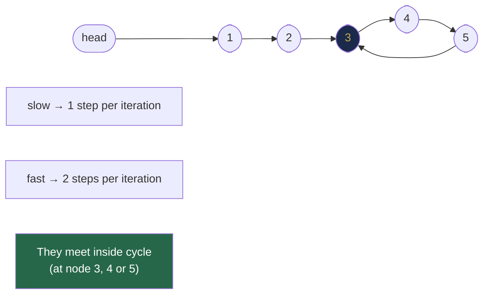

# Chapter 22 — Linked List Problem Patterns

> **Part VI — Linked Lists**  
> [← Chapter 21](chapter-21-linked-list-foundations.md) · [← Index](../INDEX.md) · [→ Part VI Review](part-06-review.md)

---

## Learning Objectives

By the end of this chapter you will be able to:

- Reverse a linked list iteratively and recursively, explaining the pointer reassignment order.
- Apply fast/slow pointers to find the middle, detect cycles, find the cycle start, and find the k-th node from the end.
- Merge two sorted linked lists in O(n + m) time.
- Reorder a list in-place (interleave first and second halves) in O(n) time and O(1) space.
- Detect palindrome linked list in O(n) time and O(1) space.

---

## Contents

- [22.1 Reversal](#221-reversal)
- [22.2 Recursive Reversal](#222-recursive-reversal)
- [22.3 Fast and Slow Pointers](#223-fast-and-slow-pointers)
- [22.4 Cycle Detection: Floyd's Algorithm](#224-cycle-detection-floyds-algorithm)
- [22.5 Finding the Cycle Start](#225-finding-the-cycle-start)
- [22.6 Intersection of Two Lists](#226-intersection-of-two-lists)
- [22.7 Merging Sorted Lists](#227-merging-sorted-lists)
- [22.8 Reordering a Linked List](#228-reordering-a-linked-list)
- [22.9 Palindrome Linked List](#229-palindrome-linked-list)
- [Interview Insight](#interview-insight)
- [Quick Quiz](#quick-quiz)
- [22.10 Practice Problems](#2210-practice-problems)
- [22.11 Hard Problem Corner](#2211-hard-problem-corner)
- [Chapter Summary](#chapter-summary)

---

## 22.1 Reversal

Reversing a linked list is the most fundamental linked list operation. The trick: at each node, before we move `curr` forward, we redirect its `next` pointer backward.

```java
ListNode reverse(ListNode head) {
    ListNode prev = null, curr = head;
    while (curr != null) {
        ListNode next = curr.next;   // 1. save next
        curr.next = prev;            // 2. redirect backward
        prev = curr;                 // 3. advance prev
        curr = next;                 // 4. advance curr
    }
    return prev;   // prev is now the new head
}
```

**Dry run on `1 → 2 → 3 → null`:**

| Step | prev | curr | curr.next after redirect |
|------|------|------|--------------------------|
| Start | null | 1 | — |
| After step 1 | null | 1 | null (was 2) |
| After step 3–4 | 1 | 2 | — |
| After step 1 | 1 | 2 | 1 |
| After step 3–4 | 2 | 3 | — |
| After | 3 | null | — |

Result: `3 → 2 → 1 → null`. `prev = 3` is the new head.

**Always remember the order:** save next, redirect, advance prev, advance curr. Reversing any two of these four steps creates a bug.

### Reverse Between Positions (LC 92)

Reverse only nodes from position `left` to `right` (1-indexed):

```java
ListNode reverseBetween(ListNode head, int left, int right) {
    ListNode dummy = new ListNode(-1, head);
    ListNode pre = dummy;
    for (int i = 1; i < left; i++) pre = pre.next;  // stop just before reversal zone

    ListNode curr = pre.next;
    for (int i = 0; i < right - left; i++) {
        ListNode next = curr.next;
        curr.next = next.next;
        next.next = pre.next;
        pre.next = next;
    }
    return dummy.next;
}
```

---

## 22.2 Recursive Reversal

```java
ListNode reverseRecursive(ListNode head) {
    if (head == null || head.next == null) return head;   // base case

    ListNode newHead = reverseRecursive(head.next);  // reverse the rest
    head.next.next = head;   // make next node point back to head
    head.next = null;        // head's next is now null (new tail)
    return newHead;
}
```

**How it works:** Each recursive call reverses the sublist starting at `head.next`. On return, `head.next` is the last node of the reversed sublist. Setting `head.next.next = head` appends `head` at the tail.

**Space:** O(n) recursion stack. The iterative version is O(1) space — prefer it for large lists.

---

## 22.3 Fast and Slow Pointers

The **fast/slow pointer** (also called the tortoise and hare) technique uses two pointers advancing at different speeds to solve structural queries about the list in one pass.

### Find the Middle Node

```java
ListNode findMiddle(ListNode head) {
    ListNode slow = head, fast = head;
    while (fast != null && fast.next != null) {
        slow = slow.next;        // advance 1
        fast = fast.next.next;   // advance 2
    }
    return slow;   // slow is at the middle
}
```

**Result:** For even-length lists, `slow` stops at the **second** middle node. For odd-length, it stops exactly at the middle. This is the "upper middle" convention — if you need the first middle of an even list, stop when `fast.next == null || fast.next.next == null`.

```
List: 1 → 2 → 3 → 4 → 5
      s,f
         s    f
              s         f (null)  → slow = 3 ✓

List: 1 → 2 → 3 → 4
      s,f
         s    f
              s         f.next = null → slow = 3 (second middle)
```

### Find k-th Node from the End

Move `fast` k steps ahead, then advance both until `fast.next == null`. `slow` is at the k-th from end.

```java
ListNode kthFromEnd(ListNode head, int k) {
    ListNode slow = head, fast = head;
    for (int i = 0; i < k; i++) fast = fast.next;
    while (fast != null) { slow = slow.next; fast = fast.next; }
    return slow;
}
```

---

## 22.4 Cycle Detection: Floyd's Algorithm

**Problem:** Given a linked list that may contain a cycle, determine if a cycle exists.

**Floyd's Tortoise and Hare:** If a cycle exists, the fast pointer will eventually lap the slow pointer — they will meet inside the cycle.

```java
boolean hasCycle(ListNode head) {
    ListNode slow = head, fast = head;
    while (fast != null && fast.next != null) {
        slow = slow.next;
        fast = fast.next.next;
        if (slow == fast) return true;   // they met inside the cycle
    }
    return false;   // fast reached null: no cycle
}
```

**Why they always meet (if cycle exists):** When `slow` enters the cycle, `fast` is already inside it. Each step, the gap between fast and slow (measured along the cycle) decreases by 1. The gap reaches 0 (they meet) in at most `cycle_length` steps.



*Nodes 3→5→3 form the cycle. Fast laps slow and they meet somewhere on the cycle.*

> [!NOTE]
> **Historical Context — Floyd's Cycle Detection**  
> This algorithm is attributed to **Robert W. Floyd** (~**1967**), though he never formally published it himself. It first appeared in print in **Donald Knuth's** *The Art of Computer Programming*, Volume 2 (1969), cited as Floyd's unpublished algorithm. The algorithm is also called the **tortoise and hare algorithm** after Aesop's fable. An independent discovery by **Richard Brent** (1980) gives an alternative O(1)-space cycle detection that is empirically faster (~36% fewer function evaluations on average) and is used in some cryptographic factoring algorithms (Pollard's rho). Both are O(n) time and O(1) space; Floyd's is simpler to implement and more commonly taught.

---

## 22.5 Finding the Cycle Start

After detecting a meeting point inside the cycle, find the **node where the cycle begins**:

```java
ListNode detectCycleStart(ListNode head) {
    ListNode slow = head, fast = head;

    // Phase 1: detect meeting point inside cycle
    while (fast != null && fast.next != null) {
        slow = slow.next;
        fast = fast.next.next;
        if (slow == fast) break;
    }
    if (fast == null || fast.next == null) return null;  // no cycle

    // Phase 2: move one pointer to head; advance both at speed 1
    slow = head;
    while (slow != fast) {
        slow = slow.next;
        fast = fast.next;
    }
    return slow;   // both pointers meet at the cycle start
}
```

**Why Phase 2 works:** Let $F$ = distance from head to cycle start, $C$ = cycle length, $a$ = distance from cycle start to meeting point. After Phase 1, the meeting point is $a$ steps into the cycle. The distance from the meeting point back to the cycle start along the cycle is $C - a$. We can show $F \equiv C - a \pmod{C}$, which means resetting one pointer to head and advancing both at speed 1 causes them to meet exactly at the cycle start after $F$ more steps.

---

## 22.6 Intersection of Two Lists

**Problem:** Two singly linked lists may share a common tail (they "merge" at some node). Find the intersection node.

**Insight:** If we traverse both lists and when one pointer reaches `null`, redirect it to the **other list's head**, both pointers will have covered the same total length by the time they reach the intersection (or both reach `null` simultaneously if no intersection).

```java
ListNode getIntersection(ListNode headA, ListNode headB) {
    ListNode a = headA, b = headB;
    while (a != b) {
        a = (a == null) ? headB : a.next;
        b = (b == null) ? headA : b.next;
    }
    return a;   // null if no intersection, intersection node otherwise
}
```

**Why it works:** Let lenA and lenB be the lengths. After pointer A traverses lenA + lenB steps (lenA on its own list, then lenB on the other), and B traverses lenB + lenA steps, both have travelled the same total distance. If there is an intersection at distance `d` from the end, they both reach it simultaneously.

---

## 22.7 Merging Sorted Lists

### Merge Two Sorted Lists

```java
ListNode mergeTwoSorted(ListNode l1, ListNode l2) {
    ListNode dummy = new ListNode(-1);
    ListNode curr = dummy;
    while (l1 != null && l2 != null) {
        if (l1.val <= l2.val) { curr.next = l1; l1 = l1.next; }
        else                  { curr.next = l2; l2 = l2.next; }
        curr = curr.next;
    }
    curr.next = (l1 != null) ? l1 : l2;   // attach remaining
    return dummy.next;
}
```

**Complexity:** O(n + m) time, O(1) space — nodes are relinked, not copied.

### Merge k Sorted Lists (Divide and Conquer)

Pair up lists and merge each pair. Repeat with the results. This is the linked list equivalent of merge sort.

```java
ListNode mergeKLists(ListNode[] lists) {
    if (lists.length == 0) return null;
    return mergeRange(lists, 0, lists.length - 1);
}

ListNode mergeRange(ListNode[] lists, int lo, int hi) {
    if (lo == hi) return lists[lo];
    int mid = lo + (hi - lo) / 2;
    return mergeTwoSorted(mergeRange(lists, lo, mid), mergeRange(lists, mid + 1, hi));
}
```

**Complexity:** O(N log k) where N = total nodes, k = number of lists. Each level of merging processes all N nodes; there are log k levels.

---

## 22.8 Reordering a Linked List

**Problem:** Given `1 → 2 → 3 → 4 → 5`, reorder it to `1 → 5 → 2 → 4 → 3` (interleave first and second half).

**Algorithm:**
1. Find the middle (fast/slow).
2. Reverse the second half.
3. Merge the two halves by interleaving.

```java
void reorderList(ListNode head) {
    if (head == null || head.next == null) return;

    // Step 1: Find middle
    ListNode slow = head, fast = head;
    while (fast.next != null && fast.next.next != null) {
        slow = slow.next; fast = fast.next.next;
    }

    // Step 2: Reverse second half (starting at slow.next)
    ListNode secondHalf = reverse(slow.next);
    slow.next = null;   // cut the list

    // Step 3: Interleave
    ListNode first = head, second = secondHalf;
    while (second != null) {
        ListNode nextFirst = first.next, nextSecond = second.next;
        first.next = second;
        second.next = nextFirst;
        first = nextFirst;
        second = nextSecond;
    }
}
```

**Complexity:** O(n) time, O(1) space — three passes over the list.

---

## 22.9 Palindrome Linked List

**Problem:** Check if a linked list reads the same forwards and backwards.

**O(n) time, O(1) space approach** — same three-step structure as reordering:

```java
boolean isPalindrome(ListNode head) {
    if (head == null || head.next == null) return true;

    // Step 1: Find middle (for even length: second of two middles)
    ListNode slow = head, fast = head;
    while (fast != null && fast.next != null) {
        slow = slow.next; fast = fast.next.next;
    }

    // Step 2: Reverse second half
    ListNode secondHalf = reverse(slow);

    // Step 3: Compare
    ListNode left = head, right = secondHalf;
    boolean result = true;
    while (right != null) {
        if (left.val != right.val) { result = false; break; }
        left = left.next; right = right.next;
    }

    return result;
}
```

> [!NOTE]
> For a "clean" solution that restores the list after checking, re-reverse the second half before returning. In interview practice this is often omitted unless the problem explicitly requires it.

---

## Interview Insight

> ### 🎯 Interview Insight
> **The Linked List Interview Checklist**
>
> Before writing any linked list code, ask yourself four questions:
>
> 1. **Do I need a dummy head?** Almost always yes for insert/delete operations (eliminates head-null special case).
> 2. **Is it safe to advance `fast`?** Always check `fast != null && fast.next != null` before `fast = fast.next.next`.
> 3. **What is the pointer order?** For reversal: save → redirect → advance prev → advance curr. Getting the order wrong corrupts the list.
> 4. **Does my algorithm restore the list?** If the problem says "do not modify the list," reversal-based approaches (palindrome, reorder) need a restore step.
>
> **The two most common bugs:**
> - Using `==` to compare `ListNode` objects by value instead of by reference.
> - Advancing `curr` after the loop exits (pointing to `null`) and then accessing `curr.val`.

---

## Quick Quiz

**Q1.** Trace the reversal of `A → B → C → null`. After the while loop, what is `prev`?

<details><summary><strong>Answer</strong></summary>

> `prev = C` and the list is `C → B → A → null`. Trace:
> - Iteration 1: save B, redirect A.next → null, prev = A, curr = B.
> - Iteration 2: save C, redirect B.next → A, prev = B, curr = C.
> - Iteration 3: save null, redirect C.next → B, prev = C, curr = null.
> Loop ends. `prev = C` is the new head.

</details>

---

**Q2.** For Floyd's cycle detection: if `slow` and `fast` start at the same node, can they ever be equal again on the first iteration?

<details><summary><strong>Answer</strong></summary>

> No — the check `slow == fast` is done **after** both pointers have advanced. At the start, they are equal but we advance before checking. They can only meet again inside a cycle (not at the starting node on the first step, because fast advances 2 and slow advances 1 from the same start).

</details>

---

**Q3.** `mergeTwoSorted` — what does `curr.next = (l1 != null) ? l1 : l2` do?

<details><summary><strong>Answer</strong></summary>

> When one list is exhausted, the other may still have remaining nodes. Since both remaining lists are sorted and all remaining nodes of the non-exhausted list are ≥ the last merged node, we can attach the entire remaining suffix directly — no need to traverse it node by node.

</details>

---

## 22.10 Practice Problems

| Problem | Name | Difficulty | Pattern |
|---------|------|------------|---------|
| [LC 206](https://leetcode.com/problems/reverse-linked-list/) | Reverse Linked List | Easy | Iterative reversal |
| [LC 92](https://leetcode.com/problems/reverse-linked-list-ii/) | Reverse Linked List II | Medium | Partial reversal |
| [LC 876](https://leetcode.com/problems/middle-of-the-linked-list/) | Middle of the Linked List | Easy | Fast/slow |
| [LC 141](https://leetcode.com/problems/linked-list-cycle/) | Linked List Cycle | Easy | Floyd's detection |
| [LC 142](https://leetcode.com/problems/linked-list-cycle-ii/) | Linked List Cycle II | Medium | Floyd's + cycle start |
| [LC 160](https://leetcode.com/problems/intersection-of-two-linked-lists/) | Intersection of Two Linked Lists | Easy | Cross-pointer |
| [LC 21](https://leetcode.com/problems/merge-two-sorted-lists/) | Merge Two Sorted Lists | Easy | Dummy + merge |
| [LC 23](https://leetcode.com/problems/merge-k-sorted-lists/) | Merge K Sorted Lists | Hard | Divide and conquer |
| [LC 143](https://leetcode.com/problems/reorder-list/) | Reorder List | Medium | Middle+reverse+merge |
| [LC 234](https://leetcode.com/problems/palindrome-linked-list/) | Palindrome Linked List | Easy | Middle+reverse+compare |

---

## 22.11 Hard Problem Corner

> ### 🔥 Hard Problem Corner
>
> **Problem: Reverse Nodes in k-Group** ([LC 25](https://leetcode.com/problems/reverse-nodes-in-k-group/))
>
> Reverse the nodes of a linked list k at a time. If the number of nodes is not a multiple of k, leave the remaining nodes as is.
>
> **Example:** `1 → 2 → 3 → 4 → 5`, k=2 → `2 → 1 → 4 → 3 → 5`.

<details><summary><strong>Solution sketch (click to reveal)</strong></summary>

> [!TIP]
> ```java
> ListNode reverseKGroup(ListNode head, int k) {
>     ListNode dummy = new ListNode(-1, head);
>     ListNode groupPrev = dummy;
>
>     while (true) {
>         ListNode kth = getKth(groupPrev, k);
>         if (kth == null) break;              // fewer than k nodes left
>         ListNode groupNext = kth.next;
>
>         // Reverse the group [groupPrev.next .. kth]
>         ListNode prev = groupNext, curr = groupPrev.next;
>         while (curr != groupNext) {
>             ListNode next = curr.next;
>             curr.next = prev;
>             prev = curr;
>             curr = next;
>         }
>
>         // Reconnect: groupPrev.next was the first of group (now last after reversal)
>         ListNode tmp = groupPrev.next;
>         groupPrev.next = kth;    // kth is now the first of the reversed group
>         groupPrev = tmp;         // tmp is now the last of the reversed group
>     }
>     return dummy.next;
> }
>
> ListNode getKth(ListNode curr, int k) {
>     while (curr != null && k > 0) { curr = curr.next; k--; }
>     return curr;
> }
> ```
>
> **Complexity:** O(n) time, O(1) space. Each node is visited at most twice (once to count k, once during reversal).

</details>

---

## Chapter Summary

| Pattern | Technique | Complexity |
|---------|-----------|-----------|
| **Reversal** | Three-pointer iteration (prev, curr, next) | O(n), O(1) |
| **Middle node** | Fast/slow pointers (2× speed) | O(n), O(1) |
| **Cycle detection** | Floyd: fast/slow meet inside cycle | O(n), O(1) |
| **Cycle start** | Reset one pointer to head after meeting | O(n), O(1) |
| **k-th from end** | Fast k steps ahead, then advance both | O(n), O(1) |
| **Intersection** | Cross-pointer: redirect to other list at null | O(n+m), O(1) |
| **Merge sorted** | Dummy + two-pointer merge | O(n+m), O(1) |
| **Merge k lists** | Divide and conquer pairs | O(N log k), O(log k) |
| **Reorder** | Middle → reverse second half → interleave | O(n), O(1) |
| **Palindrome** | Middle → reverse second half → compare | O(n), O(1) |

*Table 22.1: Linked list pattern summary.*

**The unifying principle:** Almost every linked list algorithm combines at most three primitives: **traversal**, **pointer redirection**, and **fast/slow pointers**. Mastering their composition solves the entire problem space.

---

> **Part VI — Linked Lists**  
> [← Chapter 21](chapter-21-linked-list-foundations.md) · [← Index](../INDEX.md) · [→ Part VI Review](part-06-review.md)
