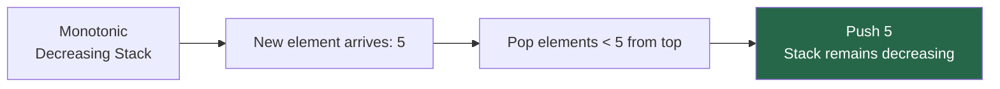
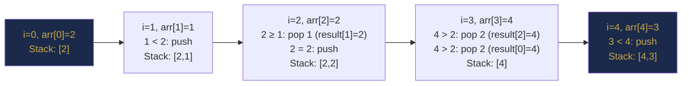

# Chapter 23 — Stacks and Their Applications

> **Part VII — Stacks, Queues and Deques**  
> [← Part VI Review](part-06-review.md) · [← Index](../INDEX.md) · [→ Chapter 24](../INDEX.md#-chapter-24--queues-deques-and-circular-buffers)

---

## Learning Objectives

By the end of this chapter you will be able to:

- Implement a stack with both an array and a linked list, and use `ArrayDeque` correctly.
- Solve balanced parentheses and expression evaluation problems using a stack.
- Build and apply a **monotonic stack** to find next greater/smaller elements in O(n).
- Solve the Largest Rectangle in Histogram using a monotonic stack.

---

## Contents

- [23.1 Stack ADT](#231-stack-adt)
- [23.2 Array and Linked-List Implementations](#232-array-and-linked-list-implementations)
- [23.3 Java ArrayDeque as Stack](#233-java-arraydeque-as-stack)
- [23.4 Balanced Parentheses](#234-balanced-parentheses)
- [23.5 Expression Evaluation](#235-expression-evaluation)
- [23.6 Infix, Postfix and Prefix Notation](#236-infix-postfix-and-prefix-notation)
- [23.7 Monotonic Stack](#237-monotonic-stack)
- [23.8 Next Greater and Smaller Elements](#238-next-greater-and-smaller-elements)
- [23.9 Histogram and Contribution Problems](#239-histogram-and-contribution-problems)
- [Interview Insight](#interview-insight)
- [Quick Quiz](#quick-quiz)
- [23.10 Practice Problems](#2310-practice-problems)
- [23.11 Hard Problem Corner](#2311-hard-problem-corner)
- [Chapter Summary](#chapter-summary)

---

## 23.1 Stack ADT

A **stack** is a Last-In, First-Out (LIFO) collection. The last element pushed is the first element popped.

| Operation | Description | Complexity |
|-----------|-------------|-----------|
| `push(e)` | Add element to top | O(1) |
| `pop()` | Remove and return top element | O(1) |
| `peek()` | Return top element without removing | O(1) |
| `isEmpty()` | True if stack has no elements | O(1) |
| `size()` | Number of elements | O(1) |

*Table 23.1: Stack ADT operations.*

---

> [!NOTE]
> **Historical Context**  
> The stack was formalised as a computer science concept by **Friedrich L. Bauer** and **Klaus Samelson** at the Technical University of Munich in **1955–1957**, who filed a patent for a "stack machine" CPU architecture in 1957. The concept was independently described by **Charles Leonard Hamblin** in his 1957 PhD thesis, which also introduced **Reverse Polish Notation (RPN)** as a stack-based expression format. RPN itself was first invented by the logician **Jan Łukasiewicz** in **1920** (in prefix form — hence "Polish Notation"). **Hewlett-Packard** adopted RPN for their calculators starting with the legendary **HP-35** in **1972**, the first scientific pocket calculator. HP engineers chose RPN because it eliminated parentheses and required fewer keystrokes. HP calculators used RPN as their primary interface until **2013**, creating a devoted user base that still prefers it today.

---

> ### 🔗 Analogy
> **A stack of plates.**
>
> You can only add a plate to the top, and you can only take a plate from the top. You cannot access a plate in the middle without first removing all plates above it. This restriction — only operating on the most recently added item — is exactly what makes stacks powerful: they preserve state in reverse-chronological order.

---

## 23.2 Array and Linked-List Implementations

### Array-based Stack

```java
class ArrayStack {
    private int[] data;
    private int top = -1;

    ArrayStack(int capacity) { data = new int[capacity]; }

    void push(int val) {
        if (top == data.length - 1) throw new RuntimeException("Stack overflow");
        data[++top] = val;
    }

    int pop() {
        if (isEmpty()) throw new RuntimeException("Stack underflow");
        return data[top--];
    }

    int peek()     { return data[top]; }
    boolean isEmpty() { return top == -1; }
    int size()     { return top + 1; }
}
```

**Properties:** O(1) push/pop, O(1) space overhead per element, excellent cache locality.

### Linked-List-based Stack

```java
class LinkedStack {
    private ListNode top;
    private int size;

    void push(int val) { top = new ListNode(val, top); size++; }
    int pop()          { int v = top.val; top = top.next; size--; return v; }
    int peek()         { return top.val; }
    boolean isEmpty()  { return top == null; }
    int size()         { return size; }
}
```

**Properties:** O(1) push/pop, unbounded (no capacity limit), but pointer overhead per element and poor cache locality.

---

## 23.3 Java ArrayDeque as Stack

**Never use `java.util.Stack`.** It extends `Vector` (synchronized), making every operation unnecessarily slow. Use `ArrayDeque<E>` instead:

```java
Deque<Integer> stack = new ArrayDeque<>();

stack.push(10);       // addFirst — push to top
stack.push(20);
stack.push(30);

stack.peek();         // 30 — view top without removing
stack.pop();          // 30 — remove top
stack.isEmpty();      // false
stack.size();         // 2
```

`ArrayDeque` is backed by a circular resizable array. `push` / `pop` are amortised O(1). It is the standard Java stack implementation.

> [!TIP]
> **Did You Know?**  
> Every time a function calls another function in any programming language, the CPU pushes a **stack frame** onto the hardware **call stack** — a physical register-based stack built into the CPU architecture. Each frame contains the return address, local variables, and parameters. This is why deeply recursive programs cause a **"StackOverflowError"**: the call stack has a fixed memory limit (typically 512KB–1MB per thread in Java) and physically overflows when too many frames are pushed. The JVM's default thread stack can hold roughly 5,000–10,000 recursive calls before overflow. **Tail-call optimisation** (available in some languages like Haskell and Scala, but *not* in Java) reuses the current frame for the recursive call, turning recursion into iteration at the hardware level.

---

## 23.4 Balanced Parentheses

**Problem:** Given a string of `(`, `)`, `[`, `]`, `{`, `}`, determine if the parentheses are balanced.

**Algorithm:** Push opening brackets. When a closing bracket is seen, check if it matches the top of the stack.

```java
boolean isValid(String s) {
    Deque<Character> stack = new ArrayDeque<>();
    for (char c : s.toCharArray()) {
        if      (c == '(' || c == '[' || c == '{') stack.push(c);
        else if (c == ')') { if (stack.isEmpty() || stack.pop() != '(') return false; }
        else if (c == ']') { if (stack.isEmpty() || stack.pop() != '[') return false; }
        else if (c == '}') { if (stack.isEmpty() || stack.pop() != '{') return false; }
    }
    return stack.isEmpty();   // balanced iff all opened brackets were closed
}
```

**Complexity:** O(n) time, O(n) space.

**Classic extension — Minimum Add to Make Valid:** Count unmatched `(` and `)`:

```java
int minAddToMakeValid(String s) {
    int open = 0, close = 0;
    for (char c : s.toCharArray()) {
        if (c == '(') open++;
        else if (open > 0) open--;   // matched a '('
        else close++;                // unmatched ')'
    }
    return open + close;
}
```

---

## 23.5 Expression Evaluation

### Evaluate Reverse Polish Notation (Postfix)

In **postfix** (Reverse Polish Notation, RPN), operators follow operands: `3 4 + 5 *` means `(3 + 4) * 5 = 35`.

**Algorithm:** Push operands. When an operator is seen, pop two operands, apply the operator, push the result.

```java
int evalRPN(String[] tokens) {
    Deque<Integer> stack = new ArrayDeque<>();
    for (String token : tokens) {
        switch (token) {
            case "+": stack.push(stack.pop() + stack.pop()); break;
            case "-": { int b = stack.pop(), a = stack.pop(); stack.push(a - b); } break;
            case "*": stack.push(stack.pop() * stack.pop()); break;
            case "/": { int b = stack.pop(), a = stack.pop(); stack.push(a / b); } break;
            default:  stack.push(Integer.parseInt(token));
        }
    }
    return stack.pop();
}
```

> [!WARNING]
> For non-commutative operators (`-`, `/`), operand order matters: `a - b` where `a` was pushed **before** `b`. Pop `b` first (it's on top), then pop `a`.

---

## 23.6 Infix, Postfix and Prefix Notation

| Notation | Example | Used by |
|----------|---------|---------|
| **Infix** | `(3 + 4) * 5` | Humans |
| **Postfix (RPN)** | `3 4 + 5 *` | Stack evaluators, calculators |
| **Prefix (Polish)** | `* + 3 4 5` | LISP, some parsers |

*Table 23.2: Expression notation comparison.*

**Shunting-Yard Algorithm** converts infix to postfix using two stacks (or one stack + output queue). It respects precedence and associativity without parentheses in the output.

```java
String toPostfix(String[] tokens) {
    Deque<String> opStack = new ArrayDeque<>();
    List<String> output = new ArrayList<>();
    Map<String, Integer> prec = Map.of("+", 1, "-", 1, "*", 2, "/", 2);

    for (String token : tokens) {
        if (token.matches("-?\\d+")) {
            output.add(token);                             // operand → output
        } else if (prec.containsKey(token)) {
            while (!opStack.isEmpty() && prec.containsKey(opStack.peek())
                   && prec.get(opStack.peek()) >= prec.get(token))
                output.add(opStack.pop());                 // pop higher/equal precedence
            opStack.push(token);
        } else if (token.equals("(")) {
            opStack.push(token);
        } else if (token.equals(")")) {
            while (!opStack.peek().equals("(")) output.add(opStack.pop());
            opStack.pop();                                 // discard '('
        }
    }
    while (!opStack.isEmpty()) output.add(opStack.pop());
    return String.join(" ", output);
}
```

---

## 23.7 Monotonic Stack

A **monotonic stack** maintains its elements in a strictly increasing or decreasing order (of values) from bottom to top. When a new element violates the order, elements are popped until the order is restored.



**Core insight:** Each element is pushed exactly once and popped at most once → O(n) total.



*Monotonic decreasing stack trace on `[2,1,2,4,3]`. Each pop records a "next greater" answer.*

**Template (monotonic decreasing — pop smaller elements):**

```java
void monotonicDecreasing(int[] arr) {
    Deque<Integer> stack = new ArrayDeque<>();   // stores indices
    for (int i = 0; i < arr.length; i++) {
        while (!stack.isEmpty() && arr[stack.peek()] < arr[i]) {
            int poppedIdx = stack.pop();
            // arr[poppedIdx]'s "next greater" is arr[i]
            processAnswer(poppedIdx, i);
        }
        stack.push(i);
    }
    // Remaining indices in stack have no next greater element
}
```

**What to store in the stack:** Always store **indices** (not values) so you can compute distances and retrieve values. `arr[stack.peek()]` gives the value.

---

## 23.8 Next Greater and Smaller Elements

### Next Greater Element (monotonic decreasing stack)

```java
int[] nextGreater(int[] nums) {
    int n = nums.length;
    int[] result = new int[n];
    Arrays.fill(result, -1);         // default: no next greater
    Deque<Integer> stack = new ArrayDeque<>();

    for (int i = 0; i < n; i++) {
        while (!stack.isEmpty() && nums[stack.peek()] < nums[i]) {
            result[stack.pop()] = nums[i];  // nums[i] is the next greater
        }
        stack.push(i);
    }
    return result;
}
```

**Dry run on `[2, 1, 2, 4, 3]`:**

| i | nums[i] | stack (indices) | Action |
|---|---------|-----------------|--------|
| 0 | 2 | [0] | push 0 |
| 1 | 1 | [0, 1] | push 1 (1 < 2 at top) |
| 2 | 2 | [0] | pop 1 (result[1]=2), 2=2 at top (no pop), push 2 |
| 3 | 4 | [] | pop 2 (result[2]=4), pop 0 (result[0]=4), push 3 |
| 4 | 3 | [3, 4] | 3 < 4 at top, push 4 |

Result: `[4, 2, 4, -1, -1]` ✓

*Table 23.3: Next Greater Element trace.*

### Next Smaller Element (monotonic increasing stack)

Flip the comparison: pop when `nums[stack.peek()] > nums[i]`.

```java
int[] nextSmaller(int[] nums) {
    int n = nums.length;
    int[] result = new int[n];
    Arrays.fill(result, -1);
    Deque<Integer> stack = new ArrayDeque<>();

    for (int i = 0; i < n; i++) {
        while (!stack.isEmpty() && nums[stack.peek()] > nums[i]) {
            result[stack.pop()] = nums[i];
        }
        stack.push(i);
    }
    return result;
}
```

### Previous Greater / Previous Smaller

Scan **right to left** (reverse the loop direction) with the same stack conditions.

---

## 23.9 Histogram and Contribution Problems

### Largest Rectangle in Histogram

**Problem:** Given `heights = [2, 1, 5, 6, 2, 3]`, find the area of the largest rectangle that fits within the histogram bars.

**Insight:** For each bar `i`, the largest rectangle with height `heights[i]` extends left until a shorter bar and right until a shorter bar. The boundaries are exactly the positions of the previous smaller and next smaller elements.

```java
int largestRectangleArea(int[] heights) {
    int n = heights.length, maxArea = 0;
    Deque<Integer> stack = new ArrayDeque<>();   // monotonic increasing

    for (int i = 0; i <= n; i++) {
        int h = (i == n) ? 0 : heights[i];       // sentinel 0 flushes remaining stack
        while (!stack.isEmpty() && heights[stack.peek()] > h) {
            int height = heights[stack.pop()];
            int width = stack.isEmpty() ? i : i - stack.peek() - 1;
            maxArea = Math.max(maxArea, height * width);
        }
        stack.push(i);
    }
    return maxArea;
}
```

**Dry run on `[2, 1, 5, 6, 2, 3]`:** Maximum area = `10` (height=2, width=5 from bars 1–5, or height=5, width=2 from bars 2–3: 5×2=10 or 6×1=6). Answer: **10** ✓

**Complexity:** O(n) — each index is pushed and popped at most once.

### Trapping Rain Water (Stack Approach)

```java
int trap(int[] height) {
    int water = 0;
    Deque<Integer> stack = new ArrayDeque<>();

    for (int i = 0; i < height.length; i++) {
        while (!stack.isEmpty() && height[stack.peek()] < height[i]) {
            int bottom = stack.pop();
            if (stack.isEmpty()) break;
            int left = stack.peek();
            int h = Math.min(height[left], height[i]) - height[bottom];
            water += h * (i - left - 1);
        }
        stack.push(i);
    }
    return water;
}
```

---

## Interview Insight

> ### 🎯 Interview Insight
> **Recognising Monotonic Stack Problems**
>
> The monotonic stack pattern applies whenever the problem asks: *"For each element, find the nearest element that is greater/smaller in some direction."* Signal phrases:
>
> - *"Next greater element"* → monotonic decreasing stack, pop when new element is larger.
> - *"Previous smaller element"* → monotonic increasing stack, scan left to right, pop when smaller seen.
> - *"Span of a stock price"* → find previous greater day → monotonic decreasing stack.
> - *"Largest rectangle"* / *"Trap rainwater"* → find previous and next smaller → monotonic increasing stack.
>
> **The two-pointer question:** Can you tell immediately whether a monotonic stack or two-pointer applies? Two pointers work when you can reason about the ends moving inward. Monotonic stacks work when you need to find the nearest boundary for each element independently.

---

## Quick Quiz

**Q1.** Why should `Stack<E>` (java.util.Stack) be avoided?

<details><summary><strong>Answer</strong></summary>

> `Stack` extends `Vector`, which is a synchronized `ArrayList`. Every `push`, `pop`, and `peek` acquires a lock — even in single-threaded code. `ArrayDeque` has the same interface, is unsynchronized, and is significantly faster. Additionally, `Stack` exposes `get(i)` from `Vector`, violating the stack abstraction.

</details>

---

**Q2.** For `evalRPN(["3", "4", "-"])`, why must you pop `b` before `a`?

<details><summary><strong>Answer</strong></summary>

> `3` is pushed first, `4` second. After two pushes, the stack (top to bottom) is `[4, 3]`. Popping once gives `b = 4`, popping again gives `a = 3`. The expression is `a - b = 3 - 4 = -1`, not `4 - 3 = 1`. Order matters for subtraction and division.

</details>

---

**Q3.** Why does the histogram solution pass `0` as a sentinel at `i == n`?

<details><summary><strong>Answer</strong></summary>

> After processing all bars, some indices remain on the stack (bars with no smaller bar to their right). The sentinel height 0 is smaller than any real bar, triggering the while loop to pop and process all remaining bars. Without the sentinel, the loop would end with unprocessed bars on the stack.

</details>

---

## 23.10 Practice Problems

| Problem | Name | Difficulty | Pattern |
|---------|------|------------|---------|
| [LC 20](https://leetcode.com/problems/valid-parentheses/) | Valid Parentheses | Easy | Bracket matching |
| [LC 150](https://leetcode.com/problems/evaluate-reverse-polish-notation/) | Evaluate Reverse Polish Notation | Medium | Postfix evaluation |
| [LC 739](https://leetcode.com/problems/daily-temperatures/) | Daily Temperatures | Medium | Monotonic decreasing |
| [LC 496](https://leetcode.com/problems/next-greater-element-i/) | Next Greater Element I | Easy | Monotonic decreasing |
| [LC 503](https://leetcode.com/problems/next-greater-element-ii/) | Next Greater Element II | Medium | Circular array + monotonic |
| [LC 84](https://leetcode.com/problems/largest-rectangle-in-histogram/) | Largest Rectangle in Histogram | Hard | Monotonic increasing |
| [LC 42](https://leetcode.com/problems/trapping-rain-water/) | Trapping Rain Water | Hard | Monotonic stack or two pointers |
| [LC 85](https://leetcode.com/problems/maximal-rectangle/) | Maximal Rectangle | Hard | Histogram per row |
| [LC 907](https://leetcode.com/problems/sum-of-subarray-minimums/) | Sum of Subarray Minimums | Medium | Monotonic + contribution |

---

## 23.11 Hard Problem Corner

> ### 🔥 Hard Problem Corner
>
> **Problem: Sum of Subarray Minimums** ([LC 907](https://leetcode.com/problems/sum-of-subarray-minimums/))
>
> For every subarray of `arr`, sum all their minimums.
>
> **Key insight:** Instead of enumerating all O(n²) subarrays, for each element `arr[i]`, count how many subarrays have `arr[i]` as their minimum. This is the number of subarrays where `arr[i]` is the smallest → bounded by its previous smaller element (left boundary) and next smaller or equal (right boundary).

<details><summary><strong>Solution sketch (click to reveal)</strong></summary>

> [!TIP]
> ```java
> int sumSubarrayMins(int[] arr) {
>     long result = 0;
>     int n = arr.length;
>     int MOD = 1_000_000_007;
>     int[] left = new int[n], right = new int[n];
>
>     // For each i: left[i] = distance to previous smaller (exclusive)
>     Deque<Integer> stack = new ArrayDeque<>();
>     for (int i = 0; i < n; i++) {
>         while (!stack.isEmpty() && arr[stack.peek()] >= arr[i]) stack.pop();
>         left[i] = stack.isEmpty() ? i + 1 : i - stack.peek();
>         stack.push(i);
>     }
>     stack.clear();
>     // right[i] = distance to next smaller or equal (exclusive)
>     for (int i = n - 1; i >= 0; i--) {
>         while (!stack.isEmpty() && arr[stack.peek()] > arr[i]) stack.pop();
>         right[i] = stack.isEmpty() ? n - i : stack.peek() - i;
>         stack.push(i);
>     }
>
>     for (int i = 0; i < n; i++) {
>         result = (result + (long) arr[i] * left[i] * right[i]) % MOD;
>     }
>     return (int) result;
> }
> ```
>
> **Why `>=` on left and `>` on right:** To avoid double-counting subarrays where two equal minimums exist. The left boundary uses strict exclusion for equals; the right uses inclusive.  
> **Complexity:** O(n) — two monotonic stack passes.

</details>

---

## Chapter Summary

| Concept | Key Takeaway |
|---------|-------------|
| **Stack ADT** | LIFO. push/pop/peek all O(1). |
| **Java Stack** | Use `ArrayDeque`, never `java.util.Stack` (synchronized, slow). |
| **Balanced parens** | Push open brackets; pop and match on closing. Stack empty at end = balanced. |
| **Postfix evaluation** | Push operands; on operator, pop two, apply, push result. Order matters for `-` and `/`. |
| **Monotonic stack** | O(n) for all nearest-boundary problems. Store indices, not values. Each element pushed/popped once. |
| **Decreasing stack** | Pop smaller elements → "next greater" for each popped. |
| **Increasing stack** | Pop larger elements → "next smaller" for each popped. |
| **Histogram** | Monotonic increasing + sentinel 0. Width = `i - stack.peek() - 1` after pop. |

*Table 23.4: Chapter 23 key concepts.*

---

> **Part VII — Stacks, Queues and Deques**  
> [← Part VI Review](part-06-review.md) · [← Index](../INDEX.md) · [→ Chapter 24 (planned)](../INDEX.md#-chapter-24--queues-deques-and-circular-buffers)
