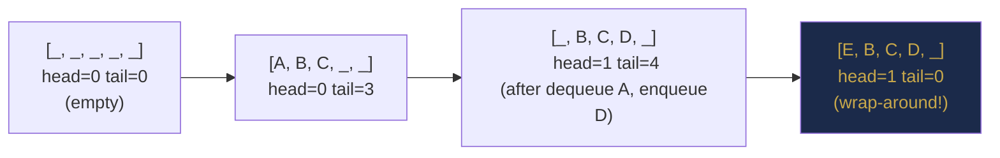
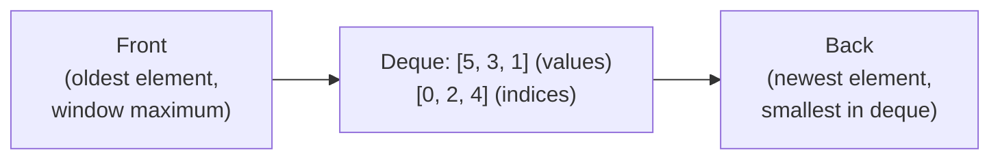
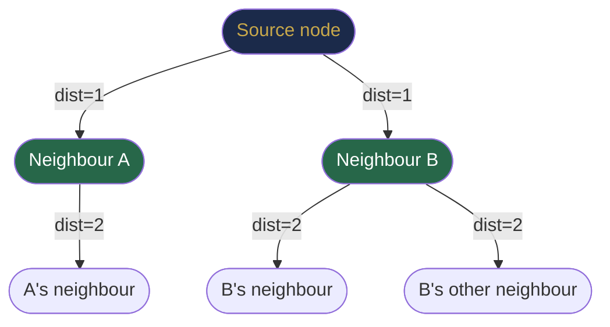

# Chapter 24 — Queues, Deques and Circular Buffers

> **Part VII — Stacks, Queues and Deques**  
> [← Chapter 23](chapter-23-stacks.md) · [← Index](../INDEX.md) · [→ Part VII Review](part-07-review.md)

---

## Learning Objectives

By the end of this chapter you will be able to:

- Implement a queue with a circular array and with a linked list.
- Use `ArrayDeque<E>` correctly as both a queue and a deque.
- Build a **monotonic deque** to answer sliding window maximum queries in O(n).
- Design a circular buffer (ring buffer) with correct wrap-around logic.
- Explain how BFS uses a queue and what FIFO ordering guarantees.

---

## Contents

- [24.1 Queue ADT](#241-queue-adt)
- [24.2 Queue Implementations](#242-queue-implementations)
- [24.3 Circular Queues](#243-circular-queues)
- [24.4 Deques](#244-deques)
- [24.5 Java ArrayDeque as Queue and Deque](#245-java-arraydeque-as-queue-and-deque)
- [24.6 Monotonic Queue](#246-monotonic-queue)
- [24.7 Sliding Window Maximum](#247-sliding-window-maximum)
- [24.8 BFS Applications](#248-bfs-applications)
- [24.9 Queue Design Problems](#249-queue-design-problems)
- [Interview Insight](#interview-insight)
- [Quick Quiz](#quick-quiz)
- [24.10 Practice Problems](#2410-practice-problems)
- [24.11 Hard Problem Corner](#2411-hard-problem-corner)
- [Chapter Summary](#chapter-summary)

---

## 24.1 Queue ADT

A **queue** is a First-In, First-Out (FIFO) collection. The first element added is the first element removed.

| Operation | Description | Complexity |
|-----------|-------------|-----------|
| `enqueue(e)` / `offer(e)` | Add to the back (tail) | O(1) |
| `dequeue()` / `poll()` | Remove from the front (head) | O(1) |
| `peek()` / `front()` | View front without removing | O(1) |
| `isEmpty()` | True if no elements | O(1) |
| `size()` | Number of elements | O(1) |

*Table 24.1: Queue ADT operations.*

---

> [!NOTE]
> **Historical Context**  
> The queue as an algorithmic concept is inseparable from **Breadth-First Search (BFS)**. BFS was first described by **Konrad Zuse** in his **1945** manuscript *Plankalkül* (not published until 1972). It was independently rediscovered by **Edward F. Moore** in **1959** for solving mazes, and by **C. Y. Lee** in **1961** for routing circuits on printed circuit boards. The FIFO queue as a data structure was formalised alongside early OS job schedulers: **IBM's OS/360** (1964) used FIFO queues for batch job processing. The deque (double-ended queue) was described by **E. J. Dijkstra** and colleagues in the early 1960s while designing efficient process scheduling algorithms. Modern hardware CPUs also use queues internally — out-of-order execution engines maintain instruction queues and reorder buffers that are conceptually FIFO structures.

---

> ### 🔗 Analogy
> **A checkout line at a grocery store.**
>
> Customers join at the back and are served from the front. FIFO is the fair and natural ordering for processing requests in arrival order. This is why operating system schedulers, network packet queues, and BFS all use queues.

---

## 24.2 Queue Implementations

### Linked-List Queue

```java
class LinkedQueue {
    private ListNode head, tail;
    private int size;

    void enqueue(int val) {
        ListNode node = new ListNode(val);
        if (tail == null) { head = tail = node; }
        else              { tail.next = node; tail = node; }
        size++;
    }

    int dequeue() {
        int val = head.val;
        head = head.next;
        if (head == null) tail = null;
        size--;
        return val;
    }

    int peek()    { return head.val; }
    boolean isEmpty() { return head == null; }
    int size()    { return size; }
}
```

**Properties:** Unbounded, O(1) enqueue and dequeue. Pointer overhead per element.

---

## 24.3 Circular Queues

A **circular queue** (ring buffer) uses an array with two pointers (`head` and `tail`) that wrap around. This avoids the "shift everything left" cost of a naïve array queue and uses fixed memory.

```java
class CircularQueue {
    private int[] data;
    private int head, tail, size, capacity;

    CircularQueue(int capacity) {
        this.capacity = capacity;
        data = new int[capacity];
    }

    boolean offer(int val) {
        if (size == capacity) return false;         // full
        data[tail] = val;
        tail = (tail + 1) % capacity;               // wrap around
        size++;
        return true;
    }

    int poll() {
        int val = data[head];
        head = (head + 1) % capacity;               // wrap around
        size--;
        return val;
    }

    int peek()       { return data[head]; }
    boolean isEmpty(){ return size == 0; }
    boolean isFull() { return size == capacity; }
    int size()       { return size; }
}
```

**The modulo wrap-around trick:** `(index + 1) % capacity` turns any index into the next valid index in the circular array. `tail` always points to the next empty slot.



> [!TIP]
> **Did You Know?**  
> The circular buffer (ring buffer) is one of the most heavily used data structures in systems programming. It is the foundation of **OS kernel I/O buffers** (the kernel maintains a circular buffer for each file descriptor), **network packet buffers** (NIC drivers use ring buffers for DMA transfers), **audio/video streaming** (continuous streams cannot afford allocating new memory for each frame), and **producer–consumer queues** in multi-threaded systems. The Linux kernel's `kfifo` and `io_uring` are both ring-buffer based. Because the circular buffer has fixed memory and O(1) enqueue/dequeue with no allocation, it is the preferred queue in every latency-sensitive system.

---

## 24.4 Deques

A **deque** (double-ended queue, pronounced "deck") supports insertion and removal at both ends in O(1). It generalises both stacks and queues.

| Operation | Description |
|-----------|-------------|
| `addFirst(e)` / `offerFirst(e)` | Insert at front |
| `addLast(e)` / `offerLast(e)` | Insert at back |
| `removeFirst()` / `pollFirst()` | Remove from front |
| `removeLast()` / `pollLast()` | Remove from back |
| `peekFirst()` | View front |
| `peekLast()` | View back |

*Table 24.2: Deque operations.*

**Uses of deque:**
- Stack: use only `addFirst`/`removeFirst`.
- Queue: use `addLast`/`removeFirst`.
- Palindrome check: add from both ends and compare.
- Monotonic deque (sliding window): add at back, remove from both ends.

---

## 24.5 Java ArrayDeque as Queue and Deque

`ArrayDeque<E>` is Java's standard deque implementation — a resizable circular array. It is the preferred implementation for both stacks and queues.

```java
// As a Queue (FIFO)
Deque<Integer> queue = new ArrayDeque<>();
queue.offer(1);         // addLast — enqueue at back
queue.offer(2);
queue.offer(3);
queue.poll();           // 1 — removeFirst: dequeue from front
queue.peek();           // 2 — peekFirst: view front

// As a Stack (LIFO)
Deque<Integer> stack = new ArrayDeque<>();
stack.push(1);          // addFirst
stack.push(2);
stack.pop();            // 2 — removeFirst
stack.peek();           // 1

// As a Deque (both ends)
Deque<Integer> deque = new ArrayDeque<>();
deque.addFirst(5);
deque.addLast(10);
deque.peekFirst();      // 5
deque.peekLast();       // 10
deque.pollLast();       // 10 — remove from back
```

**Method naming guide:**

| Action | Throws exception | Returns null/false |
|--------|-----------------|-------------------|
| Add front | `addFirst(e)` | `offerFirst(e)` |
| Add back | `addLast(e)` | `offerLast(e)` |
| Remove front | `removeFirst()` | `pollFirst()` |
| Remove back | `removeLast()` | `pollLast()` |
| View front | `getFirst()` | `peekFirst()` |
| View back | `getLast()` | `peekLast()` |

*Table 24.3: ArrayDeque method reference.*

**Prefer `offer`/`poll`/`peek`** over `add`/`remove`/`get` in algorithm code — they return null/false on failure instead of throwing exceptions, which simplifies boundary condition handling.

---

## 24.6 Monotonic Queue

A **monotonic queue** (monotonic deque) maintains elements in monotonically decreasing (or increasing) order. Unlike the monotonic stack, elements are removed from the **front** when they fall outside the window, and from the **back** when a new element violates the monotonic order.

**Core invariant for maximum query:** The front of the deque always holds the index of the maximum element in the current window.



**Two invariants to maintain:**
1. **Stale elements:** If `deque.peekFirst()` is outside the current window, `pollFirst()`.
2. **Useless elements:** When adding index `i`, `pollLast()` while `arr[deque.peekLast()] ≤ arr[i]` (they can never be the maximum while `i` is in the window).

---

## 24.7 Sliding Window Maximum

**Problem:** Given array `nums` and window size `k`, return the maximum for each window position.

```java
int[] slidingWindowMax(int[] nums, int k) {
    int n = nums.length;
    int[] result = new int[n - k + 1];
    Deque<Integer> dq = new ArrayDeque<>();  // stores indices

    for (int i = 0; i < n; i++) {
        // 1. Remove indices outside the window from front
        while (!dq.isEmpty() && dq.peekFirst() <= i - k) dq.pollFirst();

        // 2. Remove indices whose values are ≤ nums[i] from back (they are useless)
        while (!dq.isEmpty() && nums[dq.peekLast()] <= nums[i]) dq.pollLast();

        dq.offerLast(i);

        // 3. Record answer when window is full
        if (i >= k - 1) result[i - k + 1] = nums[dq.peekFirst()];
    }
    return result;
}
```

**Dry run on `nums = [1, 3, -1, -3, 5, 3, 6, 7]`, k = 3`:**

| i | nums[i] | Deque (indices) | Window max |
|---|---------|-----------------|-----------|
| 0 | 1 | [0] | — |
| 1 | 3 | [1] | — (3 > 1, pop 0) |
| 2 | -1 | [1, 2] | **3** |
| 3 | -3 | [1, 2, 3] | **3** |
| 4 | 5 | [4] | **5** (1 leaves, 3 and -1 and -3 all ≤ 5, pop all) |
| 5 | 3 | [4, 5] | **5** |
| 6 | 6 | [6] | **6** (4 leaves window, 5 ≤ 6 pop, 3 ≤ 6 pop) |
| 7 | 7 | [7] | **7** |

Result: `[3, 3, 5, 5, 6, 7]` ✓

*Table 24.4: Sliding window maximum trace.*

**Complexity:** O(n) — each index is added and removed at most once.

---

## 24.8 BFS Applications

Queues are the backbone of **Breadth-First Search (BFS)**, which explores nodes level by level (closest to farthest from the source). BFS is covered in depth in the graph chapters (Part IX); here is the queue-centric view:

```java
// BFS template — works for trees, graphs, grids
void bfs(Node start) {
    Queue<Node> queue = new ArrayDeque<>();
    Set<Node> visited = new HashSet<>();
    queue.offer(start);
    visited.add(start);

    while (!queue.isEmpty()) {
        int levelSize = queue.size();              // number of nodes at current level
        for (int i = 0; i < levelSize; i++) {
            Node curr = queue.poll();
            process(curr);
            for (Node neighbor : curr.neighbors()) {
                if (!visited.contains(neighbor)) {
                    visited.add(neighbor);
                    queue.offer(neighbor);
                }
            }
        }
    }
}
```



*BFS processes all dist=1 nodes before any dist=2 node — guaranteed by the FIFO queue.*

**Why FIFO guarantees shortest path:** BFS processes nodes in non-decreasing order of their distance from the source. The first time a node is dequeued, it is reached by the shortest path (fewest edges). No node is processed at distance `d+1` before all nodes at distance `d` are processed.

---

## 24.9 Queue Design Problems

### Design Hit Counter

```java
class HitCounter {
    private Deque<Integer> hits = new ArrayDeque<>();

    void hit(int timestamp) { hits.offer(timestamp); }

    int getHits(int timestamp) {
        while (!hits.isEmpty() && hits.peek() <= timestamp - 300)
            hits.poll();    // remove hits older than 300 seconds
        return hits.size();
    }
}
```

### Implement Queue Using Two Stacks

```java
class MyQueue {
    private Deque<Integer> inbox = new ArrayDeque<>();
    private Deque<Integer> outbox = new ArrayDeque<>();

    void push(int x) { inbox.push(x); }

    int pop() {
        transfer();
        return outbox.pop();
    }

    int peek() {
        transfer();
        return outbox.peek();
    }

    boolean empty() { return inbox.isEmpty() && outbox.isEmpty(); }

    private void transfer() {
        if (outbox.isEmpty())
            while (!inbox.isEmpty()) outbox.push(inbox.pop());
    }
}
```

**Amortised analysis:** Each element is pushed to `inbox` once, transferred to `outbox` once, and popped from `outbox` once — total 3 operations per element → O(1) amortised per `push`/`pop`.

---

## Interview Insight

> ### 🎯 Interview Insight
> **Queue vs Stack Recognition**
>
> The choice between stack and queue is determined by whether you need **reversal** (stack) or **ordering-preservation** (queue).
>
> - *"Process in arrival order"* → Queue (BFS, event processing, sliding window).
> - *"Process most recent first"* → Stack (DFS, expression parsing, undo operations).
> - *"Need both"* → Deque (palindrome, sliding window max, monotonic problems).
>
> **The monotonic deque test:** If the problem involves a fixed-size window and you need the max or min in O(1) per step, reach for the monotonic deque immediately. `PriorityQueue` gives O(log n) per step — the deque is always better for this specific problem shape.

---

## Quick Quiz

**Q1.** In the circular queue, what is the wrap-around formula for advancing an index?

<details><summary><strong>Answer</strong></summary>

> `(index + 1) % capacity`. This turns index `capacity - 1` into `0`, wrapping around to the beginning of the array. The same formula applies to both `head` and `tail` pointers.

</details>

---

**Q2.** For the sliding window max deque, why do we store indices rather than values?

<details><summary><strong>Answer</strong></summary>

> Because we need to know **when an element's index falls outside the window** to remove it from the front. If we stored only values, we could not check `dq.peekFirst() <= i - k`. Storing indices also lets us retrieve values with `nums[dq.peekLast()]` while still doing the boundary check.

</details>

---

**Q3.** In the two-stack queue, what is the worst-case complexity of a single `pop()` call?

<details><summary><strong>Answer</strong></summary>

> O(n) in the worst case — when `outbox` is empty and all n elements need to be transferred from `inbox`. But the **amortised** complexity is O(1) per operation: each element is transferred at most once in its lifetime.

</details>

---

## 24.10 Practice Problems

| Problem | Name | Difficulty | Pattern |
|---------|------|------------|---------|
| [LC 232](https://leetcode.com/problems/implement-queue-using-stacks/) | Implement Queue Using Stacks | Easy | Two stacks |
| [LC 225](https://leetcode.com/problems/implement-stack-using-queues/) | Implement Stack Using Queues | Easy | Queue to stack |
| [LC 622](https://leetcode.com/problems/design-circular-queue/) | Design Circular Queue | Medium | Circular array |
| [LC 641](https://leetcode.com/problems/design-circular-deque/) | Design Circular Deque | Medium | Circular deque |
| [LC 239](https://leetcode.com/problems/sliding-window-maximum/) | Sliding Window Maximum | Hard | Monotonic deque |
| [LC 362](https://leetcode.com/problems/design-hit-counter/) | Design Hit Counter | Medium | Queue with timestamp |
| [LC 862](https://leetcode.com/problems/shortest-subarray-with-sum-at-least-k/) | Shortest Subarray with Sum ≥ K | Hard | Monotonic deque + prefix sum |
| [LC 1438](https://leetcode.com/problems/longest-continuous-subarray-with-absolute-diff-less-than-or-equal-to-limit/) | Longest Continuous Subarray | Medium | Two monotonic deques |

---

## 24.11 Hard Problem Corner

> ### 🔥 Hard Problem Corner
>
> **Problem: Shortest Subarray with Sum ≥ K** ([LC 862](https://leetcode.com/problems/shortest-subarray-with-sum-at-least-k/))
>
> Find the length of the shortest subarray with sum ≥ K. The array can contain **negative numbers** (ruling out the standard sliding window approach).
>
> **Key insight:** Compute prefix sums. For each index `j`, find the largest index `i < j` such that `prefix[j] - prefix[i] >= K` and `j - i` is minimised. Use a monotonic deque of increasing prefix sums to find valid `i` quickly.

<details><summary><strong>Solution sketch (click to reveal)</strong></summary>

> [!TIP]
> ```java
> int shortestSubarray(int[] nums, int k) {
>     int n = nums.length, result = Integer.MAX_VALUE;
>     long[] prefix = new long[n + 1];
>     for (int i = 0; i < n; i++) prefix[i + 1] = prefix[i] + nums[i];
>
>     Deque<Integer> dq = new ArrayDeque<>();  // monotonic increasing prefix indices
>     for (int j = 0; j <= n; j++) {
>         // Try to find valid left boundaries
>         while (!dq.isEmpty() && prefix[j] - prefix[dq.peekFirst()] >= k) {
>             result = Math.min(result, j - dq.pollFirst());
>         }
>         // Maintain monotonic increasing deque
>         while (!dq.isEmpty() && prefix[dq.peekLast()] >= prefix[j]) {
>             dq.pollLast();
>         }
>         dq.offerLast(j);
>     }
>     return result == Integer.MAX_VALUE ? -1 : result;
> }
> ```
>
> **Why monotonic:** If `prefix[i] >= prefix[i']` and `i < i'`, then `i` is strictly worse than `i'` as a left boundary for any future `j` — it gives both smaller sum and larger length. So we keep only strictly increasing prefix values. **Complexity:** O(n).

</details>

---

## Chapter Summary

| Concept | Key Takeaway |
|---------|-------------|
| **Queue ADT** | FIFO. offer/poll/peek all O(1). |
| **Circular queue** | Fixed-size array with `(index+1)%cap` wrap-around. head = front, tail = next slot. |
| **Deque** | Add/remove at both ends O(1). Generalises stack and queue. |
| **Java `ArrayDeque`** | Preferred for both stack and queue. Faster than `Stack`, faster than `LinkedList`. |
| **Monotonic deque** | O(n) sliding window max/min. Front = current max. Stale removal from front; useless removal from back. |
| **BFS** | FIFO guarantees level-by-level order = shortest path. Add start, loop: poll, process, enqueue neighbours. |
| **Two-stack queue** | O(1) amortised push/pop by lazy transfer. Demonstrates that the two ADTs are duals. |

*Table 24.5: Chapter 24 key concepts.*

---

> **Part VII — Stacks, Queues and Deques**  
> [← Chapter 23](chapter-23-stacks.md) · [← Index](../INDEX.md) · [→ Part VII Review](part-07-review.md)
