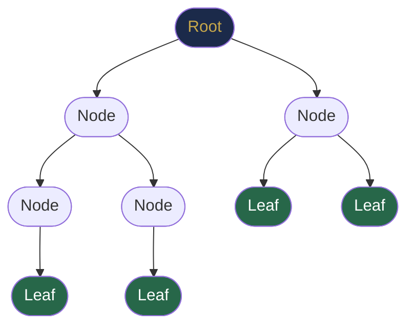
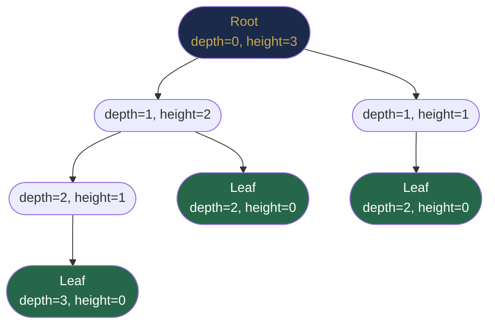

# Chapter 25 — Tree Fundamentals and Binary Trees

## Learning Objectives

By the end of this chapter, you will be able to:

- Define core tree terminology: root, leaf, parent, child, height, depth, degree, level
- Distinguish between full, complete, perfect, and balanced binary trees
- Implement a binary tree node and basic recursive operations in Java
- Apply the "trust the recursion" principle to solve tree problems
- Explain why trees are the natural data structure for hierarchical relationships

---

## Contents

- [25.1 What Is a Tree?](#251-what-is-a-tree)
- [25.2 Tree Terminology](#252-tree-terminology)
- [25.3 Why Trees?](#253-why-trees)
- [25.4 Binary Trees](#254-binary-trees)
- [25.5 Tree Classification](#255-tree-classification)
- [25.6 Java Implementation](#256-java-implementation)
- [25.7 Recursive Tree Structure](#257-recursive-tree-structure)
- [25.8 Basic Tree Operations](#258-basic-tree-operations)
- [25.9 Memory Representation](#259-memory-representation)
- [Interview Insight](#interview-insight)
- [Quick Quiz](#quick-quiz)
- [25.10 Practice Problems](#2510-practice-problems)
- [Chapter Summary](#chapter-summary)

---

> [!NOTE]
> **Historical Context**  
> Trees as mathematical objects were first studied by **Arthur Cayley** in **1857**, who counted the number of distinct labelled trees on $n$ vertices (Cayley's formula: $n^{n-2}$). In computer science, trees entered through **game trees** (Claude Shannon, 1950), **expression trees** in early compilers (1950s), and **decision trees** in AI (Quinlan, 1986). The term "binary tree" was popularised by **Donald Knuth** in *The Art of Computer Programming, Vol. 1* (1968). Today trees underlie file systems, databases, compilers, network routing, compression (Huffman coding), and machine learning — making them the most ubiquitous non-linear data structure in computing.

---

> ### 🔗 Analogy
> **A Corporate Hierarchy**
>
> Every company has a CEO at the top (root). The CEO has VPs (children). Each VP manages directors. Each director manages individual contributors (leaves). This is a tree: exactly one chain of command traces from any employee up to the CEO, there are no circular management loops, and clear levels separate strategy from execution. Trees model *any* situation where things are categorised into levels of decreasing specificity — from folders on a hard drive to biological taxonomy (Kingdom → Phylum → Class → Order → Family → Genus → Species).

---

## 25.1 What Is a Tree?

A **tree** is a hierarchical, connected, acyclic data structure built from **nodes** connected by **edges**.

**Formal definition:** A tree with $n$ nodes is a connected graph with exactly $n - 1$ edges (and no cycles).

**Three defining properties:**
1. Exactly **one root** — the unique node with no parent
2. Every non-root node has **exactly one parent**
3. **No cycles** — following edges never returns to a visited node



**Key fact:** A tree with $n$ nodes has exactly $n - 1$ edges. Each non-root node contributes exactly one edge to its parent — the root contributes zero.

---

## 25.2 Tree Terminology

| Term | Definition |
|------|------------|
| **Root** | The unique node with no parent |
| **Leaf** | A node with no children |
| **Parent** | The node directly above a given node |
| **Child** | A node directly below a given node |
| **Sibling** | Nodes that share the same parent |
| **Ancestor** | Any node on the path from root to a node (inclusive) |
| **Descendant** | Any node reachable by following edges downward |
| **Subtree** | A node and all its descendants |
| **Edge** | A connection between a parent and a child |
| **Depth** | Length of path from root to a node (root depth = 0) |
| **Height of node** | Longest downward path from node to a leaf (leaf height = 0) |
| **Height of tree** | Height of the root |
| **Level** | Depth + 1 (root is level 1) |
| **Degree** | Number of children of a node |
| **Path** | Unique sequence of edges connecting two nodes |



**Height formula:** `height(node) = 0` if leaf; `height(node) = 1 + max(height(left), height(right))` otherwise.

**Nodes at level $l$** in a perfect binary tree: $2^{l-1}$.

---

## 25.3 Why Trees?

Trees solve a fundamental problem: **how do you organise hierarchical information with efficient lookup, insertion, and ordering?** An array requires O(n) for insertion; a hash table loses ordering; a linked list lacks hierarchy. Trees combine structure with efficiency.

| Real-World Use Case | Tree Type | Benefit |
|--------------------|-----------|---------|
| File system directories | N-ary tree | Hierarchical nesting |
| HTML/XML Document Object Model | N-ary tree | Nested element structure |
| Compiler AST (parse tree) | Binary/N-ary | Encodes operator precedence structurally |
| Database primary index | B+ Tree | Range queries in O(log n) |
| Autocomplete / spell-check | Trie | Prefix queries in O(\|word\|) |
| Huffman data compression | Binary tree | Optimal prefix codes |
| Network routing tables | Radix tree | Longest-prefix IP match |
| Machine learning | Decision tree | Categorical branching logic |
| Priority scheduling | Binary heap | Min/max access in O(log n) |

> [!TIP]
> **Real-World Usage**  
> Every file you open on your computer is found through a tree. The DOM you manipulate with JavaScript is a tree. JSON and XML are textual encodings of trees. Git commit history is a **DAG** (directed acyclic graph — a tree generalisation) where each commit is a node pointing to its parent(s). When React reconciles UI updates, it diffs two **virtual DOM trees** using a tree-comparison algorithm. Trees are the most ubiquitous structure in production software — you interact with dozens of them every minute without realising it.

---

## 25.4 Binary Trees

A **binary tree** is a tree where every node has **at most two children**, explicitly named **left** and **right**.

```java
class TreeNode {
    int val;
    TreeNode left;
    TreeNode right;

    TreeNode(int val) { this.val = val; }
    TreeNode(int val, TreeNode left, TreeNode right) {
        this.val = val;
        this.left = left;
        this.right = right;
    }
}
```

**Why binary trees are special:**
- Left and right children are **distinct and ordered** — swapping them creates a different tree
- Most tree algorithms (BST, AVL, heap, Huffman) are binary
- The binary structure maps cleanly to recursive decomposition and array indexing

**Building a tree manually:**

```java
//       1
//      / \
//     2   3
//    / \
//   4   5

TreeNode root = new TreeNode(1,
    new TreeNode(2,
        new TreeNode(4),
        new TreeNode(5)),
    new TreeNode(3));
```

**Building from LeetCode-style level-order array:**

```java
TreeNode buildTree(Integer[] arr) {
    if (arr == null || arr.length == 0 || arr[0] == null) return null;
    TreeNode root = new TreeNode(arr[0]);
    Queue<TreeNode> q = new ArrayDeque<>();
    q.offer(root);
    int i = 1;
    while (i < arr.length) {
        TreeNode node = q.poll();
        if (i < arr.length && arr[i] != null) { node.left = new TreeNode(arr[i]); q.offer(node.left); }
        i++;
        if (i < arr.length && arr[i] != null) { node.right = new TreeNode(arr[i]); q.offer(node.right); }
        i++;
    }
    return root;
}
```

---

## 25.5 Tree Classification

### Full Binary Tree

Every node has **0 or 2 children** — never exactly 1.

```
      1
     / \
    2   3
   / \
  4   5
```

**Theorem:** A full binary tree with $k$ internal nodes has exactly $k + 1$ leaf nodes.

---

### Complete Binary Tree

All levels are fully filled **except possibly the last**, and the last level is filled **strictly left-to-right**.

```
      1
     / \
    2   3
   / \ /
  4  5 6
```

**Key property:** Height of a complete binary tree with $n$ nodes is $\lfloor \log_2 n \rfloor$.

**Why this matters:** Complete binary trees can be stored in arrays with **no wasted space** and **no pointers** (Section 25.9). This is the structure underlying **binary heaps** (Chapter 30).

---

### Perfect Binary Tree

All internal nodes have exactly 2 children and all leaves are at the **same depth**.

```
        1
       / \
      2   3
     / \ / \
    4  5 6  7
```

| Property | Formula |
|----------|---------|
| Leaves | $2^h$ |
| Total nodes | $2^{h+1} - 1$ |
| Internal nodes | $2^h - 1$ |
| Leaves = ½ total | Always true |

---

### Balanced Binary Tree

A tree where `|height(left) - height(right)| ≤ 1` for every node.

| Tree Type | Height Guarantee | Notes |
|-----------|-----------------|-------|
| Perfect binary | $\log_2 n$ exact | Theoretical ideal |
| Complete binary | $\lfloor \log_2 n \rfloor$ | Heaps |
| AVL tree | $1.44 \log_2 n$ | Strictly balanced |
| Red-Black tree | $2 \log_2 n$ | Java `TreeMap` |
| Sorted insertion BST | $O(n)$ worst | Degenerates to linked list |

*Table 25.1: Tree type height comparison.*

> [!TIP]
> **Did You Know?**  
> The worst case for an **unbalanced BST** — inserting elements in already-sorted order — produces a perfect linked list with O(n) search time. This was not just theoretical: before sorted-insertion defences, some production systems experienced database query times degrading from milliseconds to seconds when records were inserted in timestamp order. It took 7 extra years after BSTs were invented before **self-balancing trees** (AVL, 1962) solved this. Today every database index uses a balanced tree variant.

---

## 25.6 Java Implementation

### Generic Binary Tree Node

```java
class TreeNode<T extends Comparable<T>> {
    T val;
    TreeNode<T> left, right;
    TreeNode(T val) { this.val = val; }
}
```

### N-ary Tree Node

```java
class NaryNode {
    int val;
    List<NaryNode> children;
    NaryNode(int val) {
        this.val = val;
        this.children = new ArrayList<>();
    }
}
```

### Printing a Tree (Debug Helper)

```java
void printTree(TreeNode root, String prefix, boolean isLeft) {
    if (root == null) return;
    System.out.println(prefix + (isLeft ? "├── " : "└── ") + root.val);
    printTree(root.left,  prefix + (isLeft ? "│   " : "    "), true);
    printTree(root.right, prefix + (isLeft ? "│   " : "    "), false);
}
// Call: printTree(root, "", false)
```

---

## 25.7 Recursive Tree Structure

The most important insight in tree programming:

> **A binary tree is a node with a value, plus a left subtree, plus a right subtree.**

This decomposition makes recursion natural. Almost every tree problem follows:

```
solve(node) = combine(node.val, solve(node.left), solve(node.right))
```

**Three questions to answer for every recursive tree function:**
1. **Base case:** What do you return when `node == null`?
2. **Recursive case:** What do you do with `solve(node.left)` and `solve(node.right)`?
3. **Combination:** How does `node.val` factor in?

**Canonical examples:**

```java
// Count total nodes
int count(TreeNode root) {
    if (root == null) return 0;
    return 1 + count(root.left) + count(root.right);
}

// Tree height (height of null = -1)
int height(TreeNode root) {
    if (root == null) return -1;
    return 1 + Math.max(height(root.left), height(root.right));
}

// Sum of all node values
int sum(TreeNode root) {
    if (root == null) return 0;
    return root.val + sum(root.left) + sum(root.right);
}
```

> [!NOTE]
> **The "Trust the Recursion" Principle** (from Chapter 5)  
> Do not mentally trace the entire call tree. Trust that `solve(root.left)` returns the correct answer for the left subtree, and `solve(root.right)` for the right. Focus only on: what does the current node contribute? This is the same inductive mindset used in mathematical proofs: assume it works for $n - 1$, prove it works for $n$.

---

## 25.8 Basic Tree Operations

### Maximum Value

```java
int maxVal(TreeNode root) {
    if (root == null) return Integer.MIN_VALUE;
    return Math.max(root.val, Math.max(maxVal(root.left), maxVal(root.right)));
}
```

### Contains Value

```java
boolean contains(TreeNode root, int target) {
    if (root == null) return false;
    if (root.val == target) return true;
    return contains(root.left, target) || contains(root.right, target);
}
```

### Is Identical

```java
boolean isSameTree(TreeNode p, TreeNode q) {
    if (p == null && q == null) return true;
    if (p == null || q == null) return false;
    return p.val == q.val && isSameTree(p.left, q.left) && isSameTree(p.right, q.right);
}
```

### Is Symmetric (Mirror)

```java
boolean isSymmetric(TreeNode root) {
    return root == null || isMirror(root.left, root.right);
}

boolean isMirror(TreeNode a, TreeNode b) {
    if (a == null && b == null) return true;
    if (a == null || b == null) return false;
    return a.val == b.val
        && isMirror(a.left,  b.right)   // outer pair
        && isMirror(a.right, b.left);    // inner pair
}
```

### Is Height-Balanced

```java
boolean isBalanced(TreeNode root) {
    return checkHeight(root) != -2;
}

int checkHeight(TreeNode root) {
    if (root == null) return -1;
    int lh = checkHeight(root.left);
    if (lh == -2) return -2;             // propagate early failure
    int rh = checkHeight(root.right);
    if (rh == -2) return -2;
    if (Math.abs(lh - rh) > 1) return -2; // current node is unbalanced
    return 1 + Math.max(lh, rh);
}
```

**Pattern:** Return -2 as a sentinel "failure" value — avoids a second pass and allows early exit.

---

## 25.9 Memory Representation

### Pointer-Based (Standard)

Each node stores its value and two references. Memory per node on a 64-bit JVM: ~32 bytes (16 object header + 4 val + 8 left ref + 8 right ref + padding).

### Array-Based (Complete Binary Trees Only)

For a complete tree stored in a **1-indexed array**:

| Relationship | Formula |
|-------------|---------|
| Left child of node $i$ | $2i$ |
| Right child of node $i$ | $2i + 1$ |
| Parent of node $i$ | $\lfloor i/2 \rfloor$ |

```
Tree:
        1
       / \
      2   3
     / \ / \
    4  5 6  7

Array: [_, 1, 2, 3, 4, 5, 6, 7]
 idx:   0  1  2  3  4  5  6  7
```

**Zero-indexed variant** (used by `PriorityQueue`):
- Left child: `2i + 1`
- Right child: `2i + 2`
- Parent: `(i - 1) / 2`

This eliminates all pointer overhead and maximises cache performance. Used in Chapter 30 (Heaps).

---

## Interview Insight

> **Most binary tree interview questions fall into one of these patterns:**
> 1. **Traversal** — visit every node in a specific order and collect results
> 2. **Property computation** — compute height, sum, count, diameter using recursion
> 3. **Validity check** — symmetric, balanced, identical, valid BST
> 4. **Path problems** — find or count paths satisfying a constraint
>
> When you read a tree problem, classify it immediately. The classification determines the recursive structure before you write a single line of code.

---

## Quick Quiz

1. A perfect binary tree has height 4. How many total nodes does it have?
2. A full binary tree has 7 internal nodes. How many leaves?
3. What is the height of a complete binary tree with 10 nodes?
4. What does `height(null)` return using the convention height = -1 for empty tree?
5. For a node at index 5 in a 1-indexed array heap, what are the indices of its children?

**Answers:**
1. $2^5 - 1 = 31$
2. $7 + 1 = 8$
3. $\lfloor \log_2 10 \rfloor = 3$
4. $-1$
5. Left: $2 \times 5 = 10$; Right: $2 \times 5 + 1 = 11$

---

## 25.10 Practice Problems

**Warm-up:**
- Count total nodes in a binary tree.
- Find the maximum depth (height).
- Check if two trees are identical.
- Check if a tree is symmetric about its centre.

**Medium:**
- Check if a binary tree is height-balanced.
- Find all root-to-leaf paths (return as list of strings).
- Find the minimum depth (shortest root-to-leaf path).
- Count number of nodes at each level.
- Invert a binary tree (mirror it).

**Hard:**
- Find the diameter of a binary tree (longest path between any two nodes, may not pass through root).
- Flatten a binary tree to a linked list in pre-order (in-place).
- Construct a binary tree from its pre-order and in-order traversal arrays.
- Find the number of unival subtrees (all nodes have same value).

---

## Chapter Summary

| Concept | Key Insight |
|---------|-------------|
| Tree definition | Connected, acyclic, hierarchical; $n$ nodes → $n-1$ edges |
| Binary tree | ≤ 2 children per node; left and right are distinct |
| Full binary tree | 0 or 2 children; $k$ internal → $k+1$ leaves |
| Complete binary tree | Left-to-right fill; height $\lfloor \log_2 n \rfloor$; enables array storage |
| Perfect binary tree | All levels full; $2^{h+1} - 1$ nodes |
| Balanced binary tree | Height O(log n); required for efficient search |
| Recursive structure | Solve at node + trust that recursive calls on subtrees are correct |
| Array representation | Node $i$ → children $2i$, $2i+1$; parent $\lfloor i/2 \rfloor$ (1-indexed) |

---

*← [Chapter 24 — Queues, Deques and Circular Buffers](chapter-24-queues-deques.md)*  
*→ [Chapter 26 — Tree Traversal and Recursive Patterns](chapter-26-tree-traversal.md)*
