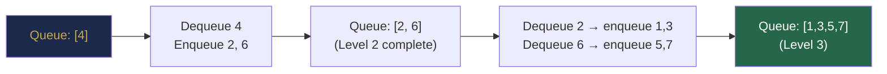
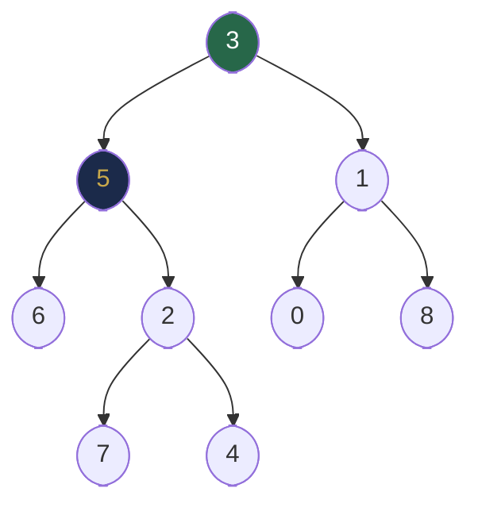

# Chapter 26 — Tree Traversal and Recursive Patterns

## Learning Objectives

By the end of this chapter, you will be able to:

- Implement preorder, inorder, and postorder traversals recursively and iteratively
- Implement level-order (BFS) traversal using a queue
- Solve height, depth, diameter, path sum, and lowest common ancestor problems
- Recognise which traversal order a problem requires
- Identify and apply the five core recursive tree patterns

---

## Contents

- [26.1 Why Traversal Order Matters](#261-why-traversal-order-matters)
- [26.2 Depth-First Traversals](#262-depth-first-traversals)
- [26.3 Iterative DFS Traversals](#263-iterative-dfs-traversals)
- [26.4 Level-Order (BFS) Traversal](#264-level-order-bfs-traversal)
- [26.5 Height and Depth](#265-height-and-depth)
- [26.6 Diameter of a Binary Tree](#266-diameter-of-a-binary-tree)
- [26.7 Root-to-Leaf Paths](#267-root-to-leaf-paths)
- [26.8 Path Sum Problems](#268-path-sum-problems)
- [26.9 Lowest Common Ancestor (LCA)](#269-lowest-common-ancestor-lca)
- [26.10 Five Core Recursive Patterns](#2610-five-core-recursive-patterns)
- [Interview Insight](#interview-insight)
- [Quick Quiz](#quick-quiz)
- [26.11 Practice Problems](#2611-practice-problems)
- [Chapter Summary](#chapter-summary)

---

> [!NOTE]
> **Historical Context**  
> Tree traversal is as old as tree-based computation itself. **Preorder traversal** (visit root, then children) maps naturally to prefix expression evaluation, used in early calculators and compilers (1950s). **Inorder traversal** of a BST produces sorted output — this was a key insight in **Hibbard's 1962 paper** introducing BST deletion. **Level-order traversal** (BFS on trees) was described by **C. Y. Lee** in 1961 for maze-routing problems and independently by **Moore** in 1959. The modern formalisation of all four traversal orders as a unified framework appears in Knuth's *TAOCP Vol. 1* (1968). **Euler tour** (visit each node twice — once entering, once leaving) was developed in the 1980s as a foundation for parallel tree algorithms and later for LCA queries in O(1) time.

---

> ### 🔗 Analogy
> **Exploring a Building**
>
> Imagine you must visit every room in a building.
> - **Preorder (DFS):** Enter a floor, immediately go deeper (take the stairs down) before visiting other rooms on the same floor. Good for printing a directory tree — you print the folder name before its contents.
> - **Inorder:** Visit the leftmost room first, then the current room, then the right rooms. For BSTs this produces rooms in alphabetical order.
> - **Postorder:** Visit all sub-rooms before the current room. Good for cleanup — you must empty subfolders before deleting a folder.
> - **Level-order (BFS):** Finish all rooms on floor 1, then all of floor 2, then floor 3. Good for finding the nearest exit — it guarantees you explore nearby rooms before far ones.

---

## 26.1 Why Traversal Order Matters

The same tree yields completely different results depending on traversal order:

```
       4
      / \
     2   6
    / \ / \
   1  3 5  7
```

| Traversal | Output | Natural Use |
|-----------|--------|-------------|
| Preorder (Root→L→R) | 4, 2, 1, 3, 6, 5, 7 | Copy tree, prefix notation, serialization |
| Inorder (L→Root→R) | 1, 2, 3, 4, 5, 6, 7 | BST sorted output, expression evaluation |
| Postorder (L→R→Root) | 1, 3, 2, 5, 7, 6, 4 | Delete tree, postfix notation, bottom-up computation |
| Level-order | 4, 2, 6, 1, 3, 5, 7 | BFS, shortest path, level-based processing |

*Table 26.1: Traversal output on the same tree.*

---

## 26.2 Depth-First Traversals

### Preorder: Root → Left → Right

```java
void preorder(TreeNode root, List<Integer> result) {
    if (root == null) return;
    result.add(root.val);              // process ROOT first
    preorder(root.left, result);
    preorder(root.right, result);
}
```

**Use cases:** Printing directory structure, serialising a tree, prefix expression trees, copying a tree.

---

### Inorder: Left → Root → Right

```java
void inorder(TreeNode root, List<Integer> result) {
    if (root == null) return;
    inorder(root.left, result);
    result.add(root.val);              // process ROOT in the middle
    inorder(root.right, result);
}
```

**Use cases:** BST sorted output, kth smallest/largest element, expression evaluation.

**Mnemonic:** Inorder of a BST is always a **sorted list**. This is the fastest way to verify a BST property or extract sorted data.

---

### Postorder: Left → Right → Root

```java
void postorder(TreeNode root, List<Integer> result) {
    if (root == null) return;
    postorder(root.left, result);
    postorder(root.right, result);
    result.add(root.val);              // process ROOT last
}
```

**Use cases:** Deleting a tree (must free children before parent), computing subtree sizes, postfix expression evaluation, bottom-up DP on trees.


*Each node labelled with its visit order per traversal type.*

> [!TIP]
> **Did You Know?**  
> Postfix (Reverse Polish) notation — the output format of postorder traversal of an expression tree — is used directly by **stack machines** and was the input method for HP scientific calculators for 40 years. When you evaluate `3 4 + 5 *`, you are replaying the postorder traversal of the expression tree for `(3 + 4) * 5`. Every Java compiler internally converts infix expressions into an AST and then generates code in postorder — visiting both operands before the operator.

---

## 26.3 Iterative DFS Traversals

Recursive DFS uses the call stack implicitly. Iterative DFS uses an explicit stack — important for very deep trees to avoid `StackOverflowError` (see Chapter 5).

### Iterative Preorder

```java
List<Integer> preorderIterative(TreeNode root) {
    List<Integer> result = new ArrayList<>();
    if (root == null) return result;
    Deque<TreeNode> stack = new ArrayDeque<>();
    stack.push(root);
    while (!stack.isEmpty()) {
        TreeNode node = stack.pop();
        result.add(node.val);
        if (node.right != null) stack.push(node.right);  // push right first
        if (node.left  != null) stack.push(node.left);   // left processed first (LIFO)
    }
    return result;
}
```

**Why right before left?** The stack is LIFO — pushing right first means left is on top and processed next, giving Root→L→R order.

---

### Iterative Inorder

```java
List<Integer> inorderIterative(TreeNode root) {
    List<Integer> result = new ArrayList<>();
    Deque<TreeNode> stack = new ArrayDeque<>();
    TreeNode curr = root;
    while (curr != null || !stack.isEmpty()) {
        while (curr != null) {       // go as far left as possible
            stack.push(curr);
            curr = curr.left;
        }
        curr = stack.pop();          // process leftmost unvisited node
        result.add(curr.val);
        curr = curr.right;           // move to right subtree
    }
    return result;
}
```

---

### Iterative Postorder (Two-Stack Trick)

```java
List<Integer> postorderIterative(TreeNode root) {
    List<Integer> result = new ArrayList<>();
    if (root == null) return result;
    Deque<TreeNode> stack = new ArrayDeque<>();
    stack.push(root);
    while (!stack.isEmpty()) {
        TreeNode node = stack.pop();
        result.add(0, node.val);     // prepend: reverse of preorder (R→L→Root reversed = L→R→Root)
        if (node.left  != null) stack.push(node.left);
        if (node.right != null) stack.push(node.right);
    }
    return result;  // adding to front reverses the modified-preorder into postorder
}
```

---

## 26.4 Level-Order (BFS) Traversal

Process nodes level by level using a **queue** (from Chapter 24). Guarantees nearest-first processing.

```java
List<List<Integer>> levelOrder(TreeNode root) {
    List<List<Integer>> result = new ArrayList<>();
    if (root == null) return result;
    Queue<TreeNode> queue = new ArrayDeque<>();
    queue.offer(root);
    while (!queue.isEmpty()) {
        int size = queue.size();          // snapshot current level size
        List<Integer> level = new ArrayList<>();
        for (int i = 0; i < size; i++) {
            TreeNode node = queue.poll();
            level.add(node.val);
            if (node.left  != null) queue.offer(node.left);
            if (node.right != null) queue.offer(node.right);
        }
        result.add(level);
    }
    return result;
}
```

**Key trick:** Capture `queue.size()` at the start of each iteration. This freezes the count at "nodes on the current level." Everything added during this iteration belongs to the next level.



**Variants using the same template:**
- **Right side view:** Take `level.get(level.size() - 1)` (last element of each level)
- **Left side view:** Take `level.get(0)`
- **Level averages:** `level.stream().mapToInt(x→x).average()`
- **Zigzag traversal:** Alternate `addFirst` / `addLast` using a deque
- **Maximum width:** `max(level.size())` across all levels

---

## 26.5 Height and Depth

**Height** = max distance from a node to any leaf below it.  
**Depth** = distance from the root to a node.

```java
int height(TreeNode root) {
    if (root == null) return -1;  // empty tree convention
    return 1 + Math.max(height(root.left), height(root.right));
}

int depth(TreeNode root, TreeNode target, int d) {
    if (root == null) return -1;
    if (root == target) return d;
    int left = depth(root.left, target, d + 1);
    return left != -1 ? left : depth(root.right, target, d + 1);
}
```

**Minimum depth** (BFS approach is optimal — stops at first leaf):

```java
int minDepth(TreeNode root) {
    if (root == null) return 0;
    Queue<TreeNode> q = new ArrayDeque<>();
    q.offer(root);
    int depth = 1;
    while (!q.isEmpty()) {
        int size = q.size();
        for (int i = 0; i < size; i++) {
            TreeNode node = q.poll();
            if (node.left == null && node.right == null) return depth;  // first leaf
            if (node.left  != null) q.offer(node.left);
            if (node.right != null) q.offer(node.right);
        }
        depth++;
    }
    return depth;
}
```

> [!NOTE]
> **Why BFS beats DFS for minimum depth:** DFS explores one full branch before another. If the minimum-depth leaf is in the right subtree, DFS wastes time exploring the entire left subtree first. BFS guarantees it finds the shallowest leaf first — the moment we dequeue a leaf, we know it's the minimum-depth one.

---

## 26.6 Diameter of a Binary Tree

**Diameter** = the length of the longest path between any two nodes. The path may or may not pass through the root.

```java
int diameter = 0;

int diameterOfBinaryTree(TreeNode root) {
    heightForDiameter(root);
    return diameter;
}

int heightForDiameter(TreeNode root) {
    if (root == null) return -1;
    int lh = heightForDiameter(root.left);
    int rh = heightForDiameter(root.right);
    diameter = Math.max(diameter, lh + rh + 2);  // path through current node
    return 1 + Math.max(lh, rh);
}
```

**Intuition:** At each node, the longest path passing through it is `height(left) + height(right) + 2`. Computing this for every node while computing heights costs only O(n) — one pass.


*The diameter passes through node 1: path is `4 → 2 → 1 → 3 → 6` (length 4).*

---

## 26.7 Root-to-Leaf Paths

```java
List<String> binaryTreePaths(TreeNode root) {
    List<String> result = new ArrayList<>();
    dfs(root, "", result);
    return result;
}

void dfs(TreeNode node, String path, List<String> result) {
    if (node == null) return;
    path += node.val;
    if (node.left == null && node.right == null) {
        result.add(path);    // reached a leaf: record path
        return;
    }
    path += "->";
    dfs(node.left,  path, result);
    dfs(node.right, path, result);
}
```

**Backtracking version** (avoids string concatenation overhead — use `StringBuilder`):

```java
void dfs(TreeNode node, StringBuilder sb, int len, List<String> result) {
    if (node == null) return;
    sb.append(node.val);
    int newLen = sb.length();
    if (node.left == null && node.right == null) {
        result.add(sb.toString());
    } else {
        sb.append("->");
        dfs(node.left,  sb, newLen, result);
        dfs(node.right, sb, newLen, result);
    }
    sb.setLength(len);  // backtrack to previous state
}
```

---

## 26.8 Path Sum Problems

### Path Sum I — Does any root-to-leaf path have a given sum?

```java
boolean hasPathSum(TreeNode root, int targetSum) {
    if (root == null) return false;
    targetSum -= root.val;
    if (root.left == null && root.right == null) return targetSum == 0;
    return hasPathSum(root.left, targetSum) || hasPathSum(root.right, targetSum);
}
```

### Path Sum II — List all root-to-leaf paths with given sum

```java
List<List<Integer>> pathSum(TreeNode root, int target) {
    List<List<Integer>> result = new ArrayList<>();
    dfs(root, target, new ArrayList<>(), result);
    return result;
}

void dfs(TreeNode node, int remain, List<Integer> path, List<List<Integer>> result) {
    if (node == null) return;
    path.add(node.val);
    remain -= node.val;
    if (node.left == null && node.right == null && remain == 0)
        result.add(new ArrayList<>(path));       // snapshot path
    dfs(node.left,  remain, path, result);
    dfs(node.right, remain, path, result);
    path.remove(path.size() - 1);               // backtrack
}
```

### Path Sum III — Count paths (any start/end) with given sum

**Prefix sum approach** (O(n)) — inspired by Chapter 10's prefix sum pattern:

```java
int pathSumIII(TreeNode root, long targetSum) {
    Map<Long, Integer> prefixCount = new HashMap<>();
    prefixCount.put(0L, 1);   // empty prefix
    return[] count = {0};
    dfs(root, 0L, targetSum, prefixCount, count);
    return count[0];
}

void dfs(TreeNode node, long curr, long target, Map<Long, Integer> prefix, int[] count) {
    if (node == null) return;
    curr += node.val;
    count[0] += prefix.getOrDefault(curr - target, 0);
    prefix.merge(curr, 1, Integer::sum);
    dfs(node.left,  curr, target, prefix, count);
    dfs(node.right, curr, target, prefix, count);
    prefix.merge(curr, -1, Integer::sum);       // backtrack
}
```

> [!TIP]
> **Did You Know?**  
> Path Sum III is a **direct application of the prefix-sum pattern** from Chapter 10, applied to a tree instead of an array. The "array" here is the root-to-node path. The key equation is: `count of paths ending at node with sum = target` = `count of previous prefix sums equal to (currentSum - target)`. This cross-chapter connection — the same mathematical idea applied in two different data-structure contexts — is a hallmark of algorithmic maturity.

---

## 26.9 Lowest Common Ancestor (LCA)

**Problem:** Given two nodes `p` and `q` in a tree, find their lowest (deepest) common ancestor.

```java
TreeNode lowestCommonAncestor(TreeNode root, TreeNode p, TreeNode q) {
    if (root == null || root == p || root == q) return root;
    TreeNode left  = lowestCommonAncestor(root.left,  p, q);
    TreeNode right = lowestCommonAncestor(root.right, p, q);
    if (left != null && right != null) return root;   // p and q are in different subtrees
    return left != null ? left : right;               // both in same subtree
}
```

**Intuition:**
- If the root is `p` or `q`, the root *is* the LCA (the other must be a descendant).
- If `p` and `q` are found in opposite subtrees, the current root is the LCA.
- If both are in the same subtree, recurse that direction.



*LCA(5, 1) = 3 (root). LCA(5, 4) = 5 (node 5 is ancestor of 4). LCA(6, 4) = 5.*

---

## 26.10 Five Core Recursive Patterns

| Pattern | Shape | Example |
|---------|-------|---------|
| **1. Accumulate** | Return aggregate of subtrees | `count`, `sum`, `height` |
| **2. Transform** | Return new tree | `invertTree`, `clone` |
| **3. Search** | Return found node or null | `contains`, `LCA` |
| **4. Path DFS** | Carry state down; record at leaf | `pathSum`, `rootToLeaf` |
| **5. Global update** | Update external variable at each node | `diameter`, `maxPathSum` |

```java
// Pattern 5 — global max path sum (may pass through any node)
int maxPath = Integer.MIN_VALUE;

int maxPathSum(TreeNode root) {
    gainFrom(root);
    return maxPath;
}

int gainFrom(TreeNode node) {
    if (node == null) return 0;
    int leftGain  = Math.max(gainFrom(node.left),  0);  // ignore negative branches
    int rightGain = Math.max(gainFrom(node.right), 0);
    maxPath = Math.max(maxPath, node.val + leftGain + rightGain);  // global update
    return node.val + Math.max(leftGain, rightGain);              // return best single-branch
}
```

---

## Interview Insight

> **The traversal order a problem requires is almost always inferable from its description:**
> - "Print parent before children" → Preorder
> - "Print sorted / kth smallest" → Inorder (on BST)
> - "Compute subtree results before combining" → Postorder
> - "Process level by level / find nearest" → Level-order
> - "Any two nodes / passes through or not" → PostOrder with global update (Pattern 5)
>
> When stuck on a tree problem: (1) identify the traversal, (2) identify the pattern, (3) write the base case, (4) trust the recursion.

---

## Quick Quiz

1. What traversal of a BST gives a sorted sequence?
2. You need to delete every node in a tree safely. Which traversal ensures children are freed before parents?
3. What is the time complexity of level-order traversal?
4. In the diameter algorithm, why do we update `diameter` with `lh + rh + 2`?
5. Why does the LCA algorithm return `root` when `root == p`?

**Answers:**
1. Inorder (L → Root → R)
2. Postorder — children freed before their parent
3. O(n) — each node enqueued and dequeued once
4. The path goes from deepest left leaf → current node → deepest right leaf: `lh + 1 + 1 + rh` = `lh + rh + 2`
5. If `root == p`, then `q` must be in `p`'s subtree (or not there), so `p` is the LCA by definition

---

## 26.11 Practice Problems

**Warm-up:**
- Return inorder traversal iteratively using a stack.
- Return level-order traversal as a list of lists.
- Find the right-side view of a binary tree.

**Medium:**
- Zigzag level-order traversal.
- Find the minimum depth.
- Count nodes with exactly one child.
- Check if path sum exists (root-to-leaf).
- Find all root-to-leaf paths that sum to target.

**Hard:**
- Maximum path sum (any node to any node — LC 124).
- Path Sum III (count all paths summing to target — LC 437).
- Lowest common ancestor of a binary tree (LC 236).
- Serialize and deserialize a binary tree (LC 297).

---

## Chapter Summary

| Operation | Traversal | Key Technique |
|-----------|-----------|---------------|
| Preorder | Root → L → R | Stack (push R then L) |
| Inorder | L → Root → R | Stack with `curr` pointer |
| Postorder | L → R → Root | Reverse of R-first preorder |
| Level-order | Level by level | Queue + snapshot `size` |
| Height | Postorder | `1 + max(lh, rh)` |
| Diameter | Postorder + global | Update diameter at each node |
| Path sum | Preorder DFS | Carry remaining sum |
| All paths | Preorder + backtrack | Add/remove from list |
| LCA | Postorder | Bubble up found nodes |
| Max path sum | Postorder + global | gainFrom returns single-branch gain |

---

*← [Chapter 25 — Tree Fundamentals and Binary Trees](chapter-25-tree-fundamentals.md)*  
*→ [Chapter 27 — Binary Search Trees](chapter-27-binary-search-trees.md)*
