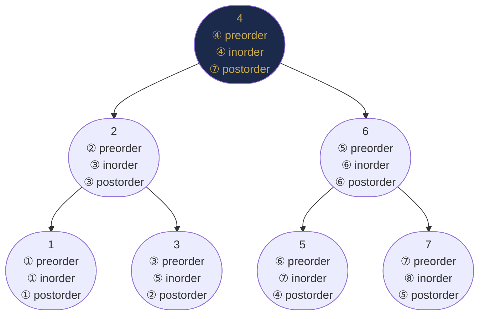
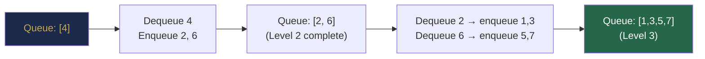
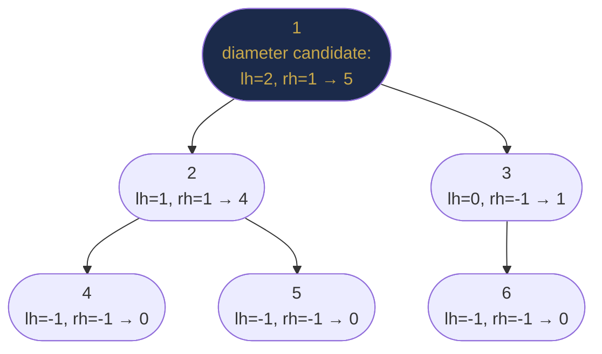

# Chapter 26 — Tree Traversal and Recursive Patterns

## Learning Objectives

By the end of this chapter, you will be able to:

- Implement preorder, inorder, and postorder traversals recursively and iteratively
- Implement level-order (BFS) traversal using a queue
- Solve height, depth, diameter, path sum, and lowest common ancestor problems
- Recognise which traversal order a problem requires
- Identify and apply the five core recursive tree patterns

---

## Contents

- [26.1 Why Traversal Order Matters](#261-why-traversal-order-matters)
- [26.2 Depth-First Traversals](#262-depth-first-traversals)
- [26.3 Iterative DFS Traversals](#263-iterative-dfs-traversals)
- [26.4 Level-Order (BFS) Traversal](#264-level-order-bfs-traversal)
- [26.5 Height and Depth](#265-height-and-depth)
- [26.6 Diameter of a Binary Tree](#266-diameter-of-a-binary-tree)
- [26.7 Root-to-Leaf Paths](#267-root-to-leaf-paths)
- [26.8 Path Sum Problems](#268-path-sum-problems)
- [26.9 Lowest Common Ancestor (LCA)](#269-lowest-common-ancestor-lca)
- [26.10 Five Core Recursive Patterns](#2610-five-core-recursive-patterns)
- [Interview Insight](#interview-insight)
- [Quick Quiz](#quick-quiz)
- [26.11 Practice Problems](#2611-practice-problems)
- [Chapter Summary](#chapter-summary)

---

> [!NOTE]
> **Historical Context**  
> Tree traversal is as old as tree-based computation itself. **Preorder traversal** (visit root, then children) maps naturally to prefix expression evaluation, used in early calculators and compilers (1950s). **Inorder traversal** of a BST produces sorted output — this was a key insight in **Hibbard's 1962 paper** introducing BST deletion. **Level-order traversal** (BFS on trees) was described by **C. Y. Lee** in 1961 for maze-routing problems and independently by **Moore** in 1959. The modern formalisation of all four traversal orders as a unified framework appears in Knuth's *TAOCP Vol. 1* (1968). **Euler tour** (visit each node twice — once entering, once leaving) was developed in the 1980s as a foundation for parallel tree algorithms and later for LCA queries in O(1) time.

---

> ### 🔗 Analogy
> **Exploring a Building**
>
> Imagine you must visit every room in a building.
> - **Preorder (DFS):** Enter a floor, immediately go deeper (take the stairs down) before visiting other rooms on the same floor. Good for printing a directory tree — you print the folder name before its contents.
> - **Inorder:** Visit the leftmost room first, then the current room, then the right rooms. For BSTs this produces rooms in alphabetical order.
> - **Postorder:** Visit all sub-rooms before the current room. Good for cleanup — you must empty subfolders before deleting a folder.
> - **Level-order (BFS):** Finish all rooms on floor 1, then all of floor 2, then floor 3. Good for finding the nearest exit — it guarantees you explore nearby rooms before far ones.

---

## 26.1 Why Traversal Order Matters

The same tree yields completely different results depending on traversal order:

```
       4
      / \
     2   6
    / \ / \
   1  3 5  7
```

| Traversal | Output | Natural Use |
|-----------|--------|-------------|
| Preorder (Root→L→R) | 4, 2, 1, 3, 6, 5, 7 | Copy tree, prefix notation, serialization |
| Inorder (L→Root→R) | 1, 2, 3, 4, 5, 6, 7 | BST sorted output, expression evaluation |
| Postorder (L→R→Root) | 1, 3, 2, 5, 7, 6, 4 | Delete tree, postfix notation, bottom-up computation |
| Level-order | 4, 2, 6, 1, 3, 5, 7 | BFS, shortest path, level-based processing |

*Table 26.1: Traversal output on the same tree.*

---

## 26.2 Depth-First Traversals

**Intuition for all three:** The only difference between preorder, inorder, and postorder is *when* you process the current node relative to its children. Everything else — the recursion structure, the base case, the visits — is identical.

```
Template:
def dfs(node):
    if node is null: return
    [process here → PREORDER]
    dfs(node.left)
    [process here → INORDER]
    dfs(node.right)
    [process here → POSTORDER]
```

Moving a single line changes the entire output.

**Complexity of all three DFS traversals:** O(n) time (every node visited exactly once), O(h) space (call stack depth = tree height, where h is O(log n) balanced, O(n) worst).

---

### Preorder: Root → Left → Right

**When to use it:** Whenever the parent must be processed before its children. Classic examples: copying a tree (you must create the root before you can attach its children), serialising a tree (the root tells you how to reconstruct subtrees), printing a file directory (print the folder name, then print its contents).

```java
void preorder(TreeNode root, List<Integer> result) {
    if (root == null) return;
    result.add(root.val);              // process ROOT first
    preorder(root.left, result);
    preorder(root.right, result);
}
```

---

### Inorder: Left → Root → Right

**When to use it:** Whenever the left subtree must be fully processed before the current node. For BSTs, left subtree = all smaller values, so inorder gives you values in ascending sorted order. This is not a coincidence — it is the *defining property* of a BST expressed as a traversal.

**Mnemonic:** Think of a number line. In a BST, left = smaller, right = larger. Inorder walks the number line left to right.

```java
void inorder(TreeNode root, List<Integer> result) {
    if (root == null) return;
    inorder(root.left, result);
    result.add(root.val);              // process ROOT in the middle
    inorder(root.right, result);
}
```

---

### Postorder: Left → Right → Root

**When to use it:** Whenever children must be fully processed before the parent. Classic examples: computing subtree size (you need left size + right size to compute current size), deleting a tree (you must free children before the parent), bottom-up DP on trees (compute results at leaves, aggregate upward).

**Mental model:** Postorder is "I'll handle everything below me first, then deal with myself." This is the natural order for any bottom-up computation.

```java
void postorder(TreeNode root, List<Integer> result) {
    if (root == null) return;
    postorder(root.left, result);
    postorder(root.right, result);
    result.add(root.val);              // process ROOT last
}
```



*Each node labelled with its visit order per traversal type.*

> [!TIP]
> **Did You Know?**  
> Postfix (Reverse Polish) notation — the output format of postorder traversal of an expression tree — is used directly by **stack machines** and was the input method for HP scientific calculators for 40 years. When you evaluate `3 4 + 5 *`, you are replaying the postorder traversal of the expression tree for `(3 + 4) * 5`. Every Java compiler internally converts infix expressions into an AST and then generates code in postorder — visiting both operands before the operator.

---

## 26.3 Iterative DFS Traversals

Recursive DFS uses the call stack implicitly. Iterative DFS uses an explicit stack — important for very deep trees to avoid `StackOverflowError` (see Chapter 5).

**General principle:** Every recursive algorithm has an equivalent iterative form that explicitly manages a stack. For DFS traversals, the stack mirrors the implicit call stack. The challenge is replicating the exact order that recursion would produce.

---

### Iterative Preorder

**Intuition:** Preorder is Root→L→R. After processing a node, we want to process its left child next, then its right child. Since a stack is LIFO, we push right first (it'll wait) and left second (it'll be processed next). Then pop-process-push-push repeats.

```java
List<Integer> preorderIterative(TreeNode root) {
    List<Integer> result = new ArrayList<>();
    if (root == null) return result;
    Deque<TreeNode> stack = new ArrayDeque<>();
    stack.push(root);
    while (!stack.isEmpty()) {
        TreeNode node = stack.pop();
        result.add(node.val);                    // process: Root
        if (node.right != null) stack.push(node.right);  // push right first (wait)
        if (node.left  != null) stack.push(node.left);   // push left last (next to process)
    }
    return result;
}
```

**Trace on `[4, 2, 6, 1, 3, 5, 7]` tree:**
```
Stack: [4]            → pop 4, result=[4], push 6,2
Stack: [6, 2]         → pop 2, result=[4,2], push 3,1
Stack: [6, 3, 1]      → pop 1, result=[4,2,1], no children
Stack: [6, 3]         → pop 3, result=[4,2,1,3], no children
Stack: [6]            → pop 6, result=[4,2,1,3,6], push 7,5
Stack: [7, 5]         → pop 5 ... and so on
Final: [4, 2, 1, 3, 6, 5, 7] ✓
```

**Complexity:** O(n) time, O(w) space where w = maximum width of tree (worst case O(n) for a complete tree).

---

### Iterative Inorder

**Intuition:** Inorder is L→Root→R. The challenge is: we can't process the root until we've fully processed the left subtree. So we must *defer* the root — save it on the stack, go as far left as possible, then come back and process it, then move to its right subtree.

**Mental model:** Think of a pointer `curr` that walks down the left spine of the tree, pushing every node it passes onto the stack. When it hits null (the leftmost point), it pops the last node (the smallest), processes it, then sets `curr = curr.right` to explore that node's right subtree using the same "go left first" strategy.

```java
List<Integer> inorderIterative(TreeNode root) {
    List<Integer> result = new ArrayList<>();
    Deque<TreeNode> stack = new ArrayDeque<>();
    TreeNode curr = root;
    while (curr != null || !stack.isEmpty()) {
        while (curr != null) {       // Phase 1: descend as far left as possible
            stack.push(curr);        // defer this node: we'll process it after its left subtree
            curr = curr.left;
        }
        // curr is now null: we've hit the leftmost unvisited node
        curr = stack.pop();          // Phase 2: backtrack to deferred node
        result.add(curr.val);        //           process it (L done, now Root)
        curr = curr.right;           // Phase 3: move to right subtree and repeat
    }
    return result;
}
```

**Trace on `[4, 2, 6, 1, 3, 5, 7]` tree:**
```
Phase 1: curr=4 → push 4, curr=2 → push 2, curr=1 → push 1, curr=null
Phase 2: pop 1, result=[1], curr=1.right=null
Phase 1: curr=null (skip)
Phase 2: pop 2, result=[1,2], curr=2.right=3
Phase 1: curr=3 → push 3, curr=3.left=null
Phase 2: pop 3, result=[1,2,3], curr=3.right=null
Phase 2: pop 4, result=[1,2,3,4], curr=4.right=6
... continues for right subtree
Final: [1, 2, 3, 4, 5, 6, 7] ✓
```

**Why `curr != null || !stack.isEmpty()`?** Two reasons to continue: (1) `curr != null` — we have a node to descend from; (2) `!stack.isEmpty()` — there are deferred nodes to process even if `curr` is null.

**Complexity:** O(n) time (each node pushed/popped once), O(h) space for the stack.

---

### Iterative Postorder (Two-Stack Trick)

**Intuition:** Postorder is L→R→Root. Direct iterative postorder is complex. The elegant trick: postorder is the *reverse* of a modified preorder. If you do preorder with right before left (Root→R→L), then reverse the result, you get L→R→Root = postorder.

**Why does this work?**
- Modified preorder (Root→R→L): push left first so right is processed first
- Reverse of Root→R→L = L→R→Root = postorder ✓

```java
List<Integer> postorderIterative(TreeNode root) {
    List<Integer> result = new ArrayList<>();
    if (root == null) return result;
    Deque<TreeNode> stack = new ArrayDeque<>();
    stack.push(root);
    while (!stack.isEmpty()) {
        TreeNode node = stack.pop();
        result.add(0, node.val);     // prepend (builds reversed list as we go)
        if (node.left  != null) stack.push(node.left);   // left pushed first
        if (node.right != null) stack.push(node.right);  // right on top (processed next)
    }
    return result;
}
```

**Note:** `result.add(0, ...)` is O(n) per call making total O(n²). For large trees, use a `Deque<Integer>` and call `addFirst` instead, keeping total at O(n).

**Complexity:** O(n) time (amortised with Deque), O(h) space.

---

## 26.4 Level-Order (BFS) Traversal

Process nodes level by level using a **queue** (from Chapter 24). Guarantees nearest-first processing.

```java
List<List<Integer>> levelOrder(TreeNode root) {
    List<List<Integer>> result = new ArrayList<>();
    if (root == null) return result;
    Queue<TreeNode> queue = new ArrayDeque<>();
    queue.offer(root);
    while (!queue.isEmpty()) {
        int size = queue.size();          // snapshot current level size
        List<Integer> level = new ArrayList<>();
        for (int i = 0; i < size; i++) {
            TreeNode node = queue.poll();
            level.add(node.val);
            if (node.left  != null) queue.offer(node.left);
            if (node.right != null) queue.offer(node.right);
        }
        result.add(level);
    }
    return result;
}
```

**Key trick:** Capture `queue.size()` at the start of each iteration. This freezes the count at "nodes on the current level." Everything added during this iteration belongs to the next level.



**Variants using the same template:**
- **Right side view:** Take `level.get(level.size() - 1)` (last element of each level)
- **Left side view:** Take `level.get(0)`
- **Level averages:** `level.stream().mapToInt(x→x).average()`
- **Zigzag traversal:** Alternate `addFirst` / `addLast` using a deque
- **Maximum width:** `max(level.size())` across all levels

---

## 26.5 Height and Depth

**Height** = max distance from a node to any leaf below it.  
**Depth** = distance from the root to a node.

**Intuition for height:** At each node, the height is 1 (for the edge to the child) plus the maximum height of either subtree. For a leaf, both subtrees are null with height -1, so leaf height = 1 + max(-1, -1) = 0. For null itself, height = -1 (convention to make leaf = 0 work out).

**Why -1 for null?** Because a leaf node has height 0 (zero edges below it). Using -1 for null makes the formula `1 + max(height(left), height(right))` give exactly 0 for a leaf: `1 + max(-1, -1) = 1 + (-1) = 0`. It's purely a convention choice that makes the arithmetic clean.

```java
int height(TreeNode root) {
    if (root == null) return -1;  // convention: null height = -1 so leaf height = 0
    return 1 + Math.max(height(root.left), height(root.right));
}

int depth(TreeNode root, TreeNode target, int d) {
    if (root == null) return -1;             // target not found in this branch
    if (root == target) return d;            // found: d is current depth
    int left = depth(root.left, target, d + 1);   // try left branch
    return left != -1 ? left : depth(root.right, target, d + 1); // if not left, try right
}
```

**Complexity:** O(n) time for height (visits all nodes). O(n) time for depth (worst case, target is last leaf). O(h) space for both.

**Minimum depth** (BFS approach is optimal — stops at first leaf):

```java
int minDepth(TreeNode root) {
    if (root == null) return 0;
    Queue<TreeNode> q = new ArrayDeque<>();
    q.offer(root);
    int depth = 1;
    while (!q.isEmpty()) {
        int size = q.size();
        for (int i = 0; i < size; i++) {
            TreeNode node = q.poll();
            if (node.left == null && node.right == null) return depth;  // first leaf
            if (node.left  != null) q.offer(node.left);
            if (node.right != null) q.offer(node.right);
        }
        depth++;
    }
    return depth;
}
```

> [!NOTE]
> **Why BFS beats DFS for minimum depth:** DFS explores one full branch before another. If the minimum-depth leaf is in the right subtree, DFS wastes time exploring the entire left subtree first. BFS guarantees it finds the shallowest leaf first — the moment we dequeue a leaf, we know it's the minimum-depth one.

---

## 26.6 Diameter of a Binary Tree

**Diameter** = the length of the longest path between any two nodes. The path may or may not pass through the root.

**Building the intuition step by step:**

**Step 1 — What does "longest path" mean?**  
A path goes from some node A, possibly upward to a common ancestor, then back down to some node B. It never revisits a node.

**Step 2 — Key observation: every path has a highest point ("top").**  
The path goes down into the left subtree from the top, and down into the right subtree. If the top is node X, the path length through X is:
```
length = edges going left + edges going right
       = height(X.left) + 1 + height(X.right) + 1
       = height(X.left) + height(X.right) + 2
```
(The +1s count the edges from X to its left child, and X to its right child.)

**Step 3 — The diameter is the maximum of this across ALL nodes.**  
We don't know in advance which node is the "top" of the longest path — so we compute `lh + rh + 2` at every node and track the global maximum.

**Step 4 — Efficiency observation.**  
To compute diameter we need heights. To compute heights we do a postorder traversal. So we compute both simultaneously in one O(n) pass, updating the global `diameter` variable at each node.

**Why a global variable?** We need height to bubble up to the parent (return value), but we also need to record the diameter candidate. Since we can only return one thing, we use a global/instance variable to record the maximum diameter seen so far.

```java
int diameter = 0;   // tracks the global maximum path length

int diameterOfBinaryTree(TreeNode root) {
    heightForDiameter(root);
    return diameter;
}

int heightForDiameter(TreeNode root) {
    if (root == null) return -1;
    int lh = heightForDiameter(root.left);              // height of left subtree
    int rh = heightForDiameter(root.right);             // height of right subtree
    diameter = Math.max(diameter, lh + rh + 2);         // path through THIS node
    return 1 + Math.max(lh, rh);                        // report height to parent
}
```

**Complexity:** O(n) time (single postorder pass), O(h) space.

**Common mistake:** Trying to compute `height()` separately for each node's diameter calculation — that would be O(n²). The trick is merging height computation with diameter tracking in one pass.

**Intuition:** At each node, the longest path passing through it is `height(left) + height(right) + 2`. Computing this for every node while computing heights costs only O(n) — one pass.



*The diameter passes through node 1: path is `4 → 2 → 1 → 3 → 6` (length 4).*

---

## 26.7 Root-to-Leaf Paths

**Intuition:** We need to track the path from root to the current node. As we go deeper, we append the current node's value. When we reach a leaf (both children null), we record the complete path. When we backtrack (the recursive call returns), we undo the append — this is the **backtracking pattern**.

**How to think about it:** Imagine dragging a string behind you as you walk through the tree. When you reach a dead end (leaf), write down the string. When you retrace your steps, the string automatically shrinks back to the fork point.

**Version 1: String concatenation (simple, slightly inefficient)**  
Strings in Java are immutable, so `path += node.val` creates a new String — it doesn't modify the existing one. This means no explicit backtracking is needed: when the recursive call returns, the local `path` variable is unaffected (it's a copy).

```java
List<String> binaryTreePaths(TreeNode root) {
    List<String> result = new ArrayList<>();
    dfs(root, "", result);
    return result;
}

void dfs(TreeNode node, String path, List<String> result) {
    if (node == null) return;
    path += node.val;                        // creates a new String: no mutation
    if (node.left == null && node.right == null) {
        result.add(path);                    // leaf reached: record full path
        return;
    }
    path += "->";
    dfs(node.left,  path, result);
    dfs(node.right, path, result);
    // no backtrack needed: Java's immutable String handles it automatically
}
```

**Complexity:** O(n · h) time (each path is O(h) long, and there are O(n) nodes visited, though the actual number of paths is at most n/2). O(n · h) space for all paths combined.

**Version 2: Explicit backtracking with StringBuilder (efficient)**  
Since `String +=` creates O(h) new Strings per call (each O(h) copy), it has O(n · h) string object cost. Using `StringBuilder` with explicit undo avoids allocations:

```java
void dfs(TreeNode node, StringBuilder sb, int len, List<String> result) {
    if (node == null) return;
    sb.append(node.val);                     // mutate: append current node
    int newLen = sb.length();                // remember new length for backtracking
    if (node.left == null && node.right == null) {
        result.add(sb.toString());           // snapshot the path
    } else {
        sb.append("->");
        dfs(node.left,  sb, newLen, result);
        dfs(node.right, sb, newLen, result);
    }
    sb.setLength(len);                       // BACKTRACK: undo everything added since `len`
}
```

**Why `sb.setLength(len)` works for backtracking:** `len` is the length of the StringBuilder *before* we appended this node's value. By resetting to `len`, we undo exactly what this call added, leaving the builder ready for the sibling call.

---

## 26.8 Path Sum Problems

### Path Sum I — Does any root-to-leaf path have a given sum?

**Intuition:** Instead of building the path and summing it at every leaf, we *subtract* each node's value from the target as we descend. By the time we reach a leaf, `targetSum` should be exactly 0 if the path sums to the original target. This avoids tracking a running sum variable separately.

**How we arrived at this:** Naive approach: collect all root-to-leaf paths (O(n·h) space), sum each, check against target. Better: pass a *remaining* target down. At each node, reduce the target by the current value. At a leaf, check if remaining == 0.

```java
boolean hasPathSum(TreeNode root, int targetSum) {
    if (root == null) return false;
    targetSum -= root.val;                          // subtract current node
    if (root.left == null && root.right == null)   // leaf reached
        return targetSum == 0;                     // did we hit the target?
    return hasPathSum(root.left, targetSum) || hasPathSum(root.right, targetSum);
}
```

**Complexity:** O(n) time (visits all nodes in worst case), O(h) space.

---

### Path Sum II — List all root-to-leaf paths with given sum

**Intuition:** Same as Path Sum I, but instead of stopping at the first match, we collect all matching paths. We use **backtracking**: add the node to the path list as we go deeper, snapshot the path when we find a match at a leaf, then remove the node when we backtrack.

**Why `new ArrayList<>(path)` for the snapshot?** The `path` list is shared across all recursive calls (it's the same object). If we just add it directly, all entries in `result` will point to the same list that keeps changing. We must take a *copy* at the moment we find a valid path.

```java
List<List<Integer>> pathSum(TreeNode root, int target) {
    List<List<Integer>> result = new ArrayList<>();
    dfs(root, target, new ArrayList<>(), result);
    return result;
}

void dfs(TreeNode node, int remain, List<Integer> path, List<List<Integer>> result) {
    if (node == null) return;
    path.add(node.val);              // choose: add this node
    remain -= node.val;
    if (node.left == null && node.right == null && remain == 0)
        result.add(new ArrayList<>(path));   // snapshot: copy the path before backtrack
    dfs(node.left,  remain, path, result);
    dfs(node.right, remain, path, result);
    path.remove(path.size() - 1);    // unchoose: remove this node (backtrack)
}
```

**Complexity:** O(n·h) time (each path copy is O(h)), O(n·h) space for the results.

---

### Path Sum III — Count paths (any start/end) with given sum

**Problem extension:** Paths don't need to start at root or end at a leaf. Any downward-going path counts.

**Naive approach:** For every node, run a DFS to count paths starting at that node. Total: O(n²). 

**Better approach: prefix sums on the root-to-node path.**  
This is the *exact same technique* from Chapter 10 (prefix sum on arrays), applied to the root-to-current-node path:
- Let `curr` = sum from root to the current node
- A path from some ancestor down to current node has sum = `curr - prefixSum_at_ancestor`
- We want that to equal `target`, so we need `prefixSum_at_ancestor = curr - target`
- We track how many times each prefix sum has occurred in a HashMap

**Step-by-step:**
```
Root path: [1, 2, 3, -2]
Running sums (curr): [1, 3, 6, 4]
At node with curr=4, target=3:
  look for curr-target = 4-3 = 1 in prefixCount
  prefixCount[1] = 1 (the prefix sum at root)
  So 1 path from root+1 to current sums to 3  ✓
```

**Backtracking the HashMap:** When we finish visiting a node's subtree, we remove its prefix sum from the map. This ensures that prefix sums from one branch don't affect counting on a sibling branch (prefix sums must be on the same root-to-node path).

```java
int pathSumIII(TreeNode root, long targetSum) {
    Map<Long, Integer> prefixCount = new HashMap<>();
    prefixCount.put(0L, 1);   // empty path (prefix sum = 0) exists once: handles paths starting at root
    int[] count = {0};
    dfs(root, 0L, targetSum, prefixCount, count);
    return count[0];
}

void dfs(TreeNode node, long curr, long target, Map<Long, Integer> prefix, int[] count) {
    if (node == null) return;
    curr += node.val;                                              // extend path to this node
    count[0] += prefix.getOrDefault(curr - target, 0);           // how many ancestors give the right prefix?
    prefix.merge(curr, 1, Integer::sum);                          // record this prefix sum
    dfs(node.left,  curr, target, prefix, count);                 // explore left
    dfs(node.right, curr, target, prefix, count);                 // explore right
    prefix.merge(curr, -1, Integer::sum);                         // BACKTRACK: remove this node's prefix sum
}
```

**Complexity:** O(n) time (single DFS pass), O(h) space for HashMap (at most h entries at any time, since only the current root-to-node path's prefix sums are in the map).

> [!TIP]
> **Did You Know?**  
> Path Sum III is a **direct application of the prefix-sum pattern** from Chapter 10, applied to a tree instead of an array. The "array" here is the root-to-node path. The key equation is: `count of paths ending at node with sum = target` = `count of previous prefix sums equal to (currentSum - target)`. This cross-chapter connection — the same mathematical idea applied in two different data-structure contexts — is a hallmark of algorithmic maturity.

---

## 26.9 Lowest Common Ancestor (LCA)

**Problem:** Given two nodes `p` and `q` in a tree, find their lowest (deepest) common ancestor — the deepest node that has both `p` and `q` as descendants (a node is a descendant of itself).

**Building the intuition:**

**Step 1: What are the possible cases at any node?**  
At any node during the DFS, exactly one of these is true:
1. The node itself is `p` or `q` → this node or its descendant is the LCA
2. `p` and `q` are in *different* subtrees → the current node is the LCA (it's the "junction")
3. Both `p` and `q` are in the *same* subtree → the LCA is deeper in that subtree

**Step 2: How to implement these cases?**  
- Recursively search left and right subtrees. Each call returns either: a found node (`p`, `q`, or LCA), or `null` (not found in that subtree).
- After getting `left` and `right` results:
  - Both non-null → `p` found in left, `q` found in right (or vice versa) → current node = LCA
  - Only left non-null → both are in left subtree; LCA propagated up from there
  - Only right non-null → both are in right subtree
  - Both null → neither found here

**Step 3: Why does returning `root` when `root == p` work?**  
If `root == p`, then `q` is either a descendant of `p` (in which case `p` is the LCA by definition) or in a sibling subtree (in which case the common ancestor above will combine `root` with the other subtree's result). Either way, returning `root` is the right move.

```java
TreeNode lowestCommonAncestor(TreeNode root, TreeNode p, TreeNode q) {
    if (root == null) return null;         // not found here
    if (root == p || root == q) return root; // found one of them: return it

    TreeNode left  = lowestCommonAncestor(root.left,  p, q);
    TreeNode right = lowestCommonAncestor(root.right, p, q);

    if (left != null && right != null) return root;  // p in left, q in right: junction found
    return left != null ? left : right;              // both in same side: propagate upward
}
```

**Step-by-step trace — LCA(5, 4) in the tree below:**
```
       3
      / \
     5   1
    / \ / \
   6  2 0  8
     / \
    7   4

LCA(node=3): go left and right
  LCA(node=5): root==5==p, return node(5)
  LCA(node=1): go left and right; neither is 5 or 4
    LCA(node=0): null/null → return null
    LCA(node=8): null/null → return null
  ← left=null, right=null → return null
left=node(5), right=null → return node(5)
Result: LCA = 5  ✓ (5 is ancestor of 4, so 5 is the LCA)
```

**Complexity:** O(n) time (visits all nodes in worst case), O(h) space.


*LCA(5, 1) = 3 (root). LCA(5, 4) = 5 (node 5 is ancestor of 4). LCA(6, 4) = 5.*

---

## 26.10 Five Core Recursive Patterns

| Pattern | Shape | Example |
|---------|-------|---------|
| **1. Accumulate** | Return aggregate of subtrees | `count`, `sum`, `height` |
| **2. Transform** | Return new tree | `invertTree`, `clone` |
| **3. Search** | Return found node or null | `contains`, `LCA` |
| **4. Path DFS** | Carry state down; record at leaf | `pathSum`, `rootToLeaf` |
| **5. Global update** | Update external variable at each node | `diameter`, `maxPathSum` |

```java
// Pattern 5 — global max path sum (may pass through any node)
int maxPath = Integer.MIN_VALUE;

int maxPathSum(TreeNode root) {
    gainFrom(root);
    return maxPath;
}

int gainFrom(TreeNode node) {
    if (node == null) return 0;
    int leftGain  = Math.max(gainFrom(node.left),  0);  // ignore negative branches
    int rightGain = Math.max(gainFrom(node.right), 0);
    maxPath = Math.max(maxPath, node.val + leftGain + rightGain);  // global update
    return node.val + Math.max(leftGain, rightGain);              // return best single-branch
}
```

---

## Interview Insight

> **The traversal order a problem requires is almost always inferable from its description:**
> - "Print parent before children" → Preorder
> - "Print sorted / kth smallest" → Inorder (on BST)
> - "Compute subtree results before combining" → Postorder
> - "Process level by level / find nearest" → Level-order
> - "Any two nodes / passes through or not" → PostOrder with global update (Pattern 5)
>
> When stuck on a tree problem: (1) identify the traversal, (2) identify the pattern, (3) write the base case, (4) trust the recursion.

---

## Quick Quiz

1. What traversal of a BST gives a sorted sequence?
2. You need to delete every node in a tree safely. Which traversal ensures children are freed before parents?
3. What is the time complexity of level-order traversal?
4. In the diameter algorithm, why do we update `diameter` with `lh + rh + 2`?
5. Why does the LCA algorithm return `root` when `root == p`?

**Answers:**
1. Inorder (L → Root → R)
2. Postorder — children freed before their parent
3. O(n) — each node enqueued and dequeued once
4. The path goes from deepest left leaf → current node → deepest right leaf: `lh + 1 + 1 + rh` = `lh + rh + 2`
5. If `root == p`, then `q` must be in `p`'s subtree (or not there), so `p` is the LCA by definition

---

## 26.11 Practice Problems

**Warm-up:**
- Return inorder traversal iteratively using a stack.
- Return level-order traversal as a list of lists.
- Find the right-side view of a binary tree.

**Medium:**
- Zigzag level-order traversal.
- Find the minimum depth.
- Count nodes with exactly one child.
- Check if path sum exists (root-to-leaf).
- Find all root-to-leaf paths that sum to target.

**Hard:**
- Maximum path sum (any node to any node — LC 124).
- Path Sum III (count all paths summing to target — LC 437).
- Lowest common ancestor of a binary tree (LC 236).
- Serialize and deserialize a binary tree (LC 297).

---

## Chapter Summary

| Operation | Traversal | Key Technique |
|-----------|-----------|---------------|
| Preorder | Root → L → R | Stack (push R then L) |
| Inorder | L → Root → R | Stack with `curr` pointer |
| Postorder | L → R → Root | Reverse of R-first preorder |
| Level-order | Level by level | Queue + snapshot `size` |
| Height | Postorder | `1 + max(lh, rh)` |
| Diameter | Postorder + global | Update diameter at each node |
| Path sum | Preorder DFS | Carry remaining sum |
| All paths | Preorder + backtrack | Add/remove from list |
| LCA | Postorder | Bubble up found nodes |
| Max path sum | Postorder + global | gainFrom returns single-branch gain |

---

*← [Chapter 25 — Tree Fundamentals and Binary Trees](chapter-25-tree-fundamentals.md)*  
*→ [Chapter 27 — Binary Search Trees](chapter-27-binary-search-trees.md)*
