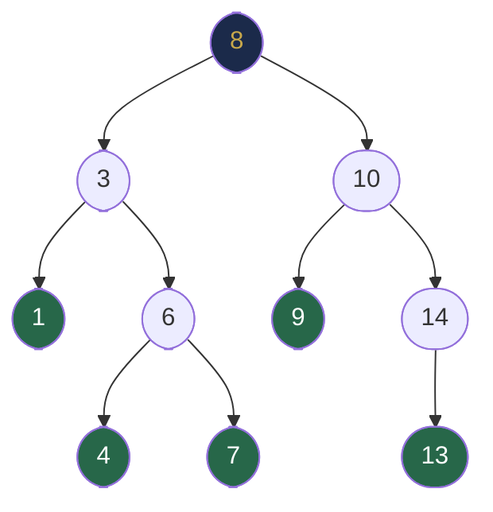
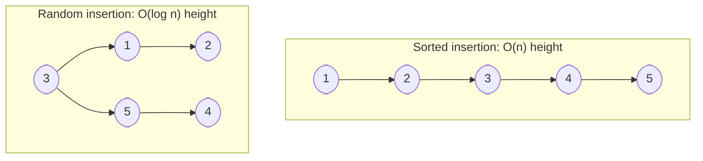

# Chapter 27 — Binary Search Trees

## Learning Objectives

By the end of this chapter, you will be able to:

- State and verify the BST invariant
- Implement BST search, insertion, and deletion in Java
- Explain why inorder traversal of a BST produces sorted output
- Find the minimum, maximum, predecessor, and successor of any node
- Recognise BST pathologies and understand why balance matters

---

## Contents

- [27.1 The BST Property](#271-the-bst-property)
- [27.2 Search](#272-search)
- [27.3 Insertion](#273-insertion)
- [27.4 Minimum, Maximum, Predecessor and Successor](#274-minimum-maximum-predecessor-and-successor)
- [27.5 Deletion](#275-deletion)
- [27.6 Inorder Traversal and Sorted Order](#276-inorder-traversal-and-sorted-order)
- [27.7 Validating a BST](#277-validating-a-bst)
- [27.8 BST Pathologies](#278-bst-pathologies)
- [27.9 Key BST Problems](#279-key-bst-problems)
- [Interview Insight](#interview-insight)
- [Quick Quiz](#quick-quiz)
- [27.10 Practice Problems](#2710-practice-problems)
- [Chapter Summary](#chapter-summary)

---

> [!NOTE]
> **Historical Context**  
> Binary Search Trees were formally described by **P. F. Windley**, **A. D. Booth**, **A. J. T. Colin**, and **T. N. Hibbard** in **1960–1962**, though the intuition (a sorted binary structure for fast lookup) was likely understood earlier. **Hibbard's 1962 paper** is credited with the first rigorous analysis of BST deletion — the third-case deletion (node with two children) that remains the standard algorithm today. BSTs became foundational in the UNIX `sort` command (early 1970s) and in symbol tables for compilers. The discovery that **random BST insertions yield an average height of ~2.1 log₂ n** (not O(n)) was proven by **Robson** and **Knuth** and justified using unbalanced BSTs in practice — until adversarial inputs proved the concern warranted.

---

> ### 🔗 Analogy
> **A Sorted Phonebook with Tabs**
>
> Imagine a phonebook where each page has a name in the centre. Names alphabetically before it are on pages to the left; names after it are to the right. Finding "Smith" starts at the middle page — if Smith > current, go right; if Smith < current, go left. This halves the search space each step. Inserting "Taylor" follows the same path until you reach an empty slot on the right of "Smith". Deleting "Jones" requires careful splicing to preserve the left-right ordering. This is exactly how a BST works.

---

## 27.1 The BST Property

For every node $N$ in a BST:
- All values in $N$'s **left subtree** are **strictly less than** $N$.val
- All values in $N$'s **right subtree** are **strictly greater than** $N$.val

This invariant must hold **for every node recursively** — not just immediate children.



**Verification:** For node 8: left subtree `{1,3,4,6,7}` all < 8 ✓; right subtree `{9,10,13,14}` all > 8 ✓.

**Common mistake:** Checking only parent–child pairs. The node 10's left child 9 must also be > 8 (the root above 10). The property is **global**, not just local.

---

## 27.2 Search

**Intuition:** The BST property tells us at every node: if the target is smaller, it *must* be in the left subtree (all left values < current); if larger, it *must* be in the right subtree. So each comparison eliminates one entire subtree. This is exactly the same reasoning as binary search on a sorted array (Chapter 14) — but applied to a pointer-based structure instead of an indexed array.

**Connection to binary search:** In a sorted array `[1,2,3,4,5,6,7]`, mid = arr[3] = 4. If target < 4, search left half. Same logic: in a BST with root 4, if target < 4, search left subtree.

**How we arrived at the code:** The base case handles two termination conditions: (1) we fell off the tree (not found), (2) we found it. For the recursive case, the BST property directly tells us which child to recurse into.

```java
TreeNode search(TreeNode root, int target) {
    if (root == null || root.val == target) return root;
    if (target < root.val) return search(root.left,  target);  // must be in left
    else                   return search(root.right, target);  // must be in right
}

// Iterative (preferred for deep trees to avoid stack overflow)
TreeNode searchIterative(TreeNode root, int target) {
    while (root != null && root.val != target) {
        root = target < root.val ? root.left : root.right;
    }
    return root;   // null if not found, the node if found
}
```

**Complexity:**
- Time: O(h) where h = tree height. O(log n) for balanced, O(n) worst case (sorted insertion).
- Space: O(h) recursive (call stack), O(1) iterative.

**Why iterative is preferred:** A degenerate BST (linked list shape) has height O(n). Recursive search would use O(n) stack frames, risking `StackOverflowError`. Iterative is O(1) space regardless.

---

## 27.3 Insertion

**Intuition:** To insert a new value while maintaining the BST property, follow the same path as search. When you reach a null slot (where search would have found nothing), that's precisely where the new node belongs. This is the only position that keeps all BST invariants intact.

**Why always insert as a leaf?** Because inserting into the middle would require restructuring the entire subtree. Inserting at a leaf requires no restructuring — the new node has no children yet and inherits the correct position from the search path.

**How the recursive code works:** `root.left = insert(root.left, val)` looks like it replaces the left child, but it only actually modifies it when the recursive call hits `null` and returns a new node. For non-null nodes, `insert` returns the same node unchanged, so the assignment is a no-op.

```java
TreeNode insert(TreeNode root, int val) {
    if (root == null) return new TreeNode(val);  // null slot found: place node here
    if (val < root.val) root.left  = insert(root.left,  val);  // go left
    else if (val > root.val) root.right = insert(root.right, val);  // go right
    // val == root.val: duplicate; policy depends on problem (here: ignore)
    return root;   // return self unchanged (unless we just inserted a child)
}

// Iterative insertion (O(1) space)
TreeNode insertIterative(TreeNode root, int val) {
    TreeNode newNode = new TreeNode(val);
    if (root == null) return newNode;
    TreeNode curr = root, parent = null;
    while (curr != null) {
        parent = curr;
        curr = val < curr.val ? curr.left : curr.right;  // follow search path
    }
    // curr is null: parent is where we attach the new node
    if (val < parent.val) parent.left  = newNode;
    else                  parent.right = newNode;
    return root;
}
```

**Complexity:** O(h) time, O(h) space (recursive), O(1) space (iterative). Same reasoning as search: the insertion path is exactly the failed-search path.

**Insertion trace for `[5, 3, 7, 1, 4]`:**

```
Insert 5: root = 5
Insert 3: 3 < 5 → left of 5
Insert 7: 7 > 5 → right of 5
Insert 1: 1 < 5 → left; 1 < 3 → left of 3
Insert 4: 4 < 5 → left; 4 > 3 → right of 3

Result:
      5
     / \
    3   7
   / \
  1   4
```

---

## 27.4 Minimum, Maximum, Predecessor and Successor

### Minimum and Maximum

**Intuition:** In a BST, left < root < right at every node. So the smallest value is as far left as you can go, and the largest is as far right as you can go. No comparison needed — just follow the trail.

```java
TreeNode minimum(TreeNode root) {
    while (root.left != null) root = root.left;  // keep going left until no left child
    return root;   // leftmost node = minimum
}

TreeNode maximum(TreeNode root) {
    while (root.right != null) root = root.right;  // keep going right until no right child
    return root;   // rightmost node = maximum
}
```

**Complexity:** O(h) time, O(1) space.

### Inorder Successor

**Intuition:** The successor of node $N$ is the smallest value greater than $N$. Two cases:
1. **N has a right child:** The successor is the minimum of the right subtree (smallest node that is definitely > N).
2. **N has no right child:** Walk up the tree; the first time we come up from the left (i.e., the first ancestor where N is in the left subtree) is the successor.

The iterative approach below handles both cases without needing parent pointers:

**The successor of node $N$** is the node with the smallest value greater than $N$.val — the next node in inorder sequence.

**How the algorithm works without parent pointers:**  
We want the smallest value > p.val. As we walk down from root:
- When `root.val > p.val`: root is a potential successor (it's larger than p), save it, then search left for a *smaller* valid candidate
- When `root.val <= p.val`: root is not a valid successor (not larger), search right

The last saved candidate when the loop ends is the successor.

```java
TreeNode inorderSuccessor(TreeNode root, TreeNode p) {
    TreeNode successor = null;
    while (root != null) {
        if (p.val < root.val) {
            successor = root;   // root > p: valid candidate; keep looking left for smaller one
            root = root.left;
        } else {
            root = root.right;  // root <= p: not a candidate; go right
        }
    }
    return successor;   // last saved candidate = smallest value > p.val
}
```

**Complexity:** O(h) time, O(1) space.

**Two cases (why this works):**
1. If `p` has a right subtree: the loop will eventually move into the right subtree and find its minimum — that's the successor.
2. If `p` has no right subtree: the successor is the first ancestor from which we descended left — exactly what we saved as `successor`.

### Inorder Predecessor

Symmetric: the predecessor is the largest value less than `p.val`.

```java
TreeNode inorderPredecessor(TreeNode root, TreeNode p) {
    TreeNode predecessor = null;
    while (root != null) {
        if (p.val > root.val) {
            predecessor = root;
            root = root.right;
        } else {
            root = root.left;
        }
    }
    return predecessor;
}
```

---

## 27.5 Deletion

Deletion is the hardest BST operation. We must remove a node while maintaining the BST invariant.

**Building the intuition — why are there three cases?**

The difficulty is that simply removing a node can orphan its children. We need to reconnect them correctly.

**Case 1: Node is a leaf** — no children, so nothing gets orphaned. Just remove it (return null to parent).

**Case 2: Node has one child** — one child gets orphaned. The fix: replace the node with its single child. The child's subtree satisfies BST because it was already correctly positioned relative to the ancestors.

**Case 3: Node has two children** — two subtrees get orphaned. We can't just attach both to the parent (parent has only one slot). Instead:
- Find the **inorder successor** — the smallest value in the right subtree
- Copy the successor's value into the current node (so current node's value is now valid)
- Delete the successor from the right subtree (it's now a duplicate)

**Why the inorder successor?** It's guaranteed to:
1. Be > all values in the left subtree (preserves left subtree's invariant)
2. Be the smallest of the right subtree (preserves right subtree's invariant)
3. Have at most one child (a right child) — making it easy to delete via Case 1 or 2

```java
TreeNode delete(TreeNode root, int val) {
    if (root == null) return null;             // base case: not found
    if (val < root.val) {
        root.left  = delete(root.left,  val);  // target in left subtree
    } else if (val > root.val) {
        root.right = delete(root.right, val);  // target in right subtree
    } else {                                   // found the node to delete
        if (root.left  == null) return root.right;   // Case 1 or 2: no left child, promote right
        if (root.right == null) return root.left;    // Case 2: no right child, promote left
        // Case 3: two children
        TreeNode successor = minimum(root.right);    // find inorder successor
        root.val   = successor.val;                  // copy successor value up
        root.right = delete(root.right, successor.val); // delete successor (Case 1 or 2)
    }
    return root;   // return this node (modified or unchanged) to its parent
}
```

**Step-by-step trace — delete node 5 from BST `[8, 3, 10, 1, 6, 9, 14, 4, 7, 13]`:**

```
Delete 5: not in tree. Let's delete 3 instead.

Node 3 has two children: left=1, right=6.
Case 3 applies.
Successor = minimum(right subtree of 3) = minimum(6-subtree)
  6's left child = 4. 4 has no left child. So minimum = 4.
Copy 4 into node 3's slot: node now has value 4.
Delete 4 from right subtree of (now-)4:
  4 is a leaf → Case 1: return null.

Before:          After:
      8               8
     / \             / \
    3   10          4   10
   / \  /  \       / \  /  \
  1  6  9  14     1   6  9  14
    / \    /         \ /
   4   7  13          7 9
                 (note: 4's left removed)
```

**Complexity:** O(h) time (search path + successor search), O(h) space.

> [!NOTE]
> **Why Use the Successor for Deletion?**  
> Replacing a two-child node with its **inorder successor** is Hibbard's original 1962 choice. The successor is guaranteed to: (1) be greater than all left-subtree nodes; (2) be the smallest value that is still greater than the left subtree; and (3) have at most one child (a right child), making it easy to splice out. Using the predecessor (Knuth's alternative) is equally correct but produces a differently shaped tree.

---

## 27.6 Inorder Traversal and Sorted Order

**The defining property of BSTs:** Inorder traversal (Left → Root → Right) produces elements in **ascending sorted order**.

```java
void inorderSorted(TreeNode root, List<Integer> result) {
    if (root == null) return;
    inorderSorted(root.left, result);
    result.add(root.val);
    inorderSorted(root.right, result);
}
// For the example tree: [1, 3, 4, 5, 6, 7, 10, 13, 14]
```

**Applications:**
- **Kth smallest:** Inorder traversal and stop at kth element.
- **Convert BST to sorted array.**
- **Check if two BSTs have the same elements** (compare inorder sequences).

### Kth Smallest Element

```java
int kthSmallest(TreeNode root, int k) {
    int[] count = {0};
    int[] result = {0};
    inorder(root, k, count, result);
    return result[0];
}

void inorder(TreeNode node, int k, int[] count, int[] result) {
    if (node == null) return;
    inorder(node.left, k, count, result);
    if (++count[0] == k) { result[0] = node.val; return; }
    inorder(node.right, k, count, result);
}
```

---

## 27.7 Validating a BST

**Wrong approach:** Only checking `node.val > node.left.val && node.val < node.right.val` at each node.

```
     5
    / \
   1   4      ← 4 < 5 locally but 5's right should be > 5. INVALID!
      / \
     3   6
```

**Correct approach:** Pass valid ranges `(min, max)` down the recursion.

```java
boolean isValidBST(TreeNode root) {
    return validate(root, Long.MIN_VALUE, Long.MAX_VALUE);
}

boolean validate(TreeNode node, long min, long max) {
    if (node == null) return true;
    if (node.val <= min || node.val >= max) return false;
    return validate(node.left,  min, node.val)   // left: values must be in (min, node.val)
        && validate(node.right, node.val, max);  // right: values must be in (node.val, max)
}
```

**Alternative:** Inorder traversal and check that the sequence is strictly increasing.

```java
boolean isValidBSTInorder(TreeNode root) {
    long prev = Long.MIN_VALUE;
    // Use iterative inorder for reliability
    Deque<TreeNode> stack = new ArrayDeque<>();
    TreeNode curr = root;
    while (curr != null || !stack.isEmpty()) {
        while (curr != null) { stack.push(curr); curr = curr.left; }
        curr = stack.pop();
        if (curr.val <= prev) return false;
        prev = curr.val;
        curr = curr.right;
    }
    return true;
}
```

> [!TIP]
> **Did You Know?**  
> The "range validation" approach (passing min/max bounds) is also used by **database query optimisers** to prune branches of a B+ tree during range scans. When the query planner knows a node's value range cannot contain the target, it skips the entire subtree — the same logic as BST range validation, but applied to billions of rows in milliseconds.

---

## 27.8 BST Pathologies

A BST's performance depends entirely on its **height**. The insertion order of keys determines the shape.

| Insertion Order | Resulting Shape | Height |
|----------------|-----------------|--------|
| `[1, 2, 3, 4, 5]` (sorted) | Right-skewed linked list | n - 1 |
| `[5, 4, 3, 2, 1]` (reverse) | Left-skewed linked list | n - 1 |
| `[3, 1, 5, 2, 4]` (random) | Approximately balanced | ~1.4 log n |
| Shuffled random | Expected balanced | ~2.1 log₂ n (proven) |



**Why this matters:** A degenerate BST with $n$ nodes behaves exactly like a linked list — O(n) search, insert, and delete. This defeats the entire purpose of a tree. Chapter 28 solves this with **self-balancing trees**.

**When plain BSTs are acceptable:**
- Data arrives in random order (provably balanced on average)
- You control the insertion order and can shuffle first
- You don't care about worst-case guarantees (small datasets)

---

## 27.9 Key BST Problems

### Range Query: Values in [low, high]

```java
List<Integer> rangeBST(TreeNode root, int low, int high) {
    List<Integer> result = new ArrayList<>();
    dfs(root, low, high, result);
    return result;
}

void dfs(TreeNode node, int low, int high, List<Integer> result) {
    if (node == null) return;
    if (node.val > low)  dfs(node.left,  low, high, result);  // may have smaller values
    if (node.val >= low && node.val <= high) result.add(node.val);
    if (node.val < high) dfs(node.right, low, high, result);  // may have larger values
}
```

**Complexity:** O(k + log n) where k = count of values in range.

### Convert Sorted Array to Balanced BST

```java
TreeNode sortedArrayToBST(int[] nums) {
    return build(nums, 0, nums.length - 1);
}

TreeNode build(int[] nums, int lo, int hi) {
    if (lo > hi) return null;
    int mid = lo + (hi - lo) / 2;
    TreeNode node = new TreeNode(nums[mid]);
    node.left  = build(nums, lo, mid - 1);
    node.right = build(nums, mid + 1, hi);
    return node;
}
```

**Insight:** Always use the middle element as root — this guarantees the tree is as balanced as possible (height = ⌊log₂ n⌋).

### BST to Greater Sum Tree (GST)

Each node's value replaced by the sum of all values ≥ it. Use reverse inorder (R → Root → L):

```java
int runningSum = 0;

TreeNode bstToGst(TreeNode root) {
    if (root == null) return null;
    bstToGst(root.right);          // process larger values first
    runningSum += root.val;
    root.val = runningSum;
    bstToGst(root.left);
    return root;
}
```

---

## Interview Insight

> **The three questions every interviewer asks about BSTs:**
> 1. *"Why can't you just check parent-child pairs to validate a BST?"* → Global invariant requires range bounds.
> 2. *"What's the time complexity of BST operations?"* → O(h) where h = height; O(log n) balanced, O(n) worst.
> 3. *"What happens when you insert sorted data into a BST?"* → Degenerate linked list — requires self-balancing trees.
>
> The answer to all three reveals whether you understand the **invariant** vs just the **algorithm**.

---

## Quick Quiz

1. What traversal of a BST produces a sorted sequence?
2. A BST has these values: `[8, 3, 10, 1, 6, 9, 14]`. What is the inorder successor of `9`?
3. When deleting a node with two children, what node replaces it, and why?
4. A BST is validated with only `node.val > node.left.val && node.val < node.right.val`. Give a tree that passes this check but is not a valid BST.
5. What is the time complexity of building a balanced BST from a sorted array of $n$ elements?

**Answers:**
1. Inorder (L → Root → R)
2. `10` — the next larger value after 9 in the BST
3. Inorder successor (minimum of right subtree) — it maintains BST order and has at most one child
4. `[5, 1, 4, null, null, 3, 6]` — node 4 passes local check (4 < 5) but 4 < 5 means right child of 5 must be > 5; 4 violates global BST property
5. O(n) — every node visited exactly once

---

## 27.10 Practice Problems

**Warm-up:**
- Search for a value in a BST.
- Insert a value into a BST.
- Find minimum and maximum of a BST.

**Medium:**
- Validate a BST (LC 98).
- Kth smallest element in a BST (LC 230).
- Find inorder successor in BST (LC 285).
- Lowest common ancestor of a BST (LC 235) — simpler than general LCA!
- Convert sorted array to height-balanced BST (LC 108).
- Range sum of BST (LC 938).

**Hard:**
- Delete a node in a BST (LC 450).
- BST to Greater Sum Tree (LC 1038).
- Recover BST — two nodes are swapped (LC 99).
- Unique BSTs count using Catalan numbers (LC 96).

---

## Chapter Summary

| Operation | BST | Balanced BST |
|-----------|-----|-------------|
| Search | O(h) | O(log n) |
| Insert | O(h) | O(log n) |
| Delete | O(h) | O(log n) |
| Min/Max | O(h) | O(log n) |
| Successor | O(h) | O(log n) |
| Inorder (sorted) | O(n) | O(n) |
| Space | O(n) | O(n) |

*h = tree height; O(n) worst for unbalanced, O(log n) for balanced.*

| Key Insight | Detail |
|-------------|--------|
| BST invariant | Left < root < right for every node (globally) |
| Inorder = sorted | Traverse BST inorder to get ascending sequence |
| Validation | Use range bounds `(min, max)`, not just parent-child check |
| Deletion case 3 | Replace with inorder successor; delete successor recursively |
| Pathology | Sorted insertions → O(n) linked list → need Chapter 28 |

---

*← [Chapter 26 — Tree Traversal and Recursive Patterns](chapter-26-tree-traversal.md)*  
*→ [Chapter 28 — Balanced Search Trees](chapter-28-balanced-trees.md)*
