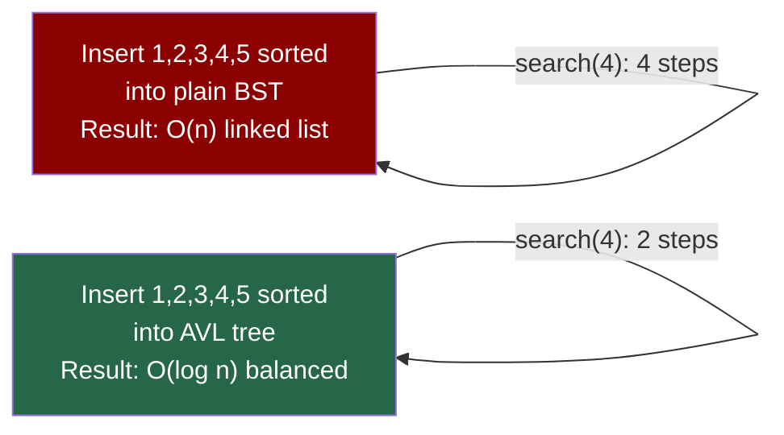
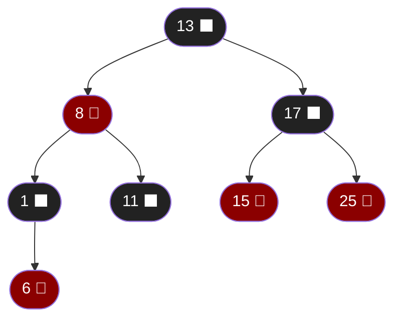
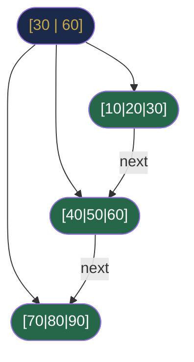

# Chapter 28 — Balanced Search Trees

## Learning Objectives

By the end of this chapter, you will be able to:

- Explain why unbalanced BSTs degrade to O(n) and why self-balancing is necessary
- Describe AVL rotations and when each type is applied
- Understand the red-black tree colouring rules at a conceptual level
- Explain how Java's `TreeMap` and `TreeSet` guarantee O(log n) operations
- Describe B-Trees and B+ Trees and their role in database indexing

---

## Contents

- [28.1 Why Balance Matters](#281-why-balance-matters)
- [28.2 AVL Trees](#282-avl-trees)
- [28.3 Rotations](#283-rotations)
- [28.4 AVL Insertion Case Analysis](#284-avl-insertion-case-analysis)
- [28.5 Red-Black Trees](#285-red-black-trees)
- [28.6 AVL vs Red-Black: Trade-offs](#286-avl-vs-red-black-trade-offs)
- [28.7 B-Trees and B+ Trees](#287-b-trees-and-b-trees)
- [28.8 Java TreeMap Internals](#288-java-treemap-internals)
- [Interview Insight](#interview-insight)
- [Quick Quiz](#quick-quiz)
- [28.9 Practice Problems](#289-practice-problems)
- [Chapter Summary](#chapter-summary)

---

> [!NOTE]
> **Historical Context**  
> **AVL trees** were invented by Soviet mathematicians **Georgy Adelson-Velsky** and **Evgenii Landis** in **1962** — the first self-balancing BST. The name comes from their initials. They published it as a solution to the O(n) worst-case BST problem, using a simple invariant: the height difference between left and right subtrees of any node must be at most 1. **Red-black trees** were invented by **Rudolf Bayer** in **1972** (as "symmetric binary B-trees") and simplified into the red-black formulation by **Leo Guibas and Robert Sedgewick** in **1978**. The name "red-black" came from the available ink colours on the printer Guibas and Sedgewick were using at the time. The B-Tree family was invented by **Rudolf Bayer** and **Edward McCreight** at Boeing Research Labs in **1972** and underpins virtually every relational database index on the planet.

---

> ### 🔗 Analogy
> **A Self-Levelling Table**
>
> Imagine a table with hydraulic legs. As you pile books on the left side, the left legs extend to level the table again. This is exactly what self-balancing trees do — after every insertion or deletion, they "re-level" (rotate) to restore their balance invariant. The cost of re-levelling is small (O(log n) rotations) and prevents the catastrophic case where the table tips over (O(n) operations).

---

## 28.1 Why Balance Matters

Recall from Chapter 27 that BST operations are O(h) where h = tree height.

| BST Scenario | Height | Ops |
|-------------|--------|-----|
| Random insertions | ~2.1 log₂ n | O(log n) avg |
| Sorted insertions | n − 1 | O(n) |
| Adversarially ordered | n − 1 | O(n) |
| **Self-balancing (AVL)** | **≤ 1.44 log₂ n** | **O(log n) guaranteed** |
| **Self-balancing (R-B)** | **≤ 2 log₂ n** | **O(log n) guaranteed** |

A self-balancing tree pays O(log n) extra work per insert/delete to **guarantee** O(log n) for every future operation. This is almost always worth it.



---

## 28.2 AVL Trees

An **AVL tree** is a BST with an additional **balance factor** stored at each node:

```
balance_factor(node) = height(node.left) - height(node.right)
```

**AVL invariant:** For every node, `balance_factor ∈ {-1, 0, 1}`.

If insertion or deletion causes any node's balance factor to reach ±2, one or two **rotations** restore balance.

```java
class AVLNode {
    int val, height;
    AVLNode left, right;
    AVLNode(int val) { this.val = val; this.height = 1; }
}

int height(AVLNode node) { return node == null ? 0 : node.height; }

int balanceFactor(AVLNode node) {
    return node == null ? 0 : height(node.left) - height(node.right);
}

void updateHeight(AVLNode node) {
    node.height = 1 + Math.max(height(node.left), height(node.right));
}
```

---

## 28.3 Rotations

Rotations are **O(1) operations** that restructure a subtree while preserving the BST property.

**What a rotation does:**  
A rotation changes the *structure* (which node is the root of a subtree) without changing the *inorder traversal sequence*. Since inorder sequence = sorted order = BST property, any rotation automatically preserves BST correctness.

**Mental model:** Think of a rotation as "promoting" a child to become the new root of the subtree, and demoting the old root to become a child. The tricky part is correctly rehoming the displaced grandchild (`T3` in diagrams below).

**Why rotations fix height imbalance:**  
In a right rotation on node Z (left-heavy), Y (Z's left child) becomes the new root. Y is at height h, Z was at height h+2 (too tall). After rotation, the subtree root is at height h+1 — balanced.

**Why only 1-2 rotations suffice:**  
Each rotation reduces the height of the subtree by 1. LL/RR imbalances are fixed with one rotation. LR/RL imbalances have the new element in the "inner" grandchild position — one rotation would make it worse (the inner grandchild would become deeper). A preliminary rotation on the child straightens the "zigzag" into a "straight line", then one more rotation on the grandparent fixes it.

### Right Rotation (LL case)

Applied when the left subtree is too tall and the imbalance is in the **left-left** direction (the tall child is the left child's left subtree).

**Step by step:**
1. Y (Z's left child) becomes the new subtree root
2. Z becomes Y's right child
3. Y's old right child (T3) becomes Z's new left child (must: T3's values are between Y and Z)

```
       z                   y
      / \                 / \
     y   T4    →         x   z
    / \                 / \ / \
   x   T3              T1 T2 T3 T4
  / \
 T1  T2
```

```java
AVLNode rotateRight(AVLNode z) {
    AVLNode y  = z.left;
    AVLNode T3 = y.right;
    y.right = z;
    z.left  = T3;
    updateHeight(z);
    updateHeight(y);
    return y;   // y is the new subtree root
}
```

### Left Rotation (RR case)

**Mirror image of right rotation:** Y (Z's right child) becomes the new root, Z becomes Y's left child, T2 (Y's old left) becomes Z's right child.

Applied when the right subtree is too tall and the imbalance is in the **right-right** direction.

```
     z                      y
    / \                    / \
   T1   y       →         z   x
       / \               / \ / \
      T2  x             T1 T2 T3 T4
         / \
        T3  T4
```

```java
AVLNode rotateLeft(AVLNode z) {
    AVLNode y  = z.right;
    AVLNode T2 = y.left;
    y.left  = z;
    z.right = T2;
    updateHeight(z);
    updateHeight(y);
    return y;
}
```

---

## 28.4 AVL Insertion Case Analysis

After inserting a new node, walk up the tree and re-balance each unbalanced node. Four cases arise based on which grandchild subtree received the new node:

| Case | Meaning | Shape | Fix |
|------|---------|-------|-----|
| **LL** | New node in left child's **left** subtree | Straight left lean | 1 right rotation at Z |
| **RR** | New node in right child's **right** subtree | Straight right lean | 1 left rotation at Z |
| **LR** | New node in left child's **right** subtree | Zigzag left-right | Left rotation at Y (straighten), then right rotation at Z |
| **RL** | New node in right child's **left** subtree | Zigzag right-left | Right rotation at Y (straighten), then left rotation at Z |

**Why LR and RL need two rotations:**  
In the LR case, the imbalance is a "zigzag": the tall path goes left then right. A single right rotation would put the inner grandchild in the wrong position. We first do a left rotation on Y (the left child) to convert the zigzag into a straight LL shape, then one right rotation on Z fixes it.

```
LR before:   After left-rotate Y:  After right-rotate Z:
    Z               Z                   X
   / \             / \                 / \
  Y   T4          X   T4             Y   Z
 / \             / \                / \ / \
T1  X           Y  T3             T1 T2 T3 T4
   / \         / \
  T2  T3      T1  T2
```

```java
AVLNode balance(AVLNode node) {
    updateHeight(node);
    int bf = balanceFactor(node);

    if (bf > 1) {                                       // Left heavy
        if (balanceFactor(node.left) < 0)              // LR case
            node.left = rotateLeft(node.left);
        return rotateRight(node);                       // LL case (or after LR fix)
    }
    if (bf < -1) {                                      // Right heavy
        if (balanceFactor(node.right) > 0)             // RL case
            node.right = rotateRight(node.right);
        return rotateLeft(node);                        // RR case (or after RL fix)
    }
    return node;                                        // already balanced
}

AVLNode insert(AVLNode root, int val) {
    if (root == null) return new AVLNode(val);
    if (val < root.val) root.left  = insert(root.left,  val);
    else if (val > root.val) root.right = insert(root.right, val);
    return balance(root);
}
```

> [!TIP]
> **Did You Know?**  
> At most **2 rotations** are ever needed after an AVL insertion (1 for LL/RR, 2 for LR/RL). After deletion, up to O(log n) rotations may be needed up the path to the root. By contrast, red-black trees require at most **3 rotations** for both insertion and deletion — a significant practical advantage for write-heavy workloads.

---

## 28.5 Red-Black Trees

A **red-black tree** is a BST where every node is coloured red or black, and four colouring rules maintain a **relaxed** balance guarantee.

**Red-Black Rules:**
1. Every node is either **Red** or **Black**
2. The **root** is always **Black**
3. Every **null leaf** (NIL sentinel) is **Black**
4. **Red nodes** cannot have red children (**no two consecutive reds**)
5. Every path from any node to any of its null leaves passes through the **same number of black nodes** (the **black-height**)



**Height bound:** A red-black tree with $n$ internal nodes has height at most $2 \log_2(n+1)$.

**Why the height bound holds:**
- Rule 4 → no path has two consecutive reds
- Rule 5 → all paths have the same black-height $b$
- Shortest path: $b$ nodes (all black)
- Longest path: $2b$ nodes (alternating red-black)
- Result: `height ≤ 2 × black-height ≤ 2 log₂(n+1)`

**Insertion rebalancing:** After inserting a red node, fix violations using:
- **Recolouring** (parent's sibling is red): recolour parent + uncle to black, grandparent to red
- **Rotation** (parent's sibling is black): 1 or 2 rotations plus recolouring

---

## 28.6 AVL vs Red-Black: Trade-offs

| Property | AVL | Red-Black |
|----------|-----|----------|
| Balance condition | Strict (height diff ≤ 1) | Relaxed (2× black-height) |
| Height bound | ≤ 1.44 log₂ n | ≤ 2 log₂ n |
| Lookup speed | Faster (shorter tree) | Slightly slower |
| Insert/Delete rebalancing | Up to O(log n) rotations | At most 2–3 rotations |
| Write performance | Slower | Faster |
| Used in Java | — | `TreeMap`, `TreeSet` |
| Used in Linux kernel | — | Completely Fair Scheduler |
| Used in C++ STL | Some implementations | `std::map`, `std::set` |
| Memory per node | +1 int (height) | +1 bit (colour) |

**Rule of thumb:** Use AVL trees when **reads vastly outnumber writes** (the extra height savings pay off). Use red-black trees when **writes are frequent** (fewer rotations per update).

---

## 28.7 B-Trees and B+ Trees

### B-Tree

A **B-Tree of order $m$** is a self-balancing tree where:
- Every node can have between $\lceil m/2 \rceil$ and $m$ children
- All leaves are at the same depth
- Each internal node with $k$ children stores $k-1$ sorted keys

```
               [30, 70]
              /    |    \
     [10, 20]  [40, 50, 60]  [80, 90]
     /  |  \     |  |  |  \   /  |  \
   ...  ...  ... ...      ... ...  ...
```

**Why B-Trees for databases?** Disk I/O is orders of magnitude slower than RAM. A B-Tree node is designed to fit in a **disk page** (4KB–16KB). With branching factor $m = 100$, a B-Tree of height 4 can index $100^4 = 100$ million records — with only 4 disk reads per lookup.

### B+ Tree

A **B+ Tree** (used by virtually every RDBMS) differs:
- All **data** lives only in **leaf nodes**
- Leaf nodes are **linked** (sorted linked list of data)
- Internal nodes store only keys for routing



**B+ Tree advantages over B-Tree:**
- **Range queries:** Follow the leaf linked list (O(k + log n) for k results)
- **Higher branching factor:** Internal nodes store only keys, fitting more in a disk page
- **Predictable performance:** All lookups reach a leaf in exactly h steps

> [!TIP]
> **Real-World Usage**  
> Every relational database you use is built on B+ Trees. MySQL's InnoDB storage engine, PostgreSQL, Oracle Database, and SQLite all use B+ trees for primary and secondary indexes. When you run `CREATE INDEX`, you are building a B+ tree. When a query planner says "Index scan: 1–3 ms", it is traversing a B+ tree with height ~3 on a table with millions of rows. The branching factor (typically 100–1000) keeps the tree so flat that most tables fit in a 2–4 level tree even at 100 million rows.

---

## 28.8 Java TreeMap Internals

Java's `TreeMap<K, V>` and `TreeSet<E>` are both backed by a **red-black tree**.

```java
// All O(log n):
TreeMap<Integer, String> map = new TreeMap<>();
map.put(5, "five");
map.put(3, "three");
map.put(7, "seven");

map.firstKey();           // 3  — minimum
map.lastKey();            // 7  — maximum
map.floorKey(4);          // 3  — largest key ≤ 4
map.ceilingKey(4);        // 5  — smallest key ≥ 4
map.lowerKey(5);          // 3  — largest key < 5
map.higherKey(5);         // 7  — smallest key > 5
map.headMap(5);           // {3=three} — keys strictly less than 5
map.tailMap(5);           // {5=five, 7=seven} — keys ≥ 5
map.subMap(3, 7);         // {3=three, 5=five} — keys in [3, 7)
map.descendingKeySet();   // [7, 5, 3]
```

**Key detail:** `subMap`, `headMap`, `tailMap` return **live views** — modifying the original `TreeMap` reflects in the returned view, and vice versa.

**TreeSet methods:**

```java
TreeSet<Integer> set = new TreeSet<>(Arrays.asList(1, 3, 5, 7, 9));
set.floor(4);    // 3
set.ceiling(4);  // 5
set.lower(5);    // 3
set.higher(5);   // 7
```

> [!NOTE]
> **Java Red-Black Tree Implementation Detail**  
> Java's `TreeMap` uses a classic red-black tree implementation with 5 fields per entry: `key`, `value`, `left`, `right`, `parent`, `boolean color`. The `parent` pointer (absent in textbook BSTs) is needed for efficient in-place rebalancing without recursion. Each `TreeMap.Entry` object uses ~56 bytes on a 64-bit JVM — significantly more than a `HashMap.Node` (~32 bytes). This is the memory cost of ordering guarantees.

---

## Interview Insight

> **Most interviewers test conceptual understanding, not implementation:**
> - "What invariant does an AVL tree maintain?" → Height difference ≤ 1 at every node
> - "Why does Java use red-black trees instead of AVL for `TreeMap`?" → Fewer rotations on write-heavy workloads
> - "Why do databases use B+ Trees instead of red-black trees?" → Disk page alignment, range queries via leaf linked list, much higher branching factor reduces I/O depth
>
> You are rarely asked to implement rotations from scratch. You *are* expected to explain the trade-offs.

---

## Quick Quiz

1. What is the balance factor of a node in an AVL tree, and what values are acceptable?
2. How many rotations does an AVL insertion require at most?
3. State two of the five red-black tree colouring rules.
4. Why does a red-black tree have height ≤ 2 log₂(n+1)?
5. What is the key structural difference between a B-Tree and a B+ Tree?

**Answers:**
1. Balance factor = height(left) - height(right); acceptable values are {-1, 0, 1}
2. At most 2 rotations (one for LR/RL, then one more for the resulting LL/RR)
3. Any two of: Root is black; Red nodes have no red children; All paths to null leaves have the same black-height; Every node is red or black; Null leaves are black
4. Rule 4 prevents consecutive reds → longest path is at most 2× shortest; Rule 5 → all paths have equal black-height $b$ → height ≤ 2b ≤ 2 log₂(n+1)
5. B+ Trees store all data in leaves; internal nodes store routing keys only; leaves are linked forming a sorted list (enables efficient range queries)

---

## 28.9 Practice Problems

**Conceptual:**
- Draw the AVL tree after inserting `[10, 20, 30, 40, 50, 25]`. Show all rotations.
- State the four AVL rotation cases and when each applies.
- Explain why red-black trees need fewer rotations on deletion than AVL trees.

**Medium:**
- Implement an AVL tree with insert and search operations.
- Write a function that finds the kth smallest element in a balanced BST in O(log n).

**Hard:**
- Implement a simple B-Tree with insert and search for a fixed order m.
- Solve "Count of Smaller Numbers After Self" (LC 315) — this problem is solved elegantly with a BST/sorted structure.
- Design a data structure for range queries: given a stream of integers, answer `countInRange(lo, hi)` queries in O(log n) using `TreeMap`.

---

## Chapter Summary

| Structure | Height | Rebalancing | Use |
|-----------|--------|-------------|-----|
| Plain BST | O(n) worst | None | Simple; random data only |
| AVL tree | ≤ 1.44 log₂ n | ≤ 2 rotations (insert) | Read-heavy; needs strict balance |
| Red-black tree | ≤ 2 log₂ n | ≤ 3 rotations (always) | General purpose; Java `TreeMap` |
| B-Tree (order m) | O(log_m n) | Split/merge | Disk storage; arbitrary branching |
| B+ Tree | O(log_m n) | Split/merge | Databases; range queries |

| Key Concept | Takeaway |
|-------------|----------|
| AVL invariant | \|height(L) - height(R)\| ≤ 1 at every node |
| Rotation | O(1) restructuring that preserves BST order |
| Four rotation cases | LL, RR → 1 rotation; LR, RL → 2 rotations |
| R-B height bound | Relaxed balance; ≤ 2 log₂(n+1) |
| B+ Tree leaf links | Enable O(k + log n) range queries |
| Java TreeMap | Red-black tree; O(log n) all operations; NavigableMap interface |

---

*← [Chapter 27 — Binary Search Trees](chapter-27-binary-search-trees.md)*  
*→ [Chapter 29 — Advanced Tree Structures](chapter-29-advanced-trees.md)*
