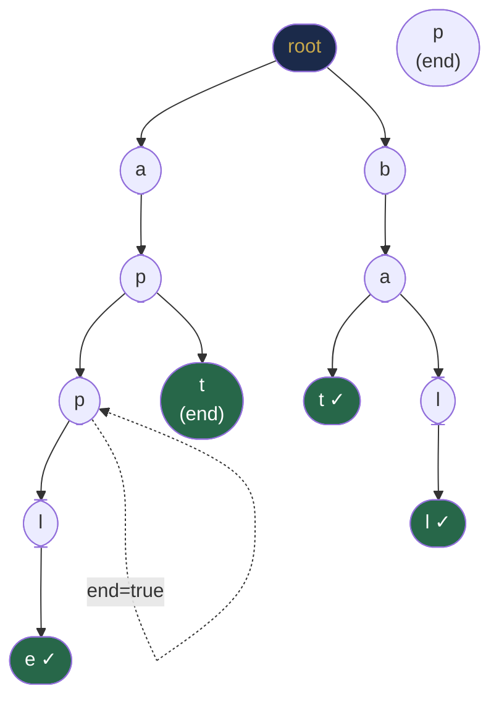
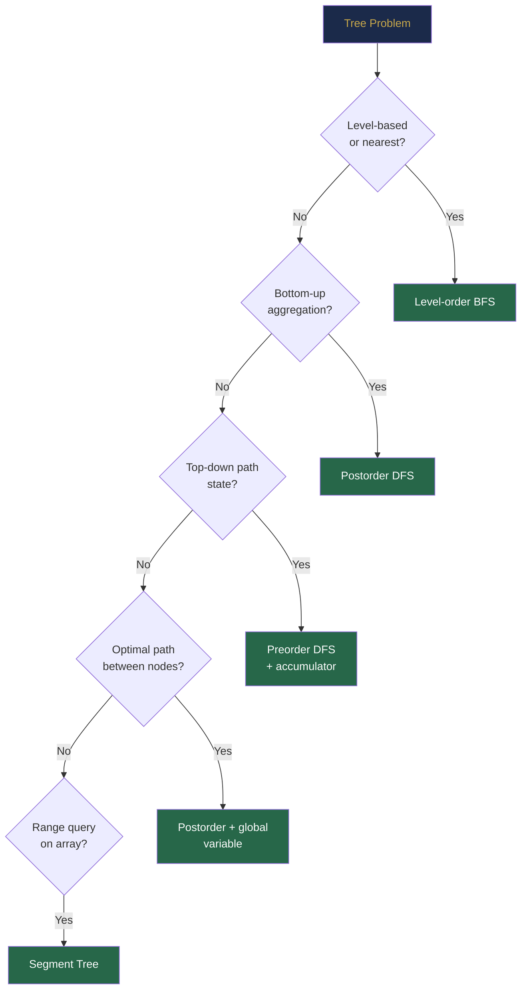

# Chapter 29 — Advanced Tree Structures

## Learning Objectives

By the end of this chapter, you will be able to:

- Implement N-ary trees and traverse them recursively
- Build a Trie and use it for prefix search, autocomplete, and word existence queries
- Implement tree serialization and deserialization
- Understand segment trees conceptually and their applications
- Apply tree problem-solving patterns to complex interview problems

---

## Contents

- [29.1 N-ary Trees](#291-n-ary-trees)
- [29.2 Tries (Prefix Trees)](#292-tries-prefix-trees)
- [29.3 Trie Implementation](#293-trie-implementation)
- [29.4 Autocomplete with Tries](#294-autocomplete-with-tries)
- [29.5 Word Search with Tries](#295-word-search-with-tries)
- [29.6 Tree Serialization and Deserialization](#296-tree-serialization-and-deserialization)
- [29.7 Segment Tree Introduction](#297-segment-tree-introduction)
- [29.8 Tree Problem-Solving Patterns](#298-tree-problem-solving-patterns)
- [Interview Insight](#interview-insight)
- [Quick Quiz](#quick-quiz)
- [29.9 Practice Problems](#299-practice-problems)
- [Chapter Summary](#chapter-summary)

---

> [!NOTE]
> **Historical Context**  
> **Tries** were invented by **René de la Briandais** in **1959** for storing a dictionary of strings, and the name "trie" (from "re**trie**val") was coined by **Edward Fredkin** in **1960**. Tries predate most modern data structures. **N-ary trees** have been in computer science since the earliest days of LISP (1958), where S-expressions are trees with arbitrary branching. **Segment trees** were developed independently in computational geometry in the 1970s and popularised in competitive programming in the 1990s through the work of Jon Bentley and others. **Tree serialization** became critical with the rise of distributed systems in the 2000s — JSON, Protocol Buffers, and Thrift are all serialization formats for tree-shaped data structures.

---

## 29.1 N-ary Trees

An **N-ary tree** allows each node to have any number of children (not restricted to 2).

```java
class NaryNode {
    int val;
    List<NaryNode> children;

    NaryNode(int val) {
        this.val = val;
        this.children = new ArrayList<>();
    }
}
```

**Real-world N-ary trees:**
- **File systems:** a directory can have any number of files/subdirectories
- **HTML DOM:** an element can have any number of child elements
- **Organisation charts:** a manager can have any number of direct reports
- **Git tree objects:** a commit tree has children for each file/subdirectory

### Traversals of N-ary Trees

**Preorder (root → all children):**

```java
List<Integer> preorder(NaryNode root) {
    List<Integer> result = new ArrayList<>();
    if (root == null) return result;
    result.add(root.val);
    for (NaryNode child : root.children)
        result.addAll(preorder(child));
    return result;
}
```

**Postorder (all children → root):**

```java
List<Integer> postorder(NaryNode root) {
    List<Integer> result = new ArrayList<>();
    if (root == null) return result;
    for (NaryNode child : root.children)
        result.addAll(postorder(child));
    result.add(root.val);
    return result;
}
```

**Level-order (identical to binary — just enqueue all children):**

```java
List<List<Integer>> levelOrder(NaryNode root) {
    List<List<Integer>> result = new ArrayList<>();
    if (root == null) return result;
    Queue<NaryNode> q = new ArrayDeque<>();
    q.offer(root);
    while (!q.isEmpty()) {
        int size = q.size();
        List<Integer> level = new ArrayList<>();
        for (int i = 0; i < size; i++) {
            NaryNode node = q.poll();
            level.add(node.val);
            q.addAll(node.children);    // enqueue all children
        }
        result.add(level);
    }
    return result;
}
```

**Height of an N-ary tree:**

```java
int height(NaryNode root) {
    if (root == null) return -1;
    int maxChildHeight = -1;
    for (NaryNode child : root.children)
        maxChildHeight = Math.max(maxChildHeight, height(child));
    return 1 + maxChildHeight;
}
```

---

## 29.2 Tries (Prefix Trees)

A **Trie** is a tree where:
- Each **node** represents a character (or a character position in a word)
- The **path from root to a node** spells out a prefix
- A node may be marked as **end of word**
- Each node has up to 26 children (for lowercase English) or more (for Unicode)

```
Trie storing: ["app", "apple", "apt", "bat", "ball"]

        (root)
       /       \
      a          b
      |          |
      p          a
     / \        / \
    p   t      t   l
    |   |      |   |
   l*  *       *  l
    |               |
    e*              *
```

*Nodes marked * are end-of-word.*



**Trie vs HashMap for string lookups:**

| Operation | HashMap | Trie |
|-----------|---------|------|
| Exact search | O(\|word\|) avg | O(\|word\|) |
| Prefix search | O(n · \|prefix\|) | O(\|prefix\|) |
| All words with prefix | O(n) | O(\|prefix\| + k) |
| Space | O(total chars) | O(total chars × alphabet) |
| Wildcard / regex | Difficult | Natural with DFS |

> [!TIP]
> **Real-World Usage**  
> Every search engine you use employs a structure similar to a Trie or a compressed Trie (Patricia/Radix tree) for autocomplete. Google's search bar, IDE code completion, spell checkers, DNS name resolution, IP routing tables (longest prefix match), and T9 predictive text on old phones all use Trie variants. The Linux kernel's routing table uses a **radix tree** (compressed trie) to match IP addresses in O(\|IP\|) = O(32) or O(128) steps.

---

## 29.3 Trie Implementation

```java
class TrieNode {
    TrieNode[] children = new TrieNode[26];
    boolean isEndOfWord = false;
}

class Trie {
    private final TrieNode root = new TrieNode();

    public void insert(String word) {
        TrieNode curr = root;
        for (char c : word.toCharArray()) {
            int idx = c - 'a';
            if (curr.children[idx] == null)
                curr.children[idx] = new TrieNode();
            curr = curr.children[idx];
        }
        curr.isEndOfWord = true;
    }

    public boolean search(String word) {
        TrieNode node = getNode(word);
        return node != null && node.isEndOfWord;
    }

    public boolean startsWith(String prefix) {
        return getNode(prefix) != null;
    }

    private TrieNode getNode(String prefix) {
        TrieNode curr = root;
        for (char c : prefix.toCharArray()) {
            int idx = c - 'a';
            if (curr.children[idx] == null) return null;
            curr = curr.children[idx];
        }
        return curr;
    }
}
```

**Complexity:**
- `insert`: O(|word|)
- `search`: O(|word|)
- `startsWith`: O(|prefix|)
- Space: O(total_characters × 26) — worse than HashMap for sparse alphabets

**HashMap-based TrieNode** (more flexible for large alphabets):

```java
class TrieNode {
    Map<Character, TrieNode> children = new HashMap<>();
    boolean isEnd = false;
}
```

---

## 29.4 Autocomplete with Tries

**Problem:** Given a list of words and a prefix, return all words that start with the prefix.

```java
List<String> autocomplete(String prefix) {
    TrieNode node = getNode(prefix);
    if (node == null) return Collections.emptyList();
    List<String> results = new ArrayList<>();
    dfsCollect(node, new StringBuilder(prefix), results);
    return results;
}

void dfsCollect(TrieNode node, StringBuilder current, List<String> results) {
    if (node.isEndOfWord) results.add(current.toString());
    for (int i = 0; i < 26; i++) {
        if (node.children[i] != null) {
            current.append((char)('a' + i));
            dfsCollect(node.children[i], current, results);
            current.deleteCharAt(current.length() - 1);  // backtrack
        }
    }
}
```

### Search Suggestions System (LC 1268)

For each prefix of the search term, return the 3 lexicographically smallest matching words.

```java
List<List<String>> suggestedProducts(String[] products, String searchWord) {
    Arrays.sort(products);                      // ensures lexicographic DFS order
    Trie trie = new Trie();
    for (String p : products) trie.insert(p);

    List<List<String>> result = new ArrayList<>();
    for (int i = 1; i <= searchWord.length(); i++) {
        String prefix = searchWord.substring(0, i);
        List<String> suggestions = trie.autocomplete(prefix);
        result.add(suggestions.subList(0, Math.min(3, suggestions.size())));
    }
    return result;
}
```

> [!TIP]
> **Did You Know?**  
> Google's autocomplete system must handle billions of prefix queries per day while ranking results by popularity, recency, and personalisation — far beyond a simple Trie. Google uses a combination of **distributed tries**, **approximate nearest neighbour search**, and **neural language models** (since 2015). But the foundational concept — indexing prefixes for instant lookup — is still trie-based at its core. The first version of Google's autocomplete (launched 2008) was largely a client-side trie over the top 1000 search terms.

---

## 29.5 Word Search with Tries

**Word Search II (LC 212):** Given an `m × n` board and a list of words, find all words present in the board (connected horizontal/vertical cells, no cell reused).

**Naive approach:** DFS from every cell for every word → O(m × n × 4^L × |words|).

**Trie approach:** Build a Trie of all words; run a single DFS from every cell, pruning branches not in the Trie.

```java
List<String> findWords(char[][] board, String[] words) {
    Trie trie = new Trie();
    for (String w : words) trie.insert(w);
    List<String> result = new ArrayList<>();
    int m = board.length, n = board[0].length;
    for (int r = 0; r < m; r++)
        for (int c = 0; c < n; c++)
            dfs(board, r, c, trie.root, result);
    return result;
}

void dfs(char[][] board, int r, int c, TrieNode node, List<String> result) {
    if (r < 0 || r >= board.length || c < 0 || c >= board[0].length) return;
    char ch = board[r][c];
    if (ch == '#' || node.children[ch - 'a'] == null) return;    // pruned
    node = node.children[ch - 'a'];
    if (node.isEndOfWord) { result.add(node.word); node.isEndOfWord = false; }  // found, avoid duplicate
    board[r][c] = '#';                                            // mark visited
    dfs(board, r+1, c, node, result);
    dfs(board, r-1, c, node, result);
    dfs(board, r, c+1, node, result);
    dfs(board, r, c-1, node, result);
    board[r][c] = ch;                                             // backtrack
}
```

---

## 29.6 Tree Serialization and Deserialization

**Serialization** converts a tree to a string/array for storage or transmission.  
**Deserialization** reconstructs the tree from that representation.

### Level-Order (BFS) Serialization — LeetCode standard

```java
String serialize(TreeNode root) {
    if (root == null) return "[]";
    StringBuilder sb = new StringBuilder("[");
    Queue<TreeNode> q = new ArrayDeque<>();
    q.offer(root);
    while (!q.isEmpty()) {
        TreeNode node = q.poll();
        if (node == null) { sb.append("null,"); continue; }
        sb.append(node.val).append(",");
        q.offer(node.left);
        q.offer(node.right);
    }
    sb.deleteCharAt(sb.length() - 1);
    return sb.append("]").toString();
}

TreeNode deserialize(String data) {
    data = data.substring(1, data.length() - 1);
    if (data.isEmpty()) return null;
    String[] vals = data.split(",");
    TreeNode root = new TreeNode(Integer.parseInt(vals[0]));
    Queue<TreeNode> q = new ArrayDeque<>();
    q.offer(root);
    int i = 1;
    while (!q.isEmpty() && i < vals.length) {
        TreeNode node = q.poll();
        if (!vals[i].equals("null")) { node.left = new TreeNode(Integer.parseInt(vals[i])); q.offer(node.left); }
        i++;
        if (i < vals.length && !vals[i].equals("null")) { node.right = new TreeNode(Integer.parseInt(vals[i])); q.offer(node.right); }
        i++;
    }
    return root;
}
```

### Preorder (DFS) Serialization — Compact for dense trees

```java
String serialize(TreeNode root) {
    StringBuilder sb = new StringBuilder();
    serializeDfs(root, sb);
    return sb.toString();
}

void serializeDfs(TreeNode node, StringBuilder sb) {
    if (node == null) { sb.append("N,"); return; }
    sb.append(node.val).append(",");
    serializeDfs(node.left, sb);
    serializeDfs(node.right, sb);
}

TreeNode deserialize(String data) {
    Queue<String> q = new ArrayDeque<>(Arrays.asList(data.split(",")));
    return deserializeDfs(q);
}

TreeNode deserializeDfs(Queue<String> q) {
    String val = q.poll();
    if (val.equals("N")) return null;
    TreeNode node = new TreeNode(Integer.parseInt(val));
    node.left  = deserializeDfs(q);
    node.right = deserializeDfs(q);
    return node;
}
```

---

## 29.7 Segment Tree Introduction

### The Problem That Motivates the Segment Tree

**Scenario:** You have an array and you must answer many queries of the form "what is the sum of elements from index l to r?" AND the array changes frequently (point updates).

| Approach | Query time | Update time | Comment |
|----------|-----------|-------------|--------|
| Naive sum loop | O(n) | O(1) | Too slow for many queries |
| Prefix sum array (Ch 10) | O(1) | O(n) | Rebuild on every update: unacceptable |
| **Segment tree** | **O(log n)** | **O(log n)** | Best of both worlds |

### What a Segment Tree Is

A **Segment Tree** is a binary tree built on an array where:
- Each **leaf node** stores one array element
- Each **internal node** stores the sum (or min/max) of its children's ranges
- The **root** covers the entire array `[0, n-1]`

**Key idea:** We precompute sums for all "segments" (ranges) of the array in a hierarchical way. Any query range `[l, r]` can be decomposed into at most O(log n) pre-computed segments from the tree.

```
Array: [1, 3, 5, 7, 9, 11]
       idx: 0  1  2  3  4   5

Segment Tree (each node = sum of its range):

                  36 [0,5]          ← root: sum of entire array
                 /         \
          9 [0,2]           27 [3,5]  ← halves
          /      \          /      \
      4 [0,1]  5[2]   16[3,4]   11[5]  ← quarters
      /    \            /    \
   1[0]   3[1]       7[3]   9[4]        ← leaves (original elements)
```

### Why Array Representation?

The segment tree is a **complete binary tree**, so we store it in an array (same technique from Ch 25). For node at index `i`:
- Left child: `2i + 1`
- Right child: `2i + 2`
- Array size: `4n` is a safe upper bound (the tree has at most `4n` nodes for `n` elements)

### Build — O(n)

**Intuition:** Build bottom-up. Leaves get the array values. Each internal node = sum of its two children. This is a standard postorder traversal: compute children first, then the parent.

```java
void build(int[] arr, int node, int lo, int hi) {
    if (lo == hi) {                              // leaf: store array value
        tree[node] = arr[lo];
        return;
    }
    int mid = lo + (hi - lo) / 2;
    build(arr, 2*node+1, lo,    mid);            // build left child
    build(arr, 2*node+2, mid+1, hi);             // build right child
    tree[node] = tree[2*node+1] + tree[2*node+2]; // internal: sum of children
}
```

**Complexity:** O(n) — visits each of the ~2n tree nodes exactly once.

### Query — O(log n)

**Intuition:** Every query range `[l, r]` can be decomposed into at most O(log n) "completely covered" segments in the tree. The recursion has three cases:
1. **No overlap:** Current segment `[lo, hi]` is completely outside `[l, r]` → return 0 (identity for sum)
2. **Complete overlap:** Current segment `[lo, hi]` is completely inside `[l, r]` → return precomputed value
3. **Partial overlap:** Split at mid, recurse left and right, combine answers

```
Query [2, 4] on array [1,3,5,7,9,11]:

node=36[0,5]: partial → split
  node=9[0,2]:  partial (l=2 cuts here) → split
    node=4[0,1]: NO overlap (1 < 2) → return 0
    node=5[2]:   complete overlap [2,2] inside [2,4] → return 5
  node=27[3,5]: partial (r=4 cuts here) → split
    node=16[3,4]: complete overlap → return 16
    node=11[5]:   NO overlap (5 > 4) → return 0

Total: 0 + 5 + 16 + 0 = 21  ✓ (arr[2]+arr[3]+arr[4] = 5+7+9 = 21)
```

```java
int query(int node, int lo, int hi, int l, int r) {
    if (r < lo || hi < l) return 0;              // Case 1: no overlap
    if (l <= lo && hi <= r) return tree[node];   // Case 2: complete overlap
    int mid = lo + (hi - lo) / 2;               // Case 3: partial overlap
    return query(2*node+1, lo, mid,    l, r)     //   recurse left
         + query(2*node+2, mid+1, hi,  l, r);   //   recurse right
}
```

**Why O(log n)?** At each level, at most 4 nodes are visited (2 at the boundary on each side). With O(log n) levels, total = O(log n).

### Update — O(log n)

**Intuition:** When one array element changes, only the tree nodes on the **path from that leaf to the root** need to be updated — at most h = O(log n) nodes. Nodes in other subtrees are unaffected.

```
Update arr[3] = 10 (was 7):

Path from leaf [3] to root:
  leaf [3]: update tree value from 7 to 10
  parent [3,4]: was 7+9=16, now 10+9=19
  grandparent [3,5]: was 16+11=27, now 19+11=30
  root [0,5]: was 36, now 36-7+10=39
```

```java
void update(int node, int lo, int hi, int idx, int val) {
    if (lo == hi) {                              // reached the leaf
        tree[node] = val;
        return;
    }
    int mid = lo + (hi - lo) / 2;
    if (idx <= mid) update(2*node+1, lo, mid,    idx, val);  // go left
    else            update(2*node+2, mid+1, hi,  idx, val);  // go right
    tree[node] = tree[2*node+1] + tree[2*node+2];  // recompute this node
}
```

### Complete Implementation

```java
class SegmentTree {
    int[] tree;
    int n;

    SegmentTree(int[] arr) {
        n = arr.length;
        tree = new int[4 * n];       // safe upper bound for tree size
        build(arr, 0, 0, n - 1);
    }

    void build(int[] arr, int node, int lo, int hi) {
        if (lo == hi) { tree[node] = arr[lo]; return; }
        int mid = lo + (hi - lo) / 2;
        build(arr, 2*node+1, lo, mid);
        build(arr, 2*node+2, mid+1, hi);
        tree[node] = tree[2*node+1] + tree[2*node+2];
    }

    int query(int node, int lo, int hi, int l, int r) {
        if (r < lo || hi < l) return 0;             // out of range: identity element
        if (l <= lo && hi <= r) return tree[node];  // fully covered: use precomputed
        int mid = lo + (hi - lo) / 2;
        return query(2*node+1, lo, mid, l, r) + query(2*node+2, mid+1, hi, l, r);
    }

    void update(int node, int lo, int hi, int idx, int val) {
        if (lo == hi) { tree[node] = val; return; }
        int mid = lo + (hi - lo) / 2;
        if (idx <= mid) update(2*node+1, lo, mid, idx, val);
        else            update(2*node+2, mid+1, hi, idx, val);
        tree[node] = tree[2*node+1] + tree[2*node+2];
    }

    // Public API: hide tree-node internals
    int query(int l, int r) { return query(0, 0, n-1, l, r); }
    void update(int idx, int val) { update(0, 0, n-1, idx, val); }
}
```

**Complexity:**
- Build: O(n) — each of ~2n nodes built once
- Query: O(log n) — at most O(log n) nodes visited per query
- Update: O(log n) — path from leaf to root has length O(log n)
- Space: O(n) backing array of size 4n

**How to change from sum to min/max:** Replace `+` with `Math.min()` / `Math.max()` in `build`, `query`, and `update`. Change the "identity element" returned for no-overlap case: 0 for sum, `Integer.MAX_VALUE` for min, `Integer.MIN_VALUE` for max.

> [!NOTE]
> **Why Segment Trees?**  
> A naive range sum query takes O(n) per query. A prefix sum array (Chapter 10) answers range queries in O(1) but cannot handle updates (rebuilding takes O(n)). A segment tree bridges both: O(log n) updates and O(log n) queries. For competitive programming and real-time analytics systems where data changes frequently (stock tickers, sensor streams, game leaderboards), segment trees or their variants (Fenwick trees / Binary Indexed Trees) are the standard solution.

---

## 29.8 Tree Problem-Solving Patterns

After studying five chapters of trees, here are the master patterns:

| Pattern | When to Use | Key Technique |
|---------|------------|---------------|
| **DFS with return value** | Compute subtree property | Postorder: combine children results |
| **DFS with global variable** | Optimal path problem | Update global at each node; return single-branch |
| **BFS level-order** | Level-based / nearest-first | Queue + snapshot level size |
| **Preorder with path state** | Root-to-leaf problems | Carry accumulator down; check at leaf |
| **Trie + DFS** | Multi-word grid search | Build trie; prune DFS branches with trie node |
| **Serialization** | Store/transmit tree | BFS or preorder + null markers |
| **Segment tree** | Range query + point update | Build once; query/update in O(log n) |
| **BST inorder** | Sorted access | Inorder traversal = sorted sequence |



---

## Interview Insight

> **Trie problems always follow one of three shapes:**
> 1. **Insert + Exact search + Prefix search** → Standard Trie (LC 208)
> 2. **Insert + Wildcard search (`.` matches any char)** → DFS through Trie at `.` nodes (LC 211)
> 3. **Insert + Grid DFS** → Trie + backtracking on the grid (LC 212)
>
> **Segment tree problems:** Any problem asking for "range query + point/range update" is a segment tree candidate. If only range queries (no updates), consider prefix sums first (Chapter 10) — simpler and O(1) per query.

---

## Quick Quiz

1. What is the time complexity of searching for a word in a Trie of total character count $C$?
2. What additional field does each `TrieNode` need beyond the children array?
3. In tree serialization, why must you encode null children explicitly?
4. A segment tree built on an array of $n$ elements requires how much space?
5. What traversal order does LeetCode use for its `[1, 2, 3, null, null, 4]` tree representation?

**Answers:**
1. O(\|word\|) — traverse one node per character
2. `boolean isEndOfWord` (or similar end-of-word marker)
3. Without null markers, the structure cannot be unambiguously reconstructed from the values alone (different trees can produce the same value sequence)
4. Up to 4n nodes (using 4n array size is a safe upper bound)
5. Level-order (BFS) — left to right, top to bottom

---

## 29.9 Practice Problems

**Warm-up:**
- Implement `insert`, `search`, and `startsWith` for a Trie (LC 208).
- N-ary tree preorder and postorder traversal (LC 589, LC 590).
- Maximum depth of an N-ary tree (LC 559).

**Medium:**
- Design Add and Search Words with wildcard support (LC 211).
- Replace Words using Trie (LC 648).
- Serialize and deserialize a binary tree (LC 297).
- Range Sum Query — Mutable (LC 307) using Segment Tree.
- Search Suggestions System (LC 1268).

**Hard:**
- Word Search II (LC 212) — Trie + backtracking grid DFS.
- Palindrome Pairs (LC 336) — Trie on reversed words.
- Count of Range Sum (LC 327) — Merge sort or Segment Tree variant.

---

## Chapter Summary

| Structure | Key Strength | Time (Build / Query / Update) |
|-----------|-------------|-------------------------------|
| N-ary tree | Models arbitrary hierarchies | O(n) traversal |
| Trie | Prefix queries, autocomplete | O(\|w\|) insert/search |
| Segment tree | Range query + point update | O(n) / O(log n) / O(log n) |

| Key Technique | When to Apply |
|---------------|---------------|
| Trie + backtracking | Multi-word board search |
| BFS serialization | LeetCode format; dense/wide trees |
| Preorder serialization | Deep/thin trees; recursive reconstruction |
| DFS autocomplete | Collect all words under a prefix node |
| Segment tree array | 4n array; 1-indexed with 2i+1 / 2i+2 children |

---

*← [Chapter 28 — Balanced Search Trees](chapter-28-balanced-trees.md)*  
*→ [Chapter 30 — Heaps and Priority Queues](chapter-30-heaps.md)*
