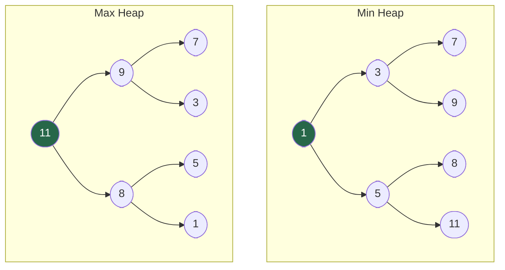
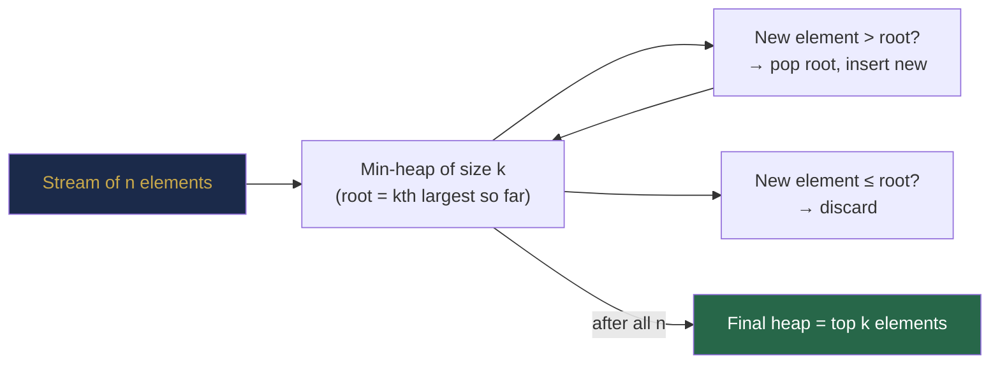

# Chapter 30 — Heaps and Priority Queues

## Learning Objectives

By the end of this chapter, you will be able to:

- Explain the heap property and its relationship to complete binary trees
- Implement min heap and max heap with insertion, extraction, and heapify
- Use Java's `PriorityQueue` with custom comparators for any ordering
- Solve Top-K problems, K-way merge, and running median problems
- Distinguish when to use a heap vs a sorted array vs a TreeMap

---

## Contents

- [30.1 What Is a Heap?](#301-what-is-a-heap)
- [30.2 Array Representation](#302-array-representation)
- [30.3 Core Operations: Insert and Extract](#303-core-operations-insert-and-extract)
- [30.4 Build Heap in O(n)](#304-build-heap-in-on)
- [30.5 Heap Sort](#305-heap-sort)
- [30.6 Java PriorityQueue](#306-java-priorityqueue)
- [30.7 Top-K Problems](#307-top-k-problems)
- [30.8 K-way Merge](#308-k-way-merge)
- [30.9 Running Median](#309-running-median)
- [30.10 Heap Patterns and When to Use Them](#3010-heap-patterns-and-when-to-use-them)
- [Interview Insight](#interview-insight)
- [Quick Quiz](#quick-quiz)
- [30.11 Practice Problems](#3011-practice-problems)
- [Chapter Summary](#chapter-summary)

---

> [!NOTE]
> **Historical Context**  
> The binary heap was invented by **J. W. J. Williams** in **1964** specifically for his heapsort algorithm. The O(n) build-heap insight was contributed by **Robert Floyd** in the same year. The abstract data structure — a **Priority Queue** — was conceptualised by **Peter Deutsch** and others in the early 1970s while designing operating system schedulers: when multiple processes compete for CPU time, the OS must always select the highest-priority process. The heap gives an O(log n) way to do this. Java's `PriorityQueue` was introduced in **Java 5 (2004)** as part of the `java.util.concurrent` framework, giving Java programmers direct access to heap-backed scheduling. **Dijkstra's shortest path algorithm** (1959) uses a priority queue as its core data structure — an observation that made priority queues central to graph algorithms and was one of the reasons heaps became a standard CS topic.

---

> ### 🔗 Analogy
> **A Hospital Emergency Room Triage**
>
> Patients arrive at the ER in random order — some with minor injuries, some critical. The ER doesn't process patients in arrival order (FIFO queue). Instead, nurses assign each patient a **priority** (triage level). The next patient seen is always the highest-priority patient waiting, regardless of arrival time. This is a priority queue backed by a heap.
>
> The heap structure ensures: (1) the highest-priority patient is always immediately accessible (the root), (2) adding a new patient (insert) reorganises quickly, and (3) treating the current patient and removing them (extract-min/max) reorganises quickly. Both operations are O(log n) — fast enough to serve any ER volume.

---

## 30.1 What Is a Heap?

A **binary heap** is a **complete binary tree** (from Chapter 25) that satisfies the **heap property**:

**Min heap:** Every node's value is **≤** its children's values. → Root = minimum element.

**Max heap:** Every node's value is **≥** its children's values. → Root = maximum element.



**Key properties:**
- **Complete binary tree** → height = ⌊log₂ n⌋ → all operations O(log n)
- **Heap property is global** (holds transitively) but **not sorted** — siblings have no ordering
- **Not a BST:** a heap does not support O(log n) search for arbitrary values

**Heap vs BST vs Sorted Array:**

| Operation | Sorted Array | BST (Balanced) | Heap |
|-----------|-------------|----------------|------|
| Insert | O(n) | O(log n) | **O(log n)** |
| Find min/max | O(1) | O(log n) | **O(1)** |
| Remove min/max | O(n) | O(log n) | **O(log n)** |
| Search arbitrary | O(log n) | O(log n) | O(n) |
| Space | O(n) | O(n) | **O(n), no pointers** |

*A heap wins when you only care about the minimum (or maximum) — not about arbitrary lookup.*

---

## 30.2 Array Representation

Since a heap is a **complete binary tree**, it maps perfectly to an array (Chapter 25, Section 25.9):

```
Min heap:    1
            / \
           3   5
          / \ / \
         7  9 8 11

Array (0-indexed): [1, 3, 5, 7, 9, 8, 11]
                    0  1  2  3  4  5   6
```

| Relationship | Formula (0-indexed) |
|-------------|---------------------|
| Left child of `i` | `2i + 1` |
| Right child of `i` | `2i + 2` |
| Parent of `i` | `(i - 1) / 2` |

**Why array representation?**
- Zero pointer overhead — the structure is encoded entirely in index arithmetic
- Excellent cache performance — parent and children are nearby in memory
- Complete binary tree → no gaps or wasted slots

---

## 30.3 Core Operations: Insert and Extract

### Insert (Sift Up / Bubble Up)

**Intuition:** The two constraints a heap must maintain are:
1. **Shape:** Complete binary tree (no gaps in the array)
2. **Order:** Every parent ≤ its children (min heap)

When we insert, we first satisfy shape by appending to the end (the next available position). But this may violate order — the new element might be smaller than its parent. So we "bubble up": repeatedly swap the new element with its parent until the parent is smaller (or we reach the root).

**Why only compare with the parent?** A node's subtree below it is already a valid heap before the insert. Only the path from the new element to the root can be violated.

**Termination guarantee:** Each swap moves the element one level up. The tree has height O(log n), so at most O(log n) swaps.

```java
class MinHeap {
    int[] data;
    int size;

    MinHeap(int capacity) { data = new int[capacity]; }

    void insert(int val) {
        data[size] = val;
        siftUp(size);
        size++;
    }

    void siftUp(int i) {
        while (i > 0) {
            int parent = (i - 1) / 2;
            if (data[parent] > data[i]) {
                swap(i, parent);
                i = parent;
            } else break;
        }
    }
}
```

**Trace — inserting 2 into `[1, 3, 5, 7, 9, 8, 11]`:**

```
Step 1: Append 2 → [1, 3, 5, 7, 9, 8, 11, 2]  (at index 7)
Step 2: Parent of 7 = (7-1)/2 = 3; data[3]=7 > 2 → swap
        → [1, 3, 5, 2, 9, 8, 11, 7]
Step 3: Parent of 3 = 1; data[1]=3 > 2 → swap
        → [1, 2, 5, 3, 9, 8, 11, 7]
Step 4: Parent of 1 = 0; data[0]=1 ≤ 2 → stop ✓
```

**Complexity:** O(log n) — at most ⌊log₂ n⌋ swaps to reach the root.

---

### Extract Min (Sift Down / Bubble Down)

**Intuition:** We want to remove the root (minimum). Two naive ideas fail:
1. Remove the root and promote one child — leaves a hole that's hard to fix recursively.
2. Remove the root and shift all elements — O(n) time.

**Better approach:** Swap the root with the *last element* (maintaining shape), reduce the size by 1, then "sift down" the displaced element. Sifting down: compare the element with both children, swap with the *smaller* child if smaller than the element. Repeat until the element is ≤ both children.

**Why swap with the smaller child?** We want the new root to be as small as possible. If we swapped with the larger child, it might become the parent of the smaller child — violating heap order. Always swapping with the minimum child ensures the new parent is valid relative to both children.

**Why only sift down (not up)?** The displaced element (last element) was a leaf — it has no children, so it can only violate the "parent ≤ children" rule going downward, never upward.

Replace the root with the **last element**, shrink the size, then **sift down** by repeatedly swapping with the smaller child until the heap property is restored.

```java
int extractMin() {
    int min = data[0];
    data[0] = data[--size];     // move last element to root
    siftDown(0);
    return min;
}

void siftDown(int i) {
    while (true) {
        int smallest = i;
        int left  = 2 * i + 1;
        int right = 2 * i + 2;
        if (left  < size && data[left]  < data[smallest]) smallest = left;
        if (right < size && data[right] < data[smallest]) smallest = right;
        if (smallest == i) break;    // already in correct position
        swap(i, smallest);
        i = smallest;
    }
}

void swap(int a, int b) { int t = data[a]; data[a] = data[b]; data[b] = t; }
```

**Complexity:** O(log n) — sifting down at most ⌊log₂ n⌋ levels.

---

## 30.4 Build Heap in O(n)

**Naïve approach:** Insert $n$ elements one by one → O(n log n).

**Floyd's heapify (O(n)):** Start from the last internal node (index ⌊n/2⌋ - 1) and sift down each node, working backwards to the root.

```java
void buildHeap(int[] arr) {
    this.data = arr;
    this.size = arr.length;
    for (int i = size / 2 - 1; i >= 0; i--)
        siftDown(i);
}
```

**Why O(n) and not O(n log n)?**

Nodes near the bottom only sift down a few levels. Formally:
$$\sum_{h=0}^{\lfloor \log n \rfloor} \lceil n / 2^{h+1} \rceil \cdot h = O(n)$$

| Level from bottom | Nodes | Max sift-down distance | Work |
|------------------|-------|------------------------|------|
| 0 (leaves) | n/2 | 0 | 0 |
| 1 | n/4 | 1 | n/4 |
| 2 | n/8 | 2 | n/4 |
| ... | | | |
| Total | | | O(n) |

*Table 30.1: Build-heap work distribution.*

> [!TIP]
> **Did You Know?**  
> The O(n) build-heap insight by **Robert Floyd** (1964) is counterintuitive and surprised many mathematicians at the time. Building a sorted array from $n$ elements is provably Ω(n log n) — but building a *heap* (a weaker structure) from $n$ elements can be done in O(n). This shows that the heap property is fundamentally easier to achieve than full sorted order. The same insight explains why **heapsort is in-place** but **merge sort requires O(n) extra space**: heaps store structure implicitly in the array layout, with no need for auxiliary memory.

---

## 30.5 Heap Sort

Build a max heap in O(n), then repeatedly extract the max and place it at the end of the array.

```java
void heapSort(int[] arr) {
    int n = arr.length;
    // Phase 1: Build max heap
    for (int i = n / 2 - 1; i >= 0; i--)
        siftDownMaxHeap(arr, n, i);
    // Phase 2: Extract max n-1 times
    for (int i = n - 1; i > 0; i--) {
        swap(arr, 0, i);              // root (max) goes to sorted position
        siftDownMaxHeap(arr, i, 0);  // restore heap on remaining i elements
    }
}

void siftDownMaxHeap(int[] arr, int size, int i) {
    int largest = i;
    int left  = 2 * i + 1, right = 2 * i + 2;
    if (left  < size && arr[left]  > arr[largest]) largest = left;
    if (right < size && arr[right] > arr[largest]) largest = right;
    if (largest != i) { swap(arr, i, largest); siftDownMaxHeap(arr, size, largest); }
}
```

**Complexity:** O(n log n) time, O(1) space — optimal for a comparison sort that is in-place.

**Why Java doesn't use heapsort by default:** Heapsort is O(n log n) in all cases but is **not stable** and has **poor cache performance** (sift-down jumps around the array non-sequentially). Java uses Timsort for objects (stable, exploits runs) and dual-pivot quicksort for primitives (cache-friendly). See Chapter 17.

---

## 30.6 Java PriorityQueue

Java's `PriorityQueue<E>` is a min heap by default.

```java
// Min heap (default)
PriorityQueue<Integer> minHeap = new PriorityQueue<>();
minHeap.offer(5);       // insert
minHeap.offer(1);
minHeap.offer(3);
minHeap.peek();         // 1 — view min without removing
minHeap.poll();         // 1 — remove and return min

// Max heap — reverse the natural ordering
PriorityQueue<Integer> maxHeap = new PriorityQueue<>(Comparator.reverseOrder());

// Custom object: sort by value ascending, then by key descending
PriorityQueue<int[]> pq = new PriorityQueue<>((a, b) ->
    a[0] != b[0] ? a[0] - b[0] : b[1] - a[1]);

// Initialise with existing collection
int[] arr = {5, 1, 3, 2, 4};
PriorityQueue<Integer> fromArray = new PriorityQueue<>();
for (int x : arr) fromArray.offer(x);  // O(n log n)
// Alternative: Arrays.stream(arr).boxed() → PriorityQueue builds in O(n log n) anyway
```

**Key API:**

| Method | Description | Time |
|--------|-------------|------|
| `offer(e)` / `add(e)` | Insert element | O(log n) |
| `poll()` | Remove and return minimum | O(log n) |
| `peek()` | Return minimum without removing | O(1) |
| `size()` | Number of elements | O(1) |
| `contains(e)` | Check existence | O(n) — no fast lookup! |
| `remove(e)` | Remove specific element | O(n) — linear scan |

> [!WARNING]
> `PriorityQueue.contains()` and `PriorityQueue.remove(Object)` are both **O(n)** because the heap structure doesn't support fast arbitrary lookup. If you need fast arbitrary remove, use a `TreeMap` or a lazy-deletion approach.

> [!TIP]
> **Did You Know?**  
> Java's `PriorityQueue` does **not** guarantee any ordering when you iterate over it with a for-each loop or `iterator()`. The iterator simply traverses the backing array in array order — which is heap order, not sorted order. To get elements in sorted order, **poll() them one by one**. This surprises many Java developers: `new PriorityQueue<>(Arrays.asList(5,1,3))` looks sorted when printed if you use `System.out.println(pq)` (it prints array representation), but the internal order is `[1, 5, 3]` (a valid min heap).

---

## 30.7 Top-K Problems

**Problem:** Find the K largest (or K smallest) elements in an array of $n$ elements.

**Building the intuition — this is the most counterintuitive heap problem:**

First instinct: "I want K largest, so I'll use a MAX heap." That gives you the K largest elements correctly, but only if you read all n elements first (O(n log n) build + K extractions).

**The smarter approach:** Use a **min heap of size K** as a "filter." Think of it this way:
- The heap represents "the best K elements seen so far"
- The heap's root is the *worst of the best* — the "threshold to beat"
- For each new element: if it beats the threshold (> root), it deserves to be in top-K. Evict the current weakest (root) and insert the new one.
- If the new element doesn't beat the threshold, discard it immediately.

**Why this works:** After processing all n elements, the heap contains exactly the K elements that survived all comparisons — the K largest.

**Complexity comparison:**
| Approach | Time | Space | Comment |
|----------|------|-------|---------|
| Sort all | O(n log n) | O(n) | Simple but wasteful |
| Max heap, extract K | O(n + K log n) | O(n) | Still builds full heap |
| **Min heap size K** | **O(n log K)** | **O(K)** | Only keeps K elements at a time |

For large n and small K, O(n log K) << O(n log n).

### K Largest — Min Heap of Size K

Maintain a min heap of size K. For each new element, if it's larger than the heap's minimum, pop the min and insert the new element.

```java
int[] kLargest(int[] nums, int k) {
    PriorityQueue<Integer> minHeap = new PriorityQueue<>();   // min heap: root = kth largest so far
    for (int x : nums) {
        minHeap.offer(x);
        if (minHeap.size() > k) minHeap.poll();   // evict the worst of top-K: it's too small
    }
    // heap now contains exactly the K largest elements
    return minHeap.stream().mapToInt(x -> x).toArray();
}
```

**Complexity:** O(n log k) time, O(k) space.

**Why min heap for K largest?** The heap's root is the *smallest of the top-K* — the threshold. Anything smaller than the threshold is immediately discarded.

---

### Kth Largest Element (LC 215)

```java
int findKthLargest(int[] nums, int k) {
    PriorityQueue<Integer> minHeap = new PriorityQueue<>();
    for (int x : nums) {
        minHeap.offer(x);
        if (minHeap.size() > k) minHeap.poll();
    }
    return minHeap.peek();     // root = kth largest
}
```

**Alternative: Quickselect** (expected O(n), O(n) worst — use if k is not small relative to n).

---

### Top K Frequent Elements (LC 347)

```java
List<Integer> topKFrequent(int[] nums, int k) {
    Map<Integer, Integer> freq = new HashMap<>();
    for (int x : nums) freq.merge(x, 1, Integer::sum);

    // Min heap by frequency — pop least frequent when size > k
    PriorityQueue<Integer> pq = new PriorityQueue<>(Comparator.comparingInt(freq::get));
    for (int key : freq.keySet()) {
        pq.offer(key);
        if (pq.size() > k) pq.poll();
    }
    List<Integer> result = new ArrayList<>(pq);
    return result;
}
```

---

### Closest Points to Origin (LC 973)

```java
int[][] kClosest(int[][] points, int k) {
    // Max heap by distance — pop farthest when size > k
    PriorityQueue<int[]> maxHeap = new PriorityQueue<>(
        (a, b) -> (b[0]*b[0] + b[1]*b[1]) - (a[0]*a[0] + a[1]*a[1]));
    for (int[] p : points) {
        maxHeap.offer(p);
        if (maxHeap.size() > k) maxHeap.poll();
    }
    return maxHeap.toArray(new int[k][]);
}
```



---

## 30.8 K-way Merge

**Problem:** Merge K sorted arrays (or lists) into a single sorted sequence.

**Building the intuition:**  
If you had 2 sorted arrays, you'd use two pointers (merge step of mergesort). For K arrays, you'd need K pointers simultaneously — at each step, you must pick the minimum of K current pointers.

**Naive:** At each step, scan all K front elements to find the minimum — O(K) per step, total O(N·K).

**Better:** Keep all K current front elements in a min heap. The minimum is always the root — O(log K) per step, total O(N log K). After extracting the minimum, insert the *next* element from the same array.

**Why store `[value, arrayIndex, elementIndex]` in the heap?** Because after extracting an element, we need to know *which array* it came from to fetch the next element. The heap entry must carry this bookkeeping.

**Step-by-step trace on 3 arrays:**
```
Arrays: A=[1,4,7], B=[2,5,8], C=[3,6,9]

Initial heap (min-heap by value): [(1,A,0), (2,B,0), (3,C,0)]

Pop (1,A,0): result=[1], push next from A: (4,A,1)
Heap: [(2,B,0), (3,C,0), (4,A,1)]

Pop (2,B,0): result=[1,2], push (5,B,1)
Heap: [(3,C,0), (4,A,1), (5,B,1)]

Pop (3,C,0): result=[1,2,3], push (6,C,1)
... continues ...
Final: [1,2,3,4,5,6,7,8,9]
```

**Approach:** Use a min heap initialised with the first element from each array. Repeatedly extract the minimum and add the next element from that array.

```java
int[] mergeKSortedArrays(int[][] arrays) {
    // heap entries: [value, arrayIndex, elementIndex]
    PriorityQueue<int[]> pq = new PriorityQueue<>(Comparator.comparingInt(a -> a[0]));
    int totalSize = 0;
    for (int i = 0; i < arrays.length; i++) {
        if (arrays[i].length > 0) {
            pq.offer(new int[]{arrays[i][0], i, 0});
            totalSize += arrays[i].length;
        }
    }
    int[] result = new int[totalSize];
    int idx = 0;
    while (!pq.isEmpty()) {
        int[] entry = pq.poll();
        int val = entry[0], arrIdx = entry[1], elemIdx = entry[2];
        result[idx++] = val;
        if (elemIdx + 1 < arrays[arrIdx].length)
            pq.offer(new int[]{arrays[arrIdx][elemIdx + 1], arrIdx, elemIdx + 1});
    }
    return result;
}
```

**Complexity:** O(N log K) where N = total elements, K = number of arrays.

**Real-world usage:** External sorting (merging sorted tape runs — the original motivation for merge sort), database query plan execution, merging sorted index shards in search engines, merge-on-read in distributed databases (Apache Cassandra, HBase).

---

## 30.9 Running Median

**Problem:** Given a stream of integers, find the median after each insertion.

**Building the intuition step by step:**

**Step 1: What is the median?**  
The median is the "middle" value when all numbers are sorted. For an odd count, it's the exact middle. For even count, it's the average of the two middle values.

**Step 2: What do we really need?**  
We only need access to the *largest of the smaller half* and the *smallest of the larger half*. We don't need the full sorted order.

**Step 3: What data structure gives O(1) access to the maximum? O(1) access to the minimum?**  
A **max heap** gives O(1) access to the maximum. A **min heap** gives O(1) access to the minimum.

**Step 4: Combining them:**
- Keep the **smaller half** in a **max heap** (left). Its root = the largest of the smaller half.
- Keep the **larger half** in a **min heap** (right). Its root = the smallest of the larger half.
- Median = average of the two roots (even count), or root of the larger heap (odd count).

**Step 5: Maintaining the balance invariant.**  
After every insert, the two halves must satisfy:
- All elements in left ≤ all elements in right (the split is correct)
- `|left.size() - right.size()| ≤ 1` (sizes differ by at most 1)

**Why the two-step insert?**
```java
left.offer(num);            // tentatively put in left
right.offer(left.poll());   // push left's max to right (ensures left's max ≤ right's min)
if (right.size() > left.size()) left.offer(right.poll());  // rebalance sizes
```
Step 1 ensures `num` starts somewhere. Step 2 fixes the cross-heap ordering (we can't be sure `num > right's min` without checking). Step 3 rebalances sizes if right became too large.

**Approach:** Maintain two heaps:
- **Max heap** (left half) — the smaller half of the numbers
- **Min heap** (right half) — the larger half

The median is the average of the two roots (even count) or the root of the larger heap (odd count).

```java
class MedianFinder {
    PriorityQueue<Integer> left  = new PriorityQueue<>(Comparator.reverseOrder());  // max heap
    PriorityQueue<Integer> right = new PriorityQueue<>();                             // min heap

    public void addNum(int num) {
        // Always add to left first, then rebalance
        left.offer(num);
        right.offer(left.poll());        // left's max might belong to right
        if (right.size() > left.size())  // keep left size ≥ right size
            left.offer(right.poll());
    }

    public double findMedian() {
        if (left.size() > right.size()) return left.peek();           // odd: left has extra
        return (left.peek() + right.peek()) / 2.0;                    // even: average of tops
    }
}
```

**Trace on stream `[5, 15, 1, 3]`:**

| Insert | Left (max heap) | Right (min heap) | Median |
|--------|-----------------|------------------|--------|
| 5 | [5] | [] | 5.0 |
| 15 | [5] | [15] | 10.0 |
| 1 | [5, 1] | [15] | 5.0 |
| 3 | [5, 3, 1] | [15] | 5.0 |

*Table 30.2: Running median trace.*

**Complexity:** O(log n) per insert, O(1) per median query.

> [!NOTE]
> **Why Two Heaps?**  
> This two-heap approach is a classic divide-and-conquer on the number line: the left heap "knows" only the smaller half of values seen so far, the right heap "knows" the larger half. By keeping them balanced in size, we always have O(1) access to the boundary — which is the median. No other data structure achieves both O(log n) insert and O(1) median as cleanly. A sorted array gives O(1) median but O(n) insert; a balanced BST gives O(log n) for both but with higher constants and more complex median logic.

---

## 30.10 Heap Patterns and When to Use Them

| Pattern | Problem Shape | Heap Type | Example |
|---------|--------------|-----------|---------|
| **Top-K largest** | Stream or array → K largest | Min heap size K | LC 215, 347 |
| **Top-K smallest** | Stream or array → K smallest | Max heap size K | LC 973 |
| **K-way merge** | K sorted sequences → one | Min heap of size K | LC 23, external sort |
| **Running median** | Stream → median after each | Max + min heap | LC 295 |
| **Sliding window median** | Array + window → median each step | Two heaps + lazy delete | LC 480 |
| **Task scheduler** | Tasks with priorities/cooldowns | Max heap by count | LC 621 |
| **Dijkstra / Prim** | Weighted graph → shortest path | Min heap by distance | LC 743, 1514 |
| **Sort nearly sorted** | Elements at most k away from position | Min heap size k | Custom |

---

## Interview Insight

> **The three questions that expose heap mastery:**
> 1. *"Why do you use a min heap for the K-largest problem?"* → The heap root is the threshold (Kth largest). Smaller elements are compared against it and discarded.
> 2. *"Why can't you use a max heap for running median?"* → You need access to both the top of the lower half AND the top of the upper half simultaneously — requiring two heaps.
> 3. *"What's the time complexity of building a heap vs inserting n elements one by one?"* → O(n) vs O(n log n). Most candidates don't know the O(n) build-heap trick.
>
> The heap pattern to recognise: whenever a problem says "K closest", "K most frequent", "K largest", "continuously maintain minimum/maximum", or "merge K sorted" — reach for a heap.

---

## Quick Quiz

1. What invariant does a min heap maintain?
2. For a node at index `i` in a 0-indexed array heap, what are its children's indices?
3. What is the time complexity of `PriorityQueue.contains(e)` in Java?
4. Why does building a heap with `n` Floyd heapify calls take O(n), not O(n log n)?
5. For the running median problem, which heap holds the larger half of the values seen?

**Answers:**
1. Every parent's value ≤ both its children's values (root is global minimum)
2. Left: `2i + 1`; Right: `2i + 2`
3. O(n) — no fast lookup; linear scan through the backing array
4. Nodes near the leaves are the majority, and they sift down very few levels (0 for leaves, 1 for level above leaves, etc.). The sum of work is O(n) by geometric series analysis
5. The min heap (right half) — its root is the smallest of the larger half, which is the upper median boundary

---

## 30.11 Practice Problems

**Warm-up:**
- Kth largest element in an array (LC 215).
- Last Stone Weight (LC 1046).
- Find median from data stream (LC 295).

**Medium:**
- Top K frequent elements (LC 347).
- K closest points to origin (LC 973).
- Merge K sorted lists (LC 23).
- Task scheduler (LC 621).
- Reorganise string (LC 767).
- Minimum cost to connect sticks (LC 1167).

**Hard:**
- Sliding window median (LC 480) — two heaps with lazy deletion.
- Find K pairs with smallest sums (LC 373).
- Trapping rain water II — 3D version using min heap (LC 407).
- Maximum average subtree (LC 1120) — combine DFS + ordering.

---

## Chapter Summary

| Concept | Key Insight |
|---------|-------------|
| Heap property | Min heap: parent ≤ children; Max heap: parent ≥ children |
| Complete binary tree | Height ⌊log₂ n⌋ → all ops O(log n) |
| Array representation | Node i → children 2i+1, 2i+2; parent (i-1)/2 (0-indexed) |
| Insert (sift up) | Append at end, swap with parent until heap restored; O(log n) |
| Extract min (sift down) | Root → last element, shrink size, sift down; O(log n) |
| Build heap (Floyd) | Heapify from last internal node to root; **O(n)** |
| Heap sort | Build max heap O(n) + n extractions O(n log n) = O(n log n) in-place |
| Java PriorityQueue | Min heap by default; O(1) peek, O(log n) offer/poll, **O(n) contains** |
| Top-K pattern | Min heap size K for K largest; Max heap size K for K smallest |
| K-way merge | Min heap of size K; re-add from same list after each poll |
| Running median | Left max heap + right min heap; keep sizes equal or left +1 |

---

*← [Chapter 29 — Advanced Tree Structures](chapter-29-advanced-trees.md)*  
*→ [Part IX Review — Heaps and Priority Queues](part-09-review.md)*
