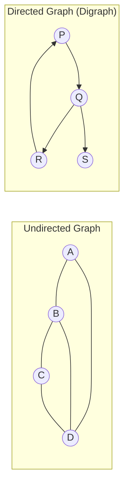
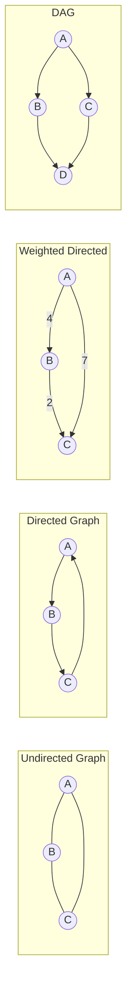
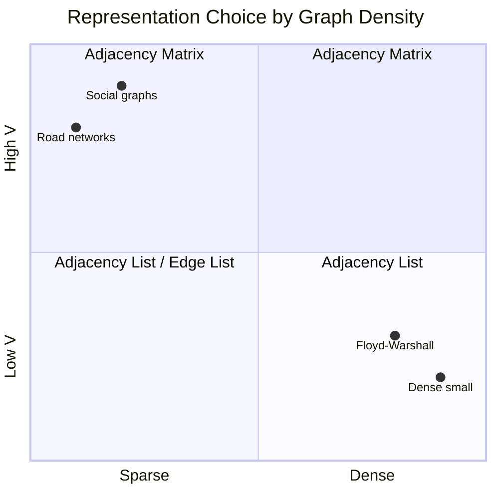

# Chapter 31 — Graph Fundamentals and Representation

## Learning Objectives

By the end of this chapter, you will be able to:

- Define a graph and explain how it generalises trees and linked lists
- Distinguish directed, undirected, weighted, and cyclic graphs
- Implement adjacency matrix, adjacency list, and edge list representations in Java
- Choose the right representation based on graph density and required operations
- Model real-world problems as graphs

---

## Contents

- [31.1 What Is a Graph?](#311-what-is-a-graph)
- [31.2 Graph Terminology](#312-graph-terminology)
- [31.3 Types of Graphs](#313-types-of-graphs)
- [31.4 Adjacency Matrix](#314-adjacency-matrix)
- [31.5 Adjacency List](#315-adjacency-list)
- [31.6 Edge List](#316-edge-list)
- [31.7 Representation Comparison](#317-representation-comparison)
- [31.8 Java Implementation](#318-java-implementation)
- [31.9 Graph Modelling](#319-graph-modelling)
- [Interview Insight](#interview-insight)
- [Quick Quiz](#quick-quiz)
- [31.10 Practice Problems](#3110-practice-problems)
- [Chapter Summary](#chapter-summary)

---

> [!NOTE]
> **Historical Context**  
> Graph theory was born on **17 August 1735** when **Leonhard Euler** solved the **Königsberg Bridge Problem**: the city of Königsberg (now Kaliningrad) had seven bridges connecting four landmasses. Citizens wondered if they could walk across every bridge exactly once and return to their starting point. Euler proved it was impossible by modelling the landmasses as **vertices** and bridges as **edges** — the first graph. This paper, *"Solutio problematis ad geometriam situs pertinentis"* (1741), founded graph theory. The key insight: not distance or geometry, but **connectivity** — how things are linked — determines what traversals are possible. Modern graph algorithms are all descendants of this 288-year-old idea.

---

> ### 🔗 Analogy
> **A Road Network**
>
> Cities are **vertices**. Roads between them are **edges**. A one-way road is a **directed edge**. A road with a speed limit or toll is a **weighted edge**. A route that starts and ends at the same city is a **cycle**. Finding the shortest drive from city A to city B is a **shortest path problem**. Finding the minimum set of roads that connects all cities is a **spanning tree problem**. Every concept in this chapter maps directly to something you experience when navigating roads.

---

## 31.1 What Is a Graph?

A **graph** is a pair $G = (V, E)$ where:
- $V$ = a set of **vertices** (also called nodes)
- $E$ = a set of **edges**, each connecting two vertices

**Formal definition of an edge:**
- Undirected edge: an unordered pair $\{u, v\}$
- Directed edge: an ordered pair $(u, v)$ — goes from $u$ to $v$

**How graphs generalise other data structures:**

```
Linked list:  each node has 1 "next" edge (a linear, directed graph)
Tree:         each node has 1 parent edge, any children edges; no cycles
Graph:        any number of edges, any direction, may have cycles
```

A **tree is a connected, undirected, acyclic graph**. Every tree is a graph, but most graphs are not trees. This means every tree algorithm (BFS, DFS, traversal) works on graphs — but graphs add new challenges: cycles (which cause infinite loops) and disconnected components (which cause missed nodes).



---

## 31.2 Graph Terminology

| Term | Definition |
|------|------------|
| **Vertex / Node** | A fundamental unit in a graph |
| **Edge** | A connection between two vertices |
| **Adjacent** | Two vertices are adjacent if connected by an edge |
| **Neighbour** | A vertex adjacent to a given vertex |
| **Degree** | Number of edges incident to a vertex |
| **In-degree** | (Directed) Number of edges pointing *into* a vertex |
| **Out-degree** | (Directed) Number of edges pointing *out* of a vertex |
| **Path** | Sequence of vertices where consecutive pairs are connected by edges |
| **Simple path** | A path with no repeated vertices |
| **Cycle** | A path where start and end vertices are the same |
| **Connected** | An undirected graph where every vertex can reach every other |
| **Component** | A maximal connected subgraph |
| **Strongly connected** | (Directed) Every vertex can reach every other vertex |
| **Sparse graph** | Few edges: $E = O(V)$ |
| **Dense graph** | Many edges: $E = O(V^2)$ |

**Degree sum theorem:** In any undirected graph, $\sum_{v \in V} \text{deg}(v) = 2|E|$. Every edge contributes exactly 2 to the total degree (one for each endpoint).

> [!TIP]
> **Did You Know?**  
> The degree sum theorem is sometimes called the **Handshaking Lemma** — in a room of people where every handshake involves two people, the total number of handshakes = half the sum of everyone's handshake count. One direct consequence: **every graph has an even number of odd-degree vertices** (because the sum of all degrees must equal 2|E|, an even number). This fact is used to prove whether Euler paths exist.

---

## 31.3 Types of Graphs

### Directed vs Undirected

```
Undirected: friendship (if A is friends with B, B is friends with A)
Directed:   Twitter follows (A follows B does not imply B follows A)
```

An undirected edge $\{u, v\}$ can be modelled as two directed edges $(u, v)$ and $(v, u)$.

### Weighted vs Unweighted

```
Unweighted: "are these nodes connected?"
Weighted:   "what is the cost/distance/capacity of this connection?"
```

Weight can represent: distance, time, cost, bandwidth, probability, or any numeric property.

### Cyclic vs Acyclic

```
Cyclic:   has at least one cycle (most real graphs)
Acyclic:  no cycles (trees are acyclic; DAGs are directed acyclic graphs)
```

**Directed Acyclic Graph (DAG):** A directed graph with no directed cycles. Used for dependency resolution (build systems, package managers, course prerequisites).

### Simple vs Multigraph

```
Simple:     at most one edge between any pair of vertices; no self-loops
Multigraph: multiple edges between the same pair allowed (e.g. multiple flight routes)
```

**Most interview problems assume simple graphs unless stated otherwise.**



---

## 31.4 Adjacency Matrix

An **adjacency matrix** is a $V \times V$ 2D array where `matrix[u][v] = 1` (or the edge weight) if there is an edge from $u$ to $v$, and `0` (or `∞`) otherwise.

```
Graph (undirected):         Adjacency Matrix:
    0 --- 1                 [0][1][2][3]
    |     |            [0]   0   1   0   1
    3 --- 2            [1]   1   0   1   0
                       [2]   0   1   0   1
                       [3]   1   0   1   0
```

**Properties:**
- Symmetric for undirected graphs (`matrix[u][v] == matrix[v][u]`)
- Space: O(V²) — always, regardless of edge count
- **Edge existence check:** O(1) — just read `matrix[u][v]`
- **Finding all neighbours:** O(V) — scan an entire row
- **Adding/removing an edge:** O(1)

**Intuition for when to use it:**  
The matrix always costs O(V²) space. If your graph is **dense** ($E$ close to $V^2$), that space is well-used — almost every cell is filled. But for a **sparse** graph (like a road network where each city connects to only a handful of others), $O(V^2)$ space stores mostly zeros. It's wasteful.



> [!NOTE]
> **Why V² space matters:** Instagram's social graph has ~2 billion users. An adjacency matrix would require 2×10⁹ × 2×10⁹ = 4×10¹⁸ bits ≈ 500,000 terabytes of memory — just to store zeros for most pairs who are not connected. Instagram's actual graph has ~100 billion edges (each user follows ~50 people on average). An adjacency list stores only those 100 billion entries — about 100 TB, manageable across a distributed cluster. The choice of representation is not academic; it determines whether your system can run at all.

**Use when:** Dense graphs, need O(1) edge checks, $V$ is small (≤ 10,000).

```java
int V = 5;
int[][] matrix = new int[V][V];

void addEdgeUndirected(int u, int v) {
    matrix[u][v] = 1;
    matrix[v][u] = 1;
}

void addEdgeWeighted(int u, int v, int weight) {
    matrix[u][v] = weight;
    matrix[v][u] = weight;  // omit for directed
}

boolean hasEdge(int u, int v) {
    return matrix[u][v] != 0;
}

List<Integer> neighbours(int u) {
    List<Integer> result = new ArrayList<>();
    for (int v = 0; v < V; v++)
        if (matrix[u][v] != 0) result.add(v);
    return result;  // O(V) scan
}
```

---

## 31.5 Adjacency List

An **adjacency list** maps each vertex to the list of its neighbours. The standard representation for most graph problems.

```
Graph (directed):    Adjacency List:
0 → 1, 3            0: [1, 3]
1 → 2               1: [2]
2 → 0               2: [0]
3 → 2               3: [2]
```

**Properties:**
- Space: O(V + E) — proportional to what's actually there
- **Edge existence check:** O(degree(u)) — scan u's list
- **Finding all neighbours:** O(degree(u)) — just iterate the list
- **Adding an edge:** O(1) amortised

**Intuition:** Think of it as the matrix's sparse equivalent. Instead of a full grid, you store a list *only* for edges that exist. For a graph with 1,000 vertices but only 2,000 edges (road network), the matrix wastes 1,000,000 cells while the list uses only 2,000 entries.

**Use when:** Sparse graphs (most real-world graphs), need to iterate over neighbours efficiently, $V$ is large.

```java
int V = 5;
List<List<Integer>> adj = new ArrayList<>();
for (int i = 0; i < V; i++) adj.add(new ArrayList<>());

void addEdgeUndirected(int u, int v) {
    adj.get(u).add(v);
    adj.get(v).add(u);
}

void addEdgeDirected(int u, int v) {
    adj.get(u).add(v);
}

// Weighted graph — store [neighbour, weight] pairs
List<List<int[]>> adjWeighted = new ArrayList<>();
for (int i = 0; i < V; i++) adjWeighted.add(new ArrayList<>());

void addWeightedEdge(int u, int v, int w) {
    adjWeighted.get(u).add(new int[]{v, w});
    adjWeighted.get(v).add(new int[]{u, w});  // omit for directed
}
```

**HashMap-based** (when vertices are strings or non-integer IDs):

```java
Map<String, List<String>> adj = new HashMap<>();

void addEdge(String u, String v) {
    adj.computeIfAbsent(u, k -> new ArrayList<>()).add(v);
    adj.computeIfAbsent(v, k -> new ArrayList<>()).add(u);
}
```

---

## 31.6 Edge List

An **edge list** stores all edges as pairs (or triples for weighted) in a flat list.

```java
// Undirected: [u, v]
int[][] edges = {{0,1}, {0,3}, {1,2}, {2,3}};

// Weighted: [u, v, weight]
int[][] weightedEdges = {{0,1,4}, {0,3,2}, {1,2,5}, {2,3,1}};
```

**Properties:**
- Space: O(E)
- **Edge existence check:** O(E) — linear scan
- **Finding all neighbours of u:** O(E) — scan entire list
- **Iterating over all edges:** O(E) — optimal

**Use when:** You need to process or sort *all edges* (Kruskal's MST algorithm), or you're building the graph incrementally.

---

## 31.7 Representation Comparison

| Operation | Adjacency Matrix | Adjacency List | Edge List |
|-----------|-----------------|----------------|-----------|
| Space | O(V²) | O(V + E) | O(E) |
| Check if edge (u,v) exists | O(1) | O(deg(u)) | O(E) |
| Find all neighbours of u | O(V) | O(deg(u)) | O(E) |
| Iterate all edges | O(V²) | O(V + E) | O(E) |
| Add edge | O(1) | O(1) amortised | O(1) |
| Remove edge | O(1) | O(deg(u)) | O(E) |
| Memory (sparse graph) | ❌ Wasteful | ✅ Efficient | ✅ Most efficient |
| Memory (dense graph) | ✅ Compact | ⚠️ Acceptable | ⚠️ Acceptable |

*Table 31.1: Representation comparison.*

> [!TIP]
> **The golden rule:** Use **adjacency list** by default for 95% of graph problems. Use **adjacency matrix** when V ≤ 1000 and you need O(1) edge checks. Use **edge list** when you need to sort edges (Kruskal's algorithm).

---

## 31.8 Java Implementation

### Complete Graph Class

```java
class Graph {
    private final int V;
    private final List<List<Integer>> adj;
    private final boolean directed;

    Graph(int V, boolean directed) {
        this.V = V;
        this.directed = directed;
        this.adj = new ArrayList<>();
        for (int i = 0; i < V; i++) adj.add(new ArrayList<>());
    }

    void addEdge(int u, int v) {
        adj.get(u).add(v);
        if (!directed) adj.get(v).add(u);
    }

    List<Integer> neighbours(int u) { return adj.get(u); }
    int vertexCount() { return V; }
}
```

### Weighted Graph

```java
class WeightedGraph {
    private final int V;
    private final List<List<int[]>> adj;   // [neighbour, weight]

    WeightedGraph(int V) {
        this.V = V;
        this.adj = new ArrayList<>();
        for (int i = 0; i < V; i++) adj.add(new ArrayList<>());
    }

    void addEdge(int u, int v, int w) {
        adj.get(u).add(new int[]{v, w});
        adj.get(v).add(new int[]{u, w});   // remove for directed
    }

    List<int[]> neighbours(int u) { return adj.get(u); }
}
```

### Building from LeetCode Input

Many graph problems give edges as `int[][] edges`:

```java
// Build adjacency list from edge list
int n = 5;
List<List<Integer>> adj = new ArrayList<>();
for (int i = 0; i < n; i++) adj.add(new ArrayList<>());

int[][] edges = {{0,1},{1,2},{2,3},{3,4}};
for (int[] e : edges) {
    adj.get(e[0]).add(e[1]);
    adj.get(e[1]).add(e[0]);  // remove for directed
}
```

---

## 31.9 Graph Modelling

**The most important skill in graph algorithms is translating a problem into a graph.**

The question to ask: *"What are the entities (vertices) and what are the relationships (edges)?"*

| Problem Domain | Vertices | Edges | Edge Weight |
|---------------|----------|-------|-------------|
| Social network | People | Friendships | — |
| Road network | Cities | Roads | Distance/time |
| Web crawling | Web pages | Hyperlinks | — |
| Course prerequisites | Courses | "Must take before" | — |
| Package dependencies | Packages | "Depends on" | — |
| Electrical circuit | Junctions | Wires | Resistance |
| Flight network | Airports | Flights | Ticket price |
| Word ladder | Words | "Differ by 1 letter" | — |
| Grid maze | Cells | "Adjacent and passable" | — |
| Interval scheduling | Time slots | "Conflicts with" | — |

### Key Modelling Insight: Implicit vs Explicit Graphs

Many graph problems don't give you a graph directly — you must construct it mentally:

**Word Ladder** (LC 127): `"hit" → "hot" → "dot" → "dog" → "cog"`  
- Vertices: all words in the dictionary  
- Edges: two words connected if they differ by exactly one letter  
- Never explicitly build this graph — just compute neighbours on the fly during BFS

**Grid problems**: Treat each cell `(r, c)` as a vertex. Edges go to `(r±1, c)` and `(r, c±1)` (4-directional) if the cell is passable. Graph is implicit — no adjacency list needed.

> [!TIP]
> **Real-World Usage**  
> Every major tech company uses graph algorithms at scale. Google's PageRank ranks web pages using the **web graph** (pages = vertices, links = edges). Facebook's friend recommendation uses graph traversal on the **social graph** (600M edges as of 2023). Uber/Lyft route drivers using **road network shortest paths**. Netflix recommendation uses a **bipartite graph** (users + movies + ratings). Git's commit history is a **DAG**. Package managers (npm, Maven, pip) resolve dependencies using **topological sort on DAGs**.

---

## Interview Insight

> **The two graph questions you must answer before writing any code:**
> 1. *"Is this graph directed or undirected?"* → Determines how you build the adjacency list (one or two entries per edge) and whether algorithms like topological sort apply.
> 2. *"Is this graph weighted or unweighted?"* → Unweighted → BFS gives shortest path. Weighted with non-negative weights → Dijkstra. Weighted with possible negatives → Bellman-Ford.
>
> Then: *"Can the graph be disconnected?"* → If yes, your traversal must loop over all vertices, not just BFS/DFS from one source.

---

## Quick Quiz

1. What is the space complexity of an adjacency matrix for a graph with V vertices and E edges?
2. For a sparse graph (E = O(V)), what is the space advantage of adjacency list over adjacency matrix?
3. An undirected graph has 5 vertices and edges `{(0,1),(1,2),(2,3),(3,4),(4,0),(0,2)}`. What is the degree of vertex 0?
4. A directed graph has in-degree 0 at some vertex. What does that mean about that vertex?
5. Why do most graph traversals need a `visited` array that trees don't need?

**Answers:**
1. O(V²) — always, regardless of E
2. Adjacency list: O(V + E) = O(V). Matrix: O(V²). For E = O(V), list is O(V times) more space-efficient.
3. Degree 3: edges to 1, 2, and 4 (also the edge `{4,0}` and `{0,2}` count — total edges touching 0: `{0,1}`, `{4,0}`, `{0,2}` = 3)
4. No edges point into it — it has no predecessors. In a DAG, these are "source" nodes (starting points for topological sort)
5. Graphs can have cycles, so without a visited set, traversal loops infinitely. Trees are acyclic so this is impossible.

---

## 31.10 Practice Problems

**Warm-up:**
- Build an adjacency list from an edge list.
- Count the degree of each vertex in an undirected graph.
- Given an adjacency matrix, check if two vertices are adjacent in O(1).
- Convert an adjacency list to an adjacency matrix.

**Medium:**
- Find if a path exists between two vertices (LC 1971).
- Find the town judge: exactly one vertex with in-degree V-1 and out-degree 0 (LC 997).
- Count number of connected components (LC 323).
- Clone a graph (deep copy) (LC 133).

**Hard:**
- Reconstruct itinerary from airline tickets using an Euler path (LC 332).
- Build a graph from implicit structure: Alien Dictionary (LC 269) — find character ordering from sorted words.

---

## Chapter Summary

| Concept | Key Insight |
|---------|-------------|
| Graph G = (V, E) | Vertices + edges; generalises trees and linked lists |
| Undirected | Edges go both ways; degree = edges incident to vertex |
| Directed (digraph) | Edges have direction; in-degree and out-degree |
| Weighted | Edges have numeric labels (cost, distance, capacity) |
| DAG | Directed, acyclic; enables topological sort |
| Adjacency matrix | O(V²) space; O(1) edge check; best for dense graphs |
| Adjacency list | O(V+E) space; O(deg) neighbour scan; best for sparse graphs |
| Edge list | O(E) space; iterate all edges; best for Kruskal's MST |
| Modelling | What are vertices? What are edges? Directed? Weighted? |
| Sparse vs dense | Determines which representation to choose |

---

*← [Chapter 30 — Heaps and Priority Queues](chapter-30-heaps.md)*  
*→ [Chapter 32 — Graph Traversal: BFS and DFS](chapter-32-graph-traversal.md)*
