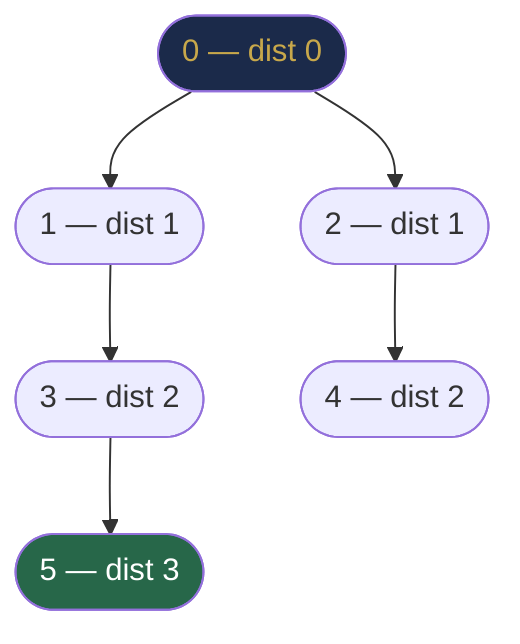
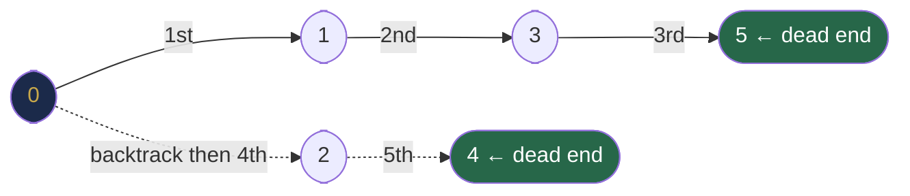
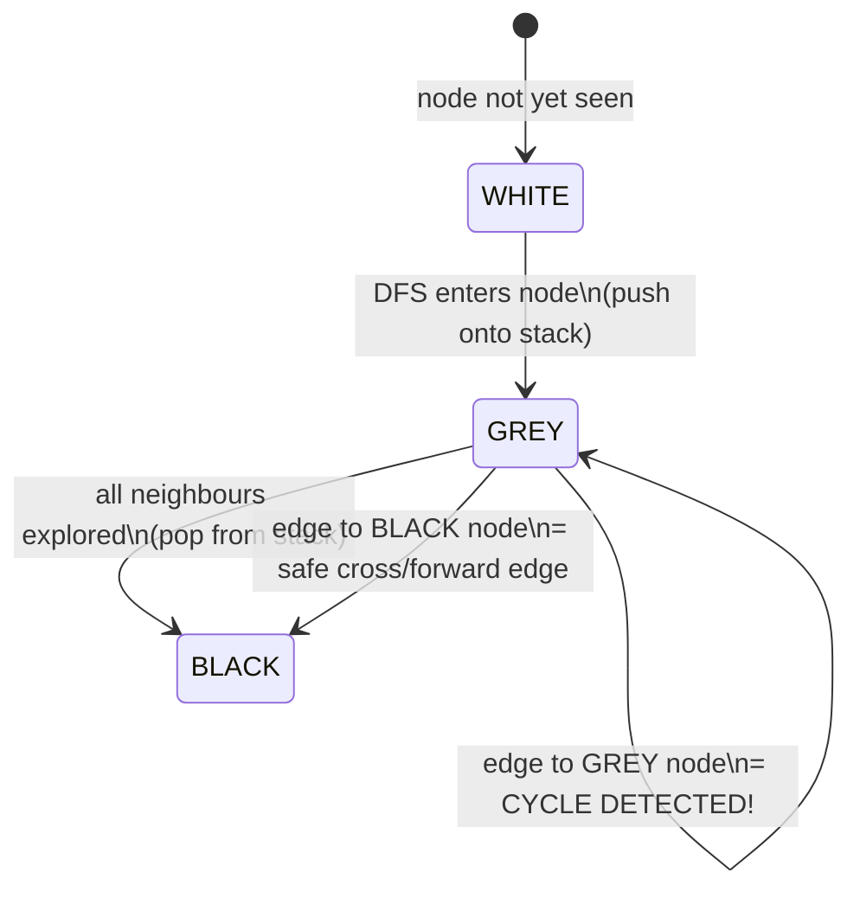

# Chapter 32 — Graph Traversal: BFS and DFS

## Learning Objectives

By the end of this chapter, you will be able to:

- Implement BFS and DFS on graphs with proper visited tracking
- Find connected components in undirected graphs
- Detect cycles in both directed and undirected graphs
- Check if a graph is bipartite using 2-colouring
- Apply multi-source BFS and grid traversal patterns
- Choose BFS vs DFS based on the problem requirements

---

## Contents

- [32.1 Why Graph Traversal Is Harder Than Tree Traversal](#321-why-graph-traversal-is-harder-than-tree-traversal)
- [32.2 Breadth-First Search (BFS)](#322-breadth-first-search-bfs)
- [32.3 Depth-First Search (DFS)](#323-depth-first-search-dfs)
- [32.4 BFS vs DFS: When to Use Which](#324-bfs-vs-dfs-when-to-use-which)
- [32.5 Connected Components](#325-connected-components)
- [32.6 Cycle Detection](#326-cycle-detection)
- [32.7 Bipartite Graph Check](#327-bipartite-graph-check)
- [32.8 Grid Traversal](#328-grid-traversal)
- [32.9 Multi-Source BFS](#329-multi-source-bfs)
- [Interview Insight](#interview-insight)
- [Quick Quiz](#quick-quiz)
- [32.10 Practice Problems](#3210-practice-problems)
- [Chapter Summary](#chapter-summary)

---

> [!NOTE]
> **Historical Context**  
> **Breadth-First Search** was first described by **Konrad Zuse** in his 1945 manuscript *Plankalkül* (unpublished until 1972) and independently by **Edward F. Moore** in **1959** for solving mazes, and **C. Y. Lee** in **1961** for routing PCB circuits. **Depth-First Search** as a systematic algorithm was formalized by **John Hopcroft** and **Robert Tarjan** in **1973**, though the idea of maze-solving by exhaustive depth-first exploration was described by **Trémaux** in **1882**. DFS and BFS form the backbone of nearly every graph algorithm — Dijkstra, Bellman-Ford, Prim, Kruskal, topological sort, SCC algorithms — all use one or both as their core traversal engine.

---

> ### 🔗 Analogy
> **Exploring an Unknown City**
>
> Imagine you're dropped in an unknown city and must visit every landmark.
> - **BFS:** You explore in rings. First, all landmarks within 1 block. Then all within 2 blocks. Then 3. You finish every ring before expanding. You'll always find the *nearest* landmark first. Good for: "What's the closest pharmacy?"
> - **DFS:** You pick one street and follow it to its dead end, then backtrack and pick the next street. You dive deep before coming back. Good for: "Does this street system have any loops?" or "Can I reach the train station from here?"

---

## 32.1 Why Graph Traversal Is Harder Than Tree Traversal

In Chapter 26, we traversed trees using recursive DFS — no special bookkeeping needed. Graphs add two new challenges:

**Challenge 1: Cycles.** A graph may have cycles. Without tracking visited nodes, BFS and DFS loop forever.

**Challenge 2: Disconnected components.** A tree has one root connecting all nodes. A graph may have multiple disconnected components. Starting traversal from one node may miss others entirely.

**Solutions:**
1. Maintain a `visited` array or set — mark each node when first seen.
2. For disconnected graphs, loop over all vertices and start a new traversal from any unvisited one.

---

## 32.2 Breadth-First Search (BFS)

**Intuition:** BFS explores the graph in waves — all nodes at distance 1 from the source, then all at distance 2, then distance 3, and so on. This level-by-level guarantee makes BFS the go-to algorithm for **shortest path in unweighted graphs**.


*BFS expands in concentric distance rings. All distance-1 nodes are processed before any distance-2 node — this is what guarantees the shortest path.*

**How it works:**
1. Start: put the source into a queue, mark it visited.
2. While queue is non-empty: dequeue a node, process it, enqueue all unvisited neighbours and mark them visited.

**Why mark as visited when enqueuing (not when dequeuing)?** If we mark only on dequeue, the same node may be enqueued multiple times before it's processed — leading to wasted work and potentially incorrect shortest distances.

> [!NOTE]
> **The Most Common BFS Bug**  
> Marking a node `visited` *after* dequeuing instead of *before* enqueuing. With the wrong placement, the same node can be enqueued by multiple neighbours before it is processed, bloating the queue and corrupting distance values. On a 1,000 × 1,000 grid, this bug can fill the queue with up to one million duplicate entries instead of one million unique cells. **Always mark visited immediately before `queue.offer()`.**

```java
void bfs(List<List<Integer>> adj, int src, int V) {
    boolean[] visited = new boolean[V];
    Queue<Integer> queue = new ArrayDeque<>();

    visited[src] = true;    // mark BEFORE enqueuing
    queue.offer(src);

    while (!queue.isEmpty()) {
        int node = queue.poll();
        System.out.print(node + " ");

        for (int neighbour : adj.get(node)) {
            if (!visited[neighbour]) {
                visited[neighbour] = true;    // mark BEFORE enqueuing
                queue.offer(neighbour);
            }
        }
    }
}
```

**BFS with shortest distances:**

```java
int[] bfsDistances(List<List<Integer>> adj, int src, int V) {
    int[] dist = new int[V];
    Arrays.fill(dist, -1);          // -1 = not reachable
    dist[src] = 0;
    Queue<Integer> queue = new ArrayDeque<>();
    queue.offer(src);

    while (!queue.isEmpty()) {
        int node = queue.poll();
        for (int nb : adj.get(node)) {
            if (dist[nb] == -1) {   // not visited yet
                dist[nb] = dist[node] + 1;   // one step further
                queue.offer(nb);
            }
        }
    }
    return dist;
}
```

**Step-by-step trace on a 6-node graph:**
```
Graph: 0-1, 0-2, 1-3, 2-4, 3-5

BFS from 0:
Queue: [0]       dist: [0,-1,-1,-1,-1,-1]
  Dequeue 0, enqueue 1,2
Queue: [1,2]     dist: [0,1,1,-1,-1,-1]
  Dequeue 1, enqueue 3
Queue: [2,3]     dist: [0,1,1,2,-1,-1]
  Dequeue 2, enqueue 4
Queue: [3,4]     dist: [0,1,1,2,2,-1]
  Dequeue 3, enqueue 5
Queue: [4,5]     dist: [0,1,1,2,2,3]
  Dequeue 4, no unvisited neighbours
  Dequeue 5, no unvisited neighbours
Final: [0,1,1,2,2,3] ✓
```

**Complexity:** O(V + E) time — each vertex enqueued/dequeued once, each edge examined once. O(V) space for queue and visited array.

---

## 32.3 Depth-First Search (DFS)

**Intuition:** DFS commits fully to one path before backtracking. It goes as deep as possible into the graph before considering alternatives. This makes it ideal for problems that need to explore entire paths: cycle detection, topological sort, connected components, strongly connected components.

### Recursive DFS

```java
void dfs(List<List<Integer>> adj, int node, boolean[] visited) {
    visited[node] = true;
    System.out.print(node + " ");

    for (int nb : adj.get(node)) {
        if (!visited[nb])
            dfs(adj, nb, visited);
    }
}

// Call for all components:
void dfsAll(List<List<Integer>> adj, int V) {
    boolean[] visited = new boolean[V];
    for (int i = 0; i < V; i++)
        if (!visited[i])
            dfs(adj, i, visited);   // new component starts here
}
```

**Step-by-step trace on the same graph:**
```
Graph: 0-1, 0-2, 1-3, 2-4, 3-5

DFS from 0:
Visit 0 → go to 1
  Visit 1 → go to 3
    Visit 3 → go to 5
      Visit 5 → no unvisited neighbours, backtrack
    Back at 3, no more neighbours, backtrack
  Back at 1, no more neighbours, backtrack
Back at 0 → go to 2
  Visit 2 → go to 4
    Visit 4 → no unvisited neighbours, backtrack
  Back at 2, backtrack
Order: 0, 1, 3, 5, 2, 4
```


*DFS follows one branch to its dead end (solid arrows) before backtracking to explore other branches (dashed arrows).*

### Iterative DFS (explicit stack)

```java
void dfsIterative(List<List<Integer>> adj, int src, boolean[] visited) {
    Deque<Integer> stack = new ArrayDeque<>();
    stack.push(src);

    while (!stack.isEmpty()) {
        int node = stack.pop();
        if (visited[node]) continue;   // may be pushed multiple times
        visited[node] = true;
        System.out.print(node + " ");

        for (int nb : adj.get(node))
            if (!visited[nb]) stack.push(nb);
    }
}
```

> [!NOTE]
> **Why iterative DFS marks visited on dequeue, not enqueue?**  
> Unlike BFS where we know exactly when a node will be processed (immediately after enqueue in FIFO order), iterative DFS pushes multiple neighbours onto a LIFO stack and processes them in reverse order. The same neighbour may be pushed by multiple nodes before it's processed. We check `visited` on pop to handle this. This is a subtle but important difference from BFS.

**Complexity:** O(V + E) time, O(V) space (call stack for recursive, explicit stack for iterative).

> [!TIP]
> **Did You Know?**  
> Recursive DFS on a graph with $V = 10,000$ may cause `StackOverflowError` if the graph is a long chain (stack depth = V). Iterative DFS avoids this. Java's default thread stack supports roughly 5,000–10,000 recursive calls. For graph problems with $V > 5,000$, prefer iterative DFS in production code.

---

## 32.4 BFS vs DFS: When to Use Which

| Need | Use | Why |
|------|-----|-----|
| Shortest path (unweighted) | **BFS** | Guarantees level-by-level = shortest |
| Detect if path exists | Either | Both visit all reachable nodes |
| Cycle detection (undirected) | **DFS** | Easy to track parent; BFS also works |
| Cycle detection (directed) | **DFS** | Colour states (white/grey/black) natural with DFS |
| Topological sort | **DFS** | Postorder gives reverse topological order |
| Connected components | Either | Both work; DFS more cache-friendly |
| Strongly connected components | **DFS** | Kosaraju/Tarjan both DFS-based |
| Level-order / nearest first | **BFS** | Natural by design |
| Find all paths | **DFS** | Natural with backtracking |
| Bipartite check | Either | 2-colouring with BFS is intuitive |

---

## 32.5 Connected Components

**Problem:** Count and identify the connected components in an undirected graph.

**Intuition:** Run BFS/DFS from every unvisited vertex. Each new traversal started from scratch discovers a new component.

```java
int countComponents(int V, List<List<Integer>> adj) {
    boolean[] visited = new boolean[V];
    int components = 0;

    for (int i = 0; i < V; i++) {
        if (!visited[i]) {
            components++;             // new component discovered
            dfs(adj, i, visited);     // mark all nodes in this component
        }
    }
    return components;
}
```

**Label each component:**

```java
int[] componentId(int V, List<List<Integer>> adj) {
    int[] comp = new int[V];
    Arrays.fill(comp, -1);
    int id = 0;
    for (int i = 0; i < V; i++) {
        if (comp[i] == -1) {
            dfsLabel(adj, i, comp, id++);
        }
    }
    return comp;
}

void dfsLabel(List<List<Integer>> adj, int node, int[] comp, int id) {
    comp[node] = id;
    for (int nb : adj.get(node))
        if (comp[nb] == -1) dfsLabel(adj, nb, comp, id);
}
```

**Complexity:** O(V + E) — every vertex and edge visited once across all DFS calls.

---

## 32.6 Cycle Detection

### Undirected Graph — DFS with Parent Tracking

**Intuition:** In an undirected graph, a cycle exists if DFS finds a "back edge" — an edge leading to a node that's already visited *and is not the direct parent*. The parent check prevents us from mistaking the edge we came from as a cycle.

**Why track the parent?** When DFS visits node u through edge (parent→u), node u sees `parent` in its adjacency list. Without the parent check, we'd incorrectly report a cycle every time we see the edge we just traversed.

```java
boolean hasCycleUndirected(List<List<Integer>> adj, int V) {
    boolean[] visited = new boolean[V];
    for (int i = 0; i < V; i++)
        if (!visited[i] && dfsCycleUndirected(adj, i, -1, visited))
            return true;
    return false;
}

boolean dfsCycleUndirected(List<List<Integer>> adj, int node, int parent, boolean[] visited) {
    visited[node] = true;
    for (int nb : adj.get(node)) {
        if (!visited[nb]) {
            if (dfsCycleUndirected(adj, nb, node, visited)) return true;
        } else if (nb != parent) {   // visited AND not the parent → back edge → cycle!
            return true;
        }
    }
    return false;
}
```

**Trace on graph with cycle 0-1-2-0:**
```
dfs(0, parent=-1): visit 0
  dfs(1, parent=0): visit 1
    dfs(2, parent=1): visit 2
      neighbour 0: visited AND 0 != 1 (parent) → CYCLE FOUND ✓
```

### Directed Graph — DFS with 3 Colour States

**Why can't we use the undirected approach?** In a directed graph, an edge to a visited node isn't necessarily a back edge. It could be a "cross edge" to a node in a different DFS branch — no cycle. We need to know if the visited node is **currently on the active DFS stack** (grey), not just visited at some point (black).

**Three colour states:**
- **WHITE (0):** Not visited yet
- **GREY (1):** Currently in the DFS stack (being processed)
- **BLACK (2):** Fully processed (all neighbours explored)



**A cycle exists if and only if we find an edge leading to a GREY node** — a node currently on the DFS path, meaning we've looped back.

```java
boolean hasCycleDirected(List<List<Integer>> adj, int V) {
    int[] color = new int[V];   // 0=white, 1=grey, 2=black
    for (int i = 0; i < V; i++)
        if (color[i] == 0 && dfsCycleDirected(adj, i, color))
            return true;
    return false;
}

boolean dfsCycleDirected(List<List<Integer>> adj, int node, int[] color) {
    color[node] = 1;   // grey: on the DFS stack
    for (int nb : adj.get(node)) {
        if (color[nb] == 1) return true;   // grey → back edge → cycle!
        if (color[nb] == 0 && dfsCycleDirected(adj, nb, color)) return true;
    }
    color[node] = 2;   // black: fully processed, removed from stack
    return false;
}
```

**Complexity:** O(V + E) for both. O(V) space.

---

## 32.7 Bipartite Graph Check

**Definition:** A graph is **bipartite** if its vertices can be divided into two sets such that every edge connects a vertex from one set to the other — no edges within the same set.

**Equivalently:** A graph is bipartite if and only if it **contains no odd-length cycle**.

**Intuition via 2-colouring:** Try to colour the graph with 2 colours such that adjacent vertices have different colours. If we ever need to give the same colour to two adjacent vertices, the graph is NOT bipartite (there's an odd cycle).

**BFS-based 2-colouring:**

```java
boolean isBipartite(List<List<Integer>> adj, int V) {
    int[] color = new int[V];   // 0=uncoloured, 1=red, -1=blue
    for (int i = 0; i < V; i++) {
        if (color[i] == 0 && !bfsColor(adj, i, color))
            return false;
    }
    return true;
}

boolean bfsColor(List<List<Integer>> adj, int src, int[] color) {
    Queue<Integer> q = new ArrayDeque<>();
    color[src] = 1;   // colour source red
    q.offer(src);

    while (!q.isEmpty()) {
        int node = q.poll();
        for (int nb : adj.get(node)) {
            if (color[nb] == 0) {
                color[nb] = -color[node];   // assign opposite colour
                q.offer(nb);
            } else if (color[nb] == color[node]) {
                return false;   // same colour as neighbour → NOT bipartite
            }
        }
    }
    return true;
}
```

**Trace on a bipartite graph (0-1-2-3-0, even cycle):**
```
Colour 0=RED(1)
  Neighbour 1: uncoloured → BLUE(-1)
  Neighbour 3: uncoloured → BLUE(-1)
Colour 1=BLUE(-1)
  Neighbour 2: uncoloured → RED(1)
Colour 3=BLUE(-1)
  Neighbour 2: already RED(1) ≠ BLUE(-1) → OK ✓
Result: Bipartite ✓
```

**Real-world usage:** Bipartite graphs model matching problems — users on one side, items on the other (Netflix: users + movies; job market: applicants + positions). Verifying bipartiteness is a prerequisite for maximum bipartite matching algorithms.

> [!TIP]
> **Did You Know?**  
> The 2-colouring (bipartite check) problem is exactly equivalent to asking: *"Can I partition the vertices into two groups such that no edge stays within a group?"* This is the simplest case of **graph colouring**. The general k-colouring problem (k colours, no two adjacent vertices share a colour) is **NP-complete for k ≥ 3** — one of the most famous intractable problems in computer science. The jump from k = 2 (solvable in linear time with BFS) to k = 3 marks the boundary between *easy* and *(probably) impossible to solve efficiently*. This is why checking bipartiteness is such a frequent prerequisite in algorithm design.

---

## 32.8 Grid Traversal

**Intuition:** A grid is an **implicit graph**. Each cell `(r, c)` is a vertex. Edges exist between adjacent passable cells. No need to build an explicit adjacency list — compute neighbours on the fly.

**Standard template:**

```java
int[][] DIRS = {{0,1},{0,-1},{1,0},{-1,0}};   // right, left, down, up

void bfsGrid(char[][] grid, int startR, int startC) {
    int rows = grid.length, cols = grid[0].length;
    boolean[][] visited = new boolean[rows][cols];
    Queue<int[]> q = new ArrayDeque<>();

    visited[startR][startC] = true;
    q.offer(new int[]{startR, startC});

    while (!q.isEmpty()) {
        int[] cell = q.poll();
        int r = cell[0], c = cell[1];
        // process cell (r, c)

        for (int[] d : DIRS) {
            int nr = r + d[0], nc = c + d[1];
            if (nr >= 0 && nr < rows && nc >= 0 && nc < cols
                    && !visited[nr][nc] && grid[nr][nc] == '1') {
                visited[nr][nc] = true;
                q.offer(new int[]{nr, nc});
            }
        }
    }
}
```

**Number of Islands (LC 200):** Count connected land components in a grid.

```java
int numIslands(char[][] grid) {
    int rows = grid.length, cols = grid[0].length;
    int count = 0;

    for (int r = 0; r < rows; r++) {
        for (int c = 0; c < cols; c++) {
            if (grid[r][c] == '1') {
                count++;
                dfsIsland(grid, r, c, rows, cols);   // sink the island
            }
        }
    }
    return count;
}

void dfsIsland(char[][] grid, int r, int c, int rows, int cols) {
    if (r < 0 || r >= rows || c < 0 || c >= cols || grid[r][c] != '1') return;
    grid[r][c] = '0';    // mark as visited by sinking (modify in-place)
    dfsIsland(grid, r+1, c, rows, cols);
    dfsIsland(grid, r-1, c, rows, cols);
    dfsIsland(grid, r, c+1, rows, cols);
    dfsIsland(grid, r, c-1, rows, cols);
}
```

**Complexity:** O(rows × cols) time and space.

**8-directional grid** (chess moves, diagonal connections):
```java
int[][] DIRS8 = {{-1,-1},{-1,0},{-1,1},{0,-1},{0,1},{1,-1},{1,0},{1,1}};
```

---

## 32.9 Multi-Source BFS

**Problem:** Some BFS problems have *multiple starting points simultaneously* rather than one source. Example: "Rotting Oranges" (LC 994) — multiple rotten oranges spread rot to neighbours at the same time.

**Intuition:** Instead of starting BFS from a single source, enqueue *all* sources at distance 0 simultaneously. The BFS wave spreads from all of them in parallel. This correctly models simultaneous spread.

**Wrong approach:** BFS from each source separately and take the minimum. This gives incorrect results when waves from different sources interleave.

```java
int orangesRotting(int[][] grid) {
    int rows = grid.length, cols = grid[0].length;
    Queue<int[]> q = new ArrayDeque<>();
    int fresh = 0;

    // Enqueue ALL rotten oranges at time 0 simultaneously
    for (int r = 0; r < rows; r++)
        for (int c = 0; c < cols; c++) {
            if (grid[r][c] == 2) q.offer(new int[]{r, c, 0});  // [row, col, time]
            else if (grid[r][c] == 1) fresh++;
        }

    int maxTime = 0;
    while (!q.isEmpty()) {
        int[] curr = q.poll();
        int r = curr[0], c = curr[1], t = curr[2];
        for (int[] d : DIRS) {
            int nr = r + d[0], nc = c + d[1];
            if (nr >= 0 && nr < rows && nc >= 0 && nc < cols && grid[nr][nc] == 1) {
                grid[nr][nc] = 2;      // rot the fresh orange
                fresh--;
                maxTime = Math.max(maxTime, t + 1);
                q.offer(new int[]{nr, nc, t + 1});
            }
        }
    }
    return fresh == 0 ? maxTime : -1;   // -1 if unreachable fresh oranges remain
}
```

**Other multi-source BFS problems:**
- **01 Matrix (LC 542):** Distance from each cell to nearest 0 — enqueue all 0-cells at once
- **Walls and Gates (LC 286):** Distance from each gate cell to nearest gate
- **Pacific Atlantic Water Flow (LC 417):** BFS from both coast borders simultaneously

---

## Interview Insight

> **The three structural questions that determine your traversal approach:**
> 1. *"Do I need the shortest path or just reachability?"* → Shortest = BFS. Reachability = either.
> 2. *"Is the graph directed or undirected?"* → Affects cycle detection algorithm and component counting.
> 3. *"Could the graph be disconnected?"* → If yes, you must loop over ALL vertices and start traversal from each unvisited one.
>
> **The two most common graph interview bugs:**
> - Forgetting to mark a node visited *before* enqueuing it in BFS (causing the same node to be enqueued multiple times).
> - Using the undirected cycle detection (parent tracking) on a directed graph — it misses cross-edges that look like back-edges but aren't.

---

## Quick Quiz

1. Why must you mark a node `visited` when **enqueuing** it in BFS, not when dequeuing it?
2. What is the key difference between cycle detection in undirected vs directed graphs?
3. A graph has V=6 vertices and E=4 edges. After running BFS/DFS from vertex 0 and visiting only 4 vertices, what can you conclude?
4. What does it mean for a graph to be bipartite in terms of cycle lengths?
5. If you're finding the minimum number of steps to reach a target in a grid, which traversal guarantees the optimal answer and why?

**Answers:**
1. If you mark on dequeue, the same node may be enqueued multiple times (by different neighbours) before being dequeued, wasting work and potentially computing wrong distances.
2. Undirected: track the **parent** of each node; a visited non-parent neighbour = cycle. Directed: track **grey** (on current stack) vs **black** (fully processed); only grey neighbours indicate a true cycle.
3. The graph has at least 2 connected components — the remaining 2 unvisited vertices are in separate components unreachable from vertex 0.
4. A bipartite graph contains **no odd-length cycles**. It may contain even-length cycles.
5. BFS. It processes nodes level-by-level (distance 1, then 2, then 3...). The first time BFS reaches the target, it's guaranteed to be the minimum number of steps. DFS has no such guarantee.

---

## 32.10 Practice Problems

**Warm-up:**
- BFS traversal of a graph (print level by level).
- DFS traversal (recursive and iterative).
- Number of connected components in an undirected graph (LC 323).
- Find if path exists in graph (LC 1971).

**Medium:**
- Number of Islands (LC 200) — grid DFS/BFS.
- Clone Graph (LC 133) — BFS with node mapping.
- Course Schedule — cycle detection in directed graph (LC 207).
- Is Graph Bipartite? (LC 785).
- Rotting Oranges — multi-source BFS (LC 994).
- 01 Matrix — multi-source BFS (LC 542).
- Pacific Atlantic Water Flow — multi-source BFS from both coasts (LC 417).

**Hard:**
- Shortest Path in Binary Matrix (LC 1091).
- Word Ladder — build implicit graph, BFS (LC 127).
- Minimum Knight Moves (LC 1197).
- Surrounded Regions — boundary DFS (LC 130).

---

## Chapter Summary

| Algorithm | Data Structure | Guarantees | Time | Space |
|-----------|---------------|-----------|------|-------|
| BFS | Queue | Shortest path (unweighted), level-order | O(V+E) | O(V) |
| DFS Recursive | Call stack | Complete graph exploration | O(V+E) | O(V) |
| DFS Iterative | Explicit stack | Complete graph exploration | O(V+E) | O(V) |

| Pattern | Technique |
|---------|-----------|
| Connected components | Outer for-loop + BFS/DFS per unvisited vertex |
| Undirected cycle | DFS + parent parameter; back edge = visited non-parent |
| Directed cycle | DFS + 3 colours; cycle = edge to grey (in-stack) node |
| Bipartite check | BFS 2-colouring; conflict = same-colour adjacent nodes |
| Grid traversal | Implicit graph; `DIRS` array; boundary + visited check |
| Multi-source BFS | Enqueue ALL sources at distance 0 simultaneously |

---

*← [Chapter 31 — Graph Fundamentals and Representation](chapter-31-graph-fundamentals.md)*  
*→ [Chapter 33 — Shortest Path Algorithms](chapter-33-shortest-paths.md)*
