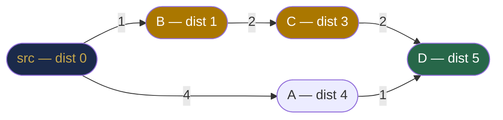
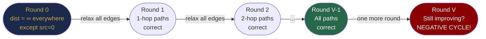
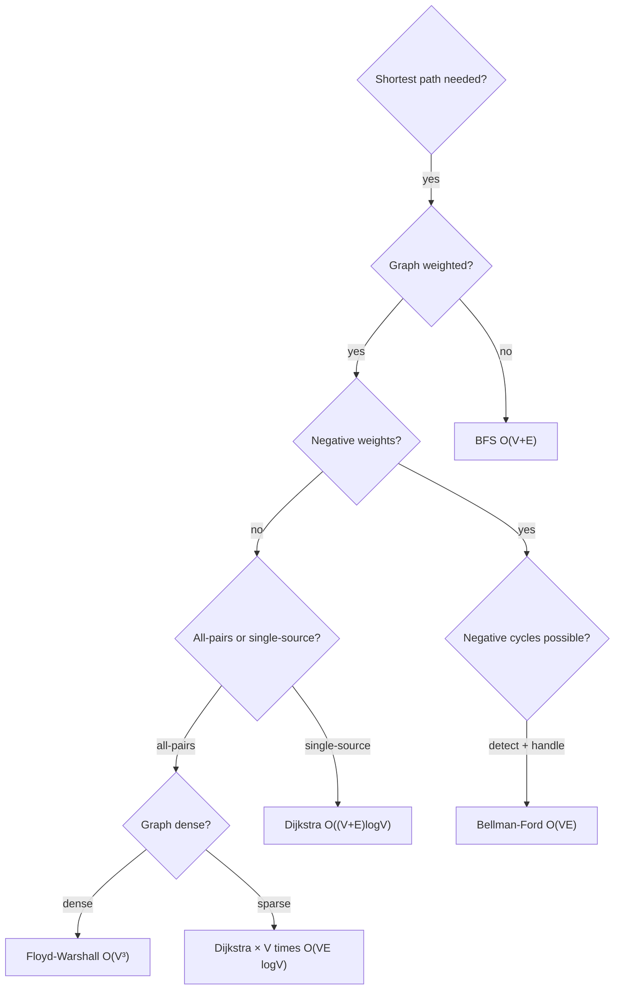

# Chapter 33 — Shortest Path Algorithms

## Learning Objectives

By the end of this chapter, you will be able to:

- Use BFS for shortest paths in unweighted graphs
- Implement Dijkstra's algorithm for non-negative weighted graphs
- Implement Bellman-Ford for graphs with negative weights
- Understand Floyd-Warshall for all-pairs shortest paths
- Reconstruct the actual path (not just distance) for all algorithms
- Choose the correct algorithm based on graph properties

---

## Contents

- [33.1 The Shortest Path Problem](#331-the-shortest-path-problem)
- [33.2 BFS for Unweighted Graphs](#332-bfs-for-unweighted-graphs)
- [33.3 Dijkstra's Algorithm](#333-dijkstras-algorithm)
- [33.4 Bellman-Ford Algorithm](#334-bellman-ford-algorithm)
- [33.5 Floyd-Warshall Algorithm](#335-floyd-warshall-algorithm)
- [33.6 Path Reconstruction](#336-path-reconstruction)
- [33.7 Algorithm Selection Guide](#337-algorithm-selection-guide)
- [Interview Insight](#interview-insight)
- [Quick Quiz](#quick-quiz)
- [33.8 Practice Problems](#338-practice-problems)
- [Chapter Summary](#chapter-summary)

---

> [!NOTE]
> **Historical Context**  
> **Edsger W. Dijkstra** invented his algorithm in **1956** (published 1959) in just 20 minutes while sitting at a café in Amsterdam. It was designed for the ARMAC computer to find the shortest route between Rotterdam and Groningen. At the time, he didn't even have a pencil with him — the algorithm was developed entirely in his head. **Richard Bellman** published his algorithm in **1958**, independently developed by **Lester Ford Jr.** (the algorithm is sometimes called Bellman-Ford-Moore). **Robert Floyd** published the all-pairs algorithm in **1962** — the same year as Stephen Warshall's similar work. These four algorithms, developed within a 6-year window, form the complete solution set for single-source and all-pairs shortest paths used today.

---

> ### 🔗 Analogy
> **GPS Navigation**
>
> You're driving in a city. Each intersection is a **vertex**. Each road segment is a **weighted edge** (weight = travel time or distance).
>
> - **BFS shortest path:** Counts the fewest *turns* (edges), ignoring road length. Good for "how many roads do I cross?"
> - **Dijkstra:** Finds the fastest route using road *distances*. This is exactly what Google Maps does for car routing — works because distances are always positive.
> - **Bellman-Ford:** Handles scenarios where some roads have "negative time" — say, you're paid to take a toll road (theoretical, but models financial graphs with gains/losses).
> - **Floyd-Warshall:** Computes shortest routes between *every pair* of intersections simultaneously — useful for pre-computing a full routing table.

---

## 33.1 The Shortest Path Problem

**Single-source shortest path (SSSP):** Given a graph $G = (V, E)$ and a source vertex $s$, find the shortest path from $s$ to every other vertex.

**All-pairs shortest path (APSP):** Find shortest paths between every pair of vertices.

**What "shortest" means depends on the graph:**
- Unweighted: fewest edges (hops)
- Weighted: minimum sum of edge weights

**Challenges:**
- **Negative edge weights:** Can invalidate greedy approaches
- **Negative cycles:** A cycle whose total weight is negative — if reachable, there's no shortest path (you can loop forever and reduce the path indefinitely)

```
Path cost:   A→B→C = 4+2 = 6
             A→C   = 10
Shortest:    A→B→C (cost 6, not A→C with cost 10)
```

---

## 33.2 BFS for Unweighted Graphs

**When to use:** Graph is **unweighted** (or all weights are equal). BFS gives the minimum number of edges (hops) automatically.

**Why BFS gives shortest paths:** BFS explores level by level. The first time BFS reaches a vertex, it has travelled the fewest possible hops to get there. Any later path to that vertex would have gone through more levels (more hops) first.

**This does NOT work for weighted graphs.** A 3-hop path with weights [1,1,1] = 3 beats a 1-hop path with weight 100. BFS only counts hops, not total weight.

```java
int[] bfsShortestPath(List<List<Integer>> adj, int src, int V) {
    int[] dist = new int[V];
    Arrays.fill(dist, Integer.MAX_VALUE);
    dist[src] = 0;
    Queue<Integer> q = new ArrayDeque<>();
    q.offer(src);

    while (!q.isEmpty()) {
        int node = q.poll();
        for (int nb : adj.get(node)) {
            if (dist[nb] == Integer.MAX_VALUE) {   // first time reaching nb
                dist[nb] = dist[node] + 1;
                q.offer(nb);
            }
        }
    }
    return dist;
}
```

---

## 33.3 Dijkstra's Algorithm

**Core idea:** At each step, greedily select the unvisited vertex with the smallest known distance from the source, then relax all its outgoing edges.

**Building the intuition step by step:**

**Step 1 — What is "relaxation"?**  
Relaxing edge (u, v, w) means: "if going through u to reach v is cheaper than the current best known path to v, update v's best distance."
```
relax(u, v, w):
    if dist[u] + w < dist[v]:
        dist[v] = dist[u] + w
```


*Dijkstra always selects the unvisited node with the smallest current distance (shown in orange). Once selected, its distance is final. It relaxes outgoing edges, potentially updating neighbours.*

**Step 2 — Why greedy selection works (the key correctness argument).**  
Once a vertex $u$ is selected as the nearest unvisited vertex, its distance `dist[u]` is **final** — no future path through unvisited vertices can improve it. Why? All edge weights are non-negative, so any path through an unvisited vertex (with `dist ≥ dist[u]`) followed by more non-negative edges can only result in a path ≥ `dist[u]`. This greedy argument is called the **optimality condition** and breaks down when negative weights exist.

**Step 3 — Efficient selection with a priority queue.**  
Naively, finding the minimum-distance unvisited vertex at each step takes O(V). With a priority queue (min heap), we extract the minimum in O(log V) and get total O((V + E) log V).

```java
int[] dijkstra(List<List<int[]>> adjWeighted, int src, int V) {
    int[] dist = new int[V];
    Arrays.fill(dist, Integer.MAX_VALUE);
    dist[src] = 0;

    // Min heap by distance: [distance, vertex]
    PriorityQueue<int[]> pq = new PriorityQueue<>(Comparator.comparingInt(a -> a[0]));
    pq.offer(new int[]{0, src});

    while (!pq.isEmpty()) {
        int[] curr = pq.poll();
        int d = curr[0], u = curr[1];

        if (d > dist[u]) continue;   // stale entry: a shorter path was already found

        for (int[] edge : adjWeighted.get(u)) {
            int v = edge[0], w = edge[1];
            if (dist[u] + w < dist[v]) {       // relax edge (u→v)
                dist[v] = dist[u] + w;
                pq.offer(new int[]{dist[v], v});
            }
        }
    }
    return dist;
}
```

**Why `if (d > dist[u]) continue`?**  
When we update `dist[v]`, we push a new entry `[dist[v], v]` to the priority queue — but we don't remove the old, stale entry `[old_dist[v], v]`. When that stale entry is eventually popped, `d > dist[u]` (the stale distance > the current best), so we skip it. This "lazy deletion" avoids the need for a decrease-key operation.

**Step-by-step trace on a weighted graph:**
```
Graph: 0→1(w=4), 0→2(w=1), 2→1(w=2), 1→3(w=1), 2→3(w=5)
Source: 0
dist = [0, ∞, ∞, ∞]

PQ: [(0,0)]
Pop (0,0): relax 1: dist[1]=4, relax 2: dist[2]=1
PQ: [(1,2),(4,1)]   dist=[0,4,1,∞]

Pop (1,2): relax 1: 1+2=3 < 4 → dist[1]=3, relax 3: 1+5=6
PQ: [(3,1),(4,1_stale),(6,3)]   dist=[0,3,1,6]

Pop (3,1): relax 3: 3+1=4 < 6 → dist[3]=4
PQ: [(4,1_stale),(4,3),(6,3_stale)]   dist=[0,3,1,4]

Pop (4,1_stale): 4 > dist[1]=3 → SKIP
Pop (4,3): no outgoing edges
Pop (6,3_stale): SKIP

Final: dist=[0,3,1,4]  ✓  (0→2→1→3 costs 1+2+1=4)
```

**Complexity:**
- Time: O((V + E) log V) with a binary heap priority queue
- Space: O(V + E) for the graph + O(V) for dist array

**Why Dijkstra fails with negative weights:**
```
  0 ——(1)——→ 1 ——(-10)——→ 2
  └——————(5)——————————————→
  
Dijkstra picks 1 (dist=1) before 2 (dist=5).
Marks dist[1]=1 as final.
But then finds 0→2→... could give dist[1] = 5 + (-10) = -5.
Too late: dist[1] was already locked in as 1. INCORRECT.
```

> [!NOTE]
> **Why is Dijkstra's proof non-trivial?**  
> Dijkstra's correctness relies on the **optimality condition**: when a vertex is popped from the priority queue with distance $d$, $d$ is the true shortest distance. This holds only because all weights are non-negative — meaning any path extension can only increase (or keep equal) the total. With negative edges, an already-processed vertex could later be found reachable via a shorter path. The formal proof uses a **greedy exchange argument**: assume there is a shorter path to $u$ that doesn't go through the already-processed set; this path must cross into the unprocessed set at some point, but that crossing edge would have been selected earlier by the min-heap. Contradiction.

---

## 33.4 Bellman-Ford Algorithm

**Core idea:** Relax ALL edges V-1 times. After $k$ iterations, the algorithm has computed the shortest paths using at most $k$ edges.

**Why V-1 iterations?** The longest simple path in a V-vertex graph uses at most V-1 edges. After V-1 rounds of relaxing all edges, every shortest path (without negative cycles) will have been found.

**Building the intuition:**

Think of it as a "slow Dijkstra." Instead of greedily picking the best vertex, Bellman-Ford brute-force relaxes every edge in every round. It's slower but handles negative weights.



```
Round 1: Shortest paths using 1 edge are correct
Round 2: Shortest paths using 2 edges are correct
...
Round V-1: All shortest paths (at most V-1 edges) are correct
Round V: If ANY distance still improves → negative cycle detected!
```

```java
int[] bellmanFord(int V, int[][] edges, int src) {
    // edges[i] = [u, v, weight]
    int[] dist = new int[V];
    Arrays.fill(dist, Integer.MAX_VALUE);
    dist[src] = 0;

    // Relax ALL edges V-1 times
    for (int round = 0; round < V - 1; round++) {
        boolean updated = false;
        for (int[] edge : edges) {
            int u = edge[0], v = edge[1], w = edge[2];
            if (dist[u] != Integer.MAX_VALUE && dist[u] + w < dist[v]) {
                dist[v] = dist[u] + w;
                updated = true;
            }
        }
        if (!updated) break;   // early exit: no relaxation = already optimal
    }

    // Detect negative cycles: one more round
    for (int[] edge : edges) {
        int u = edge[0], v = edge[1], w = edge[2];
        if (dist[u] != Integer.MAX_VALUE && dist[u] + w < dist[v])
            throw new IllegalStateException("Negative cycle detected");
    }
    return dist;
}
```

**Step-by-step trace (5 vertices, negative edge):**
```
Vertices: 0,1,2,3,4
Edges: (0,1,6),(0,2,7),(1,2,8),(1,3,-4),(1,4,5),(2,3,9),(2,4,-3),(3,0,2),(4,3,7)
Source: 0
dist = [0, ∞, ∞, ∞, ∞]

Round 1 (relax all edges):
  (0,1,6): dist[1] = 0+6 = 6
  (0,2,7): dist[2] = 0+7 = 7
  (1,3,-4): dist[3] = 6+(-4) = 2
  (1,4,5): dist[4] = 6+5 = 11
  (2,4,-3): dist[4] = min(11, 7-3) = 4
  ...
Round 2: Further relaxation with the values from Round 1 ...
...
Final after V-1 rounds: dist = [0, 6, 7, 2, 4]
```

**Complexity:**
- Time: O(V × E) — V-1 rounds, each relaxing E edges
- Space: O(V)

**Bellman-Ford vs Dijkstra:**
| | Dijkstra | Bellman-Ford |
|-|---------|-------------|
| Negative weights | ❌ Incorrect | ✅ Handles |
| Negative cycles | ❌ Cannot detect | ✅ Detects |
| Time (dense) | O(V² log V) | O(V³) |
| Time (sparse) | O(E log V) | O(VE) |
| **Use when** | Non-negative weights | Negative weights possible |

> [!TIP]
> **Did You Know?**  
> The Bellman-Ford algorithm underlies the **Internet's routing protocol**: **BGP (Border Gateway Protocol)** and older **RIP (Routing Information Protocol)** are distributed Bellman-Ford implementations. Each router maintains a distance vector (its "dist" array) and periodically shares it with neighbours (like a round of relaxation). After enough rounds, all routers converge to the correct shortest paths — the network-wide Bellman-Ford completion. This is why BGP can take minutes to converge after a network change: it's running distributed Bellman-Ford across tens of thousands of routers.

---

## 33.5 Floyd-Warshall Algorithm

**Problem:** Find shortest paths between **all pairs** of vertices simultaneously.

**Core idea:** Dynamic programming. For each pair (i, j), consider whether routing through some intermediate vertex $k$ gives a shorter path than the direct i→j path.

**The DP recurrence:**
```
dp[i][j][k] = min(
    dp[i][j][k-1],           // don't use k as intermediate
    dp[i][k][k-1] + dp[k][j][k-1]  // route through k
)
```

After considering all vertices 0..k as potential intermediates, `dp[i][j][V]` = shortest path from i to j using any intermediate vertex.

**Key insight:** We can drop the third dimension and update in-place, iterating k from 0 to V-1.

**Why in-place works:** When processing intermediate vertex k, `dist[i][k]` and `dist[k][j]` have already incorporated all intermediates 0..k-1. Using them is safe because: if a shorter path exists through k as intermediate, it only uses vertices 0..k-1 to get to k and from k — which are already correctly computed.

```java
int[][] floydWarshall(int V, int[][] graph) {
    // graph[i][j] = edge weight, or Integer.MAX_VALUE/2 if no edge, 0 on diagonal
    int[][] dist = new int[V][V];
    for (int[] row : dist) Arrays.fill(row, Integer.MAX_VALUE / 2);
    for (int i = 0; i < V; i++) dist[i][i] = 0;

    // Load edges
    for (int i = 0; i < V; i++)
        for (int j = 0; j < V; j++)
            if (graph[i][j] != 0) dist[i][j] = graph[i][j];

    // Try each vertex as intermediate
    for (int k = 0; k < V; k++) {
        for (int i = 0; i < V; i++) {
            for (int j = 0; j < V; j++) {
                if (dist[i][k] + dist[k][j] < dist[i][j]) {
                    dist[i][j] = dist[i][k] + dist[k][j];   // route through k
                }
            }
        }
    }
    return dist;   // dist[i][j] = shortest path from i to j
}
```

**Complexity:**
- Time: O(V³) — three nested loops
- Space: O(V²) — the distance matrix

**Detecting negative cycles:** After running Floyd-Warshall, check if `dist[i][i] < 0` for any vertex `i`. A negative diagonal means vertex `i` can reach itself via a path with negative total weight — a negative cycle.

**When to use Floyd-Warshall:**
- Need all-pairs shortest paths
- Graph is dense (E ≈ V²) — otherwise, run Dijkstra from every vertex: O(V × E log V)
- Graph is small (V ≤ 500 is practical for O(V³))

---

## 33.6 Path Reconstruction

Knowing the shortest **distance** is often not enough — you need the actual path. Use a `prev` (predecessor) array.

**For Dijkstra:**

```java
int[] prev = new int[V];
Arrays.fill(prev, -1);

// In the relax step:
if (dist[u] + w < dist[v]) {
    dist[v] = dist[u] + w;
    prev[v] = u;    // u is the best predecessor of v
    pq.offer(new int[]{dist[v], v});
}

// Reconstruct path from src to target:
List<Integer> reconstructPath(int[] prev, int target) {
    List<Integer> path = new ArrayList<>();
    for (int v = target; v != -1; v = prev[v])
        path.add(v);
    Collections.reverse(path);   // built backwards: target → ... → src
    return path;
}
```

**For Floyd-Warshall:**

```java
int[][] next = new int[V][V];   // next[i][j] = first hop on shortest path i→j
// Initialise: next[i][j] = j if direct edge exists
// In the update step:
if (dist[i][k] + dist[k][j] < dist[i][j]) {
    dist[i][j] = dist[i][k] + dist[k][j];
    next[i][j] = next[i][k];   // to go i→j, first go towards k
}

List<Integer> reconstructPath(int[][] next, int src, int target) {
    if (next[src][target] == -1) return Collections.emptyList();
    List<Integer> path = new ArrayList<>();
    for (int v = src; v != target; v = next[v][target])
        path.add(v);
    path.add(target);
    return path;
}
```

---

## 33.7 Algorithm Selection Guide



| Scenario | Algorithm | Time |
|----------|-----------|------|
| Unweighted graph | BFS | O(V + E) |
| Weighted, non-negative, single-source | Dijkstra | O((V+E) log V) |
| Weighted, negative edges possible | Bellman-Ford | O(V × E) |
| Weighted, all-pairs, small V | Floyd-Warshall | O(V³) |
| Weighted, all-pairs, sparse, large V | Dijkstra × V | O(V × E log V) |

*Table 33.1: Algorithm selection guide.*

---

## Interview Insight

> **The three most common shortest-path interview mistakes:**
> 1. *Using Dijkstra on a graph with negative edges.* Always ask: "Can any edge weight be negative?" If yes, switch to Bellman-Ford.
> 2. *Forgetting the stale-entry check `if (d > dist[u]) continue` in Dijkstra.* Without it, the algorithm processes outdated priority queue entries and may push incorrect values.
> 3. *Using Floyd-Warshall for a sparse graph with large V.* Floyd-Warshall is O(V³) — running Dijkstra V times is O(V × E log V) which is much better for sparse graphs with large V.
>
> **The most common interview follow-up:** "How do you reconstruct the actual path?" Always implement a `prev` array alongside `dist`.

---

## Quick Quiz

1. BFS guarantees the shortest path in an unweighted graph. Why doesn't it work for weighted graphs?
2. What condition is required for Dijkstra's greedy selection to be correct?
3. After V-1 rounds of Bellman-Ford, another relaxation still improves a distance. What does this indicate?
4. In Floyd-Warshall, what does `dist[i][i] < 0` after running the algorithm indicate?
5. Dijkstra's priority queue pops a vertex with distance 7, but `dist[u] = 5`. What should you do and why?

**Answers:**
1. BFS counts hops (edges), not total weight. A 1-hop path with weight 100 looks "closer" than a 3-hop path with weights 1+1+1=3. BFS has no way to compare by total weight.
2. All edge weights must be **non-negative**. This ensures that once a vertex is extracted from the priority queue with distance d, no future path can produce a shorter distance (all extensions only increase the total).
3. A **negative cycle** is reachable from the source. Any path through that cycle can be made arbitrarily short by looping, so there is no well-defined shortest path.
4. A **negative cycle** exists that vertex i can reach and return to itself — `i` lies on or can reach a negative cycle.
5. **Skip this entry** (`continue`). The entry with distance 7 is stale — a shorter path of distance 5 was found later and already processed. Processing the stale entry would use an outdated distance for relaxation.

---

## 33.8 Practice Problems

**Warm-up:**
- BFS shortest path in an unweighted graph (number of hops).
- Dijkstra on a small weighted graph (5 vertices).
- Reconstruct the shortest path from src to target using `prev` array.

**Medium:**
- Network Delay Time — Dijkstra from one source (LC 743).
- Path with Maximum Probability — Dijkstra with log-probability weights (LC 1514).
- Cheapest Flights Within K Stops — Bellman-Ford variant (LC 787).
- Find the City with Smallest Number of Neighbours — Floyd-Warshall (LC 1334).

**Hard:**
- Word Ladder II — BFS + backtracking for all shortest paths (LC 126).
- Swim in Rising Water — Dijkstra / binary search (LC 778).
- Minimum Cost to Reach Destination — DP + shortest path hybrid (LC 787 variant).
- K Shortest Paths — modified Dijkstra with k-visit tracking.

---

## Chapter Summary

| Algorithm | Graph Type | Weights | Time | Detects Neg Cycles |
|-----------|-----------|---------|------|-------------------|
| BFS | Any | Unweighted | O(V+E) | N/A |
| Dijkstra | Any | Non-negative | O((V+E)logV) | No |
| Bellman-Ford | Any | Any | O(V×E) | Yes |
| Floyd-Warshall | Any | Any | O(V³) | Yes (`dist[i][i]<0`) |

**Key patterns:**
- **Relaxation:** `if dist[u] + w < dist[v]: dist[v] = dist[u] + w` — the core operation of all SSSP algorithms
- **Stale-entry skip:** `if (d > dist[u]) continue` — Dijkstra's lazy deletion
- **Path reconstruction:** `prev` array updated at every relaxation, then trace backwards
- **Negative cycle:** Round V of Bellman-Ford still relaxes = negative cycle; `dist[i][i] < 0` in Floyd-Warshall

---

*← [Chapter 32 — Graph Traversal: BFS and DFS](chapter-32-graph-traversal.md)*  
*→ [Chapter 34 — Minimum Spanning Trees and Disjoint Sets](chapter-34-mst-and-dsu.md)*
