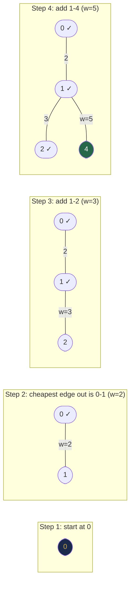
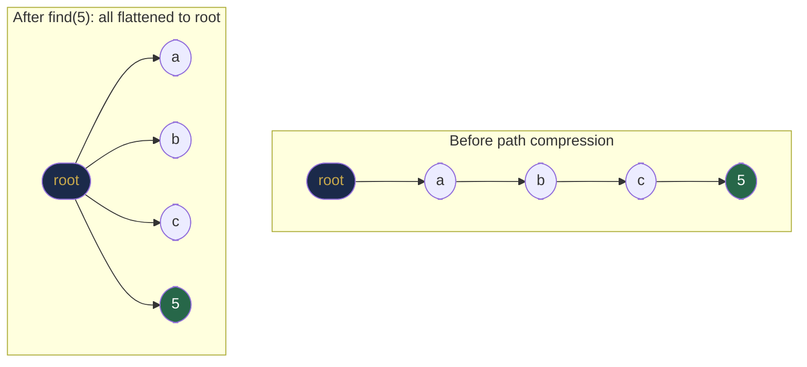

# Chapter 34 — Minimum Spanning Trees and Disjoint Sets

## Learning Objectives

By the end of this chapter, you will be able to:

- Define a spanning tree and explain why MSTs are useful
- Implement Prim's algorithm using a priority queue
- Implement Kruskal's algorithm using a Disjoint Set Union (DSU)
- Implement DSU with path compression and union by rank
- Choose between Prim's and Kruskal's based on graph density
- Apply DSU to connectivity and cycle-detection problems beyond MST

---

## Contents

- [34.1 Spanning Trees and MST](#341-spanning-trees-and-mst)
- [34.2 MST Properties](#342-mst-properties)
- [34.3 Prim's Algorithm](#343-prims-algorithm)
- [34.4 Kruskal's Algorithm](#344-kruskals-algorithm)
- [34.5 Disjoint Set Union (DSU / Union-Find)](#345-disjoint-set-union-dsu--union-find)
- [34.6 DSU Applications Beyond MST](#346-dsu-applications-beyond-mst)
- [34.7 Prim vs Kruskal](#347-prim-vs-kruskal)
- [Interview Insight](#interview-insight)
- [Quick Quiz](#quick-quiz)
- [34.8 Practice Problems](#348-practice-problems)
- [Chapter Summary](#chapter-summary)

---

> [!NOTE]
> **Historical Context**  
> **Otakar Borůvka** described the first MST algorithm in **1926** while working for an electrical company in Moravia — his task was to find the cheapest way to wire Moravian villages with electricity. **Jarník's algorithm** (now known as **Prim's**) was published in **1930** by Vojtěch Jarník and independently rediscovered by **Robert C. Prim** in **1957**. **Joseph Kruskal** published his edge-sorting algorithm in **1956**. The **Disjoint Set Union** data structure — essential for Kruskal's — was developed by **Bernard Galler** and **Michael Fischer** in **1964**, with the near-linear inverse-Ackermann analysis by **Robert Tarjan** in **1975**. The union-find data structure remains one of the most elegant structures in computer science: nearly O(1) per operation in practice, yet requiring extraordinarily deep mathematics to prove.

---

> ### 🔗 Analogy
> **Building a Road Network**
>
> You are tasked with connecting 10 cities with roads at minimum total construction cost. You don't need a road between every pair of cities — just enough roads so every city is reachable from every other.
>
> - **Prim's algorithm:** Start in one city. Always build the cheapest road extending your current connected network to a new city. Grow the network outward one city at a time.
> - **Kruskal's algorithm:** Sort all proposed roads by cost. Build the cheapest road first — unless it would connect two cities that are already connected (which would waste money on a redundant route).
>
> Both strategies always produce the minimum total cost network — the **Minimum Spanning Tree**.

---

## 34.1 Spanning Trees and MST

**Spanning tree** of a connected undirected graph $G = (V, E)$: a subgraph that:
1. Includes **all** V vertices
2. Is **connected** (every vertex is reachable)
3. Has **no cycles** (it is a tree)
4. Has exactly **V-1 edges**

**Minimum Spanning Tree (MST):** A spanning tree with the minimum possible total edge weight sum.

```
Graph (4 vertices):        MST:
   2                         2
0——————1              0——————1
|  \   |               \
4|  3\ |5               3\
|      2                   2
3——————                   3
   1
   
Total weight of MST = 2 + 3 + 1 = 6
(Not 2+3+4+5+1=15 — that's all edges)
```

**Key properties:**
- An MST always has exactly V-1 edges
- A graph may have multiple MSTs if edge weights are not unique (but all will have the same total weight)
- An MST is not necessarily unique

---

## 34.2 MST Properties

**Cut property (why greedy works for MST):**  
For any **cut** (partition of vertices into two groups S and V-S), the **minimum weight edge** crossing the cut is always part of some MST.

**Intuition:** If we cut the graph into two halves, the cheapest bridge between them must be in the MST — any other bridge would cost more and could be replaced by this one to get a cheaper tree.

**Cycle property:**  
The **maximum weight edge** of any cycle is never part of some MST (we can always remove it and use a cheaper alternative).

Both Prim's and Kruskal's are applications of the cut property — they both repeatedly identify the minimum-weight edge crossing some cut and add it to the MST.

---

## 34.3 Prim's Algorithm

**Intuition:** Grow the MST from a single starting vertex. At each step, add the cheapest edge that extends the current tree to a new vertex (not yet in the tree).

**How it relates to Dijkstra:** Prim's is structurally identical to Dijkstra. The difference is what we store in the priority queue:
- **Dijkstra:** Priority = total distance from source
- **Prim's:** Priority = weight of the single edge connecting this vertex to the growing tree


*Prim's grows the MST one vertex at a time, always picking the cheapest edge that connects to an unvisited vertex.*

```java
int primMST(int V, List<List<int[]>> adj) {
    // adj[u] = list of [v, weight]
    boolean[] inMST = new boolean[V];
    int[] key = new int[V];       // minimum edge weight to include each vertex
    Arrays.fill(key, Integer.MAX_VALUE);
    key[0] = 0;                   // start from vertex 0

    // Min heap: [edge weight, vertex]
    PriorityQueue<int[]> pq = new PriorityQueue<>(Comparator.comparingInt(a -> a[0]));
    pq.offer(new int[]{0, 0});

    int mstWeight = 0;

    while (!pq.isEmpty()) {
        int[] curr = pq.poll();
        int w = curr[0], u = curr[1];

        if (inMST[u]) continue;      // already in MST: skip stale entry
        inMST[u] = true;
        mstWeight += w;

        for (int[] edge : adj.get(u)) {
            int v = edge[0], weight = edge[1];
            if (!inMST[v] && weight < key[v]) {
                key[v] = weight;
                pq.offer(new int[]{weight, v});  // push updated key
            }
        }
    }
    return mstWeight;
}
```

**Step-by-step trace (5 vertices):**
```
Graph: 0-1(2), 0-3(6), 1-2(3), 1-3(8), 1-4(5), 2-4(7), 3-4(9)
Start: vertex 0

inMST={}  key=[0,∞,∞,∞,∞]  PQ:[(0,0)]
Pop (0,0): add 0 to MST, mstW=0
  Relax 1: key[1]=2, Relax 3: key[3]=6
  PQ:[(2,1),(6,3)]

Pop (2,1): add 1 to MST, mstW=2
  Relax 2: key[2]=3, Relax 3: min(6,8)=6 (no change), Relax 4: key[4]=5
  PQ:[(3,2),(5,4),(6,3)]

Pop (3,2): add 2 to MST, mstW=5
  Relax 4: min(5,7)=5 (no change)
  PQ:[(5,4),(6,3)]

Pop (5,4): add 4 to MST, mstW=10
  Relax 3: min(6,9)=6 (no change)
  PQ:[(6,3)]

Pop (6,3): add 3 to MST, mstW=16

MST edges: (0-1,2), (1-2,3), (1-4,5), (0-3,6)  Total=16 ✓
```

**To record MST edges (not just weight), use a `parent` array:**
```java
int[] parent = new int[V];
Arrays.fill(parent, -1);

// In the relax step, when updating key[v]:
parent[v] = u;   // u is v's parent in the MST
```

**Complexity:**
- Time: O((V + E) log V) with binary heap
- Space: O(V + E)

---

## 34.4 Kruskal's Algorithm

**Intuition:** Sort all edges by weight. Add each edge to the MST if it doesn't create a cycle (i.e., connects two different components). Use DSU to efficiently check and merge components.

**Step-by-step:**
1. Sort all E edges by weight ascending: O(E log E)
2. For each edge (u, v, w) in sorted order:
   - If u and v are in **different components** → add edge to MST, **merge** components
   - If u and v are in **same component** → skip (would create a cycle)
3. Stop when MST has V-1 edges

```java
int kruskalMST(int V, int[][] edges) {
    // edges[i] = [u, v, weight]
    Arrays.sort(edges, Comparator.comparingInt(e -> e[2]));  // sort by weight

    DSU dsu = new DSU(V);
    int mstWeight = 0;
    int edgesAdded = 0;

    for (int[] edge : edges) {
        int u = edge[0], v = edge[1], w = edge[2];
        if (dsu.find(u) != dsu.find(v)) {   // different components?
            dsu.union(u, v);                  // merge them
            mstWeight += w;
            edgesAdded++;
            if (edgesAdded == V - 1) break;  // MST complete
        }
    }
    return mstWeight;
}
```

**Complexity:**
- Sorting edges: O(E log E)
- E union-find operations: O(E × α(V)) ≈ O(E) in practice
- **Total: O(E log E)**

---

## 34.5 Disjoint Set Union (DSU / Union-Find)

DSU maintains a collection of **disjoint sets** and supports two operations efficiently:
- **`find(x)`:** Return the representative (root) of the set containing x
- **`union(x, y)`:** Merge the sets containing x and y

**Naive implementation (no optimisations):** find = O(n), union = O(n)

**Two optimisations bring this to nearly O(1) per operation:**

> [!TIP]
> **Did You Know? — The Two Names of Union-Find**  
> The structure is known as **DSU** (Disjoint Set Union) in competitive programming and **Union-Find** in most textbooks. By any name, it is deceptively simple to implement (< 15 lines of Java) yet requires Ackermann-function mathematics to fully analyse. It runs inside compilers (Hindley-Milner type inference unifies type variables), network routing protocols (grouping reachable nodes), and image processing (connected-component labelling for pixel grouping in computer vision). Every time a compiler resolves which variables must share the same type, Union-Find is running.

### Optimisation 1: Union by Rank (or Size)

**Intuition:** When merging two trees, attach the smaller tree under the root of the larger tree. This prevents the tree from becoming a long chain (which causes slow finds).

**Without union by rank:** Union always attaches one root under the other. With unlucky ordering, the tree becomes a linked list of height O(n).

**With union by rank:** The smaller tree is always the child. The height of any tree is at most O(log n).

### Optimisation 2: Path Compression

**Intuition:** When `find(x)` traverses the path to the root, make every node on the path point directly to the root. Future `find` operations on those nodes will be O(1).

```
Before find(5):               After find(5) (path compression):
root → a → b → c → 5         root → 5
                               ↑    ↑   ↑   ↑
                               a    b   c  (all point to root now)
```


*Path compression flattens the entire chain so future `find` calls skip directly to the root in O(1).*

```java
class DSU {
    private final int[] parent;
    private final int[] rank;

    DSU(int n) {
        parent = new int[n];
        rank = new int[n];
        for (int i = 0; i < n; i++) parent[i] = i;   // each node is its own root
    }

    int find(int x) {
        if (parent[x] != x)
            parent[x] = find(parent[x]);   // PATH COMPRESSION: flatten on the way up
        return parent[x];
    }

    boolean union(int x, int y) {
        int rx = find(x), ry = find(y);
        if (rx == ry) return false;   // already in same set

        // UNION BY RANK: attach smaller rank tree under larger rank root
        if (rank[rx] < rank[ry])      { parent[rx] = ry; }
        else if (rank[rx] > rank[ry]) { parent[ry] = rx; }
        else                          { parent[ry] = rx; rank[rx]++; }  // tie: pick one, increment rank
        return true;   // merged successfully
    }

    boolean connected(int x, int y) {
        return find(x) == find(y);
    }
}
```

**Trace — Union-Find on {0,1,2,3,4}:**
```
Initial: parent=[0,1,2,3,4], rank=[0,0,0,0,0]

union(0,1): find(0)=0, find(1)=1, same rank → parent[1]=0, rank[0]=1
  parent=[0,0,2,3,4], rank=[1,0,0,0,0]

union(2,3): find(2)=2, find(3)=3, same rank → parent[3]=2, rank[2]=1
  parent=[0,0,2,2,4], rank=[1,0,1,0,0]

union(0,2): find(0)=0, find(2)=2, same rank → parent[2]=0, rank[0]=2
  parent=[0,0,0,2,4], rank=[2,0,1,0,0]

find(3): parent[3]=2, parent[2]=0 → PATH COMPRESS: parent[3]=0
  parent=[0,0,0,0,4]

connected(1,3): find(1)=0, find(3)=0 → true ✓
```

**Complexity with both optimisations:**
- Time: O(α(n)) per operation, where α is the **inverse Ackermann function**
- α(n) ≤ 4 for all practical values of n (n < 10^80)
- Effectively **O(1)** per operation in all real programs

> [!NOTE]
> **Why α(n) and not O(1)?**  
> The inverse Ackermann function is the slowest-growing function you will encounter in computer science. α(n) = 1 for n ≤ 1, α(n) = 2 for n ≤ 2065536 ≈ 10^19728, and so on. While technically not O(1), it is never larger than 4 in any practical program. Robert Tarjan proved this bound in 1975 using extremely advanced mathematical tools involving transfinite induction — it is considered one of the hardest proofs in algorithms. The simple implementation above achieves this bound.

---

## 34.6 DSU Applications Beyond MST

DSU solves any problem asking: **"Are these two things in the same group/component?"** with dynamic merging.

### Dynamic Connectivity

```java
// Online queries: "connect u and v" / "are u and v connected?"
DSU dsu = new DSU(n);
// connect query:
dsu.union(u, v);
// is-connected query:
boolean connected = dsu.connected(u, v);
```

### Number of Connected Components

```java
int countComponents(int n, int[][] edges) {
    DSU dsu = new DSU(n);
    for (int[] e : edges) dsu.union(e[0], e[1]);
    Set<Integer> roots = new HashSet<>();
    for (int i = 0; i < n; i++) roots.add(dsu.find(i));
    return roots.size();
}
```

### Redundant Connection (Cycle Detection)

```java
// Return the edge that creates a cycle (LC 684)
int[] findRedundantConnection(int[][] edges) {
    int n = edges.length;
    DSU dsu = new DSU(n + 1);
    for (int[] e : edges) {
        if (!dsu.union(e[0], e[1]))   // union returns false if already connected
            return e;                  // this edge creates a cycle
    }
    return new int[]{};
}
```

### Accounts Merge (LC 721)

Group email addresses that belong to the same person. If two accounts share an email, merge them.

---

## 34.7 Prim vs Kruskal

| | Prim's | Kruskal's |
|-|--------|-----------|
| Core data structure | Priority queue | DSU + sorted edge list |
| Graph representation needed | Adjacency list | Edge list |
| Time (dense graph E≈V²) | O(V² log V) | O(V² log V) — same |
| Time (sparse graph E≈V) | O(V log V) | O(V log V) — same |
| Memory | O(V + E) | O(E) for edge list |
| Easier to implement | ✅ Similar to Dijkstra | ✅ Simpler outer loop |
| **Best for** | Dense graphs | Sparse graphs |

**General recommendation:** For LeetCode problems, **Kruskal's + DSU** is usually easier to code correctly and handles disconnected graphs naturally (the MST becomes a minimum spanning forest).

---

## Interview Insight

> **The key insight interviewers look for with DSU:**
> *"Why do you need path compression AND union by rank? Can you use just one?"*
>
> - Union by rank alone: O(log n) per operation (tree height bounded at log n)
> - Path compression alone: O(log n) amortised per operation
> - **Both together: O(α(n)) ≈ O(1)**
>
> In practice, both are needed for the near-constant time guarantee. Most interviewers are satisfied with explaining that path compression flattens the tree and union by rank prevents it from getting tall in the first place — together, they ensure the tree stays extremely shallow.
>
> **Most-asked DSU problems:** Connected components, redundant connection, accounts merge, number of provinces, satisfiability of equality equations.

---

## Quick Quiz

1. A spanning tree of a graph with V vertices has how many edges?
2. What property ensures that the minimum-weight edge crossing any cut belongs to some MST?
3. In Kruskal's algorithm, why do we skip an edge if its endpoints are already connected?
4. What does DSU's `find` operation return?
5. After running DSU with path compression, what will `parent[x]` equal for most nodes?

**Answers:**
1. Exactly **V - 1** edges. A spanning tree connects all V vertices with the minimum possible edges (no cycles, fully connected).
2. The **Cut Property**: the minimum-weight crossing edge is always part of *some* MST. This is what makes greedy MST algorithms correct.
3. Because adding it would create a **cycle** — the two endpoints are already connected through the existing MST edges. A spanning *tree* by definition has no cycles.
4. The **root/representative** of the set containing x. All nodes in the same connected component have the same root.
5. `parent[x]` points directly to the **root** of its set (or is the root itself). Path compression during `find` flattens all nodes on the path to point directly to the root.

---

## 34.8 Practice Problems

**Warm-up:**
- Implement DSU with path compression and union by rank.
- Count connected components using DSU.
- Check if adding an edge creates a cycle (Redundant Connection — LC 684).

**Medium:**
- Min Cost to Connect All Points — Prim's or Kruskal's on a fully-connected graph (LC 1584).
- Number of Provinces — DSU or DFS on adjacency matrix (LC 547).
- Accounts Merge — DSU to group emails (LC 721).
- Satisfiability of Equality Equations (LC 990).
- Making a Large Island — DSU + grid (LC 827).

**Hard:**
- Swim in Rising Water — MST / binary search + BFS (LC 778).
- Connecting Cities with Minimum Cost — Kruskal's (LC 1135).
- Remove Max Number of Edges to Keep Graph Fully Traversable (LC 1579).

---

## Chapter Summary

| Concept | Key Insight |
|---------|-------------|
| Spanning tree | V-1 edges, connects all vertices, no cycles |
| MST | Spanning tree with minimum total weight |
| Cut property | Min-weight crossing edge always in some MST — correctness of greedy |
| Prim's | Grow tree outward; priority queue; best for dense graphs |
| Kruskal's | Sort edges, add if no cycle; DSU; best for sparse graphs |
| DSU find | Returns root; path compression flattens tree |
| DSU union | Merges two components; union by rank keeps tree shallow |
| DSU complexity | O(α(n)) ≈ O(1) with both optimisations |
| DSU uses | MST, connectivity, cycle detection, grouping problems |

---

*← [Chapter 33 — Shortest Path Algorithms](chapter-33-shortest-paths.md)*  
*→ [Chapter 35 — Topological Sorting and DAGs](chapter-35-topological-sort.md)*
