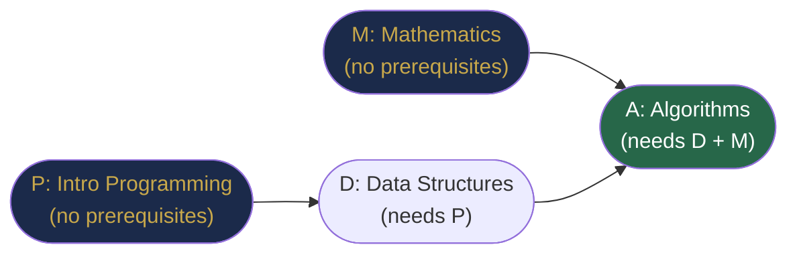
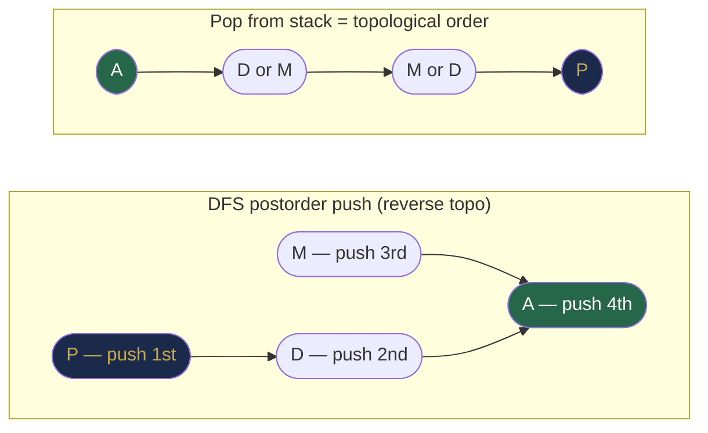

# Chapter 35 — Topological Sorting and DAGs

## Learning Objectives

By the end of this chapter, you will be able to:

- Define a DAG and explain why directed acyclic structure enables topological ordering
- Implement Kahn's algorithm (BFS-based topological sort)
- Implement DFS-based topological sort
- Detect directed cycles using both approaches
- Compute the longest path in a DAG
- Apply topological sort to real scheduling and dependency problems

---

## Contents

- [35.1 DAGs and Topological Order](#351-dags-and-topological-order)
- [35.2 Kahn's Algorithm — BFS-Based Topological Sort](#352-kahns-algorithm--bfs-based-topological-sort)
- [35.3 DFS-Based Topological Sort](#353-dfs-based-topological-sort)
- [35.4 Directed Cycle Detection](#354-directed-cycle-detection)
- [35.5 Longest Path in a DAG](#355-longest-path-in-a-dag)
- [35.6 Real Scheduling Problems](#356-real-scheduling-problems)
- [Interview Insight](#interview-insight)
- [Quick Quiz](#quick-quiz)
- [35.7 Practice Problems](#357-practice-problems)
- [Chapter Summary](#chapter-summary)

---

> [!NOTE]
> **Historical Context**  
> **Topological sorting** as a formal algorithm was developed by **Arthur B. Kahn** in **1962**, published in *Communications of the ACM*. The DFS-based approach was described by **Donald E. Knuth** in *The Art of Computer Programming* (Volume 1, 1968). The problem itself arises naturally from practical needs: PERT charts for project scheduling (popularised in the late 1950s during the US Navy's Polaris missile project) required arranging tasks in dependency order. Modern usage pervades software: `make` (build systems), npm/Maven/pip (package dependencies), database query planners, spreadsheet cell evaluation, and Git's commit DAG all use topological ordering. Even your Java compiler resolves class import dependencies using topological sort internally.

---

> ### 🔗 Analogy
> **Course Prerequisites**
>
> To take *Algorithms* (course A), you must first complete *Data Structures* (course D) and *Mathematics* (course M). To take *Data Structures*, you must first complete *Introduction to Programming* (course P). No matter what order you take courses, some orderings are **valid** (prerequisites satisfied) and others are **invalid** (taking Algorithms before Data Structures).
>
> **Topological sort** produces a valid ordering. It tells you: "Take P first, then M and D in any order, then A." It cannot work if two courses are mutually dependent (a cycle) — you can't complete both if each requires the other first.

---

## 35.1 DAGs and Topological Order

**Directed Acyclic Graph (DAG):** A directed graph with **no directed cycles**.

**Topological order:** A linear ordering of all vertices such that for every directed edge $(u \to v)$, vertex $u$ appears before $v$ in the ordering.

**Key theorem:** A topological ordering exists **if and only if** the graph is a DAG.

```
DAG:
  P → D → A
  M ——→ ↗

Valid topological orders: [P, M, D, A] or [M, P, D, A]
(M and D can appear in either order since they're independent)
```


*A DAG of course prerequisites. P and M can be taken in any order (they are independent); A must come last.*

**Why is a topological order impossible for cyclic graphs?**  
If A → B → C → A, then A must come before B (from A→B), B before C (from B→C), and C before A (from C→A). But then A must come before A — impossible.

**Multiple valid orderings:** A DAG may have many valid topological orderings. The number of orderings depends on how many vertices are independent (no dependency between them). We typically return any valid one, though some problems ask for a specific one (e.g., lexicographically smallest).

---

## 35.2 Kahn's Algorithm — BFS-Based Topological Sort

**Core idea:** Repeatedly remove vertices with **in-degree 0** (no prerequisites). After removing a vertex, decrease the in-degrees of its successors. Any successor that becomes 0 is now ready to process.

**Building the intuition step by step:**

**Step 1 — What is in-degree?**  
In-degree of vertex v = number of edges pointing *into* v = number of things v depends on.

**Step 2 — Vertices with in-degree 0 have no prerequisites.**  
They can go first in the topological order. In the course analogy, these are courses with no prerequisites.

**Step 3 — After processing a vertex, it "removes" itself.**  
When we process vertex u, all edges u→v are conceptually deleted. For each v, in-degree decreases by 1. When in-degree reaches 0, v has no remaining prerequisites — it can be processed next.

**Step 4 — Why this produces a topological order.**  
Every vertex we add to the result has in-degree 0 at the time of processing — meaning all its prerequisites were already processed and appear earlier in the result. This satisfies the topological order definition.

**Step 5 — Cycle detection.**  
If a cycle exists, the vertices in the cycle will never reach in-degree 0 (each depends on the next). The result will contain fewer than V vertices — the missing ones form cycles.

```java
List<Integer> topologicalSort(int V, List<List<Integer>> adj) {
    int[] inDegree = new int[V];
    for (int u = 0; u < V; u++)
        for (int v : adj.get(u))
            inDegree[v]++;   // count incoming edges for each vertex

    Queue<Integer> queue = new ArrayDeque<>();
    for (int i = 0; i < V; i++)
        if (inDegree[i] == 0) queue.offer(i);   // all 0-in-degree vertices start the queue

    List<Integer> result = new ArrayList<>();
    while (!queue.isEmpty()) {
        int u = queue.poll();
        result.add(u);                           // u has no remaining prerequisites

        for (int v : adj.get(u)) {
            inDegree[v]--;                       // "remove" edge u→v
            if (inDegree[v] == 0) queue.offer(v);  // v now has no remaining prerequisites
        }
    }

    // If result contains all V vertices → valid topological order
    // If result.size() < V → there's a cycle (unreachable vertices remain)
    return result.size() == V ? result : Collections.emptyList();
}
```

**Step-by-step trace:**
```
Graph: 5→2, 5→0, 4→0, 4→1, 2→3, 3→1
In-degrees: [2, 2, 1, 1, 0, 0]

Queue: [4, 5]  (in-degree 0)

Process 4: result=[4], decrease in-degree of 0,1
  inDeg: [1, 1, 1, 1, 0, 0]  Queue: [5]
Process 5: result=[4,5], decrease in-degree of 2,0
  inDeg: [0, 1, 0, 1, 0, 0]  Queue: [0, 2]
Process 0: result=[4,5,0], no outgoing edges
  Queue: [2]
Process 2: result=[4,5,0,2], decrease in-degree of 3
  inDeg: [0, 1, 0, 0, 0, 0]  Queue: [3]
Process 3: result=[4,5,0,2,3], decrease in-degree of 1
  inDeg: [0, 0, 0, 0, 0, 0]  Queue: [1]
Process 1: result=[4,5,0,2,3,1]

result.size()=6=V → valid order: [4, 5, 0, 2, 3, 1] ✓
Verification: 5→2 ✓ (5 before 2), 4→1 ✓ (4 before 1), 3→1 ✓ (3 before 1)
```

**Complexity:** O(V + E) — each vertex and edge processed once.

> [!TIP]
> **Did You Know? — Kahn's Algorithm Was Written in 1962**  
> Arthur B. Kahn published his topological sort in just 2 pages of *Communications of the ACM* in 1962. The algorithm is used today in virtually every build system: `make`, Gradle, Maven, Bazel, and npm all use topological sort to determine which files to compile in which order. The npm package manager maintains a dependency graph of your project; `npm install` runs topological sort on that graph to install packages in the correct order. If a circular dependency exists (package A depends on B depends on A), npm reports an error — exactly the cycle detection Kahn's algorithm provides for free when `result.size() < V`.

---

## 35.3 DFS-Based Topological Sort

**Core idea:** Run DFS on all vertices. When a vertex's DFS finishes (all its successors have been fully explored), push it onto a stack. After all DFS calls, the stack contains the topological order (pop for the final order).

**Intuition:** A vertex can appear in the topological order only after all vertices it reaches have been processed. DFS naturally explores all reachable vertices before returning from a call. By adding vertices to the result **at completion** (postorder), we get the reverse topological order on the stack.

**Why postorder gives reverse topological order:**  
When DFS finishes vertex u (postorder), all vertices reachable from u have already been finished and pushed to the stack. So u ends up *below* all its successors in the stack — when we reverse (pop everything), u comes before its successors. That's exactly the topological order definition.


*DFS finishes deep nodes first (postorder push). Popping the stack reverses this — giving the correct topological order.*

```java
List<Integer> topologicalSortDFS(int V, List<List<Integer>> adj) {
    boolean[] visited = new boolean[V];
    Deque<Integer> stack = new ArrayDeque<>();

    for (int i = 0; i < V; i++)
        if (!visited[i])
            dfsTopoSort(adj, i, visited, stack);

    List<Integer> result = new ArrayList<>();
    while (!stack.isEmpty()) result.add(stack.pop());
    return result;
}

void dfsTopoSort(List<List<Integer>> adj, int node, boolean[] visited, Deque<Integer> stack) {
    visited[node] = true;
    for (int nb : adj.get(node))
        if (!visited[nb])
            dfsTopoSort(adj, nb, visited, stack);
    stack.push(node);   // POSTORDER: push after all successors are processed
}
```

**Trace on the same graph (5→2, 5→0, 4→0, 4→1, 2→3, 3→1):**
```
DFS from 0: visit 0 → no outgoing → push 0. Stack: [0]
DFS from 1: visit 1 → no outgoing → push 1. Stack: [0,1]
DFS from 2: visit 2 → visit 3 → visit 1 (visited) → push 3. Stack: [0,1,3]
              push 2. Stack: [0,1,3,2]
DFS from 3: visited
DFS from 4: visit 4 → visit 0 (visited), visit 1 (visited) → push 4. Stack: [0,1,3,2,4]
DFS from 5: visit 5 → visit 2 (visited), visit 0 (visited) → push 5. Stack: [0,1,3,2,4,5]

Pop all: [5, 4, 2, 3, 1, 0]
Verification: 5→2 ✓, 5→0 ✓, 4→0 ✓, 4→1 ✓, 2→3 ✓, 3→1 ✓
```

**Complexity:** O(V + E).

**Kahn's vs DFS — Key differences:**

| | Kahn's (BFS) | DFS-based |
|-|-------------|-----------|
| Cycle detection | Natural: result.size() < V | Requires separate colour tracking |
| Order produced | Naturally BFS-flavoured | Postorder reverse |
| Implementation | Slightly more code | Slightly more concise |
| In-degree array | Required | Not needed |
| Preferred for | Scheduling, detecting cycles cleanly | When DFS is already in use |

---

## 35.4 Directed Cycle Detection

**Using Kahn's:** Run the algorithm. If `result.size() < V`, a cycle exists.

**Using DFS 3-colour states (from Chapter 32):**

```java
boolean hasCycle(int V, List<List<Integer>> adj) {
    int[] color = new int[V];   // 0=white, 1=grey, 2=black
    for (int i = 0; i < V; i++)
        if (color[i] == 0 && dfsHasCycle(adj, i, color))
            return true;
    return false;
}

boolean dfsHasCycle(List<List<Integer>> adj, int node, int[] color) {
    color[node] = 1;   // grey: on current DFS path
    for (int nb : adj.get(node)) {
        if (color[nb] == 1) return true;   // back edge: cycle!
        if (color[nb] == 0 && dfsHasCycle(adj, nb, color)) return true;
    }
    color[node] = 2;   // black: fully processed
    return false;
}
```

**Course Schedule (LC 207):** Can you finish all courses given their prerequisites?
= "Is the prerequisite DAG actually a DAG?" = cycle detection.

```java
boolean canFinish(int numCourses, int[][] prerequisites) {
    List<List<Integer>> adj = new ArrayList<>();
    for (int i = 0; i < numCourses; i++) adj.add(new ArrayList<>());
    for (int[] p : prerequisites) adj.get(p[1]).add(p[0]);
    return !hasCycle(numCourses, adj);
}
```

---

## 35.5 Longest Path in a DAG

**Why DAG-only?** In a general graph with cycles, the longest path is undefined (you can loop forever). In a DAG, longest paths are well-defined and solvable in O(V + E) with DP in topological order.

**Algorithm:** Process vertices in topological order. For each vertex, its longest path = max(longest path to any predecessor + edge weight).

**Intuition:** This is the same as the classic DP "process states in dependency order" — you can compute the value for a node only after all its dependencies are computed. Topological order ensures this.

```java
int longestPathDAG(int V, List<List<int[]>> adj) {
    // adj[u] = [[v, weight], ...]
    // Step 1: Topological sort (Kahn's)
    int[] inDegree = new int[V];
    for (int u = 0; u < V; u++)
        for (int[] e : adj.get(u)) inDegree[e[0]]++;

    Queue<Integer> q = new ArrayDeque<>();
    for (int i = 0; i < V; i++) if (inDegree[i] == 0) q.offer(i);

    // Step 2: DP in topological order
    int[] dp = new int[V];   // dp[v] = longest path ending at v
    int maxLen = 0;

    while (!q.isEmpty()) {
        int u = q.poll();
        for (int[] e : adj.get(u)) {
            int v = e[0], w = e[1];
            dp[v] = Math.max(dp[v], dp[u] + w);   // extend path through u
            maxLen = Math.max(maxLen, dp[v]);
            if (--inDegree[v] == 0) q.offer(v);
        }
    }
    return maxLen;
}
```

**Unweighted version** (count edges): same code with `w = 1`.

**Applications:**
- **Critical path method (CPM):** In project scheduling, the longest path = minimum project duration (critical path). Any delay on a critical-path task delays the whole project.
- **Compilation:** Longest dependency chain determines maximum parallelism.

---

## 35.6 Real Scheduling Problems

### Course Schedule II (LC 210) — Return topological order

```java
int[] findOrder(int numCourses, int[][] prerequisites) {
    List<List<Integer>> adj = new ArrayList<>();
    for (int i = 0; i < numCourses; i++) adj.add(new ArrayList<>());
    int[] inDegree = new int[numCourses];
    for (int[] p : prerequisites) {
        adj.get(p[1]).add(p[0]);   // p[1] must be taken before p[0]
        inDegree[p[0]]++;
    }

    Queue<Integer> q = new ArrayDeque<>();
    for (int i = 0; i < numCourses; i++) if (inDegree[i] == 0) q.offer(i);

    int[] order = new int[numCourses];
    int idx = 0;
    while (!q.isEmpty()) {
        int course = q.poll();
        order[idx++] = course;
        for (int next : adj.get(course))
            if (--inDegree[next] == 0) q.offer(next);
    }
    return idx == numCourses ? order : new int[]{};
}
```

### Alien Dictionary (LC 269) — Derive character ordering

Given words sorted by an alien language's alphabet, determine the character ordering.

**Key modelling insight:** Compare adjacent words to find which character comes first. Each comparison yields one directed edge in the character DAG. Topological sort gives the alphabet order.

```java
String alienOrder(String[] words) {
    Map<Character, Set<Character>> adj = new HashMap<>();
    Map<Character, Integer> inDegree = new HashMap<>();

    // Initialize all characters
    for (String w : words) for (char c : w.toCharArray()) {
        adj.putIfAbsent(c, new HashSet<>());
        inDegree.putIfAbsent(c, 0);
    }

    // Extract ordering constraints from adjacent word pairs
    for (int i = 0; i < words.length - 1; i++) {
        String w1 = words[i], w2 = words[i+1];
        int minLen = Math.min(w1.length(), w2.length());
        if (w1.length() > w2.length() && w1.startsWith(w2)) return "";  // invalid

        for (int j = 0; j < minLen; j++) {
            if (w1.charAt(j) != w2.charAt(j)) {
                char from = w1.charAt(j), to = w2.charAt(j);
                if (!adj.get(from).contains(to)) {
                    adj.get(from).add(to);
                    inDegree.merge(to, 1, Integer::sum);
                }
                break;   // only the first differing character matters
            }
        }
    }

    // Kahn's topological sort on character graph
    Queue<Character> q = new ArrayDeque<>();
    for (char c : inDegree.keySet()) if (inDegree.get(c) == 0) q.offer(c);

    StringBuilder sb = new StringBuilder();
    while (!q.isEmpty()) {
        char c = q.poll();
        sb.append(c);
        for (char next : adj.get(c)) {
            inDegree.merge(next, -1, Integer::sum);
            if (inDegree.get(next) == 0) q.offer(next);
        }
    }
    return sb.length() == inDegree.size() ? sb.toString() : "";  // empty = cycle
}
```

---

## Interview Insight

> **Topological sort is the solution to any problem involving "process X before Y" constraints.**
>
> When you see these patterns, think topological sort:
> - "Prerequisites / dependencies"
> - "Build order / compilation order"
> - "Task scheduling with constraints"
> - "Given a partial order, find a valid total order"
>
> **The two must-know facts:**
> 1. Topological sort is only possible on **DAGs** (directed acyclic graphs). The first step in every topological sort problem is verifying (or assuming) the graph is acyclic.
> 2. **Kahn's algorithm naturally detects cycles**: if the output has fewer than V vertices, there's a cycle involving the unprocessed vertices. This is cleaner than the DFS cycle detection for most problems.

---

## Quick Quiz

1. What graph property is required for topological sort to exist?
2. In Kahn's algorithm, what does it mean if the result list has fewer than V vertices?
3. Why does DFS-based topological sort push vertices to a stack at **postorder** (after all successors are processed)?
4. What is the time complexity of longest-path in a DAG, and why can't this be done efficiently on general graphs?
5. A graph has edges A→B, B→C, C→D, D→B. Can this graph be topologically sorted?

**Answers:**
1. The graph must be a **DAG** — Directed Acyclic Graph. No directed cycles are allowed.
2. A **cycle exists** among the unprocessed vertices (those never reached in-degree 0). The unprocessed vertices are part of one or more directed cycles.
3. At postorder, all vertices reachable from the current vertex are already pushed. When we reverse by popping the stack, the current vertex appears *before* all its successors — satisfying the topological order definition (u before v for every edge u→v).
4. O(V + E) — using DP in topological order. It cannot be done efficiently on general graphs because those may have cycles (enabling infinitely long paths) and don't have a valid topological order to process states in dependency sequence.
5. **No.** B→C→D→B is a directed cycle. The graph cannot be topologically sorted.

---

## 35.7 Practice Problems

**Warm-up:**
- Topological sort of a directed graph (manual trace + implementation).
- Course Schedule — detect cycle (LC 207).
- Find if a path exists in a DAG.

**Medium:**
- Course Schedule II — return valid course order (LC 210).
- Find All Possible Recipes from Given Supplies (LC 2115) — model as a DAG.
- Minimum Height Trees — iteratively remove leaves (LC 310).
- Sequence Reconstruction — verify unique topological order (LC 444).

**Hard:**
- Alien Dictionary — derive alphabet from word order (LC 269).
- Longest Increasing Path in a Matrix — DFS with memoisation on implicit DAG (LC 329).
- Parallel Courses II — scheduling with capacity constraint (LC 1494).
- Critical Connections in a Network — bridges, Tarjan (LC 1192).

---

## Chapter Summary

| Concept | Key Insight |
|---------|-------------|
| DAG | Directed + no cycles; enables topological sort |
| Topological order | u before v for every edge u→v |
| Kahn's algorithm | Remove 0-in-degree nodes; BFS-based; O(V+E) |
| DFS topological sort | Postorder push; reverse for final order; O(V+E) |
| Cycle detection (Kahn's) | result.size() < V → cycle exists |
| Cycle detection (DFS) | Grey → grey edge = cycle |
| Longest path in DAG | DP in topological order: dp[v] = max(dp[u] + w) |
| Course schedule | Topological sort; uncompletable if cycle |
| Alien dictionary | Build character DAG from word comparisons; topo sort |

---

*← [Chapter 34 — Minimum Spanning Trees and Disjoint Sets](chapter-34-mst-and-dsu.md)*  
*→ [Chapter 36 — Advanced Graph Algorithms](chapter-36-advanced-graphs.md)*
