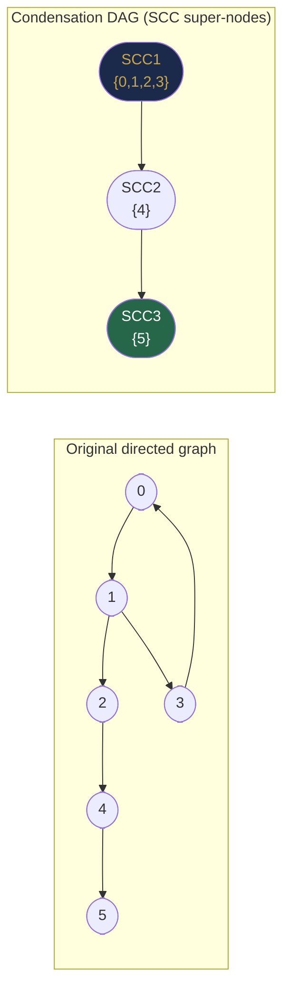
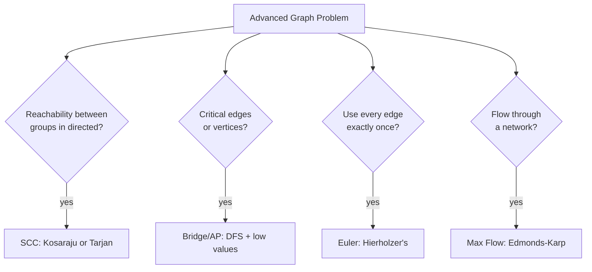

# Chapter 36 — Advanced Graph Algorithms

## Learning Objectives

By the end of this chapter, you will be able to:

- Find strongly connected components using Kosaraju's algorithm
- Find bridges and articulation points using Tarjan's bridge-finding algorithm
- Determine if an Eulerian path or circuit exists and construct it
- Understand the network flow problem conceptually
- Implement Ford-Fulkerson / BFS-based max flow (Edmonds-Karp)

---

## Contents

- [36.1 Strongly Connected Components (SCCs)](#361-strongly-connected-components-sccs)
- [36.2 Kosaraju's Algorithm](#362-kosarajus-algorithm)
- [36.3 Tarjan's SCC Algorithm](#363-tarjans-scc-algorithm)
- [36.4 Bridges and Articulation Points](#364-bridges-and-articulation-points)
- [36.5 Euler Paths and Circuits](#365-euler-paths-and-circuits)
- [36.6 Network Flow — Maximum Flow](#366-network-flow--maximum-flow)
- [36.7 Algorithm Overview and When to Use](#367-algorithm-overview-and-when-to-use)
- [Interview Insight](#interview-insight)
- [Quick Quiz](#quick-quiz)
- [36.8 Practice Problems](#368-practice-problems)
- [Chapter Summary](#chapter-summary)

---

> [!NOTE]
> **Historical Context**  
> **Strongly Connected Components:** **S. Rao Kosaraju** described his two-pass DFS algorithm in **1978** (unpublished; described by others). **Robert Tarjan** published his single-pass SCC algorithm in **1972** — the same Robert Tarjan whose name appears on DSU's inverse-Ackermann analysis. Tarjan's algorithm is considered a masterpiece of algorithmic elegance. **Bridges:** The concept of graph bridges was formalised in graph theory from Euler's original 1735 work, with efficient algorithms by **David Pearce** and others. **Euler paths:** Euler's 1736 Königsberg bridge solution is the founding paper of graph theory and already contained the existence condition for Eulerian circuits. **Network flow:** **L. R. Ford Jr.** and **D. R. Fulkerson** published the max-flow min-cut theorem and their augmenting-path algorithm in **1956**. **Jack Edmonds** and **Richard Karp** improved it to polynomial time (Edmonds-Karp, **1972**).

---

> ### 🔗 Analogy — SCCs
> **City Regions with One-Way Roads**
>
> Imagine a city where some roads are one-way. A **Strongly Connected Component** is a group of intersections where you can drive from any intersection to any other intersection within the group, following the one-way constraints. Different SCCs are separated by one-way bridges — you can drive from SCC A to SCC B but not back. After condensing each SCC into a single "super-node," the resulting **condensation graph** is always a DAG.

---

## 36.1 Strongly Connected Components (SCCs)

**Definition:** In a directed graph, a **Strongly Connected Component** is a maximal set of vertices such that every vertex is reachable from every other vertex within the set.

**Properties:**
- Every vertex belongs to exactly one SCC
- A single vertex with no self-loop is its own SCC
- The **condensation** of a graph (replace each SCC with a super-node) is always a **DAG**

```
Directed graph:          SCCs:          Condensation (DAG):
  0 → 1 → 2             SCC1={0,1,2}      SCC1 → SCC2 → SCC3
  ↑   ↓   ↓                               (DAG: no cycles)
  └───3   4             SCC2={3}
              ↓         SCC3={4}
              5         SCC4={5}

Within SCC1: 0→1→3→0 (all can reach all)
SCC2 can reach SCC3; SCC3 can reach SCC4.
```

**Why SCCs matter:**  
Any directed graph problem can be solved by: (1) finding SCCs, (2) condensing them into a DAG, (3) running simpler algorithms on the DAG. Applications include deadlock detection (OS), website clustering (identical content groups), circuit analysis.


*After finding SCCs, the condensation DAG always has no cycles — it can now be processed with topological sort, longest-path DP, or any DAG algorithm.*

---

## 36.2 Kosaraju's Algorithm

**Intuition — two-pass DFS:**

**Pass 1 (on original graph):** Run DFS on the original graph. Record vertices in **finish order** (postorder) — vertices that finish last have the most reachable reach in the original graph.

**Pass 2 (on reversed graph):** Transpose the graph (reverse all edges). Run DFS in **reverse finish order** from Pass 1. Each DFS in Pass 2 discovers one SCC.

**Why does reversing + reverse-finish-order work?**  
In the original graph, the vertex that finishes last in DFS can reach the most other vertices. In the **reversed** graph, the same vertex can be reached from the most other vertices. So starting a DFS in the reversed graph from the last-finishing vertex reaches exactly those vertices that could reach it in the original graph — which is precisely its SCC.

```java
List<List<Integer>> kosarajuSCC(int V, List<List<Integer>> adj) {
    // Pass 1: DFS on original graph, record finish order
    boolean[] visited = new boolean[V];
    Deque<Integer> finishOrder = new ArrayDeque<>();

    for (int i = 0; i < V; i++)
        if (!visited[i])
            dfsFinishOrder(adj, i, visited, finishOrder);

    // Build transposed graph
    List<List<Integer>> transposed = new ArrayList<>();
    for (int i = 0; i < V; i++) transposed.add(new ArrayList<>());
    for (int u = 0; u < V; u++)
        for (int v : adj.get(u)) transposed.get(v).add(u);   // reverse edge

    // Pass 2: DFS on transposed graph in reverse finish order
    Arrays.fill(visited, false);
    List<List<Integer>> sccs = new ArrayList<>();

    while (!finishOrder.isEmpty()) {
        int node = finishOrder.pop();
        if (!visited[node]) {
            List<Integer> scc = new ArrayList<>();
            dfsCollect(transposed, node, visited, scc);
            sccs.add(scc);
        }
    }
    return sccs;
}

void dfsFinishOrder(List<List<Integer>> adj, int node, boolean[] visited, Deque<Integer> stack) {
    visited[node] = true;
    for (int nb : adj.get(node))
        if (!visited[nb]) dfsFinishOrder(adj, nb, visited, stack);
    stack.push(node);   // push at POSTORDER (after all descendants finish)
}

void dfsCollect(List<List<Integer>> adj, int node, boolean[] visited, List<Integer> scc) {
    visited[node] = true;
    scc.add(node);
    for (int nb : adj.get(node))
        if (!visited[nb]) dfsCollect(adj, nb, visited, scc);
}
```

**Complexity:** O(V + E) — two DFS passes + one graph transposition.

> [!NOTE]
> **Did You Know? — Tarjan's SCC Is Used Inside Compilers**  
> When a compiler analyses a program, it builds a **call graph** (functions = vertices, function calls = edges). Strongly connected components in the call graph correspond to **mutually recursive function groups**. The compiler processes each SCC as a unit during type inference, inlining decisions, and optimisation. This is why compilers can correctly handle `f()` calling `g()` and `g()` calling `f()` (a 2-node SCC). Tarjan's algorithm, running in O(V + E) on the call graph, determines this grouping in a single DFS pass — fast enough to be invisible in compilation time.

---

## 36.3 Tarjan's SCC Algorithm

**Intuition:** Single DFS pass using two values per node:
- **`disc[v]`:** Discovery time — when was v first visited?
- **`low[v]`:** Lowest discovery time reachable from v's subtree (including back edges)

**A vertex v is an SCC root if `low[v] == disc[v]`** — meaning no back edge from v's subtree reaches a vertex outside v's SCC (discovered earlier than v).

Tarjan maintains a stack of the current DFS path. When an SCC root is identified, pop everything down to (and including) it — that's the SCC.

```java
int timer = 0;
int[] disc, low, sccId;
boolean[] onStack;
Deque<Integer> stack;
List<List<Integer>> sccs;

void tarjanSCC(int V, List<List<Integer>> adj) {
    disc = new int[V]; low = new int[V]; sccId = new int[V];
    onStack = new boolean[V];
    Arrays.fill(disc, -1);     // -1 = not visited
    stack = new ArrayDeque<>();
    sccs = new ArrayList<>();

    for (int i = 0; i < V; i++)
        if (disc[i] == -1) tarjanDFS(adj, i);
}

void tarjanDFS(List<List<Integer>> adj, int u) {
    disc[u] = low[u] = timer++;
    stack.push(u);
    onStack[u] = true;

    for (int v : adj.get(u)) {
        if (disc[v] == -1) {
            tarjanDFS(adj, v);                      // tree edge: recurse
            low[u] = Math.min(low[u], low[v]);      // inherit low from child
        } else if (onStack[v]) {
            low[u] = Math.min(low[u], disc[v]);     // back edge to on-stack vertex
        }
        // cross edges (to finished vertices not on stack): ignored
    }

    if (low[u] == disc[u]) {   // u is root of an SCC
        List<Integer> scc = new ArrayList<>();
        int w;
        do {
            w = stack.pop();
            onStack[w] = false;
            scc.add(w);
        } while (w != u);
        sccs.add(scc);
    }
}
```

**Complexity:** O(V + E) — single DFS pass.

**Tarjan vs Kosaraju:**

| | Kosaraju | Tarjan |
|-|---------|--------|
| DFS passes | 2 | 1 |
| Graph transposition | Required | Not needed |
| Implementation complexity | Easier to reason about | More complex (low values, stack) |
| Memory | O(V + E) for transposed graph | O(V) extra (stack + low/disc) |

---

## 36.4 Bridges and Articulation Points

**Bridge:** An edge whose removal disconnects the graph.  
**Articulation Point (Cut Vertex):** A vertex whose removal disconnects the graph.

**Intuition:** During DFS, a **back edge** provides an alternative path (a "bypass") around a tree edge. A tree edge (u, v) is a **bridge** if there is no back edge in v's subtree that reaches u or above — meaning the only way to get from v's subtree to u's side is through this single edge.

**Low values** (same concept as Tarjan's SCCs) measure the earliest reachable ancestor:
- **`disc[v]`:** Discovery time of v
- **`low[v]`:** Minimum `disc` reachable from v's subtree using at most one back edge

**Bridge condition:** Edge (u, v) is a bridge if `low[v] > disc[u]`. (v cannot reach u or anything above u without going through this edge.)

**Articulation point condition:** u is an articulation point if:
- u is the DFS root with ≥ 2 children, OR
- u is not the root and has a child v with `low[v] >= disc[u]` (v cannot bypass u)

```java
int[] disc, low, parent;
boolean[] visited, isAP;
List<int[]> bridges;
int timer = 0;

void findBridgesAndAPs(int V, List<List<Integer>> adj) {
    disc = new int[V]; low = new int[V]; parent = new int[V];
    visited = new boolean[V]; isAP = new boolean[V];
    Arrays.fill(parent, -1);
    bridges = new ArrayList<>();

    for (int i = 0; i < V; i++)
        if (!visited[i]) bridgeDFS(adj, i);
}

void bridgeDFS(List<List<Integer>> adj, int u) {
    visited[u] = true;
    disc[u] = low[u] = timer++;
    int childCount = 0;

    for (int v : adj.get(u)) {
        if (!visited[v]) {
            childCount++;
            parent[v] = u;
            bridgeDFS(adj, v);
            low[u] = Math.min(low[u], low[v]);

            // Bridge check: only way to reach v's side is through (u,v)
            if (low[v] > disc[u]) bridges.add(new int[]{u, v});

            // Articulation point check
            if (parent[u] == -1 && childCount > 1) isAP[u] = true;  // root case
            if (parent[u] != -1 && low[v] >= disc[u]) isAP[u] = true;  // non-root case
        } else if (v != parent[u]) {
            low[u] = Math.min(low[u], disc[v]);   // back edge
        }
    }
}
```

**Complexity:** O(V + E).

**Real-world usage:** Network reliability. A bridge is a single point of failure in a network — removing it disconnects some nodes. Network engineers must identify and eliminate bridges to ensure redundancy. Same logic applies to supply chains, power grids, and transportation networks.

---

## 36.5 Euler Paths and Circuits

**Euler path:** A path that visits every **edge** exactly once.  
**Euler circuit:** An Euler path that starts and ends at the same vertex.

**Existence conditions (Euler's theorem — 1736):**

| Graph Type | Euler Circuit | Euler Path |
|------------|--------------|------------|
| Undirected | All vertices have **even degree** | Exactly **2 vertices** have odd degree (start/end) |
| Directed | Every vertex: in-degree = out-degree | Exactly 1 vertex: out - in = 1 (start); exactly 1: in - out = 1 (end) |

**Construction: Hierholzer's algorithm (1873)**

**Intuition:** Start from a valid vertex. Follow any unvisited edge, marking it used. When stuck (current vertex has no unused edges), backtrack to the last vertex with unused edges and continue. The order in which vertices get "stuck" gives the Euler circuit in reverse.

```java
List<Integer> eulerCircuit(int V, List<List<Integer>> adjList) {
    // adjList: adjacency list (use iterators so we can remove edges)
    int[] idx = new int[V];   // current edge index for each vertex (optimization)
    Deque<Integer> stack = new ArrayDeque<>();
    List<Integer> result = new ArrayList<>();

    stack.push(0);   // start from vertex 0
    while (!stack.isEmpty()) {
        int v = stack.peek();
        // If v has unused edges, follow one
        if (idx[v] < adjList.get(v).size()) {
            int u = adjList.get(v).get(idx[v]++);
            stack.push(u);
        } else {
            // v is stuck: add to result, backtrack
            result.add(stack.pop());
        }
    }
    Collections.reverse(result);
    return result;
}
```

**Complexity:** O(V + E).

**Key distinction — Euler vs Hamiltonian:**
- **Euler path:** Visit every **edge** exactly once. Solvable in O(V + E).
- **Hamiltonian path:** Visit every **vertex** exactly once. NP-complete — no known polynomial algorithm.

This is a profound asymmetry: edge-once is easy, vertex-once is (probably) computationally intractable.

> [!TIP]
> **Did You Know? — Euler vs Hamiltonian Paths Are 288 Years Apart in Difficulty**  
> Euler solved the edge-traversal problem in 1735 with a one-paragraph existence proof. The vertex-traversal problem (Hamiltonian path) was identified by **Sir William Rowan Hamilton** in 1857 as a puzzle on a dodecahedron. Despite 165 years of work, no polynomial algorithm for Hamiltonian path is known, and most computer scientists believe none exists (it is NP-complete). This gap illustrates one of the deepest open questions in mathematics: **P vs NP**. The Hamiltonian path problem is one of the 21 original NP-complete problems identified by **Richard Karp** in 1972. If P = NP, Hamiltonian path would become solvable in polynomial time; if P ≠ NP (almost universally believed), it forever remains intractable.

**Classic problem: Reconstruct Itinerary (LC 332)**

```java
// Airports are vertices, flights are directed edges.
// Find an Euler path starting from "JFK" that uses all flights.
Map<String, PriorityQueue<String>> graph = new HashMap<>();
List<String> result = new ArrayList<>();

void dfs(String airport) {
    PriorityQueue<String> destinations = graph.get(airport);
    while (destinations != null && !destinations.isEmpty())
        dfs(destinations.poll());
    result.add(0, airport);   // add to front: reverse postorder = Euler path
}
```

---

## 36.6 Network Flow — Maximum Flow

**Problem:** Given a directed graph (flow network) with:
- A **source** s and a **sink** t
- Each edge (u, v) has a **capacity** c(u, v) — maximum flow it can carry
- Find the maximum total flow from s to t

**Intuition:** Think of water flowing through pipes. Each pipe has a maximum flow rate (capacity). How much water can we pump from source to sink?

**Key theorem: Max-flow = Min-cut**  
The maximum flow equals the minimum cut — the minimum capacity of edges that, if removed, would disconnect s from t. This profound result (Ford-Fulkerson, 1956) is the foundation of network flow theory.

**Augmenting paths:** An augmenting path is a path from s to t with remaining capacity on every edge. We can push more flow along it.

**Residual graph:** After flowing $f$ units through edge (u, v) with capacity $c$:
- Forward edge remaining capacity: $c - f$ (can push more)
- Backward edge (v, u) residual capacity: $f$ (can "un-push" = redirect flow)

The backward edge is the key idea — it allows the algorithm to "undo" suboptimal flow decisions by routing flow differently.

### Edmonds-Karp (BFS-based augmenting paths)

```java
int maxFlow(int[][] capacity, int source, int sink) {
    int V = capacity.length;
    int[][] residual = new int[V][V];
    for (int i = 0; i < V; i++)
        System.arraycopy(capacity[i], 0, residual[i], 0, V);  // copy capacity to residual

    int totalFlow = 0;
    int[] parent = new int[V];

    while (bfsAugment(residual, source, sink, parent, V)) {
        // Find bottleneck (minimum residual capacity along the path)
        int pathFlow = Integer.MAX_VALUE;
        for (int v = sink; v != source; v = parent[v]) {
            int u = parent[v];
            pathFlow = Math.min(pathFlow, residual[u][v]);
        }

        // Update residual capacities along the path
        for (int v = sink; v != source; v = parent[v]) {
            int u = parent[v];
            residual[u][v] -= pathFlow;   // forward: reduce remaining capacity
            residual[v][u] += pathFlow;   // backward: increase undo capacity
        }

        totalFlow += pathFlow;
    }
    return totalFlow;
}

boolean bfsAugment(int[][] residual, int src, int sink, int[] parent, int V) {
    boolean[] visited = new boolean[V];
    Queue<Integer> q = new ArrayDeque<>();
    visited[src] = true;
    q.offer(src);
    Arrays.fill(parent, -1);

    while (!q.isEmpty()) {
        int u = q.poll();
        for (int v = 0; v < V; v++) {
            if (!visited[v] && residual[u][v] > 0) {   // has remaining capacity
                parent[v] = u;
                if (v == sink) return true;             // found path to sink
                visited[v] = true;
                q.offer(v);
            }
        }
    }
    return false;   // no augmenting path
}
```

**Complexity (Edmonds-Karp):** O(V × E²) — guaranteed polynomial due to BFS finding shortest augmenting paths.

**Max-Flow applications:**
- **Bipartite matching:** Assign workers to tasks (flow = 1 per assignment)
- **Image segmentation:** Min-cut separates foreground/background pixels
- **Network capacity planning:** Maximum data throughput
- **Project scheduling with resource constraints**

> [!TIP]
> **Did You Know?**  
> The **max-flow min-cut theorem** has an elegant proof: a flow is maximum if and only if no augmenting path exists in the residual graph. The minimum cut is the set of saturated edges that form the "bottleneck." This theorem is a special case of LP duality and underpins entire areas of combinatorial optimisation. In a famous 1962 paper, Ford and Fulkerson showed that if capacities are integers, their algorithm always terminates with an integer max flow — this "integrality theorem" makes network flow the goto tool for combinatorial matching problems where fractional solutions are meaningless.

---

## 36.7 Algorithm Overview and When to Use

| Algorithm | Problem | Complexity | Key Technique |
|-----------|---------|-----------|---------------|
| Kosaraju's | SCCs in directed graph | O(V+E) | 2 DFS passes + graph transpose |
| Tarjan's SCC | SCCs in directed graph | O(V+E) | 1 DFS + low values + stack |
| Bridge finding | Critical edges | O(V+E) | DFS + low values |
| Articulation points | Critical vertices | O(V+E) | DFS + low values |
| Hierholzer's | Euler circuit/path | O(V+E) | DFS with edge deletion |
| Edmonds-Karp | Max flow | O(VE²) | BFS augmenting paths |



---

## Interview Insight

> **Advanced graph algorithms in interviews — what to expect:**
>
> These algorithms are rarely asked from scratch at FAANG/tier-1 interviews. What IS expected:
> 1. **SCCs:** Know what they are, know the condensation DAG result. Kosaraju's is simpler to explain.
> 2. **Bridges/APs:** Critical Connections in a Network (LC 1192) is a popular hard problem. Know the bridge condition (`low[v] > disc[u]`).
> 3. **Euler path:** "Reconstruct Itinerary" (LC 332) tests Hierholzer's + heap for lexicographic order.
> 4. **Max flow:** Rarely coded from scratch. More important: understand that bipartite matching reduces to max flow, and that max-flow = min-cut.
>
> **The deepest insight:** Most advanced graph problems are reducible to simpler problems. SCC condensation reduces directed-graph reachability to DAG reachability. Max-flow reduces bipartite matching to a flow problem. The skill is *recognising* the reduction.

---

## Quick Quiz

1. What is a Strongly Connected Component?
2. How does Kosaraju's algorithm use the **transpose** (reversed) graph?
3. An undirected graph has 4 vertices with degrees [3, 3, 2, 2]. Does an Euler circuit exist?
4. What is the difference between a bridge and an articulation point?
5. In network flow, why do we add backward edges in the residual graph?

**Answers:**
1. A maximal set of vertices where every vertex can reach every other vertex following directed edges. "Maximal" means you can't add more vertices while preserving this property.
2. After Pass 1 (original graph DFS records finish order), Pass 2 runs DFS on the **transposed** graph in reverse finish order. Reversing edges means: if u could reach v in the original graph, now v can reach u. Each DFS in Pass 2 from the last-finishing vertex discovers exactly all vertices that could reach it in the original graph = one SCC.
3. **No.** An Euler circuit requires all vertices to have **even degree**. Vertices with degree 3 (odd) violate this condition. An Euler **path** requires exactly 2 odd-degree vertices — which this graph has (2 vertices with degree 3). So an Euler path exists but not a circuit.
4. A **bridge** is an **edge** whose removal disconnects the graph. An **articulation point** is a **vertex** whose removal disconnects the graph. An articulation point may have multiple bridge edges around it, but not necessarily.
5. Backward edges allow the algorithm to "undo" a previous flow assignment — effectively redirecting flow through a different route. Without backward edges, the algorithm might get stuck in a suboptimal solution where it can't reroute flow even though a better overall assignment exists.

---

## 36.8 Practice Problems

**Medium:**
- Reconstruct Itinerary — Euler path with lexicographic ordering (LC 332).
- Critical Connections in a Network — bridges (LC 1192).
- Number of Operations to Make Network Connected — DSU (LC 1319).

**Hard:**
- Strongly Connected Components — implement Kosaraju's on a given directed graph.
- Max Points on a Line — articulation point concept applied (LC 149).
- Swim in Rising Water — min bottleneck path = bridge concept (LC 778).
- Maximum Flow — implement Edmonds-Karp on a custom network.

---

## Chapter Summary

| Algorithm | Use Case | Key Idea |
|-----------|---------|---------|
| SCCs (Kosaraju) | Directed graph connectivity groups | 2-pass DFS; transpose graph |
| SCCs (Tarjan) | Same but single pass | disc/low values; stack |
| Bridges | Single-failure-point edges | low[v] > disc[u] |
| Articulation points | Single-failure-point vertices | low[v] >= disc[u] (non-root) |
| Euler circuit | Traverse every edge once | All even degrees; Hierholzer's |
| Euler path | Traverse every edge once, open | Exactly 2 odd-degree vertices |
| Max flow | Throughput optimisation | Augmenting paths + residual graph |
| Max-flow = Min-cut | Fundamental duality | Ford-Fulkerson theorem |

---

*← [Chapter 35 — Topological Sorting and DAGs](chapter-35-topological-sort.md)*  
*→ [Part X Review](part-x-review.md)*
