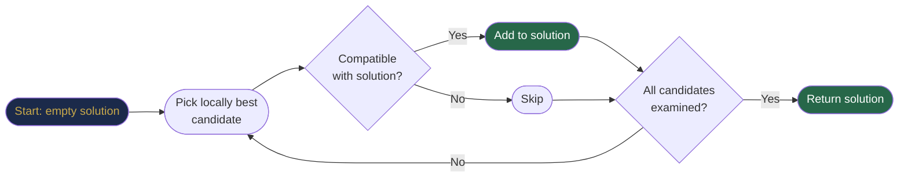
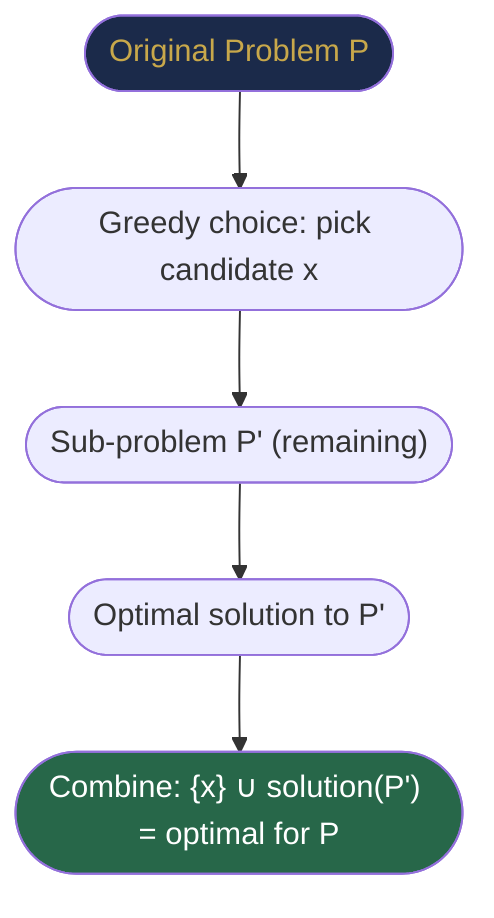
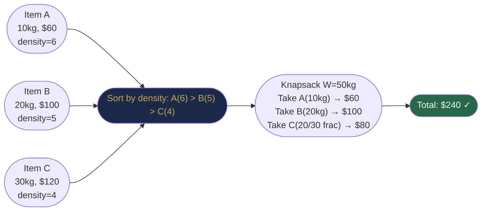
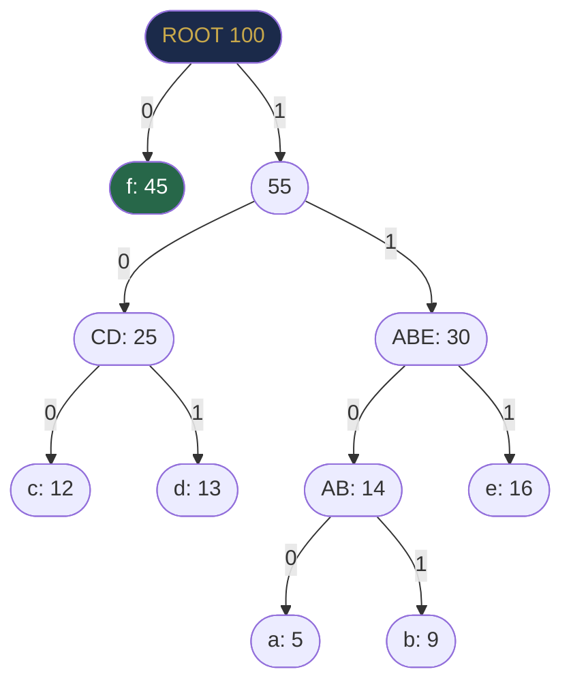
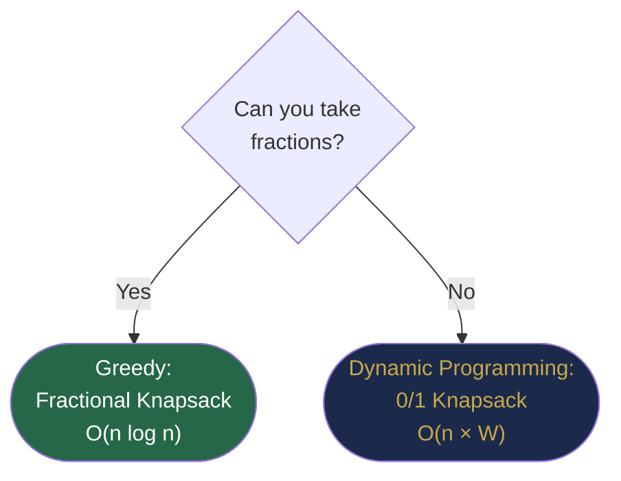
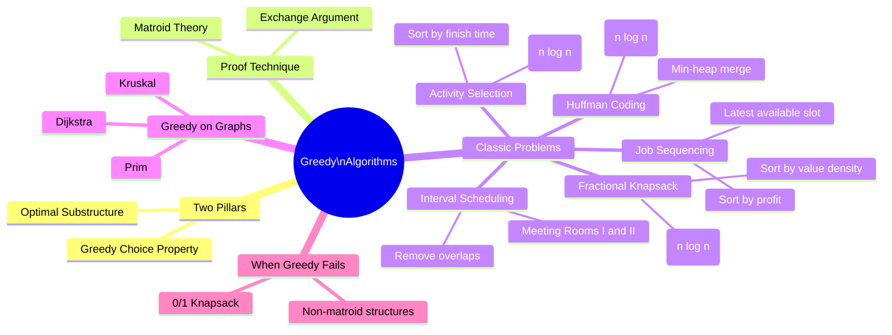

# Chapter 37 — Greedy Algorithms

## Learning Objectives

By the end of this chapter, you will be able to:

- Explain the greedy choice property and optimal substructure
- Construct and verify exchange arguments to prove greedy correctness
- Implement activity selection, interval scheduling, fractional knapsack, Huffman coding, and job sequencing
- Recognise when greedy works and when it fails
- Distinguish greedy from dynamic programming by analysing subproblem overlap

---

## Contents

- [37.1 What Is a Greedy Algorithm?](#371-what-is-a-greedy-algorithm)
- [37.2 The Two Pillars: Greedy Choice + Optimal Substructure](#372-the-two-pillars)
- [37.3 Exchange Arguments — How to Prove Greedy is Correct](#373-exchange-arguments)
- [37.4 Activity Selection — The Classic Greedy Problem](#374-activity-selection)
- [37.5 Interval Scheduling Variants](#375-interval-scheduling-variants)
- [37.6 Fractional Knapsack](#376-fractional-knapsack)
- [37.7 Huffman Coding](#377-huffman-coding)
- [37.8 Job Sequencing with Deadlines](#378-job-sequencing-with-deadlines)
- [37.9 When Greedy Fails — The 0/1 Knapsack Counter-Example](#379-when-greedy-fails)
- [37.10 Greedy on Graphs — Dijkstra and Kruskal Revisited](#3710-greedy-on-graphs)
- [Interview Insight](#interview-insight)
- [Quick Quiz](#quick-quiz)
- [37.11 Practice Problems](#3711-practice-problems)
- [Chapter Summary](#chapter-summary)

---

> [!NOTE]
> **Historical Context**  
> The word "greedy" in algorithms dates to the 1950s–60s, but the approach is as old as human optimisation. **David Huffman** invented his optimal prefix code in 1952 as a **term paper for an MIT information theory course** — he was given a choice: take the final exam, or prove that no better code than Fano coding exists. He found it in a few days by noticing a greedy tree-building rule. His professor, **Robert Fano**, co-inventor of Fano coding, was so impressed he co-published it with Huffman. Meanwhile, **Edsger Dijkstra** (1959) and **Joseph Kruskal** (1956) independently discovered that greedy selection on graph edges produces provably optimal shortest paths and spanning trees. The formal framework for proving greedy algorithms correct — the *greedy choice property* and *exchange arguments* — was largely formalised by **Jon Matroid theory** researchers in the 1970s, connecting greedy algorithms to combinatorial mathematics.

---

> ### 🔗 Analogy
> **The Coin Change Problem**
>
> You need to make $0.41 change using the fewest coins possible (quarters 25¢, dimes 10¢, nickels 5¢, pennies 1¢). What do you do? You instinctively grab the largest coin that fits, then repeat. This is a greedy algorithm — always take the locally best choice. With these specific denominations, it works perfectly. But if denominations were [1¢, 3¢, 4¢] and you needed 6¢, greedy (4¢ + 1¢ + 1¢ = 3 coins) is worse than optimal (3¢ + 3¢ = 2 coins). The analogy teaches the core truth: **greedy is fast and elegant, but requires proof that local optimality implies global optimality**.

---

## 37.1 What Is a Greedy Algorithm?

A **greedy algorithm** builds a solution incrementally by making the **locally optimal choice at each step**, never reconsidering past decisions.

**Three-step template:**
1. **Sort** (or structure) candidates by some criterion.
2. **Iterate** through candidates and **greedily select** each one that is "compatible" or "best" so far.
3. **Return** the accumulated selection.



**Key contrast with other paradigms:**

| Property | Greedy | Dynamic Programming | Backtracking |
|----------|--------|---------------------|--------------|
| Reconsider past choices? | ❌ Never | ❌ Never (table) | ✅ Yes |
| Explores all subproblems? | ❌ One per step | ✅ All | ✅ All paths |
| Optimal? | Only if provable | Yes (if subproblems overlap) | Yes (exhaustive) |
| Time complexity | Usually O(n log n) | Usually O(n²) or O(n·k) | Usually exponential |

---

## 37.2 The Two Pillars

### Pillar 1: Greedy Choice Property

**Definition:** A globally optimal solution can always be constructed so that it includes the greedy (locally optimal) choice made at the first step.

In other words: you will never need to "undo" the greedy choice. The first choice you make will appear in at least one optimal solution.

**Informal proof strategy:** Show that any optimal solution that does not include your greedy choice can be transformed (without getting worse) into one that does.

### Pillar 2: Optimal Substructure

**Definition:** An optimal solution to the problem contains optimal solutions to its sub-problems.

This is shared with dynamic programming. The difference: greedy doesn't need to solve all sub-problems — after making the greedy choice, only one sub-problem remains.



---

## 37.3 Exchange Arguments

The **exchange argument** is the standard technique for proving a greedy algorithm is correct.

**Template:**
1. Assume an optimal solution $OPT$ exists that does **not** include your greedy choice $g$.
2. Find the element $g'$ in $OPT$ that conflicts with or replaces $g$.
3. **Swap** $g'$ for $g$ in $OPT$, producing solution $OPT'$.
4. Show that $OPT'$ is **at least as good** as $OPT$ (cost ≤ cost, size ≥ size, etc.).
5. Conclude: there is always an optimal solution including $g$ → greedy is safe.

We'll apply this concretely in the activity selection proof below.

> [!TIP]
> **Did You Know? — Matroid Theory**  
> The formal study of when greedy algorithms work is called **matroid theory**, developed by Hassler Whitney in 1935 and popularised in combinatorial optimisation by Jack Edmonds in the 1970s. A *matroid* is an abstract structure where the greedy algorithm always produces the globally optimal solution. Kruskal's algorithm (MST), Huffman coding, and activity selection all correspond to greedy algorithms on matroids. When a problem doesn't form a matroid, greedy typically fails — this is why 0/1 knapsack (not a matroid) requires dynamic programming.

---

## 37.4 Activity Selection — The Classic Greedy Problem

**Problem:** Given $n$ activities, each with a start time $s_i$ and finish time $f_i$, select the **maximum number of non-overlapping activities** that can be scheduled in a single room.

**Example:**
```
Activity:  A(1,4)  B(3,5)  C(0,6)  D(5,7)  E(3,9)  F(5,9)  G(6,10) H(8,11) I(8,12) J(2,14) K(12,16)
           [start, finish]

Best selection: A(1,4), D(5,7), H(8,11), K(12,16) — 4 activities ✓
```

**The greedy insight:** Sort by **earliest finish time**. Always pick the activity that finishes soonest — it leaves the maximum remaining time for future activities.

**Why earliest finish, not earliest start?**

```
Suppose we sort by earliest start:
  A: [1, 10]  (starts earliest but runs very long)
  B: [2,  3]  (starts slightly later but finishes early)
  C: [4,  5]
  D: [6,  7]

Earliest-start picks A first: 1 activity.
Earliest-finish picks B, C, D: 3 activities. ✓
```

**Exchange argument proof:**  
Let $OPT$ be any optimal solution. Let $a_1$ be the activity with the earliest finish time overall. If $OPT$ contains $a_1$, we're done. If $OPT$ contains $b_1 \ne a_1$ as its first activity, then $f(a_1) \le f(b_1)$ (by definition of earliest finish). Replace $b_1$ with $a_1$: since $f(a_1) \le f(b_1)$, $a_1$ cannot conflict with any activity that $b_1$ was compatible with. So $OPT'$ is still a valid optimal solution. ∎

```java
List<int[]> activitySelection(int[][] activities) {
    // Sort by finish time (ascending)
    Arrays.sort(activities, Comparator.comparingInt(a -> a[1]));

    List<int[]> selected = new ArrayList<>();
    int lastFinish = -1;

    for (int[] act : activities) {
        int start = act[0], finish = act[1];
        if (start >= lastFinish) {       // no overlap with last selected
            selected.add(act);
            lastFinish = finish;
        }
    }
    return selected;
}
```

**Step-by-step trace:**
```
Sorted by finish: (1,4),(3,5),(0,6),(5,7),(3,9),(5,9),(6,10),(8,11),(8,12),(2,14),(12,16)

Pick (1,4):   lastFinish=4
Skip (3,5):   start=3 < 4 ✗
Skip (0,6):   start=0 < 4 ✗
Pick (5,7):   start=5 ≥ 4 ✓, lastFinish=7
Skip (3,9):   start=3 < 7 ✗
Skip (5,9):   start=5 < 7 ✗
Skip (6,10):  start=6 < 7 ✗
Pick (8,11):  start=8 ≥ 7 ✓, lastFinish=11
Skip (8,12):  start=8 < 11 ✗
Skip (2,14):  start=2 < 11 ✗
Pick (12,16): start=12 ≥ 11 ✓, lastFinish=16

Result: [(1,4),(5,7),(8,11),(12,16)] — 4 activities ✓
```

**Complexity:**
- **Time:** O(n log n) for sorting + O(n) scan = **O(n log n)**
- **Space:** O(1) extra (output aside)

---

## 37.5 Interval Scheduling Variants

### Minimum Rooms (Meeting Rooms II)

**Problem:** Given meeting intervals, find the **minimum number of conference rooms** required.

**Greedy insight:** The minimum rooms needed equals the **maximum number of overlapping meetings at any point in time**.

**Two-pointer approach on events:**

```java
int minMeetingRooms(int[][] intervals) {
    int n = intervals.length;
    int[] starts = new int[n], ends = new int[n];
    for (int i = 0; i < n; i++) {
        starts[i] = intervals[i][0];
        ends[i]   = intervals[i][1];
    }
    Arrays.sort(starts);
    Arrays.sort(ends);

    int rooms = 0, maxRooms = 0, endPtr = 0;
    for (int i = 0; i < n; i++) {
        if (starts[i] < ends[endPtr]) {
            rooms++;          // new meeting starts before any ends → need new room
        } else {
            endPtr++;         // a meeting ended → reuse that room
        }
        maxRooms = Math.max(maxRooms, rooms);
    }
    return maxRooms;
}
```

**Complexity:** O(n log n) time, O(n) space.

**[LeetCode 253 — Meeting Rooms II](https://leetcode.com/problems/meeting-rooms-ii/)**  
**[LeetCode 252 — Meeting Rooms](https://leetcode.com/problems/meeting-rooms/)** (simpler: just check for any overlap)

### Minimum Intervals to Remove (Non-Overlapping Intervals)

**Problem:** Remove the **minimum number** of intervals so that none overlap.

**Greedy:** Sort by finish time. Greedily keep the interval with the earliest finish. Count how many you must skip — that's the answer.

**[LeetCode 435 — Non-overlapping Intervals](https://leetcode.com/problems/non-overlapping-intervals/)**

```java
int eraseOverlapIntervals(int[][] intervals) {
    Arrays.sort(intervals, Comparator.comparingInt(a -> a[1]));  // by finish
    int removed = 0, lastFinish = Integer.MIN_VALUE;
    for (int[] iv : intervals) {
        if (iv[0] >= lastFinish) {
            lastFinish = iv[1];       // keep this interval
        } else {
            removed++;                // overlap: remove it
        }
    }
    return removed;
}
```

---

## 37.6 Fractional Knapsack

**Problem:** You have a knapsack of capacity $W$ and $n$ items, each with weight $w_i$ and value $v_i$. You can take **fractions** of items. Maximise total value.

**Greedy insight:** Take items in decreasing order of **value-per-unit-weight** (value density = $v_i / w_i$). Fill the knapsack greedily; take the fraction of the last item that fits.

**Why fractions allow greedy:**  
Taking a fraction of the highest-density item is always safe — no better use of that capacity fraction exists. With fractions, we can always "fill to capacity" optimally.



```java
double fractionalKnapsack(int W, int[][] items) {
    // items[i] = [value, weight]
    // Sort by density descending
    Arrays.sort(items, (a, b) -> Double.compare((double)b[0]/b[1], (double)a[0]/a[1]));

    double totalValue = 0.0;
    int remaining = W;

    for (int[] item : items) {
        if (remaining == 0) break;
        int value = item[0], weight = item[1];
        int take = Math.min(remaining, weight);  // take as much as fits
        totalValue += (double) take / weight * value;
        remaining -= take;
    }
    return totalValue;
}
```

**Complexity:** O(n log n) sorting + O(n) fill = **O(n log n)**.

**Why 0/1 knapsack is different:** You cannot take fractions. The highest-density item might be too heavy to take at all, or leaving partial capacity might be better filled with combinations of lighter items. We'll see this in Section 37.9.

---

## 37.7 Huffman Coding

**Problem:** Assign binary codes to characters so that **more frequent characters get shorter codes**, and **no code is a prefix of another** (prefix-free property). Minimise total encoded message length.

**Why prefix-free?** So decoding is unambiguous — no need for delimiters between characters.

**The greedy insight:** Build a binary tree bottom-up. At each step, **merge the two least-frequent nodes** into a new internal node with combined frequency. The resulting tree gives optimal prefix-free codes.

**Why merging least-frequent is optimal (exchange argument):**  
The two nodes with the lowest frequencies must be deepest in the optimal tree (assigned the longest codes). If any other pair were deepest instead, we could swap them with the lowest-frequency pair and reduce total length. The greedy merge precisely ensures the two rarest characters are always at the greatest depth.

**Step-by-step example:**
```
Characters and frequencies:
  a:5  b:9  c:12  d:13  e:16  f:45

Step 1: Merge a(5) + b(9) → AB(14)
  Remaining: AB(14) c(12) d(13) e(16) f(45)

Step 2: Merge c(12) + d(13) → CD(25)
  Remaining: AB(14) CD(25) e(16) f(45)

Step 3: Merge AB(14) + e(16) → ABE(30)
  Remaining: ABE(30) CD(25) f(45)

Step 4: Merge CD(25) + ABE(30) → CDABE(55)
  Remaining: CDABE(55) f(45)

Step 5: Merge f(45) + CDABE(55) → ROOT(100)

Codes (read path: left=0, right=1):
  f:   0        (1 bit  — most frequent!)
  c:  100       (3 bits)
  d:  101       (3 bits)
  a:  1100      (4 bits)
  b:  1101      (4 bits)
  e:  111       (3 bits)
```



```java
class HuffmanNode implements Comparable<HuffmanNode> {
    char ch;
    int freq;
    HuffmanNode left, right;

    HuffmanNode(char ch, int freq) { this.ch = ch; this.freq = freq; }
    HuffmanNode(int freq, HuffmanNode l, HuffmanNode r) {
        this.freq = freq; this.left = l; this.right = r;
    }

    @Override public int compareTo(HuffmanNode o) { return this.freq - o.freq; }
}

Map<Character, String> huffmanCodes(char[] chars, int[] freqs) {
    PriorityQueue<HuffmanNode> minHeap = new PriorityQueue<>();
    for (int i = 0; i < chars.length; i++)
        minHeap.offer(new HuffmanNode(chars[i], freqs[i]));

    while (minHeap.size() > 1) {
        HuffmanNode left  = minHeap.poll();   // least frequent
        HuffmanNode right = minHeap.poll();   // second least
        minHeap.offer(new HuffmanNode(left.freq + right.freq, left, right));
    }

    Map<Character, String> codes = new HashMap<>();
    buildCodes(minHeap.poll(), "", codes);
    return codes;
}

void buildCodes(HuffmanNode node, String code, Map<Character, String> codes) {
    if (node == null) return;
    if (node.left == null && node.right == null) {   // leaf = actual character
        codes.put(node.ch, code.isEmpty() ? "0" : code);
        return;
    }
    buildCodes(node.left,  code + "0", codes);
    buildCodes(node.right, code + "1", codes);
}
```

**Complexity:**
- Building the initial heap: O(n)
- Each merge: O(log n) for heap operations, n-1 merges total
- **Total: O(n log n)**
- Space: O(n) for heap and tree

**Practical use:** Huffman coding is the compression engine inside **ZIP files, JPEG images (Huffman as one stage), MP3 audio, and HTTP/2 header compression (HPACK)**. The 6-character example above achieves an average code length of 2.24 bits vs 3 bits for fixed-length encoding — a 25% compression.

---

## 37.8 Job Sequencing with Deadlines

**Problem:** Given $n$ jobs, each with a profit $p_i$ and a deadline $d_i$ (must complete by this time slot), schedule jobs (each takes 1 unit time) to **maximise total profit**.

**Greedy strategy:** Sort by profit descending. For each job, assign it to the **latest available slot** at or before its deadline (greedy backward filling — maximises future flexibility).

```java
int maxProfit(int[][] jobs) {
    // jobs[i] = [deadline, profit]
    Arrays.sort(jobs, (a, b) -> b[1] - a[1]);  // descending profit

    int maxDeadline = Arrays.stream(jobs).mapToInt(j -> j[0]).max().getAsInt();
    boolean[] slots = new boolean[maxDeadline + 1]; // slot[i] = taken?
    int totalProfit = 0;

    for (int[] job : jobs) {
        int deadline = job[0], profit = job[1];
        // Find latest available slot at or before deadline
        for (int t = deadline; t >= 1; t--) {
            if (!slots[t]) {
                slots[t] = true;
                totalProfit += profit;
                break;
            }
        }
    }
    return totalProfit;
}
```

**Trace on example:**
```
Jobs: (d=2,p=100), (d=1,p=19), (d=2,p=27), (d=1,p=25), (d=3,p=15)
Sorted by profit: (d=2,p=100), (d=1,p=25), (d=2,p=27), (d=1,p=19), (d=3,p=15)

Pick (d=2,p=100): slot 2 free → assign slot 2. profit=100
Pick (d=1,p=25):  slot 1 free → assign slot 1. profit=125
Pick (d=2,p=27):  slot 2 taken; slot 1 taken → skip
Pick (d=1,p=19):  slots 1 all taken → skip
Pick (d=3,p=15):  slot 3 free → assign slot 3. profit=140

Schedule: slot1=(d1,p25), slot2=(d2,p100), slot3=(d3,p15) → total=140 ✓
```

**Complexity:** O(n log n) sort + O(n · maxDeadline) scheduling. Can be improved to O(n log n) using a DSU to track the next available slot.

**[LeetCode 621 — Task Scheduler](https://leetcode.com/problems/task-scheduler/)** (related greedy on tasks with cooldown)

---

## 37.9 When Greedy Fails

### The 0/1 Knapsack Counter-Example

```
Items:  A(weight=10, value=60)  B(weight=20, value=100)  C(weight=30, value=120)
Knapsack capacity: W = 50

Densities: A=6.0, B=5.0, C=4.0

Greedy (fractional-style, no fractions allowed):
  Take A (10kg) → value=60, remaining=40
  Take B (20kg) → value=160, remaining=20
  Take C: weight=30 > 20, SKIP
  Result: 160

Optimal (DP):
  Take B (20kg) + C (30kg) = 50kg → value=220 ✓

Greedy gives 160 vs optimal 220. Greedy FAILS here.
```

**Why?** Taking the highest-density item (A) used capacity that would have been better shared between B and C. Without the ability to split items, the greedy exchange argument breaks — a left-out fraction can't be "recovered."

**Greedy fails when:**
1. Items are indivisible (0/1 choices) — need DP
2. Choices interact in complex ways (not independent)
3. The problem is on a non-matroid structure



---

## 37.10 Greedy on Graphs — Dijkstra and Kruskal Revisited

Both Dijkstra's (Chapter 33) and Kruskal's (Chapter 34) are greedy algorithms operating on graphs:

| Algorithm | Greedy Choice | What it proves |
|-----------|--------------|----------------|
| Dijkstra | Always expand the nearest unvisited vertex | Nearest unvisited vertex has its shortest path finalised |
| Kruskal | Always add the cheapest safe edge | Cheapest edge crossing any cut is in some MST (cut property) |
| Prim's | Always add the cheapest edge reaching an unvisited vertex | Same cut property as Kruskal's |
| Huffman | Always merge the two least-frequent nodes | Exchange argument: least-frequent must be deepest |

This demonstrates the power of the greedy framework: the same abstract idea — make the locally best choice that you can prove won't hurt globally — underlies algorithms from routing to compression.

---

## Interview Insight

> **Greedy is the first instinct, but requires proof.** In interviews, if you propose a greedy approach, the interviewer will almost always ask: "Why is this correct?" Have an exchange argument or brief intuition ready.

**Common interview patterns:**
1. **Sort by one attribute, greedily select by another** — activity selection, job sequencing
2. **Priority queue to always process the "best" next** — Huffman, Dijkstra
3. **Two pointers on sorted events** — meeting rooms
4. **Greedy on the answer** — works when the feasibility function is monotone (see Chapter 39: binary search on answer)

---

## Quick Quiz

<details>
<summary>Q1: Activity selection sorts by finish time. What if two activities have the same finish time — does the tie-breaking matter?</summary>

**Answer:** No. Any tie-breaking rule (start time, arbitrary) produces the same number of selected activities. The exchange argument guarantees that any activity with the same finish time is equally "safe" to select as the greedy first choice — they leave the same amount of remaining time.

</details>

<details>
<summary>Q2: Huffman coding is optimal. Can any other prefix-free code produce a shorter average code length for the same frequency distribution?</summary>

**Answer:** No. Huffman's algorithm is provably optimal among all prefix-free (variable-length) codes. The proof uses an exchange argument showing that any tree not built by the Huffman procedure can be improved by swapping subtrees — a contradiction. This was Huffman's original proof in his 1952 paper.

</details>

<details>
<summary>Q3: Why does greedy work for fractional knapsack but not 0/1 knapsack?</summary>

**Answer:** With fractions, you can always fill remaining capacity using a fraction of the highest-density item — there is no waste. The exchange argument holds: replacing any other selection with the highest-density item (or its fraction) never decreases total value. With 0/1 items, you must take all or nothing, so "filling the last bit" greedily might waste capacity that another item combination would use better. The feasible sets no longer form a matroid.

</details>

<details>
<summary>Q4: What is the time complexity of Huffman coding and why?</summary>

**Answer:** O(n log n). We perform n−1 merges; each merge involves two `poll()` and one `offer()` on a min-heap of size ≤ n, each costing O(log n). Total: O(n log n). If frequencies are already sorted integers, Huffman can run in O(n) using two queues (one for leaves, one for internal nodes).

</details>

<details>
<summary>Q5: The gas station problem (LeetCode 134): traverse a circular route with gas stations; each station gives gas[i] fuel and costs cost[i] to reach the next. Find the starting station. What's the greedy insight?</summary>

**Answer:** The key insights are: (1) If total gas ≥ total cost, a solution always exists. (2) Start from the station after the point where the running cumulative sum (gas - cost) drops to its minimum. The greedy argument: any station before that minimum point will cause you to run out before reaching the minimum; any station after it will have a positive running sum all the way around. This gives an O(n) solution.

</details>

---

## 37.11 Practice Problems

### Easy

| Problem | Concept | Link |
|---------|---------|------|
| Assign Cookies | Greedy matching | [LC 455](https://leetcode.com/problems/assign-cookies/) |
| Lemonade Change | Greedy simulation | [LC 860](https://leetcode.com/problems/lemonade-change/) |
| Is Subsequence | Two-pointer greedy | [LC 392](https://leetcode.com/problems/is-subsequence/) |
| Meeting Rooms | Interval overlap check | [LC 252](https://leetcode.com/problems/meeting-rooms/) |

### Medium

| Problem | Concept | Link |
|---------|---------|------|
| Non-overlapping Intervals | Activity selection | [LC 435](https://leetcode.com/problems/non-overlapping-intervals/) |
| Meeting Rooms II | Minimum rooms | [LC 253](https://leetcode.com/problems/meeting-rooms-ii/) |
| Jump Game | Greedy reachability | [LC 55](https://leetcode.com/problems/jump-game/) |
| Jump Game II | Minimum jumps | [LC 45](https://leetcode.com/problems/jump-game-ii/) |
| Gas Station | Circular greedy | [LC 134](https://leetcode.com/problems/gas-station/) |
| Task Scheduler | Greedy scheduling | [LC 621](https://leetcode.com/problems/task-scheduler/) |
| Minimum Number of Arrows to Burst Balloons | Interval greedy | [LC 452](https://leetcode.com/problems/minimum-number-of-arrows-to-burst-balloons/) |

### Hard

| Problem | Concept | Link |
|---------|---------|------|
| IPO | Greedy + 2 heaps | [LC 502](https://leetcode.com/problems/ipo/) |
| Reorganize String | Greedy + heap | [LC 767](https://leetcode.com/problems/reorganize-string/) |
| Minimum Cost to Hire K Workers | Greedy + heap | [LC 857](https://leetcode.com/problems/minimum-cost-to-hire-k-workers/) |
| Split Array into Consecutive Subsequences | Greedy | [LC 659](https://leetcode.com/problems/split-array-into-consecutive-subsequences/) |

---

## Chapter Summary



**Key Takeaways:**
- **Greedy = locally optimal choices that provably produce a global optimum.** The challenge is the proof, not the implementation.
- **Exchange arguments** are the universal tool: show any non-greedy optimal solution can be transformed into the greedy one without loss.
- **Sorting is the most common first step** — it converts an unordered problem into one where "pick the best remaining" is straightforward.
- **If you can't prove greedy correct**, the problem likely requires dynamic programming or backtracking.
- Dijkstra, Kruskal, Prim, and Huffman are all greedy algorithms — this framework unifies Chapter 33, 34, and 37.
