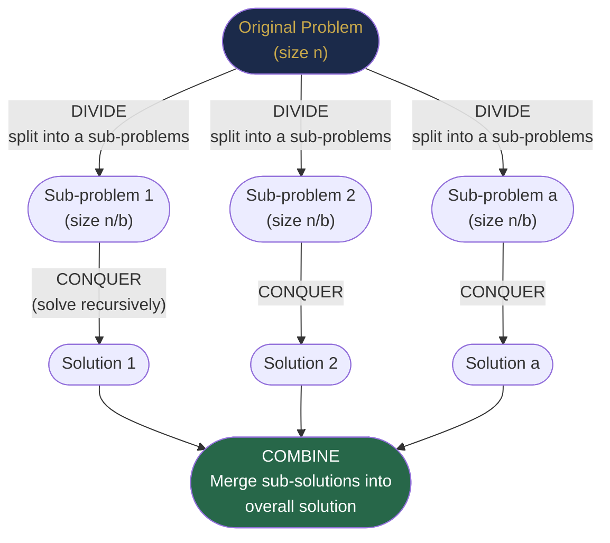
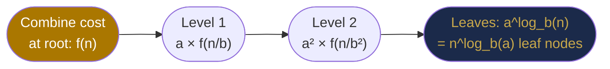

# Chapter 38 — Divide and Conquer

## Learning Objectives

By the end of this chapter, you will be able to:

- Decompose problems using the divide-conquer-combine pattern
- Apply the Master Theorem to calculate recurrence complexity
- Explain how merge sort, quicksort, and binary search are divide-and-conquer algorithms
- Implement the closest pair of points in O(n log n)
- Identify when divide and conquer is more powerful than brute force

---

## Contents

- [38.1 The Divide and Conquer Pattern](#381-the-divide-and-conquer-pattern)
- [38.2 The Master Theorem — Recurrence Analysis](#382-the-master-theorem)
- [38.3 Merge Sort — The Canonical Example](#383-merge-sort)
- [38.4 Quicksort — Divide by Partition](#384-quicksort)
- [38.5 Binary Search — Divide by Half](#385-binary-search)
- [38.6 Maximum Subarray — Kadane vs D&C](#386-maximum-subarray)
- [38.7 Closest Pair of Points](#387-closest-pair-of-points)
- [38.8 Strassen's Matrix Multiplication](#388-strassens-matrix-multiplication)
- [38.9 Power Function and Fast Exponentiation](#389-fast-exponentiation)
- [Interview Insight](#interview-insight)
- [Quick Quiz](#quick-quiz)
- [38.10 Practice Problems](#3810-practice-problems)
- [Chapter Summary](#chapter-summary)

---

> [!NOTE]
> **Historical Context**  
> **John von Neumann** invented merge sort in 1945 as part of his work on the EDVAC computer — the algorithm was needed to sort data stored on magnetic drums with limited random access. It was the first O(n log n) comparison sort, and the divide-and-conquer pattern it embodies became foundational. In 1962, **Tony Hoare** (later famous for null pointer regrets: *"I call it my billion-dollar mistake"*) invented quicksort, also divide-and-conquer. The deepest theoretical contribution came from **Volker Strassen** in 1969: he proved that the obvious O(n³) matrix multiplication algorithm is not optimal, reducing it to O(n^2.81) with an unexpected divide-and-conquer trick — shattering the belief that O(n³) was inherent. This launched decades of research into *"can we do better?"* (current record: O(n^2.37), **2024**). Divide and conquer remains one of the most fertile paradigms in algorithmic research.

---

> ### 🔗 Analogy
> **Sorting a Shuffled Deck of Cards with a Friend**
>
> Give your friend the bottom half, keep the top half. You each separately sort your halves. Then merge by comparing the front cards of each sorted half, always picking the smaller. This is merge sort. Notice: you didn't need to coordinate while sorting your halves — the sub-problems are **independent**. When you merge, the work is proportional to the total cards, not the square of them. This is the power of D&C: **independence of sub-problems makes them parallelisable, and merging takes linear time**.

---

## 38.1 The Divide and Conquer Pattern

Every D&C algorithm has three phases:



**The three questions to ask when designing a D&C algorithm:**
1. **How do I divide?** — Split by index, by value, by some pivot, geometrically?
2. **What is the base case?** — When is the problem trivially solvable (size 0, 1, or 2)?
3. **How do I combine?** — This is usually where the cleverness lives. The divide step is easy; the combine step determines correctness and complexity.

**General recurrence:**
$$T(n) = a \cdot T(n/b) + f(n)$$

- $a$ = number of sub-problems
- $b$ = factor by which problem shrinks
- $f(n)$ = cost of divide + combine steps

---

## 38.2 The Master Theorem

The **Master Theorem** solves recurrences of the form $T(n) = a \cdot T(n/b) + f(n)$.

**Three cases — intuitively:**

The question is: who dominates — the recursive calls (the tree's leaves) or the combine step (at the root)?



| Case | Condition | Result | Dominant term | Example |
|------|-----------|--------|---------------|---------|
| **Case 1** | $f(n) = O(n^{\log_b a - \epsilon})$ | $T(n) = \Theta(n^{\log_b a})$ | Leaves dominate | $T(n) = 8T(n/2) + n^2$: $n^3$ |
| **Case 2** | $f(n) = \Theta(n^{\log_b a} \log^k n)$ | $T(n) = \Theta(n^{\log_b a} \log^{k+1} n)$ | Tie: all levels equal | $T(n) = 2T(n/2) + n$: $n \log n$ |
| **Case 3** | $f(n) = \Omega(n^{\log_b a + \epsilon})$ | $T(n) = \Theta(f(n))$ | Root/combine dominates | $T(n) = 2T(n/2) + n^2$: $n^2$ |

**Step-by-step: How to apply the Master Theorem**

1. Identify $a$, $b$, $f(n)$ from the recurrence.
2. Compute $\log_b a$ (the "critical exponent").
3. Compare $f(n)$ to $n^{\log_b a}$:
   - If $f$ grows slower → Case 1 → answer is $n^{\log_b a}$
   - If $f$ grows same rate → Case 2 → answer is $n^{\log_b a} \log n$
   - If $f$ grows faster → Case 3 → answer is $f(n)$

**Examples worked out:**

```
Merge Sort: T(n) = 2T(n/2) + n
  a=2, b=2, f(n)=n
  log₂(2) = 1  →  n^1 = n
  f(n) = n = n¹ → Case 2 (k=0)
  T(n) = Θ(n log n)  ✓

Binary Search: T(n) = T(n/2) + 1
  a=1, b=2, f(n)=1
  log₂(1) = 0  →  n^0 = 1
  f(n) = 1 = n^0 → Case 2 (k=0)
  T(n) = Θ(log n)  ✓

Strassen: T(n) = 7T(n/2) + n²
  a=7, b=2, f(n)=n²
  log₂(7) ≈ 2.807  →  n^2.807
  f(n) = n² = O(n^(2.807 - 0.807)) → Case 1
  T(n) = Θ(n^log₂7) ≈ Θ(n^2.81)  ✓

Naive Matrix Multiply: T(n) = 8T(n/2) + n²
  a=8, b=2, log₂(8)=3  →  n³
  f(n) = n² = O(n^(3-1)) → Case 1
  T(n) = Θ(n³)  ✓
```

> [!NOTE]
> **When Master Theorem Does NOT Apply**  
> The Master Theorem requires sub-problems of **equal size** (all n/b, not n/3 and 2n/3). It also doesn't cover recurrences like $T(n) = 2T(n-1) + 1$ (sub-problem shrinks by subtraction, not division) — that recurrence gives $T(n) = O(2^n)$, not O(n log n). For unequal sub-problems, use the **Akra-Bazzi method** or draw the recursion tree.

---

## 38.3 Merge Sort — The Canonical Example

Merge sort is the **poster child of divide and conquer**: clean three-phase structure, O(n log n) guaranteed, and provably optimal for comparison-based sorting.

**The recursion tree visualised:**
```
mergeSort([3,1,4,1,5,9,2,6]):
  mergeSort([3,1,4,1])            mergeSort([5,9,2,6])
    mergeSort([3,1])  mergeSort([4,1])  ...
      mergeSort([3]) mergeSort([1])
      merge([3],[1]) = [1,3]
    merge([1,3],[1,4]) = [1,1,3,4]
  merge([1,1,3,4],[2,5,6,9]) = [1,1,2,3,4,5,6,9]
```

**Why merge sort is O(n log n) — intuitively:**
- The tree has $\log_2 n$ levels (halving each time).
- At every level, the total work to merge all sub-arrays at that level is $O(n)$ (every element is examined exactly once per level).
- Total: $O(n) \times O(\log n) = O(n \log n)$.

```java
void mergeSort(int[] arr, int left, int right) {
    if (left >= right) return;           // base case: 1 or 0 elements
    int mid = left + (right - left) / 2;
    mergeSort(arr, left, mid);           // DIVIDE + CONQUER left half
    mergeSort(arr, mid + 1, right);      // DIVIDE + CONQUER right half
    merge(arr, left, mid, right);        // COMBINE
}

void merge(int[] arr, int left, int mid, int right) {
    int[] temp = new int[right - left + 1];
    int i = left, j = mid + 1, k = 0;

    while (i <= mid && j <= right) {
        if (arr[i] <= arr[j]) temp[k++] = arr[i++];   // left smaller: pick left
        else                  temp[k++] = arr[j++];   // right smaller: pick right
    }
    while (i <= mid)   temp[k++] = arr[i++];   // copy remaining left
    while (j <= right) temp[k++] = arr[j++];   // copy remaining right

    System.arraycopy(temp, 0, arr, left, temp.length);
}
```

**Complexity:**
- **Time:** $T(n) = 2T(n/2) + O(n)$ → **O(n log n)** best, average, worst
- **Space:** O(n) extra for the temp array — merge sort is not in-place

**Stability:** Merge sort is **stable** — equal elements maintain their relative order. This matters for multi-key sorting (sort by name, then by age: stability preserves the name order after age sort).

**Key application — Counting Inversions:**  
An inversion is a pair $(i, j)$ where $i < j$ but $arr[i] > arr[j]$ (out-of-order pair). Brute force: O(n²). Merge sort counts inversions in O(n log n) by counting cross-inversions during the merge step.

**[LeetCode 912 — Sort an Array](https://leetcode.com/problems/sort-an-array/)**  
**[LeetCode 315 — Count of Smaller Numbers After Self](https://leetcode.com/problems/count-of-smaller-numbers-after-self/)** (modified merge sort)

---

## 38.4 Quicksort — Divide by Partition

**Quicksort** divides differently: instead of always splitting at the midpoint, it **partitions by value** around a pivot.

**The key idea:** After partitioning, the pivot is in its final sorted position. Everything left of it is ≤ pivot, everything right is ≥ pivot. Recurse on both sides.

**Two pointers partition (Lomuto scheme):**
```java
void quickSort(int[] arr, int low, int high) {
    if (low >= high) return;
    int pivotIdx = partition(arr, low, high);
    quickSort(arr, low, pivotIdx - 1);    // left of pivot
    quickSort(arr, pivotIdx + 1, high);   // right of pivot
}

int partition(int[] arr, int low, int high) {
    int pivot = arr[high];   // choose last element as pivot
    int i = low - 1;         // i tracks the boundary of the ≤ pivot region

    for (int j = low; j < high; j++) {
        if (arr[j] <= pivot) {
            i++;
            swap(arr, i, j);             // extend ≤ pivot region
        }
    }
    swap(arr, i + 1, high);              // place pivot in its final position
    return i + 1;
}
```

**Partition trace on [3, 6, 8, 10, 1, 2, 1]:**
```
pivot=1, i=-1
j=0: arr[0]=3 > 1, skip
j=1: arr[1]=6 > 1, skip
j=2: arr[2]=8 > 1, skip
j=3: arr[3]=10 > 1, skip
j=4: arr[4]=1 ≤ 1, i=0, swap(0,4): [1,6,8,10,3,2,1]
j=5: arr[5]=2 > 1, skip
j=6: not reached (j < high=6)
swap(i+1=1, high=6): [1,1,8,10,3,2,6]
pivot index = 1  → [1] | 1 | [8,10,3,2,6]  ✓
```

**Complexity analysis:**

| Case | Condition | Recurrence | Complexity |
|------|-----------|-----------|------------|
| **Best** | Pivot always splits evenly | $T(n) = 2T(n/2) + n$ | O(n log n) |
| **Average** | Random pivot | $T(n) = 2T(n/2) + n$ | O(n log n) |
| **Worst** | Already sorted, pivot=last | $T(n) = T(n-1) + n$ | O(n²) |

**Why worst case matters:** Sorted input + last-element pivot = every partition separates 0 elements from n-1 elements. The recursion tree becomes a chain of depth n, giving O(n²). **Fix: randomise the pivot.**

```java
// Randomised pivot: swap random element with last element before partition
int randomIdx = low + (int)(Math.random() * (high - low + 1));
swap(arr, randomIdx, high);
```

**Space:** O(log n) average call stack depth; O(n) worst case.

**Quicksort vs Merge Sort:**

| Property | Quicksort | Merge Sort |
|----------|----------|-----------|
| Worst case | O(n²) | O(n log n) |
| Average case | O(n log n) | O(n log n) |
| Space | O(log n) in-place | O(n) extra |
| Cache performance | Excellent (sequential access) | Good |
| Stable? | ❌ | ✅ |
| In-place? | ✅ | ❌ |

> [!TIP]
> **Did You Know? — Why Java Arrays.sort() Uses Quicksort**  
> Java's `Arrays.sort(int[])` uses a variant called **dual-pivot quicksort** (introduced in Java 7 by **Vladimir Yaroslavskiy**), which uses two pivots instead of one, partitioning the array into three segments. This reduces the average number of comparisons from 2n ln n to 1.9n ln n — a ~5% improvement that matters for sorting large arrays billions of times. Java's `Arrays.sort(Object[])` uses **TimSort** (a merge-sort variant) because it must be stable (reference types may need stable ordering). The choice of algorithm depends on whether stability and worst-case guarantees matter more than cache efficiency.

---

## 38.5 Binary Search — Divide by Half

Binary search is divide and conquer in its simplest form: eliminate half the search space each step.

**Intuition:** If the array is sorted, comparing the target to the middle element tells you definitively which half the target is in. This reduces a search of n elements to log₂ n comparisons.

```java
int binarySearch(int[] arr, int target) {
    int left = 0, right = arr.length - 1;
    while (left <= right) {
        int mid = left + (right - left) / 2;   // avoids integer overflow vs (l+r)/2
        if      (arr[mid] == target) return mid;
        else if (arr[mid]  < target) left  = mid + 1;  // target in right half
        else                         right = mid - 1;  // target in left half
    }
    return -1;   // not found
}
```

**Why `left + (right - left) / 2` and not `(left + right) / 2`?**  
If `left = 1_000_000_000` and `right = 1_500_000_000`, their sum overflows a 32-bit integer (max ~2.1 billion). The first form is overflow-safe. This is a subtle but critical correctness issue.

**Recurrence:** $T(n) = T(n/2) + 1$. By Master Theorem Case 2: $T(n) = O(\log n)$.

**[LeetCode 704 — Binary Search](https://leetcode.com/problems/binary-search/)**

**Generalised binary search template — lower bound:**

```java
// Find leftmost position where condition(mid) is true
// (classic "find first" / "find insertion point" / "search on answer")
int lowerBound(int[] arr, int target) {
    int left = 0, right = arr.length;   // right = arr.length (open boundary)
    while (left < right) {
        int mid = left + (right - left) / 2;
        if (arr[mid] < target) left  = mid + 1;
        else                   right = mid;      // possible answer, keep narrowing left
    }
    return left;   // smallest index where arr[index] >= target
}
```

---

## 38.6 Maximum Subarray — Kadane vs D&C

**Problem:** Find the contiguous subarray with the maximum sum.  
**[LeetCode 53 — Maximum Subarray](https://leetcode.com/problems/maximum-subarray/)**

**D&C approach:** The maximum subarray either lies entirely in the left half, entirely in the right half, or **crosses the midpoint**.

```java
int maxSubarrayDC(int[] nums, int left, int right) {
    if (left == right) return nums[left];           // base: single element

    int mid = left + (right - left) / 2;
    int leftMax  = maxSubarrayDC(nums, left, mid);  // best in left half
    int rightMax = maxSubarrayDC(nums, mid+1, right); // best in right half
    int crossMax = maxCrossing(nums, left, mid, right); // best crossing mid

    return Math.max(Math.max(leftMax, rightMax), crossMax);
}

int maxCrossing(int[] nums, int left, int mid, int right) {
    // Extend left from mid, then extend right from mid+1
    int leftSum = Integer.MIN_VALUE, sum = 0;
    for (int i = mid; i >= left; i--) {
        sum += nums[i];
        leftSum = Math.max(leftSum, sum);
    }
    int rightSum = Integer.MIN_VALUE;
    sum = 0;
    for (int i = mid + 1; i <= right; i++) {
        sum += nums[i];
        rightSum = Math.max(rightSum, sum);
    }
    return leftSum + rightSum;
}
```

**Recurrence:** $T(n) = 2T(n/2) + O(n)$ → **O(n log n)**.

**Why Kadane's O(n) is better here:** Kadane's dynamic programming (single pass, track running sum) is O(n) and simpler. The D&C version demonstrates the paradigm but is suboptimal for this specific problem. This contrast teaches an important lesson: **D&C is not always the most efficient approach — always analyse the recurrence**.

```java
// Kadane's O(n) for comparison
int maxSubarrayKadane(int[] nums) {
    int maxSum = nums[0], currentSum = nums[0];
    for (int i = 1; i < nums.length; i++) {
        currentSum = Math.max(nums[i], currentSum + nums[i]);  // extend or restart
        maxSum     = Math.max(maxSum, currentSum);
    }
    return maxSum;
}
```

---

## 38.7 Closest Pair of Points

**Problem:** Given $n$ points in a plane, find the pair with the minimum Euclidean distance. Brute force checks all $\binom{n}{2}$ pairs: O(n²). Divide and conquer achieves **O(n log n)**.

**The key D&C insight:** Split points by x-coordinate. The closest pair either:
1. Has both points in the left half,
2. Has both points in the right half, or
3. Has one point in each half, within distance $\delta$ of the dividing line (where $\delta = \min(\text{leftMin}, \text{rightMin})$).

The brilliant observation: in the **strip** of width $2\delta$ around the dividing line, each point can only be close to at most **7 other points** (a geometric packing argument). So the cross-strip check is O(n), not O(n²).

```
      δ | δ
       \|/
  .....|.....
  .    | .  .     ← strip of width 2δ
  .   .|.   .
  ...  | ...
       |
   left  right
```

```java
double closestPair(int[][] pts) {
    int[][] sorted = pts.clone();
    Arrays.sort(sorted, Comparator.comparingInt(p -> p[0]));  // sort by x
    return closest(sorted, 0, sorted.length - 1);
}

double closest(int[][] pts, int left, int right) {
    if (right - left < 3) return bruteForce(pts, left, right);  // base case

    int mid = (left + right) / 2;
    int midX = pts[mid][0];

    double d = Math.min(closest(pts, left, mid), closest(pts, mid+1, right));

    // Collect strip points (within δ of midX)
    List<int[]> strip = new ArrayList<>();
    for (int i = left; i <= right; i++)
        if (Math.abs(pts[i][0] - midX) < d)
            strip.add(pts[i]);

    strip.sort(Comparator.comparingInt(p -> p[1]));  // sort strip by y

    // Check strip: each point vs at most 7 subsequent points
    for (int i = 0; i < strip.size(); i++)
        for (int j = i+1; j < strip.size() && strip.get(j)[1] - strip.get(i)[1] < d; j++)
            d = Math.min(d, dist(strip.get(i), strip.get(j)));

    return d;
}

double dist(int[] a, int[] b) {
    double dx = a[0]-b[0], dy = a[1]-b[1];
    return Math.sqrt(dx*dx + dy*dy);
}
```

**Recurrence:** $T(n) = 2T(n/2) + O(n \log n)$ (strip sort dominates) → **O(n log² n)**  
*Optimisation:* Pre-sort by y, maintain sorted-by-y strip during merge → $T(n) = 2T(n/2) + O(n)$ → **O(n log n)**.

**Complexity:** O(n log n) with the y-sort optimisation. Space: O(n).

---

## 38.8 Strassen's Matrix Multiplication

**Standard algorithm:** Multiply two $n \times n$ matrices using the schoolbook method.  
Time: $O(n^3)$ (n² entries, each requires n multiplications).

**Strassen's insight (1969):** One 2×2 matrix multiplication normally requires 8 multiplications. Strassen found a way to do it in **7 multiplications** (trading some multiplications for additions/subtractions). Since additions are cheaper and this reduction applies recursively:

```
Standard:   T(n) = 8T(n/2) + O(n²)  → O(n³)       [Master Theorem Case 1]
Strassen:   T(n) = 7T(n/2) + O(n²)  → O(n^log₂7) ≈ O(n^2.81)  [Case 1]
```

**Why this matters:** For $n = 1000$, $n^3 = 10^9$ vs $n^{2.81} \approx 10^{8.4}$ — roughly 4× faster. For $n = 10,000$, the gap grows to ~16×.

> [!TIP]
> **Did You Know? — The Matrix Multiplication Race**  
> Strassen's 1969 paper sparked a 55-year race to lower the matrix multiplication exponent $\omega$. The progression: Strassen (2.81, 1969) → Pan (2.796, 1978) → Coppersmith-Winograd (2.376, 1990) → Williams (2.373, 2012) → Duan-Wu-Zhou **(2.372, 2024)**. Theorists believe the true lower bound is $\omega = 2$ (you can't do better than reading n² entries), but no one has proved it. This is one of the great open problems in theoretical computer science.

---

## 38.9 Fast Exponentiation

**Problem:** Compute $x^n$ using the minimum number of multiplications.

**Naive:** n-1 multiplications. Can we do better?

**D&C insight:** $x^n = x^{n/2} \times x^{n/2}$ (if n even), or $x^{n/2} \times x^{n/2} \times x$ (if n odd). Each step halves the exponent.

```
x^8 = (x^4)² = ((x²)²)²   → 3 multiplications instead of 7
x^10 = x^5 × x^5 = (x^4 × x) × (x^4 × x)
     (don't recalculate x^5 twice!) → 4 multiplications instead of 9
```

```java
long fastPow(long base, int exp, long mod) {
    if (exp == 0) return 1;
    if (exp % 2 == 0) {
        long half = fastPow(base, exp / 2, mod);
        return (half * half) % mod;         // compute once, square
    }
    return (base * fastPow(base, exp - 1, mod)) % mod;
}
```

**Iterative version (preferred — no recursion overhead):**
```java
long fastPowIter(long base, int exp, long mod) {
    long result = 1;
    base %= mod;
    while (exp > 0) {
        if ((exp & 1) == 1) result = result * base % mod;  // current bit is 1
        base = base * base % mod;   // square
        exp >>= 1;                  // next bit
    }
    return result;
}
```

**Recurrence:** $T(n) = T(n/2) + O(1)$ → **O(log n)** multiplications.

**Practical uses:** Modular exponentiation is the core of **RSA encryption** and all public-key cryptography. Every HTTPS connection your browser makes uses fast exponentiation to compute $a^b \mod p$ in milliseconds instead of astronomically many steps.

**[LeetCode 50 — Pow(x, n)](https://leetcode.com/problems/powx-n/)**

---

## Interview Insight

> **D&C problems in interviews typically ask for two things:** (1) recognise that D&C applies, (2) correctly analyse the recurrence. Practice applying the Master Theorem until it's automatic — it takes less than 30 seconds once you know it. Also remember: not all D&C algorithms are more efficient than brute force — always verify with the Master Theorem before claiming O(n log n).

**Common D&C patterns in interviews:**
1. **Sorted array → think binary search** — most "search in sorted/rotated array" problems.
2. **Split and merge** — merge sort, counting inversions, sorting-based problems.
3. **Divide by half, process boundary** — closest pair, maximum subarray, skyline problem.
4. **Halve the exponent** — fast power, matrix exponentiation.

---

## Quick Quiz

<details>
<summary>Q1: What is the recurrence for merge sort and what does the Master Theorem give?</summary>

**Answer:** $T(n) = 2T(n/2) + O(n)$. Here $a=2$, $b=2$, $f(n)=n$, so $\log_b a = \log_2 2 = 1$, and $f(n) = n = n^1$. This is Case 2 of the Master Theorem (k=0), giving $T(n) = \Theta(n \log n)$.

</details>

<details>
<summary>Q2: Why does quicksort degrade to O(n²) on a sorted array when using the last element as pivot?</summary>

**Answer:** Each partition produces sub-arrays of size 0 and n-1 (the pivot is always the smallest/largest). The recurrence becomes $T(n) = T(n-1) + O(n)$, which solves to $O(n^2)$. The fix is randomising the pivot — with a random pivot, the expected split is roughly equal, giving O(n log n) on average.

</details>

<details>
<summary>Q3: Why does Strassen's algorithm reduce n³ to n^2.81?</summary>

**Answer:** Standard 2×2 matrix multiplication uses 8 multiplications, giving recurrence $T(n) = 8T(n/2) + O(n^2)$. With $\log_2 8 = 3$, Master Theorem Case 1 gives $O(n^3)$. Strassen reduces the 8 multiplications to 7 (at the cost of extra additions), giving $T(n) = 7T(n/2) + O(n^2)$. With $\log_2 7 \approx 2.807$, Case 1 still applies, giving $O(n^{2.807})$.

</details>

<details>
<summary>Q4: Why should you use left + (right - left) / 2 instead of (left + right) / 2?</summary>

**Answer:** Integer overflow. If `left` and `right` are both near `Integer.MAX_VALUE` (~2.1 billion), their sum exceeds the 32-bit int range and wraps to a negative number, producing an incorrect index. `left + (right - left) / 2` is mathematically equivalent but avoids the overflow since `right - left` is at most ~2 billion.

</details>

<details>
<summary>Q5: The Master Theorem gives O(n log n) for merge sort. Why is each level of the recursion tree O(n) work?</summary>

**Answer:** At each level of the tree, the total array elements being processed equals n. Level 0 (root): one merge of two halves = n comparisons. Level 1: two merges, each of n/2 elements = 2 × n/2 = n comparisons. Level 2: four merges of n/4 = n comparisons. This pattern continues for all log n levels → n × log n total.

</details>

---

## 38.10 Practice Problems

### Easy

| Problem | Concept | Link |
|---------|---------|------|
| Binary Search | D&C search | [LC 704](https://leetcode.com/problems/binary-search/) |
| Search Insert Position | Lower bound binary search | [LC 35](https://leetcode.com/problems/search-insert-position/) |
| Pow(x, n) | Fast exponentiation | [LC 50](https://leetcode.com/problems/powx-n/) |
| Merge Sorted Array | Merge step | [LC 88](https://leetcode.com/problems/merge-sorted-array/) |

### Medium

| Problem | Concept | Link |
|---------|---------|------|
| Sort an Array | Merge sort / quicksort | [LC 912](https://leetcode.com/problems/sort-an-array/) |
| Maximum Subarray | D&C + Kadane's | [LC 53](https://leetcode.com/problems/maximum-subarray/) |
| Kth Largest in Array | Quickselect (partition) | [LC 215](https://leetcode.com/problems/kth-largest-element-in-an-array/) |
| Find Peak Element | Binary search D&C | [LC 162](https://leetcode.com/problems/find-peak-element/) |
| Search in Rotated Sorted Array | Binary search | [LC 33](https://leetcode.com/problems/search-in-rotated-sorted-array/) |
| Find Minimum in Rotated Sorted Array | Binary search | [LC 153](https://leetcode.com/problems/find-minimum-in-rotated-sorted-array/) |

### Hard

| Problem | Concept | Link |
|---------|---------|------|
| Count of Smaller Numbers After Self | Modified merge sort | [LC 315](https://leetcode.com/problems/count-of-smaller-numbers-after-self/) |
| Reverse Pairs | Merge sort inversions | [LC 493](https://leetcode.com/problems/reverse-pairs/) |
| The Skyline Problem | D&C merge | [LC 218](https://leetcode.com/problems/the-skyline-problem/) |
| Median of Two Sorted Arrays | Binary search D&C | [LC 4](https://leetcode.com/problems/median-of-two-sorted-arrays/) |

---

## Chapter Summary

```mermaid
mindmap
  root((Divide and\nConquer))
    Pattern
      Divide into a sub-problems
      Conquer recursively
      Combine results
    Master Theorem
      T(n) = aT(n/b) + f(n)
      Case 1: Leaves dominate
      Case 2: All levels equal
      Case 3: Root dominates
    Algorithms
      Merge Sort
        T(n)=2T(n/2)+n
        O(n log n) all cases
        Stable, not in-place
      Quicksort
        T(n)=2T(n/2)+n average
        O(n²) worst case
        In-place, unstable
      Binary Search
        T(n)=T(n/2)+1
        O(log n)
      Fast Exponentiation
        T(n)=T(n/2)+1
        O(log n)
      Closest Pair
        T(n)=2T(n/2)+n
        O(n log n)
      Strassen
        T(n)=7T(n/2)+n²
        O(n^2.81)
```

**Key Takeaways:**
- **D&C = split independently, recur, merge.** The merge step is where the intelligence lives.
- **Master Theorem is your complexity calculator.** Identify a, b, f(n), compare f(n) to n^(log_b a).
- **D&C doesn't always beat brute force** — verify with the Master Theorem (maximum subarray D&C is O(n log n), but Kadane's is O(n)).
- **Merge sort: stable, O(n log n) guaranteed, O(n) space.** Quicksort: in-place, O(n log n) expected, O(n²) worst.
- **Binary search is D&C** — and its "search on answer" variant (Chapter 39) is one of the most powerful problem-solving techniques in competitive programming.
