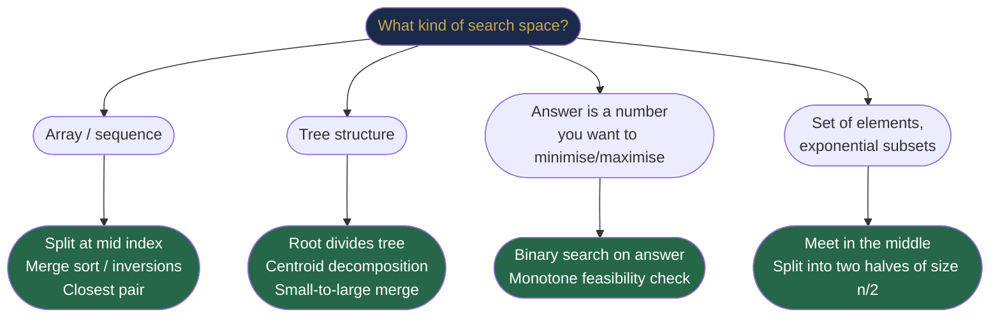
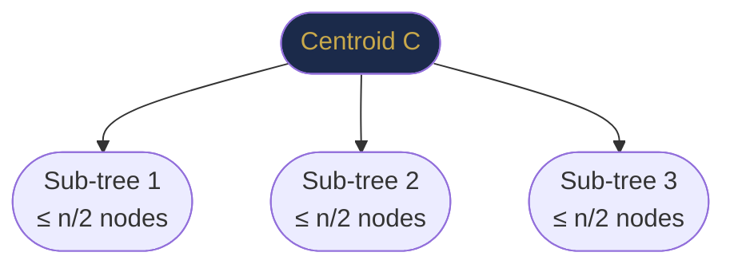
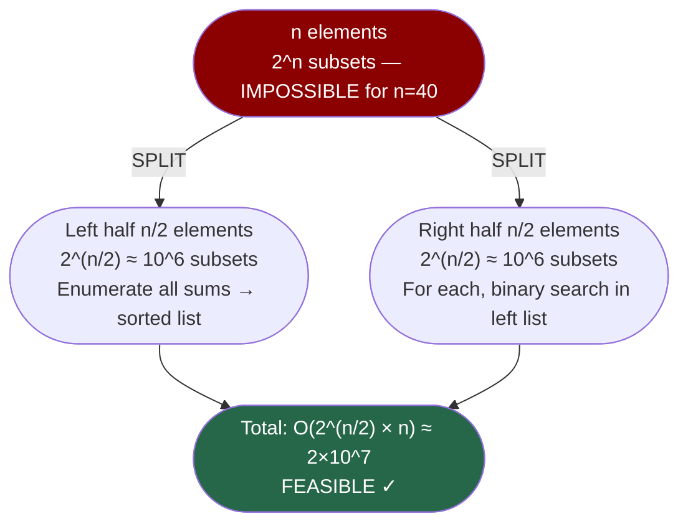

# Chapter 39 — Advanced Problem Decomposition

## Learning Objectives

By the end of this chapter, you will be able to:

- Apply binary search on the answer to problems with monotone feasibility functions
- Implement meet-in-the-middle to solve problems in O(2^(n/2)) instead of O(2^n)
- Use small-to-large merging (DSU on tree) to combine data structures efficiently
- Decompose complex problems by identifying the right subproblem boundary
- Recognise which decomposition strategy fits which problem structure

---

## Contents

- [39.1 Choosing Decomposition Boundaries](#391-choosing-decomposition-boundaries)
- [39.2 Binary Search on the Answer](#392-binary-search-on-the-answer)
- [39.3 Divide and Conquer on Arrays](#393-divide-and-conquer-on-arrays)
- [39.4 Divide and Conquer on Trees](#394-divide-and-conquer-on-trees)
- [39.5 Meet in the Middle](#395-meet-in-the-middle)
- [39.6 Small-to-Large Merging](#396-small-to-large-merging)
- [39.7 Combining Subproblem Results](#397-combining-subproblem-results)
- [Interview Insight](#interview-insight)
- [Quick Quiz](#quick-quiz)
- [39.8 Practice Problems](#398-practice-problems)
- [Chapter Summary](#chapter-summary)

---

> [!NOTE]
> **Historical Context**  
> Advanced decomposition techniques emerged not from a single discovery but from decades of competitive programming culture and theoretical computer science pushing at the boundary of what's solvable. **Binary search on the answer** became widely known through the International Olympiad in Informatics (IOI) problem sets in the 1990s and 2000s. **Meet in the middle** was described by **Daniel Shanks** in 1971 (Baby-step Giant-step for discrete logarithms) and independently discovered for knapsack problems by **Ellis Horowitz and Sartaj Sahni** (1974). **Small-to-large merging** appeared in competitive programming literature in the 2000s and was formalised as "DSU on tree" by competitive programmer **Ahmer Saeed** in a 2016 Codeforces blog. These techniques share a theme: **breaking exponential into polynomial by clever splitting of the search space**.

---

> ### 🔗 Analogy
> **Binary Search on the Answer — The Goldilocks Principle**
>
> Imagine you're pouring water into a pot to cook pasta. The pot needs to be "not too full, not too empty." You don't measure precisely — instead, you pour, check ("too full?"), adjust, and converge. If the pot can hold binary information ("still fits" / "overflows"), you've just done a binary search on a continuous quantity. This is binary search on the answer: instead of searching for a value in an array, you're searching for the smallest/largest parameter value that satisfies some condition. The condition must be **monotone** — once it's true, it stays true, so binary search can find the boundary.

---

## 39.1 Choosing Decomposition Boundaries

The hardest part of divide-and-conquer problems is **deciding how to split**. There is no universal recipe, but these patterns cover the vast majority:



**Decision framework:**
- If you're searching for a **position** in a sequence → array D&C or binary search
- If you're searching for an **optimal value** (min/max) where feasibility is monotone → binary search on the answer
- If the search space is exponential in $n$ → meet in the middle (halve the exponent)
- If merging data at a node with its children's data → small-to-large to bound total work

---

## 39.2 Binary Search on the Answer

**Core idea:** Instead of searching for a value in a sorted array, **search for the optimal answer parameter** in the space of possible answers, using a feasibility function as the comparator.

**When it applies:**
1. The answer is a number (integer or real) in some range $[lo, hi]$.
2. There is a **monotone feasibility function** $\text{feasible}(x)$: if $x$ satisfies the condition, so does every value smaller (or larger) than $x$.
3. You can check feasibility in polynomial time.

**Template:**
```java
int binarySearchOnAnswer(int lo, int hi) {
    while (lo < hi) {
        int mid = lo + (hi - lo) / 2;
        if (feasible(mid)) hi = mid;    // mid works; try smaller (find minimum)
        else               lo = mid + 1; // mid doesn't work; need larger
    }
    return lo;   // smallest value that is feasible
}
```

**Visual intuition:**
```
Answer space: [lo ................. hi]
              F F F F T T T T T T T T    (F=infeasible, T=feasible)
                      ↑
                 Find this boundary  →  binary search!
```

### Example 1 — Koko Eating Bananas (LeetCode 875)

**Problem:** Koko has $n$ piles of bananas. In $h$ hours, she must eat all bananas. Each hour she eats at speed $k$ bananas from one pile (can eat less if pile is smaller). Find the minimum $k$.

**Why binary search on the answer?**
- Answer range: $[1, \max(\text{piles})]$
- Feasibility: "can Koko eat all bananas in h hours at speed k?" → monotone: if $k$ works, $k+1$ also works.
- Feasibility check: $\sum \lceil \text{pile}_i / k \rceil \le h$. Time: O(n).

```java
int minEatingSpeed(int[] piles, int h) {
    int lo = 1, hi = Arrays.stream(piles).max().getAsInt();
    while (lo < hi) {
        int mid = lo + (hi - lo) / 2;
        if (canFinish(piles, h, mid)) hi = mid;   // mid works, try smaller
        else                          lo = mid + 1; // too slow
    }
    return lo;
}

boolean canFinish(int[] piles, int h, int speed) {
    int hours = 0;
    for (int pile : piles) hours += (pile + speed - 1) / speed; // ceiling division
    return hours <= h;
}
```

**Complexity:** O(n log(max_pile)) — log of the value range × O(n) feasibility check.

**[LeetCode 875 — Koko Eating Bananas](https://leetcode.com/problems/koko-eating-bananas/)**

### Example 2 — Split Array Largest Sum (LeetCode 410)

**Problem:** Split array into $k$ subarrays to minimise the maximum subarray sum.

**Why binary search on the answer?**
- Answer range: $[\max(\text{nums}), \sum(\text{nums})]$
- Feasibility: "can we split into at most k subarrays each with sum ≤ mid?" → monotone.

```java
int splitArray(int[] nums, int k) {
    int lo = Arrays.stream(nums).max().getAsInt();
    int hi = Arrays.stream(nums).sum();

    while (lo < hi) {
        int mid = lo + (hi - lo) / 2;
        if (canSplit(nums, k, mid)) hi = mid;
        else                        lo = mid + 1;
    }
    return lo;
}

boolean canSplit(int[] nums, int k, int maxSum) {
    int parts = 1, currentSum = 0;
    for (int num : nums) {
        if (currentSum + num > maxSum) {
            parts++;          // start a new subarray
            currentSum = num;
            if (parts > k) return false;
        } else {
            currentSum += num;
        }
    }
    return true;
}
```

**[LeetCode 410 — Split Array Largest Sum](https://leetcode.com/problems/split-array-largest-sum/)**

**Complexity:** O(n log(sum)) where sum = total array sum.

> [!TIP]
> **Did You Know? — Binary Search on the Answer is Everywhere**  
> This technique, once you see it, appears constantly: allocating bandwidth, scheduling jobs, designing physical systems (how thick should a wall be to withstand X load?). In competitive programming, the tell-tale sign is problems phrased as *"minimise the maximum"* or *"maximise the minimum"* — almost always a binary search on the answer, with a greedy or DP feasibility check. The template takes under 10 lines and reduces many otherwise intractable problems to O(n log n).

---

## 39.3 Divide and Conquer on Arrays

Beyond merge sort, D&C on arrays solves problems by **splitting at the midpoint and handling the cross-boundary case**.

### Pattern: Cross-Boundary Contributions

Many array problems have the structure: answer either lies entirely in [left, mid], entirely in [mid+1, right], or **crosses the midpoint**.

The cross-boundary case is computed using prefix/suffix structures built outward from the midpoint.

**Example — Maximum Sum Rectangle (2D):** Fix left and right column boundaries (O(n²) pairs). For each pair, reduce to 1D maximum subarray using Kadane's. Total: O(n³) → with D&C on rows: O(n² log n).

**Example — Count Inversions (merge sort extension):**
```java
long countInversions(int[] arr, int left, int right) {
    if (left >= right) return 0;
    int mid = left + (right - left) / 2;
    long count = countInversions(arr, left, mid)
               + countInversions(arr, mid+1, right);
    count += mergeCount(arr, left, mid, right);  // inversions crossing midpoint
    return count;
}

long mergeCount(int[] arr, int left, int mid, int right) {
    // During merge: if arr[i] > arr[j], then arr[i..mid] are ALL > arr[j]
    // → (mid - i + 1) inversions at once
    int[] temp = new int[right - left + 1];
    int i = left, j = mid+1, k = 0;
    long inv = 0;
    while (i <= mid && j <= right) {
        if (arr[i] <= arr[j]) {
            temp[k++] = arr[i++];
        } else {
            inv += (mid - i + 1);    // all remaining left elements are inversions with arr[j]
            temp[k++] = arr[j++];
        }
    }
    while (i <= mid)   temp[k++] = arr[i++];
    while (j <= right) temp[k++] = arr[j++];
    System.arraycopy(temp, 0, arr, left, temp.length);
    return inv;
}
```

**Complexity:** O(n log n) — same recurrence as merge sort; counting is free during the merge.

**[LeetCode 315 — Count of Smaller Numbers After Self](https://leetcode.com/problems/count-of-smaller-numbers-after-self/)** (generalisation)

---

## 39.4 Divide and Conquer on Trees

Trees have natural recursive structure — the root divides the tree into subtrees. Many tree problems can be solved with D&C where:
- **Base case:** leaf or null node
- **Divide:** recurse on left and right subtrees
- **Combine:** merge subtree results at the current node

### Example — Binary Tree Maximum Path Sum (LeetCode 124)

```java
int maxPathSum;

int maxPathSum(TreeNode root) {
    maxPathSum = Integer.MIN_VALUE;
    maxGain(root);
    return maxPathSum;
}

// Returns the maximum gain if we start from this node and go DOWN (one direction only)
int maxGain(TreeNode node) {
    if (node == null) return 0;
    int leftGain  = Math.max(maxGain(node.left),  0);  // ignore if negative
    int rightGain = Math.max(maxGain(node.right), 0);

    // The path THROUGH this node (can go both left and right, but not up)
    maxPathSum = Math.max(maxPathSum, node.val + leftGain + rightGain);

    // Return only one direction (the caller can only extend path in one direction)
    return node.val + Math.max(leftGain, rightGain);
}
```

**The key D&C insight:** The function `maxGain` solves the sub-problem "best gain starting from this node going downward." The combine step updates the global answer with the path going through the node (using both left and right gains), but returns only one direction to the parent.

**Complexity:** O(n) — each node visited once.

**[LeetCode 124 — Binary Tree Maximum Path Sum](https://leetcode.com/problems/binary-tree-maximum-path-sum/)**

### Centroid Decomposition (Advanced)

For tree D&C on paths, the **centroid** of a tree is the node whose removal splits the tree into components, each with at most n/2 nodes.

**Key property:** A centroid always exists. The recursion depth is O(log n), giving O(n log n) for many path queries.



**Algorithm:**
1. Find centroid of the current tree.
2. Count paths passing through the centroid.
3. Remove centroid and recurse on each sub-tree.

This solves "count paths with sum/length X" in O(n log² n).

---

## 39.5 Meet in the Middle

**Problem class:** Subset sum or similar problems over $n$ items where $n$ is too large for O(2^n) brute force but small enough that O(2^(n/2)) is feasible.

**Core idea:** Split the $n$ items into two halves of $n/2$ each. Enumerate **all 2^(n/2) subsets of each half separately**. Then combine the two half-enumerations to find the optimal combination.

**Complexity:** $O(2^{n/2} \cdot n)$ — going from O(2^n) to O(2^(n/2)) is an exponential speedup. For $n=40$: $2^{40} \approx 10^{12}$ (too slow) vs $2^{20} \approx 10^6$ (fast).

### Example — 4Sum II (LeetCode 454)

**Problem:** Given four arrays, count tuples $(a,b,c,d)$ such that $a+b+c+d=0$.

**Brute force:** O(n⁴). **D&C (meet in middle):** Split into two pairs:
- Enumerate all $n^2$ sums of (A[i]+B[j]) → store in a hash map.
- Enumerate all $n^2$ sums of (C[k]+D[l]) → for each, look up its negation in the map.

```java
int fourSumCount(int[] a, int[] b, int[] c, int[] d) {
    Map<Integer, Integer> sumAB = new HashMap<>();
    for (int x : a)
        for (int y : b)
            sumAB.merge(x + y, 1, Integer::sum);  // count all A+B sums

    int count = 0;
    for (int x : c)
        for (int y : d)
            count += sumAB.getOrDefault(-(x + y), 0); // find complementary sum
    return count;
}
```

**Complexity:** O(n²) time, O(n²) space. This is meet-in-the-middle: split 4 arrays into 2 groups of 2.

**[LeetCode 454 — 4Sum II](https://leetcode.com/problems/4sum-ii/)**

### Example — Subset Sum Split (the classic meet-in-middle)

**Problem:** Given $n$ integers, does any subset sum to exactly $T$? For $n=40$, brute force O(2^40) is impossible.

```java
boolean subsetSum(int[] nums, int target) {
    int n = nums.length, half = n / 2;

    // Enumerate all subsets of the left half
    List<Integer> leftSums = new ArrayList<>();
    for (int mask = 0; mask < (1 << half); mask++) {
        int sum = 0;
        for (int i = 0; i < half; i++)
            if ((mask >> i & 1) == 1) sum += nums[i];
        leftSums.add(sum);
    }

    // Sort left sums for binary search
    Collections.sort(leftSums);

    // Enumerate all subsets of the right half
    for (int mask = 0; mask < (1 << (n - half)); mask++) {
        int sum = 0;
        for (int i = 0; i < n - half; i++)
            if ((mask >> i & 1) == 1) sum += nums[half + i];
        // Binary search: does leftSums contain (target - sum)?
        int need = target - sum;
        int idx = Collections.binarySearch(leftSums, need);
        if (idx >= 0) return true;
    }
    return false;
}
```

**Complexity:** O(2^(n/2) · n) time, O(2^(n/2)) space.



> [!NOTE]
> **Did You Know? — Baby-Step Giant-Step**  
> Meet in the middle appeared in cryptography as the **Baby-Step Giant-Step** algorithm (Shanks, 1971), which breaks the discrete logarithm problem in O(√p) time. It's also the foundation of the **man-in-the-middle attack** on double encryption (DES + DES). If you encrypt a message twice with two independent 56-bit DES keys, brute-forcing requires 2^112 operations. But meet in the middle breaks it in 2^57 operations — the reason "double DES" was never adopted as a standard. The NSA was aware of this weakness and specified Triple-DES (encrypt-decrypt-encrypt with three keys) instead.

---

## 39.6 Small-to-Large Merging

**Problem class:** You have a tree where each node stores a set/map. After processing subtrees, you need to merge children's data into the parent. Naively, merging can be O(n) per node × n nodes = O(n²). Small-to-large brings it to **O(n log n)**.

**Core idea:** Always merge the **smaller set into the larger set** (never the other way). Each element moves from a smaller set to a larger set, so it can be moved at most O(log n) times (each merge at least doubles the set it's in).

**Why O(n log n)?** Each element can "switch sets" at most O(log n) times (each time, the set containing it at least doubles in size). With n total elements, total moves ≤ n log n.

```java
// Tree node has a set of values; merge all into root
Map<Integer, Set<Integer>> tree = new HashMap<>();
int[] setSize = new int[n + 1];

// At each node, merge smaller children's sets into the largest child's set
int largestChild = -1;
for (int child : tree.get(node)) {
    if (largestChild == -1 || setSize[child] > setSize[largestChild])
        largestChild = child;
}

// "Inherit" the largest child's set, merge others into it
Set<Integer> result = getSet(largestChild);
for (int child : tree.get(node)) {
    if (child == largestChild) continue;
    for (int val : getSet(child)) {
        result.add(val);              // move each element from small → large
    }
}
// result now contains all values from all children
```

**[LeetCode 2003 — Smallest Missing Genetic Value in Each Subtree](https://leetcode.com/problems/smallest-missing-genetic-value-in-each-subtree/)** (small-to-large on tree)

**General template complexity:**

| Merge strategy | Total work |
|----------------|-----------|
| Always merge into first child | O(n²) worst case |
| Small-to-large | O(n log n) guaranteed |

---

## 39.7 Combining Subproblem Results

The hardest part of D&C is often the **combine step** — taking solutions from two halves and producing the solution for the whole. Here are the patterns:

### Pattern 1 — Best of three regions
Maximum subarray, longest palindromic substring, and many 1D optimisation problems:
- Left answer
- Right answer
- Cross-boundary answer (computed separately using outward expansion)

### Pattern 2 — Sorted merge
Merge sort, merge-based inversion counting, and ordered statistics:
- Both halves produce a **sorted** result
- Merge in O(n) using two pointers

### Pattern 3 — Complement lookup
4Sum II, pair sum, meet-in-middle:
- One half produces a set/map of values
- The other half looks up **complements** in the first half's structure
- Hash map lookup makes this O(1) per query

### Pattern 4 — Recursive aggregation
Tree D&C (maximum path sum, LCA, diameter):
- Each subtree returns an **aggregate** (height, max gain, min/max, etc.)
- The parent combines the two aggregates to update the global answer
- Returns a potentially different aggregate to its own parent

```java
// Generalised tree D&C template
ReturnType solve(TreeNode node) {
    if (node == null) return baseCase();

    ReturnType leftResult  = solve(node.left);
    ReturnType rightResult = solve(node.right);

    // Update global answer using both left + right results
    updateGlobalAnswer(node, leftResult, rightResult);

    // Return aggregate to parent (may differ from global update)
    return combineForParent(node, leftResult, rightResult);
}
```

**[LeetCode 543 — Diameter of Binary Tree](https://leetcode.com/problems/diameter-of-binary-tree/)** — returns height, updates diameter  
**[LeetCode 110 — Balanced Binary Tree](https://leetcode.com/problems/balanced-binary-tree/)** — returns height (-1 if unbalanced), detects imbalance

---

## Interview Insight

> **D&C on trees is the single most common advanced problem type in FAANG interviews.** Problems like Maximum Path Sum, Diameter, Lowest Common Ancestor, and Serialize/Deserialize all use the same template: recurse to base, combine left/right results, return aggregate to parent. Master one, and you'll recognise the others instantly.

**Red flags that suggest a decomposition technique:**
- "Minimise the maximum" / "Maximise the minimum" → **binary search on answer**
- "Count pairs/triples with property X" over large n → **meet in middle** or **D&C with cross-boundary counting**
- "Every path through a tree" or "every node's subtree data" → **tree D&C** or **small-to-large**
- n ≤ 40 and O(2^n) is too slow → **meet in middle** (target O(2^20))

---

## Quick Quiz

<details>
<summary>Q1: What property must the feasibility function have for binary search on the answer to work?</summary>

**Answer:** It must be **monotone**: once the condition is true (or false), it stays that way as the parameter increases. Formally: if `feasible(x)` is true, then `feasible(x+1)` is also true (for "find minimum feasible"). This guarantees there is a clean boundary where the answer transitions from infeasible to feasible, and binary search can find that boundary efficiently.

</details>

<details>
<summary>Q2: For n=40 elements, why does meet-in-the-middle give O(2^20) instead of O(2^40)?</summary>

**Answer:** Instead of enumerating all 2^40 subsets, we split into two halves of 20. Each half has 2^20 ≈ 10^6 subsets — fast to enumerate. We then combine by sorting one half's sums and binary-searching from the other half — O(2^20 · log(2^20)) = O(2^20 · 20). Total: about 20 million operations vs 1 trillion. The key insight: **the complement relationship allows combining two half-enumerations** without needing to enumerate all full subsets.

</details>

<details>
<summary>Q3: Why is small-to-large merging O(n log n) and not O(n²)?</summary>

**Answer:** When we always merge the smaller set into the larger, every element that gets moved ends up in a set at least twice as large as before. Since a set can double in size at most log n times before it reaches size n, each element is moved at most O(log n) times. With n total elements, total moves = n × O(log n) = O(n log n).

</details>

<details>
<summary>Q4: In "Split Array Largest Sum" (LC 410), what are the lo and hi bounds for binary search, and why?</summary>

**Answer:** `lo = max(nums)` — the minimum possible answer (even with k=n groups, each containing one element, the maximum sum is the largest element; we can never do better). `hi = sum(nums)` — the maximum possible answer (if k=1, the single group contains everything). The feasibility check "can we split into at most k subarrays each with sum ≤ mid?" is monotone in `mid`.

</details>

<details>
<summary>Q5: The maxPathSum problem (LC 124) uses the tree D&C template. Why does maxGain return only one direction but update the global answer with both directions?</summary>

**Answer:** A path through a tree node can extend downward in BOTH left and right subtrees, but once a path goes left AND right at some node, it cannot extend upward (a "path" must be a simple chain — no branching). So when we update the global answer at the current node, we consider the path that bends: `node.val + leftGain + rightGain`. But when we return to the parent, the parent can only extend our path in ONE direction (from either our left or right), so we return `node.val + max(leftGain, rightGain)`.

</details>

---

## 39.8 Practice Problems

### Easy

| Problem | Concept | Link |
|---------|---------|------|
| Diameter of Binary Tree | Tree D&C | [LC 543](https://leetcode.com/problems/diameter-of-binary-tree/) |
| Balanced Binary Tree | Tree D&C | [LC 110](https://leetcode.com/problems/balanced-binary-tree/) |
| 4Sum II | Meet in middle / hash | [LC 454](https://leetcode.com/problems/4sum-ii/) |

### Medium

| Problem | Concept | Link |
|---------|---------|------|
| Koko Eating Bananas | Binary search on answer | [LC 875](https://leetcode.com/problems/koko-eating-bananas/) |
| Capacity to Ship Packages | Binary search on answer | [LC 1011](https://leetcode.com/problems/capacity-to-ship-packages-within-d-days/) |
| Find Peak Element | D&C binary search | [LC 162](https://leetcode.com/problems/find-peak-element/) |
| Binary Tree Maximum Path Sum | Tree D&C | [LC 124](https://leetcode.com/problems/binary-tree-maximum-path-sum/) |
| Path Sum III | Tree D&C + prefix sum | [LC 437](https://leetcode.com/problems/path-sum-iii/) |
| Find the Duplicate Number | Binary search D&C | [LC 287](https://leetcode.com/problems/find-the-duplicate-number/) |
| Minimum Speed to Arrive on Time | Binary search on answer | [LC 1870](https://leetcode.com/problems/minimum-speed-to-arrive-on-time/) |

### Hard

| Problem | Concept | Link |
|---------|---------|------|
| Split Array Largest Sum | Binary search on answer | [LC 410](https://leetcode.com/problems/split-array-largest-sum/) |
| Partition Array for Maximum Sum | D&C on arrays | [LC 1043](https://leetcode.com/problems/partition-array-for-maximum-sum/) |
| Smallest Missing Genetic Value | Small-to-large | [LC 2003](https://leetcode.com/problems/smallest-missing-genetic-value-in-each-subtree/) |
| Maximum Sum of 3 Non-Overlapping Subarrays | D&C + DP | [LC 689](https://leetcode.com/problems/maximum-sum-of-3-non-overlapping-subarrays/) |
| Minimize Max Distance to Gas Station | Binary search on answer | [LC 774](https://leetcode.com/problems/minimize-max-distance-to-gas-station/) |

---

## Chapter Summary

```mermaid
mindmap
  root((Advanced\nDecomposition))
    Binary Search on Answer
      Monotone feasibility
      lo=min hi=max answer
      O(n log range)
      Koko Bananas
      Split Array
    D&C on Arrays
      Split at midpoint
      Handle cross-boundary
      Count Inversions O(n log n)
    D&C on Trees
      Root divides subtrees
      Return aggregate upward
      Update global at each node
      Max Path Sum
      Diameter
      Centroid Decomposition
    Meet in the Middle
      Split n items into n/2 halves
      Enumerate 2^(n/2) each
      Combine with binary search
      Subset Sum for n=40
      4Sum II
    Small-to-Large Merging
      Always merge smaller into larger
      Each element moves O(log n) times
      Total O(n log n)
```

**Key Takeaways:**
- **Binary search on the answer** = binary search, but on the *answer parameter*, not an array index. Works whenever feasibility is monotone. Reduces many min/max optimisation problems to O(n log n).
- **Meet in the middle** = split an exponential search into two halves, each enumerable. Turns O(2^n) → O(2^(n/2) · n). Critical for n ≤ 40.
- **Small-to-large** = always merge the smaller structure into the larger. Guarantees O(n log n) total work, O(n²) naively.
- **Tree D&C** = return an aggregate upward, update a global answer at each node. The pattern is universal: diameter, path sum, LCA, balanced tree check.
- **Choosing the right decomposition boundary** is the meta-skill. Recognise whether you're decomposing by index (array D&C), by value (binary search on answer), or by set (meet in middle).
