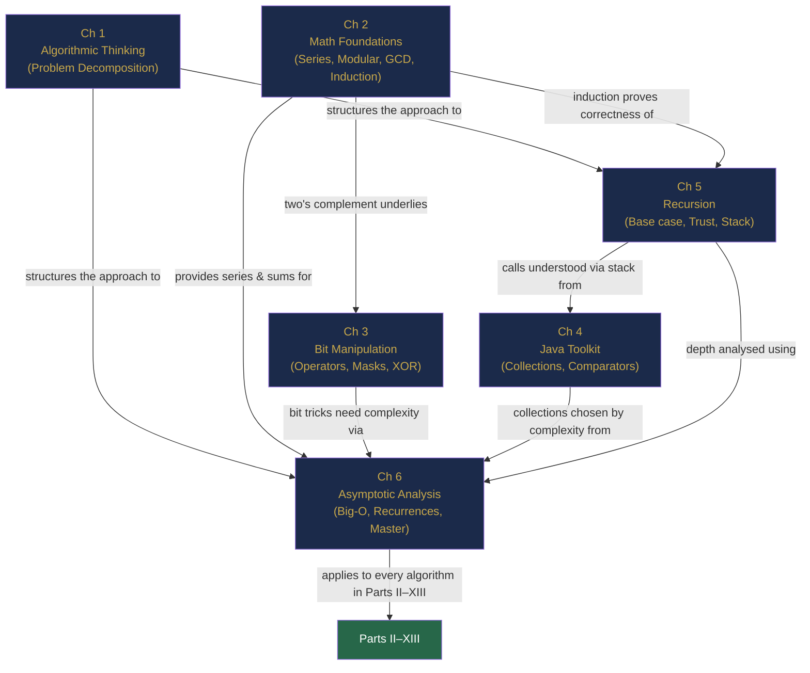

# Part I Review — The Foundations, Revisited

> **End of Part I: Foundations of Algorithmic Thinking**  
> Chapters 1–6 · [← Chapter 6](chapter-06-asymptotic-analysis.md) · [Index](../INDEX.md) · [→ Chapter 7: Part II](chapter-07-arrays.md)

---

> *"Give me six hours to chop down a tree and I will spend the first four sharpening the axe."*  
> — Abraham Lincoln (attributed)

Part I was the axe-sharpening. Everything in this book — every sorting algorithm, graph traversal, dynamic programming recurrence, and data structure — rests on the six ideas you have just studied. Before moving into Part II, this interlude consolidates, connects, and stress-tests that foundation.

---

## Contents

- [The Story: One Long Day at TechCorp](#the-story-one-long-day-at-techcorp)
- [The Concept Map: How the Six Chapters Connect](#the-concept-map-how-the-six-chapters-connect)
- [The Six Principles](#the-six-principles)
- [Cross-Chapter Challenges](#cross-chapter-challenges)
- [Part I Lightning Quiz](#part-i-lightning-quiz)
- [The Grand Integration Problem](#the-grand-integration-problem)
- [Looking Ahead: What Part II Builds On](#looking-ahead-what-part-ii-builds-on)

---

## The Story: One Long Day at TechCorp

*The following is a short piece of technical fiction. Every concept invoked is real and was covered in Chapters 1–6.*

---

Mia arrived at TechCorp at 8:47 a.m. on the worst Monday of the quarter. The company's recommendation engine had been silently corrupting user preferences since Friday, and nobody could explain why.

**8:48 a.m. — Algorithmic Thinking (Chapter 1)**

She resisted the urge to open the logs immediately. First, she broke the problem down.

*What do I actually know?* Corrupted preferences. *What do I want?* The root cause, not the symptom. *What is the structure of the problem?* The engine reads user IDs, looks up preferences, scores items, and writes recommendations. Any one of those four steps could be the culprit.

She drew a box around each step on her whiteboard. This was not wasted time. Within three minutes she had reduced a terrifying monolith of a system into four specific, testable sub-problems. The chaos became a checklist.

---

**9:15 a.m. — Mathematical Foundations (Chapter 2)**

The preference scores were computed modulo a hash. She pulled the formula:

```
score = (userId × itemId × 31 + timestamp) % TABLE_SIZE
```

`TABLE_SIZE` was 1024. Something prickled at the back of her mind. She checked: $\gcd(31, 1024)$? Since $1024 = 2^{10}$ and $31$ is prime and odd, $\gcd(31, 1024) = 1$ — good, no aliasing there. But `timestamp`? The timestamps were Unix milliseconds, and a recent library upgrade had started truncating them to 32-bit integers before the modulo. At $2^{31} - 1$ milliseconds from epoch, they were wrapping around and colliding.

The overflow bug — the silent killer from Section 1.5 — had been lurking in a dependency for months.

---

**10:02 a.m. — Bit Manipulation (Chapter 3)**

The timestamps were stored as packed 64-bit records: `[32-bit userId | 32-bit timestamp]`. The corrupted records all had a suspicious pattern: the timestamp field's MSB was always set.

```java
long record = ...;
long timestamp = record & 0xFFFFFFFFL;   // extract lower 32 bits, unsigned
boolean msb = (record & (1L << 31)) != 0;
```

She wrote a one-liner that filtered every corrupted record in a single pass. Twelve million records, flagged in 1.3 seconds. No `for` loop, no `String.split`. Just masks and shifts.

---

**11:30 a.m. — Java Toolkit (Chapter 4)**

Now she had twelve million flagged records and needed to identify which user IDs were affected. She could not afford $O(n^2)$.

```java
Map<Long, Long> corruptionCount = new HashMap<>();
for (long record : flaggedRecords) {
    long userId = record >>> 32;
    corruptionCount.merge(userId, 1L, Long::sum);
}
// Find the five most-affected users
PriorityQueue<Map.Entry<Long, Long>> top5 = new PriorityQueue<>(
    Map.Entry.comparingByValue()
);
for (var entry : corruptionCount.entrySet()) {
    top5.offer(entry);
    if (top5.size() > 5) top5.poll();
}
```

A `HashMap` for O(1) counting, a `PriorityQueue` min-heap of size 5 for the top-k query. She had seen junior engineers write a sort here — $O(n \log n)$ when $O(n)$ was available. She did not make that mistake.

---

**1:45 p.m. — Recursion (Chapter 5)**

The affected users had nested preference groups: each group could contain sub-groups, which could contain further sub-groups, three levels deep. She needed to flatten the entire tree into a list. A recursive structure demands a recursive solution.

```java
List<Long> flattenPreferences(PreferenceNode root) {
    if (root == null) return List.of();              // base case
    List<Long> result = new ArrayList<>(root.items); // current level
    for (PreferenceNode child : root.children) {
        result.addAll(flattenPreferences(child));    // recursive case
    }
    return result;
}
```

Three levels deep at most: stack overflow was not a risk. She wrote the helper method, trusted the recursion, and moved on.

---

**3:20 p.m. — Asymptotic Analysis (Chapter 6)**

Her manager dropped by. "How long will the full data repair take?" Mia had already estimated it mentally.

The repair pipeline had three stages:
1. Flag corrupted records: $O(n)$, one pass.
2. Group by user: $O(n)$ with the `HashMap`.
3. Recompute preferences for $k$ affected users, each with an average of $m$ items: $O(k \cdot m \log m)$ (sort + score).

With $n = 10^8$ records, $k = 1{,}200$ users, and $m \approx 500$ items:

$$O(10^8) + O(10^8) + O(1200 \times 500 \times \log 500) \approx 2 \times 10^8 + 5.4 \times 10^6 \approx O(10^8)$$

"About 20 minutes on the production cluster," she said. She was right within four minutes.

---

**4:47 p.m. — The Fix Ships**

The root cause was a 32-bit truncation. The fix was three lines. The analysis — the systematic breakdown, the mathematical verification, the bitwise diagnosis, the right data structures, the recursive flattening, the complexity estimate — took a full working day and prevented a rollback that would have cost the company two weeks.

The six chapters were not theory. They were the job.

---

## The Concept Map: How the Six Chapters Connect



No chapter in Part I stands alone. The geometric series from Chapter 2 appears in Chapter 6's amortised analysis. Two's complement from Chapter 2 is the reason Chapter 3's `~n + 1 == -n` works. Mathematical induction from Chapter 2 is the proof engine behind every recursive correctness argument in Chapter 5. Chapter 4's collection choices are meaningless without Chapter 6's complexity vocabulary to compare them.

---

## The Six Principles

Each chapter can be distilled into a single guiding principle. These are worth memorising.

| Chapter | Title | The Principle |
|---------|-------|---------------|
| 1 | Algorithmic Thinking | **Understand before you code.** Break every problem into: What do I know? What do I want? What is the structure? |
| 2 | Mathematical Foundations | **Integers have limits; patterns have formulas.** Know the arithmetic and geometric series, the modular arithmetic rules, and that induction = recursion. |
| 3 | Bit Manipulation | **Every pattern has a name. Name it.** `n & (n-1)` clears the lowest bit. `n & -n` isolates it. `a ^ a = 0`. Encapsulate and trust. |
| 4 | Java Toolkit | **The wrong data structure costs you an order of magnitude.** O(1) lookup → `HashMap`. Sorted order → `TreeMap`. Min/max → `PriorityQueue`. Stack/queue → `ArrayDeque`. |
| 5 | Recursion | **Prove the base case. Trust the recursive case.** You do not need to trace the entire call tree — that is what induction is for. |
| 6 | Asymptotic Analysis | **Complexity is a conversation, not a calculation.** Know the feasibility table. Write the recurrence. Apply the Master Theorem. State the stack cost. |

*Table R.1: The six principles of Part I.*

---

## Cross-Chapter Challenges

Each challenge below requires knowledge from at least two Part I chapters. Work through them before reading the solutions.

---

### CC-1 — Math Meets Bits (Chapters 2 & 3)

**Problem:** Without using the `%` operator or division, determine whether a non-negative integer `n` is divisible by $2^k$ for a given $k \geq 0$.

**Hint:** Think about what the last $k$ bits of a multiple of $2^k$ must look like. Then construct the right mask.

<details>
<summary><strong>Solution</strong></summary>

> A multiple of $2^k$ has its last $k$ bits all zero. The mask for the last $k$ bits is `(1 << k) - 1`.
>
> ```java
> boolean divisibleByPowerOfTwo(int n, int k) {
>     return (n & ((1 << k) - 1)) == 0;
> }
> ```
>
> **Why it works (Chapter 2):** In binary, $2^k$ is `1` followed by $k$ zeros. Any multiple of $2^k$ is of the form $m \cdot 2^k$, so its last $k$ bits are always $0$.
>
> **The connection:** Chapter 2 gave us the structure of powers of two; Chapter 3 gave us the masking tool. Neither is sufficient alone.

</details>

---

### CC-2 — Recursion Meets Complexity (Chapters 5 & 6)

**Problem:** A colleague claims this function runs in $O(n)$ time. Is the claim correct? If not, find the actual complexity and fix the function so it truly runs in $O(n)$.

```java
int f(int n) {
    if (n <= 1) return n;
    return f(n / 2) + f(n / 2) + n;
}
```

<details>
<summary><strong>Solution</strong></summary>

> **The claim is wrong.**
>
> The function makes **two** recursive calls on `n/2` each time. The recurrence is:
>
> $$T(n) = 2T(n/2) + n$$
>
> By the Master Theorem (Chapter 6): $a=2, b=2$, so $k = \log_2 2 = 1$. We have $f(n) = n = \Theta(n^k)$ → **Case 2** → $T(n) = \Theta(n \log n)$.
>
> The function is $O(n \log n)$, not $O(n)$.
>
> **Fix:** Call `f(n/2)` once, store the result, then use it twice:
>
> ```java
> int f(int n) {
>     if (n <= 1) return n;
>     int half = f(n / 2);   // single recursive call
>     return half + half + n; // reuse result — now T(n) = T(n/2) + O(n) → O(n)
> }
> ```
>
> New recurrence: $T(n) = T(n/2) + n$ → Case 3 of Master Theorem (since $f(n) = n = \Omega(n^{0+1})$) → $T(n) = \Theta(n)$. ✓

</details>

---

### CC-3 — Algorithmic Thinking Meets Java Toolkit (Chapters 1 & 4)

**Problem:** Given an integer array `nums`, return all unique pairs `[a, b]` such that `a + b == 0`. Each pair should appear once, with the smaller number first.

Design the approach (Chapter 1), choose the right data structure (Chapter 4), state the complexity (Chapter 6).

<details>
<summary><strong>Solution</strong></summary>

> **Algorithmic Thinking (Ch 1):** What do I know? An array of integers. What do I want? Pairs that sum to zero. Structure? For each element `a`, I need to know if `-a` is also in the array — this is a lookup problem. Use a set for O(1) lookup.
>
> **Java Toolkit (Ch 4):** `HashSet<Integer>` for O(1) contains. A second `TreeSet<List<Integer>>` to avoid duplicate pairs (or sort + deduplicate).
>
> ```java
> List<List<Integer>> zeroPairs(int[] nums) {
>     Set<Integer> seen = new HashSet<>();
>     Set<List<Integer>> resultSet = new TreeSet<>(
>         Comparator.comparingInt((List<Integer> l) -> l.get(0))
>                   .thenComparingInt(l -> l.get(1))
>     );
>     for (int x : nums) {
>         if (seen.contains(-x)) {
>             int lo = Math.min(x, -x), hi = Math.max(x, -x);
>             resultSet.add(List.of(lo, hi));
>         }
>         seen.add(x);
>     }
>     return new ArrayList<>(resultSet);
> }
> ```
>
> **Complexity:** O(n) time (single pass, O(1) operations per element), O(n) space for the set.  
> Naïve nested-loop solution: $O(n^2)$. The HashMap makes this problem linear.

</details>

---

### CC-4 — Bits Meets Recursion (Chapters 3 & 5)

**Problem:** Write a **recursive** function that counts the number of set bits in a non-negative integer `n` using the `n & (n-1)` trick. Then write its recurrence relation and state the complexity.

<details>
<summary><strong>Solution</strong></summary>

> ```java
> int countBits(int n) {
>     if (n == 0) return 0;          // base: no bits left
>     return 1 + countBits(n & (n - 1));  // clear lowest set bit, count it
> }
> ```
>
> **Recurrence:** Let $k$ be the number of set bits. Each call removes exactly one set bit:
>
> $$T(k) = T(k-1) + O(1), \quad T(0) = O(1)$$
>
> This unfolds to $T(k) = O(k)$.
>
> **Complexity:** $O(k)$ where $k$ = popcount of `n`. For a 32-bit integer, $k \leq 32$, so this is effectively $O(1)$ — but the recursion has depth $k$, so stack space is also $O(k)$.
>
> **Connection:** Chapter 3 gave us the `n & (n-1)` insight. Chapter 5 gave us the recursive structure and trust that the sub-problem ("count bits in a number with one fewer set bit") is correct by induction.

</details>

---

### CC-5 — Math Meets Complexity (Chapters 2 & 6)

**Problem:** The Sieve of Eratosthenes marks composites for each prime $p \leq \sqrt{n}$ by stepping through multiples: $p, 2p, 3p, \ldots$ The number of marking operations is:

$$\frac{n}{2} + \frac{n}{3} + \frac{n}{5} + \frac{n}{7} + \cdots = n \sum_{\text{prime } p \leq n} \frac{1}{p}$$

Using the fact that $\sum_{\text{prime } p \leq n} \frac{1}{p} \approx \ln(\ln n)$ (a result from analytic number theory), show that the Sieve runs in $O(n \log \log n)$.

<details>
<summary><strong>Solution</strong></summary>

> Total operations:
>
> $$n \cdot \sum_{\text{prime } p \leq n} \frac{1}{p} \approx n \cdot \ln(\ln n)$$
>
> Since $\ln(\ln n) = O(\log \log n)$ (logarithm base doesn't matter — Section 6.3), the total work is:
>
> $$O(n \log \log n)$$
>
> **Concretely:** for $n = 10^8$, $\log \log n \approx \log(8 \log 10) \approx \log(26) \approx 4.7$. The sieve performs roughly $4.7 \times 10^8$ operations — feasible in a few seconds.
>
> **Connection:** Chapter 2 established the harmonic series ($\sum 1/k \approx \ln n$). Chapter 6 gave us the tool to convert the sum into a Big-O complexity. The result is a surprisingly efficient algorithm that most people would naïvely estimate as $O(n\sqrt{n})$.

</details>

---

## Part I Lightning Quiz

Ten questions. No hints. Time yourself — aim for under 10 minutes total.

---

**LQ-1.** Evaluate `7 ^ 7` in Java. What is the result, and which property of XOR explains it?

<details>
<summary><strong>Answer</strong></summary>

> `0`. XOR self-cancellation: $a \oplus a = 0$ for any $a$.

</details>

---

**LQ-2.** An algorithm has time complexity $O(n^2)$ and $n = 10^5$. Roughly how many seconds will it take at $10^8$ operations/second?

<details>
<summary><strong>Answer</strong></summary>

> $(10^5)^2 / 10^8 = 10^{10} / 10^8 = 100$ seconds. Far too slow.

</details>

---

**LQ-3.** In Java, `Integer a = 128; Integer b = 128;`. What does `a == b` return, and why?

<details>
<summary><strong>Answer</strong></summary>

> `false`. Values outside the cache range $[-128, 127]$ create new `Integer` objects. `==` compares references, not values. Always use `.equals()`.

</details>

---

**LQ-4.** What recurrence does binary search satisfy? What is the solution?

<details>
<summary><strong>Answer</strong></summary>

> $T(n) = T(n/2) + O(1)$. Solution: $O(\log n)$.

</details>

---

**LQ-5.** What is `~0` in Java? Give the exact decimal value and explain using two's complement.

<details>
<summary><strong>Answer</strong></summary>

> `-1`. NOT flips all 32 bits of `0` (all zeros → all ones). In two's complement, all ones = $-1$ (from Chapter 2: flip bits and add 1 gives $0+1=1$; negate → $-1$). Alternatively, `~n == -(n+1)`, so `~0 == -1`.

</details>

---

**LQ-6.** You need to process a stream of integers and always retrieve the current maximum in $O(1)$. Which Java collection do you use, and what is the `poll()` complexity?

<details>
<summary><strong>Answer</strong></summary>

> `PriorityQueue` with `Collections.reverseOrder()` (max-heap). `peek()` is $O(1)$; `poll()` is $O(\log n)$. For $O(1)$ `poll()` you would need a specialised structure (e.g., Fibonacci heap — Chapter 55).

</details>

---

**LQ-7.** What is wrong with this comparator: `(a, b) -> a - b`?

<details>
<summary><strong>Answer</strong></summary>

> Integer overflow: if `a = Integer.MAX_VALUE` and `b = -1`, `a - b` overflows to a large negative number, reversing the comparison result. Use `Integer.compare(a, b)` instead.

</details>

---

**LQ-8.** A recursive function has depth $n$ and each frame uses $O(1)$ space. What is the total stack space?

<details>
<summary><strong>Answer</strong></summary>

> $O(n)$. Stack space = depth × space per frame = $n \times O(1) = O(n)$.

</details>

---

**LQ-9.** The Tower of Hanoi with $n = 20$ discs requires how many moves?

<details>
<summary><strong>Answer</strong></summary>

> $2^{20} - 1 = 1{,}048{,}575$ moves. Formula from Chapter 5: $2^n - 1$.

</details>

---

**LQ-10.** A number `n` satisfies `(n & (n - 1)) == 0` and `n > 0`. What is true about `n`?

<details>
<summary><strong>Answer</strong></summary>

> `n` is a power of two. `n & (n-1)` clears the lowest set bit; if the result is 0, `n` had exactly one set bit — which is the definition of a power of 2.

</details>

---

## The Grand Integration Problem

> *This problem intentionally requires all six chapters. Work through each part in order.*

---

You are given an integer array `nums` where every element appears **exactly three times** except for one element, which appears **exactly once**. Find that single element.

**Constraints:** $1 \leq n \leq 3 \times 10^4$, values fit in a 32-bit signed integer.  
**Required:** $O(n)$ time, $O(1)$ extra space.

---

**Part A — Algorithmic Thinking (Chapter 1)**

> Before writing any code: state what you know, what you want, and what the structural insight is. Why does the XOR trick from Chapter 3 (which works for "appears twice") fail here?

<details>
<summary><strong>Answer A</strong></summary>

> **Know:** An array where all but one element appear three times.  
> **Want:** The unique element.  
> **Structure:** We need a counting mechanism that "resets" at three, not two.  
>
> XOR fails because $a \oplus a = 0$ (resets at two), but $a \oplus a \oplus a = a$ (three XORs restore the original). We need a bit-level accumulator that counts modulo 3.

</details>

---

**Part B — Mathematical Foundations (Chapter 2)**

> For each of the 32 bit positions, what does the count of 1-bits modulo 3 tell you? Why does summing modulo 3 work here?

<details>
<summary><strong>Answer B</strong></summary>

> For bit position $k$: each element that appears three times contributes $3 \times (\text{bit}_k)$ to the total count at position $k$. Since $3 \equiv 0 \pmod{3}$, the three-times elements contribute 0 to the total modulo 3. Only the unique element's bit at position $k$ remains. So `(total count at bit k) % 3` gives the $k$-th bit of the unique element.

</details>

---

**Part C — Bit Manipulation + Java Toolkit (Chapters 3 & 4)**

> Implement the solution. For each of the 32 bit positions, count how many numbers have that bit set, take that count mod 3, and use it to reconstruct the answer. Then show the cleaner "two-variable" approach using bitwise state machines.

<details>
<summary><strong>Solution C</strong></summary>

> **Approach 1 — Count per bit (clear but O(32n) = O(n)):**
>
> ```java
> public int singleNumber(int[] nums) {
>     int result = 0;
>     for (int bit = 0; bit < 32; bit++) {
>         int bitSum = 0;
>         for (int x : nums) bitSum += (x >> bit) & 1;
>         result |= ((bitSum % 3) << bit);
>     }
>     return result;
> }
> ```
>
> **Approach 2 — Two-variable state machine (elegant O(n)):**
>
> Maintain two integers `ones` and `twos` as "bit-level mod-3 counters":
> - `ones` holds bits seen an odd number of times (mod 3 = 1).
> - `twos` holds bits seen a number of times ≡ 2 (mod 3).
> - When a bit's count reaches 3, it clears from both.
>
> ```java
> public int singleNumber(int[] nums) {
>     int ones = 0, twos = 0;
>     for (int x : nums) {
>         ones = (ones ^ x) & ~twos;   // add to 'ones', clear bits already in 'twos'
>         twos = (twos ^ x) & ~ones;   // add to 'twos', clear bits already in 'ones'
>     }
>     return ones;  // unique element has each bit counted once
> }
> ```

</details>

---

**Part D — Recursion + Asymptotic Analysis (Chapters 5 & 6)**

> (i) Could you solve this recursively? Sketch a divide-and-conquer approach and write its recurrence.  
> (ii) Compare the complexity of Approaches 1 and 2 from Part C. Which is preferable and why?

<details>
<summary><strong>Answer D</strong></summary>

> **(i) Divide-and-conquer:**  
> Split the array in half. Recursively find the candidate in each half (the half with an element count not divisible by 3 must contain the unique element). Recurrence: $T(n) = T(n/2) + O(n)$ (the O(n) is for counting elements). By Master Theorem: $a=1, b=2, k=\log_2 1=0$. $f(n)=n=\Omega(n^{0+1})$ → Case 3 → $T(n) = \Theta(n)$. Same time complexity but $O(\log n)$ stack space.
>
> **(ii) Comparison:**
>
> | | Approach 1 | Approach 2 |
> |--|-----------|-----------|
> | Time | $O(32n) = O(n)$ | $O(n)$ |
> | Space | $O(1)$ | $O(1)$ |
> | Constant factor | 32 iterations of inner work | 1 pass |
> | Readability | High | Medium (requires understanding state machine) |
>
> Both are $O(n)$ time and $O(1)$ space. Approach 2 is faster by a constant factor of 32 and is the standard interview answer. This is a case where Big-O is the same but the constant factor matters in practice.

</details>

---

**Score yourself:**
- Part A: Did you articulate why XOR fails? (+1)
- Part B: Did you use modular arithmetic correctly? (+1)
- Part C: Did you implement either approach correctly? (+1 for Approach 1, +2 for Approach 2)
- Part D: Did you write a correct recurrence and apply the Master Theorem? (+1 each)

Maximum: 6 points.

---

## Looking Ahead: What Part II Builds On

Part II begins with arrays — the most fundamental data structure in computing. Here is how each Part I chapter continues to live inside the array chapters:

| Part I Chapter | How it appears in Part II (Chapters 7–12) |
|----------------|------------------------------------------|
| **Ch 1 — Algorithmic Thinking** | Every array problem starts with: What do I know? What do I want? What patterns apply? (Two pointers? Sliding window? Prefix sum?) |
| **Ch 2 — Math Foundations** | Prefix sums use the additive structure of integers. Sliding window size uses modular indexing for circular arrays. |
| **Ch 3 — Bit Manipulation** | Used in Chapter 11 (prefix XOR for subarray XOR queries) and throughout binary representation of indices. |
| **Ch 4 — Java Toolkit** | `int[]` vs `ArrayList`, `HashMap` for frequency counting, `ArrayDeque` for the monotonic stack/deque pattern. |
| **Ch 5 — Recursion** | Divide-and-conquer on arrays (merge sort, quick sort, quick select) are fundamentally recursive. |
| **Ch 6 — Asymptotic Analysis** | Every solution you write in Part II must be justified with a complexity claim — time and space. |

*Table R.2: Part I concepts in Part II.*

---

> ### 🧭 Navigation
> You have completed **Part I — Foundations of Algorithmic Thinking**.  
> Six chapters. Six principles. One interconnected foundation.
>
> Every future chapter in this book is built on what you have just consolidated.  
> When you encounter an unfamiliar algorithm and feel lost, return here.  
> The principles do not change. Only the problems do.

---

> **Part I — Complete**  
> [← Chapter 6](chapter-06-asymptotic-analysis.md) · [← Index](../INDEX.md) · [→ Chapter 7: Part II](../INDEX.md#-chapter-7--arrays-foundations-and-memory-model)
