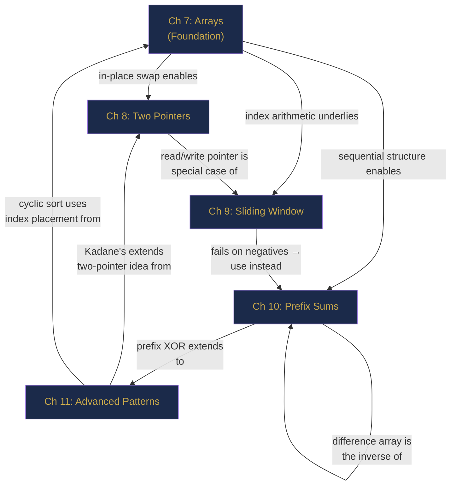

# Part II Review — The Array Toolkit, Consolidated

> **End of Part II: Arrays and Array Patterns**  
> Chapters 7–11 · [← Chapter 11](chapter-11-advanced-array-patterns.md) · [Index](../INDEX.md) · [→ Chapter 12: Part III](chapter-12-string-fundamentals.md)

---

> *"The art of programming is the art of organising complexity."*  
> — Edsger W. Dijkstra

Five chapters. Five pattern families. One principle: **arrays are only as powerful as the technique you bring to them.** A raw array is just memory. A skilled engineer sees the same raw memory as a sliding window, a prefix sum table, a partitioned region, a Kadane accumulator, or a cyclic sort target — and chooses correctly.

This interlude consolidates, connects, and stress-tests that skill.

---

## Contents

- [The Story: The Data Pipeline Incident](#the-story-the-data-pipeline-incident)
- [The Pattern Map](#the-pattern-map)
- [The Five Patterns](#the-five-patterns)
- [Cross-Chapter Challenges](#cross-chapter-challenges)
- [Part II Lightning Quiz](#part-ii-lightning-quiz)
- [The Grand Integration Problem](#the-grand-integration-problem)
- [Looking Ahead: What Part III Builds On](#looking-ahead-what-part-iii-builds-on)

---

## The Story: The Data Pipeline Incident

*Technical fiction. Every technique invoked is from Chapters 7–11.*

---

It was 11:04 p.m. when Ravi's monitoring alert fired: the production metrics pipeline was generating corrupted aggregates. By 11:08 he was at his laptop with the raw event log in hand — a flat `long[]` of 180,000 timestamped integers.

**Ch 7 — Arrays:** He began by inspecting the buffer directly. The data was a contiguous `long[]` dumped from a ring buffer. Random access let him jump to any timestamp in one instruction. He found the corrupted segment within seconds by binary-halving the array — a mental O(log n) search with O(1) access per check.

**Ch 8 — Two Pointers:** The corruption looked like invalid pairs: each event was supposed to be paired with a matching close-event of the same ID, but some pairs were broken. He ran an opposite-direction two-pointer scan on the sorted event array. Any unpaired open-event (sum check failed) in $O(n)$ — no nested loop.

**Ch 9 — Sliding Window:** He needed to identify *when* the corruption rate spiked. He ran a fixed-size sliding window of 1,000 events across the array, tracking `corruptCount` with an add-on-right, subtract-on-left update. Within five minutes he had a time-series of corruption density across the full log, in a single O(n) pass.

**Ch 10 — Prefix Sums:** His manager asked: "What is the total number of valid events between timestamp 40,000 and 110,000?" He had pre-built a prefix sum of valid-event counts. The answer came back in one subtraction. Then: "What about timestamps 55,000 to 72,000?" Same: one subtraction. The O(n) investment in prefix sum construction paid off on every query.

**Ch 11 — Kadane's:** Finally, he needed to find the single *continuous time range* where corruption was maximum — the peak damage window. He reframed "corruption count minus expected count" as a signed array: corruption above average was positive, below average was negative. Kadane's algorithm found the maximum-sum contiguous subarray in one final O(n) pass.

By 2:17 a.m., the report was done. Root cause: a 23-minute network partition starting at timestamp 61,407, identified by the peak Kadane window. Total debugging time: three hours for a 180,000-event log. Every single technique was used. None were optional.

---

## The Pattern Map



---

## The Five Patterns

| Chapter | Pattern | One-Line Rule |
|---------|---------|---------------|
| 7 | Array Fundamentals | `address = base + i × size`. O(1) access. Know your traversal direction and copying semantics. |
| 8 | Two Pointers | Sorted structure lets you decide which pointer to advance. Avoids one full dimension of search. |
| 9 | Sliding Window | Expand right; shrink left when invariant broken. O(n) because each element enters/exits once. |
| 10 | Prefix Sums | O(n) build, O(1) range query. With HashMap: count subarrays with any sum target, including negatives. |
| 11 | Advanced Patterns | Kadane's: start fresh when negative. Cyclic sort: value v at index v−1. Matrix: transpose + reverse = 90° rotation. |

*Table R2.1: Part II pattern summary.*

---

## Cross-Chapter Challenges

### CC-1 — Sliding Window Pitfall Exposed (Chapters 9 & 10)

**Problem:** Given `nums = [1, -2, 3, 4, -1, 2]` and `k = 4`, find the number of subarrays with sum exactly 4.

Explain why a variable-size sliding window fails here, then give the correct O(n) solution.

<details>
<summary><strong>Solution</strong></summary>

> **Why sliding window fails:** `nums` contains negative values. After expanding to include `-2`, the window sum drops below the target — but expanding further might bring it back. The shrink-when-exceeded invariant breaks: you might shrink past valid windows.
>
> **Correct solution — Prefix sum + HashMap (Chapter 10):**
>
> ```java
> int subarraySum(int[] nums, int k) {
>     Map<Integer, Integer> freq = new HashMap<>();
>     freq.put(0, 1);
>     int prefix = 0, count = 0;
>     for (int x : nums) {
>         prefix += x;
>         count += freq.getOrDefault(prefix - k, 0);
>         freq.merge(prefix, 1, Integer::sum);
>     }
>     return count;
> }
> ```
>
> For `k=4`: the two subarrays `[1,-2,3,4-1,2]`... Let's trace: prefix sequence is `[0,1,-1,2,6,5,7]`. We look for `prefix - 4` in map at each step. At prefix=6 (after index 3), `6-4=2` is in map (prefix=2 at index 2) → count+1 (`[−2,3,4-1]`... actually `[3,4]` from index 2 to 3). At prefix=7, `7-4=3` is in map (prefix=3 at index? no) ... The function correctly counts all valid subarrays in O(n).

</details>

---

### CC-2 — Best of Both Halves (Chapters 8 & 10)

**Problem:** Given a sorted array `nums` and a target sum `S`, find one pair `(i, j)` with `i < j` such that `nums[i] + nums[j] == S` using two pointers. Now extend: find a pair where both elements are from different halves of the array (left half: `[0, n/2)`, right half: `[n/2, n)`). What changes?

<details>
<summary><strong>Solution</strong></summary>

> **Standard two-sum on sorted array:** `lo=0, hi=n-1`, advance based on sum comparison. O(n), always works.
>
> **Cross-halves constraint:** You still need `nums[i] + nums[j] == S` with `i < n/2 <= j`. Set `lo = 0, hi = n-1` as before, but only accept answers when `lo < n/2 <= hi`.
>
> ```java
> int[] crossHalfPair(int[] nums, int S) {
>     int lo = 0, hi = nums.length - 1, mid = nums.length / 2;
>     while (lo < hi) {
>         int sum = nums[lo] + nums[hi];
>         if (sum == S && lo < mid && hi >= mid) return new int[]{lo, hi};
>         else if (sum <= S) lo++;
>         else               hi--;
>     }
>     return new int[]{-1, -1};
> }
> ```
>
> **Why it works:** The standard pointer logic still makes progress because sum ≤ S → lo++ and sum > S → hi--. We just add a validity check when sum equals S. The pointers will naturally explore all candidate pairs without missing the cross-halves ones.

</details>

---

### CC-3 — Prefix Sum Meets Kadane (Chapters 10 & 11)

**Problem:** Define the "imbalance" of a subarray as `(count of even numbers) - (count of odd numbers)`. Find the maximum imbalance over all non-empty subarrays of `nums = [2, 1, 4, 3, 6]`.

<details>
<summary><strong>Solution</strong></summary>

> **Transform:** Map each element: even → +1, odd → −1. The imbalance of a subarray is the sum of this transformed array over that range.
>
> `transformed = [1, -1, 1, -1, 1]`
>
> Now apply Kadane's algorithm:
>
> | i | t[i] | maxEnd | maxSoFar |
> |---|------|--------|----------|
> | 0 | 1 | 1 | **1** |
> | 1 | -1 | 0 | 1 |
> | 2 | 1 | 1 | 1 |
> | 3 | -1 | 0 | 1 |
> | 4 | 1 | 1 | **1** |
>
> Maximum imbalance = **1** (any single even element). The connection: Kadane's operates on the prefix-sum-derived view of the data; both are the same O(n) scan.

</details>

---

### CC-4 — Difference Array Meets Sliding Window (Chapters 9 & 10)

**Problem:** Given an array of flight prices on day `0..n-1`, you must add a promotion discount of $10 on all days `[l, r]` for each of `q` promotions. After all promotions, find the maximum price on any single day, and also the maximum *sum* over any consecutive window of size 3.

<details>
<summary><strong>Solution</strong></summary>

> **Step 1 — Apply all range discounts with Difference Array (Ch 10):**
> ```java
> int[] diff = new int[n + 1];
> for (int[] promo : promotions) { diff[promo[0]] -= 10; diff[promo[1]+1] += 10; }
> int[] prices = originalPrices.clone();
> int running = 0;
> for (int i = 0; i < n; i++) { running += diff[i]; prices[i] += running; }
> ```
>
> **Step 2 — Maximum single-day price:** one scan, O(n).
>
> **Step 3 — Maximum sum over window of 3 (Ch 9, fixed window):**
> ```java
> int windowSum = prices[0] + prices[1] + prices[2], best = windowSum;
> for (int i = 3; i < n; i++) {
>     windowSum += prices[i] - prices[i - 3];
>     best = Math.max(best, windowSum);
> }
> ```
>
> **Complexity:** O(n + q) for difference array, O(n) for sliding window. Combined: O(n + q).

</details>

---

## Part II Lightning Quiz

**LQ-1.** For `nums = [5, 1, 3, -2, 4]`, what is `prefix[3]`?

<details><summary><strong>Answer</strong></summary>

> `prefix = [0, 5, 6, 9, 7, 11]`. `prefix[3] = 9`. (Sum of first 3 elements: 5+1+3.)

</details>

---

**LQ-2.** What is wrong with using `if` instead of `while` for the shrink step in a variable sliding window?

<details><summary><strong>Answer</strong></summary>

> `if` only shrinks once per right-step. After one shrink, the window may still violate the invariant (e.g., still have too many distinct characters). `while` keeps shrinking until the invariant is fully restored.

</details>

---

**LQ-3.** Two Sum on a sorted array: `nums = [1, 3, 5, 7, 9]`, `target = 10`. Trace the pointer movements.

<details><summary><strong>Answer</strong></summary>

> `lo=0,hi=4`: 1+9=10 → found! Return `[0, 4]`. (One step.)

</details>

---

**LQ-4.** Why does the sliding window technique fail for `subarray sum = k` when arrays can have negative values?

<details><summary><strong>Answer</strong></summary>

> With negatives, adding more elements can decrease the window sum. So when `sum > k`, shrinking might make `sum` go below `k` again — but expanding could bring it back. There is no monotonic relationship between window size and sum, so you cannot know which direction to shrink or expand. Use prefix sum + HashMap instead.

</details>

---

**LQ-5.** Kadane's algorithm on `[2, -5, 3, -1, 4]`. What is the answer and which subarray produces it?

<details><summary><strong>Answer</strong></summary>

> maxEnd trace: 2, −3(reset→−3? No, max(−5, 2−5)=−3), max(3, −3+3)=3, max(−1, 3−1)=2, max(4, 2+4)=6. `maxSoFar=6`. Subarray `[3, -1, 4]` (indices 2–4). ✓

</details>

---

**LQ-6.** What is the time complexity of building a 2D prefix sum for an `m × n` grid, and what is the query time?

<details><summary><strong>Answer</strong></summary>

> Build: O(mn). Query: O(1). The formula `P[r2+1][c2+1] - P[r1][c2+1] - P[r2+1][c1] + P[r1][c1]` is four array accesses and three arithmetic operations — constant time.

</details>

---

**LQ-7.** In cyclic sort, why do we NOT increment `i` after a swap?

<details><summary><strong>Answer</strong></summary>

> After swapping `nums[i]` to its home, a new (unexamined) element arrives at position `i` from the swap target. That new element must also be classified and possibly swapped. Only when `nums[i]` is already at its home (or is out of range) do we safely advance `i`.

</details>

---

**LQ-8.** What are the two steps for rotating a matrix 90° clockwise in-place?

<details><summary><strong>Answer</strong></summary>

> 1. **Transpose:** swap `matrix[r][c]` with `matrix[c][r]` for all `c > r`.  
> 2. **Reverse each row:** swap elements symmetrically within each row.

</details>

---

**LQ-9.** Difference array: `n=4`, operations `[0,2,+5]` and `[1,3,+3]`. What is the final array?

<details><summary><strong>Answer</strong></summary>

> `diff = [+5, +3, 0, -3, -5]` after both ops (`diff[0]+=5, diff[3]-=5; diff[1]+=3, diff[4]-=3`).  
> Prefix sum: `[5, 8, 8, 5]`. Final array: `[5, 8, 8, 5]`.

</details>

---

**LQ-10.** The spiral order of `[[1,2,3],[4,5,6],[7,8,9]]` — list all 9 elements in order.

<details><summary><strong>Answer</strong></summary>

> `[1, 2, 3, 6, 9, 8, 7, 4, 5]`.  
> Top row→, right col↓, bottom row←, left col↑, centre.

</details>

---

## The Grand Integration Problem

> *This problem requires Chapters 7, 9, and 10 together.*

---

**Problem: Maximum Sum of Two Non-Overlapping Subarrays** ([LC 1031](https://leetcode.com/problems/maximum-sum-of-two-non-overlapping-subarrays/))

Given integer array `nums` (all positive) and integers `firstLen` and `secondLen`, return the maximum sum of elements in two non-overlapping subarrays of lengths `firstLen` and `secondLen`.

---

**Part A — Prefix Sums (Chapter 10)**

> Build the prefix sum array for `nums`. Why is this the first step?

<details><summary><strong>Answer A</strong></summary>

> With a prefix sum array, any subarray sum `sum(l, r)` can be computed in O(1). Without it, computing each candidate window sum would cost O(L) or O(M) — turning the whole algorithm O(n²). Prefix sum is the O(n) investment that makes the rest efficient.

</details>

---

**Part B — Sliding Window (Chapter 9)**

> Describe how to find the maximum sum subarray of length `L` ending at or before index `i` for every `i` in one pass. What data structure do you need?

<details><summary><strong>Answer B</strong></summary>

> Maintain a running variable `maxL` = maximum subarray sum of length `L` seen so far. For each `i >= L - 1`, compute `windowSum = prefix[i+1] - prefix[i+1-L]` (fixed-size window). Update `maxL = max(maxL, windowSum)`. This is a fixed-size sliding window producing a prefix-maximum array in O(n).

</details>

---

**Part C — Combining (All Together)**

> Implement the full solution. Try `firstLen` as the left window and `secondLen` as the right, then swap.

<details><summary><strong>Solution C</strong></summary>

> ```java
> int maxSumTwoNoOverlap(int[] nums, int firstLen, int secondLen) {
>     int n = nums.length;
>     int[] prefix = new int[n + 1];
>     for (int i = 0; i < n; i++) prefix[i + 1] = prefix[i] + nums[i];
>
>     // Helper: max window sum of length len ending at index i
>     // = prefix[i+1] - prefix[i+1-len]  for i >= len-1
>     return Math.max(
>         solve(prefix, n, firstLen, secondLen),
>         solve(prefix, n, secondLen, firstLen)
>     );
> }
>
> int solve(int[] p, int n, int L, int M) {
>     int result = 0, maxL = 0;
>     for (int i = L + M - 1; i < n; i++) {
>         // Max sum window of length L ending anywhere in [L-1, i-M]
>         maxL = Math.max(maxL, p[i - M + 1] - p[i - M + 1 - L]);
>         // Window of length M ending at i
>         int mSum = p[i + 1] - p[i + 1 - M];
>         result = Math.max(result, maxL + mSum);
>     }
>     return result;
> }
> ```
>
> **Complexity:** O(n) time, O(n) space for prefix array.
>
> **Verify on `[0,6,5,2,2,5,1,9,4]`, firstLen=1, secondLen=2:**  
> Expected: 20 (window `[9]` + window `[6,5]` = 9+11=20).

</details>

---

**Part D — Complexity Analysis (Chapter 6)**

> State the time and space complexity and justify both.

<details><summary><strong>Answer D</strong></summary>

> **Time:** O(n). One pass to build prefix sum + two O(n) passes in `solve` (called twice) = O(n) total. No nested loops.  
> **Space:** O(n) for the prefix array. If we were allowed to modify `nums`, we could build prefix in-place using O(1) extra, but typically O(n) is acceptable.

</details>

---

## Looking Ahead: What Part III Builds On

Part III covers strings — but strings are arrays of characters. Every array technique from Part II applies directly:

| Part II Technique | How it appears in Part III (Chapters 12–13) |
|-------------------|---------------------------------------------|
| **Two pointers** | Palindrome check: opposite-direction pointers on a character array |
| **Sliding window** | Longest substring without repeating chars; anagram search |
| **Prefix sums** | Frequency prefix arrays for O(1) character-count queries |
| **Read/write pointer** | In-place string compression |
| **Fixed window** | Permutation in string (window size = pattern length) |

New in Part III: strings introduce the concept of **pattern matching** — finding a small string inside a large one — which is fundamentally different from array search and requires specialised algorithms (KMP, Rabin-Karp).

---

> **Part II — Complete**  
> [← Chapter 11](chapter-11-advanced-array-patterns.md) · [← Index](../INDEX.md) · [→ Chapter 12: Part III](chapter-12-string-fundamentals.md)
