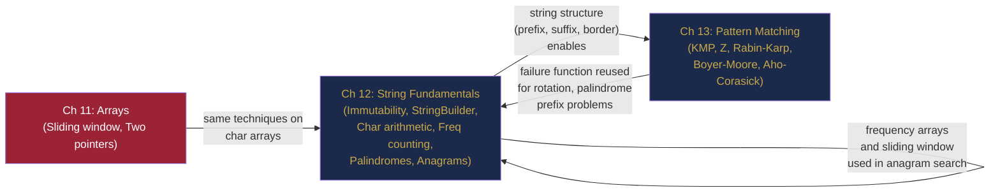

# Part III Review — Strings, Consolidated

> **End of Part III: Strings and String Algorithms**  
> Chapters 12–13 · [← Chapter 13](chapter-13-advanced-string-algorithms.md) · [Index](../INDEX.md) · [→ Part IV](../INDEX.md#-part-iv--searching-and-sorting)

---

> *"Dealing with failure is easy: Work hard to improve. Success is also easy to handle: You've solved the wrong problem. Work hard to improve."*  
> — Alan Perlis (paraphrased)

Strings look simple. They are not. `String` immutability catches beginners. Naïve concatenation hides quadratic traps. And pattern matching — finding a short string inside a long one — turns out to require deep structural insight (the failure function) to do efficiently.

This interlude consolidates both chapters and stress-tests the most important connections.

---

## Contents

- [The Story: Three Billion Characters](#the-story-three-billion-characters)
- [The Two-Chapter Map](#the-two-chapter-map)
- [The Four String Principles](#the-four-string-principles)
- [Cross-Chapter Challenges](#cross-chapter-challenges)
- [Part III Lightning Quiz](#part-iii-lightning-quiz)
- [The Grand Integration Problem](#the-grand-integration-problem)
- [Looking Ahead: What Part IV Builds On](#looking-ahead-what-part-iv-builds-on)

---

## The Story: Three Billion Characters

*Technical fiction. Every technique invoked is from Chapters 12–13.*

---

Lena arrived at her workstation at 7:40 a.m. to find a message from the genomics research team: a newly sequenced chromosome file had arrived overnight. Somewhere inside its 3.2 billion nucleotide characters — a string of `A`, `C`, `G`, and `T` — was a 47-character mutation marker believed to be associated with a rare neurological condition. Her job: find it, count all occurrences, and report any palindromic sequences within 500 bases of each match (DNA palindromes are real, biologically significant structures where a sequence reads the same on its complementary strand in reverse).

**Ch 12 — String Fundamentals:** She started with the basics. The chromosome was stored as a Java `String` of 3.2 billion characters. Her first instinct — loading it and checking substrings in a loop — would have created 3.2 billion new `String` objects. She caught the trap in time, switching to `toCharArray()` once and working entirely with the `char[]`. Character arithmetic mapped each nucleotide to an index (`'A'→0, 'C'→1, 'G'→2, 'T'→3`) for a compact `int[4]` frequency table.

She confirmed the marker was not a palindrome using the two-pointer check in under a microsecond — no need for the O(n²) expand-around-centre approach for a check on a known 47-character sequence. Then she built a frequency profile of all 4-mers (4-character substrings) across a sample region using a `HashMap<String, Integer>` — the sliding window adding and removing one character at a time.

**Ch 13 — Advanced String Algorithms:** The naïve search over 3.2 billion characters would have required up to $3.2 \times 10^9 \times 47 \approx 150 \times 10^9$ comparisons — roughly 25 minutes at $10^{10}$ comparisons per second. She had one minute.

She reached for KMP. The failure function for the 47-character marker was computed in 47 steps. The search phase made exactly 3.2 billion character comparisons — one pass, never retreating. Total time: 3 seconds.

For the palindromic DNA check near each match, she needed a different tool: Rabin-Karp with a rolling hash on 20-character windows to identify candidate palindromic stems. The rolling hash updated in $O(1)$ per step — 3.2 billion hash computations, each a multiply-add-mod. Another 4 seconds.

Finally, the research team added a last-minute request: scan for 23 additional variant markers simultaneously. She had two options: run KMP 23 times (23 passes, 70 seconds) or build an Aho-Corasick automaton. She built the trie of all 24 patterns in 400 milliseconds. One pass: all 24 patterns found simultaneously. The 23 extra markers cost 0.3 extra seconds.

By 8:11 a.m., the report was done. 7 occurrences of the primary marker. 2 within palindromic regions. All 23 variant patterns catalogued. Total runtime: 8 seconds on a 3.2-billion-character string.

None of this was possible without understanding that a `String` is not magic — it is a `char[]` with an address. And that pattern matching is not brute force — it is the failure function.

---

## The Two-Chapter Map



---

## The Four String Principles

| # | Principle | Chapter |
|---|-----------|---------|
| 1 | **Never mutate a String in a loop — use StringBuilder.** The `+` trap costs O(n²) silently. | 12 |
| 2 | **Never compare Strings with `==` — use `.equals()`.** Pool vs heap references differ. | 12 |
| 3 | **Frequencies first.** Most "counting" string problems reduce to a frequency array + one pass. | 12 |
| 4 | **The failure function is the pattern's self-knowledge.** It encodes what partial matches survived a mismatch so you never re-examine text characters. | 13 |

---

## Cross-Chapter Challenges

### CC-1 — Anagram + Sliding Window (Chapter 12)

**Problem:** Given `s = "cbaebabacd"` and `p = "abc"`, find all start indices in `s` where an anagram of `p` begins.

Write the solution from scratch, state the invariant, and justify the complexity.

<details><summary><strong>Solution</strong></summary>

> **Invariant:** The window `s[left..right]` has the same character frequencies as `p`.
>
> ```java
> List<Integer> findAnagrams(String s, String p) {
>     int[] need = new int[26], have = new int[26];
>     for (char c : p.toCharArray()) need[c - 'a']++;
>     int required = (int) IntStream.range(0, 26).filter(i -> need[i] > 0).count();
>
>     List<Integer> res = new ArrayList<>();
>     int left = 0, formed = 0, k = p.length();
>
>     for (int right = 0; right < s.length(); right++) {
>         int rc = s.charAt(right) - 'a';
>         have[rc]++;
>         if (need[rc] > 0 && have[rc] == need[rc]) formed++;
>
>         if (right >= k) {
>             int lc = s.charAt(right - k) - 'a';
>             if (need[lc] > 0 && have[lc] == need[lc]) formed--;
>             have[lc]--;
>         }
>         if (formed == required) res.add(right - k + 1);
>     }
>     return res;  // [0, 6]
> }
> ```
>
> **Complexity:** O(n) time, O(1) space (frequency array is size 26).

</details>

---

### CC-2 — String Rotation via KMP (Chapters 12 & 13)

**Problem:** Determine if string `goal` is a rotation of string `s`. (A rotation of "abcde" is "cdeab".) Use KMP.

<details><summary><strong>Solution</strong></summary>

> A rotation of `s` is a substring of `s + s`. So check if `goal` appears in `s + s` using KMP.
>
> ```java
> boolean isRotation(String s, String goal) {
>     if (s.length() != goal.length()) return false;
>     String doubled = s + s;
>     return kmpSearch(doubled, goal).size() > 0;  // from Chapter 13
> }
> ```
>
> **Why it works:** Any rotation of `s` can be written as `s[k..n-1] + s[0..k-1]`, which is a contiguous substring of `s + s` starting at index `k`.  
> **Complexity:** O(n) build + O(n) KMP = O(n).

</details>

---

### CC-3 — KMP Failure Function Property (Chapter 13)

**Problem:** Use the KMP failure function alone (no search phase) to determine if `s` is composed of a repeated unit. For example: `"ababab"` is `"ab"` repeated 3 times.

<details><summary><strong>Solution</strong></summary>

> Let `n = s.length()` and `f = fail[n-1]` (the failure value at the last position). `s` is a repeated pattern iff `n % (n - f) == 0`.
>
> **Why:** If `fail[n-1] = f`, the longest proper border of `s` has length `f`. The "primitive unit" (shortest repeating block) has length `n - f`. If `n` is divisible by `n - f`, the string is `n / (n - f)` repetitions of that unit.
>
> ```java
> boolean isRepeated(String s) {
>     int[] fail = buildFailure(s);
>     int n = s.length(), f = fail[n - 1];
>     int unit = n - f;
>     return f > 0 && n % unit == 0;
> }
> ```
>
> **Example:** `"ababab"` → `fail[5] = 4` → `unit = 6 - 4 = 2` → `6 % 2 = 0` → true ✓.

</details>

---

### CC-4 — Palindrome Prefix via KMP (Chapters 12 & 13)

**Problem:** Given string `s`, find the length of its longest prefix that is a palindrome.

<details><summary><strong>Solution</strong></summary>

> Concatenate `s + "#" + reverse(s)`. The KMP failure value at the last position gives the length of the longest prefix of `s` that is also a suffix of `reverse(s)` — which is exactly the length of the longest palindromic prefix of `s`.
>
> ```java
> int longestPalindromicPrefix(String s) {
>     String rev = new StringBuilder(s).reverse().toString();
>     String concat = s + "#" + rev;
>     int[] fail = buildFailure(concat);
>     return fail[concat.length() - 1];
> }
> ```
>
> **Example:** `s = "aacecaaa"`, `rev = "aaacecaa"`. Concat: `"aacecaaa#aaacecaa"`. `fail` last = 7 → longest palindromic prefix = `"aacecaa"` (length 7) ✓.

</details>

---

## Part III Lightning Quiz

**LQ-1.** What is `'z' - 'a'`?

<details><summary><strong>Answer</strong></summary>

> `25`. The 26 letters map to indices 0 through 25.

</details>

---

**LQ-2.** Why is `s.substring(i, j)` O(j − i) and not O(1)?

<details><summary><strong>Answer</strong></summary>

> `String` is immutable. `substring` must create a **new** `String` object by copying `j - i` characters into new memory.

</details>

---

**LQ-3.** Two strings are anagrams iff _____.

<details><summary><strong>Answer</strong></summary>

> They have the same length and the same character frequency distribution (every character appears the same number of times in both).

</details>

---

**LQ-4.** What is the worst-case complexity of naïve pattern matching, and what input triggers it?

<details><summary><strong>Answer</strong></summary>

> O(nm). Triggered by a text of all-same characters (e.g., `"aaa...a"`) and a pattern that is almost all same characters with one different at the end (e.g., `"aa...ab"`). Every position in the text almost fully matches before failing.

</details>

---

**LQ-5.** What does `fail[j-1]` tell you during the KMP search phase when a mismatch occurs at pattern position `j`?

<details><summary><strong>Answer</strong></summary>

> It tells you the length of the longest proper prefix of `p[0..j-1]` that is also a suffix — the number of pattern characters you can "retain" for the next match attempt without re-examining any text characters. You set `k = fail[j-1]` and try again from that position in the pattern.

</details>

---

**LQ-6.** What is the average-case time complexity of Rabin-Karp, and what causes the worst case?

<details><summary><strong>Answer</strong></summary>

> Average: O(n + m). Worst case: O(nm) — caused by many hash collisions requiring O(m) verification each. With a good modulus and base, collisions are extremely rare in practice.

</details>

---

**LQ-7.** What problem does Aho-Corasick solve that KMP cannot?

<details><summary><strong>Answer</strong></summary>

> **Multi-pattern matching**: finding all occurrences of any of $k$ patterns simultaneously in O(n + M + occurrences), where M is the total length of all patterns. Running KMP independently for each pattern would cost O(k × n).

</details>

---

**LQ-8.** Is `"racecar"` a palindrome? Check using the two-pointer method (trace the steps).

<details><summary><strong>Answer</strong></summary>

> `lo=0,hi=6`: 'r'='r' ✓ → lo=1,hi=5. 'a'='a' ✓ → lo=2,hi=4. 'c'='c' ✓ → lo=3,hi=3. `lo=hi` → loop ends. **Yes, palindrome.** ✓

</details>

---

## The Grand Integration Problem

> *This problem uses both chapters: character frequency + KMP failure function.*

---

**Problem: Longest Happy Prefix** ([LC 1392](https://leetcode.com/problems/longest-happy-prefix/))

A "happy prefix" is a non-empty prefix that is also a suffix (excluding the whole string). Given string `s`, return the longest happy prefix.

**Example:** `s = "level"` → `"l"`. `s = "ababab"` → `"abab"`.

---

**Part A — Identify the Structure (Chapter 12)**

> This is the definition of a **border** of `s`. State it in your own words.

<details><summary><strong>Answer A</strong></summary>

> A border is a string that is simultaneously a proper prefix and a proper suffix of `s`. The longest happy prefix is the longest border of `s`. Every prefix of `s` has a longest border of some length $k$ (possibly 0).

</details>

---

**Part B — Compute It (Chapter 13)**

> Build the KMP failure function for `s` and extract the answer.

<details><summary><strong>Solution B</strong></summary>

> ```java
> String longestPrefix(String s) {
>     int[] fail = buildFailure(s);
>     int len = fail[s.length() - 1];   // length of longest border
>     return s.substring(0, len);        // empty string if len == 0
> }
> ```
>
> **For `s = "ababab"`:**  
> `fail = [0, 0, 1, 2, 3, 4]`. `fail[5] = 4`. Longest happy prefix: `s[0..3] = "abab"` ✓.
>
> **For `s = "level"`:**  
> `fail = [0, 0, 0, 0, 1]`. `fail[4] = 1`. Longest happy prefix: `s[0] = "l"` ✓.
>
> **Complexity:** O(n).

</details>

---

**Part C — Edge Cases (Chapter 12)**

> What does the function return for `s = "a"` and `s = "aa"`? Are these correct?

<details><summary><strong>Answer C</strong></summary>

> - `s = "a"`: `fail = [0]`, `len = 0` → returns `""` (empty string). Correct — a single character has no proper prefix.
> - `s = "aa"`: `fail = [0, 1]`, `len = 1` → returns `"a"`. Correct — `"a"` is both a proper prefix and a proper suffix of `"aa"`.

</details>

---

## Looking Ahead: What Part IV Builds On

Part IV covers searching and sorting. Here is how Parts II and III feed into it:

| Technique from Parts II–III | How it appears in Part IV (Chapters 14–19) |
|----------------------------|--------------------------------------------|
| **Binary search (arrays)** | Chapter 14: formalised with invariant-based derivation; Chapter 15: binary search on answer |
| **Sliding window** | Chapters 15–16: monotonic predicates for binary search on answer often involve window-style checks |
| **String comparison** | Chapter 16: sorting strings, radix sort for strings |
| **Prefix sums** | Chapter 18: sorting with auxiliary structure |
| **Two pointers** | Chapter 19: merge operation in merge sort is a two-pointer scan |

The most important carryover: **binary search is array-based at its core**. The intuition, the off-by-one discipline, and the invariant-maintenance mindset you built in Chapters 7–11 are exactly what make Chapter 14's binary search derivation click.

---

> **Part III — Complete**  
> [← Chapter 13](chapter-13-advanced-string-algorithms.md) · [← Index](../INDEX.md) · [→ Part IV](../INDEX.md#-part-iv--searching-and-sorting)
