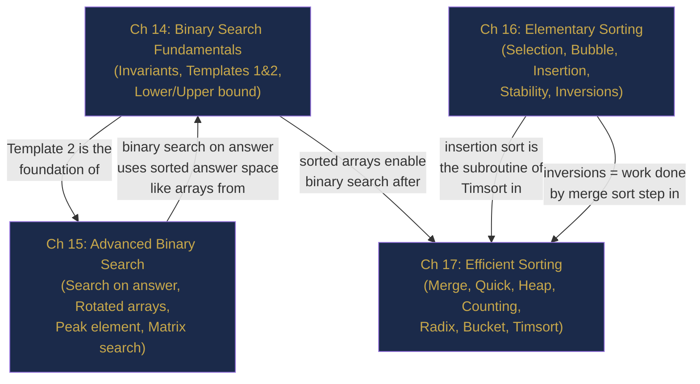

# Part IV Review — Searching and Sorting, Consolidated

> **End of Part IV: Searching and Sorting**  
> Chapters 14–17 · [← Chapter 17](chapter-17-efficient-sorting.md) · [Index](../INDEX.md) · [→ Part V](../INDEX.md#-part-v--hashing-and-lookup-structures)

---

> *"Sorting is the basic building block that many other algorithms are built around."*  
> — Robert Sedgewick

Four chapters. Two searching algorithms. Seven sorting algorithms. One fundamental theorem (Ω(n log n) lower bound). One powerful technique (binary search on answer). This interlude consolidates everything.

---

## Contents

- [The Story: The Leaderboard Meltdown](#the-story-the-leaderboard-meltdown)
- [The Four-Chapter Map](#the-four-chapter-map)
- [The Six Principles](#the-six-principles)
- [Cross-Chapter Challenges](#cross-chapter-challenges)
- [Part IV Lightning Quiz](#part-iv-lightning-quiz)
- [The Grand Integration Problem](#the-grand-integration-problem)
- [Looking Ahead: What Part V Builds On](#looking-ahead-what-part-v-builds-on)

---

## The Story: The Leaderboard Meltdown

*Technical fiction. Every technique invoked is from Chapters 14–17.*

---

It was the last Friday of the month — ranking day on Vortex, a competitive strategy game with 50 million active players. At 11:00 p.m. the monthly leaderboard recomputation window opened. Jay, the platform's backend engineer, had exactly 90 minutes before rankings had to be live for the morning audience across three time zones.

**Ch 16 — Elementary Sorting:** The day's first task was the regional sub-leaderboards: 32 small tournament brackets with 8–12 players each. Jay dropped them into insertion sort. At n ≤ 12, insertion sort's low constant factor made it noticeably faster than the library sort's overhead — and because two players occasionally shared a score, stability mattered. Insertion sort preserved the tie-breaking order (earlier registration date). Twelve microseconds. Done.

**Ch 17 — Efficient Sorting:** The global leaderboard was a different beast: 50 million `PlayerRecord` objects, each carrying score, rank-delta, win streak, and regional tag. Java's `Arrays.sort` on objects uses Timsort — stable, adaptive, and O(n) for partially sorted data. Last month's rankings were already 73% sorted (most players don't move much). Timsort exploited those natural runs. What would have been 50 million × 26 ≈ 1.3 billion comparisons for a cold sort became roughly 180 million. It finished in 11 seconds.

For score-only sub-sorts on the primitive `int[]` score array, Jay ran `Arrays.sort(scores)` — dual-pivot quicksort, unstable but irrelevant for raw integers. 4 seconds.

**Ch 14 — Binary Search Fundamentals:** With the sorted leaderboard in hand, the query API went live. Players could query their own rank instantly: binary search on the score array in O(log 50,000,000) ≈ 26 comparisons. Jay used the lower-bound template: first score ≥ player's score, upper bound for count. 300 million queries arrived in the first 10 minutes. Each answered in under 1 microsecond. 26 comparisons. No matter how many players were on the server.

**Ch 15 — Advanced Binary Search:** Then the product team pushed a last-minute feature: "Show each player the minimum score needed to reach the next tier." Tier thresholds were defined as percentile boundaries. Jay binary-searched on the answer space — "what score `s` is needed such that at least k players have score ≤ s?" — using the upper-bound function as his checker. Each player's target score computed in O(log n). The feature shipped at 12:17 a.m., 43 minutes before the deadline.

The 90-minute window closed at 12:30 a.m. All 50 million rankings were live. The story: insertion sort for small n, Timsort's adaptivity for mostly-sorted objects, dual-pivot quicksort for raw primitives, binary search for 300 million queries, binary search on answer for the tier-target feature.

Different problems. Different algorithms. All from the same four chapters.

---

## The Four-Chapter Map



---

## The Six Principles

| # | Principle | Chapter |
|---|-----------|---------|
| 1 | **State your invariant before writing binary search.** What do `lo` and `hi` represent? Derive updates from the invariant — don't memorise code. | 14 |
| 2 | **Template 2 (`lo < hi`) is for boundaries; Template 1 (`lo <= hi`) is for exact values.** Mixing them causes bugs. | 14 |
| 3 | **If the answer is a number in a bounded range and feasibility is monotonic: binary search on it.** O(n log range) beats O(n × range). | 15 |
| 4 | **Inversions measure unsortedness.** Insertion sort's work = O(n + inversions). Merge sort counts inversions in O(n log n). | 16 |
| 5 | **Stability is about equal elements.** Stable: bubble, insertion, merge, Timsort, counting, radix. Unstable: selection, heap, standard quicksort. | 16 |
| 6 | **The Ω(n log n) lower bound is a wall, not a goal.** Break it only with extra knowledge (integer keys, bounded range, uniform distribution). | 17 |

---

## Cross-Chapter Challenges

### CC-1 — Sort Then Binary Search (Chapters 16/17 & 14)

**Problem:** Given an unsorted array `nums` and multiple queries of the form "count elements ≤ x", answer each query in O(log n) after O(n log n) preprocessing.

<details><summary><strong>Solution</strong></summary>

> **Sort once** (O(n log n)), then for each query use `upperBound(x)` (Chapter 14, Template 2):
>
> ```java
> Arrays.sort(nums);
> int countLeq(int[] nums, int x) {
>     // upperBound returns first index > x; that equals count of elements ≤ x
>     int lo = 0, hi = nums.length;
>     while (lo < hi) {
>         int mid = lo + (hi - lo) / 2;
>         if (nums[mid] <= x) lo = mid + 1;
>         else                 hi = mid;
>     }
>     return lo;
> }
> ```
>
> **Complexity:** O(n log n) preprocessing + O(log n) per query. For q queries: O(n log n + q log n).

</details>

---

### CC-2 — Binary Search on Answer with Sorting (Chapters 15 & 17)

**Problem:** Given `n` tasks with `time[i]` durations, assign them to `k` workers to minimise the maximum total time assigned to any worker.

<details><summary><strong>Solution</strong></summary>

> **Binary search on the answer** (max time cap), with a greedy checker.  
> To minimise the max: binary search on `cap ∈ [max(time), sum(time)]`. Checker: can we assign all tasks to k workers such that each worker's total ≤ cap?
>
> **Greedy checker** (assigns tasks greedily, starts new worker when cap exceeded):
> ```java
> boolean canAssign(int[] time, int k, int cap) {
>     int workers = 1, currentLoad = 0;
>     for (int t : time) {
>         if (currentLoad + t > cap) { workers++; currentLoad = 0; }
>         currentLoad += t;
>         if (workers > k) return false;
>     }
>     return true;
> }
> ```
>
> Sort `time` in descending order first so the greedy checker makes fewer partitions (harder tasks assigned first reduces waste). **Complexity:** O(n log n) sort + O(n log(sum)) binary search.

</details>

---

### CC-3 — Counting Inversions with Merge Sort (Chapters 16 & 17)

**Problem:** Count the number of inversions in `[2, 4, 1, 3, 5]`.

<details><summary><strong>Solution</strong></summary>

> An inversion is a pair (i, j) with i < j and arr[i] > arr[j].  
>
> **Brute force:** 10 pairs to check. Inversions: (2,1), (4,1), (4,3) → **3 inversions**.
>
> **Merge sort approach:** When merging `[1, 2, 4]` and `[3, 5]`, if we place `3` before the remaining `[4]` from the left half, that means `4 > 3` → 1 inversion for each remaining left element (just `4` here → 1). Total O(n log n) counting.
>
> The connection: `inversions` = work insertion sort would do (removes 1 per shift). Merge sort counts all inversions simultaneously in O(n log n).

</details>

---

### CC-4 — Non-Comparison Sort Beats Lower Bound (Chapter 17)

**Problem:** You have 10⁶ integers in the range `[0, 50]`. What is the fastest sort, and why does it break the Ω(n log n) lower bound?

<details><summary><strong>Solution</strong></summary>

> **Counting sort:** O(n + k) = O(10⁶ + 50) = O(10⁶). With n log n ≈ 20 × 10⁶ for n=10⁶, counting sort is 20× faster.
>
> **Why it breaks the lower bound:** The Ω(n log n) bound applies only to **comparison-based** sorts. Counting sort does not compare elements — it uses their values as indices. The constraint is that the sort key must be an integer in a known bounded range `[0, k]`. This is *extra knowledge* beyond what comparison sorts assume, and it allows bypassing the information-theoretic lower bound.

</details>

---

## Part IV Lightning Quiz

**LQ-1.** Which template do you use to find the **first position** where a condition becomes true?

<details><summary><strong>Answer</strong></summary>

> **Template 2 (`lo < hi`)** with `hi = mid` when condition is true (candidate preserved), `lo = mid + 1` when false (candidate excluded).

</details>

---

**LQ-2.** `Arrays.binarySearch(arr, x)` returns `-5`. What is the insertion point?

<details><summary><strong>Answer</strong></summary>

> `-(−5) − 1 = 4`. The element would be inserted at index 4.

</details>

---

**LQ-3.** What is the worst-case time complexity of quicksort with a random pivot?

<details><summary><strong>Answer</strong></summary>

> Still **O(n²)** theoretically (random pivot can still produce unbalanced partitions by chance), but the probability is exponentially small. Expected (average) complexity with random pivot is O(n log n).

</details>

---

**LQ-4.** `[3, 1, 2, 5, 4]` — how many inversions?

<details><summary><strong>Answer</strong></summary>

> (3,1), (3,2), (5,4) → **3 inversions**. Insertion sort would make exactly 3 shifts.

</details>

---

**LQ-5.** Which sorting algorithm should you use to sort 10⁶ `String` objects by length, preserving their original order for equal lengths?

<details><summary><strong>Answer</strong></summary>

> **Timsort** via `Arrays.sort(array, Comparator.comparingInt(String::length))`. It is stable (equal-length strings keep original order) and O(n log n).

</details>

---

**LQ-6.** Why is heap sort's Phase 1 (build max-heap) O(n) rather than O(n log n)?

<details><summary><strong>Answer</strong></summary>

> Bottom-up heapification starts from the last internal node. Nodes near the bottom have small subtrees — heapifying them is cheap. Summing the work: $\sum_{i=0}^{\log n} 2^i \cdot (\log n - i) = O(n)$. Most nodes are near the leaves and do little work.

</details>

---

**LQ-7.** For rotated array `[4,5,6,7,0,1,2]` and target `0`: which half is sorted at `mid = 3` (value 7)?

<details><summary><strong>Answer</strong></summary>

> `nums[lo]=4`, `nums[mid]=7`. Since `4 ≤ 7`, the **left half [4,5,6,7]** is sorted. `target=0` is NOT in `[4, 7)` → search the right half. `lo = mid + 1 = 4`. Next: `lo=4, hi=6, mid=5`, value 1. Right half `[1,2]` sorted. `0 < 1` → not in right → `hi = mid-1 = 4`. `lo=hi=4`, value 0 → found ✓.

</details>

---

**LQ-8.** What is the minimum number of swaps to sort `[2, 3, 1]` using selection sort?

<details><summary><strong>Answer</strong></summary>

> Selection sort always makes exactly `n-1` swaps. For n=3: **2 swaps**. Pass 1: find min (1 at index 2), swap with index 0 → `[1,3,2]`. Pass 2: find min (2 at index 2), swap with index 1 → `[1,2,3]`.

</details>

---

## The Grand Integration Problem

> *This problem uses binary search (Ch 14/15), sorting concepts (Ch 16/17), and complexity reasoning (Ch 6).*

---

**Problem: H-Index** ([LC 274](https://leetcode.com/problems/h-index/))

A researcher has an array `citations[i]` = number of citations for paper i. The **H-index** is the maximum value `h` such that the researcher has at least `h` papers with at least `h` citations each.

**Example:** `citations = [3, 0, 6, 1, 5]` → H-index = **3** (3 papers with ≥3 citations: papers with 3, 6, 5 citations).

---

**Part A — Sorting Approach (Chapter 17)**

> Sort descending. The H-index is the largest `i+1` where `sorted[i] >= i+1`.

<details><summary><strong>Answer A</strong></summary>

> ```java
> int hIndex(int[] citations) {
>     Arrays.sort(citations);
>     int n = citations.length;
>     for (int i = 0; i < n; i++) {
>         if (citations[n - 1 - i] < i + 1) return i;
>     }
>     return n;
> }
> ```
>
> **Complexity:** O(n log n) for sort + O(n) scan = O(n log n).

</details>

---

**Part B — Counting Sort Approach (Chapter 17)**

> Since `h` can be at most `n` (can't have more papers than papers), use counting sort on citations capped at `n`.

<details><summary><strong>Answer B</strong></summary>

> ```java
> int hIndexLinear(int[] citations) {
>     int n = citations.length;
>     int[] count = new int[n + 1];
>     for (int c : citations) count[Math.min(c, n)]++;
>
>     int papers = 0;
>     for (int h = n; h >= 0; h--) {
>         papers += count[h];
>         if (papers >= h) return h;
>     }
>     return 0;
> }
> ```
>
> **Complexity:** O(n) — no comparison sort needed. Breaking O(n log n) with the bounded-range insight from Chapter 17.

</details>

---

**Part C — Binary Search Approach (Chapter 14/15)**

> After sorting, binary search for the H-index boundary.

<details><summary><strong>Answer C</strong></summary>

> Sort descending. Binary search for the largest `h` where `citations[h-1] >= h`:
>
> ```java
> int hIndexBinarySearch(int[] citations) {
>     Arrays.sort(citations);
>     int n = citations.length;
>     int lo = 0, hi = n;
>     while (lo < hi) {
>         int mid = lo + (hi - lo + 1) / 2;  // upper-mid to avoid infinite loop
>         if (citations[n - mid] >= mid) lo = mid;
>         else                           hi = mid - 1;
>     }
>     return lo;
> }
> ```
>
> **Complexity:** O(n log n) sort + O(log n) binary search = O(n log n). Same as Part A asymptotically, but illustrates the binary search on answer structure.

</details>

---

**Part D — Compare All Three**

> Which approach is best and why?

<details><summary><strong>Answer D</strong></summary>

> **Part B (counting sort) wins**: O(n) time, O(n) space. It exploits the domain knowledge that h ≤ n, making comparison-sort's Ω(n log n) lower bound irrelevant. For n = 10⁵ papers, counting sort does 10⁵ operations vs ~1.7 × 10⁶ for the sorting approaches — a 17× speedup.

</details>

---

## Looking Ahead: What Part V Builds On

| Part IV Concept | How it appears in Part V (Chapters 18–19) |
|-----------------|------------------------------------------|
| **Binary search lower bound** | Hash tables achieve O(1) lookup — they "break" the O(log n) comparison search bound using extra knowledge (the hash function) |
| **Counting sort** | The direct-addressing table is essentially counting sort's frequency array — the simplest hash table |
| **Sorted order** | Hash tables don't maintain sorted order — when you need sorted iteration, use `TreeMap` (backed by a balanced BST, Chapter 24) |
| **Stability** | HashMap/HashSet have no defined iteration order — this is the hash table's trade-off for O(1) operations |

The jump from O(log n) binary search to O(1) hash lookup is Part V's central achievement — and it comes with its own set of trade-offs and pitfalls.

---

> **Part IV — Complete**  
> [← Chapter 17](chapter-17-efficient-sorting.md) · [← Index](../INDEX.md) · [→ Part V](../INDEX.md#-part-v--hashing-and-lookup-structures)
