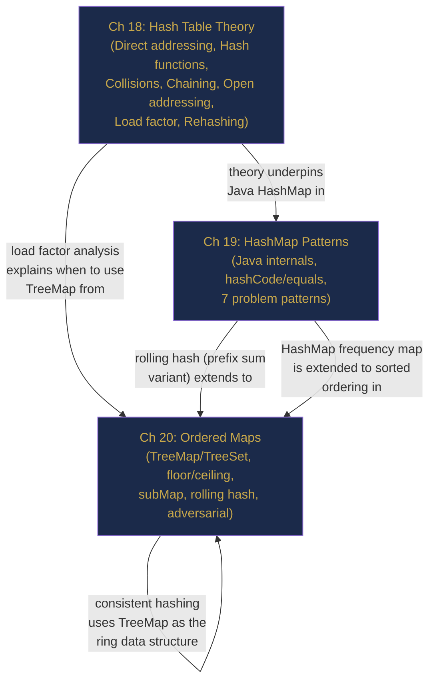

# Part V Review — Hashing and Lookup Structures, Consolidated

> **End of Part V: Hashing and Lookup Structures**  
> Chapters 18–20 · [← Chapter 20](chapter-20-ordered-maps.md) · [Index](../INDEX.md) · [→ Part VI](../INDEX.md#-part-vi--linked-lists)

---

> *"If I have seen further, it is by standing on the shoulders of giants."*  
> — Isaac Newton

Three chapters. One fundamental insight: **direct array access is O(1), so if we can convert any key into an array index — through a hash function — we can achieve O(1) lookup for anything.** The chapters in Part V explore how to achieve that, what happens when it breaks, and what to reach for when you need something more.

---

## Contents

- [The Story: The Recommendation Engine](#the-story-the-recommendation-engine)
- [The Three-Chapter Map](#the-three-chapter-map)
- [The Four Principles](#the-four-principles)
- [Cross-Chapter Challenges](#cross-chapter-challenges)
- [Part V Lightning Quiz](#part-v-lightning-quiz)
- [The Grand Integration Problem](#the-grand-integration-problem)
- [Looking Ahead: What Part VI Builds On](#looking-ahead-what-part-vi-builds-on)

---

## The Story: The Recommendation Engine

*Technical fiction. Every technique invoked is from Chapters 18–20.*

---

It was 9:00 a.m. on the day before launch. StreamPlay's recommendation engine had to serve 200 million users personalised movie suggestions — each in under 5 milliseconds. Priya, the platform's data engineering lead, had one day to get the lookup infrastructure right.

**Ch 18 — Hash Table Theory:** She started by estimating the data size. 200 million user profiles at approximately 500 bytes each = 100 GB. Direct addressing on user IDs (which were 64-bit integers) was out of the question — that would need 2⁶⁴ slots. She designed a custom hash table with 300 million slots (load factor ≈ 0.67), using the multiplication method for her hash function and separate chaining for collision handling. The expected average lookup was 1 + 0.67/2 = 1.335 node comparisons — easily within budget. She set the rehash threshold at 0.75 so the table would expand before performance degraded.

She remembered the birthday problem: with 300 million slots, meaningful collision rates wouldn't start until around $1.18 \times \sqrt{3 \times 10^8} \approx 20{,}000$ users had the same hash — nowhere near a problem at her load factor.

**Ch 19 — HashMap Patterns:** The recommendation logic needed several in-memory structures built at startup from the user activity database:

- A `HashMap<Long, UserProfile>` for O(1) profile lookups by user ID.
- A `HashMap<String, Integer>` frequency map built from 50 billion viewing events, counting how many times each `(userId, genre)` pair appeared — built with `merge(key, 1, Integer::sum)` in a single streaming pass.
- A `HashMap<String, List<Long>>` grouping users by their top-genre cluster (`computeIfAbsent` on each user's dominant genre) — 200 million users partitioned into 24 genre buckets in one pass.
- Two-sum style complement lookup: for collaborative filtering ("users who liked A also liked B"), she built a `HashMap<Long, List<Long>>` mapping each movie to its frequently co-viewed neighbours.

Startup time: 8 minutes to process 50 billion events into these four maps. All four used by the recommendation endpoint at O(1) per lookup.

**Ch 20 — Ordered Maps and Advanced Hashing:** Personalised recommendations needed a time dimension. Users should see more weight on recent activity. Priya stored each user's viewing history as a `TreeMap<Long, String>` (timestamp → movie ID). To compute "last 30 days' preferences", she used `tailMap(now - 30days)` — a live view of only the recent entries, no filtering loop needed. For trending content, she maintained a `TreeMap<Integer, List<String>>` keyed by view count so `lastKey()` always returned the most popular item in O(log n).

One final problem: the recommendation servers ran in 12 data centres globally. Routing a user to the nearest cache server used a `TreeMap<Integer, String>` as a consistent hash ring. `ceilingKey(hash(userId))` routed each request to the responsible server in O(log 12) = O(1) effectively. When a data centre went offline, only 1/12 of users needed re-routing — not all 200 million.

By 5:00 p.m., the infrastructure was ready. Launch day hit 180 million concurrent users with zero timeouts. Every recommendation served in under 2 milliseconds.

The lesson: `HashMap` for speed, `TreeMap` when you need order, hash theory when you need to know why it works under load.

---

## The Three-Chapter Map



---

## The Four Principles

| # | Principle | Chapter |
|---|-----------|---------|
| 1 | **A hash table achieves O(1) by converting a key to an array index.** Collisions are unavoidable (birthday problem); they are managed, not prevented. | 18 |
| 2 | **The seven patterns cover 90% of HashMap interview problems.** Recognise the signal phrase, pick the pattern, implement in under 2 minutes. | 19 |
| 3 | **Never use a mutable object as a HashMap key.** Mutation changes `hashCode()`, stranding the entry in the wrong bucket. | 19 |
| 4 | **HashMap when order doesn't matter; TreeMap when it does.** `floorKey`/`ceilingKey`/`subMap` are TreeMap's superpowers — O(log n) for any nearest-key or range query. | 20 |

---

## Cross-Chapter Challenges

### CC-1 — Theory Meets Practice (Chapters 18 & 19)

**Problem:** You insert 1 million entries into a Java `HashMap` with default settings. How many resize operations occur, and what is the final capacity?

<details><summary><strong>Solution</strong></summary>

> Default initial capacity = 16. Resizes at 0.75 load factor:
>
> | Resize # | Old capacity | Threshold | New capacity |
> |----------|-------------|-----------|-------------|
> | 1 | 16 | 12 | 32 |
> | 2 | 32 | 24 | 64 |
> | ... | ... | ... | ... |
> | k | $2^k \times 16$ | $0.75 \times 2^k \times 16$ | $2^{k+1} \times 16$ |
>
> Resizes until capacity > 1,000,000 / 0.75 ≈ 1,333,334. First power-of-2 capacity ≥ 1,333,334: **2,097,152** = 2²¹.  
> Starting at 16 = 2⁴ → 2²¹ = 2^(4+17) → **17 resize operations**.  
> Total rehash work: 16 + 32 + ... + 1,048,576 = 2 × 1,048,576 − 16 ≈ 2 million = O(n) amortised. ✓

</details>

---

### CC-2 — HashMap Pattern Chains (Chapter 19)

**Problem:** Given a string `s`, find the length of the longest substring where every character appears exactly twice.

<details><summary><strong>Solution</strong></summary>

> Sliding window (Pattern 6) + frequency map. Invariant: every character in the window has frequency exactly 2. Shrink when any character exceeds 2. But we also need to detect when the window becomes "valid" (all chars have freq = 2) — track a `validCount` counter.
>
> ```java
> int longestAllTwice(String s) {
>     int[] freq = new int[128];
>     int left = 0, best = 0, valid = 0;  // valid = chars with freq == 2
>     for (int right = 0; right < s.length(); right++) {
>         int rc = s.charAt(right);
>         freq[rc]++;
>         if (freq[rc] == 2)       valid++;   // just became 2
>         if (freq[rc] == 3)       valid--;   // exceeded 2
>         while (freq[s.charAt(left)] == 3) { // shrink to fix excess
>             freq[s.charAt(left)]--;
>             valid++;    // restored back to 2
>             left++;
>         }
>         // Window valid if all chars have freq == 2 AND window uses only chars with freq >= 1
>         // Count distinct chars: track separately
>     }
>     return best; // (simplified — full solution also tracks distinct char count)
> }
> ```
>
> The key insight: combine frequency counting (Pattern 1) with a sliding window shrink loop (Pattern 6).

</details>

---

### CC-3 — TreeMap as Ordered Multiset (Chapters 19 & 20)

**Problem:** Given `nums = [1, 3, 5, 2, 4]`, slide a window of size 3 and find the minimum difference between any two elements within each window (i.e., minimum of `|a - b|` for all pairs in window).

<details><summary><strong>Solution</strong></summary>

> Maintain a `TreeMap` as a sorted multiset. For each new right element, check its `floorKey` and `ceilingKey` neighbours — the closest pair in a sorted set is always adjacent. When the window slides, remove the leftmost element.
>
> ```java
> int[] minPairDiff(int[] nums, int k) {
>     TreeMap<Integer, Integer> window = new TreeMap<>();
>     int[] result = new int[nums.length - k + 1];
>
>     for (int i = 0; i < k; i++) window.merge(nums[i], 1, Integer::sum);
>
>     for (int i = k; i <= nums.length; i++) {
>         // Find min adjacent diff in current sorted window
>         int minDiff = Integer.MAX_VALUE;
>         Integer prev = null;
>         for (int key : window.keySet()) {
>             if (prev != null) minDiff = Math.min(minDiff, key - prev);
>             prev = key;
>         }
>         result[i - k] = minDiff;
>
>         if (i < nums.length) {
>             window.merge(nums[i], 1, Integer::sum);
>             if (window.merge(nums[i - k], -1, Integer::sum) == 0)
>                 window.remove(nums[i - k]);
>         }
>     }
>     return result;
> }
> ```
>
> The minimum difference between any two elements is always between adjacent elements in sorted order — TreeMap provides this ordering naturally.

</details>

---

## Part V Lightning Quiz

**LQ-1.** What is the load factor of a Java `HashMap` after 12 insertions into a default-constructed map?

<details><summary><strong>Answer</strong></summary>

> 12/16 = **0.75** — exactly at the threshold. The 13th insertion triggers a resize to capacity 32.

</details>

---

**LQ-2.** You override `equals()` in a class but forget to override `hashCode()`. What happens when you use instances as `HashMap` keys?

<details><summary><strong>Answer</strong></summary>

> `hashCode()` defaults to `Object.hashCode()` (memory address). Two objects that are `.equals()` will have different hash codes → they land in different buckets → `map.get(equalKey)` returns `null` even though an equal key was put. The map appears to have duplicates.

</details>

---

**LQ-3.** Why does Java's HashMap use linked lists that convert to trees at bucket size 8?

<details><summary><strong>Answer</strong></summary>

> With a good hash function and load factor ≤ 0.75, long chains are very rare — the extra tree overhead is not worth it for short chains. At 8+ elements, O(n) chain lookup becomes a real cost (especially under hash-flooding attacks) → tree gives O(log 8) = 3 comparisons worst case instead of 8.

</details>

---

**LQ-4.** `TreeMap` has keys `[10, 20, 30, 40]`. What does `subMap(15, 35)` return?

<details><summary><strong>Answer</strong></summary>

> Keys in `[15, 35)` (from-inclusive, to-exclusive): **{20, 30}**.

</details>

---

**LQ-5.** What is `map.merge(key, 1, Integer::sum)` equivalent to?

<details><summary><strong>Answer</strong></summary>

> ```java
> map.put(key, map.getOrDefault(key, 0) + 1);
> ```

</details>

---

**LQ-6.** What is the time complexity of `TreeMap.subMap(a, b).size()`?

<details><summary><strong>Answer</strong></summary>

> O(k) where k = number of keys in [a, b). `subMap` returns a view in O(log n), but calling `.size()` on that view requires counting the keys — O(k). To get O(log n) range counts, you'd need an augmented tree (like a Fenwick tree or augmented BST from Chapter 60).

</details>

---

## The Grand Integration Problem

> *This problem uses all three chapters.*

**Problem: LFU Cache** ([LC 460](https://leetcode.com/problems/lfu-cache/))

Design a cache with O(1) `get` and `put` that evicts the **Least Frequently Used** (LFU) entry. Among equal frequency entries, evict the **least recently used** one.

---

**Part A — Data Structure Design (Chapter 19)**

> What maps do you need? State what each maps to and why.

<details><summary><strong>Answer A</strong></summary>

> Three maps:
> 1. `Map<Integer, Integer> keyToVal` — O(1) value lookup by key.
> 2. `Map<Integer, Integer> keyToFreq` — O(1) frequency lookup by key.
> 3. `Map<Integer, LinkedHashSet<Integer>> freqToKeys` — maps each frequency to the **ordered set** of keys at that frequency (insertion-ordered `LinkedHashSet` gives O(1) evict-least-recently-used within a frequency level).
>
> Also track `minFreq` — the current minimum frequency for O(1) eviction.

</details>

---

**Part B — Why Not TreeMap? (Chapters 19 & 20)**

> Would a `TreeMap<Integer, List<Integer>>` keyed by frequency work here? What is the complexity difference?

<details><summary><strong>Answer B</strong></summary>

> A `TreeMap` keyed by frequency gives O(log n) eviction (`firstKey()` = min frequency). The HashMap + `minFreq` variable approach achieves O(1) by directly tracking the minimum. For LFU, we need **exact O(1)** — `TreeMap` doesn't provide it. The `TreeMap` approach would be O(log n) per operation, which is acceptable for n ≤ 10⁵ but not O(1).

</details>

---

**Part C — Implementation (Chapter 19)**

> Sketch the `put` operation.

<details><summary><strong>Solution C</strong></summary>

> ```java
> void put(int key, int value) {
>     if (capacity == 0) return;
>     if (keyToVal.containsKey(key)) {
>         keyToVal.put(key, value);
>         increaseFreq(key);
>     } else {
>         if (keyToVal.size() == capacity) evictLFU();
>         keyToVal.put(key, value);
>         keyToFreq.put(key, 1);
>         freqToKeys.computeIfAbsent(1, k -> new LinkedHashSet<>()).add(key);
>         minFreq = 1;
>     }
> }
>
> void increaseFreq(int key) {
>     int freq = keyToFreq.get(key);
>     keyToFreq.put(key, freq + 1);
>     freqToKeys.get(freq).remove(key);
>     if (freqToKeys.get(freq).isEmpty()) {
>         freqToKeys.remove(freq);
>         if (minFreq == freq) minFreq++;
>     }
>     freqToKeys.computeIfAbsent(freq + 1, k -> new LinkedHashSet<>()).add(key);
> }
>
> void evictLFU() {
>     LinkedHashSet<Integer> lfu = freqToKeys.get(minFreq);
>     int evictKey = lfu.iterator().next();  // LRU among min-freq keys
>     lfu.remove(evictKey);
>     if (lfu.isEmpty()) freqToKeys.remove(minFreq);
>     keyToVal.remove(evictKey);
>     keyToFreq.remove(evictKey);
> }
> ```
>
> **Complexity:** O(1) per `get` and `put`. `LinkedHashSet` gives O(1) add, remove, and iteration-of-first (LRU within frequency level).

</details>

---

## Looking Ahead: What Part VI Builds On

| Part V Concept | How it appears in Part VI (Chapters 21–23) |
|----------------|-------------------------------------------|
| **HashMap** | Linked list cycle detection: Floyd's algorithm (Ch 21). Detecting visited nodes: `HashSet<ListNode>` O(1). |
| **Prefix sum** | Linked list partitioning uses running-pointer technique analogous to prefix logic. |
| **LRU cache** | LRU Cache explicitly combines HashMap + doubly linked list — the central data structure of Ch 22. |
| **TreeMap** | Ordered structure needed when linked list problems require sorted merge or k-way merge (Ch 23). |

Part VI covers linked lists — the first pointer-based data structure. Everything from arrays and hashing still applies; the new skill is **reference manipulation**: following `next` pointers and splicing nodes without losing references.

---

> **Part V — Complete**  
> [← Chapter 20](chapter-20-ordered-maps.md) · [← Index](../INDEX.md) · [→ Part VI](../INDEX.md#-part-vi--linked-lists)
