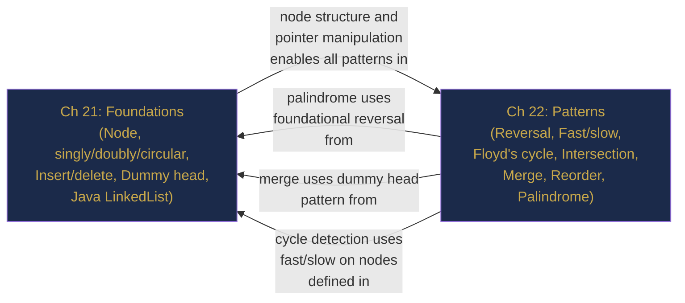

# Part VI Review — Linked Lists, Consolidated

> **End of Part VI: Linked Lists**  
> Chapters 21–22 · [← Chapter 22](chapter-22-linked-list-patterns.md) · [Index](../INDEX.md) · [→ Part VII](../INDEX.md#-part-vii--stacks-queues-and-deques)

---

> *"The purpose of abstracting is not to be vague, but to create a new semantic level in which one can be absolutely precise."*  
> — Edsger W. Dijkstra

Two chapters. One node. Infinite compositions. The linked list is the first pointer-based structure — the first time an algorithm's correctness depends entirely on maintaining a network of references rather than a contiguous layout. Get one `next` pointer wrong and the list is corrupted silently.

---

## Contents

- [The Story: The Packet Router](#the-story-the-packet-router)
- [The Two-Chapter Map](#the-two-chapter-map)
- [The Four Principles](#the-four-principles)
- [Cross-Chapter Challenges](#cross-chapter-challenges)
- [Part VI Lightning Quiz](#part-vi-lightning-quiz)
- [The Grand Integration Problem](#the-grand-integration-problem)
- [Looking Ahead: What Part VII Builds On](#looking-ahead-what-part-vii-builds-on)

---

## The Story: The Packet Router

*Technical fiction. Every technique invoked is from Chapters 21–22.*

---

Marcus was a network systems engineer at a cloud provider. His team maintained the **packet routing queues** for a datacenter interconnect — high-throughput, low-latency, real-time. At 2:00 p.m. on a Tuesday, a Jira ticket landed: a critical routing bug was corrupting packet order under a specific traffic pattern. He had to find it, fix it, and validate the fix before the 11:00 p.m. maintenance window.

**Ch 21 — Foundations:** The routing queue was implemented as a singly linked list of `Packet` nodes. Each packet had a `seq` (sequence number), a `payload`, and a `next` pointer. The queue used a **dummy head node** — Marcus had learned early in his career that eliminating the head-null special case saved hours of debugging. Packets arrived out of order (network reordering is normal) and were inserted in sorted sequence-number order: traverse to the predecessor, splice the new node in. O(n) to find the position, O(1) to splice. For this application, n was typically under 20 packets per flow — perfectly acceptable.

The bug was in the deletion path. A junior engineer had written `curr = curr.next` *before* `curr.next = curr.next.next` — advancing the pointer before redirecting it, leaving a dangling reference. The list was silently corrupted on every packet acknowledgement. Marcus spotted it in four minutes; fixing it took one line.

**Ch 22 — Patterns:** Validation was the harder part. To confirm the fix, Marcus needed to verify that the packet queue was palindrome-free under a specific "echo" traffic pattern where every request packet had a mirrored response (`seq 1, 2, 3, 3, 2, 1`). An echo-corrupted queue would read the same forwards and backwards — a palindrome. He applied the palindrome check: fast/slow pointers to find the middle, reverse the second half, compare. O(n) time, O(1) space — no extra memory allocation in the hot path of a network router.

For the merge of two reordered packet streams (a failover scenario that created two independent sequences), he used the merge-two-sorted-lists pattern with a dummy node: two pointers advancing through each stream, taking the lower sequence number each time. No new memory — just pointer relinking. 11 microseconds for a 400-packet merge.

For the final stress test, he checked for circular references: a runaway pointer bug in one routing table update had once created an infinite loop in a list. Floyd's algorithm: slow pointer advances one hop, fast pointer advances two. If they ever meet, the list is circular. If `fast` reaches null, the list is clean. 200,000 packets checked in one pass, O(n) time, O(1) space — the algorithm uses no extra memory no matter how large the routing table.

By 9:30 p.m. the fix was validated, the merge tested under failover conditions, and the circular-reference scanner added as a startup health check. The 11:00 p.m. window opened on a clean system.

---

## The Two-Chapter Map



---

## The Four Principles

| # | Principle | Chapter |
|---|-----------|---------|
| 1 | **Always use a dummy head for insert/delete algorithms.** It eliminates the head-null special case and makes all operations uniform. | 21 |
| 2 | **Check `fast != null && fast.next != null` before advancing fast two steps.** Skipping this check is the most common linked list runtime error. | 22 |
| 3 | **The reversal order is: save → redirect → advance prev → advance curr.** Any permutation corrupts the list. | 22 |
| 4 | **Floyd's algorithm is two-phase: detect, then locate.** Meeting inside the cycle tells you a cycle exists; resetting one pointer to head locates the cycle start. | 22 |

---

## Cross-Chapter Challenges

### CC-1 — Reversal + Dummy Head (Chapters 21 & 22)

**Problem:** Reverse a linked list in groups of 2. `1 → 2 → 3 → 4 → 5` → `2 → 1 → 4 → 3 → 5`.

<details><summary><strong>Solution</strong></summary>

> ```java
> ListNode swapPairs(ListNode head) {
>     ListNode dummy = new ListNode(-1, head);
>     ListNode prev = dummy;
>     while (prev.next != null && prev.next.next != null) {
>         ListNode first = prev.next, second = prev.next.next;
>         first.next = second.next;
>         second.next = first;
>         prev.next = second;
>         prev = first;
>     }
>     return dummy.next;
> }
> ```
>
> **Complexity:** O(n) time, O(1) space. Each iteration handles 2 nodes and advances `prev` to the new tail of the swapped pair.

</details>

---

### CC-2 — Fast/Slow + Reversal (Chapter 22)

**Problem:** Given `1 → 2 → 3 → 4 → 5`, return the second half reversed: `5 → 4 → 3`.

<details><summary><strong>Solution</strong></summary>

> ```java
> ListNode secondHalfReversed(ListNode head) {
>     ListNode slow = head, fast = head;
>     while (fast != null && fast.next != null) {
>         slow = slow.next; fast = fast.next.next;
>     }
>     // slow is at middle (node 3 for length 5)
>     return reverse(slow.next);  // reverse [4→5] to [5→4]
> }
> ```
>
> `slow.next` is the first node of the second half. Reverse it and return the new head. For `1→2→3→4→5`: slow = 3, `slow.next = 4`, reverse `4→5` = `5→4`. ✓

</details>

---

### CC-3 — Cycle Detection + HashMap Alternative (Chapters 21 & 22)

**Problem:** Detect if a linked list has a cycle using a `HashSet`, then compare it to Floyd's approach on space and time.

<details><summary><strong>Solution</strong></summary>

> **HashSet approach:**
> ```java
> boolean hasCycleSet(ListNode head) {
>     Set<ListNode> seen = new HashSet<>();
>     for (ListNode curr = head; curr != null; curr = curr.next) {
>         if (!seen.add(curr)) return true;  // seen before = cycle
>     }
>     return false;
> }
> ```
>
> **Comparison:**
>
> | | HashSet | Floyd's |
> |--|--------|---------|
> | Time | O(n) | O(n) |
> | Space | **O(n)** | **O(1)** |
> | Finds cycle start? | Yes (the duplicate node) | Yes (Phase 2) |
>
> Floyd's wins on space — especially important for routing tables and embedded systems where memory is constrained. The HashSet approach is simpler and finds the cycle start directly at the duplicate.

</details>

---

## Part VI Lightning Quiz

**LQ-1.** Why does the reversal loop use `ListNode next = curr.next` as the first step?

<details><summary><strong>Answer</strong></summary>

> Because the next line `curr.next = prev` would overwrite `curr.next`, losing the reference to the rest of the list. The save-next step preserves the ability to advance `curr` after redirection.

</details>

---

**LQ-2.** For list `1 → 2 → 3 → 4`, where does `findMiddle` (fast/slow) stop?

<details><summary><strong>Answer</strong></summary>

> `slow = 3` (the second of the two middles). After two iterations: (slow=1,fast=1) → (slow=2,fast=3) → (slow=3,fast=null — fast.next.next would be null). Loop stops at `slow = 3`.

</details>

---

**LQ-3.** What is the time complexity of Floyd's cycle detection, and what is the space complexity?

<details><summary><strong>Answer</strong></summary>

> Time: **O(n)** — slow enters the cycle after at most n steps; fast and slow meet within one additional cycle length. Space: **O(1)** — only two pointer variables.

</details>

---

**LQ-4.** Why is `java.util.LinkedList.get(i)` discouraged in loops?

<details><summary><strong>Answer</strong></summary>

> `get(i)` traverses the list from head (or tail) to index `i` — O(n). A loop calling `get(i)` for i = 0..n-1 runs in O(n²). Use an iterator (`for (E e : list)`) for O(1) per step, O(n) total.

</details>

---

## The Grand Integration Problem

**Problem: LRU Cache** ([LC 146](https://leetcode.com/problems/lru-cache/))

Design a cache with O(1) `get` and `put` that evicts the **Least Recently Used** entry when over capacity.

---

**Part A — Why Linked List? (Chapter 21)**

> State why a doubly linked list is necessary (not singly) and what role the dummy head and tail play.

<details><summary><strong>Answer A</strong></summary>

> **Doubly linked** because we need to remove an arbitrary interior node in O(1). Removal requires updating the predecessor's `next` and the successor's `prev` — only possible with a `prev` pointer. A singly linked list cannot do this without O(n) traversal.
>
> **Dummy head and tail** (`sentinel_head ↔ sentinel_tail`) eliminate all edge cases: the most-recently-used node is always after `head`; the least-recently-used is always before `tail`. Add and remove always operate between sentinels — no null checks needed.

</details>

---

**Part B — The Three-Structure Composition (Chapters 21 & 22)**

> The LRU cache uses: (1) a `HashMap`, (2) doubly linked list nodes. Describe how `get` uses both.

<details><summary><strong>Answer B</strong></summary>

> `get(key)`:
> 1. `HashMap<Integer, DListNode> map` → O(1) lookup of the node by key.
> 2. `removeNode(node)` → O(1) using `node.prev.next = node.next; node.next.prev = node.prev`.
> 3. `addToHead(node)` → O(1) insert after sentinel head: `node.next = head.next; head.next.prev = node; head.next = node; node.prev = head`.
>
> Both operations are O(1) because the doubly linked list allows arbitrary-node removal in O(1) and the HashMap avoids O(n) search.

</details>

---

**Part C — Full Complexity (Chapters 21 & 22)**

> State the complexity of `get`, `put`, and `evict`.

<details><summary><strong>Answer C</strong></summary>

> All three are **O(1)** time, O(capacity) space:
> - `get`: HashMap lookup O(1) + moveToHead O(1).
> - `put`: HashMap insert/update O(1) + addToHead O(1).
> - `evict` (triggered inside `put` when over capacity): removeTail O(1) + HashMap remove O(1).

</details>

---

## Looking Ahead: What Part VII Builds On

| Part VI Concept | How it appears in Part VII (Chapters 23–24) |
|-----------------|---------------------------------------------|
| **Linked list as stack** | Stacks can be implemented with a linked list (`push` = addFirst, `pop` = removeFirst) |
| **Linked list as queue** | Queues: `enqueue` = addLast (with tail pointer), `dequeue` = removeFirst |
| **Doubly linked + head/tail** | `ArrayDeque` (the go-to Java stack/queue) is conceptually a circular array; linked-list DLL is the alternative implementation |
| **Dummy nodes** | Sentinel pattern reappears in monotonic stack/queue implementations as boundary guards |

Part VII introduces **stacks** and **queues** — abstract data types defined by their access rules (LIFO and FIFO). The linked list from Part VI is one valid implementation; Java's `ArrayDeque` is the other (and faster one in practice).

---

> **Part VI — Complete**  
> [← Chapter 22](chapter-22-linked-list-patterns.md) · [← Index](../INDEX.md) · [→ Part VII](../INDEX.md#-part-vii--stacks-queues-and-deques)
