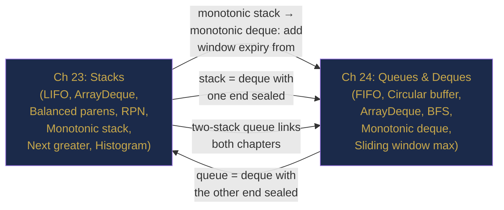

# Part VII Review — Stacks, Queues and Deques, Consolidated

> **End of Part VII: Stacks, Queues and Deques**  
> Chapters 23–24 · [← Chapter 24](chapter-24-queues-deques.md) · [Index](../INDEX.md) · [→ Part VIII](../INDEX.md#-part-viii--trees-and-hierarchical-structures)

---

> *"A good data structure is one that makes the right operations fast."*  
> — Jon Bentley

Two chapters. Two access disciplines. One underlying truth: **restricting how you access a collection is not a limitation — it is a guarantee.** LIFO makes reversal effortless. FIFO makes ordering-preservation trivial. The monotonic stack and monotonic deque show what happens when you add one more constraint — monotonicity — and unlock O(n) solutions to problems that otherwise require O(n²).

---

## Contents

- [The Story: The Expression Engine](#the-story-the-expression-engine)
- [The Two-Chapter Map](#the-two-chapter-map)
- [The Four Principles](#the-four-principles)
- [Cross-Chapter Challenges](#cross-chapter-challenges)
- [Part VII Lightning Quiz](#part-vii-lightning-quiz)
- [The Grand Integration Problem](#the-grand-integration-problem)
- [Looking Ahead: What Part VIII Builds On](#looking-ahead-what-part-viii-builds-on)

---

## The Story: The Expression Engine

*Technical fiction. Every technique invoked is from Chapters 23–24.*

---

Yui was the lead backend engineer for a fintech startup building a **formula evaluation engine** — think of it as a custom spreadsheet formula evaluator, processing millions of financial expressions per hour. The expressions came from bank clients in infix notation: `(revenue - cost) * (1 + taxRate) / 100`. They had to be parsed, validated, and evaluated in real time.

**Ch 23 — Stacks:** The first problem was **validation**. Every formula with parentheses had to be checked for balance before evaluation — a corrupted formula could silently produce wrong results on a client's portfolio. Yui implemented the balanced-parentheses checker using a stack: push `(`, pop and verify on `)`. O(n) per formula. A million formulas: 1 second.

Then came **evaluation**. The client expressions arrived in infix notation; the evaluator needed postfix (RPN) for the stack-based evaluator to work correctly. Yui implemented the **Shunting-Yard algorithm**: one stack for operators, one output list for operands and evaluated operators. Precedence of `*` and `/` over `+` and `-` was encoded in a small integer map. The result: an O(n) infix-to-postfix converter, then an O(n) RPN evaluator. No recursion, no tree construction.

The harder problem: **temperature-indexed interest rates**. Each formula referenced up to 50 benchmark rates, and the risk team needed, for each rate `i`, the index of the first day a higher rate was available (the "next greater element"). Brute force was O(n²) across 365 days × 50 rates = 18 million comparisons daily. Yui replaced it with a **monotonic decreasing stack**: O(n) per rate, O(50n) total — a 50× speedup. The stack popped each rate exactly once when a higher rate was encountered.

**Ch 24 — Queues and Deques:** The second system was a **real-time risk dashboard**. Every time a new price tick arrived, the system needed to report the maximum price over the last 60 seconds (the "60-second high"). With ticks arriving every millisecond, there were up to 60,000 prices in the window. The naïve solution — iterate the window on every tick — was O(60,000) per tick = O(60,000²) per minute. Unusable.

Yui replaced it with a **monotonic deque**: maintain indices of prices in decreasing order. When a tick arrives, pop all prices from the back that are ≤ the new price (they can never be the 60-second max while this price is in the window). Pop from the front any prices older than 60 seconds. Front of the deque = current 60-second maximum. **O(1) per tick** — 60,000× faster than the naïve approach.

For the BFS-based "market segment reachability" feature (which segments can be reached from segment A through price correlations within k hops), Yui used a standard BFS queue. The queue guaranteed that segments were processed in ascending hop distance — the first time a segment was dequeued, it was reached by the shortest path. No revisiting, no recalculating.

By launch day, the expression engine processed 4 million formulas per hour with sub-millisecond latency. Every `O(n²)` had been replaced by an `O(n)`.

---

## The Two-Chapter Map



---

## The Four Principles

| # | Principle | Chapter |
|---|-----------|---------|
| 1 | **Use `ArrayDeque`, never `java.util.Stack`.** `Stack` extends synchronized `Vector` — slow by design, misleading by inheritance. | 23 |
| 2 | **A monotonic stack answers all nearest-boundary queries in O(n).** Store indices. Each element is pushed once and popped once. | 23 |
| 3 | **A monotonic deque answers sliding-window min/max in O(1) per step.** Remove stale from front, remove useless from back before inserting. | 24 |
| 4 | **Stack is LIFO (reversal); queue is FIFO (preservation); deque is both.** The right ADT is chosen by the access pattern the problem requires, not by familiarity. | 23, 24 |

---

## Cross-Chapter Challenges

### CC-1 — Expression + Stack (Chapter 23)

**Problem:** Evaluate `"3 + 2 * 2"` (basic calculator, infix with no parentheses).

<details><summary><strong>Solution</strong></summary>

> Process tokens left to right. Use a stack to defer lower-priority operations:
>
> ```java
> int calculate(String s) {
>     Deque<Integer> stack = new ArrayDeque<>();
>     int num = 0, result = 0;
>     char sign = '+';
>     for (int i = 0; i < s.length(); i++) {
>         char c = s.charAt(i);
>         if (Character.isDigit(c)) num = num * 10 + (c - '0');
>         if ((!Character.isDigit(c) && c != ' ') || i == s.length() - 1) {
>             if      (sign == '+') stack.push(num);
>             else if (sign == '-') stack.push(-num);
>             else if (sign == '*') stack.push(stack.pop() * num);
>             else if (sign == '/') stack.push(stack.pop() / num);
>             sign = c;
>             num = 0;
>         }
>     }
>     int sum = 0;
>     while (!stack.isEmpty()) sum += stack.pop();
>     return sum;
> }
> ```
>
> `+` and `-` push to stack (deferred); `*` and `/` pop and apply immediately (higher precedence). Final sum collapses the stack. For `3 + 2 * 2`: push 3, push 2 (after `+`), `*` encountered: pop 2, push 2×2=4. Stack=[3,4]. Sum=7. ✓

</details>

---

### CC-2 — Monotonic Stack + Queue Connection (Chapters 23 & 24)

**Problem:** Find the minimum in every sliding window of size k. How do the monotonic stack and monotonic deque differ in approach?

<details><summary><strong>Solution</strong></summary>

> **Monotonic stack** cannot solve this — a stack only pops from one end. When the window slides, an element that was not the minimum for the previous window might become the minimum for the next window (if the previous minimum left the window). Without front removal, the stack cannot evict expired elements.
>
> **Monotonic deque** solves it: maintain indices in increasing order of values. Front = current minimum. Remove expired indices from front; remove larger values from back when a new element arrives.
>
> ```java
> int[] slidingWindowMin(int[] nums, int k) {
>     int n = nums.length;
>     int[] result = new int[n - k + 1];
>     Deque<Integer> dq = new ArrayDeque<>();
>     for (int i = 0; i < n; i++) {
>         while (!dq.isEmpty() && dq.peekFirst() <= i - k) dq.pollFirst();
>         while (!dq.isEmpty() && nums[dq.peekLast()] >= nums[i]) dq.pollLast();
>         dq.offerLast(i);
>         if (i >= k - 1) result[i - k + 1] = nums[dq.peekFirst()];
>     }
>     return result;
> }
> ```
>
> The key difference from the max version: use `>=` on the back removal (keep strictly smaller at back for min).

</details>

---

### CC-3 — Queue Design: BFS Level Order (Chapter 24)

**Problem:** Given a binary tree, return the values level by level as a list of lists. Each inner list contains the values at one level.

<details><summary><strong>Solution</strong></summary>

> Classic BFS level-order traversal. Use `queue.size()` to know how many nodes are at the current level before processing them.
>
> ```java
> List<List<Integer>> levelOrder(TreeNode root) {
>     List<List<Integer>> result = new ArrayList<>();
>     if (root == null) return result;
>     Queue<TreeNode> queue = new ArrayDeque<>();
>     queue.offer(root);
>     while (!queue.isEmpty()) {
>         int size = queue.size();             // freeze level size before processing
>         List<Integer> level = new ArrayList<>();
>         for (int i = 0; i < size; i++) {
>             TreeNode node = queue.poll();
>             level.add(node.val);
>             if (node.left  != null) queue.offer(node.left);
>             if (node.right != null) queue.offer(node.right);
>         }
>         result.add(level);
>     }
>     return result;
> }
> ```
>
> The `int size = queue.size()` snapshot before the inner loop is the standard pattern for processing exactly one level per outer iteration.

</details>

---

## Part VII Lightning Quiz

**LQ-1.** What does LIFO stand for, and what everyday object is a perfect analogy?

<details><summary><strong>Answer</strong></summary>

> **Last In, First Out.** A stack of plates: the last plate placed on top is the first one taken off.

</details>

---

**LQ-2.** How do you use `ArrayDeque` as a queue (not stack)?

<details><summary><strong>Answer</strong></summary>

> `queue.offer(e)` to enqueue at the back (`offerLast`), `queue.poll()` to dequeue from the front (`pollFirst`). The front is the oldest element; the back is the newest.

</details>

---

**LQ-3.** For `nextGreater([5, 4, 3, 2, 1])`, what does the monotonic stack return?

<details><summary><strong>Answer</strong></summary>

> `[-1, -1, -1, -1, -1]`. The array is strictly decreasing, so no element ever triggers a pop — the stack grows from bottom to top as `[0,1,2,3,4]` (indices). Every element has no next greater element.

</details>

---

**LQ-4.** Why is `offer`/`poll`/`peek` preferred over `add`/`remove`/`element` in algorithm code?

<details><summary><strong>Answer</strong></summary>

> `add`/`remove`/`element` throw exceptions when the queue is full or empty. `offer`/`poll`/`peek` return `false`/`null` instead — simpler to handle in conditional logic without try/catch.

</details>

---

**LQ-5.** What is the amortised complexity of `pop()` in the two-stack queue, and why?

<details><summary><strong>Answer</strong></summary>

> **O(1) amortised.** Each element is transferred from `inbox` to `outbox` at most once in its lifetime. Summing over n operations: n pushes to inbox + n transfers + n pops from outbox = 3n total operations → O(1) per operation.

</details>

---

## The Grand Integration Problem

**Problem: Maximal Rectangle** ([LC 85](https://leetcode.com/problems/maximal-rectangle/))

Given a 2D binary matrix filled with `'0'` and `'1'`, find the largest rectangle containing only `'1'`s.

---

**Part A — Reduce to Histogram (Chapter 23)**

> State how to transform each row of the matrix into a histogram heights array.

<details><summary><strong>Answer A</strong></summary>

> For each column `j`, compute the number of consecutive `'1'`s ending at the current row. If `matrix[i][j] == '1'`: `heights[j] += 1`. If `matrix[i][j] == '0'`: `heights[j] = 0`.
>
> This gives a histogram for each row where each bar's height is the number of consecutive `'1'`s above and including that cell. The maximum rectangle in the full matrix is the maximum rectangle in any of these row-histograms.

</details>

---

**Part B — Apply Histogram Algorithm (Chapter 23)**

> Run the Largest Rectangle in Histogram algorithm on each row's heights.

<details><summary><strong>Solution B</strong></summary>

> ```java
> int maximalRectangle(char[][] matrix) {
>     if (matrix.length == 0) return 0;
>     int m = matrix.length, n = matrix[0].length;
>     int[] heights = new int[n];
>     int maxArea = 0;
>     for (int i = 0; i < m; i++) {
>         for (int j = 0; j < n; j++) {
>             heights[j] = (matrix[i][j] == '1') ? heights[j] + 1 : 0;
>         }
>         maxArea = Math.max(maxArea, largestRectangleArea(heights));
>     }
>     return maxArea;
> }
> ```
>
> `largestRectangleArea` is from Chapter 23 (monotonic stack). **Complexity:** O(m × n) — one histogram pass per row, each O(n).

</details>

---

**Part C — Deque vs Stack (Chapters 23 & 24)**

> Could the sliding window deque from Chapter 24 help here? Or is the monotonic stack from Chapter 23 strictly necessary?

<details><summary><strong>Answer C</strong></summary>

> The **monotonic stack** (Ch 23) is the right tool. The histogram problem needs, for each bar, its **previous smaller** and **next smaller** element — this is a nearest-boundary query that the monotonic stack answers in a single scan. The monotonic deque (Ch 24) is designed for sliding-window min/max queries where the window has a fixed size and slides forward — it cannot directly answer the "nearest smaller on both sides" query needed by the histogram.

</details>

---

## Looking Ahead: What Part VIII Builds On

| Part VII Concept | How it appears in Part VIII (Chapters 25–29) |
|-----------------|----------------------------------------------|
| **Stack (DFS)** | Tree traversal with an explicit stack (iterative preorder, inorder, postorder) mirrors recursive DFS |
| **Queue (BFS)** | Level-order traversal of trees is BFS — the queue pattern from Ch 24 applies directly |
| **Monotonic stack** | Reused for tree problems: "next greater node in linked list", expression tree evaluation |
| **Deque** | Priority queue / heap (Ch 60 area) is conceptually an ordered queue — `PriorityQueue` in Java |
| **LIFO = recursion call stack** | Every recursive tree algorithm uses an implicit stack (the call stack). Iterative = explicit stack. |

Part VIII is trees — the first time the data structures themselves are recursive and hierarchical. The stack and queue from Part VII become the two traversal strategies: DFS uses the call stack (or explicit stack), BFS uses a queue.

---

> **Part VII — Complete**  
> [← Chapter 24](chapter-24-queues-deques.md) · [← Index](../INDEX.md) · [→ Part VIII](../INDEX.md#-part-viii--trees-and-hierarchical-structures)
