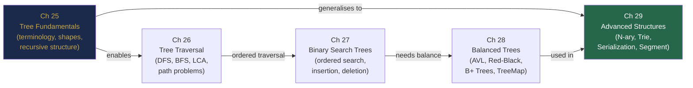

# Part VIII Review — Trees and Hierarchical Structures, Consolidated

> *"In every walk with nature one receives far more than one seeks."*  
> — John Muir  
>
> *Rephrase for algorithms: in every traversal of a tree, you encounter far more structure than you first suspected.*

---

## The Story: The Version Control System

**Act 1 — The Problem**

Priya joined a large software company fresh out of university. Her first task: optimise the internal monorepo's code search tool. The tool let engineers type a file path prefix and instantly see matching files. With 40 million files in the repository, every query took 800ms — slow enough that engineers had stopped using it.

She looked at the code. The search was doing a **linear scan** through a sorted array of all 40 million paths, checking `startsWith` for each. O(n) per query. No wonder it was slow.

"I know what to fix this," Priya said.

**Act 2 — The Structure**

The monorepo's file system was already a tree — directories containing directories containing files. She proposed building a **Trie** indexed on file paths split by `/`. Each node would represent one path segment. A query for `src/main/java/` would traverse three nodes and collect all descendants.

Her manager pushed back: "Won't a Trie use too much memory with 40 million paths?"

Priya ran the math. With an average path depth of 8 segments and 10 characters per segment, the Trie would use roughly 4GB uncompressed. Too much. She switched to a **compressed Trie** (Patricia tree) — merging chains with no branching into single nodes. Memory dropped to under 400MB.

**Act 3 — The Deeper Problem**

Three weeks after launch, a new request arrived: "Show only files modified in the last 24 hours." Now she needed not just structure but **ordered recency**.

She layered a **red-black tree** on top of the Trie, indexed by last-modified timestamp. For each prefix query, she retrieved the matching file set from the Trie (O(|prefix| + k)), then did a range query on the red-black tree to filter by recency (O(log n + k)).

Query time: **800ms → 2ms**. The search tool became the most used internal developer tool in the company.

---

## Five-Chapter Concept Map



---

## Five Principles of Part VIII

1. **Trees are recursive by nature** — solve at the current node and trust that the recursive calls on subtrees return correct results (Chapter 25).
2. **Traversal order is not arbitrary** — preorder for top-down work, postorder for bottom-up aggregation, BFS for level-based or nearest-first processing (Chapter 26).
3. **BST power comes from its invariant** — the global BST property (not just local parent-child) enables O(log n) search, but only holds if the tree stays balanced (Chapter 27).
4. **Self-balancing is the price of guarantees** — AVL/Red-Black trees pay O(log n) rotation cost per update to prevent O(n) degeneration; databases pay with B-Tree page splits to minimise disk I/O (Chapter 28).
5. **Tries and Segment Trees solve what BSTs cannot** — prefix queries in O(|word|) regardless of dictionary size; range queries with dynamic updates in O(log n) (Chapter 29).

---

## Three Cross-Chapter Challenges

### Challenge 1 — Tree Comparison

Given two roots of binary trees, determine if one tree is a **subtree** of the other. (Hint: serialise both with preorder + null markers — string containment check suffices.)

```java
boolean isSubtree(TreeNode root, TreeNode subRoot) {
    return serialize(root).contains(serialize(subRoot));
}
String serialize(TreeNode node) {
    if (node == null) return "#null";
    return "#" + node.val + serialize(node.left) + serialize(node.right);
}
```

**Chapters involved:** 25 (tree structure) + 26 (preorder traversal) + 29 (serialization).

---

### Challenge 2 — BST to Sorted Deque

Given a BST, produce a **double-ended queue** that allows O(1) access to both the minimum and the maximum, with O(log n) `removeMin` and `removeMax`.

```
Approach:
- Use iterative inorder for min access (leftmost), reverse-inorder for max access (rightmost).
- Java's TreeMap: firstKey() / lastKey() both O(log n). pollFirstEntry() / pollLastEntry() O(log n).
```

**Chapters involved:** 24 (Deque) + 27 (BST inorder) + 28 (TreeMap).

---

### Challenge 3 — Autocomplete with Frequencies

Extend the Trie to store word frequencies. For a given prefix, return the top-3 words by frequency.

```java
class TrieNodeWithFreq {
    TrieNodeWithFreq[] children = new TrieNodeWithFreq[26];
    PriorityQueue<String> topK = new PriorityQueue<>(3,
        (a, b) -> a.equals(b) ? 0 : a.compareTo(b));  // min-heap by freq
    boolean isEnd = false;
}
```

**Chapters involved:** 24 (Queue) + 29 (Trie) + 30 preview (PriorityQueue / heap).

---

## Part VIII Lightning Quiz

**6 questions — 3 minutes:**

1. What does inorder traversal of a BST produce?
2. A complete binary tree has 100 nodes. What is its height (using height = 0 for a single node)?
3. What is the balance factor in an AVL tree, and what values are allowed?
4. Name two differences between a B-Tree and a B+ Tree.
5. What is the time complexity of inserting a word of length $L$ into a Trie?
6. A segment tree built on $n = 8$ elements. How many nodes does the segment tree array need?

**Answers:**
1. A sorted (ascending) sequence of all values
2. $\lfloor \log_2 100 \rfloor = 6$
3. Balance factor = height(left) − height(right); allowed values: {−1, 0, 1}
4. B+ Tree stores all data at leaves / B-Tree stores data at any node; B+ Tree leaves are linked for range queries / B-Tree leaves are not linked
5. O($L$)
6. At most $4n = 32$ nodes (use a 32-element array)

---

## Grand Integration Problem: Git History Viewer

### Part 1 — The Data Model

A Git repository has commits, each with a message, timestamp, and a list of changed files. Model this as a tree (a DAG, but simplify to a singly linked tree for now).

```java
class Commit {
    String id;             // SHA hash
    String message;
    long timestamp;
    List<String> changedFiles;
    Commit parent;         // simplify: single parent only

    Commit(String id, String message, long timestamp, List<String> files, Commit parent) { ... }
}
```

**Task A:** Given a commit, write a method that returns all ancestor commits (from given commit back to root/initial commit) as a list, most recent first.

---

### Part 2 — Prefix Search on Changed Files

You need a feature: "Show all commits that changed any file starting with `src/auth/`".

**Task B:** Build a Trie indexed on file paths. Each node stores the set of commit IDs that changed a file passing through that node. For a query prefix, return all matching commit IDs in O(|prefix| + k).

```java
// Hint: on insert(filePath, commitId), at each TrieNode along the path, add commitId to a Set.
// On query(prefix), return the Set at the prefix endpoint.
```

---

### Part 3 — Recency Range Query

Add a feature: "Show all commits in time range [t1, t2]".

**Task C:** Use a `TreeMap<Long, List<Commit>>` keyed by timestamp. Use `subMap(t1, true, t2, true)` to retrieve all commits in the range in O(log n + k).

**Combined query:** Commits that changed files under `src/auth/` AND were made between timestamps 1000 and 2000.

```java
Set<String> byPath = trie.query("src/auth/");
TreeMap<Long, List<Commit>> byTime = ...;
byTime.subMap(1000L, true, 2000L, true)
      .values().stream()
      .flatMap(List::stream)
      .filter(c -> byPath.contains(c.id))
      .collect(Collectors.toList());
```

**Complexity:** O(|prefix| + log n + k) for combined query.

---

## Preview of Part IX

Part IX dives into **Heaps and Priority Queues** — Chapter 30 covers:
- The binary heap structure and its array representation (direct continuation of Ch 25's array representation)
- Min heap and max heap with insertion and extract operations
- Java's `PriorityQueue` and when to use it
- The Top-K pattern, K-way merge, and running median — three of the most common heap interview problems

The heap is the first data structure where you will truly appreciate Chapter 25's observation about complete binary trees and their array representation — the heap is *defined* by that property.

---

*← [Chapter 29 — Advanced Tree Structures](chapter-29-advanced-trees.md)*  
*→ [Chapter 30 — Heaps and Priority Queues](chapter-30-heaps.md)*
