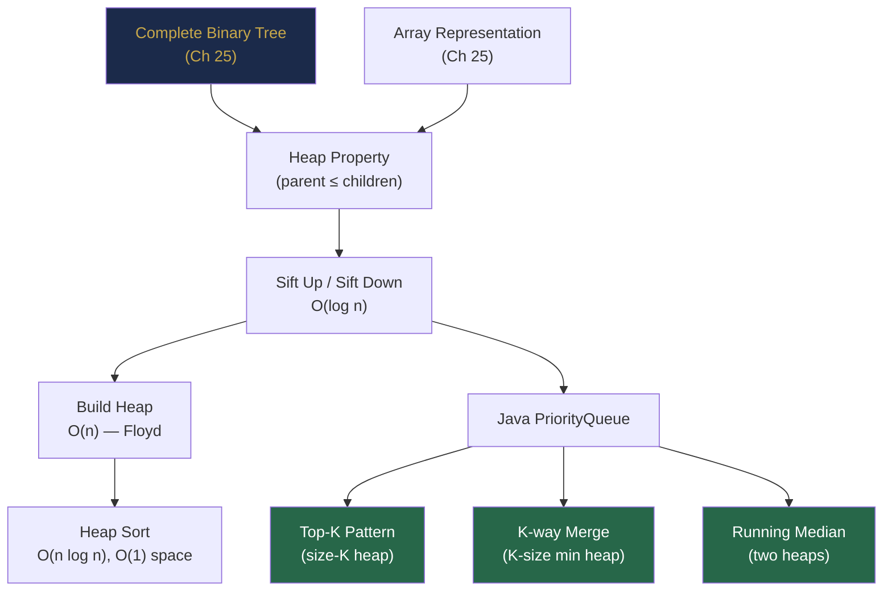

# Part IX Review — Heaps and Priority Queues, Consolidated

> *"A good algorithm is like a good detective — it goes straight to the most important clue and ignores the rest."*  
> — Anonymous
>
> *A heap is the embodiment of this principle: it ignores the relative ordering of everything except the single most important element.*

---

## The Story: The Hospital Dispatch System

**Act 1 — The Chaos**

Marcus was a software engineer at a regional healthcare organisation. Their emergency dispatch system was crashing under load. Ambulances were dispatched in the order calls came in — a simple FIFO queue. When a critical cardiac arrest was called in 30 seconds after a minor ankle sprain, the ankle sprain got the ambulance first because it called first.

Dispatchers were manually re-ordering requests on sticky notes. This took time. People were dying.

**Act 2 — The Priority Queue**

Marcus replaced the FIFO queue with a **priority queue backed by a min heap**, where priority = triage severity (1 = most critical). The heap always surfaced the most critical case in O(1); inserting a new call was O(log n); dispatching an ambulance was O(log n).

The system now handled 500 incoming calls per minute — peak weekend volume — with sub-millisecond dispatch latency. The manual sticky-note system was retired.

**Act 3 — The Running Statistics Problem**

A new legal requirement arrived: the system must report the **median ambulance response time** in real time, updated after every dispatch completion, for regulatory dashboards.

Marcus immediately recognised this: running median. He implemented a **two-heap solution** — a max heap for the lower half of response times, a min heap for the upper half. After each dispatch completion, he inserted the response time and computed the median in O(log n).

The dashboard updated in real time. The compliance report generated itself. Marcus went home early.

---

## Chapter 30 Concept Map



---

## Four Principles of Part IX

1. **A heap is a prioritised complete binary tree** — its power comes not from sorting everything, but from always knowing the single extreme (minimum or maximum) in O(1) (Chapter 30).
2. **Build is O(n), not O(n log n)** — Floyd's bottom-up heapify is a non-obvious but important result: the heap property is achievable in linear time because most nodes have small subtrees (Chapter 30, Section 30.4).
3. **The heap pattern is "stream + size constraint"** — whenever you need to maintain the K most/least extreme elements of a stream without sorting it, the heap delivers O(n log k) instead of O(n log n) (Chapter 30, Section 30.7).
4. **Two heaps solve boundary problems** — the running median is the canonical example, but the same two-heap decomposition applies to any problem that requires tracking the boundary between two halves of a dataset (Chapter 30, Section 30.9).

---

## Three Cross-Chapter Challenges

### Challenge 1 — Merge K BSTs

You have K BSTs. Merge all their values into a single balanced BST.

**Approach:**
1. Traverse each BST in inorder (Chapter 27) to extract sorted arrays.
2. K-way merge the sorted arrays using a min heap (Chapter 30, Section 30.8) → single sorted array.
3. Build a balanced BST from the sorted array (Chapter 27, sortedArrayToBST).

**Combined complexity:** O(N log K) for the merge + O(N) for BST build = O(N log K).

---

### Challenge 2 — Sliding Window Median

Given array `nums` and integer `k`, return the median of each window of size `k`.

**Approach:** Two heaps (max heap left, min heap right) with **lazy deletion**. When an element leaves the window, don't remove it immediately — mark it as deleted. When it reaches the top of a heap, skip it.

```java
// Key insight: use a HashMap to track "pending deletions"
Map<Integer, Integer> delayed = new HashMap<>();
// left = max heap, right = min heap
// After each step: balance sizes, skip deleted elements on peek
```

**Chapters involved:** Sliding window (Chapter 9) + heap with lazy deletion (Chapter 30).

---

### Challenge 3 — Task Priority with Cooldown

**Problem (LC 621):** Given tasks with cooldown `n` between identical tasks, find the minimum time to execute all.

**Approach:** Use a max heap by task frequency. After extracting the top task, put it in a cooldown queue. After n time units, re-insert it into the heap.

```java
// Max heap: always pick most frequent available task
// Queue of [count, available_at_time] for cooling tasks
PriorityQueue<Integer> maxHeap = new PriorityQueue<>(Comparator.reverseOrder());
Queue<int[]> cooldown = new ArrayDeque<>();  // [remaining_count, available_time]
```

**Chapters involved:** Queues (Chapter 24) + priority queues (Chapter 30).

---

## Part IX Lightning Quiz

**5 questions — 2 minutes:**

1. What is the time complexity of `PriorityQueue.peek()` in Java?
2. You need the K smallest elements from a stream of 10 million integers. Which heap type and what size?
3. After Floyd's build-heap on `[5, 3, 8, 1, 9, 2]`, what is the root of the resulting min heap?
4. For running median, if the left max heap has 4 elements and the right min heap has 4 elements, what is the median formula?
5. K-way merge of K sorted arrays of total N elements. Time and space complexity?

**Answers:**
1. O(1)
2. Max heap of size K — pop the max whenever size exceeds K, keeping the K smallest
3. 1 (after build-heap: `[1, 3, 2, 5, 9, 8]` or similar valid min heap)
4. `(left.peek() + right.peek()) / 2.0`
5. Time O(N log K); Space O(K) for the heap

---

## Grand Integration Problem: Real-Time Leaderboard

### Context

A competitive coding platform has millions of users. Users submit solutions, and each accepted solution updates their score. The platform needs three real-time features:

1. **Global top-10 leaderboard** — the 10 highest scores at any moment
2. **Rank of a specific user** — how many users have a higher score
3. **Median score** — the median score across all users, updated after every accepted submission

### Part 1 — Top-10 Leaderboard

**Data structure:** Min heap of size 10. When a user's score improves:
- If the new score > heap's minimum → pop min, insert new score. O(log 10) = O(1).
- Otherwise → new score doesn't reach top 10; ignore.

```java
PriorityQueue<long[]> top10 = new PriorityQueue<>(10, Comparator.comparingLong(a -> a[0]));
// a[0] = score, a[1] = userId

void updateScore(long userId, long newScore) {
    // Remove old entry for userId if present (O(10) = O(1))
    top10.removeIf(e -> e[1] == userId);
    top10.offer(new long[]{newScore, userId});
    if (top10.size() > 10) top10.poll();
}
```

---

### Part 2 — User Rank

**Data structure:** `TreeMap<Long, Integer>` where key = score, value = count of users with that score.

```java
TreeMap<Long, Integer> scoreMap = new TreeMap<>();

int rank(long userId) {
    long userScore = getUserScore(userId);
    // Count users with score > userScore
    return scoreMap.tailMap(userScore, false)
                   .values().stream().mapToInt(x -> x).sum() + 1;
}
```

**Complexity:** O(n) for counting users above — if too slow, use a Fenwick tree or Segment tree on score buckets.

---

### Part 3 — Running Median Score

**Data structure:** Two `PriorityQueue` heaps (left max heap, right min heap).

```java
MedianFinder medianFinder = new MedianFinder();

void acceptSubmission(long userId, long newScore) {
    long oldScore = getUserScore(userId);
    if (oldScore >= 0) removeFromMedianFinder(oldScore);  // remove old score
    medianFinder.addNum((int) newScore);                   // add new score
    setUserScore(userId, newScore);
}

double currentMedian() { return medianFinder.findMedian(); }
```

**Combined system complexity:**
- Score update: O(log 10 + log n) = O(log n)
- Rank query: O(log n) range sum
- Median query: O(1) after O(log n) insert

---

## Preview of Part X

Part X enters **Graph Theory and Algorithms** — the most powerful problem-solving framework in competitive programming and systems design.

**Coming up:**
- Graph representations: adjacency matrix, adjacency list (Chapter 31)
- BFS and DFS — now generalised beyond trees (Chapter 32)
- Shortest path: Dijkstra (uses a heap!), Bellman-Ford, Floyd-Warshall (Chapter 33)
- Minimum spanning trees: Prim and Kruskal + Disjoint Set Union (Chapter 34)
- Topological sorting and DAGs (Chapter 35)

The heap you learned in Chapter 30 reappears immediately in Chapter 33 — Dijkstra's algorithm is a BFS variant that uses a min heap instead of a queue to always process the nearest unvisited node first. The investment in Chapter 30 pays forward directly.

---

*← [Chapter 30 — Heaps and Priority Queues](chapter-30-heaps.md)*  
*→ [Chapter 31 — Graph Fundamentals and Representation](chapter-31-graph-fundamentals.md)*
