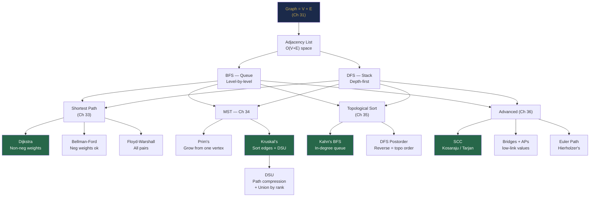

# Part 10 Review — Graph Theory and Algorithms

> *"The bridges of Königsberg could not all be crossed in a single walk. Euler's proof of this impossibility — in 1735 — accidentally founded the field of graph theory, which today powers every GPS, every social network, every package manager, and every internet router on the planet."*

---

## The Story: Building a Smart City

**Act 1 — The Map**

Priya was hired as the lead engineer at a startup building a smart-city routing app for a mid-sized Indian city. Week one, she had to represent the city digitally. 500 intersections. 1,200 road segments. Some one-way. Some with tolls.

She chose an **adjacency list** — 500 vertex entries, each holding a list of `[neighbour, weight]` pairs. The adjacency matrix would have wasted 500 × 500 = 250,000 cells for only 1,200 actual roads. Chapter 31 made this choice obvious.

**Act 2 — Are We Connected?**

The city's civil engineers asked: *"If the river floods and closes the bridge on NH-7, can emergency vehicles still reach the eastern district from the control centre?"*

Priya ran **DFS from the control centre vertex**, marked vertices visited, and checked whether the eastern district was reachable. 50 lines of code. The answer came in milliseconds. Chapter 32.

Her next task was harder: *"Which roads, if closed, would completely isolate some part of the city?"* She ran Tarjan's bridge-finding algorithm. It flagged 3 road segments as single points of failure. The civil engineers rerouted two of them. Chapter 36.

**Act 3 — Fastest Routes**

The app launched. Users asked: *"What's the fastest route to the airport?"* Priya ran **Dijkstra from the user's current intersection** with edge weights = estimated travel time (all non-negative). Correct. Fast. Chapter 33.

Then the finance team flagged an edge case: some toll roads paid the app a commission for routing users through them — effectively a **negative weight**. Dijkstra broke on those routes. Priya switched to **Bellman-Ford**, which correctly handled the negative-commission edges and also detected a suspicious negative cycle caused by a data-entry error. Chapter 33 again.

**Act 4 — The Minimum Infrastructure**

The city wanted to install 5G relay nodes at intersections and connect them all with fibre cables. Each cable segment had an installation cost. The question: *"Connect all relay nodes at minimum total cable cost."*

Priya ran **Kruskal's algorithm** on a graph of 500 relay nodes and 2,000 possible cable segments. Sorted the edges. Used a **DSU** to skip cables that connected already-connected relay groups. 20 minutes of coding for a problem that could save the city ₹40 crore. Chapter 34.

**Act 5 — The Construction Schedule**

The smart city project had 80 construction tasks. Some tasks had dependencies — Task B couldn't start until Tasks A and C finished. The project manager asked for a valid build order.

Priya modelled tasks as vertices and dependencies as directed edges. Ran **Kahn's topological sort**. The result: a valid order for all 80 tasks, and a bonus discovery — there was a dependency cycle between tasks 23 and 47. The project manager hadn't noticed it. Chapter 35.

**Act 6 — The Clusters**

The traffic analysis team asked: *"Which intersections form natural self-contained traffic clusters — groups where most traffic stays internal?"* This was a **Strongly Connected Components** problem. Priya ran **Kosaraju's algorithm** on the directed road network. The city fragmented naturally into 12 clusters matching the city's historical neighbourhoods almost exactly. The result was used to design autonomous traffic light timing zones. Chapter 36.

---

## Chapter Concept Map



---

## Six Principles of Part 10

1. **Every graph problem starts with the same two questions** — Is this directed or undirected? Is this weighted? The answers immediately narrow the algorithm choice to a small set. (Chapter 31)

2. **BFS guarantees shortest hops; DFS guarantees full exploration** — BFS explores outward in concentric rings (level-by-level), making it the only correct choice for unweighted shortest paths. DFS commits fully to one path before backtracking, making it natural for cycle detection, SCCs, and topological sort. (Chapter 32)

3. **Relaxation is the universal operation of shortest-path algorithms** — `if dist[u] + w < dist[v]: dist[v] = dist[u] + w`. Dijkstra applies it greedily (nearest vertex first). Bellman-Ford applies it exhaustively (all edges, V-1 times). Both are specialisations of the same idea. (Chapter 33)

4. **The Cut Property explains why greedy MST is correct** — the minimum-weight edge crossing any cut is always part of some MST. Both Prim's and Kruskal's are applications of this single principle. DSU makes Kruskal's efficient by answering "are these two nodes already connected?" in nearly O(1). (Chapter 34)

5. **Topological sort = process vertices in dependency order** — whenever a problem has "X must come before Y" constraints and no cycles, Kahn's algorithm gives a valid order and also detects cycles automatically (result smaller than V vertices). (Chapter 35)

6. **Low-link values unlock the advanced DFS problems** — `disc[v]` (when first visited) and `low[v]` (earliest discovery reachable from v's subtree) together identify SCCs, bridges, and articulation points. These are all variants of "how early can you get back without using a certain edge/vertex?" (Chapter 36)

---

## Three Cross-Chapter Challenges

### Challenge 1 — Dijkstra + Topological Sort: Critical Path Scheduling

**Problem:** You are given N tasks. Some tasks must complete before others can start (dependency edges). Each task has a duration. All independent tasks can run in parallel. Find the minimum time to complete all tasks.

**Why this is a graph problem:** Tasks = vertices. Dependencies = directed edges. This forms a DAG (if no circular dependencies). The minimum completion time = the **longest path** (critical path) in the DAG, computed with DP in topological order.

```java
int minCompletionTime(int n, int[][] deps, int[] duration) {
    List<List<Integer>> adj = new ArrayList<>();
    for (int i = 0; i < n; i++) adj.add(new ArrayList<>());
    int[] inDegree = new int[n];
    for (int[] d : deps) { adj.get(d[0]).add(d[1]); inDegree[d[1]]++; }

    // Kahn's topological sort (Ch 35) with longest-path DP
    int[] earliest = Arrays.copyOf(duration, n);  // earliest finish time
    Queue<Integer> q = new ArrayDeque<>();
    for (int i = 0; i < n; i++) if (inDegree[i] == 0) q.offer(i);

    while (!q.isEmpty()) {
        int u = q.poll();
        for (int v : adj.get(u)) {
            // Earliest start of v = max over all predecessors u of (earliest[u])
            earliest[v] = Math.max(earliest[v], earliest[u] + duration[v]);
            if (--inDegree[v] == 0) q.offer(v);
        }
    }
    return Arrays.stream(earliest).max().getAsInt();
}
```

**Chapters combined:** Kahn's topological sort (Ch 35) + longest-path DP in DAG (Ch 35) + cycle detection (Ch 35)

---

### Challenge 2 — BFS + DSU: Connecting Components with Minimum New Roads

**Problem:** A city has N districts and some existing roads. Some districts are disconnected. The city wants to build the fewest new roads to make all districts reachable from each other. What is the minimum number of new roads needed?

**Approach:**
1. Use DSU to find the number of connected components C (Ch 34).
2. Answer = C - 1 (you need exactly C-1 new edges to connect C components into one).

```java
int minNewRoads(int n, int[][] roads) {
    DSU dsu = new DSU(n);
    for (int[] road : roads) dsu.union(road[0], road[1]);

    // Count distinct roots = number of connected components
    Set<Integer> components = new HashSet<>();
    for (int i = 0; i < n; i++) components.add(dsu.find(i));

    return components.size() - 1;  // need C-1 edges to connect C components
}
```

**Extension:** If each new road has a cost (and you want minimum total cost), this is exactly Kruskal's MST applied to a graph where existing roads have weight 0 and new proposed roads have their construction cost. The MST gives the minimum total new construction cost.

**Chapters combined:** DSU connectivity (Ch 34) + MST/Kruskal's (Ch 34)

---

### Challenge 3 — SCC + Condensation: Minimum Edges to Make a DAG Strongly Connected

**Problem:** Given a directed graph, find the minimum number of edges to add so that every vertex can reach every other vertex (the graph becomes strongly connected).

**Key insight:** Find the SCCs and condense them. The condensation is a DAG. The answer is `max(nodes with in-degree 0, nodes with out-degree 0)` in the condensation DAG.

**Why?** In the condensation DAG, source nodes (in-degree 0) have no incoming edges from other SCCs — they need new edges pointing into them. Sink nodes (out-degree 0) have no outgoing edges to other SCCs — they need new edges going out. We can pair up sources and sinks: one new edge from a sink to a source both fixes one source and one sink simultaneously.

```java
int minEdgesForSCC(int V, List<List<Integer>> adj) {
    // Run Kosaraju's or Tarjan's to get SCC IDs for each vertex
    int[] sccId = kosaraju(V, adj);
    int numSCCs = Arrays.stream(sccId).max().getAsInt() + 1;

    if (numSCCs == 1) return 0;  // already strongly connected

    int[] inDeg = new int[numSCCs], outDeg = new int[numSCCs];
    for (int u = 0; u < V; u++) {
        for (int v : adj.get(u)) {
            if (sccId[u] != sccId[v]) {   // cross-SCC edge
                outDeg[sccId[u]]++;
                inDeg[sccId[v]]++;
            }
        }
    }

    int sourceSCCs = 0, sinkSCCs = 0;
    for (int i = 0; i < numSCCs; i++) {
        if (inDeg[i] == 0) sourceSCCs++;
        if (outDeg[i] == 0) sinkSCCs++;
    }
    return Math.max(sourceSCCs, sinkSCCs);
}
```

**Chapters combined:** Kosaraju's SCC (Ch 36) + condensation DAG (Ch 36) + directed graph reasoning (Ch 31)

---

## Part 10 Lightning Quiz

**6 questions — 3 minutes:**

1. You have V=1000 vertices and E=10 edges. Which representation costs less memory — adjacency matrix or adjacency list?
2. BFS finds shortest paths in unweighted graphs. Why can't BFS be used for weighted graphs?
3. After V-1 rounds of Bellman-Ford, one more round still improves a distance. What does this mean?
4. What data structure does Kruskal's algorithm use to check if adding an edge creates a cycle?
5. In Kahn's topological sort, `result.size() < V` after the algorithm finishes. What does this indicate?
6. An undirected graph has 6 vertices with degrees [2, 3, 2, 3, 2, 2]. Does an Euler circuit exist? An Euler path?

**Answers:**
1. **Adjacency list:** O(V + E) = O(1,010). Matrix: O(V²) = O(1,000,000). List is ~1,000× more memory-efficient here.
2. BFS counts **hops** (number of edges), not total weight. A 1-hop path of weight 100 appears "closer" to BFS than a 3-hop path of weights 1+1+1 = 3. Dijkstra uses a priority queue ordered by total weight to fix this.
3. A **negative-weight cycle** is reachable from the source. Any path through that cycle can be made arbitrarily short by looping, so no finite shortest path exists.
4. **DSU (Disjoint Set Union / Union-Find):** `find(u) == find(v)` → same component → adding edge creates a cycle. `find(u) != find(v)` → safe to add, then `union(u, v)`.
5. A **directed cycle** exists. The vertices involved never reached in-degree 0 during the algorithm — each depends on the next in a circular chain.
6. Vertices with degree 3 (odd): vertices 1 and 3. **Euler circuit: NO** (requires all even degrees). **Euler path: YES** (exactly 2 odd-degree vertices — start at one, end at the other).

---

## Grand Integration Problem: City Emergency Response System

### Context

A metropolitan city is building a digital emergency response system. 300 intersections (vertices), 850 road segments (edges). Some roads are one-way (directed). Road weights represent travel time in minutes.

The system must handle five real requirements simultaneously.

---

### Part 1 — Reachability: Which Areas Can Each Station Cover? (Ch 32)

```java
// For each fire station, find all intersections reachable within 10 minutes
Map<Integer, Set<Integer>> coverageZones = new HashMap<>();
for (int station : fireStations) {
    int[] dist = bfsDistances(adj, station, V);
    Set<Integer> zone = new HashSet<>();
    for (int i = 0; i < V; i++)
        if (dist[i] != -1 && dist[i] <= 10) zone.add(i);
    coverageZones.put(station, zone);
}
// Intersections covered by zero stations → flag for new station placement
```

**Algorithm:** BFS from each fire station (Ch 32). Coverage = all vertices at BFS distance ≤ 10.

---

### Part 2 — Optimal Dispatch: Fastest Route to Emergency (Ch 33)

```java
// Pre-compute shortest paths from all k fire stations
int[][] stationDist = new int[fireStations.size()][V];
for (int i = 0; i < fireStations.size(); i++)
    stationDist[i] = dijkstra(adjWeighted, fireStations.get(i), V);

// On emergency at vertex e: dispatch fastest-responding station
int dispatchStation(int emergencyVertex) {
    return IntStream.range(0, fireStations.size())
        .boxed()
        .min(Comparator.comparingInt(i -> stationDist[i][emergencyVertex]))
        .orElse(-1);
}
```

**Algorithm:** Dijkstra × stations (Ch 33). Dispatch = O(stations) table lookup.

---

### Part 3 — Vulnerability: Which Roads Are Critical? (Ch 36)

```java
// Find all bridges in the undirected road network
findBridgesAndAPs(V, undirectedAdj);

System.out.println("CRITICAL ROADS (single points of failure): " + bridges.size());
for (int[] bridge : bridges)
    System.out.printf("  Road %d ↔ %d must be duplicated or reinforced%n",
                       bridge[0], bridge[1]);
```

**Algorithm:** Bridge-finding DFS with low-link values (Ch 36). Each bridge flagged for infrastructure upgrade.

---

### Part 4 — Infrastructure: Minimum Cost to Connect All Relay Nodes (Ch 34)

```java
// 500 relay nodes, 2000 possible fibre cable routes with costs
int mstCost = kruskalMST(500, cableOptions);
System.out.printf("Minimum fibre installation cost: ₹%,d%n", mstCost);
```

**Algorithm:** Kruskal's MST + DSU (Ch 34). Guarantees minimum total cable cost.

---

### Part 5 — Scheduling: Valid Construction Order (Ch 35)

```java
// 80 upgrade tasks with dependencies
int[] schedule = findOrder(80, taskDependencies);
if (schedule.length == 0) {
    System.out.println("ERROR: Circular dependency in construction plan!");
} else {
    System.out.println("Valid schedule: " + Arrays.toString(schedule));
}
```

**Algorithm:** Kahn's topological sort (Ch 35). Cycle detection as a free byproduct.

---

### Combined System Summary

| Feature | Algorithm | Time Complexity | Triggered |
|---------|-----------|-----------------|-----------|
| Reachability per station | BFS | O(V+E) per station | On startup |
| Emergency dispatch | Dijkstra × stations | O(k(V+E)logV) | On startup |
| Live dispatch query | Table lookup | O(stations) | Per emergency |
| Vulnerability analysis | Bridge-finding DFS | O(V+E) | Nightly |
| Infrastructure planning | Kruskal's + DSU | O(E log E) | Per proposal |
| Construction scheduling | Kahn's topological sort | O(V+E) | Per plan update |

The entire smart-city backend is a composition of graph algorithms — one per chapter. Each chapter in Part 10 contributes exactly one real, necessary component.

---

## Preview of Part 11

Part 11 enters **Greedy Algorithms and Divide and Conquer** — two algorithm *design paradigms* that explain **why** many algorithms work, rather than just how they work.

**Coming up:**
- **Greedy algorithms (Chapter 37):** Make the locally optimal choice at each step and prove it leads to a globally optimal solution. The correctness tool: the **exchange argument**. Applications: interval scheduling, Huffman coding, fractional knapsack, job sequencing.
- **Divide and Conquer (Chapter 38):** Break the problem into smaller subproblems, solve recursively, combine. Applications: merge sort, quick sort, closest pair of points. Analysis tool: the **Master Theorem**.

**Connection to Part 10:** Dijkstra is a greedy algorithm — the proof that "always process the nearest unvisited vertex" leads to the global optimum uses the same exchange argument structure you will see in Chapter 37. Kruskal's MST is also greedy (Cut Property = greedy correctness). Understanding Chapter 37 will deepen your understanding of *why* Dijkstra and Kruskal work, not just how.

---

*← [Chapter 36 — Advanced Graph Algorithms](chapter-36-advanced-graphs.md)*  
*→ Part 11 — Greedy Algorithms and Divide and Conquer*
