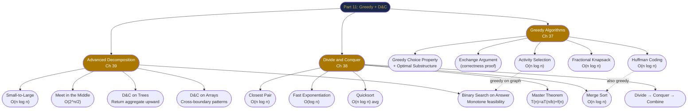

# Part 11 Review — Greedy Algorithms and Divide and Conquer

---

## The Story: Rebuilding a City After a Disaster

A powerful earthquake has struck **Algorithmia**, a city of 1,000,000 residents. You are the chief engineer in the emergency response team. The city must be rebuilt under three crushing constraints: **limited resources**, **tight deadlines**, and **too many decisions to try exhaustively**. The only tools in your toolkit are clever thinking and the two algorithmic paradigms you've mastered in this part.

---

### Act I — Clearing the Roads (Greedy: Interval Scheduling)

The highway authority reports 47 road segments needing repair crews. Each segment has an **estimated completion window** (start and end date). You have one repair crew. You want to maximise the number of segments repaired before the winter storms arrive.

> *Insight: Sort by completion date. Always assign the crew to the segment that finishes soonest — it frees the crew as early as possible for the next segment.*

You apply **activity selection** (Chapter 37). Sorting 47 intervals by finish time and scanning once, you schedule 18 segments in one morning's planning session. No other strategy fits more than 18.

---

### Act II — Rebuilding Bridges (Greedy: Fractional Allocation)

The city has $B$ tonnes of steel that must be distributed among the damaged bridges to maximise total structural value restored. Each bridge has a weight capacity (how much steel it needs) and a restoration value.

> *Insight: Bridges can receive partial steel allocations. Sort by value-per-tonne. Fill greedily.*

**Fractional knapsack** (Chapter 37) solves this in O(n log n). You allocate the full steel budget optimally before the warehouse closes for the day.

---

### Act III — Prioritising Communications (Greedy: Huffman)

The emergency broadcast system sends status codes over damaged radio channels with limited bandwidth. Character frequencies: STATUS(0.45), ALERT(0.16), ZONE(0.13), SAFE(0.12), EVAC(0.09), MEDIC(0.05).

> *Insight: Shorter codes for frequent symbols. Build a prefix-free tree by always merging the two least-frequent nodes.*

**Huffman coding** (Chapter 37) reduces average transmission length from 3 bits (fixed) to 2.24 bits — a 25% bandwidth savings. The emergency network stays operational.

---

### Act IV — Sorting the Debris (Divide and Conquer: Merge Sort)

A database of 500,000 debris removal requests arrives, sorted by neither priority nor zone. The scheduling system needs them sorted by deadline.

> *Insight: Merge sort — split in half, sort each half, merge. The recursion tree has log n levels, each doing O(n) merge work.*

**Merge sort** (Chapter 38) handles 500,000 records in O(n log n). You also count inversions during the merge to identify which zones have the most scheduling conflicts — a free O(n log n) bonus.

---

### Act V — Finding the Most Critical Facility (D&C: Binary Search on Answer)

Engineers must deploy a mobile hospital that can reach all 12 emergency zones within a time limit. You want to find the **minimum speed** the hospital convoy must travel such that all zones are reachable within T hours.

> *Insight: Speed is the answer parameter. "Can all zones be reached at speed k?" is a monotone function — if yes for k, yes for k+1. Binary search on k.*

**Binary search on the answer** (Chapter 39) checks feasibility O(zones) per iteration, with O(log(maxSpeed)) iterations — finding the answer in milliseconds.

---

### Act VI — Allocating Relief Teams (D&C: Split Array)

6 relief teams must be assigned to 48 work zones (each team handles a contiguous block of zones). You want to minimise the busiest team's workload (the maximum total work across teams).

> *Insight: "Minimise the maximum workload" → binary search on the answer (maximum allowed load). Feasibility: "can we split 48 zones into 6 blocks each ≤ mid load?" → greedy scan in O(n).*

**Split Array Largest Sum** (Chapter 39, LC 410). The city is rebuilt with fairness — no team is overwhelmed.

---

## Part 11 Concept Map



---

## Six Principles of Part 11

1. **Greedy = locally optimal → globally optimal (with proof).** The algorithm is simple; the correctness argument is the work. Always have an exchange argument ready.
2. **Master Theorem is your complexity shortcut.** Identify a, b, f(n), compare to n^(log_b a) → answer in 30 seconds.
3. **D&C splits the problem; the combine step holds the intelligence.** Invest your design effort there.
4. **Binary search on the answer converts optimisation into search.** "Minimise the maximum" and "maximise the minimum" almost always have this structure.
5. **Meet in the middle converts O(2^n) to O(2^(n/2)).** When n ≤ 40 and brute force is impossible, split in half.
6. **Small-to-large turns O(n²) merging into O(n log n).** Always merge the smaller structure into the larger.

---

## Cross-Chapter Challenges

### Challenge 1 — Greedy Proof by Exchange Argument (Ch 37)

You are given the following greedy claim:

> *To minimise the total weighted completion time of $n$ jobs, process them in increasing order of $w_i / p_i$ (weight-per-unit-time ratio, highest first).*

Write a complete exchange argument to prove this. Specifically:
1. Define "total weighted completion time."
2. Assume an optimal schedule $OPT$ that processes job $i$ before job $j$ where $w_i/p_i < w_j/p_j$.
3. Show swapping $i$ and $j$ strictly improves the objective.
4. Conclude.

<details>
<summary>Hint</summary>

If job $j$ has a higher weight-per-time ratio than job $i$, it's more "urgent." Doing $j$ before $i$ means $j$ completes earlier (at time $C_j$) and $i$ completes later (at $C_i$). The weighted completion time changes by $w_j \cdot p_i - w_i \cdot p_j$. If $w_j/p_j > w_i/p_i$, then $w_j \cdot p_i > w_i \cdot p_j$, so the swap improves the objective. By repeatedly swapping, we converge to the greedy order.

</details>

---

### Challenge 2 — Master Theorem Gauntlet (Ch 38)

Solve all five recurrences. For each, identify a, b, f(n), the critical exponent, which case applies, and the final complexity.

```
(a) T(n) = 4T(n/2) + n
(b) T(n) = 4T(n/2) + n²
(c) T(n) = 4T(n/2) + n³
(d) T(n) = 2T(n/3) + 1
(e) T(n) = 3T(n/3) + n log n
```

<details>
<summary>Answers</summary>

(a) a=4, b=2, log₂4=2, f(n)=n=O(n^(2-1)) → **Case 1** → T(n)=Θ(n²)  
(b) a=4, b=2, log₂4=2, f(n)=n²=Θ(n²) → **Case 2** (k=0) → T(n)=Θ(n² log n)  
(c) a=4, b=2, log₂4=2, f(n)=n³=Ω(n^(2+1)) → **Case 3** → T(n)=Θ(n³)  
(d) a=2, b=3, log₃2≈0.63, f(n)=1=O(n^(0.63-ε)) → **Case 1** → T(n)=Θ(n^log₃2)=Θ(n^0.63)  
(e) a=3, b=3, log₃3=1, f(n)=n log n=Θ(n¹ log¹ n) → **Case 2** (k=1) → T(n)=Θ(n log² n)

</details>

---

### Challenge 3 — Binary Search on Answer + Greedy Feasibility (Ch 37 + Ch 39)

**Problem:** You have a conveyor belt of $n$ packages with weights $w[0..n-1]$. You must ship all packages in $D$ days. The ship can carry at most $W$ kg per day. Packages must be shipped in order (you can't rearrange them). Find the minimum $W$ needed.

1. What is the answer range $[lo, hi]$?
2. What is the feasibility function?
3. Why is it monotone?
4. Write the binary search and feasibility check in Java.
5. What is the total time complexity?

<details>
<summary>Answer</summary>

1. **lo = max(weights)** (must carry each package); **hi = sum(weights)** (ship everything in one day)
2. `feasible(W)`: greedily load packages into days. If current day + next package > W, start a new day. Return (days used ≤ D).
3. If capacity W works (fits in D days), capacity W+1 also works (each day can hold at least as much).
4. 
```java
int shipWithinDays(int[] weights, int days) {
    int lo = Arrays.stream(weights).max().getAsInt();
    int hi = Arrays.stream(weights).sum();
    while (lo < hi) {
        int mid = lo + (hi - lo) / 2;
        if (canShip(weights, days, mid)) hi = mid;
        else lo = mid + 1;
    }
    return lo;
}
boolean canShip(int[] weights, int days, int cap) {
    int d = 1, cur = 0;
    for (int w : weights) {
        if (cur + w > cap) { d++; cur = 0; }
        cur += w;
    }
    return d <= days;
}
```
5. O(n · log(sum(weights))) — binary search over sum range, O(n) feasibility each time.

This is [LeetCode 1011 — Capacity to Ship Packages](https://leetcode.com/problems/capacity-to-ship-packages-within-d-days/).

</details>

---

### Challenge 4 — Meet in the Middle on Subset Sum (Ch 39)

You are given 36 integers $a_1, \ldots, a_{36}$, each in range $[-10^9, 10^9]$. Determine whether any subset sums exactly to a target $T$.

1. Why is brute force O(2^36) too slow (quantify)?
2. How does meet in the middle achieve O(2^18 × 18)?
3. What data structure do you need for the combination step, and why?
4. Extend the algorithm: instead of "exists?", count the number of subsets that sum to T.

<details>
<summary>Answer</summary>

1. 2^36 ≈ 68 billion operations — at ~10^9 operations/second, that's ~68 seconds. Too slow for a 1–2 second time limit.
2. Split into two halves of 18. Each has 2^18 = 262,144 subsets. Enumerate all subset sums for each half. Then for each sum s in the right half, binary search the left half for (T - s). Total: O(2^18 × 18) ≈ 4.7M operations.
3. A **sorted list** of left subset sums (for binary search), or a **hash set** (for O(1) lookup). Hash set is simpler; sorted list enables counting duplicates with `Collections.frequency` or `upper_bound - lower_bound`.
4. Count: use a **sorted list** of left sums. For each right sum s, count how many left sums equal (T - s) using binary search to find the range `[lower_bound(T-s), upper_bound(T-s))` and add the count.

</details>

---

## Lightning Quiz

<details>
<summary>Q1: Can greedy be used for 0/1 knapsack? Why or why not?</summary>

**Answer:** No. The 0/1 knapsack doesn't have the greedy choice property — taking the highest-density item might leave capacity that is better filled by a combination of lighter items. The exchange argument fails because you can't partially "undo" a selection. Dynamic programming is required: O(n × W).

</details>

<details>
<summary>Q2: Merge sort is stable. Quicksort is not. What does this mean, and when does it matter?</summary>

**Answer:** Stable means equal elements maintain their original relative order after sorting. This matters when sorting by multiple keys (e.g., sort employees by salary; ties broken by original hire order). Java's `Arrays.sort(Object[])` uses TimSort (stable) for this reason; `Arrays.sort(int[])` uses dual-pivot quicksort (unstable, but primitives don't have identity, so stability is irrelevant).

</details>

<details>
<summary>Q3: What is the Master Theorem result for T(n) = 2T(n/2) + n log n?</summary>

**Answer:** a=2, b=2, log₂2=1, f(n) = n log n = Θ(n¹ log¹ n). This is Case 2 with k=1: T(n) = Θ(n log² n). The extra log factor comes from Case 2: T(n) = Θ(n^(log_b a) × log^(k+1) n) = Θ(n × log² n).

</details>

<details>
<summary>Q4: Why does Huffman coding produce optimal prefix-free codes, while other greedy orderings (e.g., sort by frequency descending and assign 0, 10, 110, ...) might not?</summary>

**Answer:** Huffman's tree-building approach explores all valid tree structures, whereas the sequential code-assignment approach only considers one fixed structure. The optimality proof shows that any tree where the two least-frequent symbols are not siblings (at the deepest level) can be improved by moving them to the deepest position — which is exactly what Huffman's merging achieves.

</details>

<details>
<summary>Q5: Binary search on the answer requires O(log range) iterations. For "Koko Eating Bananas" with max pile = 10^9, how many iterations does binary search perform?</summary>

**Answer:** log₂(10^9) ≈ 30. So at most 30 iterations × O(n) feasibility check = O(30n) ≈ O(n log(max_pile)). For n = 10^4 piles and max = 10^9: 30 × 10^4 = 300,000 operations — extremely fast.

</details>

<details>
<summary>Q6: In the tree D&C pattern for maximum path sum, why do we need a separate global variable rather than just returning the answer from the recursion?</summary>

**Answer:** The function `maxGain(node)` must return the best gain going DOWN from the node (one direction) so the parent can extend it. But the best path THROUGH the node (using both left and right children) cannot be extended further upward — it's a "bent" path. These are two different values: one is returned up the recursion; the other updates the global answer. Using just the return value would miss paths that bend at some node below the root.

</details>

---

## Grand Integration Problem: Disaster Response Optimisation

**Setup:** A city has $n = 100$ zones, connected by roads with varying repair costs. You have:
- A list of $m = 200$ road repair tasks, each with a time window and an urgency score
- A fixed budget of $B$ tonnes of emergency materials (can be fractionally allocated)
- A central depot; relief convoy must visit all zones within $T$ hours
- A message queue with character frequencies to compress for radio transmission

**Your task (5 parts):**

**Part A — Road Repair Scheduling (Ch 37, Activity Selection)**  
From 200 repair tasks with time windows, select the maximum number that can be done by one crew without overlap.

What is the time complexity? What additional sorting step converts this to "maximum weighted selection" where each task has a priority score?

<details>
<summary>Answer A</summary>

Sort by finish time. Greedy scan: O(n log n). For weighted version: activity selection with weights requires dynamic programming (weighted job scheduling), not greedy — the greedy exchange argument breaks when weights differ. DP with binary search on finish times: O(n log n).

</details>

**Part B — Material Allocation (Ch 37, Fractional Knapsack)**  
Allocate B tonnes of materials to maximize total urgency-weighted restoration. Zone i needs w[i] tonnes for full restoration, gaining v[i] urgency-value. You can partially restore zones.

Write the algorithm and state the complexity.

<details>
<summary>Answer B</summary>

Sort zones by v[i]/w[i] descending. Greedily fill each zone; take a fraction of the last zone that fits. O(n log n). The fractional assumption makes greedy correct — the exchange argument holds because any partial unit of the highest-density zone is always the best use of that capacity.

</details>

**Part C — Convoy Speed (Ch 39, Binary Search on Answer)**  
The convoy must visit all n zones with travel times t[1..n] (each takes t[i]/speed hours). Find the minimum speed such that total travel time ≤ T.

What is the feasibility function? What does the binary search range look like for speed values in [1, 10^7]?

<details>
<summary>Answer C</summary>

feasible(speed): `ceil(t[i] / speed)` summed over all zones ≤ T. Binary search on speed: lo=1, hi=10^7. log₂(10^7) ≈ 23 iterations × O(n) feasibility = O(n × 23). This is essentially LC 1870 (Minimum Speed to Arrive on Time).

</details>

**Part D — Sorting Requests (Ch 38, Merge Sort + Inversion Count)**  
500,000 zone-priority requests arrive pre-sorted by one official's judgement. Count how many "swaps" are needed to transform their order into the standard urgency order (this is the inversion count — how far the two orderings disagree).

Describe the merge-sort-based inversion counting algorithm and its complexity.

<details>
<summary>Answer D</summary>

During merge sort, whenever we pick an element from the right half over an element from the left half, all remaining left elements form inversions with this right element. Add (mid - i + 1) to the inversion count at that step. Total: O(n log n) — the same as merge sort.

</details>

**Part E — Radio Compression (Ch 37, Huffman)**  
6 message types with frequencies [45%, 16%, 13%, 12%, 9%, 5%]. Build the Huffman tree and assign codes. What is the average code length? By how much (%) does it reduce the number of bits compared to fixed-length 3-bit codes?

<details>
<summary>Answer E</summary>

Build Huffman tree by repeated merge of two least-frequent nodes:
- Merge 5+9=14, then 12+13=25, then 14+16=30, then 25+30=55, then 45+55=100
- Codes: 45%→1bit, 16%→3bits, 13%→3bits, 12%→3bits, 9%→4bits, 5%→4bits  
- Average length = 0.45×1 + 0.16×3 + 0.13×3 + 0.12×3 + 0.09×4 + 0.05×4
  = 0.45 + 0.48 + 0.39 + 0.36 + 0.36 + 0.20 = **2.24 bits**
- Fixed length: 3 bits  
- Reduction: (3 - 2.24) / 3 × 100% ≈ **25.3% compression**

</details>

---

## Part 12 Preview

The next part ventures into **Dynamic Programming** — the paradigm that handles the cases where greedy fails.

Where greedy makes one irreversible choice and moves on, DP **stores solutions to all sub-problems** and builds the global optimum by combining them. The 0/1 knapsack (which failed greedy in Chapter 37) becomes elegantly solvable. Longest common subsequence, edit distance, coin change, and interval DP all await.

The bridge from Part 11 to Part 12: **optimal substructure** is shared by both greedy and DP. The critical difference is **whether the greedy choice property holds**. When it doesn't — when you need to try multiple choices and keep the best — DP is the tool.

> **A thought to carry forward:** Every greedy algorithm is a DP where only one sub-problem survives after each decision. When more than one survives, DP solves them all and picks the best. Understanding this relationship transforms two separate techniques into one unified framework for optimisation.

---

*End of Part 11 — Greedy Algorithms and Divide and Conquer*
